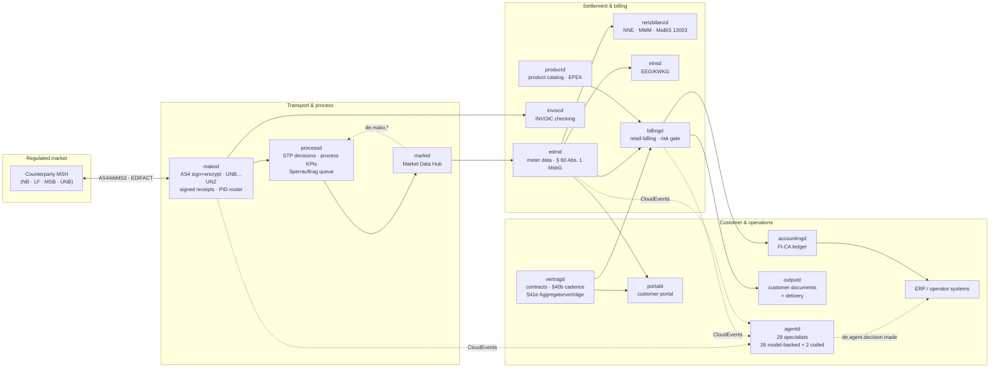

# mako ⚡

[](https://github.com/hupe1980/mako/actions/workflows/ci.yml)
[](./LICENSE-MIT)
[](https://www.rust-lang.org/)
[](https://www.edi-energy.de/)
[](https://github.com/hupe1980/mako/pkgs/container/mako-makod)

> **⚠️ Experimental** — pre-1.0. APIs change between releases. Do not run it in
> production without thorough in-house testing against your own counterparties.

**mako is an open-source market-operations platform for the German energy
market, in Rust.** It takes BDEW Marktkommunikation (MaKo) from raw EDIFACT and
AS4 bytes to event-sourced workflows that answer inside their Frist, and carries
metering, grid and EEG settlement, retail billing and the ledger on the same
events — for the NB, LF, MSB and ESA roles. The BDEW formats are read from the
published MIG and AHB documents as data, so a format release is an import run,
not a rewrite.

| Layer | What it is |
|---|---|
| **Protocol** | `edi-energy` EDIFACT · `dvgw-edi` DVGW gas · `redispatch-xml` Redispatch 2.0 · `mako-engine` event-sourced process runtime · `makod` daemon — 71 workflows over 469 Prüfidentifikatoren |
| **Market data** | `mako-markt` library · `marktd` hub (PostgreSQL, durable CloudEvents fan-out, OIDC/JWT) |
| **Settlement & billing** | `grid-billing` + `netzbilanzd` · `eeg-billing` + `einsd` · `energy-billing` + `billingd` |
| **Customer management** | `accountingd` ledger · `portald` portal · `outputd` documents · `vertragd` contracts · `productd` catalogue |
| **Agent surface** | 11 of the 14 services expose an MCP server — **160 tools** — and `agentd` is the governed consumer: 28 specialists (26 read-only model-backed plus 2 coded) on [agentplane](https://github.com/hupe1980/agentplane), with journaled effects and durable human triage |
| **Testing** | `makotest` — Python toolkit over the same Rust core: check digits, the answer Fristen, Entscheidungsbaum codes, AHB-validated EDIFACT, answering counterparties, a `pytest` plugin ([README](makotest/README.md)) |

## Quick start

From a fresh clone (Rust via `rustup`, [`just`](https://github.com/casey/just),
Docker for PostgreSQL), run one service:

```bash
git clone https://github.com/hupe1980/mako.git && cd mako
just dev marktd                    # PostgreSQL from dev/docker-compose.yml, then marktd
curl -s localhost:8180/health/ready
```

Every service has a `dev/config/<service>.toml`; `makod` needs no database.
`<service> --help` prints the config conventions, and a broken config names
every missing, unknown or invalid key at once.

Or run a whole stack — three demos under [`demos/`](demos/), each a
`docker compose` file plus a `smoke.sh` that asserts every step:

| Demo | Services | What it shows |
|---|---|---|
| [`nb-stp`](demos/nb-stp/) | `makod` · `marktd` · `processd` | A UTILMD 55001 Anmeldung is decided by E_0622 and answered with 55002 inside the Frist |
| [`eeg-billing`](demos/eeg-billing/) | `marktd` · `edmd` · `einsd` | A month of quarter-hour feed-in settles into a § 21 EEG 2023 Vergütung and a Gutschrift |
| [`o2c`](demos/o2c/) | `productd` · `vertragd` · `billingd` · `outputd` · `accountingd` | A tariff prices a contract, the invoice becomes a document and an Offener Posten, a payment closes it |

```bash
just build-demo && cd demos/nb-stp && docker compose up -d && bash smoke.sh
```

`just build-demo-eeg` and `just build-demo-o2c` build the other two; they
compile the whole workspace, so budget 20–45 minutes cold. The
[Getting Started guide](https://hupe1980.github.io/mako/docs/guide/getting-started/)
walks the first demo step by step.

## Architecture



## Crates

Each crate's README carries its scope, PIDs and regulatory sources.

| Crate | Purpose |
|---|---|
| [`edi-energy`](crates/edi-energy/) | Parse, validate and build all 17 EDI@Energy EDIFACT message types; profiles imported from the BDEW MIG/AHB PDFs |
| [`dvgw-edi`](crates/dvgw-edi/) | DVGW gas transport — ALOCAT, NOMINT, NOMRES, SSQNOT |
| [`redispatch-xml`](crates/redispatch-xml/) | Redispatch 2.0 XML — the nine CIM document types |
| [`energy-api`](crates/energy-api/) | BDEW API-Webdienste Strom — REST/WebSocket client and Axum server |
| [`mako-as4`](crates/mako-as4/) | BDEW AS4-Profil over `asx-rs` — sign, encrypt, signed receipts |
| [`mako-engine`](crates/mako-engine/) | Event-sourced runtime — `Workflow`, `Process`, event store, outbox, deadlines |
| [`mako-fristen`](crates/mako-fristen/) | BDEW Werktage, the MaKo holiday table, the per-PID Antwortfristen |
| [`mako-markt`](crates/mako-markt/) | Master data — 94 active `rubo4e::current` types behind one gate, validated `MaloId` / `MeloId` / `MarktpartnerId`, repository traits |
| [`mako-gpke`](crates/mako-gpke/) | GPKE Strom — Lieferantenwechsel, Stammdatenänderung, Sperrung, PARTIN, INVOIC |
| [`mako-geli-gas`](crates/mako-geli-gas/) | GeLi Gas — Lieferantenwechsel Gas, Stammdatenänderung, Sperrprozesse |
| [`mako-wim`](crates/mako-wim/) | WiM, Strom and Gas — MSB-Wechsel, Geräteübernahme, Preisanfrage, INSRPT, ESA |
| [`mako-mabis`](crates/mako-mabis/) | MaBiS Strom — Summenzeitreihen, Clearinglisten, MaBiS-ZP lifecycle |
| [`mako-gabi-gas`](crates/mako-gabi-gas/) | GaBi Gas — allocation, nomination, MMM and capacity invoices |
| [`mako-emob`](crates/mako-emob/) | NZR-EMob Modell 2 — the virtual Bilanzierungsgebiet |
| [`mako-redispatch`](crates/mako-redispatch/) | Redispatch 2.0 workflows — §§ 13/13a/14 EnWG |
| [`mako-nbw`](crates/mako-nbw/) | Netzbetreiberwechsel (§ 46 EnWG) — sequences the other crates' Use-Cases, owns no PID |
| [`mako-pruefung`](crates/mako-pruefung/) | The BDEW Entscheidungsbäume — NB, LF, MSB, ESA, MaBiS and NZR-EMob answer rules |
| [`mako-invoic`](crates/mako-invoic/) | The INVOIC settle/dispute state machine |
| [`invoic-checker`](crates/invoic-checker/) | INVOIC plausibility pipeline |
| [`grid-billing`](crates/grid-billing/) | Grid settlement — NNE, MMM, MSB, AWH Gas, each position with its legal reference |
| [`eeg-billing`](crates/eeg-billing/) | EEG/KWKG feed-in settlement |
| [`energy-billing`](crates/energy-billing/) | Retail billing — 13 product categories, § 41a dynamic tariffs, EN 16931 |
| [`mako-service`](crates/mako-service/) | Service SDK — `run::<D>()`, config, health, OIDC, Cedar, MCP auth, outbox |
| [`mako-events`](crates/mako-events/) | The CloudEvents type catalogue, one `pub const` per type |

## Services

One PostgreSQL schema per daemon; the operator reference — routes,
config, deployment — is [mako docs · Services](https://hupe1980.github.io/mako/docs/services/).

| Service | Port | Role | Purpose |
|---|---|---|---|
| [`makod`](services/makod/) | `:8080` · `:4080` · `:8090` | All | Protocol daemon — 71 workflows over 469 Prüfidentifikatoren, AS4 · REST · iMS |
| [`marktd`](services/marktd/) | `:8180` | All | Market data hub — MaLo/MeLo, Versorgungsstatus, registries, durable CloudEvents fan-out |
| [`processd`](services/processd/) | `:8580` | NB · LF · MSB | Process decision engine — answers the published Entscheidungsbäume, escalates what it cannot decide; the process read model (KPIs, Fristen, the § 7a Abs. 5 EnWG Gleichbehandlung report) and the NB Sperr-/Entsperrauftrag queue |
| [`edmd`](services/edmd/) | `:8380` | All | Energy data management — MSCONS, Zählerstandsgang, quality scoring, Ablesesteuerung, tiered store · 16 MCP tools |
| [`vertragd`](services/vertragd/) | `:9780` | LF · MSB | Contracts and customers — every contract with a Kunde on one side · 18 MCP tools |
| [`productd`](services/productd/) | `:9080` | LF | Product and tariff catalogue — 14 categories, Angebot lifecycle, EPEX and BEHG price series · 13 MCP tools |
| [`netzbilanzd`](services/netzbilanzd/) | `:8680` | NB · ÜNB | Grid settlement runs — NNE, KA, MMM, MSB, AWH, and the MaBiS Summenzeitreihen filed with the BIKO; issues the INVOIC · 12 MCP tools |
| [`einsd`](services/einsd/) | `:9180` | NB · LF | Einspeiser registry and EEG/KWKG settlement · 20 MCP tools + 6 prompts |
| [`invoicd`](services/invoicd/) | `:8280` | LF | INVOIC plausibility and the REMADV/COMDIS lifecycle · 7 MCP tools |
| [`billingd`](services/billingd/) | `:9280` | LF | Retail billing — §§ 40, 40b EnWG, EN 16931, Abschlagspläne · 12 MCP tools |
| [`accountingd`](services/accountingd/) | `:9380` | LF | Massenkontokorrent — tamper-evident double-entry ledger, SEPA, Mahnwesen |
| [`outputd`](services/outputd/) | `:9880` | — | Customer communications — renders and delivers what other services computed |
| [`portald`](services/portald/) | `:9480` | LF | Customer portal read-model gateway and the § 41 EnWG self-service writes; no MCP server |
| [`agentd`](services/agentd/) | `:9580` | All | Advisory agent plane — 28 specialists over the platform's MCP tools, journaled and human-gated |

## Use a crate

```bash
cargo add edi-energy
```

```rust
use edi_energy::{parse, EdiEnergyMessage};

let msg = parse(&std::fs::read("Netznutzung_20241015.edi")?)?;
let report = msg.validate()?;           // MIG + AHB + semantic rules
println!("valid: {}", report.is_valid());
```

```rust
use mako_engine::{builder::EngineBuilder, event_store::InMemoryEventStore, process::RunOptions};
use mako_gpke::lf_anmeldung::GpkeLfAnmeldungWorkflow;

let ctx = EngineBuilder::new().with_event_store(InMemoryEventStore::new()).build();
let tenant = mako_engine::ids::TenantId::new();        // `define_id!` newtype
let process = ctx.spawn::<GpkeLfAnmeldungWorkflow>(tenant, wf_id);
process.run(initiate_cmd, RunOptions::new()).await?;
let state = process.state().await?;     // replayed from the stored events
```

```rust
use dvgw_edi::DvgwPlatform;

let msg = DvgwPlatform::default().parse(edi_bytes)?;   // identity from BGM DE 1001
println!("{:?} {:?}", msg.gas_day(), msg.process_key());
```

```rust
use redispatch_xml::parse_and_validate;

let doc = parse_and_validate(xml_bytes)?;              // XSD + semantic rules
println!("{} from {}", doc.mrid(), doc.sender_id());
```

```rust
use mako_markt::domain::{MaloId, MarktpartnerId, nad_agency_code};

let malo = MaloId::new("51238696012")?;               // check digit verified
let mp: MarktpartnerId = "9900357000004".parse()?;
assert_eq!(nad_agency_code(&mp), "293");               // BDEW-Codenummer
```

The [Reference](https://hupe1980.github.io/mako/docs/reference/) covers parsing,
validation, builders, AS4, DVGW and Redispatch; feature flags are in each
crate's README.

## Develop

```bash
just            # list every recipe
just check      # cargo check, all targets and features
just test       # the whole suite (cargo-nextest when installed)
just test-db    # the real-PostgreSQL suites (testcontainers, needs Docker)
just ci         # the gate — run it as below; a pipe hides the exit code
just ci > ci.log 2>&1; echo EXIT:$?
```

[CONTRIBUTING.md](./CONTRIBUTING.md) covers building, testing one crate,
running one service and the gate; [AGENTS.md](./AGENTS.md) holds the domain
rules and conventions. The profiles under `crates/edi-energy/profiles/` are
generated from the BDEW PDFs — fix the reader in `xtask/src/bdew/` and run
`cargo xtask import-profiles` instead of editing JSON.

## Documentation

[hupe1980.github.io/mako](https://hupe1980.github.io/mako/) — source under
[`site/`](./site), built with [Zola](https://www.getzola.org/).

| Section | What's inside |
|---|---|
| [Guide](https://hupe1980.github.io/mako/docs/guide/) | Run the demos, run one service from source |
| [Architecture](https://hupe1980.github.io/mako/docs/architecture/) | Engine, domain model, deadlines, ERP integration |
| [Reference](https://hupe1980.github.io/mako/docs/reference/) | Parsing, validation, builders, process catalogue, AS4, DVGW, Redispatch, `makotest` |
| [Services](https://hupe1980.github.io/mako/docs/services/) | One operator guide per daemon |
| [Regulatory](https://hupe1980.github.io/mako/docs/regulatory/) | Festlegungen and the Prüfidentifikator catalogue |
| [Release & Compliance](https://hupe1980.github.io/mako/docs/compliance/) | Format releases, schema versioning, licences, what a release carries |
| [docs.rs](https://docs.rs/edi-energy) | Rustdoc for the published crates |

## Releases

A tag `vX.Y.Z` publishes the crates to crates.io and the `makotest` wheels to
PyPI (Trusted Publishing), pushes one image per service to
`ghcr.io/hupe1980/mako-<service>`, and attaches the evidence pack, a CycloneDX
SBOM per service binary and the VEX document to the GitHub Release. Every image
and binary carries build-provenance and SBOM attestations:

```bash
gh attestation verify oci://ghcr.io/hupe1980/mako-makod:X.Y.Z --repo hupe1980/mako
```

See [What a release carries](https://hupe1980.github.io/mako/docs/compliance/release-lifecycle/#what-a-release-carries)
and [SECURITY.md](./SECURITY.md).

## Contributing

Contributions are welcome; open an issue before a large change, and run
`just ci` before a pull request.

## License

Licensed under either of [MIT](./LICENSE-MIT) or
[Apache 2.0](./LICENSE-APACHE), at your option.

## Related crates

- [edifact-rs](https://crates.io/crates/edifact-rs) — the EDIFACT parser underneath `edi-energy`
- [asx-rs](https://crates.io/crates/asx-rs) — AS4/ebMS3 transport used by `makod`
- [rubo4e](https://crates.io/crates/rubo4e) — BO4E business-object types
- [metering](https://crates.io/crates/metering) and [meterstore](https://crates.io/crates/meterstore) — metering domain and time-series store beneath `edmd`
- [doubleentry](https://crates.io/crates/doubleentry) — the ledger beneath `accountingd`
- [billing](https://crates.io/crates/billing) — the EN 16931 tariff/invoicing engine under the settlement crates
- [SlateDB](https://slatedb.io/) — embedded storage behind `mako-engine`
