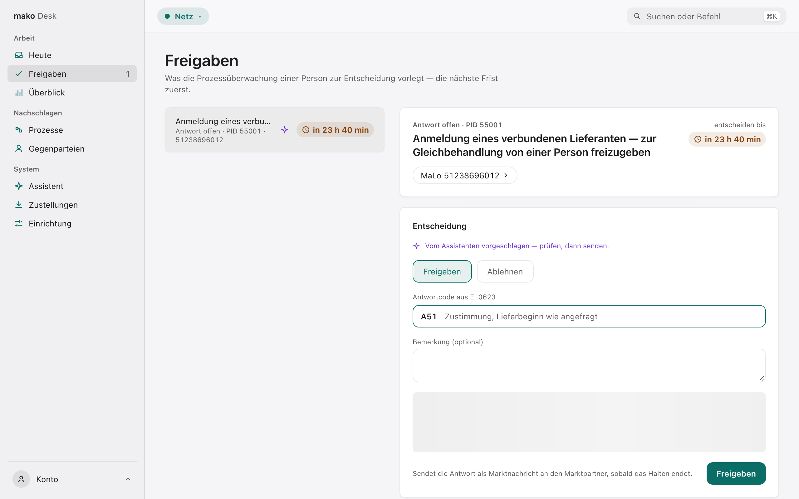
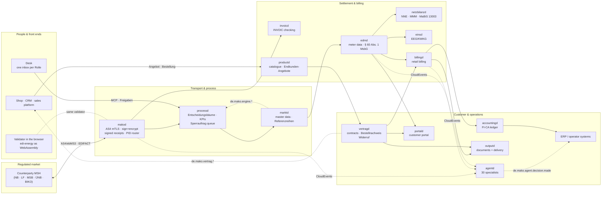

# mako ⚡

[](https://github.com/hupe1980/mako/actions/workflows/ci.yml)
[](./LICENSE-MIT)
[](https://www.rust-lang.org/)
[](https://www.edi-energy.de/)
[](https://github.com/hupe1980/mako/pkgs/container/mako-makod)

> **⚠️ Experimental** — pre-1.0. APIs change between releases. Do not run it in
> production without thorough in-house testing against your own counterparties.

**mako is an open-source, AI-first operating platform for the German energy
market, in Rust.** Every regulated process runs as a proven, event-sourced
workflow — BDEW Marktkommunikation from raw EDIFACT and AS4 bytes, metering,
grid and EEG settlement, retail billing and the ledger — for the NB, LF, MSB
and ESA roles and the BKV's MaBiS share. Agents prepare the work; a named
person decides; every answer, amount and Frist carries its source.

- **The rules are data.** MIG and AHB profiles are imported from the binding
  BDEW PDFs, so a format release is an import run, not a rewrite.
- **Code computes, models propose.** Fristen, amounts and verdicts are Rust
  functions; agents read the same MCP surface as the Desk and never send.
- **Proof ships with the release.** Every defect class is a CI guard, and each
  release carries SBOMs, provenance and a VEX document.

<p align="center">
  <picture>
    <source media="(prefers-color-scheme: dark)" srcset="site/content/docs/guide/desk/freigaben-dark.png">
    
  </picture>
  <br>
  <sub>mako Desk — the assistant's proposal waits on the Freigabe; <kbd>U</kbd> fills the form, a person checks it and sends.</sub>
</p>

| Layer | What it is |
|---|---|
| **Protocol** | `edi-energy`, `dvgw-edi`, `redispatch-xml` formats · `mako-engine` runtime · `makod` — 83 workflows over 499 Prüfidentifikatoren, AS4 with mutual TLS |
| **Market data** | `mako-markt` · `marktd` hub: master data, registries, Referenzreihen, durable CloudEvents fan-out |
| **Settlement & billing** | `grid-billing` + `netzbilanzd` · `eeg-billing` + `einsd` · `energy-billing` + `billingd` |
| **Customer** | `vertragd` contracts and online Vertragsschluss · `productd` catalogue · `accountingd` ledger · `outputd` documents · `portald` portal |
| **Agents** | 11 of the 14 services expose an MCP server — **212 tools**; `agentd` is the governed consumer: 30 specialists on [agentplane](https://github.com/hupe1980/agentplane), advisory and human-gated |
| **Validator** | [Check an EDIFACT message in your browser](https://hupe1980.github.io/mako/validator/) — the validator makod runs, compiled to WebAssembly — beside an [Antwortcode lookup](https://hupe1980.github.io/mako/validator/codes/), a [Fristenrechner](https://hupe1980.github.io/mako/validator/fristen/) and an [ID check](https://hupe1980.github.io/mako/validator/ids/), and four [calculators](https://hupe1980.github.io/mako/tools/) from the crates the settlement uses — the § 30 MsbG smart-meter cap, a PV system's EEG rate, the 2027 levies, § 14a Modul 1 against Modul 2; nothing leaves the tab |
| **Desk** | [`desk/`](desk/) — one inbox per Rolle, the rule behind every item, an assistant that cites every sentence ([guide](https://hupe1980.github.io/mako/docs/guide/desk/)) |
| **Testing** | [`makotest`](makotest/) — Python toolkit on the same Rust core, with answering counterparties and a `pytest` plugin · [`mako-conformance`](tools/mako-conformance/) — checks a replacement for a service against the contract mako's publishes ([guide](https://hupe1980.github.io/mako/docs/guide/replace-a-service/)) |

## Quick start

One command to the whole estate, seeded — Rust via `rustup`,
[`just`](https://github.com/casey/just), Docker for PostgreSQL, Node for the
Desk:

```bash
git clone https://github.com/hupe1980/mako.git && cd mako
just doctor        # what this machine still needs, each miss with its fix
just dev           # PostgreSQL in Docker, every service on this machine, the Desk on :5173
```

`just dev` builds every service with cargo, runs each on its
`deploy/demo/<service>.toml` with its logs in one terminal, and seeds
**Stadtwerke Musterstadt** through the public APIs: an inbound UTILMD 55001
answered with the 55002, an affiliate's Anmeldung waiting for a Freigabe, an
EEG plant settled to the cent, a household invoice issued, booked and paid,
the Stadtwerk's Gas grid and a Gas customer, and a Gas NN-Rechnung disputed
for a price its Netzbetreiber's Preisblatt does not publish.
`just seed --verify` asserts those outcomes. Ctrl-C keeps the data, `just
dev-down` forgets it.

| Command | What it does |
|---|---|
| `just demo` | The released images of every service and the Desk in Docker, seeded — no Rust; <http://localhost:8000> |
| `just token lf` | A persona's token (`nb`, `lf`, `admin`, `agent`) for `curl`, judged by the same Cedar policies |
| `just listen` | Every CloudEvent of the running estate, signature verified, as it arrives |
| `just dev-ui` | The Desk on its recorded answers — Node only |

The [Getting Started guide](https://hupe1980.github.io/mako/docs/guide/getting-started/)
walks it.

## Architecture



## Crates

Each crate's README carries its scope, PIDs and regulatory sources.

| Crate | Purpose |
|---|---|
| [`edi-energy`](crates/edi-energy/) | Parse, validate and build all 17 EDI@Energy EDIFACT message types; profiles imported from the BDEW MIG/AHB PDFs |
| [`dvgw-edi`](crates/dvgw-edi/) | DVGW gas transport — ALOCAT, NOMINT, NOMRES, SSQNOT |
| [`redispatch-xml`](crates/redispatch-xml/) | Redispatch 2.0 XML — the nine CIM document types |
| [`energy-api`](crates/energy-api/) | BDEW API-Webdienste Strom — REST/WebSocket client and Axum server |
| [`mako-as4`](crates/mako-as4/) | BDEW AS4-Profil over `asx-rs` — mutual TLS, sign, encrypt, signed receipts, part properties |
| [`mako-engine`](crates/mako-engine/) | Event-sourced runtime — `Workflow`, `Process`, event store, outbox, deadlines |
| [`mako-fristen`](crates/mako-fristen/) | Werktage, the MaKo holiday table, every Antwort- and Vorlauffrist |
| [`mako-markt`](crates/mako-markt/) | Master data — 101 active `rubo4e::current` types behind one gate, validated identifiers, the Referenzreihen catalogue |
| [`mako-gpke`](crates/mako-gpke/) | GPKE Strom — Lieferantenwechsel, Stammdatenänderung, Sperrung, PARTIN, INVOIC |
| [`mako-geli-gas`](crates/mako-geli-gas/) | GeLi Gas — Lieferantenwechsel Gas, Stammdatenänderung, Sperrprozesse |
| [`mako-wim`](crates/mako-wim/) | WiM, Strom and Gas — MSB-Wechsel, Geräteübernahme, Preisanfrage, INSRPT, ESA |
| [`mako-mabis`](crates/mako-mabis/) | MaBiS Strom — Summenzeitreihen, Clearinglisten, Zuordnungsermächtigungen, the BKV's share |
| [`mako-gabi-gas`](crates/mako-gabi-gas/) | GaBi Gas — allocation, nomination, MMM and capacity invoices |
| [`mako-emob`](crates/mako-emob/) | NZR-EMob Modell 2 — the virtual Bilanzierungsgebiet |
| [`mako-redispatch`](crates/mako-redispatch/) | Redispatch 2.0 workflows — §§ 13, 13a, 14 EnWG |
| [`mako-nbw`](crates/mako-nbw/) | Netzbetreiberwechsel (§ 46 EnWG) — sequences the other crates' Use-Cases, owns no PID |
| [`mako-pruefung`](crates/mako-pruefung/) | The BDEW Entscheidungsbäume — NB, LF, MSB, ESA, MaBiS and NZR-EMob answer rules |
| [`mako-invoic`](crates/mako-invoic/) | The INVOIC settle/dispute state machine |
| [`invoic-checker`](crates/invoic-checker/) | INVOIC plausibility pipeline and its REMADV codes |
| [`grid-billing`](crates/grid-billing/) | Grid settlement — NNE, KA, MMM, MSB, AWH Gas, each position with its legal reference |
| [`eeg-billing`](crates/eeg-billing/) | EEG/KWKG feed-in settlement |
| [`mako-messkonzept`](crates/mako-messkonzept/) | The Messkonzept of a Netzanschluss — the Lokationen its devices require, the decisions with their euros and sources, the match against a Netzbetreiber's catalogue |
| [`energy-billing`](crates/energy-billing/) | Retail billing — 13 product kinds, § 41a dynamic tariffs, EN 16931 |
| [`mako-service`](crates/mako-service/) | Service SDK — `run::<D>()`, config findings, policy, OIDC, Cedar, MCP, outbox, webhooks |
| [`mako-events`](crates/mako-events/) | The CloudEvents type catalogue, one `pub const` per type |

## Services

One PostgreSQL schema per daemon; routes, configuration and deployment are in
[mako docs · Services](https://hupe1980.github.io/mako/docs/services/). Each
service's OpenAPI 3.1 document is published at
[mako docs · HTTP APIs](https://hupe1980.github.io/mako/docs/reference/api/).

| Service | Port | Role | Purpose |
|---|---|---|---|
| [`makod`](services/makod/) | `:8080` · `:4080` · `:8090` | All | Protocol daemon — 83 workflows over 499 Prüfidentifikatoren, AS4 · REST · iMS |
| [`marktd`](services/marktd/) | `:8180` | All | Market data hub — MaLo/MeLo, Versorgungsstatus, registries, Zuordnungsermächtigungen, Referenzreihen, CloudEvents fan-out |
| [`processd`](services/processd/) | `:8580` | NB · LF · MSB | Answers the Entscheidungsbäume and escalates what it cannot decide; process KPIs, Fristen, the § 7a Abs. 5 EnWG report, the Sperrauftrag queue |
| [`edmd`](services/edmd/) | `:8380` | All | Energy data management — MSCONS, Zählerstandsgang, quality scoring, Ablesesteuerung, tiered store · 19 MCP tools |
| [`vertragd`](services/vertragd/) | `:9780` | LF · MSB | Contracts and customers — online Vertragsschluss with its Bestellnachweis, Widerruf, every contract with a Kunde on one side · 22 MCP tools |
| [`productd`](services/productd/) | `:9080` | LF | Product catalogue — 14 categories (13 billable kinds and Bundle), Endkunden-Angebote, EPEX and BEHG price series · 16 MCP tools |
| [`netzbilanzd`](services/netzbilanzd/) | `:8680` | NB · ÜNB | Grid settlement — NNE, KA, MMM, MSB, AWH and the MaBiS Summenzeitreihen; issues the INVOIC · 15 MCP tools |
| [`einsd`](services/einsd/) | `:9180` | NB · LF | Einspeiser registry and EEG/KWKG settlement · 20 MCP tools + 6 prompts |
| [`invoicd`](services/invoicd/) | `:8280` | LF | INVOIC plausibility and the REMADV/COMDIS lifecycle · 11 MCP tools |
| [`billingd`](services/billingd/) | `:9280` | LF | Retail billing — §§ 40, 40b EnWG, EN 16931, Abschlagspläne · 18 MCP tools |
| [`accountingd`](services/accountingd/) | `:9380` | LF | Massenkontokorrent — tamper-evident double-entry ledger, SEPA, Mahnwesen |
| [`outputd`](services/outputd/) | `:9880` | — | Customer documents and their delivery, addressed by `[policy] anrede` |
| [`portald`](services/portald/) | `:9480` | LF | Customer portal gateway and the § 41 EnWG self-service writes |
| [`agentd`](services/agentd/) | `:9580` | All | Advisory agent plane — 30 specialists over the MCP tools, journaled and human-gated |

## Use a crate

```bash
cargo add edi-energy
```

```rust
use edi_energy::{parse, EdiEnergyMessage};

let msg = parse(&std::fs::read("Netznutzung_20241015.edi")?)?;
let report = msg.validate()?;           // MIG + AHB + semantic rules
println!("valid: {}", report.is_valid());
```

```rust
use mako_engine::{builder::EngineBuilder, event_store::InMemoryEventStore, process::RunOptions};
use mako_gpke::lf_anmeldung::GpkeLfAnmeldungWorkflow;

let ctx = EngineBuilder::new().with_event_store(InMemoryEventStore::new()).build();
let tenant = mako_engine::ids::TenantId::new();        // `define_id!` newtype
let process = ctx.spawn::<GpkeLfAnmeldungWorkflow>(tenant, wf_id);
process.run(initiate_cmd, RunOptions::system()).await?;
let state = process.state().await?;     // replayed from the stored events
```

```rust
use mako_markt::domain::{MaloId, MarktpartnerId, nad_agency_code};

let malo = MaloId::new("51238696012")?;               // check digit verified
let mp: MarktpartnerId = "9900357000004".parse()?;
assert_eq!(nad_agency_code(&mp), "293");               // BDEW-Codenummer
```

```rust
use dvgw_edi::DvgwPlatform;

let msg = DvgwPlatform::default().parse(edi_bytes)?;   // identity from BGM DE 1001
println!("{:?} {:?}", msg.gas_day(), msg.process_key());
```

```rust
use redispatch_xml::parse_and_validate;

let doc = parse_and_validate(xml_bytes)?;              // XSD + semantic rules
println!("{} from {}", doc.mrid(), doc.sender_id());
```

The
[Reference](https://hupe1980.github.io/mako/docs/reference/) covers parsing,
validation, builders, AS4, DVGW and Redispatch; feature flags are in each
crate's README.

## Develop

```bash
just            # every recipe, by group
just check      # cargo check, all targets and features
just test       # the whole suite (cargo-nextest when installed)
just test-db    # the real-PostgreSQL suites (testcontainers, needs Docker)
just ci > ci.log 2>&1; echo EXIT:$?   # the gate — a pipe would hide the exit code
```

[CONTRIBUTING.md](./CONTRIBUTING.md) covers building, testing one crate,
running one service and the gate; [AGENTS.md](./AGENTS.md) holds the domain
rules and conventions. The profiles under `crates/edi-energy/profiles/` are
generated from the BDEW PDFs — fix the reader in `xtask/src/bdew/` and run
`cargo xtask import-profiles` instead of editing JSON.

## Documentation

[hupe1980.github.io/mako](https://hupe1980.github.io/mako/) — source under
[`site/`](./site), built with [Zola](https://www.getzola.org/); `just site-serve`
serves it locally with live reload.

| Section | What's inside |
|---|---|
| [Guide](https://hupe1980.github.io/mako/docs/guide/) | Start the estate, set up a deployment, use the Desk, replace a service |
| [Architecture](https://hupe1980.github.io/mako/docs/architecture/) | Engine, domain model, deadlines, ERP integration |
| [Reference](https://hupe1980.github.io/mako/docs/reference/) | Parsing, validation, builders, process catalogue, AS4, operator policy, the HTTP APIs, the event catalog, `makotest` |
| [Services](https://hupe1980.github.io/mako/docs/services/) | One operator guide per daemon |
| [Regulatory](https://hupe1980.github.io/mako/docs/regulatory/) | Festlegungen and the Prüfidentifikator catalogue |
| [Release & Compliance](https://hupe1980.github.io/mako/docs/compliance/) | Format releases, licences, what a release carries |
| [docs.rs](https://docs.rs/edi-energy) | Rustdoc for the published crates |

## Releases

A tag `vX.Y.Z` publishes the crates to crates.io and the `makotest` wheels to
PyPI (Trusted Publishing), pushes one image per service to
`ghcr.io/hupe1980/mako-<service>`, and attaches the evidence pack, a CycloneDX
SBOM per service binary and the VEX document to the GitHub Release. Every image
and binary carries build-provenance and SBOM attestations:

```bash
gh attestation verify oci://ghcr.io/hupe1980/mako-makod:X.Y.Z --repo hupe1980/mako
```

See [What a release carries](https://hupe1980.github.io/mako/docs/compliance/release-lifecycle/#what-a-release-carries),
[CHANGELOG.md](./CHANGELOG.md) and [SECURITY.md](./SECURITY.md); the threats
and the control answering each are in [THREAT_MODEL.md](./THREAT_MODEL.md).

## Contributing

Contributions are welcome; open an issue before a large change, and run
`just ci` before a pull request.

## License

Licensed under either of [MIT](./LICENSE-MIT) or
[Apache 2.0](./LICENSE-APACHE), at your option.

## Related crates

- [edifact](https://crates.io/crates/edifact) — the EDIFACT parser underneath `edi-energy`
- [asx-rs](https://crates.io/crates/asx-rs) — AS4/ebMS3 transport with mutual TLS, used by `makod`
- [rubo4e](https://crates.io/crates/rubo4e) — BO4E business-object types
- [metering](https://crates.io/crates/metering) and [meterstore](https://crates.io/crates/meterstore) — metering domain and time-series store beneath `edmd`
- [doubleentry](https://crates.io/crates/doubleentry) — the ledger beneath `accountingd`
- [billing](https://crates.io/crates/billing) — the EN 16931 tariff and invoicing engine under the settlement crates
- [SlateDB](https://slatedb.io/) — embedded storage behind `mako-engine`

## Sister projects

- [emob](https://hupe1980.github.io/emob/) — open-source charging operations: CSMS and eMSP back office, OCPP 2.1, OCPI 2.3.0, Eichrecht. mako covers the market side of e-mobility (`mako-emob`, NZR-EMob Modell 2).
- [hems](https://hupe1980.github.io/hems/) — open-source home energy management: § 14a, § 9 EEG, MiSpeL. mako holds the § 14a module on the contract and prices its Netzentgelt reduction.
