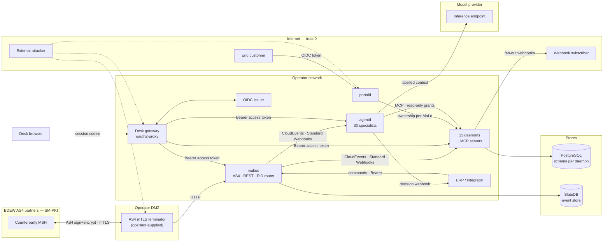

# Threat model

The system-level threat model of a mako deployment: what crosses which trust
boundary, what is worth attacking, what goes wrong, and which mechanism in the
code stops it — or that nothing does yet. Reporting a vulnerability is
[SECURITY.md](./SECURITY.md).

## Scope and method

| | |
|---|---|
| **Scope** | One operator deployment: `makod` and the 13 PostgreSQL daemons, their MCP servers, `agentd`, `portald`, the Desk behind its OIDC gateway, the stores, the model provider and the release supply chain. One tenant per deployment. The operator's IdP, network and the AS4 TLS terminator are in scope as boundaries mako depends on, not as code it ships |
| **Method** | STRIDE per element, plus OWASP Top 10 for LLM Applications 2026 and OWASP Top 10 for Agentic Applications 2026, through the ThreatSpec Spec Kit extension (profiles `stride`, `llm`, `agent`) |
| **Machine-readable model** | `.specify/memory/threat-model.yaml` — an Open Threat Model 0.2.0 document validated by `.specify/extensions/threatspec/scripts/bash/threatspec.sh validate`. It is the project baseline: actors, trust zones, assets, components, flows, threats, mitigations and the `SR-###` security requirements |
| **Severity** | Inherent, before the listed controls: likelihood × impact on ThreatSpec's 3×3 matrix (low < 34, medium < 67, high ≥ 67; high × high is critical) |
| **Status** | **Control** — a mechanism exists and the evidence column names the guard, test or file. **Partial** — a control exists and a required one is missing. **Open** — no control in the code |

The model counts 11 actors, 24 trust zones, 12 assets, 23 components, 22 data
flows and 48 threats (1 critical, 28 high, 16 medium, 3 low), 52 mitigations
(35 implemented, 17 required) and 19 security requirements.

## Trust boundaries

| Boundary | What crosses it | The control at the crossing |
|---|---|---|
| Partner MSH → terminator → makod | AS4 user messages and receipts | Client certificate at the terminator (BDEW AS4-Profil 1.2 Kap. 2.2.6.1 binds a terminator as it binds the MSH); `asx-rs` signature, SM-PKI chain, OU = `eb:From`, CRL, decryption; UNB bound to `eb:From` |
| Browser → gateway → services | Staff actions | OIDC at the gateway, no token in the browser, CSP; each service verifies the token's audience and tenant, Cedar decides |
| Internet → portald | Customer reads and § 41 EnWG self-service writes | `vertragd` decides ownership per MaLo from the forwarded token |
| Service → service | CloudEvents, booking drafts, reads | Standard Webhooks HMAC; service keys; durable outbox in the business transaction |
| agentd → MCP / model | Tool calls, model context | Read-only grants, per-effect Cedar, field labelling, sensitivity egress ceilings |
| marktd → subscriber | Master-data events | HMAC signature, IP-literal SSRF refusal, no redirects |
| Release → estate | Images, binaries, crates | Pinned actions and digests, provenance, SBOMs, attestations |

## Assets

| Asset | Why it matters |
|---|---|
| MP-ID signing, encryption and TLS key pairs; SM-PKI root | Whoever holds them speaks for the operator in the market |
| Market messages and AS4 receipts | Change who supplies, meters or bills a Marktlokation; receipts prove delivery |
| Messwerte (Lastgang, Zählerstandsgang) | Personal data that also prices every bill |
| Invoices, settlements, ledger, SEPA mandates | Money, reproducible to the cent |
| Customer PII and Bestellnachweise | Contracts, addresses, bank data, the proof of an online contract |
| API keys, OIDC tokens, service keys, webhook and model-provider secrets | Each one is an identity |
| Cedar policies and operator policy settings | Decide every access |
| makod event log, correlation index, deadlines, outbox | The process truth; a lost row is a lost APERAK or a Frist that never fires |
| § 147 AO / GoBD records | Issued invoices, settlement receipts, ledger periods, evidence tables |
| Agent manifests, procedures, prompts, model ids | Define what each specialist may read and how it answers |
| agentd journal, cases, memories, proposals | Personal data and the record of every agent run |

## Threats

### Market boundary and availability

| Threat | Sev | Mitigation | Evidence | Status |
|---|---|---|---|---|
| `as4-sender-spoofing` — a forged or unconfigured MSH claims a counterparty's MP-ID | high | `asx-rs` `Profile::bdew()`: signature under the SM-PKI root, OU = `eb:From` (Regelungen zum Übertragungsweg für AS4 2.6 Kap. 5.2), pins, CRL; `[policy.as4] unbekannte_absender = nur_konfigurierte` answers `EBMS:0202` (BDEW AS4-Profil 1.2 Kap. 2.3.7) | `services/makod/tests/it/as4_security.rs`, `transport/as4_ingest.rs` | Control |
| `unb-envelope-mismatch` — an authenticated partner names another MP-ID in UNB DE0004 | high | DE0004 bound to `eb:From`, DE0010 to an own MP-ID (Allgemeine Festlegungen 6.1d Kap. 2.13); `de0004_ausnahme` by name, each a startup warning | `as4_security.rs`, `transport/as4_ingest.rs` | Control |
| `as4-tampering-in-transit` — a message or receipt is read or altered between MSHs | medium | Sign, then encrypt, both mandatory (BDEW AS4-Profil 1.2 Kap. 2.2.6.2.1, 2.2.6.2.2); a receipt without NonRepudiationInformation is no delivery (Regelungen zum Übertragungsweg für AS4 2.6 Kap. 7.3) | `transport/as4_sender.rs`, `crates/mako-as4` | Control |
| `as4-replay` — a captured message is processed twice | medium | Dedup claim in the store before the handler; a duplicate gets a fresh receipt | `transport/as4_ingest.rs` (`SlateDbDedup`) | Control |
| `as4-terminator-misconfig` — the operator's terminator admits a client without a verified SM-PKI certificate | high | The repository ships no terminator configuration; makod cannot see the TLS layer | — | **Open** (SR-004) |
| `mp-key-compromise` — an MP-ID private key is read from its PEM file | high | Preflight refuses one key pair certifying two of sign/encrypt/TLS (BDEW AS4-Profil 1.2 Kap. 2.3.4.4); no HSM or PKCS#11 path | `core/preflight.rs`, `cargo xtask check-as4-controls` | Partial |
| `as4-cert-expiry` — a certificate lapses and market communication stops | high | Certificate monitor, warning window of at least 14 days | `core/zertifikat_monitor.rs` | Control |
| `inbound-parser-dos` — a flood or oversized interchange exhausts makod | medium | Rate limit per peer and per claimed sender before any cryptography; 64 MiB AS4 body cap; `DefaultBodyLimit` on `/edifact` and the Webdienste | `transport/as4_ingest.rs`, `startup/servers.rs` | Control |
| `inbound-parser-exploit` — malformed EDIFACT, XML or MIME hits a parser defect | medium | cargo-fuzz targets; MIG/AHB validation before dispatch. `just ci` compiles the targets (`check-fuzz`); running them is `just fuzz <target>`, outside the gate | `fuzz/fuzz_targets/` | Control |
| `loopback-runaway` — a combined-role loopback cycles without bound | low | `MAX_LOOPBACK_HOPS` per conversation, then dead-letter | `as4_sender.rs` `a_cycle_is_broken_once_the_budget_is_exhausted` | Control |
| `makod-outage` — the single SlateDB writer fails and no standby takes over before a Frist lapses | high | None: no failover or fencing drill exists | — | **Open** (SR-014) |

### Identity, access and configuration

| Threat | Sev | Mitigation | Evidence | Status |
|---|---|---|---|---|
| `insecure-auth-posture` — a service runs in production with `allow_insecure_no_auth` or the Cedar permit-all baseline | high | Missing OIDC or inbound secret is a blocking Befund unless the flag is set; the posture is reported `insecure`; makod refuses no keys and no OIDC, and default-Deny without a policy dir. The flag itself is never refused | `marktd/src/daemon.rs`, `mako-service/src/policy.rs`, `makod/src/core/cedar_authz.rs` | Partial (SR-018) |
| `demo-oidc-key` — a production issuer trusts the public demo key | high | Boot refused with `OidcError::DemoKey` | `oidc/demo.rs` `a_production_issuer_publishing_the_demo_key_refuses_to_boot` | Control |
| `cross-tenant-token` — a token of another tenant in the same realm reaches this deployment | high | `mako_tenant` compared with the deployment tenant before Cedar; `check-expected-tenant`, `check-tenant-predicate`. No row-level security | `mako-service/src/oidc.rs`, `mcp_auth.rs` | Partial (SR-019 before a second legal entity) |
| `rest-broken-access-control` — a principal reaches a route its roles do not grant | high | Cedar on every route, command and MCP tool; makod default Deny; `check-cedar-roles` | `mako-service/src/cedar.rs`, `makod/src/core/cedar_authz.rs` | Control |
| `mcp-roleless-key-read` — a role-less key reaches a whole MCP read surface where `use-mcp` is tenant-only | high | None beyond Cedar's tenant clause | `mcp_auth.rs` module doc states the gap | **Open** (SR-008) |
| `mcp-unaudited` — an MCP call, allowed or refused, leaves no shared audit record | high | None | — | **Open** (SR-008) |
| `token-audience-replay` — a token for one service is replayed at another sharing its audience | high | Audience checked per service; no resource-bound token or Protected Resource Metadata | `desk/deploy/gateway.yaml` allows one shared audience | **Open** (SR-009) |
| `duplicate-header-confusion` — a repeated `Authorization` or `Idempotency-Key` decides identity by occurrence | medium | `headers::single_str`; `RepeatedAuthorization` | `headers.rs` `a_repeat_is_refused` | Control |
| `unknown-field-mass-assignment` — a misspelt key is dropped and a setting does nothing | medium | `mako_service::Json` refuses an unknown field; `check-request-bodies` | `json.rs` `from_value_refuses_an_unknown_key_as_the_extractor_does` | Control |
| `cedar-policy-tampering` — a replaced policy file widens access | medium | Settings logged to `service_policy_log`, exported as `mako_policy_info`; agentd reports each manifest digest | `mako-service/src/policy.rs`, `einrichtung.rs` | Control (detective) |
| `desk-session-csrf` — a cross-site page drives the gateway's cookie session | high | No token in the browser; CSP with `frame-ancestors 'none'`. Cookie `SameSite` lives in the operator's oauth2-proxy config, not in the tree | `desk/deploy/nginx.conf`, `gateway.yaml` | Partial (SR-013) |
| `release-supply-chain` — a dependency, action or base image ships malicious code | high | cargo-deny, SHA-pinned actions, digest-pinned images, SLSA provenance, SBOMs, attestations, `cargo auditable`, Trusted Publishing | `deny.toml`, `check-action-pins`, [SECURITY.md](./SECURITY.md#what-a-release-carries) | Control |

### Integration, records and personal data

| Threat | Sev | Mitigation | Evidence | Status |
|---|---|---|---|---|
| `webhook-forgery-inbound` — forged CloudEvents mutate master data or start agent runs | high | `webhook::verify_request` (Standard Webhooks, stale timestamp refused, id to deduplicate); a missing inbound secret blocks the boot | `webhook.rs` `a_stale_timestamp_is_refused` | Control |
| `webhook-ssrf` — a subscriber DNS name resolving to an internal address turns the fan-out into a probe | high | IP literals that are loopback, private, link-local or IPv4-mapped are refused; no redirects. A DNS name is not re-checked at delivery | `subscription.rs` `private_ranges_are_refused_including_their_ipv4_mapped_form`, `http.rs` `the_default_client_does_not_follow_redirects` | Partial (SR-007) |
| `webhook-secret-at-rest` — subscriber HMAC secrets are read from the database | low | Stored in plaintext by design; protection is database grants and storage encryption | `marktd/src/pg/subscription.rs` | **Open** |
| `event-log-tampering` — makod's history is edited in the object store without detection | medium | None in `mako-engine`; agentd's journal and accountingd's ledger are chained, makod's log is not | — | **Open** (SR-010) |
| `gobd-record-alteration` — an issued invoice or settlement receipt is updated in place | high | Append-only triggers on vertragd's evidence tables and productd's offers; accountingd period seals. billingd `billing_records` and einsd `settlement_receipts` accept `UPDATE` | `vertragd/migrations/0001_schema.sql`, `online_vertragsschluss.rs` | Partial (SR-011) |
| `ledger-bypass` — money reaches the books outside a booking draft or into a sealed period | medium | `check-ledger-drafts`; a booking in a sealed month is refused and parked | `xtask/src/check_ledger_drafts.rs`, `accountingd/src/handlers.rs` | Control |
| `portal-cross-customer` — a customer reads another's Messwerte, invoices or balance | high | portald verifies no token itself; vertragd answers ownership per MaLo; portald refuses to start without vertragd | `portald/src/config.rs` | Control |
| `portal-dos` — an internet client floods portald and its upstreams | medium | `mako_service` rate limiting exists but portald does not apply it | — | **Open** (SR-012) |
| `secrets-pii-in-errors-logs` — an error body or log line carries a secret or customer data | high | A 500 renders only an `error_id`; secrets are `SecretString`; `check-error-tuples` | `mako-service/src/error.rs` | Control |
| `data-at-rest-unencrypted` — PII is read from storage, backups or snapshots | high | mako encrypts neither PostgreSQL nor SlateDB; agentd seals its own store | — | **Open** |
| `dsr-incomplete` — an access or erasure request misses a service holding the subject's data | medium | agentd crypto-shredding per case; no cross-service Art. 15/20 DSGVO answer | `agentd/src/config.rs` `[keyring]` | Partial |
| `decision-repudiation` — a command, Freigabe or agent run cannot be attributed | high | processd `decided_by` from the token; agentd `[attestation]` and `[witness]`; AS4 evidence record and NRR | `processd/src/freigabe.rs`, `agentd/src/config.rs` | Control |

An LF billing watch read requires the tenant’s supplier role in REST and MCP. The recovery command requires its own LF write action and UUID key. A tenant-scoped database session lock fences concurrent runs. Scoped contract resolution and the eligible-original view bind the billed period to its issuer. Closed working exceptions have bounded retention and store a refusal code. The Desk reads channel evidence through a distinct authorization check. [Billing controls](site/content/docs/services/billingd.md#billing-watch-and-recovery)

The cold-restore rehearsal compares a quiesced billing and accounting cut with independently recorded business evidence, a re-folded local protocol stream and a separate receiver receipt. The local sender resumes only after they agree. A local makod writer owns its directory before opening SlateDB, including for startup checks and migrations. The rehearsal uses temporary stores and loopback recipients. [Recovery procedure](https://hupe1980.github.io/mako/docs/reference/recovery/)

### LLM and agent plane

| Threat | Sev | Mitigation | Evidence | Status |
|---|---|---|---|---|
| `indirect-prompt-injection` — instructions in EDIFACT free text, an INVOIC, e-mail or PDF reach a model (LLM01) | high | Admission re-validates identifiers and labels everything else untrusted; `protected_fields` with `require_trusted`; no mutating grant. No injection test case exists | `agentd/src/plane/label.rs` | Partial (SR-015) |
| `agent-goal-hijack` — injected content suppresses a finding or shapes a harmful proposal (ASI01) | medium | Closed output schemas; triage rules on every terminal finding; a person decides | `plane::` unit tests | Partial (SR-015) |
| `agent-tool-misuse` — a specialist calls a mutating MCP tool (ASI02) | high | `[policy] agent_posture = advisory`; `check-tool-grants` refuses a mutating grant and a `mutates` flag that disagrees with `read_only_hint`; the taint gate | `xtask/src/check_tool_grants.rs`, `check_prompt_tools.rs` | Control (SR-016) |
| `agent-identity-abuse` — agentd's service credential reaches tools beyond the grants (ASI03) | high | Per-effect Cedar with a server allowlist, one MCP client per server, `DenyAll` baseline. The server side has no advisory `forbid` | `services/agentd/policy/agentd.cedar` | Partial (SR-008) |
| `agent-memory-poisoning` — counterparty content steers later runs (ASI06) | medium | Memory subject bound to `$correlation/malo`, lint-enforced; formation on a quarantined model; `forget_subject` | `services/agentd/agents/` | Control |
| `llm-pii-egress` — Messwerte and PII leave for a hosted provider (LLM02) | high | `max_sensitivity_egress` in all 30 manifests; a self-hosted `chat-completions` provider keeps data on premises | `services/agentd/agents/` | Control |
| `llm-unbounded-consumption` — an event burst exhausts spend and capacity (LLM10) | medium | Manifest budgets; `[quota]` reserved at admission, 429 beyond | `agentd/tests/it/ingest.rs` | Control |
| `agent-misinformation` — a wrong §, Frist or amount is taken as fact (LLM09) | high | A rule is stated only as a quote from the passage index, refused without it; `check-quotations`; numbers come from the computing service; Art. 50 Regulation (EU) 2024/1689 disclosure on every served model-written row | `agentd/tests/it/disclosure.rs` | Control |
| `agent-output-handling` — model output reaches the Desk as markup or a form as an unchecked value (LLM05) | high | Closed `output.schema` under strict decoding; React escaping under the CSP; a person sends. Proposals are not yet held against the pre-send gate | `agentd/tests/it/specialist_smoke.rs` | Partial (SR-017) |
| `human-rubber-stamp` — a person approves a proposal unchanged although the pre-send gate refused it or never saw it (ASI09) | **critical** | makod's `rehearse_command` tool and `/api/v1/probe/{command}` exist; agentd does not hold proposals against them and the Freigabe does not refuse an unchanged refused proposal | `makod/src/api/mcp_server.rs` | **Open** (SR-017) |
| `rogue-agent` — a running specialist diverges from the approved manifest (ASI10) | medium | Manifest digest and version reported; journal attestation and witness; halts | `agentd/tests/it/plane_golden_run.rs` | Control |
| `agent-cascading-runs` — one event fans out into duplicate runs (ASI08) | medium | At-least-once delivery, at-most-once admission; quota | `agentd/tests/it/ingest.rs` | Control |
| `model-swap` — a manifest switches to an unreviewed model (LLM03) | low | `plane::` tests refuse a model id nobody reviewed | `services/agentd/src/plane/` | Control |

Not modelled as threats, with the reason in the baseline's `dispositions`:
direct prompt injection (only authenticated staff type into a read-only
assistant), training-data poisoning (nothing is trained), hidden-context
exposure (prompts are open source and carry no secret), embedding weakness (no
embedding store), model extraction (mako serves no model), agentic supply chain,
code execution and inter-agent communication (first-party skills, no generated
code, no delegation).

## Open risks, ranked

| # | Risk | Sev | Required control |
|---|---|---|---|
| 1 | `human-rubber-stamp` | critical | SR-017 — a proposal refused by, or not held against, the pre-send gate cannot be approved unchanged |
| 2 | `indirect-prompt-injection`, `agent-goal-hijack` | high | SR-015 — injection twin cases per specialist in CI, equal tool calls and finding |
| 3 | `as4-terminator-misconfig` | high | SR-004 — a shipped, tested terminator configuration that refuses a client without an SM-PKI certificate |
| 4 | `mcp-roleless-key-read`, `mcp-unaudited`, `agent-identity-abuse` | high | SR-008 — one audit record per `/mcp` call and an advisory `forbid` in every policy, proven in CI |
| 5 | `gobd-record-alteration` | high | SR-011 — billingd and einsd refuse an update of issued amounts at the database |
| 6 | `makod-outage` | high | SR-014 — fenced failover inside an RTO derived from the shortest Frist |
| 7 | `webhook-ssrf` | high | SR-007 — refuse a non-global address at connect time |
| 8 | `insecure-auth-posture` | high | SR-018 — production refuses `allow_insecure_no_auth` and permit-all |
| 9 | `token-audience-replay` | high | SR-009 — resource-bound tokens and Protected Resource Metadata on every MCP server |
| 10 | `desk-session-csrf` | high | SR-013 — the shipped gateway configuration sets the cookie posture |
| 11 | `data-at-rest-unencrypted`, `webhook-secret-at-rest`, `mp-key-compromise` | high | Operator hardening: storage encryption and key custody; no HSM path exists |
| 12 | `cross-tenant-token` | high | SR-019 — row-level security before a second legal entity shares a deployment |
| 13 | `event-log-tampering` | medium | SR-010 — a tamper-evident makod history |
| 14 | `portal-dos` | medium | SR-012 — per-caller and global rate limit on portald |
| 15 | `dsr-incomplete` | medium | Art. 15/20 DSGVO answered from every service |

## Extending the model

- **A feature model extends this baseline.** `/speckit-threatspec-model` writes
  a feature's `threat-model.yaml` with `threatspec.extends` pointing at
  `.specify/memory/threat-model.yaml`; it inherits these trust zones, actors,
  assets and components and continues the `SR-###` numbering from SR-019.
- **The engine is deterministic.** `threatspec.sh validate <model>` checks the
  schema and every reference; `threatspec.sh check` runs gap checks C1–C12
  without an agent and exits non-zero on a HIGH or CRITICAL finding, so it can
  gate CI; `--format sarif` feeds code scanning.
- **Only evidence closes a threat.** `/speckit-threatspec-converge` records a
  verification against a test, guard or file and only then marks a threat
  mitigated; this document's Status column follows the baseline.
- **A defect class becomes a guard.** A new control here is finished when a
  `cargo xtask` check or a test fails on its removal, and the evidence column
  names it.
