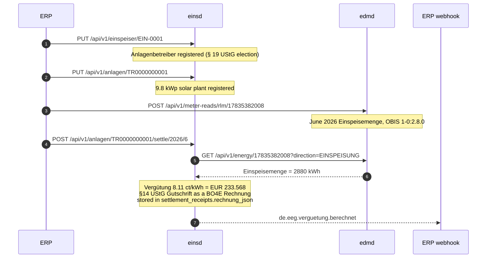

# EEG billing demo

End-to-end EEG feed-in settlement: `einsd` registers an Anlagenbetreiber and a
9.8 kWp rooftop plant, `edmd` stores a month of quarter-hour Einspeisemengen,
and the monthly settlement yields a § 21 EEG 2023 Vergütung issued as a § 14
Abs. 2 UStG Gutschrift (a BO4E `Rechnung`).

## What runs

| Service | Port | Role |
|---|---|---|
| `postgres` | `5432` | PostgreSQL — one database per service |
| `webhook` | `8000` | Demo ERP event receiver (Python, in-memory) |
| `marktd` | `8180` | Market Data Hub — MaLo master data |
| `edmd` | `8380` | Energy Data Management — meter readings + billing periods |
| `einsd` | `9180` | EEG/KWKG settlement — plant register + monthly Vergütung |




## Run it

```bash
just build-demo-eeg        # from the workspace root: marktd, edmd, einsd images
cd demos/eeg-billing
docker compose up -d
bash smoke.sh
```

`edmd` and `einsd` come out of the full `builder` stage — budget 20–45 minutes on
a cold cache. The smoke test asserts the outcome: the projected Einspeisung of
**2880 kWh**, a settlement with `status=calculated` at **EUR 233.568**, and the
`de.eeg.verguetung.berechnet` CloudEvent on the webhook. Both ingest doors are
idempotent, so a second run against the same stack passes too.

## The plant and the result

| Field | Value |
|---|---|
| ErzeugungsArt | `SOLAR_AUFDACH` (roof-mounted PV) |
| EEG law | EEG 2023 |
| Settlement model | `VERGUETUNG` (§21 Abs. 1 Einspeisevergütung) |
| Installed capacity | 9.8 kWp |
| Vergütungsform | `UEBERSCHUSS` (§48 — the Volleinspeisung column pays the Abs. 2a uplift instead) |
| Feed-in tariff | **8.11 ct/kWh** (Solarpaket I, ≤10 kWp Überschusseinspeisung) |
| Commissioning | 2024-03-15 |
| §9 Steuerbarkeit | `LEISTUNGSBEGRENZUNG_60` (§9 Abs. 2 Nr. 3, the route open below 25 kW) |
| Einspeiser | `EIN-0001`, Kleinunternehmer (§19 UStG) |

2880 kWh × 8.11 ct = **EUR 233.568**. The settlement is the entitlement, kept at
sub-cent precision; rounding to a payable amount happens once, in the
Gutschrift. The operator is a § 19 UStG Kleinunternehmer (`ust_status` on the
`einspeiser` record, not a function of plant size), so the Gutschrift carries
0 % USt. Readings are pushed under OBIS `1-0:2.8.0` — `edmd` never reads an
unlabelled reading as feed-in.

Every `Decimal` in the wire formats is a JSON **string** (`"9.8"`); a bare
number is a `422`. `just test-demo-payloads` deserialises every body `smoke.sh`
posts into the real request type.

## Explore

| Endpoint | Description |
|---|---|
| `http://localhost:9180/api/v1/anlagen/TR0000000001` | Plant registration details |
| `http://localhost:9180/api/v1/anlagen/TR0000000001/settlements?year=2026&month=6` | The June settlement receipt — addressed by month, because later months exist too (as `no_data`) |
| `http://localhost:9180/api/v1/einspeiser/EIN-0001` | Operator record — § 19 UStG election, payout account |
| `http://localhost:8380/api/v1/energy/17835382008?direction=EINSPEISUNG&from=2026-06-01T00:00:00%2B02:00&to=2026-07-01T00:00:00%2B02:00` | The projected Einspeisung series the settlement reads |
| `http://localhost:9180/mcp` | einsd MCP server (20 tools) |
| `http://localhost:8380/mcp` | edmd MCP server (16 tools) |
| `http://localhost:8000/events` | ERP webhook event log |

`settlement_model` in `fixtures/anlage.json` takes one of twelve tokens and
`eeg_gesetz` selects the law (`2000 | 2004 | 2009 | 2012 | 2017 | 2021 | 2023 | 0`
for KWKG); the [einsd guide](https://hupe1980.github.io/mako/docs/services/einsd/)
lists what each model needs.

```bash
docker compose down      # keep the database volumes
docker compose down -v   # full reset
```
