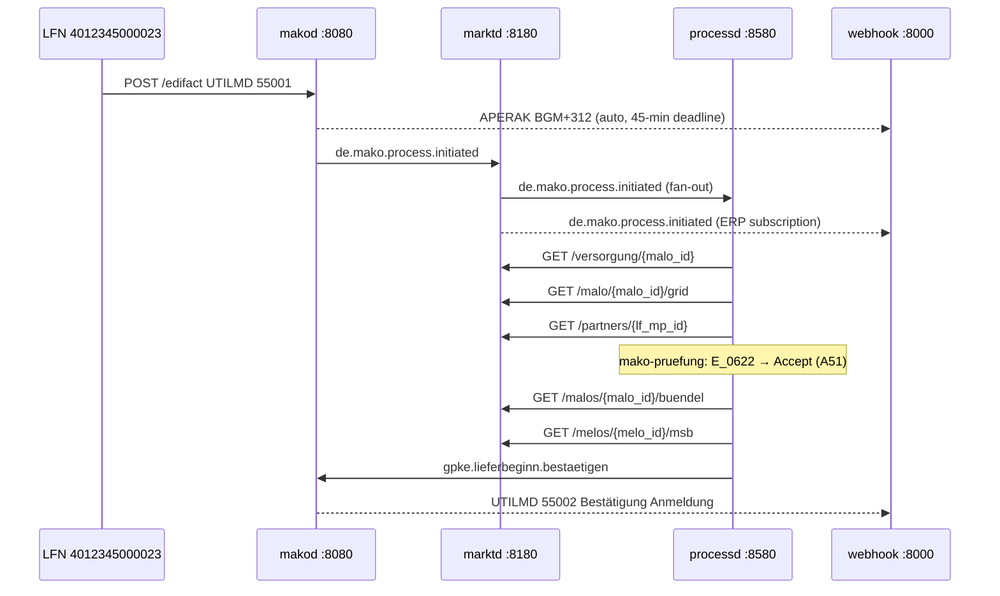

# NB STP demo

End-to-end run of the Netzbetreiber's straight-through processing: a UTILMD
**55001** Anmeldung arrives at `makod`, `processd` walks `E_0622` → `E_0623`
through `mako-pruefung` to `A51`, and the UTILMD **55002** Bestätigung reaches
the ERP webhook within seconds — no operator involved.

## What runs

| Service | Port | Purpose |
|---|---|---|
| `postgres` | `5432` | PostgreSQL — one database per service |
| `webhook` | `:8000` | In-memory ERP event receiver (Python) |
| `marktd` | `:8180` | Market Data Hub — MaLo/MeLo/NeLo/TR, VersorgungsStatus, EventBus fan-out |
| `processd` | `:8580` | NB STP auto-responder — `mako-pruefung` Anmeldung (`E_0622` → `E_0623`) and Abmeldung (`E_0607`); LF answers 55007/55010 inside their per-PID Frist |
| `makod` | `:8080` | EDIFACT process engine — GPKE/WiM/GeLi Gas, in-memory |




## Run it

```bash
just build-demo            # from the workspace root: makod, marktd, processd images
cd demos/nb-stp
docker compose up -d
bash smoke.sh
```

`smoke.sh` seeds the master data (partner, MaLo, grid record, Messlokation and
its MSB, price sheet), posts the 55001 and asserts on the outcome: the APERAK
`BGM+312`, the fan-out through `marktd`, `processd`'s `Accept` decision, and the
55002 on the webhook.

A manual `gpke.lieferbeginn.bestaetigen` afterwards is refused with `409`
(`expected ValidationPassed, found AntwortGesendet`) — the state-machine proof.
Each run generates a fresh check-digit-valid MaLo, so it repeats against a warm
stack; `MARKTD_URL= WEBHOOK_URL= bash smoke.sh` exercises `makod` alone.

Every line of the 55002 is Muss in its Prüfschablone — the NB's
classification `ZW7`, the chosen Produktpaket `RFF+Z60`, the Messlokation and
both MSB blocks; `services/makod/tests/it/e2e_gpke_antwort_conformance.rs` holds
the rendering to the AHB. Without the Messlokation the answer says `ZW6`
„Pauschale Marktlokation" instead.

## Fixtures

| File | Description |
|---|---|
| `fixtures/utilmd-55001.edi` | UTILMD PID 55001 — Anmeldung Lieferbeginn Strom (LFN→NB) |
| `fixtures/partner-lf.json` | Trading partner record for LFN GLN `4012345000023` |
| `fixtures/preisblatt-nb.json` | `PreisblattNetznutzung` for NB `9900357000004` (FV2026-10-01) |
| `fixtures/malo-nb.json` | `MARKTLOKATION` for NB `9900357000004` (demo MaLo) |

`fixtures/utilmd-55001.edi` carries release S2.1 and the Bilanzkreis
Produktpaket (`SG8 SEQ+Z79`) an Anmeldung must state;
`crates/edi-energy/tests/it/demo_fixtures.rs` validates it against its AHB, and
`cargo run -p edi-energy --example 07_resolve --all-features -- demos/nb-stp/fixtures/utilmd-55001.edi`
shows where each segment sits.

## Endpoints

| Service | URL | Purpose |
|---|---|---|
| makod REST API | http://localhost:8080 | EDIFACT ingest, process commands |
| makod Swagger UI | http://localhost:8080/api/v1/docs/ | Interactive API docs |
| makod MCP server | http://localhost:8080/mcp | LLM tooling (Claude Desktop, VS Code) |
| marktd REST API | http://localhost:8180 | Master data (MaLo/MeLo, typed BO4E, VersorgungsStatus) |
| marktd Swagger UI | http://localhost:8180/api/v1/docs/ | Interactive API docs |
| marktd DLQ admin | http://localhost:8180/admin/fanout/dlq | Inspect failed CloudEvent deliveries |
| marktd metrics | http://localhost:8180/metrics | Prometheus metrics |
| processd decisions | http://localhost:8580/api/v1/decisions | NB STP audit log |
| processd queue | http://localhost:8580/api/v1/queue | LF approval queue |
| ERP webhook receiver | http://localhost:8000/events | View delivered CloudEvents |

## Demo configuration

| Service | Parameter | Value |
|---|---|---|
| makod | Bearer token | `demo-secret-change-me` |
| makod | Tenant / Marktrolle | `9900357000004` / NB Strom |
| marktd | Tenant | `9900357000004` |
| processd | makod API key | `demo-secret-change-me` |
| processd | marktd API key | `demo-processd-key` |
| All services | Authentication | OIDC disabled (dev mode only) |

Authentication is disabled — do not deploy this configuration. The
[getting-started guide](https://hupe1980.github.io/mako/docs/guide/getting-started/)
covers OIDC.

```bash
docker compose down       # keep the PostgreSQL volume
docker compose down -v    # full reset
```
