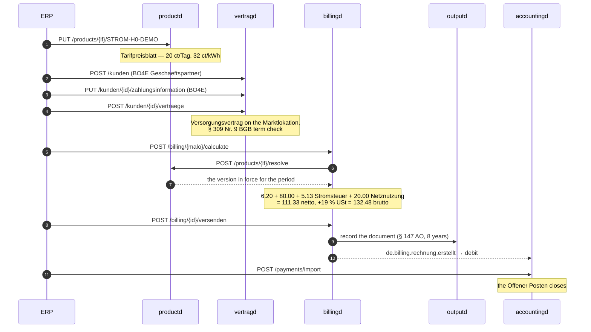

# Order-to-cash demo

The retail money path, end to end: a Tarifpreisblatt in `productd` prices a
Versorgungsvertrag in `vertragd`, `billingd` issues the invoice, `outputd`
stores it as a PDF/A document, `accountingd` books the receivable, and an
imported payment closes it. No EDIFACT — that is `demos/nb-stp`.

## What runs

| Service | Port | Purpose |
|---|---|---|
| `postgres` | `5432` | PostgreSQL — one database per service |
| `webhook` | `:8001` | In-memory ERP event receiver (Python) — 8001 on the host so this stack runs beside `demos/nb-stp` |
| `productd` | `:9080` | Product and tariff catalogue — the only price source |
| `vertragd` | `:9780` | Kunden, Verträge, Kündigungsfristen |
| `billingd` | `:9280` | Multi-product billing engine (EN 16931) |
| `outputd` | `:9880` | Document store and delivery |
| `accountingd` | `:9380` | Massenkontokorrent — the double-entry ledger |




## Run it

```bash
just build-demo-o2c        # from the workspace root: the five service images
cd demos/o2c
docker compose up -d
bash smoke.sh
```

All five images come out of the full `builder` stage — budget 20–45 minutes on a
cold cache. The MaLo-ID is generated per run, so the demo repeats without a
reset.

## What the smoke test asserts

- **The customer is a BO4E `Geschaeftspartner`**, the mandate a BO4E
  `Zahlungsinformation`. A flat `vorname`/`strasse` payload is a `422` naming
  the field, a bad Anrede is `bo4e.unknown_enum`, a bad IBAN fails mod-97 — and
  the invoice names the same recipient in the BO4E `Rechnung` and the EN 16931
  model (§ 14 Abs. 4 Nr. 1 UStG).
- **The amount, computed independently:**

| | |
|---|---|
| Grundpreis | `20 ct/Tag × 31 Tage` = **6.20 EUR** |
| Arbeitspreis | `32 ct/kWh × 250 kWh` = **80.00 EUR** |
| Stromsteuer | `2.05 ct/kWh × 250 kWh` = `5.125` → **5.13 EUR** (§ 3 StromStG) |
| Netznutzungsentgelt Arbeitspreis | `8.00 ct/kWh × 250 kWh` = **20.00 EUR** (the `grid` override) |
| Netto | **111.33 EUR** — the sum of the rounded lines |
| USt 19 % | `21.1527` → **21.15 EUR** (kaufmännisch) |
| Brutto | **132.48 EUR** |
| Forderung | **132.48 EUR** — the ledger holds integer cents, because that is what can be owed and paid |

- **The document**: `outputd` publishes the INVOICE template, and the issued PDF
  read back is byte-identical to the record.
- **The receivable** is 132.48 EUR to the cent, and the payment import closes
  it with `matched_by == "remittance_token"` — the MaLo-ID in the
  Verwendungszweck, because `accountingd` has never seen this customer's IBAN.

## Deliberately not running

| | |
|---|---|
| **edmd** | the reading is supplied through billingd's `meter` override, which keeps the invoice reproducible to the cent |
| **marktd** | the smoke test names the Netzbetreiber, so no lookup happens |
| **processd / makod** | `start-supply` stays queued (visible in `GET /api/v1/outbound/dead`) and the contract stays `ANGELEGT` — supply starts when the NB confirms the Lieferbeginn, which `demos/nb-stp` shows |

Their hostnames are configured to **not resolve** (`….not-run.invalid`), so an
override that is ever dropped fails loudly instead of billing zero.

## Endpoints

| Service | URL | Purpose |
|---|---|---|
| productd | http://localhost:9080/api/v1/products/9912345000005 | The tariff catalogue |
| productd § 41c feed | http://localhost:9080/api/v1/comparison-feed | The public comparison feed |
| vertragd | http://localhost:9780/api/v1/vertraege | Open contracts |
| billingd | http://localhost:9280/api/v1/billing | Issued invoices |
| billingd review queue | http://localhost:9280/api/v1/billing/review-queue | Invoices the risk gate held |
| outputd | http://localhost:9880/api/v1/documents | The document store |
| outputd spool | http://localhost:9880/api/v1/spool | Queued deliveries |
| accountingd | http://localhost:9380/api/v1/offene-posten | Open items |
| accountingd aging | http://localhost:9380/api/v1/aging | Receivables by age |
| accountingd trial balance | http://localhost:9380/api/v1/trial-balance | The ledger's Summen- und Saldenliste |
| ERP webhook | http://localhost:8001/events | Delivered CloudEvents |

## Demo configuration

The demo runs as a Lieferant with the deliberately synthetic MP-ID
`9912345000005` (it satisfies neither check-digit procedure, so it names no real
company). Authentication is disabled in every service — do not deploy this
configuration; the
[getting-started guide](https://hupe1980.github.io/mako/docs/guide/getting-started/)
covers OIDC.

```bash
docker compose down       # keep the PostgreSQL volume
docker compose down -v    # full reset
```
