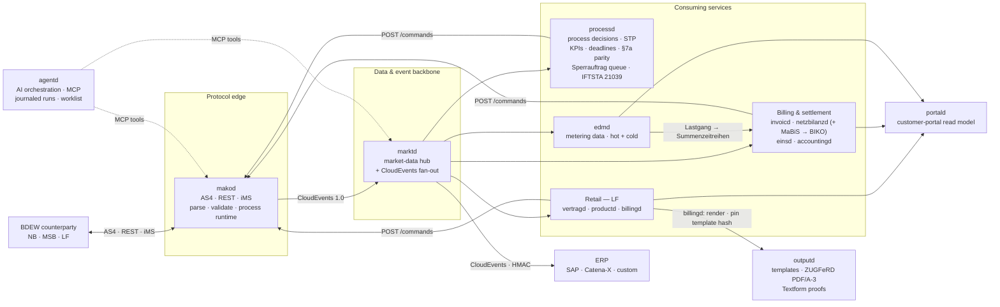
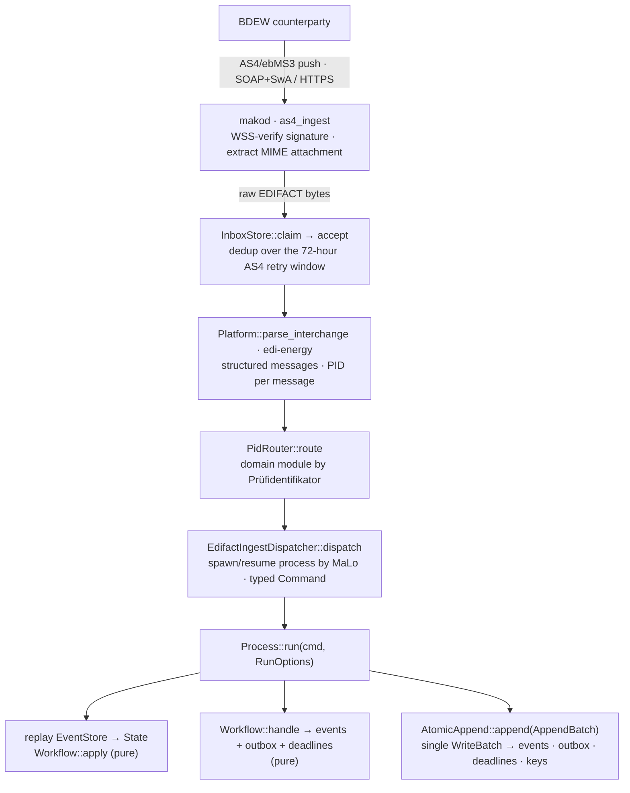
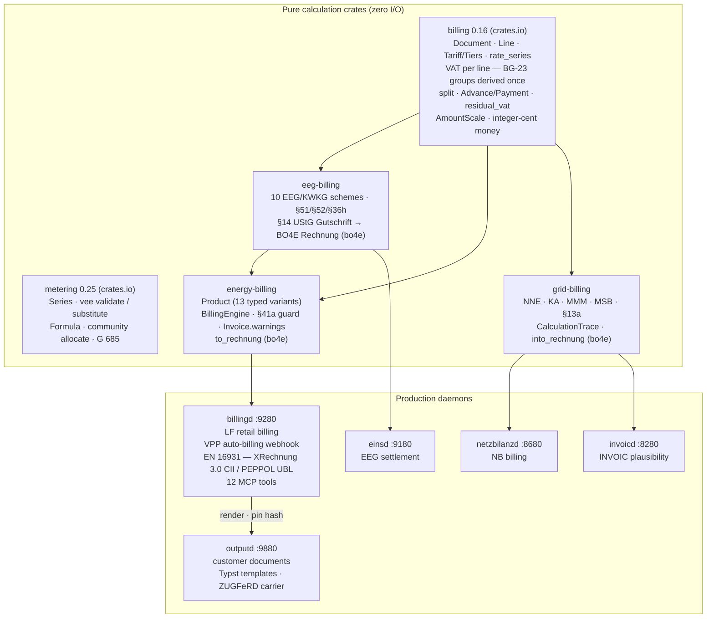
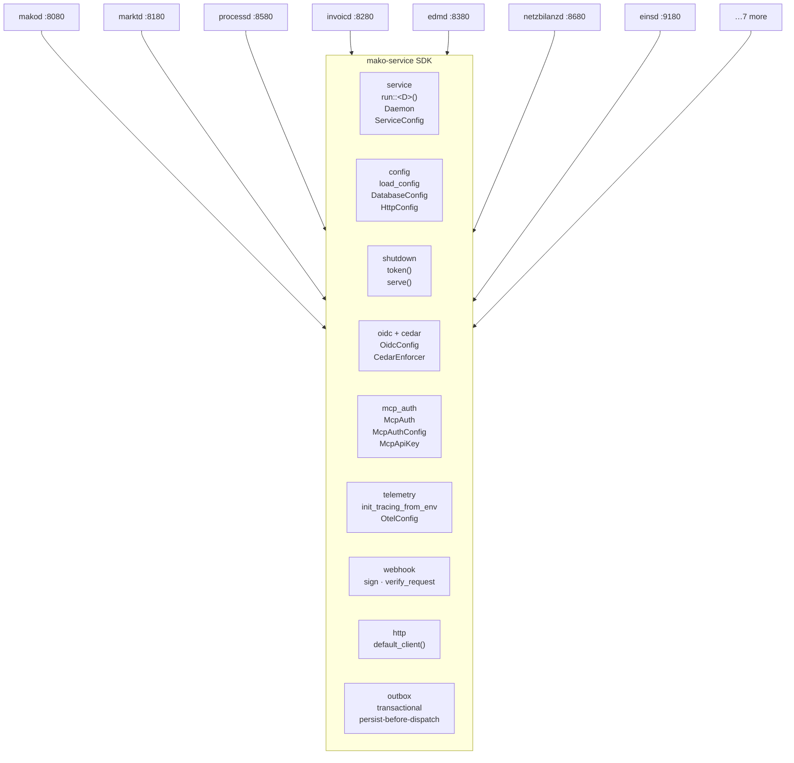
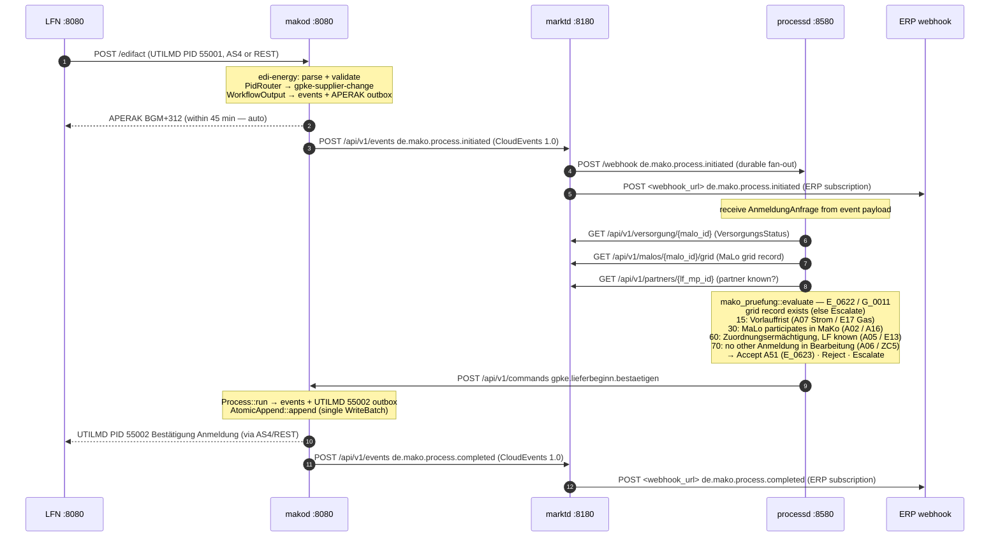

+++
title = "Architecture"
description = "How the platform fits together: the event-sourced engine, domain model, deadlines, and ERP/API integration."
weight = 2
sort_by = "weight"
template = "section.html"
page_template = "page.html"
+++
The design of `mako-engine` and the service mesh around it: the event-sourced
process runtime, the inbound and outbound transports, ERP integration over
BO4E + CloudEvents 1.0, the SlateDB persistence layer, and the daemons built
on the `mako-service` SDK.

---

## Design principles

| Principle | Consequence |
|---|---|
| **Protocol processor, not a business system** | `makod` handles EDIFACT, BDEW rules, AS4 delivery and regulatory deadlines. Contract data and business decisions live in the ERP and the consuming daemons |
| **`Workflow::handle` and `Workflow::apply` are pure** | Parsing, I/O and clock access happen at the transport boundary, before a command exists — so processes are deterministic and replayable |
| **One atomic write** | Events, outbox entries, deadlines and correlation keys go into one `WriteBatch` via `AtomicAppend::append(AppendBatch)`, the store's only write |
| **Event sourcing** | State is rebuilt by replaying the append-only log; audit trails and format-version migrations follow from the model |
| **Format-version coexistence** | Several Formatversionen run in one instance; a process finishes under the version it started with |
| **Persist before dispatch** | An outbound CloudEvent is written in the same transaction as the business row; a worker delivers it afterwards |
| **One deployment, one operator** | Isolation between market operators is per deployment, not row-level SaaS tenancy |
| **Capabilities grouped by regulatory domain** | A capability sits with the obligation it answers for — there is no `notificationd`, `documentd` or `forecastd` |
| **No API gateway** | Each daemon terminates its own OIDC/JWT and evaluates Cedar itself |

**Persist before dispatch.** `makod` writes the event and its outbox entry in
one SlateDB `WriteBatch`; the PostgreSQL services share `mako_service::outbox`
(`enqueue(&mut tx, &ce)` plus `OutboxWorker`). Delivery is at-least-once,
retried and dead-lettered; the receiver deduplicates on the CloudEvent `id`.

**One deployment, one operator.** A `tenant` column or `TenantId` carries the
operator's data-isolation key. It scopes data to the configured party — several
LF brands may share one `productd` — but separate operators run separate
processes, databases and AS4 identities.

**Capabilities grouped by regulatory domain.** Forecasting (§ 40a Abs. 2 EnWG)
and anomaly detection live in `edmd` because both work on the same metering
series; payments live in `accountingd` because they are one side of the
Kontokorrent. A document's *content* (amounts, VAT, EN 16931 payload) stays with
the billing service that computes it; its *rendering* (templates, ZUGFeRD,
Textform proofs) is `outputd`. Notification is `mako_service::webhook` plus
marktd's durable fan-out, not a service.

### No API gateway

A daemon that authorises evaluates Cedar against a resource it fully
understands — `MaKo::Command` carries `marktrolle` and `pid`. What belongs at the
edge (TLS termination, IP allowlisting, rate limits beyond the per-peer GCRA each
port applies) is the deployment's ingress. The other daemons evaluate their own
policy through `mako_service::cedar::CedarEnforcer`; three do not:

| Daemon | Gate |
|---|---|
| `makod` | its own `CedarAuthorizer` over `src/cedar/default.cedar` (or the shipped `conservative.cedar`), with MaKo-specific resource types |
| `agentd` | agentplane's policy, embedded from `policy/agentd.cedar` — the agent plane owns the tool-grant decision |
| `portald` | relays the customer's token to `vertragd`, which owns the customer record; `src/auth.rs` is the single gate |

`productd`'s § 41c EnWG comparison feed (`GET /api/v1/comparison-feed`) is
unauthenticated because the law obliges publication to comparison instruments.
It reads only `PUBLISHED` rows in an allow-listed set of categories. See
[`productd`](@/docs/services/productd.md).

---

## Service topology

Every inbound message enters through **makod**, which turns it into a
CloudEvent. **marktd** owns the market master data and fans events out to the
consuming services. Commands flow back to makod, which renders and dispatches
the outbound EDIFACT.



### Inbound message pipeline

How one AS4 EDIFACT interchange becomes committed process state inside makod:



The same interchange, redelivered, deduplicates at the inbox and no-ops at the
event store.

---

## Domain library crates

The pure, zero-I/O crates domain logic lives in:

| Crate | Role | Key API |
|---|---|---|
| `edi-energy` | EDIFACT parse / validate / build | `parse()`, `Platform`, `ValidationReport` |
| `mako-engine` | Event-sourced process runtime | `Workflow`, `Process`, `EventStore`, `AtomicAppend`, `OutboxStore`, `DeadlineStore` |
| `mako-markt` | Market data domain types + repo traits | `MaloId`, `MeloId`, `MarktpartnerId`, `VersorgungsStatus` |
| `mako-fristen` | The German market calendar | `heute`/`berlin_date`/`berlin_midnight`; `add_werktage`, `deadline_at_werktage`; `antwort`/`meldung`/`vorlauf` per-PID windows |
| `grid-billing` | NNE/KA/MMM/MSB grid settlement | `settle_nne`, `SettlementResult` with `CalculationTrace`; `reverse()`; opt-in `bo4e` → `into_rechnung()` |
| `energy-billing` | Multi-product retail billing (LF) | `Product` (13 categories) through `BillingEngine`; §14a loads, Strom-/Energiesteuer, HT/NT, §41a EPEX; optional `eeg` and `bo4e` features |
| `eeg-billing` | EEG/KWKG feed-in settlement (NB) | `calculate_settlement`, 10 schemes, §51/§52 rules; opt-in `bo4e` → §14 UStG Gutschrift as BO4E `Rechnung` |
| `mako-invoic` | The INVOIC settle/dispute process, shared by GPKE, WiM, GaBi Gas and GeLi Gas | `InvoicFamily`, `InvoicWorkflow<F>` |
| `invoic-checker` | INVOIC plausibility, eight stages | `InvoicCheckEngine::check`, `CheckOutcome` |
| `mako-pruefung` | The published Antwortcode decision trees, executable | `nb`/`lf`/`msb`/`mabis` behind `role-*` features; `codes::lookup`; `Cluster` picks the answer PID; unknown facts escalate |
| `mako-events` | Catalogue of every CloudEvents `type` — zero dependencies | one `pub const` per type in 16 modules; `all()`; `matches()` |
| `mako-service` | Service SDK for every daemon | see [below](#mako-service-service-sdk) |

### `mako-events` — one catalogue, no transport

Emitters and subscribers reference the constants instead of string literals, so
a producer/consumer mismatch is a compile error. The crate carries no envelope,
HTTP client or serialisation — `mako_service::CloudEvent` is the envelope,
`mako_service::outbox` the transport.

- Every type is lowercase reverse-DNS starting `de.`; a multi-word segment joins
  with `-`. `de.vertrag.*` uses German participles (`de.vertrag.gekuendigt`).
- A constant's doc comment carries its delivery status: `⚠ phantom:` is
  subscribed with no emitter (ten of the fourteen `de.gabi.*` types), `orphan
  emit:` the reverse.
- `matches()` is the one glob matcher every subscription uses: `*` matches any
  (possibly empty) sequence, `?` exactly one character.

### Billing crate hierarchy



`energy-billing` dispatches on a typed `Product` enum, one struct per category:

```
Product::Strom(ElectricityProduct)           → ElectricityProvider / DynamicElectricityProvider
Product::Waermepumpe(ControllableLoadProduct) → ControllableLoadProvider (§14a)
Product::Wallbox(ControllableLoadProduct)     → ControllableLoadProvider (§14a)
Product::Gas(GasProduct)                      → GasProvider
Product::Waerme(HeatProduct)                  → HeatProvider
Product::Wasser(WaterProduct)                 → WaterProvider (Trinkwasser + Abwasser)
Product::Solar(SolarProduct)                  → SolarProvider
Product::Eeg(EegProduct)                      → EegProvider
Product::Einspeisung(EinspeisungProduct)       → EinspeisungProvider
Product::Hems(HemsProduct)                     → HemsProvider
Product::Emobility(EmobilityProduct)           → EmobilityProvider
Product::Energiedienstleistung(ServiceProduct) → ServiceProvider
Product::Sharing(SharingProduct)               → ElectricityProvider + EnergyShareProvider
```

`ControllableLoadProduct` flattens an `ElectricityProduct`, so standard
electricity billing runs first and the §14a credit positions are appended. The
engine runs in passes:

```
Pass 0  validate_warnings()      §41a iMSys guard · KEIN_ARBEITSPREIS · § 42a cap
Pass 1  commodity / levy providers   (per-variant provider)
Pass 2  tax provider                 (MwStProvider — groups by applicable_tax_rate)
Pass 3  Abschlag deductions          (Final invoice reconciliation)
Pass 4  Minimum invoice top-up       (B2B Mindestabnahmeverpflichtung)
Pass 5  Cancellation sign reversal   (Stornorechnung)
```

### External crates.io dependencies

| Crate | Version | Purpose |
|---|---|---|
| [`billing`](https://crates.io/crates/billing) | `0.16` | Generic billing engine — fixed-point `Amount`, `Tariff`/`Tiers` pricing, a `Document` whose EN 16931 totals are derived once from its lines, exact largest-remainder `split` |
| [`en16931`](https://crates.io/crates/en16931) | `0.8` | EN 16931 semantic invoice model, business-rule validation and the invoice header and code lists `billing` does not carry |
| [`en16931-formats`](https://crates.io/crates/en16931-formats) | `0.8` | EN 16931 syntaxes — `write` of a validated invoice, `write_unchecked`, `read` of CII/UBL/ZUGFeRD with a typed entry for everything not mapped, and the ZUGFeRD reader |
| [`sepa`](https://crates.io/crates/sepa) | `0.9` | IBAN/BIC validation, pain.001/008/007 generation, camt.05x and pain.002 parsing |
| [`metering`](https://crates.io/crates/metering) | `0.25` | German energy metering quantities over a validated `Series` — validation and Ersatzwertbildung (`vee`), aggregation and resampling, the UTILTS Berechnungsformel and the § 42b/§ 42c community allocation, session splits, gas conversion |
| [`meterstore`](https://crates.io/crates/meterstore) | `0.15` | Metering time-series store beneath `edmd` — hot PostgreSQL window over TLS (`verify-full` unless the URL names a `sslmode`), settled Iceberg V2 history, version resolution, the delivery and provenance types |
| [`doubleentry`](https://crates.io/crates/doubleentry) | `0.7` | Double-entry ledger — append-only BLAKE3 Merkle log, inclusion and consistency proofs, period seals |
| [`rubo4e`](https://crates.io/crates/rubo4e) | `0.14` | BO4E business-object types — the `rubo4e::current` versioned schema with validation |
| [`agentplane`](https://crates.io/crates/agentplane) | `0.47` | Durable agent runtime behind `agentd` — journaled effects, typed manifests, human triage |
| [`asx-rs`](https://crates.io/crates/asx-rs) | `0.16.2` | AS4/ebMS3 — `Profile::bdew()` fixes BDEW AS4-Profil 1.2's security and wire settings; one client per MP-ID, the `Inbound` service, token-fenced `DedupStore`, verified receipts |
| [`edifact-rs`](https://crates.io/crates/edifact-rs) | `~0.18` | EDIFACT syntax layer beneath `edi-energy` — parse, serialise, directory validation, recovering scan for CONTRL fault locations |

`cargo xtask check-dep-versions` holds this table to the manifests.

---

## Companion daemons

All **14** daemons share one operational model:

- **TOML configuration** loaded from `NAME.toml`, with `NAME_…` environment
  overrides and `env:VAR_NAME` secret interpolation.
- **Cedar ABAC** on the HTTP surface — see [No API gateway](#no-api-gateway).
- **OIDC/JWT** with asymmetric algorithms only and a background-refreshed JWKS;
  omitting `[oidc]` is dev mode.
- **OpenTelemetry** OTLP traces on workflow commands, event appends and webhook
  deliveries.
- **MCP server** (`POST|GET /mcp`, Streamable HTTP) on **11 of the 14**: all
  except `outputd`, `portald` and `agentd`, which is the MCP *host* that calls
  the others.

Ports, market roles and per-daemon design live in the
[Services section](@/docs/services/_index.md). `makod` is the protocol gateway
the rest sits behind: EDIFACT ↔ BO4E, 71 workflows over 469 Prüfidentifikatoren,
AS4 ingest and the deadline scheduler.

| Daemon | Port | Role in the mesh |
|---|---|---|
| [`marktd`](@/docs/services/marktd.md) | `:8180` | Market master data; derives `VersorgungsStatus` from the answer PID; durable persist-before-fan-out to subscribers with a status-column DLQ |
| [`processd`](@/docs/services/processd.md) | `:8580` | Automated NB/LF answers via `mako-pruefung`; ambiguous cases go to an approval queue. Keeps the rebuildable process projection (deadline risk, BNetzA KPIs, § 7a Abs. 5 EnWG evidence) and the NB Sperr-/Entsperrauftrag queue that reports back as IFTSTA 21039 |
| [`invoicd`](@/docs/services/invoicd.md) | `:8280` | INVOIC plausibility (eight stages) and the accept/reject command of the PID's own family |
| [`edmd`](@/docs/services/edmd.md) | `:8380` | Metering data — MSCONS, direct pushes, validation, substitute values, BO4E reads |
| [`netzbilanzd`](@/docs/services/netzbilanzd.md) | `:8680` | NB outbound billing — NNE, KA, MMM, MSB — with self-validation and an operator review step |

### Every JSON request body, everywhere

- **A BO4E document in a request body is a `Bo4e<T>`**, so
  [the gate](@/docs/architecture/domain-model.md#the-bo4e-gate) runs while
  `serde` deserialises and no handler can skip it.
- **Every body denies unknown fields** — a misspelt key is a `422` naming the
  field, not a setting that does nothing.

`mako_service::Json` is the extractor, so both refusals render the platform's
`{error, detail, …}` problem body. It refuses an undeclared key at any depth:
the `422` carries `code: "unknown_field"` and the keys' JSON paths in `paths`
(`["adresse.plz", "intervalle.3.qualitaet"]`). A key inside a
`#[serde(flatten)]` member, an `#[serde(untagged)]` or an internally tagged
enum is out of the extractor's sight, so such a shape carries
`#[serde(deny_unknown_fields)]`. `mako_service::Lenient` drops the unknown-key
refusal, for a body whose schema an external specification defines.
`cargo xtask check-request-bodies` names a buffered shape that does not deny,
and a `Lenient` or `axum::Json` extraction its list does not carry with a
reason.

### Every failure, everywhere

A handler returns `ApiResult<T>`, and every failure leaves it as an
`ApiError` in the same problem shape:

| Failure | Status | Body |
|---|---|---|
| the caller's mistake — `bad_request`, `unprocessable`, `conflict`, `not_found`, `forbidden`, `unauthorized`, `precondition_failed` (412, an `If-Match` that does not hold), `payload_too_large` | 4xx | `{ "error", "detail" }`, `detail` written for the caller |
| not now, or not in this build — `too_many_requests` (429, resend), `unavailable` (503, retry), `not_implemented` (501, do not retry) | 429 / 501 / 503 | `{ "error", "detail" }` |
| this service's fault — `ApiError::internal(e)`, or `?` on an `anyhow::Error` / `sqlx::Error` (`RowNotFound` is a 404) | 500 | `{ "error": "Internal Server Error", "detail": "internal server error", "error_id" }` |
| a service this one calls — `ApiError::upstream_status`, `upstream_request`, `upstream`, `upstream_unreachable` | 502 / 503 / 504 | `{ "error", "detail": "upstream service <name> failed", "upstream", "error_id" }` |

`error` is the status's reason phrase. A client that branches on *why* reads
`code`, the stable machine reason any variant can carry beside the sentence
(`.with_code("duplicate_process")`), and the identifiers the refusal is about
ride in the same body (`.with_fields(json!({ "process_id": … }))`,
`ApiError::conflict_with(code, msg, fields)`); `error`, `detail`, `error_id`
and `upstream` are never overwritten.

The error's own text — a database message, a constraint name, the body an
upstream answered with — never reaches the response. It is logged at `error`
level with the same `error_id` (a UUID v4, fresh per response), so the id a
caller reports finds the log line. `cargo xtask check-error-tuples` refuses
any hand-built `(StatusCode::<non-2xx>, …)` tuple in `services/*/src` outside
a `#[cfg(test)]` item. A report whose status follows from its own content — a
readiness probe, `makod`'s EDIFACT ingest report counting its rejections —
answers through its own `IntoResponse`, which picks the status from the
report.

### `mako-service` — Service SDK



| Module | Key exports |
|---|---|
| `service` | `run::<D>()`, `Daemon`, `ServiceConfig`, `ServiceContext` — the daemon lifecycle runner |
| `config` | `load_config`, `DatabaseConfig`, `HttpConfig` — layered TOML + env-var + `_FILE` secrets |
| `shutdown` | `token()` (SIGINT + SIGTERM), `serve()` — graceful connection drain |
| `oidc` | `OidcConfig`, `OidcVerifier`, `OidcConfig::build_verifier()` |
| `mcp_auth` | `McpAuth`, `McpAuthConfig`, `McpApiKey`, `McpIdentity` |
| `telemetry` | `init_tracing_from_env`, `init_tracing`, `OtelConfig` |
| `cedar` | `CedarEnforcer` |
| `health` | `health_routes` — `/health/live` + `/health/ready` |
| `http` | `default_client()` — `reqwest::Client` with a 5 s connect timeout |
| `webhook` | `sign`, `verify_request` — Standard Webhooks; `verify_request` also refuses a stale timestamp and returns the id to deduplicate on |
| `builder` | `ServiceBuilder` — Axum router with health, metrics, trace layer |
| `outbox` | Transactional outbox — `enqueue` in the business transaction, drain worker with retry and dead-lettering |
| `cloudevent` | `CloudEvent`, `post_ce_with_retry`, `source`; type names come from `mako-events` |
| `metrics` | `init_metrics` — Prometheus registry and `/metrics` |
| `rate_limit` | `RateLimitConfig` — the per-peer GCRA every port applies |
| `worker_lock` | PostgreSQL session-level advisory lock, so a periodic worker runs on one replica; a dead replica's connection releases it |

#### The daemon runner

Every daemon but `makod` is a library: its `Daemon` lives in `lib.rs` (or a
module of it, `daemon.rs`), and `main.rs` is the one line
`mako_service::run::<D>().await`. `cargo xtask check-thin-main` refuses
anything more, and `[[bin]] test = false` keeps the binary out of the test
build. A test under `tests/it/router_builds.rs` builds the router the binary
mounts through `mako_service::build_for_test::<D>(cfg)`, runner routes
included. The runner initialises tracing, loads `NAME.toml` plus `NAME_…` env vars, connects
a tuned pool with `application_name = NAME`, runs `Daemon::migrate`, wires the
shutdown token, mounts health/metrics/trace routes, and serves with graceful
drain:

```rust
struct Productd;

impl Daemon for Productd {
    type Config = ProductdConfig;   // impls ServiceConfig: database() + bind_addr()
    const NAME: &'static str = "productd";

    async fn migrate(pool: &PgPool) -> anyhow::Result<()> { /* sqlx::migrate! */ }

    async fn build(cfg: Arc<ProductdConfig>, ctx: ServiceContext) -> anyhow::Result<Router> {
        // ctx.pool() · ctx.http · ctx.shutdown — spawn workers, build the domain router
    }
}

#[tokio::main]
async fn main() -> anyhow::Result<()> { mako_service::run::<Productd>().await }
```

Every config takes its listen address as `[http] addr` (`HttpConfig`, with
the daemon's default from `HttpConfig::on_port`), and `dev/ports.toml` is the
one table of dev ports the dev configs are checked against.

`ServiceConfig::database()` returning `None` marks a stateless daemon: no pool,
no migrations, readiness is `Daemon::ready` alone, and `ServiceContext::pool()`
panics. Domain routes, workers, the OIDC verifier and MCP auth live in
`Daemon::build`.

`makod` drives its own `main` and takes `mako-service` piecemeal
(`http::default_client`, `oidc::OidcVerifier`,
`telemetry::init_tracing_from_env`).

#### What `/metrics` carries on every service

| Metric | Type | What it says |
|---|---|---|
| `mako_http_requests_total{method,path,status}` | counter | Request volume and status mix. A UUID, a pure-digit segment or anything over 24 characters becomes `{id}`, so a MaLo-ID cannot multiply series |
| `mako_http_request_duration_seconds{method,path}` | histogram | Latency, bucketed 1 ms → 5 s |
| `mako_bo4e_decimal_from_json_number_total` | counter | BO4E amounts read from a JSON **number** rather than a string |

`makod` renders the third itself beside its own `makod_*` gauges. `marktd` and
`processd` register their gauges on the same registry; `invoicd`, `processd`'s
read model and `accountingd` serve theirs from their own path (`/invoicd/metrics`,
`/obs/metrics`, `/accountingd/metrics`). No daemon may route `/metrics` a second
time — `Router::merge` panics on the overlap at startup — and `cargo xtask
check-runner-routes` holds every runner daemon to that.

The third metric is worth an alert. A fractional JSON number has passed through
`f64` before any deserializer sees it (`0.1` is
`0.1000000000000000055511151231`). BO4E permits both spellings, so mako counts
rather than refuses: a rising series identifies the producer, a flat zero says
every amount arrived with its scale intact.

---

## EDM reference architecture mapping

Classic German EDM platforms (Robotron ecount, SAP IS-U EDM, Kisters BelVis)
bundle the energy-data value chain into one system. mako spreads the same layers
across single-purpose daemons around one metered-data spine (`edmd`):

| EDM reference layer | Home | Notes |
|---|---|---|
| Data acquisition | `edmd` — MSCONS via marktd, direct iMSys/RLM/Gas push, IoT push, bulk, optional Kafka | All paths run the same per-register validation |
| Time-series database | `edmd` over `meterstore` — PostgreSQL hot window + Iceberg settled history | `?as_of=` reconstruction; `allocation_version` INITIAL/CORRECTION/FINAL |
| Validation engine (VEE) | `metering::vee::validation`, on every ingest path | Annotate-only: suspect readings are stored with `quality_warnings`, never discarded |
| Substitute values (§ 60 Abs. 1 MsbG) | `metering::vee::substitute` + `edmd` REST/MCP | Interpolation up to two hours, else the Vergleichswert of comparable days (MeteringCode 2006 A8.2.2); refused, never invented; `substitute_value_log` audit |
| Calculation engine | `metering`: aggregation, HT/NT, Spitzenleistung, G685 gas conversion, the UTILTS Berechnungsformel, the § 42b/§ 42c allocation, Mehr-/Mindermengen | Typed rules; a virtual meter's formula is the UTILTS step graph |
| Forecasting | `edmd /forecast` — § 40a Abs. 2 EnWG Verbrauchsschätzung | No ML runtime in-core |
| Balancing / settlement | `netzbilanzd` (grid invoices; Summenzeitreihen, PID 13003), `mako-gabi-gas` in makod | edmd serves `/summenzeitreihe` and `/billing-period` |
| Market communication | `makod` — 17 EDIFACT message types, deadline scheduler, CONTRL/APERAK | Business state lives in the daemons |
| Billing interface | `billingd` (LF retail) and `invoicd` (INVOIC plausibility) read edmd's `MeterBillingPeriod` and Lastgang | edmd answers "what flowed", never "what it costs" |
| Reporting & analytics | `processd`'s process read model, edmd OLAP (`/archive/*`, `/query/sql`, Arrow IPC), `portald`, `agentd` | Headless |
| Workflow automation | Config-gated workers: edmd archival, billingd §40b runs, accountingd Abschlag/SEPA/dunning, netzbilanzd MaBiS windows | Hourly tick, gated, idempotent via SQL claim |

**Not in scope:** SCADA/Leittechnik acquisition (grid systems push through the
IoT/bulk APIs); in-core ML forecasting or weather ingestion; a water market
process (`Sparte::WASSER` reads are stored and validated, and `energy-billing`
invoices water, but there is no water EDIFACT); an operator cockpit UI.

## End-to-end: UTILMD 55001 Lieferbeginn

A GPKE Anmeldung from the LF through to the NB's Bestätigung:



The APERAK goes out within 45 minutes (APERAK AHB 1.1 §2.4.1).

---

## Outbound flows

### AS4 EDIFACT delivery

`OutboxWorker` polls `OutboxStore` every 5 seconds. For each pending message
`BdewAs4Sender` looks up the recipient's `[[as4.partner]]` (endpoint and
encryption certificate), renders the interchange through the `edi-energy`
builders and passes it back through the AHB gate, then sends it with the AS4
client of the interchange's sender (UNB DE0004, its `[[party]]` keys), which
signs, encrypts and verifies the receipt (`asx-rs`). Success acknowledges the
entry; a failure retries inside the 72-hour window, then dead-letters. An
unknown recipient dead-letters at once.

A message addressed to the operator's own MP-ID bypasses AS4: `BdewAs4Sender`
renders it, re-parses it with `Platform::parse_interchange` and hands each
message to `EdifactIngestDispatcher::dispatch`. See
[Integrated operators](@/docs/services/makod.md#integrated-operators-nb-msb-same-mp-id).

### ERP CloudEvents delivery

`OutboxErpWorker` polls the same store every 5 seconds, builds a
[CloudEvents 1.0](https://cloudevents.io) envelope, signs it when
`--erp-webhook-secret` is set, and posts it to `--erp-webhook-url`. `2xx`
acknowledges; `429`/`5xx` back off; any other `4xx` dead-letters. See
[ERP Integration](@/docs/architecture/erp-integration.md).

### Deadline scheduler

`DeadlineScheduler` ticks every **30 seconds** by default
(`--deadline-poll-interval-secs`, minimum 1). For each due entry in
`DeadlineStore`:

1. A delivery window (an APERAK or CONTRL not delivered in time) raises a
   regulatory alert and reaches no workflow.
2. Otherwise the scheduler looks up the `WorkflowDriver` registered under the
   deadline's workflow name and calls `Process::run_timeout`, which asks the
   workflow's `on_deadline` — for a label in its `DEADLINE_LABELS` only —
   whether the window the label names is still open.
3. If it is, the workflow records the lapse — the outcome its Festlegung gives
   the silence, or `FristAbgelaufen` where it gives none — in one write, with an
   `AperakTimeout` outbox entry where it carries one.
4. That entry reaches the ERP as `de.mako.aperak.timeout` through
   `OutboxErpWorker`.

See [Compensation](@/docs/architecture/compensation.md).

---

## Domain crate layering

Each domain crate defines its `Command`, `Event` and `State` types, implements
`Workflow` with pure `handle` and `apply`, and exposes an `EngineModule` that
registers its PIDs with the `PidRouter` and its workflows through
`drivers()`. `makod::startup::MODULE_TABLE` is the one list of modules, each
registered for the `[deployment] rollen` that need it:

| Module | Scope |
|---|---|
| `mako_gpke::GpkeModule` | GPKE UTILMD, INVOIC 31001/31002/31005/31006, ORDERS Sperrung Strom 17115–17117, Konfiguration 17134/17135/19001/19002, PARTIN 37000–37006 |
| `mako_wim::WimModule` | WiM in both Sparten — 55039/55042/55051/55168 and the Gas twins, Geräteübernahme, INSRPT, INVOIC 31009/31003/31004, ESA Wertebestellung |
| `mako_geli_gas::GeliGasModule` | GeLi Gas 44001–44024, ORDERS Sperrung Gas 17115–17117, PARTIN 37008–37014, INVOIC 31011 |
| `mako_gabi_gas::GaBiGasModule` | INVOIC 31007/31008/31010, REMADV 33001, COMDIS 29001, MSCONS 13013 Allokationsliste |
| `mako_mabis::MabisModule` | MaBiS — Summenzeitreihen, IFTSTA Datenstatus, Clearinglisten, the ZP lifecycle |
| `mako_emob::EmobModule` | NZR-EMob / Modell 2 — UTILMD 55238–55243 |
| `mako_redispatch::RedispatchModule` | Redispatch 2.0 XML routing and IFTSTA 21037/21038 |

PIDs 44022–44024 route by which side of the exchange the deployment is on: any
`Nb` role receives 44022 in `geli-gas-stornierung`, any `Lf` role receives
44023/44024 in `geli-gas-stornierung-lf`. The
[PID Reference](@/docs/regulatory/pid-reference.md) is the complete table.

`EdifactIngestDispatcher` is called by AS4 inbound (`as4_ingest`), REST ingest
(`edifact_api`) and the AS4 sender's loopback.

---

## Billing crate family

Four crates, cut by legal regime and counterparty pair:

| Crate | Regime | Parties | Core |
|---|---|---|---|
| [`billing`](https://crates.io/crates/billing) (crates.io) | none — generic | any | `Amount<P>` fixed-point money, sign-symmetric `Rounding`, `Tariff`/`Tiers`, `rate_series`, exact largest-remainder `split` |
| `energy-billing` | §§40–41b EnWG, StromStG, EnergieStG, BEHG | LF → end customer | retail invoices for 13 product categories |
| `grid-billing` | StromNEV/GasNEV, KAV, MsbG, §§13a/14a EnWG | NB ↔ LF/MSB/ANB | network settlement (NNE/KA/MMM/MSB/AWH, §13a Redispatch-Vergütung) |
| `eeg-billing` | EEG (2000–2024), KWKG 2023 | NB → Anlagenbetreiber | statutory subsidy settlement, 10 schemes |

The domain crates share no billing logic with each other; everything reusable
lives in `billing`. **Water** has no market-communication regime, so it is a
product category in `energy-billing` (`WASSER`): Trinkwasser at 7 % USt (§12
Abs. 2 Nr. 1 UStG, Anlage 2 Nr. 34) and the gesplittete Abwassergebühr, with
the public-law fee outside USt.

### Money types — the `Decimal` / `Amount` split

The calculation pipelines run on `rust_decimal::Decimal`; monetary results pass
through `EuroAmount` (= `Amount<5>`, an `i64` scaled by 10⁻⁵):

- **Pipelines need non-money operands** — kWh, kW, months, percentages,
  pro-rata fractions. `Decimal` is exact (28 significant digits), so nothing is
  lost in between.
- **Results must be representable money.** Every EUR amount leaving a billing
  crate is rounded and range-checked through `EuroAmount`; a value outside the
  `Amount<5>` range is refused, not truncated.
- **Statutory-precision paths use `billing` directly** — §41a EPEX interval
  pricing in `energy-billing` sums Σ qᵢ·pᵢ exactly through
  `billing::rate_series` and reduces the total once, half away from zero.

---

## SlateDB key schema

One `slatedb::Db` underpins every engine store; the stores keep separate,
byte-sortable key spaces, so the time-ordered scans are range reads.

| Prefix | Content | Key pattern | Value |
|--------|---------|-------------|---|
| `e/` | Event log | `e/<stream_id>/<seq:016x>` | `JSON(EventEnvelope)` |
| `sv/` | Stream version (optimistic lock) | `sv/<stream_id>` | `u64` LE |
| `si/` | Stream existence index | `si/<stream_id>` | `""` |
| `sn/` | Snapshots | `sn/<stream_id>` | `JSON(Snapshot)` |
| `om/` | Outbox payloads | `om/<message_id>` | `JSON(OutboxMessage)` |
| `ot/` | Outbox **time index** | `ot/<ts_nanos:016x>/<id>` | `""` |
| `dl/` | Deadline payloads | `dl/<deadline_id>` | `JSON(Deadline)` |
| `dt/` | Deadline **time index** | `dt/<due_nanos:016x>/<id>` | `""` |
| `ds/` | Deadlines by stream | `ds/<stream_id>/<id>` | `""` |
| `pr/` | Process registry (1:1 routing) | `pr/<tenant_id>/<routing_key>` | `JSON(ProcessIdentity)` |
| `ci/` | Correlated index (1:many) | `ci/<tenant_id>/<tag>/<process_id>` | `JSON(ProcessIdentity)` |
| `pt/` | Partner directory | `pt/<tenant_id>/<mp_id>` | `JSON(PartnerRecord)` |
| `ib/` | Inbox dedup sentinel | `ib/<inbox_key>` | `""` |
| `it/` | Inbox time index (TTL purge) | `it/<ts_nanos:016x>/<nonce>` | `"<inbox_key>"` |
| `dr/` | Durable dead-letter queue | `dr/<ts_nanos:016x>/<uuid>` | `JSON(DeadLetterRecord)` |
| `cp/` | Projection cursor per stream | `cp/<projection_name>/<stream_id>` | `u64` LE |

Payload and time index are two prefixes (`dl/` + `dt/`, `om/` + `ot/`, `ib/` +
`it/`): the payload is addressed by id, the scheduler's "what is due now" is a
range scan over the index, whose key starts with the zero-padded timestamp.

`pr/`, `ci/` and `pt/` carry the tenant because they are looked up by a business
key — conversation id, correlation tag, MP-ID — that is not unique across
operators. The event, outbox, deadline and inbox spaces are keyed on values that
already are unique.

`AtomicAppend::append` and the outbox/deadline/registry writes run in
**Serializable Snapshot Isolation** transactions, pinned explicitly. A
write-write conflict on a shared key such as `sv/<stream_id>` rejects the second
commit as `EngineError::VersionConflict`.

---

## Testing strategy

Every service is a lib + binary crate: `src/lib.rs` exports the modules and
`src/main.rs` is a thin driver, so the single integration-test binary under
`tests/it/` uses the crate directly.

| Layer | Test type | Tooling |
|---|---|---|
| EDIFACT parse/validate | Unit + property + fuzz | `edi-energy` tests, `cargo-fuzz` (`just check-fuzz`) |
| Workflow logic | Unit | `InMemoryEventStore`, `InMemoryOutboxStore` |
| Deadline arithmetic | Unit | `mako-fristen` with the BDEW holiday table |
| AS4 inbound routing | Integration | `services/makod/tests/it/e2e_ahb_conformance.rs` — fixture EDIFACT through the full pipeline |
| EEG settlement formulas | Unit (no DB) | `cargo test -p einsd --test it settlement_tests` |
| Ledger, IBAN, period seal | Unit (no DB) | `cargo test -p accountingd --test it unit_tests` |
| Billing arithmetic | Unit + proptest + golden master | `cargo test -p energy-billing --all-features` |
| PostgreSQL suites | Schema-per-test, `#[ignore]`d | `just test-db` (needs Docker) |

---

## Related documentation

| Topic | File |
|---|---|
| Getting started | [Getting started](@/docs/guide/getting-started.md) |
| Engine internals | [Engine internals](@/docs/architecture/engine.md) |
| Compensation flows | [compensation](@/docs/architecture/compensation.md) |
| ERP integration | [erp-integration](@/docs/architecture/erp-integration.md) |
| PID reference | [pid-reference](@/docs/regulatory/pid-reference.md) |
| Operator guides | [Services](@/docs/services/_index.md) |
