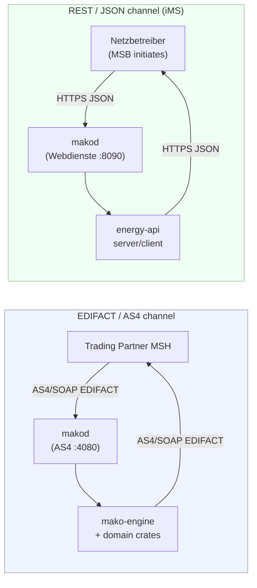
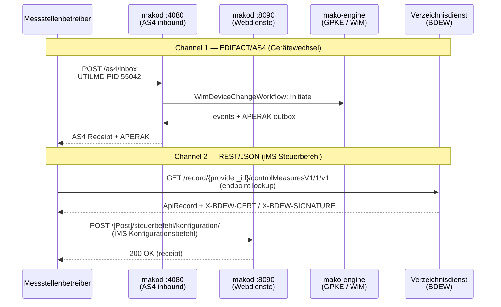

+++
title = "API-Webdienste Strom"
description = "BDEW API-Webdienste Strom: the REST/JSON iMS channel beside EDIFACT/AS4 — control measures, MaLo-ID queries and the Directory Service, via energy-api."
weight = 11
+++
Electricity market processes run over **two channels**: EDIFACT over AS4, and
the REST/JSON API-Webdienste for intelligente Messsysteme. This page maps
processes to channels and shows both in one application.

---

## Two parallel channels



| Channel | Crates | Transport | Processes |
|---------|--------|-----------|-----------|
| EDIFACT/AS4 | `edi-energy` + `mako-engine` + `makod` | SOAP/SwA, TLS, WS-Security | UTILMD, MSCONS, APERAK, CONTRL, INVOIC, REMADV, ORDERS, ORDRSP, and all other MaKo message types |
| REST/JSON (API-Webdienste) | `energy-api` | HTTPS, JWS signatures | iMS control measures, MaLo-ID queries, directory service |

The REST channel serves intelligente Messsysteme (iMS) processes from
2026-01-29 ([BDEW API-Webdienste Strom](https://www.bdew-mako.de/documents)). It
does not replace EDIFACT; participants in scope for iMS need both.

---

## When to use each crate

### EDIFACT/AS4 channel — `edi-energy` + `mako-engine` + `makod`

```bash
cargo add edi-energy --features utilmd,mscons
cargo add mako-engine --features slatedb
cargo add mako-gpke          # or mako-wim / mako-geli-gas / mako-mabis
```

Use these crates for:
- Parsing and validating EDIFACT messages received over AS4 (`edi-energy`).
- Building outgoing EDIFACT messages (`edi-energy` builders).
- Running long-lived market processes with event sourcing, regulatory deadlines, and atomic outbox enqueue (`mako-engine` + domain crates).
- Production AS4 inbound reception with WSS verification and deduplication (`makod` via `asx-rs`).

See the [Process Engine Guide](@/docs/architecture/engine.md) for `mako-engine` architecture and the [Getting Started guide](@/docs/guide/getting-started.md) for a first workflow example.

### `energy-api` — for iMS REST processes

```bash
cargo add energy-api --features client   # HTTP client
cargo add energy-api --features server   # Axum server handler
```

Use this crate for:
- Sending and receiving iMS grid control commands (`controlMeasuresV1`).
- MaLo-ID queries (`maloIdentV1`).
- Looking up endpoint URLs via the Verzeichnisdienst (directory service).
- Reading directory records with the `X-BDEW-CERT` / `X-BDEW-SIGNATURE` JWS the
  Verzeichnisdienst returns over the RFC 8785 canonical record.

---

## Processes mapped to channels

| BDEW process | Channel | Crate | Notes |
|---|---|---|---|
| Lieferbeginn/-ende (GPKE) | EDIFACT/AS4 | `edi-energy` | UTILMD |
| Zählpunktregistrierung (WiM) | EDIFACT/AS4 | `edi-energy` | UTILMD |
| Fahrplankommunikation | EDIFACT/AS4 | `edi-energy` | MSCONS |
| Lastgangkommunikation | EDIFACT/AS4 | `edi-energy` | MSCONS |
| iMS Steuerbefehl — Konfiguration / initialZustand | REST/JSON | `energy-api` | `ControlMeasuresHandler::on_konfiguration` / `on_initial_zustand` receives; `energy-api` has no sending client |
| iMS Rückmeldungen — vorläufig und endgültig, je positiv und negativ, plus `information` und `informationAnweisung` | REST/JSON | `energy-api` | the six remaining `ControlMeasuresHandler` methods; eight `POST /[Post]/steuerbefehl/…` routes in total |
| MaLo-ID-Abfrage | REST/JSON | `energy-api` | `MaloIdentClient` → `POST /maloId/request/v1`; `MaloIdentHandler` receives |
| iMS Universalbestellprozess — Anmeldung (PID 11021, NB → MSB) | REST/JSON | `energy-api` | `WimOrderHandler::on_anmeldung` — `POST /wimBestellung/v1/anmeldung/` |
| iMS Universalbestellprozess — Bestätigung (PID 11022, MSB → NB) | REST/JSON | `energy-api` | `WimOrderHandler::on_bestaetigung` — `POST /wimBestellung/v1/bestaetigung/` |
| iMS Universalbestellprozess — Ablehnung (PID 11023, MSB → NB) | REST/JSON | `energy-api` | `WimOrderHandler::on_ablehnung` — `POST /wimBestellung/v1/ablehnung/` |
| Endpunkt-Lookup | REST/JSON | `energy-api` | `DirectoryServiceClient::get_record` — `GET /record/{provider}/{api}/{major}/v1` |

---

## Integration pattern

A market participant acting as **Netzbetreiber (NB)** typically needs both
channels simultaneously: EDIFACT for GPKE/WiM process messages and REST for iMS
control measure reception.



`DirectoryServiceClient::get_record(provider_id, api_id, major_version)`
returns the record with its certificate and signature headers, so the caller
verifies the JWS before trusting the endpoint URL. The `/[Post]/` prefix on the
Steuerbefehl routes is the BDEW OpenAPI path template, mirrored verbatim.


```rust
use edi_energy::{parse_interchange, EdiEnergyMessage};
use energy_api::directory::DirectoryServiceClient;
use energy_api::server::control_measures;
use url::Url;

// ── EDIFACT/AS4 channel ──────────────────────────────────────────────────────
// Incoming AS4 payload bytes arrive from the message queue:
fn handle_as4_message(payload: &[u8]) -> Result<(), edi_energy::Error> {
    for msg in parse_interchange(std::io::Cursor::new(payload)) {
        let msg = msg?;
        let pid = msg.detect_pruefidentifikator()?;
        let report = msg.validate()?;
        println!("MSG {pid}: valid={}", report.is_valid());
    }
    Ok(())
}

// ── REST/JSON channel ────────────────────────────────────────────────────────
// Look up the MSB endpoint for a given MaLo before sending a control command:
#[cfg(feature = "client")]
async fn lookup_msb_endpoint() -> Result<(), energy_api::Error> {
    let dir = DirectoryServiceClient::new_insecure(
        Url::parse("https://verzeichnisdienst.example.de/").unwrap(),
    )?;
    let (record, _cert, _sig) = dir
        .get_record("1234567890123", "controlMeasuresV1", 1)
        .await?;
    println!("MSB endpoint: {}", record.url);
    Ok(())
}
```

The two crates are independent and share no types; only the MaLo/MeLo
identifiers appear in both channels.

---

## `energy-api` feature flags

| Feature | What it enables |
|---------|-----------------|
| `client` | HTTP clients — `MaloIdentClient`, `DirectoryServiceClient` (reqwest + rustls) and TR-03116-3 content signing |
| `server` | Axum router factories for `ControlMeasuresHandler`, `MaloIdentHandler`, and `WimOrderHandler` receive handlers |
| `websocket` | The Verzeichnisdienst subscription client (tokio-tungstenite) |

Content-layer signing (Regelungen zum Übertragungsweg für API-Webdienste 1.2,
Kap. 3.3: `X-BDEW-DIGEST` / `X-BDEW-SIGNATURE` / `X-BDEW-CERT` over the URI, the
RFC 8785 canonical JSON, `creationDateTime`, `transactionId` and any
`initialTransactionId`) and JWS verification are always compiled, not features.
A request is signed exactly when a signing key and its certificate are
configured on the client (`with_signing`).

---

## Scope boundary: Electricity only (Gas API status)

`energy-api` implements the **BDEW API-Webdienste Strom** only. BDEW has
published no Gas API-Webdienste specification, so Gas iMS processes use EDIFACT
over AS4 and `energy-api` carries no gas surface.

---

## Identifier validation

Every BDEW identifier crossing this boundary is a validated `rubo4e::identifiers`
type. `Deserialize` enforces the check digit, so a malformed MaLo-, MeLo-, NeLo-,
SR- or TR-ID is rejected with **400** before it reaches a handler.

MaLo-Ident is mandatory since 06.06.2025 with a 2-hour deadline and precedes
every supplier switch, so it is where a bad identifier would otherwise enter.

`MarketPartnerId` is a string, not an integer — BDEW codes may carry leading
zeros.

## Specification versions

`energy-api` implements **1.0.0**, the version in force.

[BNetzA Mitteilung Nr. 58](https://www.bundesnetzagentur.de/DE/Beschlusskammern/BK06/BK6_83_Zug_Mess/835_mitteilungen_datenformate/Mitteilung_58/Mitteilung_Nr_58.html)
(01.10.2026) publishes no API-Webdienste document for 01.04.2027 and settles the
channel's scope:

> Die API-Guideline verbleibt daher zunächst auf dem aktuell produktiven Stand.
> Die bereits produktiv eingesetzten APIs werden beibehalten und
> weiterentwickelt. Die im Rahmen der Konsultation neu vorgesehenen APIs werden
> hingegen zurückgezogen.

The API-Webdienste stay limited to the Anwendungsfälle **MaLo-Ident** and
**Steuern**. The Lokationsbündel and Berechnungsformel APIs are not introduced —
„Die UTILTS bleibt damit erhalten", and both travel by UTILMD or UTILTS — and the
Anwendungsfälle of the MaBiS-Hub Festlegung (BK6-24-210-1) are specified in
EDIFACT, not as new APIs.

`EDI-Energy/api-electricity` carries a `2.0.0` tag that adds new process APIs,
`locationBundle` and `calculationFormula` among them. No Mitteilung makes it
binding, and `energy-api` does not implement it.

Note the specs are split across two repositories: `EDI-Energy/api-electricity`
(electricity APIs) and `EDI-Energy/api-directory-service` (Verzeichnisdienst).

## Further reading

- [Getting Started](@/docs/guide/getting-started.md) — EDIFACT parsing and process engine first steps
- [Process Engine Guide](@/docs/architecture/engine.md) — `mako-engine` architecture, stores, deadlines, outbox
- [Platform guide](@/docs/reference/platform.md) — multi-tenant EDIFACT processing
- [Validation guide](@/docs/reference/validation.md)
- BDEW MaKo document portal: <https://www.bdew-mako.de/documents>
