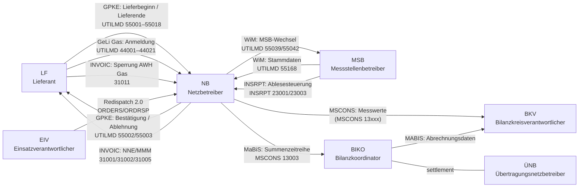

+++
title = "Domain Model"
description = "The BDEW market role model, market objects (MaLo, MeLo, NeLo, NeBe), territories, identifier check-digit rules and their EDIFACT encoding."
weight = 13
+++
The BDEW **Rollenmodell für die Marktkommunikation**, the market objects and
the identifier formats used across EDI@Energy messages — the vocabulary every
mako service speaks.

**Source documents:**

| Document | Version | Date |
|---|---|---|
| Rollenmodell für die Marktkommunikation im deutschen Energiemarkt | **V2.2** | 2026-01-08 |
| Identifikatoren in der Marktkommunikation | **V1.2** | 2025-02-07 |
| Allgemeine Festlegungen zu den EDIFACT- und XML-Nachrichten | **6.1d** | 2026-04-01 |

---

## Market Role Interaction Map

The core Marktrollen and the key processes between them. Gas-only roles (MGV, KN)
are in the [role table](#party-roles-marktrollen).



---

## Table of Contents

1. [Glossary](#glossary) — the terms the rest of the docs link to
2. [Party Roles (Marktrollen)](#party-roles-marktrollen)
3. [Market Objects (Objekte)](#market-objects-objekte)
4. [Territories (Gebiete)](#territories-gebiete)
5. [Identifier Formats](#identifier-formats)
   - [MP-ID — Marktpartner (13 digits)](#mp-id-marktpartner-13-digits)
   - [MaLo-ID — Marktlokation (11 digits)](#malo-id-marktlokation-11-digits)
   - [MeLo-ID — Messlokation (Zählpunktbezeichnung)](#melo-id-messlokation-zahlpunktbezeichnung)
   - [NeLo-ID — Netzlokation (11 chars)](#nelo-id-netzlokation-11-chars)
   - [NeBe-ID — Netzbereich (11 chars)](#nebe-id-netzbereich-11-chars)
   - [Ressourcen-ID — TR / SR / SG / CR (11 chars)](#ressourcen-id-tr-sr-sg-cr-11-chars)
   - [Paket-ID — Netzbetreiberwechsel (11 chars)](#paket-id-netzbetreiberwechsel-11-chars)
6. [Check Digit Algorithms](#check-digit-algorithms)
7. [EDIFACT Encoding](#edifact-encoding)
8. [Rust API](#rust-api)
   - [`Sparte` across layers](#sparte-across-layers-deliberately-distinct-enums)
9. [Quantities and money on the wire](#quantities-and-money-on-the-wire)
   - [Rounding is kaufmännisch (DIN 1333)](#rounding-is-kaufmannisch-din-1333)
10. [Dates and days](#dates-and-days)
11. [Gas Domain — GaBi Gas](#gas-domain-gabi-gas)
12. [The BO4E gate](#the-bo4e-gate)
13. [BO4E extensions: `ZusatzAttribut`](#bo4e-extensions-zusatzattribut)
14. [Further Reading](#further-reading)

---

## Glossary

### Prüfidentifikator (PID)

A five-digit code, `10000..=99999`, naming **one business transaction inside a
message type** — `55001` is the GPKE Anmeldung in a UTILMD, `31009` the
MSB-Rechnung in an INVOIC. It is not the message type and not the process: one
UTILMD carries dozens of PIDs, and one process is a sequence of them (55001
Anmeldung → 55002 Bestätigung *or* 55003 Ablehnung). On the wire it rides in
`SG1 RFF+Z13` for fifteen message types and in `BGM` DE 1004 for APERAK and
CONTRL (the profile's `pid_source`); `edi_energy`'s `pid_scan` reads **both**
whichever the profile declares, and demands a *plausible* code in each, since
`BGM` DE 1004 may hold a Dokumentennummer. `edi_energy::Pruefidentifikator` validates the range.

The PID is what everything else is keyed on: `mako_engine::PidRouter` routes it
to a workflow, `mako_fristen::antwort` resolves its answer Frist, and
`mako-pruefung` picks the decision tree the answer must come from. `makod`
routes **469** PIDs across **71** workflows
(`services/makod/tests/it/published_counts.rs` holds this page to the count).

### AHB and MIG

Two BDEW documents per message type, and they answer different questions:

| | Answers | Governs |
|---|---|---|
| **MIG** — Nachrichtenbeschreibung / Message Implementation Guide | „what may this message type contain?" | segment order, groups, cardinalities, which DE codes exist |
| **AHB** — Anwendungshandbuch | „what must *this PID* contain?" | per-PID `M`/`K`/`X` requirements and the conditional expressions on them |

A message can satisfy the MIG and violate the AHB: the MIG permits a segment the
AHB makes mandatory for one PID and forbids for another. mako stores them as
`profiles/<type>/<fv>/mig.json` and `ahb.json`, and validates against both.

**Their version numbers differ** for every message type except UTILMD — an
INVOIC MIG 2.1 pairs with an INVOIC AHB 1.0b — so citing „the AHB version" of a
release is only meaningful per message type.

### EBD — Entscheidungsbaumdiagramm

The published decision trees that say **which answer a market participant owes**.
BDEW prints them as *Entscheidungsbaum-Diagramme und Codelisten für die
Antwortnachrichten*: each tree names a *prüfende Rolle*, walks numbered
Prüfschritte, and lands on a code from **its own** Codeliste — so the same
Antwortcode string means different things in different trees, and a lookup must
name the tree (`mako_pruefung::codes::lookup`).

`mako-pruefung` is those trees, executable, behind `role-*` features. The answer
rides in `SG4 STS+E01` of the outbound UTILMD — the code in DE 9013, the EBD id
in DE 1131 — or, for an invoice, in REMADV `AJT`.

### Bilanzkreis and Bilanzierungsgebiet

Both are 16-character ENTSO-E EIC codes; ENTSO-E types them differently:

| | EIC object type | What it is | `LOC` |
|---|---|---|---|
| **Bilanzkreis** (BK) | `X` — Party | the account energy is balanced in, held by a **BKV** | `237` |
| **Bilanzierungsgebiet** (BG) | `Y` — Area | the grid region a Marktlokation balances **in** | `107` |

A Bilanzierungsgebiet consolidates one or more Netzgebiete for settlement; the
synthetic (SLP) or analytical (RLM) method applies uniformly within it.
`mako_mabis` keeps the two as separate newtypes.

### Frist and Werktag

A **Frist** is a regulatory deadline stated by a Festlegung, resolved per PID by
`mako_fristen::antwort` — never a flat duration. Windows come in four shapes: a
wall-clock time on the *n*-th Werktag after the Übertragungstag (GPKE), the
Ablauf of the *n*-th Werktag (GeLi Gas), a count of Werktage (WiM, NZR-EMob), and
a clock time **am ÜT** itself. An unquantified PID returns `None` — *unknown*,
never *unbounded*.

A **Werktag** is, per GPKE (BK6-24-174) Teil 1 Kap. 7, „alle Tage …, die kein
Samstag, Sonntag oder gesetzlicher Feiertag sind" — **Saturday is not a
Werktag**; a holiday in any Bundesland counts nationwide, as do 24.12. and
31.12. The calendar, including what „today" means, lives in `mako-fristen` — see
[Dates and days](#dates-and-days).

### EDIFACT message types

Seventeen types, one profile directory each under `crates/edi-energy/profiles/`:

| Type | Carries |
|---|---|
| **UTILMD** | Stammdaten und Geschäftsvorfälle — the GPKE, GeLi Gas, WiM and MaBiS process messages |
| **MSCONS** | Messwerte: Lastgänge, Zählerstände, Summenzeitreihen, Allokationslisten |
| **INVOIC** | Rechnung — Netznutzung, Mehr-/Mindermengen, Messstellenbetrieb |
| **REMADV** | Zahlungsavis: the payer's answer to an INVOIC — 33001 confirms, 33002–33004 refuse |
| **COMDIS** | the invoicer's refusal of a REMADV (29001) |
| **ORDERS** | Auftrag — Sperren/Entsperren, Geräteübernahme, Wertebestellung |
| **ORDRSP** | Auftragsantwort to an ORDERS |
| **ORDCHG** | Auftragsänderung / Stornierung of an ORDERS |
| **IFTSTA** | Statusmeldung — Auftragsstatus, WiM Umsetzungsstatus, MaBiS Datenstatus |
| **APERAK** | Anwendungsfehler- und Bestätigungsmeldung — the technical acknowledgement |
| **CONTRL** | Syntaxprüfung — the syntax-level acknowledgement, one layer below APERAK |
| **UTILTS** | Berechnungsformel und Zählzeitdefinitionen |
| **PRICAT** | Preiskatalog — Preisblätter |
| **QUOTES** | Angebot |
| **REQOTE** | Anfrage — the request an Angebot answers |
| **PARTIN** | Marktpartner-Stammdaten (`PartnerStore` bootstrap) |
| **INSRPT** | Prüfbericht — Störungsmeldung, Ablesesteuerung |

An **interchange** (`UNB`…`UNZ`) may carry several messages (`UNH`…`UNT`) of one
type; each message declares its own PID.

---

## Party Roles (Marktrollen)

One company can hold several roles (a DSO may be its own MSB), with one MP-ID
per role and Sparte.

> **Source:** RME V2.2 §3.1

| Abbr. | German Name | English | Strom | Gas | Definition |
|---|---|---|:---:|:---:|---|
| **LF** | Lieferant | Energy Supplier | ✅ | ✅ | Supplies energy to market locations and settles network usage with the NB. |
| **NB** | Netzbetreiber | Distribution System Operator (DSO) | ✅ | ✅ | Operates the grid; creates and manages MaLo, MeLo and technical resources in its area; aggregates quantities for settlement. Gas: forwards metering values. |
| **ÜNB** | Übertragungsnetzbetreiber | Transmission System Operator (TSO) | ✅ | — | Transmission grid stability within its one Regelzone; EEG allocation time series. |
| **MSB** | Messstellenbetreiber | Metering Point Operator | ✅ | ✅ | Installs and operates meters and distributes their values. Three prefixes distinguish the parties to a switch — see below. |
| **BKV** | Bilanzkreisverantwortlicher | Balance Responsible Party (BRP) | ✅ | ✅ | Energetic and financial balance of a Bilanzkreis; counterparty to the BIKO (Strom) or MGV (Gas). |
| **BIKO** | Bilanzkoordinator | Balance Coordinator | ✅ | — | Bilanzkreisabrechnung and financial settlement between BKVs (`mako-mabis`). |
| **MGV** | Marktgebietsverantwortlicher | Market Area Manager | — | ✅ | Gas Bilanzkreis settlement and balancing energy; operates the virtual trading hub. |
| **KN** | Kapazitätsnutzer | Capacity User | — | ✅ | Books transport capacity at entry/exit points and allocates it to Bilanzkreise. |
| **BTR** | Betreiber einer technischen Ressource | Technical Resource Operator | ✅ | — | Operates technical resources (generators, controllable loads). |
| **EIV** | Einsatzverantwortlicher | Dispatch Responsible Party | ✅ | — | Deploys controllable resources and assigns SR-IDs; central in Redispatch 2.0. |
| **DP** | Data Provider | Data Provider | ✅ | — | Forwards information to authorised trading partners on behalf of the DSO or MSB. |
| **ESA** | Energieserviceanbieter des Anschlussnutzers | Consumer-side Energy Service Provider | ✅ | — | Obtains metering data on behalf of the Anschlussnutzer; holds **no Zuordnung** to a Marktlokation — see below. `Marktrolle::Esa`. |
| **RB** | Registerbetreiber | Registry Operator | ✅ | ✅ | Operates an energy-market register (e.g. the Marktstammdatenregister). |

**The three MSB prefixes name the parties to a Messstellenbetreiberwechsel,
not kinds of company.** The **gMSB** (grundzuständig) is the incumbent — the NB
by default, per §41 MsbG; the **nMSB** (nicht-grundzuständig) is the one a
customer switches to; the **aMSB** (abgebend) is whoever is replaced in that
switch. WiM processes are keyed on the pair.

**The ESA holds no Zuordnung.** It reaches a Marktlokation through the customer:
the Anschlussnutzer's consent (§49 Abs. 2 Nr. 9 MsbG) plus a contract with the
MSB, which §34 Abs. 2 S. 2 Nr. 10 MsbG makes a mandatory, non-discriminatory
Zusatzleistung. Data obtained this way may be used only for the consented
purpose.

### Role pairs in key processes

| Process | Sender (NAD+MS) | Receiver (NAD+MR) | Crate |
|---|---|---|---|
| GPKE Lieferbeginn / Lieferende | LF | NB | `mako-gpke` |
| GPKE Kündigung Lieferbeginn | LF | LFA (outgoing supplier) | `mako-gpke` |
| GPKE Antwort Lieferbeginn | NB | LF | `mako-gpke` |
| GPKE Sperrung / Entsperrung (NB-initiated) | NB | MSB | `mako-gpke` |
| GPKE Sperrung / Entsperrung (LF-initiated, Strom) | LF | NB | `mako-gpke` |
| WiM Gerätewechsel | MSB | NB | `mako-wim` |
| WiM Stammdaten | NB | LF / MSB | `mako-wim` |
| GeLi Gas Lieferbeginn / Lieferende | LF | GNB (gas DSO) | `mako-geli-gas` |
| GeLi Gas Sperrung / Entsperrung (LF-initiated, Gas) | LF | GNB | `mako-geli-gas` |
| WiM Gas Anmeldung / Kündigung gMSB | MSB (gas) | NB (gas) | `mako-wim` |
| MABIS Summenzeitreihe | ÜNB | BKV | `mako-mabis` |
| INVOIC Abrechnung | NB | LF | `mako-gpke` |

---

## Market Objects (Objekte)

The entities processes act on. The NB creates and closes them in its grid area.

> **Source:** RME V2.2 §3.2; Allgemeine Festlegungen 6.1d §2.15, §2.19

| Abbr. | German | English | Strom | Gas | Definition |
|---|---|---|:---:|:---:|---|
| **MaLo** | Marktlokation | Market Location | ✅ | ✅ | **The central billing entity** — where energy is produced or consumed, connected to the grid via at least one line. **MaLo-ID** (11 digits). |
| **MeLo** | Messlokation | Metering Location | ✅ | ✅ | Where energy is measured, with the equipment for measurement and transmission. One MaLo has one or more MeLo. **Zählpunktbezeichnung**. |
| **NeLo** | Netzlokation | Network Location | ✅ | — | Connects one or more MaLo to the grid via exactly one line; used for Blindarbeit billing. **NeLo-ID** (prefix `E`), BK6-22-128. |
| **NeBe** | Netzbereich | Network Zone | ✅ | — | Grid sub-area for §14a EnWG controllable consumption. **NeBe-ID** (prefix `F`), BK6-22-300 / BK8-22/010-A. |
| **BK** | Bilanzkreis | Balance Circle | ✅ | ✅ | An account that balances feed-in and consumption quantities, facilitating energy trading. One BKV manages one or more BK. |
| **NKP** | Netzkopplungspunkt | Grid Coupling Point | ✅ | ✅ | A physical point connecting two grid areas. |
| **TR** | Technische Ressource | Technical Resource | ✅ | — | A physical asset that consumes and/or generates; may belong to two MaLo. **TR-ID** (prefix `D`). |
| **SR** | Steuerbare Ressource | Controllable Resource | ✅ | — | A controllable asset grouping one or more TR. **SR-ID** (prefix `C`). |
| **SG** | Steuergruppe | Control Group | ✅ | — | A grouping of controllable resources for dispatch purposes. Identified by **SG-ID** (prefix `B`). |
| **CR** | Cluster Ressource | Cluster Resource | ✅ | — | A bundle of control groups. Identified by **CR-ID** (prefix `A`). |

### MaLo vs MeLo — the critical distinction

| Aspect | MaLo | MeLo |
|---|---|---|
| **What it models** | Commercial supply point (billing) | Physical measurement device location |
| **Who manages it** | NB — registers and closes | MSB — installs and operates the meter |
| **How many per location** | 1 per supply relationship | 1..n per MaLo |
| **Identifier type** | MaLo-ID (11-digit numeric) | Zählpunktbezeichnung (33-char Strom / 11-char Gas) |
| **EDIFACT context** | UTILMD IDE+Z01, INVOIC | MSCONS, UTILMD (WiM) |
| **Rust type** | `mako_engine::types::MaLo` | `mako_engine::types::MeLo` |

A supplier switch references the **MaLo-ID** in UTILMD; the MSB's readings
reference the **MeLo-ID** in MSCONS. Same site, different objects.

---

## Territories (Gebiete)

Territories are spatial containers. Each DSO operates one or more grid areas.
Each TSO operates one control zone.

> **Source:** RME V2.2 §3.2

| Abbr. | German | English | Strom | Gas | Definition |
|---|---|---|:---:|:---:|---|
| **NG** | Netzgebiet | Grid Area | ✅ | ✅ | A metrologically bounded area within a Marktgebiet (Gas) or Regelzone (Strom), operated by the NB. |
| **BG** | Bilanzierungsgebiet | Balancing Zone | ✅ | — | One or more grid areas consolidated for settlement purposes. The synthetic (SLP) or analytical (RLM) balancing method is applied uniformly within a BG. |
| **MG** | Marktgebiet | Market Area | — | ✅ | Aggregation of gas transport networks sharing a virtual trading hub operated by the MGV. |
| **RZ** | Regelzone | Control Zone | ✅ | — | The area one ÜNB keeps frequency and voltage stable in. |

---

## Identifier Formats

All market identifiers are:
- **Immutable** once assigned — a MaLo-ID does not change when the DSO changes ownership
- **Centrally issued** by bdew-codes.de (Strom) or codevergabe.dvgw-sc.de (Gas)
- **Locally assigned** to objects by the responsible code holder (NB in most cases)

> **Source:** Identifikatoren in der Marktkommunikation V1.2 (BDEW, 2025-02-07)

---

### MP-ID — Marktpartner (13 digits)

Identifies a trading partner in a specific market role and commodity. One
company holds one MP-ID per role per Sparte.

| Positions | Length | Content |
|---|---|---|
| 1–2 | 2 | Issuer + commodity: `99` = BDEW/Strom, `98` = DVGW/Gas |
| 3 | 1 | Issue mode: `0`–`8` (BDEW), `9` (DVGW) |
| 4–12 | 9 | Sequence number |
| 13 | 1 | Check digit (**Lok- und Waggon-Kennzeichnungsverfahren**) |

**Alternative: GLN (GS1, 13 digits).** When the code holder uses a GS1-issued
Global Location Number, the GS1 check-digit algorithm applies (EAN-13).

**EDIFACT DE3055 qualifier** — three code schemes are in active use, and the
qualifier is what says which:

| Scheme | Shape | DE 3055 | Typical holders |
|---|---|---|---|
| BDEW-Codenummer (`99…`) | 13 numeric | `293` | Strom LF, NB, MSB, BKV |
| DVGW-Codenummer (`98…`) | 13 numeric | `332` | Gas market participants |
| GS1 **GLN** | 13 numeric | `9` | rare in German MaKo |
| ENTSO-E **EIC** | 16 alphanumeric | `305` (`AgencyCode::Etso`) | ÜNB, Regelzonen, cross-border |

`MarktpartnerCode` stores the value **without** the agency qualifier;
`edi_energy::AgencyCode::for_mp_id` derives the right one when rendering an
outbound NAD segment.

**Segments:** `UNB DE0004` (sender), `UNB DE0010` (recipient), `NAD DE3035 = MS`
(message sender), `NAD DE3035 = MR` (message recipient).

**Databases:**
- Strom: <https://bdew-codes.de/Codenumbers/BDEWCodes/CodeOverview>
- Gas: <https://codevergabe.dvgw-sc.de/MarketParticipants>

---

### MaLo-ID — Marktlokation (11 digits)

Identifies a supply point (electricity or gas — same pool) for the life of the
market location. The first digit indicates which code authority issued the ID
but does **not** indicate the Sparte (Strom or Gas).

| Position | Length | Content |
|---|---|---|
| 1 | 1 | Issuer: `4`–`9` = BDEW, `1`–`3` = DVGW |
| 2–10 | 9 | Sequence number (auto-assigned) |
| 11 | 1 | Check digit (**Lok- und Waggon-Kennzeichnungsverfahren**) |

**Who assigns:** NB (network operator), who requests blocks of MaLo-IDs from
bdew-codes.de or codevergabe.dvgw-sc.de.

**Key rule:** The same MaLo-ID identifies the location regardless of whether
the grid was transferred to a new DSO — the NB keeps the ID.

**Examples:** `51238696012`, `40130000551`

---

### MeLo-ID — Messlokation (Zählpunktbezeichnung)

The metering location identifier is the **Zählpunktbezeichnung** (metering code).
It is **not** covered by the Identifikatoren AWH — format is defined by
technical standards:

| Commodity | Standard | Typical length | Format description |
|---|---|---|---|
| **Strom** | VDE-AR-N 4400 §6 (MeteringCode) | 33 characters | Country code (2) + issuer (11) + sequence + check char |
| **Gas** | DVGW G2000 | 11 characters | Issuer code + sequence |

**Strom example:** `DE0000123400007002500000000001234`  
(DE = Germany; remainder identifies the DSO grid area and metering point sequence)

**Segments:** Referenced in MSCONS `LOC`, UTILMD WiM `IDE+Z01`, ORDERS/ORDRSP `LOC`.

---

### NeLo-ID — Netzlokation (11 chars)

Strom only. Issued since **15 February 2023** (per BNetzA BK6-22-128).
Used for reactive-power billing and power-curve limit monitoring.

| Position | Length | Content |
|---|---|---|
| 1 | 1 | Type code: always `E` |
| 2–10 | 9 | Alphanumeric sequence (A–Z, 0–9), auto-assigned |
| 11 | 1 | Check digit (**ASCII-Verfahren**) |

**Issuer:** bdew-codes.de only.

---

### NeBe-ID — Netzbereich (11 chars)

Strom only. Issued since **20 February 2025** (per BNetzA BK6-22-300 / BK8-22/010-A).
Used to classify controllable consumption facilities under §14a EnWG.

| Position | Length | Content |
|---|---|---|
| 1 | 1 | Type code: always `F` |
| 2–10 | 9 | Alphanumeric sequence (A–Z, 0–9), auto-assigned |
| 11 | 1 | Check digit (**ASCII-Verfahren**) |

**Issuer:** bdew-codes.de only.

---

### Ressourcen-ID — TR / SR / SG / CR (11 chars)

Used in Redispatch 2.0 and Netzbetreiberkoordination. Four sub-types share one
format, distinguished by the first character.

| Position | Length | Content |
|---|---|---|
| 1 | 1 | Type code: `A` = Cluster Ressource, `B` = Steuergruppe, `C` = Steuerbare Ressource, `D` = Technische Ressource |
| 2–10 | 9 | Alphanumeric sequence (A–Z, 0–9), auto-assigned |
| 11 | 1 | Check digit (**ASCII-Verfahren**) |

**Who assigns:** NB assigns TR-IDs and SG-IDs; EIV assigns SR-IDs.
**Issuer:** bdew-codes.de.

---

### Paket-ID — Netzbetreiberwechsel (11 chars)

Identifies a bundle of market locations affected by a DSO ownership transfer
(Netzbetreiberwechsel). Used in PARTIN messages.

| Position | Length | Content |
|---|---|---|
| 1 | 1 | Type code (assigned by Vergabestelle) |
| 2 | 1 | Sub-type (assigned by Vergabestelle) |
| 3–10 | 8 | Sequence number (auto-assigned) |
| 11 | 1 | Check digit (**ASCII-Verfahren**) |

---

## Check Digit Algorithms

BDEW names two procedures, and they are the **same arithmetic** over different
character sets. Weight the base by position, sum, and take the difference to the
next multiple of ten.

> **Source:** Identifikatoren V1.2 §8.1 and §8.2

1. Map each character of the base to a number. Digits map to themselves;
   under §8.2 an uppercase letter maps to its ASCII value (`A` = 65 … `Z` = 90).
2. Sum the values at **odd** 1-indexed positions (1, 3, 5, …).
3. Sum the values at **even** positions and multiply that sum by **2**.
4. Check digit = the difference from (2) + (3) to the next multiple of ten —
   `(10 - (total mod 10)) mod 10`, so a total that is already a multiple of ten
   yields `0`.

| § | Name | Applies to | Base |
|---|---|---|---|
| 8.1 | Lok- und Waggon-Kennzeichnungsverfahren | BDEW-Code, DVGW-Code, MaLo-ID | numeric |
| 8.2 | ASCII-Verfahren | NeLo-ID, NeBe-ID, Ressourcen-ID, Paket-ID | alphanumeric |

**Not Luhn**, despite the wagon name: no "subtract 9" reduction, and the
doubling falls on the even positions rather than alternating from the left.

BDEW's two worked examples, which `rubo4e` asserts:

```text
§8.1  4137355924  →  (4+3+3+5+2) + (1+7+5+9+4)*2 = 69  →  70−69 = 1  →  41373559241
§8.2  A113735592  →  A = 65, same steps                            →  A1137355925
```

Never derive one by hand — `makotest` exposes `malo_from_base` and
`mp_id_from_base` over the implementation the platform validates with.

### An MP-ID in a fixture is deliberately not check-digit-valid

**A check-digit-valid MP-ID is an assigned one**: publication in the BDEW resp.
DVGW code database is what makes an MP-ID usable (Identifikatoren V1.2 §2.1), so
a valid code names a real company. Fixtures, demos and examples therefore use
codes satisfying *neither* procedure — `makotest id 9900357000004` reports
neither, which is the expected answer.

Nothing in mako validates an MP-ID check digit: §2.3 defines two procedures and
the prefix does not decide which applies, so `MarktpartnerId::new` checks
thirteen decimal digits and stops. MaLo-IDs and EIC codes are the other case —
`metering::MaloId` and `meterstore::encode::parse_malo` refuse a bad one at the
parse, so `cargo xtask check-malo-ids` holds every literal valid. Enforce
validity where something validates.

---

## EDIFACT Encoding

Key segment positions where identifiers appear in EDI@Energy messages.

> **Source:** Allgemeine Festlegungen 6.1d §2.13, §2.15, §2.16, §2.19

### Interchange level (UNB)

| DE | Role | Content |
|---|---|---|
| `UNB DE0004` | Sender (Absender) | MP-ID of the transmitting party |
| `UNB DE0010` | Receiver (Empfänger) | MP-ID of the receiving party |

The MP-ID in UNB **must be identical** to the MP-ID in the corresponding NAD+MS
/ NAD+MR segment in the enclosed messages. Mismatches are rejected.

### Message level (NAD segment, DE3035)

| Qualifier | Role |
|---|---|
| `MS` | Message sender (Nachrichtenabsender) — always the same party as UNB DE0004 |
| `MR` | Message receiver (Nachrichtenempfänger) — always the same party as UNB DE0010 |

Code scheme (DE 3055): `293` BDEW-Code, `332` DVGW-Code, `9` GS1 GLN, `305` ENTSO-E EIC —
see [MP-ID](#mp-id-marktpartner-13-digits).

### Market / metering location — `SG5 LOC`, not `IDE`

**`IDE` does not name the object.** Its DE 7495 has exactly two values — `24` for
a Vorgang and `Z01` for a Liste — and its DE 7402 carries the **Vorgangsnummer**,
not a location. The object a Vorgang is about is named one segment group down, in
`SG5 LOC`: DE 3227 is the qualifier and DE 3225 the identifier value.

| `LOC` DE 3227 | Object | DE 3225 format |
|---|---|---|
| `Z15` | MaBiS-Zählpunkt | 33-char Zählpunktbezeichnung |
| `Z16` | Marktlokation (MaLo) | 11-digit MaLo-ID |
| `Z17` | Messlokation (MeLo) | 33-char Zählpunktbezeichnung |
| `Z18` | Netzlokation (NeLo) | 11-char NeLo-ID, prefix `E` |
| `Z19` | Steuerbare Ressource (SR) | SR-ID, prefix `C` |
| `Z20` | Technische Ressource (TR) | TR-ID, prefix `D` |
| `Z21` | Tranche | Tranchen-ID |
| `Z22` | Ruhende Marktlokation | 11-digit MaLo-ID (§ 20 Abs. 1d EnWG / § 10c EEG) |
| `172` | Meldepunkt — the **Gas** qualifier | see below |

The Rust mirror is `edi_energy::Lokationstyp`, whose `qualifier_code()` /
`from_qualifier_code()` are the only place these strings are written. The codes
above are the ones the MIG lists for `LOC` DE 3227 (Strom S2.2 Zähler 0330
Nr. 00046–00053; Gas G1.2 likewise).

> **Gas does not use `Z16`/`Z17`.** UTILMD AHB Gas G1.1/G1.2 uses one qualifier,
> `LOC+172` Meldepunkt, for every Lokation and distinguishes Marktlokation from
> Messlokation by the **format of DE 3225** — an 11-digit MaLo against a 33-char
> Zählpunktbezeichnung — rather than by the qualifier. A parser keying on the
> qualifier alone reads every Gas Meldepunkt as neither.

#### MSCONS `SG6 LOC` — a different set, and a dangerous pair

MSCONS carries three `LOC` qualifiers whose values the MIG leaves as free text,
so **length alone separates two of them**:

| `LOC` DE 3227 | Object | DE 3225 format |
|---|---|---|
| `172` | Meldepunkt — the point a Summenzeitreihe is filed under | 33-char Zählpunktbezeichnung |
| `107` | Bilanzierungsgebiet | 16-char EIC, object type `Y` (Area) |
| `237` | **Bilanzkreis** | 16-char EIC, object type `X` (Party) |

A Bilanzierungsgebiet EIC in `LOC+172` parses, validates and is **accepted by
the BIKO**, which files the series against the wrong Meldepunkt.
`mako_mabis::MabisZaehlpunktId` and `mako_mabis::BilanzierungsgebietId` are
separate newtypes, so the outbound side cannot swap them. Inbound commands keep
a plain `String`: a counterparty's malformed Meldepunkt must be representable
for the workflow to reject it.

### File naming convention

Per Allgemeine Festlegungen 6.1d §2.12:

```
{type}_{anwendungsref}_{sender-MP-ID}_{receiver-MP-ID}_{yyyymmdd}_{DAR}.txt
```

Example: `UTILMD__9900123400007_4012345393651_20261001_A177.txt`

---

## Rust API

`mako_engine::types` provides newtypes so one identifier kind cannot be passed
where another belongs.

```rust
use mako_engine::types::{
    MaLo,           // Marktlokations-ID
    MeLo,           // Messlokations-ID (Zählpunktbezeichnung)
    MarktpartnerCode, // MP-ID: BDEW-Code (99...), DVGW-Code (98...), or GLN
    BkvId,          // Bilanzkreisverantwortlicher-ID
    UenbId,         // Übertragungsnetzbetreiber-ID (ÜNB)
    BikoId,         // Bilanzkoordinator-ID (BIKO)
    DeviceId,       // Geräte-ID / Zählernummer (WiM MSB processes)
};

// --- Market location (MaLo) ---
// 11-digit numeric; first digit 4-9 = BDEW-issued, 1-3 = DVGW-issued
let malo: MaLo = MaLo::new("51238696012");   // starts with 5 = BDEW

// --- Metering location (MeLo) = Zählpunktbezeichnung ---
// 33-char Strom (VDE-AR-N 4400) or 11-char Gas (DVGW G2000)
let melo: MeLo = MeLo::new("DE0000123400007002500000000001234"); // Strom

// --- Market participant (MP-ID) ---
// 13-digit numeric; 99... = BDEW/Strom; 98... = DVGW/Gas
let nb:  MarktpartnerCode = MarktpartnerCode::new("9900357000004"); // BDEW-Code, NB
let lf:  MarktpartnerCode = MarktpartnerCode::new("9900357000011"); // BDEW-Code, LF

// --- Balance-circle roles (MABIS) ---
let bkv:  BkvId  = BkvId::new("9900357000004");   // Bilanzkreisverantwortlicher
let uenb: UenbId = UenbId::new("4012345000023");   // ÜNB
let biko: BikoId = BikoId::new("9900357000005");   // Bilanzkoordinator

// --- WiM MSB device identifier ---
// Format depends on meter type and MSB; not standardised as a BDEW ID format
let device: DeviceId = DeviceId::new("1EMH0012345678");
```

Each wraps a `Box<str>`, serialises as a transparent JSON string, and is **not
validated at construction**: format validation happens where untrusted input
enters — the EDIFACT adapters and the `rubo4e::identifiers` types at the REST
boundary.

### `Sparte` across layers — deliberately distinct enums

Six `Sparte` enums coexist by design — each models a different variant set,
and two serde casings are wire formats:

| Enum | Variants | Why |
|---|---|---|
| `metering::Sparte` (external) | Strom, Gas, **Waerme, Wasser** | Physical metering commodities — heat/water submetering under HeizkostenV is metered but is *not* market communication |
| `mako-engine::types::Sparte` | Strom, Gas | MaKo message routing (`PidRouter::route_with_sparte`) and the Strom/Gas APERAK and CONTRL rules; serialized **lowercase** in stored process events |
| `mako-markt::Sparte` | Strom, Gas | MaKo master data — a Marktlokation exists only for Strom/Gas; serialized **SCREAMING_SNAKE** at the REST boundary |
| `grid-billing::Sparte` | Strom, Gas | Legal-reference selector (StromNEV vs GasNEV) — regulated grid settlement has no Waerme/Wasser |
| `mako-pruefung::msb::types::Sparte` | Strom, Gas | Selects the Entscheidungsbaum a WiM answer is read against — the trees differ per Sparte, so this is the discriminator a walk takes |
| `mako-nbw::Sparte` | Strom, Gas | Selects the Netzbetreiberwechsel Anwendungshilfe — the two publish different Fristenkalender, and Gas has no Paket-ID at all |

A Wasser MaLo cannot exist, so the MaKo-side enums carry Strom and Gas only.
The SQL CHECKs follow: `marktd` restricts `sparte` to `STROM`/`GAS`; `edmd` also
accepts `WAERME`/`WASSER` for submetering series.

---

## Quantities and money on the wire

**A `Decimal` is a JSON string, in both directions.** `{"arbeitspreis_ct_per_kwh": "32.0"}`,
never `32.0`.

A JSON number has passed through `f64` before any deserializer sees it, losing
the **scale** (`119.00` arrives as `119`) and precision past ~15 significant
digits; a settled energy figure is a Buchungsbeleg (§ 147 AO / GoBD) and must be
exact. `rust_decimal/serde-str` is enabled on the **workspace** pin, so every
build of every service applies it, not only builds that happen to unify a
dependency's feature.

Two deliberate exceptions, both on inbound-only surfaces:

| Surface | Behaviour | Why |
|---|---|---|
| MCP tool arguments (`DecimalArg`) | string **or** number | A model emits a number; the value is re-read from the number's own digits, not through `f64` |
| BO4E payloads (`rubo4e`) | string **or** number | BO4E-python writes `"119.00"`, go-bo4e writes `119.00`; the standard settles neither. mako always **emits** the string |

### Rounding is kaufmännisch (DIN 1333)

`rust_decimal::Decimal::round_dp` rounds half **to even**, and so does
`Decimal::round`. German commercial practice, the EN 16931 / XRechnung
validation ecosystem and every BDEW settlement figure round half **away from
zero** (DIN 1333) — the strategy
`RoundingStrategy::MidpointAwayFromZero` names, and the one every
`billing::Amount` operation already applies internally.

The modes differ only at exact midpoints, which a three-decimal ct price
against a whole-kWh quantity hits routinely — and a stated total and a consumer
recomputing it from the positions must round the same way.

```rust
dec!(12.345).round_dp(2)   // 12.34 — half to even
dec!(12.345).round_kfm(2)  // 12.35 — half away from zero
```

Away from zero rather than literal half-up, so a Storno reverses to the same
magnitude it booked: `round(-0.005) = -0.01` mirrors `round(0.005) = 0.01`.

`cargo xtask check-rounding` refuses a bare `round_dp(`, a bare
`Decimal::round()` — which rounds to an integer the same way, and is how a EUR
amount reaches the ledger as cents — and any `RoundingStrategy` other than
`MidpointAwayFromZero`, workspace-wide, tests included. `f64::round` is half
away from zero already and is left alone. `grid_billing::RoundMoney::round_kfm(dp)`
is the one helper over the explicit form — `eeg-billing` and `energy-billing`
re-export it, and the guard refuses a second definition anywhere; a crate
outside the billing stack states the strategy inline.

## Dates and days

Three different things are called a "day"; confusing two is off by an hour or a
date, silently.

| Kind | What it is | Where it comes from |
|---|---|---|
| **Instant** | an absolute point in time: a meter interval, an event timestamp, a delivery attempt | `OffsetDateTime`, stored as `TIMESTAMPTZ` |
| **Calendar day** | the German civil day, 00:00 → 00:00 Europe/Berlin: a Lieferbeginn, a Rechnungsdatum, the day a Frist starts, an electricity billing period | `mako_fristen::{heute, berlin_date, berlin_midnight}` |
| **Gastag** | 06:00 → 06:00 Europe/Berlin, the day gas balances on (Art. 3 Nr. 6 VO (EU) 312/2014, KoV; DVGW G 2000 § 3.2) | `mako_gabi_gas::GasDay` |

Instants are never converted for storage or comparison — they are absolute.
The other two are local, and both survive DST: a calendar day is 23, 24 or 25
hours long, and so is a Gastag.

### A business date is a Berlin date

`OffsetDateTime::now_utc().date()` — and SQL `current_date` on a UTC session —
answers the **UTC** date, still yesterday between 23:00 Berlin and midnight
(22:00 in summer). Used for a business date it dates an invoice into the
previous month or starts a Frist a day early. A calendar *component* off the
clock (`now_utc().year()`, `now.day()`) is the same mistake.

`mako-fristen` is the one answer, and every service reads it from there:

```rust
use mako_fristen::{heute, berlin_date, berlin_midnight};

let today = heute();                       // the German calendar date, now
let d     = berlin_date(some_instant);     // the German calendar date of an instant
let start = berlin_midnight(d);            // when that day begins, as a UTC instant
```

Every schema defines the SQL counterpart, so a comparison written in SQL agrees
with one written in Rust however the connection was opened:

```sql
CREATE OR REPLACE FUNCTION heute() RETURNS date
    LANGUAGE sql STABLE
    AS $$ SELECT (now() AT TIME ZONE 'Europe/Berlin')::date $$;
```

`just check-business-dates` refuses the UTC idioms across the workspace — the
inline reads, the ones that go through a local binding, and the SQL forms
(`current_date`, `now()::date`, `extract(… FROM now())`, `to_char(now(), …)`).
`now()` on its own is untouched: an instant is absolute, and `TIMESTAMPTZ NOT
NULL DEFAULT now()` is how one is stamped.

**A timestamp on the EDIFACT wire is not a business date** — Allgemeine
Festlegungen §3 puts EDIFACT times in UTC (DTM format 303 fixes DE 2380 to
`+00`), and the receiver converts to gesetzliche deutsche Zeit before counting a
Frist. The modules encoding those values are exempt from the check by path;
nothing else is.

**A library does not read the clock.** `edi-energy` resolves a Formatversion
against a date the caller states — `ParseConfig::with_reference_date`,
`validate_on_date`, `ProcessContext::for_date` — and `makod` supplies
`mako_fristen::heute()` at its validation gates.

### Periods are tiled from Berlin midnights

A billing period, a Bilanzierungsmonat and a § 41a Lastgang window are runs of
German calendar days, so their bounds are
`[berlin_midnight(from), berlin_midnight(to.next_day()))`. A window of UTC
midnights sits an hour into the German day: it drops the first four
quarter-hours of the period and picks up four belonging to the next one.

**A gas quantity is not settled on that grid.** Use `GasDay::start_utc` /
`end_utc` for anything booked against a Gastag — it is six hours later in every
season, so a calendar-day window mis-books a quarter of each day.

## Gas Domain — GaBi Gas

The `mako-gabi-gas` crate provides a dedicated domain vocabulary for the German
gas market, in `domain.rs` (the measured quantities) and `portfolio.rs` (the BKV
portfolio aggregation — `GasMarketRole`, `PortfolioPosition`,
`GasPortfolioBalance`). All energy quantities use `Decimal` — no float arithmetic
(**DVGW G 685 requires ≥ 3 decimal places**).

### GasDay — typed gas market day

The German gas day is defined by **DVGW G 2000 §3.2**: it starts and ends at
**06:00 CET** (Central European Time), which is UTC-offset aware:

| Season | Local | UTC |
|---|---|---|
| Winter (CET, UTC+1) | 06:00 CET | 05:00 UTC |
| Summer (CEST, UTC+2) | 06:00 CEST | 04:00 UTC |

DST transitions produce 23-hour (spring forward) or 25-hour (fall back) gas days.
The day-ahead nomination deadline mako assumes is **D-1 13:00 CET**. KoV XV sets
no clock time for the nomination cycle — that is the FNB's Netzzugangsbedingungen,
harmonised across Europe — so mako treats a breach as an operational alert rather
than a documented Fristverletzung.

```rust
let day = GasDay::new(date!(2026-01-15));
assert_eq!(day.start_utc().hour(), 5);          // 05:00 UTC (CET winter)
assert_eq!(day.duration_hours(), 24);
assert_eq!(GasDay::new(date!(2026-03-28)).duration_hours(), 23); // spring-forward day
assert_eq!(GasDay::new(date!(2026-10-24)).duration_hours(), 25); // fall-back day
```

### GasBeschaffenheit + GasQuantity

The DVGW G 685 conversion formula:

$$kWh_{Hs} = m^3 \times H_s \times Z$$

```rust
let beschaffenheit = GasBeschaffenheit {
    brennwert_hs_kwh_per_m3: dec!(10.55),  // Abrechnungsbrennwert from MSCONS PID 13007
    zustandszahl: dec!(0.9764),             // pressure/temperature correction
    quality_class: GasQualityClass::HGas,
    ..
};
let q = GasQuantity::from_m3(dec!(100), beschaffenheit);
assert_eq!(q.energy_kwh_hs, dec!(1030.102));  // rounded to 3 decimal places
```

Gas quality classes per **DVGW G 260**:

| Class | Hs range (kWh/m³) | Usage |
|---|---|---|
| H-Gas | 9.5–13.1 | Most German transmission grids |
| L-Gas | 7.5–10.3 | Parts of northern Germany |
| Biogas | variable | Injected biomethane |

### AllocationVersion — §§46/47 KoV XV correction tracking

ALOCAT messages may be sent as initial, corrected, or final allocations:

| Variant | Meaning |
|---|---|
| `Initial` | First ALOCAT for this gas day — preliminary |
| `Correction(n)` | nth corrected allocation (1-based) |
| `Final` | Binding for imbalance settlement — no further corrections |

### Gas identifier formats

| Identifier | Format | Standard | Example |
|---|---|---|---|
| EIC (BKV / FNB / MGV) | 16 chars alphanumeric | ENTSO-E EIC code | `21X000000001368W` |
| Bilanzkreis-EIC | 16 chars, object type `X` (Party) | ENTSO-E EIC code | `11XSUEDWESTSTRO8` |
| Bilanzierungsgebiet-EIC | 16 chars, object type `Y` (Area) | ENTSO-E EIC code | `10YDE-EON------1` |
| DVGW-Codenummer (NB) | 13 digits, starts `98` | DVGW registry | `9800357000001` |
| BDEW-Codenummer (LF) | 13 digits, starts `99` | BDEW registry | `9900357000004` |
| Gas Zählpunkt (MeLo) | 11 chars | DVGW G 2000 | `DE000123400M` |

## The BO4E gate

BO4E's machine-readable schema constrains almost nothing — of the 35
Geschäftsobjekte at v202607.1.0 only `Lastgang` and `Tarif` declare a
`required` field — and its rules live in prose. Accepting a BO4E document is
four decisions, and `mako_markt::bo4e::decode` makes all four for every
endpoint:

| Stage | Refuses | `code` |
|---|---|---|
| 1. **Discriminator** | a `Zaehler` posted to the `Geraet` endpoint. `_typ` is injected when absent — the endpoint already fixes which BO it takes — and read off the type's `Bo4eTyped::TYP_WIRE` constant without constructing a value, so it cannot drift from what the type serialises | `bo4e.discriminator` |
| 2. **Schema** | a value the type cannot hold | `bo4e.schema` |
| 3. **Strict enums** | `"sparte": "STROMM"`, at any depth, reported by JSON-path (`rubo4e`'s `Bo4eStrict::ensure_known_enums`) | `bo4e.unknown_enum` |
| 4. **BO4E rules** | a document the standard's prose forbids | `bo4e.rule` |

Stage 3 matters because every BO4E enum carries an `Unknown` catch-all that
**serialises back as `"UNKNOWN"`**: without it, an endpoint storing the canonical
round-trip would overwrite a caller's typo with that marker.

### Stage 4: the rules BO4E states and enforces nowhere

`rubo4e`'s `.validate()` descends the whole tree and reports each failure at
its path; mako's own module holds the **two** rules it does not check:

| Rule | Source | Checked by |
|---|---|---|
| `marktlokation` Ortsangabe | „Es darf immer nur eine Art der Ortsangabe vorhanden sein" — **at most** one; a location reference carries none | `rubo4e` |
| `messlokation` Ortsangabe | the same, with `messadresse` | `rubo4e` |
| `zeitraum` states a period | „Es muss daher eine der drei Möglichkeiten angegeben sein" — dauer, or start/enddatum, or start/enduhrzeit | `rubo4e` |
| `zeitraum` ordering | both bounds documented **inclusive**, so a one-day period has `start == end` | `rubo4e` |
| `rechnung.gesamtbrutto` | `gesamtbrutto`: „Die Summe aus Netto- und Steuerbetrag" | `rubo4e` |
| `rechnung.steuerbetraege` | `steuerbetraege`: „die Summe dieser Beträge ergibt den Wert für gesamtsteuer" | `rubo4e` |
| currency agreement | the premise of both sums: net and tax denominated differently have no gross | `rubo4e` |
| `vertrag` / `bilanzierung` dates, `kostenposition` line totals | field descriptions | `rubo4e` |
| **`rechnung.gesamtnetto`** | `gesamtnetto`: „Die Summe der Nettobeträge der Rechnungsteile" | **mako** |
| **`rechnung.storno`** | `istStorno`: „im Falle 'true' findet sich im Attribut 'originalrechnungsnummer' die Nummer der Originalrechnung" | **mako** |

Both report `rubo4e`'s `ValidationFailure { path, message }`, so the stage
returns one list. A rule is here only if BO4E asserts it — enforcing more would
reject a conformant counterparty; endpoint requirements are a separate layer.
Money is compared at the scale of the stated total, with the cent as the floor.

### Received and emitted

Two call sites need something other than all four stages, and each says why:

- **`decode_received`** — a counterparty's market document. Stages 1–3 refuse;
  the **rules do not**, because an invoice whose `gesamtbrutto` is not net plus
  tax is *disputable*, and the answer is a REMADV naming the defect.
- **`ensure_conformant`** — the outbound gate: stages 3 and 4 on a value mako
  built, plus the outbound-only field check, at every emission site
  (Sammelrechnung, Korrekturrechnung, VPP and EEG Gutschriften, INVOIC 31006,
  Redispatch-Kostenblatt). **mako never sends a document it would refuse to
  receive.**

### The gate is in the type — `Bo4e<T>`

A request struct declaring

```rust
/// Full BO4E `Vertrag` payload.
pub vertrag: serde_json::Value,
```

is a document nothing checks. `mako_markt::bo4e::Bo4e<T>` moves the gate into
the type:

```rust
#[derive(Deserialize)]
#[serde(deny_unknown_fields)]
pub struct UpsertRequest {
    pub sparte: Sparte,
    /// Full BO4E `Marktlokation`.
    pub data: Bo4e<Marktlokation>,
}
```

`serde` runs all four stages while it deserialises the request — `Deserialize`
*is* `decode`. The handler reads `&*field` for the typed BO and
`field.canonical_json()` for what to store; a value built in Rust enters through
`Bo4e::from_built`. `mako_service::Json` lifts the rejection into the problem
body, so a `422` carries the same `code` / `paths` / `failures` keys as a direct
`decode` call.

`cargo xtask check-request-bodies` refuses a `serde_json::Value` field whose
name is a BO4E type's own — `vertrag`, `kosten_json`, `standort_adresse`,
`geschaeftspartner` — in any request body. The exemption list is empty.

### A request body refuses what it cannot store

`mako_service::Json` refuses a key no field declares with a `422` naming it.
`check-request-bodies` lists what that runtime check cannot see, each with a
reason: `SmgwTyp2Push` is read
`Lenient` (a BSI TR-03109 payload); the BDEW **Energy API** schemas —
`IdentificationParameter`, `MaloIdentResultPositive`, `MaloIdentResultNegative`
and `ApiRecord` — are read by `axum::Json`, because their forward compatibility
is the BDEW's; and the `energy-billing` `Product` family, an internally tagged
enum, does not deny, because `billingd`'s productd mapping builds one object
carrying every category's keys.

**A nested value is not a third case.** A COM or standalone BO read out of the
extension map of the object that carried it — `ZeitvariablePreisposition` under
a `PreisblattMessung`, `Standorteigenschaften` under a `Messlokation` — crosses
the same `decode`, which injects an absent `_typ` and refuses a **wrong** one
(`ensure_known_enums` never reaches `typ` itself).

A BO4E `Rechnungsposition` is a **net supply line**: tax lives in
`steuerbetraege`/`gesamtsteuer` and advances in `vorauszahlungen`/`zuZahlen`, so
emitting either as a position states the amount twice and leaves `gesamtnetto`
irreconcilable. `BillingPosition::is_rechnungsposition` is the shared predicate
for the BO4E and EN 16931 mappings and for `billingd`'s Sammelrechnung position
index.

### One extra rule, outbound only

`rubo4e::validation::current::quality` holds rules BO4E does not state.
`rechnung_totals_are_complete` — all three invoice totals or none — runs in
`ensure_conformant` only, since mako controls the documents it emits.

## BO4E extensions: `ZusatzAttribut`

BO4E cannot model everything mako bills for, and its answer is `ZusatzAttribut`
— a `{name, wert}` pair on every BO and most COMs. The standard mandates no
naming convention for it.

mako's is `mako:<snake_case>`. `mako` is one of the namespace prefixes
`rubo4e` registers (`mako`, `hems`, `edmd`, `mabis`), and the guard reads it
from `rubo4e::zusatz_attribut::Namespace::MAKO`. `cargo xtask
check-bo4e-attributes` refuses any emitted attribute that is not namespaced
**and** listed in its registry, which carries a one-line description per
attribute and is the list a consumer reads mako's extensions from.

### The gate decodes through `rubo4e`, not `serde_json`

Stage 2 is `T::from_json_value`, which enforces the crate's nesting-depth cap
(plain `serde_json::from_value` enforces nothing) — not the hardened variant,
which would refuse a counterparty's undefined field.

### Out-of-schema fields are refused on the way out

`Bo4eStrict::ensure_known_enums` finds out-of-schema **values**;
`Bo4eExtensions::ensure_no_extension_data` finds out-of-schema **fields**.
Neither sees the other's finding, and the outbound gate runs both.

Only outbound: a sender one BO4E release ahead is to be read, not rejected;
on a document mako authored an undefined field is a misspelt key, which a decode
round-trip would accept and read back as `None`.

`_additional` is the **counterparty's** extension slot. Everything mako adds
rides in `zusatzAttribute` — a real BO4E field — under the `mako:` namespace,
where the registry and `check-bo4e-attributes` reach it.

### A BO4E document is built typed, never assembled as JSON

`cargo xtask check-bo4e-discriminants` (also part of `just ci`) refuses a `_typ`
written by hand — as `typ: Some(BoTyp::X)` beside a `..Default::default()` that
already stamps it, as `typ: None` (which serialises to a document carrying no
discriminant at all), or as a `"_typ": "X"` key in a `json!` literal.

A document assembled as `json!` never meets the typed constructor:
`rubo4e` captures a misspelt key in `_additional`, so it decodes cleanly and
ships with the value missing. A struct literal fails to compile instead.
`cargo xtask check-bo4e-examples` decodes every fenced JSON block in the docs
that carries a `_typ` and reports any field BO4E does not define.

Two rules follow:

- **A mako value never occupies a BO4E field.** Where mako's vocabulary exceeds
  the standard's, the extra value goes in a `ZusatzAttribut` and the BO4E field
  is left absent. `Rechnungstyp` has no Gutschrift value, so a credit note
  leaves `rechnungstyp` unset and labels itself `mako:rechnungsart`; BO4E
  `Preistyp` has ten values against mako's thirty, so an EEG-Marktprämie rides
  as `mako:preistyp`.
- **What mako emits is checked, not just what it receives.** Every `Rechnung`,
  `Angebot` and stored `Tarifpreisblatt` crosses the same gate on the way out
  (`ensure_conformant`, above) — no enum falling through to `Unknown`, and the
  BO4E-stated rules satisfied. go-bo4e and BO4E-python reject the **whole
  document** on an unknown enum value.

---

## Further Reading

| Topic | Document |
|---|---|
| Full PID table for all process families | [PID Reference](@/docs/regulatory/pid-reference.md) |
| BNetzA rulings governing each process | [BNetzA Regulatory Reference](@/docs/regulatory/bnetza.md) |
| How EDIFACT messages are parsed and validated | [Parsing Guide](@/docs/reference/parsing.md) |
| How the engine routes messages to workflows | [Process Engine](@/docs/architecture/engine.md) |
| BO4E objects in ERP integration | [ERP Integration](@/docs/architecture/erp-integration.md) |
| Gas balancing domain model | [GaBi Gas domain](#gas-domain-gabi-gas) (below) |
