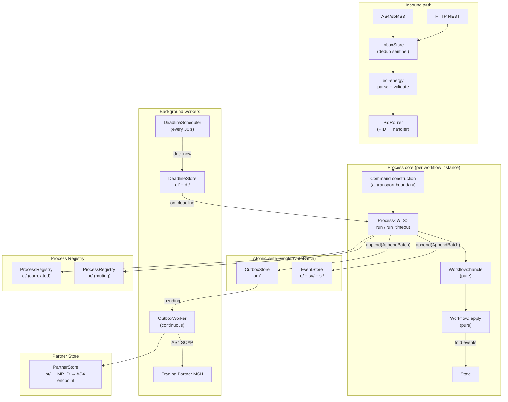
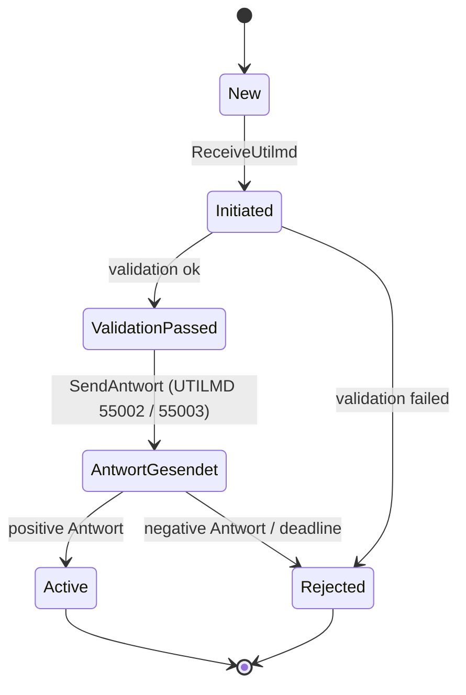
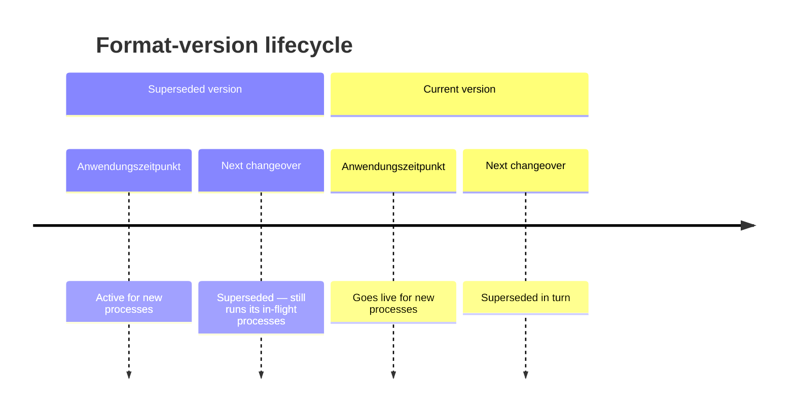
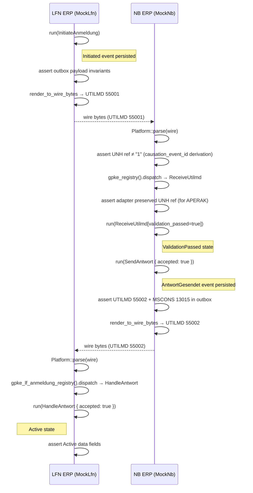

+++
title = "Process Engine"
description = "mako-engine: event-sourced workflow state machines, atomic dual-write, deadlines, the outbox, PID routing and format-version coexistence."
weight = 14
+++
`mako-engine` is the event-sourced runtime for long-running MaKo processes: each
in-flight Lieferbeginn, Gerätewechsel or billing process is an append-only event
stream, its regulatory deadlines are stored beside it, and its outbound EDIFACT is
written atomically with its events.

---

## Architecture Overview



**Key invariants:**
- `Workflow::handle`, `Workflow::apply` and `Workflow::on_deadline` are **pure** — no I/O, no clock, no global state (`cargo xtask check-workflow-purity`).
- Parsing, validation and external lookups happen at the transport boundary, **before** the command is constructed.
- Events, outbox messages, deadlines and correlation entries are written in a **single `WriteBatch`** via `AtomicAppend::append(AppendBatch)` — the store's only write, with no default body.

---

## Core concepts

### `Workflow` trait

```rust
pub trait Workflow: Send + Sync + 'static {
    type State: Default + Clone + Send + Sync + 'static;
    type Event: EventPayload;
    type Command: CommandPayload;

    /// Every business-deadline label this workflow registers and decides.
    const DEADLINE_LABELS: &'static [&'static str] = &[];

    /// Fold one event into the state. Total — never fails.
    fn apply(state: Self::State, event: &Self::Event) -> Self::State;

    /// Validate a command against the state and return what to persist.
    fn handle(
        state: &Self::State,
        command: Self::Command,
    ) -> Result<WorkflowOutput<Self::Event>, WorkflowError>;

    /// Map a fired deadline to a command, or `None` when its window is closed.
    fn on_deadline(deadline: &Deadline, state: &Self::State) -> Option<Self::Command> { None }
}
```

`WorkflowOutput<E>` carries the events, `PendingOutbox` descriptors for
outbound messages, and `PendingDeadline`s; the engine stamps outbox entries
with IDs, tenant and timestamps when it writes them. The engine refuses to
persist a deadline whose label is neither in `DEADLINE_LABELS` nor a delivery
window (`EngineError::UnownedDeadlineLabel`).

An outbound payload is a typed struct from `mako_engine::payload`
(`AperakPayload`, `UtilmdPayload`, …): the workflow builds it with
`PendingOutbox::typed`, `makod`'s renderer reads it back with
`OutboundPayload::from_payload`, so a field renamed on one side does not compile
on the other. The structs are tolerant readers (`Option` fields, no
`deny_unknown_fields`), because an outbox row written by one build may be
drained by the next.

### `Process`

A handle to a specific workflow instance (one delivery point, one meter change, …):

```rust
// Spawn: creates a new empty stream
let process = ctx.spawn::<MyWorkflow>(tenant_id, workflow_id);

// Run: replay → handle → one atomic write of events, outbox, deadlines
let ran = process.run(command, RunOptions::new()).await?;

// A spawn: its Frist and its business key land in the same write.
let ran = process
    .run(command, RunOptions::new().deadlines(&frist).correlations(&keys))
    .await?;

// A fired deadline: the workflow's own on_deadline decides the command.
let acted = process.run_timeout(&deadline, RunOptions::new()).await?;

// The write's own record — events, materialised outbox, deadlines:
let (events, outbox) = (ran.events, ran.outbox);

// Read the current state (full replay):
let state = process.state().await?;

// Read state with snapshot (O(k) replay from checkpoint):
let state = process.state_with_snapshot(&snapshot_store).await?;
```

`run` is the one way a command reaches a process. Everything that
distinguishes one run from another is a `RunOptions` field: the
`CommandContext` (`.context`), the version-conflict budget (`.attempts`,
default 3, jittered back-off), caller-computed deadlines (`.deadlines`),
correlation entries (`.correlations`) and the snapshot to take after the write
(`.snapshot`). Each attempt replays the stream, so a retry never runs on stale
state. An outbox entry or deadline returned without an event is refused
(`EngineError::UnrecordedEffect`) rather than lost.

`run_timeout` is the deadline-shaped entry to the same write: a label outside
`DEADLINE_LABELS` is answered `None` without consulting the hook, and every
attempt asks `on_deadline` again on fresh state. See
[Compensation](@/docs/architecture/compensation.md).

The returned `RunOutcome` dereferences to the persisted events and carries the
outbox entries as the store materialised them, with `causation_event_id` set —
exactly what the `OutboxWorker` later delivers.

### Workflow state lifecycle

Each workflow is an event-sourced FSM: `apply` folds events into a state
enum, `handle` gates which command is valid in each state, and only the event
stream is durable. The GPKE supplier-change workflow (NB side, PID 55001 →
55002/55003) is representative:



These variants are `SupplierChangeState` in `mako-gpke`, serialised as a tagged
`status`/`data` object inside each event payload.

### `EngineBuilder`

Type-state builder that enforces a store is registered before `build()`:

```rust
use mako_engine::{builder::EngineBuilder, store_slatedb::SlateDbStore};

let store = SlateDbStore::open("/data/mako").await?;
let ctx   = EngineBuilder::new()
    .with_event_store(store)
    .with_dead_letter_sink(LogDeadLetterSink::new())
    .build();
```

`build()` is only callable when the `ES` type parameter implements `EventStore` — a missing store is a compile-time error.

---

## Event payload design

`EventEnvelope::payload` is `serde_json::Value` at rest; `apply()` works on the
typed `*Event` enum the engine deserialises it into.

Event payloads are **tolerant readers**: a field added later carries
`#[serde(default)]`, so older events still fold, and no event payload denies
unknown fields — `cargo xtask check-event-payloads` refuses one, because an
event is read back years later and a removed field must not make a § 147 AO
record unfoldable. A change that cannot be expressed that way is an `upcast`
(`Workflow::upcast`, keyed on `EventPayload::schema_version`).

---

## Stores

One SlateDB database backs every store. `SlateDbStore` implements
`EventStore`, `AtomicAppend`, `OutboxStore` and `ProjectionCheckpointStore`;
`DeadlineStore`, `ProcessRegistry`, `InboxStore`, `SnapshotStore` and
`PartnerStore` are sub-stores reached through accessors. The `testing` feature
provides in-memory and no-op implementations. Key layout:
[SlateDB key schema](@/docs/architecture/_index.md#slatedb-key-schema).

### `EventStore`

The read side of the log. Writes go through `AtomicAppend` only.

```rust
let events = store.load(&stream_id).await?;
let tail   = store.load_from(&stream_id, from_sequence).await?;
let acc    = store.fold_stream(&stream_id, init, |acc, env| acc).await?;
let v      = store.stream_version(&stream_id).await?;
```

### `AtomicAppend`

The write side: one required method, no default body, taking the whole
batch with optimistic concurrency via `ExpectedVersion`.

```rust
store
    .append(
        AppendBatch::new(&stream_id, ExpectedVersion::Exact(n), &events)
            .outbox(&outbox)
            .deadlines(&deadlines)
            .correlations(&correlations),
    )
    .await?;
```

Two concurrent writers both stamp `sv/<stream_id>`, so exactly one commits; the
other gets `EngineError::VersionConflict`. The in-memory and SlateDB stores pass
one conformance suite (`crates/mako-engine/tests/it/append_conformance.rs`): a
full batch lands whole, a refused batch lands nothing, and an outbox entry
without an event is refused.

### `OutboxStore`

FIFO delivery queue with exponential back-off and per-message jitter:

```rust
let batch = store.pending(limit, now).await?;   // or pending_now(limit)
store.acknowledge(message_id).await?;
store.reschedule(message_id, next_attempt_at).await?;
```

### `DeadlineStore`

Time-indexed store for Fristen, written through `AppendBatch::deadlines` and
polled by the scheduler:

```rust
let due = store.due_now(limit).await?;          // DueNowResult, with a truncation flag
let open = store.for_stream(&stream_id).await?;
```

Business deadlines are never cancelled when a process moves on: every one
fires, on the healthy path too, and `on_deadline` acts only where the window is
still open. `cancel` retires a **delivery window** once the outbox worker has
delivered its APERAK or CONTRL. A deadline whose run hits a `VersionConflict`
stays due for the next poll.

### `ProcessRegistry`

Lookup from a business key (`RegistryKey`, e.g. conversation id + sender)
to a `ProcessIdentity` (`pr/`), plus a 1:many correlated index (`ci/`):

```rust
registry.register(tenant, &key, &process.identity()).await?;
let identity = registry.lookup(tenant, &key).await?;
```

### `InboxStore`

Deduplication for inbound messages, in three phases so a message that fails
after receipt stays retryable:

| Call | Meaning |
|---|---|
| `claim(key)` | Takes the key atomically and says whether it is new, in flight, or a duplicate. An unsettled claim carries a lease (`CLAIM_LEASE`) |
| `accept(key)` | Settles it once the message is durably handled — dispatched, persisted or dead-lettered with the `DeadLetterSink::reject` write awaited. Every retransmission is then a duplicate |
| `abandon(key)` | Releases it when nothing durable recorded the message — a dead letter whose write failed included — so the retransmission is treated as first-seen |

The key is the sender plus the message reference (`inbox_key`).

---

## Regulatory Fristen (`mako-fristen`)

**`mako_fristen::antwort::antwort_deadline(pid, received)` is the one resolver.**
It answers for every family below, keyed on the inbound PID, and returns `None`
for a PID the Festlegungen do not quantify — *unknown*, never *unbounded*. The
per-family entries differ only in the `FristShape` they carry.

| Process family (`Family`) | Shape | Windows |
|---|---|---|
| `Gpke` | wall-clock time on the *n*-th Werktag after the ÜT, or **am ÜT** | 11:00 (55001, 55077) · 06:00 (55004) · 05:00 (55007) · 09:00 (55010) · 15:00 am ÜT (55013, 55607) |
| `Wim` | Werktage per PID | 3 (55039) / 5 (55042) / 7 (55051) / 1 (55168) |
| `WimGas` | the same four on the Gas twins | 3 (44039) / 5 (44042) / 7 (44051) / 1 (44168) |
| `GeliGas` | Ablauf des *n*-ten Werktags nach Eingang | 4 (44001) / 3 (44004, 44007, 44010, 44016) / 2 (44013) |
| `Emob` | Ablauf des *n*-ten Werktags | 7 (55238) / 3 (55240, 55242) |

Two obligations sit outside that catalogue because they are not keyed on an
inbound PID:

| Obligation | Resolver |
|---|---|
| INVOIC — zum Zahlungsziel der Rechnung; der NB bei 31009 zum 4. WT davor | `mako_fristen::vorlauf::rechnung_antwort_spaetester_uet` |
| MaBiS — **no response Frist is published**; the Kap. 3.10 Tabelle 2 clearing window bounds it instead | `mako_mabis::Bilanzierungsmonat::clearing(zeitreihe, lauf)` |

`mako_wim::antwort_frist_werktage(pid)` returns the bare Werktage count for a WiM
PID, for callers that need the number rather than a resolved instant.

**Saturday is not a Werktag.** GPKE (BK6-24-174) Teil 1 Kap. 7: *"alle Tage ..., die kein Samstag, Sonntag oder gesetzlicher Feiertag sind"*. A holiday in any single Bundesland counts nationwide; 24.12. and 31.12. count as holidays.

**The count starts on the day of receipt, whatever weekday it is.** The Übertragungstag is *"der Tag des Empfangs der Übertragungsdatei ... aus der AS4-Zustellquittung"*, and counts *"nur ..., sofern es sich um eine positive Zustellquittung bzw. Response-Nachricht handelt"* — a negative acknowledgement starts no Frist. In `makod` the door records that instant once — the AS4 handler when it takes the message it answers with the receipt, `POST /edifact` when the request arrives, the loopback when it delivers — and `EdifactIngestDispatcher::dispatch` resolves every arrival-anchored window of the message (the Antwortfrist and the APERAK window) against it, never against the instant the message reaches its dispatch arm.

A Werktage Frist runs to the end of the due Werktag in `Europe/Berlin`; a clock-time Frist runs to that clock time in Berlin; the day of receipt is a Berlin calendar date. See [Dates and days](@/docs/architecture/domain-model.md#dates-and-days).

---

## Format-version coexistence

`makod` serves every registered format version at once; which one applies to
a message is a function of its date.

Selection is `ReleaseRegistry::profile_on(message_type, release, date)`: the
profile with the greatest `valid_from ≤ date`. The date comes from
`ParseConfig::with_reference_date` or `validate_on_date`, and `makod` supplies
`mako_fristen::heute()`. `edi-energy` reads no clock of its own. The release
code in `UNH DE 0057` narrows the candidates but cannot decide alone — two
Formatversionen can share one MIG. `profiles/<type>/<fv>/mig.json` carries
`publikationsdatum`, `valid_from` and `valid_until`; see
[Formatversion effective dates](@/docs/compliance/annual-release-workflow.md#appendix-c-formatversion-effective-dates).



### What carries a process across a format-version boundary

A Lieferbeginn opened in September may be answered by an APERAK in November
under the October release. Two mechanisms carry that; neither is a policy a
workflow declares.

**The adapter registry picks the parser.** The inbound message's own format
version selects the `MessageAdapter`. At startup
`makod::startup::validate_adapter_coverage` asks every registry for
`uncovered_format_versions(&known_fvs())` and refuses to boot on a non-empty
answer — or on an empty `known_fvs()`. Every known version must be covered,
since a counterparty may reply under any of them.

**The `WorkflowId` records the rules the process runs under** — the workflow
name and the format version it was created with, on every event in the stream.
`StateMigration` moves it when an in-flight process must be advanced before the
old version leaves the registry.

---

## Format-version migration (`migration` module)

When a release changes a workflow's state schema, in-flight processes are
migrated with a `MigrationRunner`:

```rust
use mako_engine::migration::{MigrationRunner, StateMigration, MigrationReport};

impl StateMigration for UpgradeSupplierChange {
    type FromWorkflow = SupplierChangeWorkflowFV2025;
    type ToWorkflow   = SupplierChangeWorkflowFV2026;

    fn source_workflow_id(&self) -> &WorkflowId { &self.source }
    fn target_workflow_id(&self) -> &WorkflowId { &self.target }
    fn migrate(&self, state: OldState) -> Result<NewState, String> { /* map fields */ }
}

let report: MigrationReport =
    MigrationRunner::new(UpgradeSupplierChange { .. }, event_store, snapshot_store)
        .run()
        .await;
```

A failing stream is collected in `MigrationReport::errors` and the runner
continues. A `WorkflowDriver` also carries a typed entry point that repoints a
workflow's snapshots across a cutover, which `makod`'s migration endpoint uses.

---

## Trading-partner master data (`PartnerStore`)

`PartnerStore` is the durable, PARTIN-aware partner directory (`pt/`). `makod`
seeds it from config at startup, inbound PARTIN updates it, and the outbox
worker reads the AS4 endpoint from it:

```rust
let partners = store.as_partner_store();
for record in PartnerRecord::from_cli_pairs(&config.as4.partners)? {
    partners.upsert(tenant_id, &record).await?;
}
let endpoint = partners.as4_endpoint(tenant_id, &recipient).await?;
```

### Partner record data model

```
PartnerRecord {
    mp_id:        MarktpartnerCode,     // 13-digit Marktpartner-ID (lookup key within a tenant)
                                        // May be BDEW-Codenummer (99…), DVGW-Codenummer (98…),
                                        // or GS1 GLN
    display_name: Option<Box<str>>,     // NAD company name
    channels:     Vec<CommunicationChannel>,  // COM segments
      ├── qualifier "AK" → AS4 endpoint URL  (PARTIN AHB 1.0f DE 3155)
      ├── qualifier "EM" → email address
      ├── qualifier "TE" → telephone
      └── qualifier "FX" → fax
    roles:        Vec<Marktrolle>,      // serialised as BDEW codes: "LF", "NB", "MSB", …
    valid_from:   Option<OffsetDateTime>, // DTM+137
    contacts:     Vec<ContactPerson>,   // CTA/NAD/COM groups
    country_code: Option<Box<str>>,     // NAD country (e.g. "DE")
    updated_at:   OffsetDateTime,       // last write timestamp
}
```

`merge_from_partin` merges an incoming PARTIN record: a newer `valid_from`
wins, and a config-seeded record (no `valid_from`) is always overwritten.
Partners are managed at runtime via the
[admin API](@/docs/services/makod.md#partner-management-admin-partners).

---

## Domain crates

| Crate | Process family | Antwortfrist |
|---|---|---|
| `mako-gpke` | GPKE — Lieferbeginn/-ende Strom, Beendigung der Zuordnung, Ersatz-/Grundversorgung, Neuanlage, Sperrung, Konfiguration, INVOIC | clock time per PID, from `mako_fristen::antwort` |
| `mako-wim` | WiM Strom und Gas — Messstellenwechsel, Geräteübernahme, INSRPT, WiM-Rechnung, ESA | 3 / 5 / 7 / 1 Werktage per PID, in beiden Sparten |
| `mako-geli-gas` | GeLi Gas — Lieferbeginn/-ende Gas, Stornierung 44022–44024, Sperrung Gas, Datenabruf, INVOIC 31011 | per PID, from `mako_fristen::antwort` |
| `mako-mabis` | MaBiS — Bilanzkreisabrechnung Strom, MaBiS-ZP lifecycle, Clearingliste, Listenabgleich | none published — the Kap. 3.10 clearing window bounds it |
| `mako-gabi-gas` | GaBi Gas — Allokation, MMM- und Kapazitäts-INVOIC, DVGW gas transport | KoV deadlines |
| `mako-emob` | NZR-EMob / Modell 2 — the three Modellwechsel legs | 7 / 3 Werktage per PID; an unanswered leg escalates |
| `mako-redispatch` | Redispatch 2.0 — activation, Stammdaten, acknowledge-and-forward | 3-minute ACK |

Which PID routes to which workflow: [PID Reference](@/docs/regulatory/pid-reference.md).

### The module contract

A domain crate reaches the engine as an `EngineModule`. It routes
Prüfidentifikatoren to workflow names, and it registers each workflow **once, by
type**, as a `WorkflowDriver`:

```rust
impl EngineModule for GpkeModule {
    fn drivers(&self) -> Vec<WorkflowDriver> {
        vec![
            WorkflowDriver::of::<GpkeSupplierChangeWorkflow>(wechselprozesse::WORKFLOW_NAME),
            WorkflowDriver::of::<GpkeEogWorkflow>(eog::WORKFLOW_NAME),
            // …
        ]
    }

    fn register_pids(&self, router: &mut PidRouter) {
        router.register(55001, wechselprozesse::WORKFLOW_NAME);
        // …
    }
}
```

The driver carries the labels the workflow owns and the typed entry points
that run a fired deadline through `Process::run_timeout` and repoint snapshots
across a cutover, so `makod`'s scheduler and migration endpoint look a workflow
up by name in `EngineContext::drivers` and never map names to types themselves.
**Every name `register_pids` routes to must have a driver** — `EngineBuilder::build`
panics otherwise. A command-initiated workflow has a driver and routes no PID; a
name that resumes another workflow's process (`gabi-gas-mmma` →
`gpke-allokationsliste`) registers `WorkflowDriver::routing_only`.
`makod::startup::production_modules` is the one list of modules.

### MABIS architecture note

MaBiS aggregates across thousands of MaLo streams for a billing period, so its
aggregate is a projection (`ProjectionRunner::catch_up_persistent`) rather than
a per-MaLo `Process`.

---

## Projections and Read Models

Projections build disposable, eventually consistent read models from the
event stream; a projection failure never affects event persistence.

`ProjectionRunner::catch_up_persistent` is the production entry point: it loads
the named checkpoint, feeds only events newer than each stream's cursor, and
writes back only the cursors that advanced. A restart resumes; nothing replays
from zero.

```rust,ignore
use mako_engine::{
    projection::{Projection, ProjectionRunner},
    store_slatedb::SlateDbStore,
};

// Implement the read-model builder:
struct BillingProjection { /* ... */ }
impl Projection for BillingProjection {
    fn name(&self) -> &'static str { "mabis-billing" }
    fn handle_event(&mut self, env: &EventEnvelope) { /* update read model */ }
    fn last_sequence(&self) -> Option<u64> { /* return cursor or None */ }
}

// Run the worker loop:
let store: Arc<SlateDbStore> = /* ... */;
let mut proj = BillingProjection::default();
loop {
    let _checkpoint = ProjectionRunner::catch_up_persistent(
        &mut proj,
        &store,
        Some("process/"),      // stream prefix — all process streams
        "mabis-billing",       // checkpoint name (unique per projection)
    ).await?;
    tokio::time::sleep(Duration::from_secs(30)).await;
}
```

### API surface

| Function | When to use |
|---|---|
| `catch_up_persistent(proj, store, prefix, name)` | **Production workers** — incremental, checkpoint-backed, restart-safe |
| `catch_up_all_streams(proj, store, streams, cp)` | In-process catch-up when you manage the checkpoint yourself |
| `run_all_streams(proj, store, streams)` | One-shot full replay (tests, diagnostic tools) |
| `run_from_store(proj, store, stream)` | Single-stream full replay (unit tests) |
| `catch_up_from_store(proj, store, stream)` | Single-stream incremental catch-up using `Projection::last_sequence` |

`run_all_streams`, `run_matching_streams` and `run_from_store` replay from
sequence 0 — never use them in a long-running worker.

### Checkpoint store

`SlateDbStore` implements `ProjectionCheckpointStore` over
`cp/{checkpoint_name}/{stream_id} → u64 LE`. `GlobalProjectionCheckpoint` is the
per-stream cursor map; `0` means replay from the beginning.

---

## `makod` production daemon

`makod` assembles every domain module its Marktrolle features enable into one
`EngineContext`. Configuration, deployment and health checks:
**[`makod` Operator Guide →](@/docs/services/makod.md)**.

```bash
cargo run -p makod -- --config makod.toml --allow-volatile --http-addr 127.0.0.1:8080
```

`makod.toml` needs at least one `[[party]]` entry (`mp_id` + `roles`). Without
`--data-dir`, state is in memory and lost on restart.

---

## Testing

Use the `testing` feature to swap in in-memory stores:

```rust
use mako_engine::{
    builder::EngineBuilder,
    event_store::InMemoryEventStore,
    dead_letter::NoopDeadLetterSink,
};

let ctx = EngineBuilder::new()
    .with_event_store(InMemoryEventStore::new())
    .with_dead_letter_sink(NoopDeadLetterSink)
    .build();
```

Each test builds its own `EngineBuilder`; in-memory stores share no global
state.

### Bilateral E2E tests

End-to-end tests of the render → wire bytes → parse → adapt → run chain model
each market participant as a mock ERP that owns its own `Process`. `Process::run`
returns the stamped `OutboxMessage`s, with `causation_event_id` set exactly as
the production `OutboxWorker` reads it, ready for `render_to_wire_bytes`:

```rust
let outbox = self.process
    .run(LfAnmeldungCommand::InitiateAnmeldung { .. }, RunOptions::new())
    .await?
    .outbox;
let wire = render_to_wire_bytes(&outbox[0], LFN_ID)?;
```

#### Protocol sequence (Lieferbeginn Strom, PID 55001)



`services/makod/tests/it/e2e_lieferbeginn.rs` covers the acceptance and
rejection paths.

---

## See Also

- [Getting Started](@/docs/guide/getting-started.md) — first steps for both layers
- [Platform Guide](@/docs/reference/platform.md) — multi-tenant `edi-energy` usage
- [Parsing Guide](@/docs/reference/parsing.md) — EDIFACT parsing
- [API-Webdienste Strom](@/docs/architecture/api-webdienste.md) — REST/JSON channel for iMS processes
- [Release Lifecycle](@/docs/compliance/release-lifecycle.md) — annual BDEW profile updates
