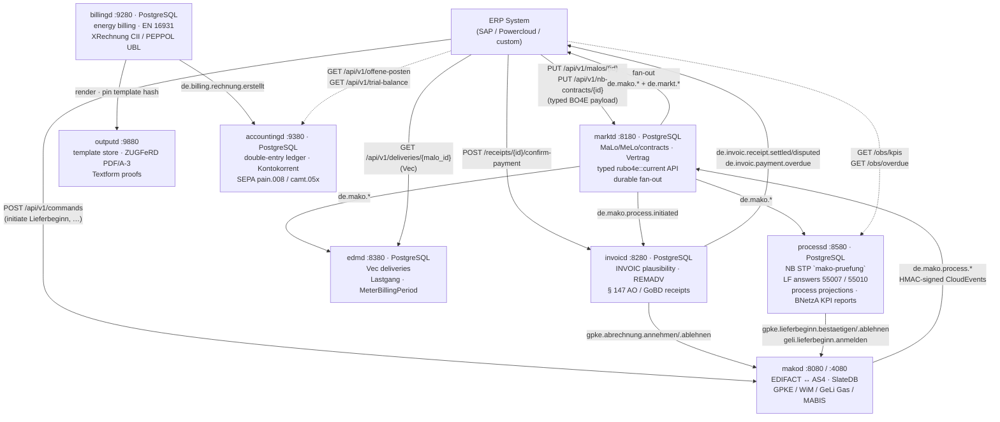
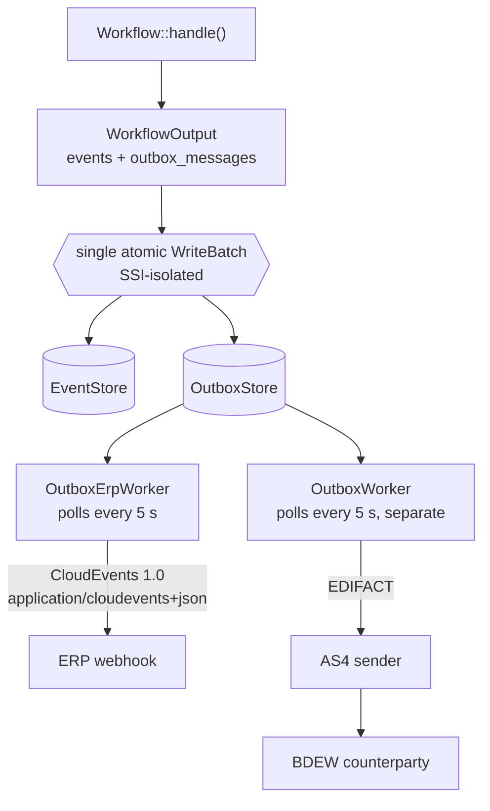

+++
title = "ERP Integration"
description = "Integrate your ERP with mako over CloudEvents 1.0 webhooks, the Command API and typed BO4E market data — HMAC signatures, idempotency keys, topology."
weight = 10
+++
`makod` handles EDIFACT, BDEW process rules, AS4 delivery and regulatory
deadlines; contract data, billing logic and master data live in the ERP. The
contract between them is **BO4E** — the ERP never sees EDIFACT format versions
or segment codes, so a new BDEW format version leaves its payloads unchanged.

```
ERP  ←─────────── BO4E JSON ───────────→  makod
                (ErpAdapter / POST /api/v1/commands)
                        ↕
              EDIFACT / AS4 / BDEW network
```

Outbound events are **[CloudEvents 1.0](https://cloudevents.io)**
structured-mode JSON, which SAP BTP, AWS EventBridge, Azure Event Grid, Google
Eventarc and Knative route natively. With [`marktd`](@/docs/services/marktd.md)
deployed, `makod` pushes its process events to `marktd`
(`POST /api/v1/events`) and `marktd` fans them out to registered ERP
subscribers, so no webhook needs configuring in `makod` itself.

---

## Quick-start: wire the ERP webhook in 5 minutes

`makod` POSTs an event to the ERP whenever a process reaches a significant
state (APERAK received, process completed, …).

**Step 1 — Generate a shared secret**

```bash
openssl rand -hex 32
# → e.g. a3f8c1d2...  (64 hex chars)
```

**Step 2 — Start makod with the webhook configured**

```bash
makod \
  --config /etc/makod/makod.toml \
  --data-dir /var/lib/makod \
  --erp-webhook-url https://erp.example.com/mako/events \
  --erp-webhook-secret a3f8c1d2...
```

Or via `makod.toml`:

```toml
[erp]
webhook_url    = "https://erp.example.com/mako/events"
webhook_secret = "a3f8c1d2..."
```

**Step 3 — Implement the ERP endpoint**

Your ERP must accept `POST` requests at the configured URL:

```
POST /mako/events
Content-Type:      application/cloudevents+json
X-Idempotency-Key: 01932a4f-7b3e-4c5d-8f6a-9e0b1c2d3e4f   ← always sent
traceparent:       00-4bf92f…-00f067…-01                  ← when the inbound transport carried one
webhook-id:        01932a4f-7b3e-4c5d-8f6a-9e0b1c2d3e4f   ┐
webhook-timestamp: 1786012800                             ├ only when a secret is set
webhook-signature: v1,K5oT9r8GKYqrTwjUPD8ILPZIo2LaLaSw…   ┘
```

Body (CloudEvents 1.0 structured-mode JSON):

```json
{
  "specversion": "1.0",
  "id": "01932a4f-7b3e-4c5d-8f6a-9e0b1c2d3e4f",
  "source": "urn:mako:makod:tenant:9900357000004",
  "type": "de.mako.aperak.accepted",
  "time": "2026-10-01T10:15:00+02:00",
  "subject": "018f3a2b-...",
  "dataschema": "https://raw.githubusercontent.com/BO4E/BO4E-Schemas/v202607.1.0/src/bo4e_schemas/bo/Marktlokation.json",
  "datacontenttype": "application/json",
  "makoconvid": "...",
  "makocausationid": "...",
  "makopid": 55001,
  "data": {
    "_typ": "MARKTLOKATION",
    "_version": "202501",
    "marktlokationsId": "51238696799",
    "sparte": "STROM",
    "bilanzierungsmethode": "SLP",
    "energierichtung": "VERBRAUCH",
    "netzbetreibercodenr": "9900357000004"
  }
}
```

`webhook-id`, `X-Idempotency-Key` and the CloudEvent `id` are the same value.
`webhook-id` is what the signature covers; `X-Idempotency-Key` is sent
unconditionally, for a deployment without a secret.

**Step 4 — Verify the signature**

mako signs with [Standard Webhooks]. **Use a library**; the code below shows
what one checks. All three must hold:

1. The signature matches `base64(HMAC-SHA256(secret, "{id}.{timestamp}.{body}"))`.
   Note it covers the id and the timestamp, **not the body alone**.
2. `webhook-timestamp` is within **5 minutes** of now, in either direction.
   Without this a captured request replays forever.
3. `webhook-id` has not been seen before. Reject or ignore the duplicate.

```python
import base64, hmac, hashlib, time

TOLERANCE = 300  # seconds, each way

def verify_mako_webhook(body: bytes, secret: str, headers) -> str:
    """Returns the webhook id to deduplicate on; raises on refusal."""
    msg_id = headers["webhook-id"]
    ts     = int(headers["webhook-timestamp"])
    if abs(time.time() - ts) > TOLERANCE:
        raise ValueError("stale or future timestamp — possible replay")

    signed  = f"{msg_id}.{ts}.".encode() + body
    digest  = hmac.new(secret.encode(), signed, hashlib.sha256).digest()
    expected = "v1," + base64.b64encode(digest).decode()

    # The header is a space-separated list, so a key rotation presents both.
    if not any(hmac.compare_digest(expected, part)
               for part in headers["webhook-signature"].split()):
        raise ValueError("no signature matched")
    return msg_id   # ← persist this; reject a repeat
```

```typescript
import { createHmac, timingSafeEqual } from "crypto";

const TOLERANCE = 300; // seconds, each way

function verifyMakoWebhook(body: Buffer, secret: string, headers: Record<string, string>): string {
  const id = headers["webhook-id"];
  const ts = Number(headers["webhook-timestamp"]);
  if (Math.abs(Date.now() / 1000 - ts) > TOLERANCE) {
    throw new Error("stale or future timestamp — possible replay");
  }

  const signed = Buffer.concat([Buffer.from(`${id}.${ts}.`), body]);
  const expected = "v1," + createHmac("sha256", secret).update(signed).digest("base64");

  const ok = headers["webhook-signature"].split(" ").some((part) =>
    part.length === expected.length &&
    timingSafeEqual(Buffer.from(part), Buffer.from(expected)));
  if (!ok) throw new Error("no signature matched");
  return id; // ← persist this; reject a repeat
}
```

> **Key rotation.** `webhook-signature` is a space-separated list. mako emits
> one `v1` entry; its own verifier (`mako_service::webhook::verify_request`)
> accepts any matching entry and skips other versions. Implement the receiver
> the same way so a secret can be rotated without a flag-day.

[Standard Webhooks]: https://www.standardwebhooks.com/

**Step 5 — Return `HTTP 200` for duplicates**

`makod` retries on `429`, `5xx` and network errors; any other `4xx` is
permanent and dead-letters the message. Persist the id and answer a duplicate
with `200 OK` without re-processing.

---

## Integration surfaces

| Direction | Mechanism | Description |
|-----------|-----------|-------------|
| makod → ERP | `--erp-webhook-url` / `WebhookErpAdapter` | POST BO4E JSON on every process event |
| ERP → makod | `POST /api/v1/commands` | Initiate a MaKo process (Lieferbeginn, Gerätewechsel, …) |
| ERP → makod | `PUT /admin/malo/{malo_id}` | Push MaLo master data to the local cache |
| ERP → makod | `PUT /admin/partners/{mp_id}` | Register or update a trading-partner endpoint |
| marktd → invoicd | `POST /webhook` CloudEvents | GPKE/WiM billing notifications for automatic plausibility check |
| invoicd → makod | `POST /api/v1/commands` | the answering PID's accept/reject command (`gpke.abrechnung.*`, `wim.rechnung.*`, `gabi.rechnung.*`, `invoic.*`) |
| invoicd → ERP | `de.invoic.receipt.settled/disputed` CloudEvents | Durable at-least-once payment notifications |
| invoicd → ERP | `de.invoic.payment.overdue` CloudEvents | Announced once per receipt when `pay_by` passes without `confirm-payment` |
| ERP → invoicd | `POST /api/v1/receipts/{id}/confirm-payment` | Close § 147 AO / GoBD payment audit trail when bank transfer confirmed |
| ERP → invoicd | `GET /api/v1/zahlungsstatus/{malo_id}` | AR reconciliation — settled / pending / overdue counts |
| edmd API → ERP | `GET /api/v1/deliveries/{malo_id}` | BO4E `Vec<Energiemenge>` — typed meter readings for billing import |
| edmd API → ERP | `GET /api/v1/lastgang/{malo_id}` | BO4E `Lastgang` — interval time series grouped by OBIS register |
| edmd API → ERP | `GET /api/v1/billing-period/{malo_id}` | `MeterBillingPeriod` — arbeitsmenge, spitzenleistung, brennwert |
| ERP → marktd | `PUT /api/v1/nb-contracts/{id}` | Upsert NB contract with full BO4E `Vertrag` payload |
| processd API → ERP | `GET /obs/kpis` | BNetzA KPI report — § 7a Abs. 5 EnWG Gleichbehandlung parity, STP rates, decision times |

### ERP-facing integration topology

The services an ERP integration touches directly; the full mesh is in
[Service topology](@/docs/architecture/_index.md#service-topology).



`marktd`'s fan-out is persist-before-fan-out: an event lands in `event_log`
before any delivery, and each per-subscriber delivery is tracked, retried and
dead-lettered in `event_delivery`.

### Delivery pipeline



Events and outbox entries land in one `WriteBatch`, so there is no state with
one and not the other. The two workers are independent: an ERP that is down
cannot delay an APERAK, and an unreachable counterparty cannot stall the ERP
feed.

#### The payload-key seam

An EDIFACT outbox entry carries a typed payload from `mako_engine::payload`
(`AperakPayload`, `UtilmdPayload`, …), so producer and renderer share one
struct. An **ERP notification** entry is still a `message_type` string plus
JSON: a workflow writes
`PendingOutbox::new("GabiFinalAllocationOverdue", recipient, json!({…}))` and
`map_message_type_to_erp_event` (`services/makod/src/core/erp_adapter.rs`) reads
the string back to pick an `ErpEventType`. Keys inside `data` — `gas_day`,
`tx_id`, `zustimmung` — are a convention between writer and consumer.

`every_enqueued_message_type_maps_to_a_cloud_event` asserts that every
`message_type` a workflow enqueues resolves, and
`the_gabi_overdue_notification_carries_the_alocat_missing_type` pins the mapping
an agent subscribes to by name. **When you add an ERP message type, add it to
that list** — an unmapped type is delivered to nobody.

### PID → event mapping

| PID family | Process | CloudEvents `type` sequence |
|---|---|---|
| GPKE 55001 | Lieferbeginn LF-AN | `de.mako.process.initiated` → `de.mako.aperak.accepted` → `de.mako.process.completed` |
| GPKE 55004 | Lieferende / Abmeldung (LFN → NB) | same |
| GPKE 55016 | Kündigung Lieferbeginn (LFN → LFA) | same |
| GPKE 31001–31005 | Abrechnung INVOIC | `de.mako.process.initiated` → `de.mako.process.completed` + `de.invoic.receipt.settled`/`disputed` |
| WiM 31009 | MSB-Rechnung (LF payer) | `de.mako.process.initiated` → REMADV → `de.invoic.receipt.settled`/`disputed` |
| WiM 55039, 55042, 55051, 55168 | Gerätewechsel / MSB-Wechsel | `de.mako.process.initiated` → `de.mako.aperak.accepted` → `de.mako.process.completed` |
| WiM 55168 (Konfiguration confirmed) | Steuerungsauftrag positive Endantwort | `de.mako.process.completed` + **`de.vpp.dispatch.confirmed`** → auto-billing in `billingd` |
| GeLi Gas 44001–44006 | Lieferbeginn Gas (LFN-initiated) | `de.mako.process.initiated` → `de.mako.aperak.accepted` → `de.mako.process.completed` |
| GeLi Gas 44016–44018 | Kündigung Lieferbeginn Gas (LFN ↔ LFA) | same |
| GeLi Gas 17103 | Gas Datenabruf (Brennwert/Zustandszahl) | `de.mako.process.initiated` → `de.mako.process.completed` |
| GeLi Gas 17115, 17117 | Sperr-/Entsperrauftrag Gas (LF-initiated) | `de.mako.process.initiated` → `de.mako.process.completed` or `de.mako.process.failed` |
| MABIS 13003 | Bilanzkreisabrechnung Strom | `de.mako.process.initiated` → `de.mako.process.completed` or `de.mako.process.failed` |

### `invoicd` payment CloudEvents

After each checked INVOIC, `invoicd` posts payment CloudEvents to the ERP when
`[erp] webhook_url` is set in `invoicd.toml`.

| Type | Trigger | Use case |
|---|---|---|
| `de.invoic.receipt.settled` | Invoice accepted | Book received invoice |
| `de.invoic.receipt.disputed` | Invoice rejected | Flag for manual review |
| `de.invoic.receipt.dispatched` | Self-issued 31006 sent | Track self-issued invoice |

The `dispatched` field says whether the market answer went out — do not pay
against a settled invoice whose REMADV never left.

Payment events use `source: "urn:mako:invoicd:tenant:{tenant}"` and `subject: "{process_id}"`.

**Durable at-least-once.** The first attempt runs inline after the market
answer is dispatched; a transport error or `5xx` is retried (30 s → 5 min →
30 min → 2 h, dead-lettered after 5 attempts); a `4xx` dead-letters at once.
Batches are claimed with a lease. Track `invoic_receipts.erp_notified_at` and
the `invoicd_erp_dead_lettered_total` gauge.

**Request signing:** when `[erp] hmac_secret` is configured, every POST includes
[Standard Webhooks] headers computed over `{webhook-id}.{webhook-timestamp}.{body}`.

### CloudEvents envelope schema

**Required CloudEvents attributes:**

| Attribute | Value | Notes |
|---|---|---|
| `specversion` | `"1.0"` | Always |
| `id` | `<idempotency_key>` | Stable dedup key — persist in ERP |
| `source` | `"urn:mako:makod:tenant:<tenant_id>"` | Operator MP-ID |
| `type` | `"de.mako.<domain>.<action>"` | See event type table below |
| `time` | RFC 3339 with timezone offset | Wall-clock time of domain event |
| `subject` | `<process_id>` UUID | The mako process that fired the event |

**Optional CloudEvents attributes:**

| Attribute | Value | Notes |
|---|---|---|
| `dataschema` | BO4E JSON Schema URL | Present when `data` carries a BO4E object |
| `datacontenttype` | `"application/json"` | Always present when `data` is non-null |

**mako extension attributes** (lowercase alphanumeric per CloudEvents spec §3.3):

| Extension | Type | Description |
|---|---|---|
| `makoconvid` | string | BDEW Vorgangsnummer |
| `makocausationid` | string | mako domain event UUID that caused this notification |
| `makopid` | integer | Prüfidentifikator |
| `makofailreason` | string | Only present on `de.mako.process.failed` |

**`data` field:**

A BO4E object, or `null` where none applies (e.g. `de.mako.contrl.received`).

**Event type → CloudEvents `type` mapping:**

| CloudEvents `type` | Trigger | Primary BO4E payload |
|---|---|---|
| `de.mako.process.initiated` | New inbound UTILMD received | `Marktlokation` |
| `de.mako.aperak.accepted` | Counterparty accepted our UTILMD | `Marktlokation` |
| `de.mako.aperak.rejected` | Counterparty rejected our UTILMD | `Marktlokation` + rejection reason |
| `de.mako.aperak.timeout` | No APERAK within regulatory SLA | `Marktlokation` |
| `de.mako.contrl.received` | CONTRL syntax acknowledgement | — (null data) |
| `de.mako.process.completed` | Lieferbeginn/Lieferende confirmed | `Marktlokation` + `Vertrag` |
| `de.mako.process.failed` | Fatal error / regulatory deadline exceeded | `Marktlokation` |
| `de.mako.malo.identified` | MaLo-ID lookup resolved | `Marktlokation` |
| `de.mako.abmeldeanfrage.beantwortet` | The LFA answered the NB's Anfrage zur Beendigung der Zuordnung (55010/55011/55012), or its 09:00 window lapsed — a Zustimmung per GPKE Teil 2 § 2.1.2 Nr. 4. `processd` resumes the Anmeldung decision on it | `{pid, malo_id, grid_operator, lfa_mp_id, anmeldung_process_id, zustimmung, fristablauf}` plus `antwortcode`, `grund` and `zuordnungsende` when the LFA named them |
| `de.vpp.dispatch.confirmed` | MSB positively confirmed a WiM Steuerungsauftrag (PID 55168) of type `Konfiguration` — triggers VPP auto-billing in `billingd` | `{tx_id, location_id, location_type, max_power_kw, execution_time_from, execution_time_until, command_type, sender_mp_id, produkt_code}` |
| `de.gabi.alocat.missing` | The § 47 Ziffer 1 KoV XV final-allocation window (M+14 Werktage) closed with no final ALOCAT on file; open a Clearingfall with the FNB/MGV | `{gas_day, deadline_label, sender_eic, receiver_eic, pruefidentifikator}` |
| `de.gabi.nomination.curtailed` | The FNB/MGV confirmed less than was nominated; the portfolio is short until the BKV re-nominates or buys the gap | `{gas_day, nominated_kwh, confirmed_kwh, curtailed_kwh, sender_eic, receiver_eic, pruefidentifikator, nomination_ref}` |
| `de.gabi.nomination.rejected` | The FNB/MGV refused the nomination; nothing flows on it | `{gas_day, reason, nominated_kwh, sender_eic, receiver_eic, pruefidentifikator, nomination_ref}` |
| `de.gabi.nomres.missing` | The KoV NOMRES window closed unanswered, so the nomination's status is unknown at gas-day start | `{gas_day, deadline_label, sender_eic, receiver_eic, pruefidentifikator, nomination_ref}` |

### Retry and back-off

`OutboxErpWorker` retries with exponential back-off:

| Attempt | Delay |
|---|---|
| 1st failure | 5 min |
| 2nd failure | 10 min |
| 3rd failure | 20 min |
| 4th failure | 40 min |
| 5th+ failure | 60 min (capped) |
| After 10 failures | Dead-lettered; `WARN` logged |

HTTP response codes:

| Code | Interpretation |
|---|---|
| `2xx` | Success — message acknowledged |
| `4xx` except `429` | Permanent error — message dead-lettered immediately |
| `429` | Transient — rescheduled with back-off |
| `5xx` | Transient — rescheduled with back-off |
| Network timeout / error | Transient — rescheduled with back-off |

### No-secret mode

Without `--erp-webhook-secret` all three Standard Webhooks headers are omitted
(`mako_service::webhook::headers` produces them as a set); dedup on
`X-Idempotency-Key`. Use this only in local development.

### `LogErpAdapter` (development / logging only)

Without `--erp-webhook-url`, `makod` uses `LogErpAdapter`, which logs every
event at `INFO`:

```
INFO mako::erp: ErpAdapter: event logged (no delivery configured)
    idempotency_key=01932a4f-...
    event_type=aperak_accepted   ← short label for structured logs/metrics
    process_id=018f3a2b-...
    tenant_id=9900357000004
    pid=55001
```

`event_type` is `ErpEventType::label()`, the snake_case key for logs and
metrics; the wire `type` is set only by `WebhookErpAdapter`.

---

## Inbound: ERP initiates a MaKo process

### REST (`POST /api/v1/commands`)

A **command envelope** carries the dotted command name, the issuing
Marktrolle and a command-specific `payload`; `makod` resolves the PID. Most
GPKE/GeLi commands need only the MaLo-ID and the process date — NB, MSB and
MeLo come from the master-data cache:

```http
POST /api/v1/commands
Content-Type: application/json
Idempotency-Key: erp-order-991234
Authorization: Bearer <token>

{
  "command": "gpke.lieferbeginn.anmelden",
  "marktrolle": "LF",
  "payload": {
    "malo_id":            "51238696799",
    "lieferbeginn_datum": "2026-10-01"
  }
}
```

`marktrolle` is required only for a command more than one role may issue (such
as `invoic.nne.stellen`, permitted for `NB` and `GNB`); for a single-role
command it is inferred from the name. Never include
`sender_party_id`, `receiver_party_id`, `pruefidentifikator` or `message_ref` —
those are engine-owned.

A **billing** command names the invoice by `invoice_ref` — the
`rechnungsnummer` the counterparty's REMADV correlates on — and carries the
BO4E `Rechnung` beside it:

```json
{
  "command": "invoic.nne.stellen",
  "marktrolle": "NB",
  "payload": {
    "invoice_ref":     "NN-2026-000123",
    "sender_mp_id":    "9900357000004",
    "recipient_mp_id": "9900357000011",
    "rechnung": {
      "_typ": "RECHNUNG",
      "_version": "202607.1.0",
      "rechnungsnummer": "NN-2026-000123",
      "gesamtnetto":  { "_typ": "BETRAG", "wert": "300.00", "waehrung": "EUR" },
      "gesamtsteuer": { "_typ": "BETRAG", "wert": "57.00",  "waehrung": "EUR" },
      "gesamtbrutto": { "_typ": "BETRAG", "wert": "357.00", "waehrung": "EUR" }
    }
  }
}
```

`_version` is optional and spelt without a `v` (`202607.1.0`); mako reads the
series (`202607`), so a producer one patch ahead is accepted.

**Response** — `202 Accepted`:

```json
{
  "idempotency_key": "erp-order-991234",
  "command": "gpke.lieferbeginn.anmelden",
  "marktrolle": "LF",
  "status": "accepted",
  "process_id": "018f3a2b-..."
}
```

#### What `Idempotency-Key` does

The header is **required** (`422 missing_idempotency_key` without it). Use one
stable value per business request — your ERP order or correlation ID. `makod`
stores the accepted response for **24 hours** and replays it verbatim on a
retry, with no second dispatch. The same key with a *different* command or
payload is `422 idempotency_key_reuse`.

```json
// 422 — the key already belongs to a different request.
{ "error": "Unprocessable Entity", "code": "idempotency_key_reuse", "detail": "…" }
```

A storage failure on the lookup is `503 idempotency_unavailable` — retry.

Beneath the key sits the business-level guard: a second `anmelden` while a
process is active for the same business key is `409 duplicate_process` even
under a fresh key, carrying the existing `process_id`. **Treat it as success**
and adopt the `process_id`. The other 409, `invalid_state`, is a real error and
carries none. Branch on `code`: `error` is the HTTP reason phrase.

```json
// 409 — your retry already succeeded. Adopt the process_id.
{ "error": "Conflict", "code": "duplicate_process", "detail": "…", "malo_id": "51238696799", "process_id": "018f3a2b-..." }

// 409 — genuine rejection. Do not retry.
{ "error": "Conflict", "code": "invalid_state", "detail": "cannot bestaetigen a process in state Abgeschlossen" }
```

The guard covers a **running** process of the same family only, decided from
the process's replayed state: a rejected Anmeldung does not block the corrected
one, an executed Sperrung does not block the Entsperrung, and a process of a
different family on the same MaLo is allowed. Derive keys from the business
event (MaLo *and* process date), not the MaLo alone.

The `command` name selects the process and its PID; a BO4E `_typ` in the
payload selects nothing.

---

## MaLo master data cache

`makod` answers `POST /maloId/request/v1` (BDEW API-Webdienste Strom) from a
local cache; the ERP is the authoritative master. The body wraps a BDEW
`MaloIdentResultPositive` (the `energy-api` model):

```http
PUT /admin/malo/51238696799
Authorization: Bearer <token>
Content-Type: application/json

{
  "result": { "dataMarketLocation": { "maloId": "51238696799", … }, … },
  "valid_from": "2026-10-01",
  "source": "erp-sync"
}
```

Push it on contract activation, address change, contract end and every grid
assignment change — a wrong grid operator is a common cause of APERAK
rejections.

### Cache admin

```http
GET    /admin/malo/stats            ← record count + last-upsert timestamp per tenant
DELETE /admin/malo/51238696799      ← remove on contract end
```

---

## Trading-partner directory

```http
PUT /admin/partners/9900000000001
Authorization: Bearer <token>
Content-Type: application/json

{
  "mp_id": "9900000000001",
  "display_name": "Stadtwerke Beispiel GmbH",
  "channels": [
    { "qualifier": "AK", "address": "https://partner.example/as4/inbox" }
  ],
  "roles": ["NB"]
}
```

Or bulk-import from a PARTIN EDIFACT interchange:

```http
POST /admin/partners/import
Authorization: Bearer <token>
Content-Type: text/plain; charset=utf-8

<raw PARTIN interchange>
```

---

## Receiving CloudEvents — ERP implementation guide

### Checklist

1. Accept `POST` from `makod`'s IP or via your load balancer.
2. **Verify the [Standard Webhooks] signature** before touching the body — and
   with it the `webhook-timestamp`, or a captured request replays forever.
3. Deserialise the CloudEvents envelope.
4. **Persist `webhook-id`** (identical to the envelope's `id`) before acting.
5. Check it against your dedup log — discard duplicates without error.
6. Dispatch on `type` to your business logic.
7. Return `200 OK` (or any `2xx`) — `makod` retries on `429`/`5xx`.

### Python (FastAPI)

```python
import json
from fastapi import FastAPI, Request, HTTPException, status
# In production use a Standard Webhooks library; `verify_mako_webhook` from
# Step 4 is shown so you can see what it checks.

app     = FastAPI()
SECRET  = "your-shared-secret"           # same as --erp-webhook-secret

@app.post("/mako/events")
async def receive(request: Request):
    body = await request.body()

    # 1. Signature + timestamp freshness, in one call. Returns the id.
    try:
        msg_id = verify_mako_webhook(body, SECRET, request.headers)
    except ValueError:
        raise HTTPException(status_code=status.HTTP_401_UNAUTHORIZED)

    event = json.loads(body)

    # 2. Idempotency — `webhook-id` is the envelope's `id`, so either works.
    if already_processed(msg_id):
        return {"ok": True}          # return 2xx; makod won't retry

    mark_as_processed(msg_id)

    # 3. Dispatch on CloudEvents type
    match event["type"]:
        case "de.mako.process.initiated":
            await on_process_initiated(event)
        case "de.mako.aperak.accepted":
            await on_aperak_accepted(event)
        case "de.mako.aperak.rejected":
            await on_aperak_rejected(event)
        case "de.mako.aperak.timeout":
            await on_aperak_timeout(event)
        case "de.mako.process.completed":
            await on_process_completed(event)
        case "de.mako.process.failed":
            await on_process_failed(event, reason=event.get("makofailreason"))
        case _:
            pass  # forward-compatible: ignore unknown types

    return {"ok": True}
```

### TypeScript / Node.js (Express)

```typescript
import express, { Request, Response } from "express";
// In production use a Standard Webhooks library; `verifyMakoWebhook` from
// Step 4 is shown so you can see what it checks.

const app    = express();
const SECRET = process.env.MAKO_WEBHOOK_SECRET!;

app.post(
  "/mako/events",
  express.raw({ type: "application/cloudevents+json" }),
  async (req: Request, res: Response) => {
    // 1. Signature + timestamp freshness, in one call. Returns the id.
    let msgId: string;
    try {
      msgId = verifyMakoWebhook(req.body, SECRET, req.headers as Record<string, string>);
    } catch {
      return res.status(401).end();
    }

    const event = JSON.parse(req.body.toString());

    // 2. Idempotency — `webhook-id` is the envelope's `id`, so either works.
    if (await alreadyProcessed(msgId)) return res.json({ ok: true });
    await markAsProcessed(msgId);

    // 3. Dispatch
    switch (event.type) {
      case "de.mako.process.initiated":  await onInitiated(event);  break;
      case "de.mako.aperak.accepted":    await onAccepted(event);   break;
      case "de.mako.aperak.rejected":    await onRejected(event);   break;
      case "de.mako.aperak.timeout":     await onTimeout(event);    break;
      case "de.mako.process.completed":  await onCompleted(event);  break;
      case "de.mako.process.failed":     await onFailed(event);     break;
    }
    res.json({ ok: true });
  }
);
```

---

## Idempotency implementation notes

Delivery is **at-least-once**, so the receiver must be idempotent. A dedup
table (PostgreSQL):

```sql
CREATE TABLE mako_webhook_dedup (
  id         TEXT PRIMARY KEY,          -- CloudEvents `id` = idempotency key
  received_at TIMESTAMPTZ DEFAULT now(),
  type       TEXT NOT NULL
);

-- Expire after 30 days (beyond any realistic retry window)
CREATE INDEX ON mako_webhook_dedup (received_at)
  WHERE received_at < now() - INTERVAL '30 days';
```

```sql
-- Check + insert atomically; return whether this is new
INSERT INTO mako_webhook_dedup (id, type)
VALUES ($1, $2)
ON CONFLICT (id) DO NOTHING
RETURNING id;
-- Rows returned = 1 → new event; 0 → duplicate, skip
```

---

## Writing a custom `ErpAdapter`

For mTLS, a message-bus sink or an ERP SDK, implement the trait:

```rust
use mako_engine::erp::{ErpAdapter, ErpAdapterError, ErpEvent};

struct MySapAdapter { client: SapHttpClient }

impl ErpAdapter for MySapAdapter {
    async fn notify(&self, event: ErpEvent) -> Result<(), ErpAdapterError> {
        // event.payload contains the BO4E object (same as CloudEvents `data`).
        let malo: MyMalo = serde_json::from_value(event.payload)
            .map_err(ErpAdapterError::payload)?;

        // event.idempotency_key = CloudEvents `id` — use for dedup.
        self.client
            .post_event(&event.idempotency_key, malo.id, event.event_type.label())
            .await
            .map_err(|e| {
                if e.is_retryable() {
                    ErpAdapterError::transport(e)
                } else {
                    ErpAdapterError::permanent(e)
                }
            })
    }
}
```

Wire it in `services/makod/src/core/erp_adapter.rs` beside `WebhookErpAdapter`.

### Error classification contract

| Return | Worker behaviour |
|---|---|
| `Ok(())` | Acknowledged — removed from outbox |
| `Err(ErpAdapterError::Transport(_))` | Retried with exponential back-off |
| `Err(ErpAdapterError::Permanent(_))` | Dead-lettered immediately |
| `Err(ErpAdapterError::Payload(_))` | Dead-lettered immediately |

---

## Configuration reference

| CLI flag | Env var | TOML key | Default | Description |
|---|---|---|---|---|
| `--erp-webhook-url` | `MAKOD_ERP_WEBHOOK_URL` | `erp.webhook_url` | — | ERP endpoint URL (enables HTTP delivery) |
| `--erp-webhook-secret` | `MAKOD_ERP_WEBHOOK_SECRET` | `erp.webhook_secret` | — | HMAC-SHA256 signing key |

`makod.toml` example:

```toml
[erp]
webhook_url    = "https://erp.internal/mako/events"
webhook_secret = "env:ERP_WEBHOOK_SECRET"   # read from environment at startup
```

---

## Testing

`mako-engine`'s `testing` feature provides `NoopErpAdapter`, which succeeds
without delivering; `LogErpAdapter` (logs at `INFO`) is always available. After a `Process::run`,
assert on `InMemoryOutboxStore::pending_now` for the ERP-targeted entry.

---

## Why BO4E (not EDIFACT)

[BO4E](https://www.bo4e.de/) is the open German standard for energy-market
data models, with MIT-licensed implementations for Python, C#, Go, Kotlin,
TypeScript and PHP. `makod` absorbs EDIFACT format changes; the ERP receives
`Marktlokation.marktlokationsId` directly and dispatches on reverse-DNS
CloudEvents types. The BO4E schema tag is `v202607.1.0`; a payload's
`_version` is `202607.1.0` and dispatch keys on the series `202607`.

---

## The integration surface

| Component | Where | Role |
|---|---|---|
| `ErpAdapter` / `ErpEvent` traits | `mako-engine/src/erp.rs` | Outbound event contract |
| `ErpEventType` (14 variants) | `mako-engine/src/erp.rs` | `cloud_event_type()` resolves each to a `mako-events` constant; `label()` gives the snake_case log/metric key |
| `WebhookErpAdapter` (HMAC-SHA256 signed) | `makod/src/core/erp_adapter.rs` | Delivers CloudEvents to the ERP webhook |
| `OutboxErpWorker` (exponential back-off) | `makod/src/core/erp_adapter.rs` | At-least-once delivery with retry + dead-letter |
| `POST /api/v1/commands` | `makod/src/orchestrator/commands_api/` | ERP-initiated process commands |
| `PUT /admin/malo/{malo_id}` · `PUT /admin/partners/{mp_id}` | `makod` | Master-data cache sync |
| BO4E typed model (`rubo4e`) | workspace dependency | `rubo4e = "0.14"`, BO4E schema v202607.1.0; typed BOs at every API boundary, strict-decoded on ingest (`Bo4eStrict::ensure_known_enums`) and checked against BO4E's own rules (`.validate()`) |

---

## Related documentation

| Topic | File |
|---|---|
| `makod` operator reference | [makod](@/docs/services/makod.md) |
| `marktd` operator reference | [marktd](@/docs/services/marktd.md) |
| `invoicd` operator guide | [invoicd](@/docs/services/invoicd.md) |
| `edmd` operator guide | [edmd](@/docs/services/edmd.md) |
| process read model (KPIs, § 7a Abs. 5 EnWG) | [processd](@/docs/services/processd.md#process-read-model) |
| Engine architecture | [Engine](@/docs/architecture/engine.md) |
| API-Webdienste Strom (MaLo-ID) | [API-Webdienste](@/docs/architecture/api-webdienste.md) |
| Annual release workflow | [Annual release workflow](@/docs/compliance/annual-release-workflow.md) |

---

## Automated Billing Settlement

[`invoicd`](@/docs/services/invoicd.md) checks every received INVOIC — ten
PIDs across four answer-command families: `gpke.abrechnung.*` (31001, 31002,
31005, 31006), `wim.rechnung.*` (31003, 31009), `gabi.rechnung.*` (31007,
31008), and `invoic.*` for the 31004 Stornorechnung and the 31011 Rechnung
sonstige Leistung. It subscribes to
`de.mako.process.initiated` from `marktd`, runs `invoic-checker`, persists the
receipt (a Buchungsbeleg — § 147 Abs. 3 AO / § 14b UStG) and issues the
settlement command without ERP involvement.

### Full billing flow

```
NB (counterparty)
    │  INVOIC (one of the ten routed PIDs; 31001/31002/31005/31006 shown)
    │  AS4/EDIFACT push
    ▼
makod :8080
    │  GpkeAbrechnungWorkflow.handle(ReceiveInvoic)
    │  emits: de.mako.process.initiated
    │  outbox: invoice_ref, Rechnung BO4E object
    ▼
marktd :8180
    │  fan-out to registered subscribers
    ▼
invoicd :8280
    │  InvoicCheckEngine::check(tariff_store, check_config, &rechnung)
    │  upsert_receipt(pool, row)  ← persist to PostgreSQL BEFORE dispatching
    │
    ├─ no dispute findings ──► POST /api/v1/commands
    │                              {"command": "gpke.abrechnung.annehmen",
    │                               "payload": {"invoice_ref": "..."}}
    │                              ↓  mark_dispatched(pool, process_id)
    │                          makod emits REMADV 33001 (Zahlungsavis)
    │                          AS4 → NB
    │
    └─ dispute findings ─────► POST /api/v1/commands
                                   {"command": "gpke.abrechnung.ablehnen",
                                    "payload": {"invoice_ref": "...",
                                                "ablehnungsgrund": "..."}}
                                   ↓  mark_dispatched(pool, process_id)
                               makod emits REMADV 33002 — or 33003/33004
                               when the tree answers positionsscharf
                               AS4 → NB
```

**Settlement is „ganz oder gar nicht".** REMADV AHB 1.0a § 3 admits no
Teilzahlung: only **33001** confirms; 33002 refuses with one code (§ 3.1.1),
33003 („Abweisung Kopf und Summe") and 33004 („Abweisung Position") carry one
code per disputed position (§ 3.1.2). `RemadvAntwort::remadv_pid` picks from the
shape of the decision tree's answer.

COMDIS **29001** is the invoicer's refusal of a payer's REMADV (COMDIS AHB 1.0)
and not part of this flow; APERAK uses the same number for a different message.

### The plausibility pipeline

`InvoicCheckEngine::check` runs eight stages in a fixed order, plus one for a
single PID, each appending to one `Vec<Finding>`:

| # | Stage | What it verifies |
|---|---|---|
| 1 | Storno reference | `ist_storno = true` must name the original in `original_rechnungsnummer`. Source: BK6-24-174 §5; Allgemeine Festlegungen §8 |
| 2 | Period validity | `rechnungsperiode.startdatum` ≤ `enddatum`; line-item periods via `lieferungszeitraum` |
| 3 | Zahlungsziel | `faelligkeitsdatum` is not before `rechnungsdatum` (dispute) and does not exceed `max_zahlungsziel_days` — 30 days by default (warn). Source: §7 Allgemeine Festlegungen V6.1d |
| 3a | WiM 31003 send window | A Dienstleistungsrechnung dated more than 20 Werktage after the period it bills. Source: WiM Teil 1 Kap. 3.7.2 Nr. 1. Only PID 31003, and a `Warn` that does not escalate on the invoice's value |
| 4 | Currency agreement | Runs **before** the arithmetic, so a CHF `Betrag` is not compared as EUR |
| 5 | Position arithmetic | `position.positions_menge × einzelpreis` ≈ `gesamtpreis` (within `arithmetic_tolerance`) |
| 6 | Document total | Sum of `rechnungspositionen[*].gesamtpreis` ≈ `gesamtnetto` (within `total_tolerance`) |
| 7 | Umsatzsteuer | The per-rate `steuerbetraege` breakdown sums to `gesamtsteuer` — the figure the recipient's Vorsteuerabzug is computed from |
| 8 | Tariff match | Each position's unit price falls within the registered tariff band ± `tariff_tolerance`; a missing tariff entry for the MaLo + period is a finding whose severity follows `require_tariff` |

Stage 3 compares **calendar dates** in the offset the payload carries
(`rechnungsdatum_date()`, `faelligkeitsdatum_date()`), not timestamps. Stage 8
is skipped for a Stornorechnung, which carries negated amounts rather than
tariff positions. Beside the pipeline, `check_mmm_settlement` prices MMM
invoices (31005–31008) against the MMMA reference prices in `marktd`, and
`check_msb_rechnung` / `check_esa_rechnung` price a WiM or ESA invoice against
a `PreisblattMessung` or the accepted Angebot.

### Payment deadline tracking (`pay_by`)

`invoicd` extracts the `faelligkeitsdatum` from each `Rechnung` and stores it as
`pay_by TIMESTAMPTZ` in `invoic_receipts`.

**Approaching REMADV deadline** — `GET /api/v1/overdue-remadv` lists receipts
with `pay_by < now() + 3 days` and no REMADV dispatched:

```http
GET http://invoicd:8280/api/v1/overdue-remadv
Authorization: Bearer ${TOKEN}
```

**Overdue payment** — the `payment_overdue` worker (every 6 h) emits
`de.invoic.payment.overdue` when `pay_by` passes without a payment
confirmation:

```json
{
  "type":    "de.invoic.payment.overdue",
  "data":    { "receipt_id": "...", "malo_id": "...", "pay_by": "2026-10-15" }
}
```

**Payment confirmation** — when the bank transfer clears, POST to close the
§ 147 AO / GoBD audit trail:

```http
POST http://invoicd:8280/api/v1/receipts/{id}/confirm-payment
```

### Tariff seeding

Price sheets (`PreisblattNetznutzung`) live in `marktd`:

```bash
curl -X PUT http://marktd:8180/api/v1/preisblaetter/9904234560001 \
  -H "Authorization: Bearer ${TOKEN}" \
  -H "Content-Type: application/json" \
  -d @preisblatt_netznutzung.json   # rubo4e::current::PreisblattNetznutzung (BO4E v202607)
```

`invoicd` fetches it at check time (1-hour TTL cache, circuit breaker: 3
failures → 30 s open). The ERP's part is uploading price sheets when rates
change and consuming `de.mako.process.completed` / `de.mako.process.failed`;
the settlement decision needs no ERP response.
