+++
title = "Der Desk"
description = "mako Desk, die Oberfläche für den Betrieb: Prozesse nach Geschäftsschlüssel, jede Frist in Berliner Zeit, eine Marktrolle zur Zeit — auf den MCP-Tools der Agenten."
weight = 3

[extra]
translated_from = "content/docs/guide/desk/index.md"
source_sha256 = "91c75d5321660d4c0f7c1fa6aaee237c34d491c47b43631f6a147b2340248fab"

+++
**mako Desk** ist deine Arbeitsoberfläche im Betrieb. Er liest die MCP-Tools
der Dienste — dieselbe typisierte Leseschnittstelle, die auch die Agenten
erhalten — und stellt dar, was sie antworten. Er rechnet nichts aus, was
entscheidet: Jede Frist, jeder Betrag und jedes Ergebnis auf dem Bildschirm ist
das, was ein Dienst geliefert hat.

[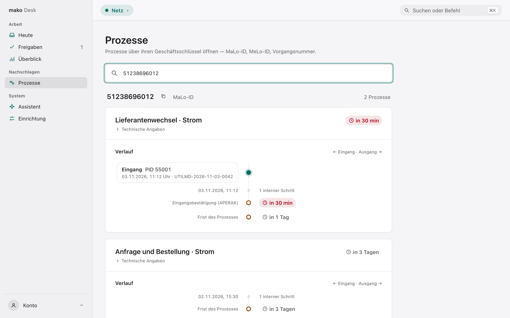](prozesse-light.png)
[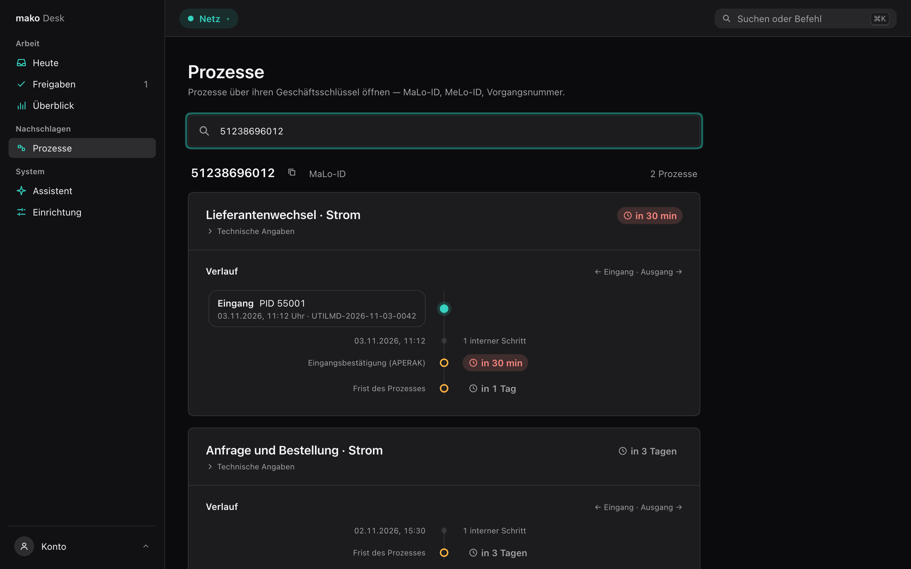](prozesse-dark.png)

## Starten

```sh
just dev
```

startet jeden Dienst, das geseedete Stadtwerk und den Desk mit Hot Reload auf
`http://localhost:5173`; `just dev-ui` startet den Desk allein auf seinen
aufgezeichneten Antworten.

In Produktion ist der Desk das Image `mako-desk` — das statische Bundle auf Port
8080 — hinter [oauth2-proxy](https://oauth2-proxy.github.io/oauth2-proxy/) als
Gateway. Der Browser spricht mit einem einzigen Origin und hält kein
Dienst-Token: Das Gateway meldet die Person per OIDC an, liefert den Desk aus
und leitet `/svc/<service>/` an jeden Dienst weiter, den der Desk liest —
makod, processd, vertragd, invoicd, billingd, edmd, netzbilanzd und agentd —,
mit dem Access-Token der Person als `Authorization: Bearer`.
`desk/deploy/gateway.yaml` ist das Routing des Gateways, bereit zum Anpassen.

Jeder Dienst prüft dieses Token wie jedes andere, deshalb muss seine
`[oidc] audience` im `aud` des Tokens stehen — über einen Audience-Mapper beim
Identity-Provider oder über eine Audience, die alle teilen. Was die Person tun
darf, entscheidet Cedar; der Desk führt keine eigene Rollenzuordnung. Seine CSP
erlaubt nur das eigene Skript und Stylesheet des Bundles, dazu eine Nonce pro
Anfrage für die Styles, die React Aria einfügt.

Zur Laufzeit liest der Desk eine Datei, `/config.json` neben dem Bundle. Sie
enthält `handbuch`, die Adresse des Betriebshandbuchs, die der
Einstellungs-Link eines Befunds öffnet (Standard
`https://hupe1980.github.io/mako`). Lege deine eigene Datei über
`/usr/share/nginx/html/config.json`, um auf ein Handbuch zu verweisen, das du
selbst betreibst; fehlt die Datei oder ist der Wert keine `https:`- oder
Same-Origin-Adresse, bleibt der Standard.

## Ein Prozess über seinen Geschäftsschlüssel

Tippe auf **Prozesse** eine MaLo-ID, MeLo-ID oder Vorgangsnummer ein, oder
drücke irgendwo <kbd>⌘K</kbd> und tippe sie dort: Die Palette bietet an, sie
direkt zu öffnen.

[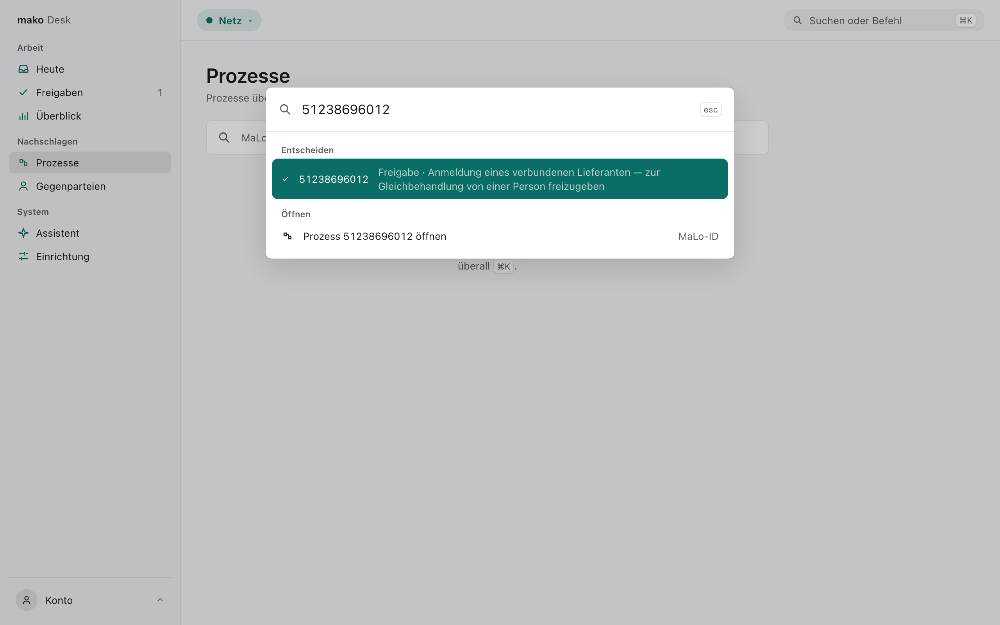](palette-light.png)
[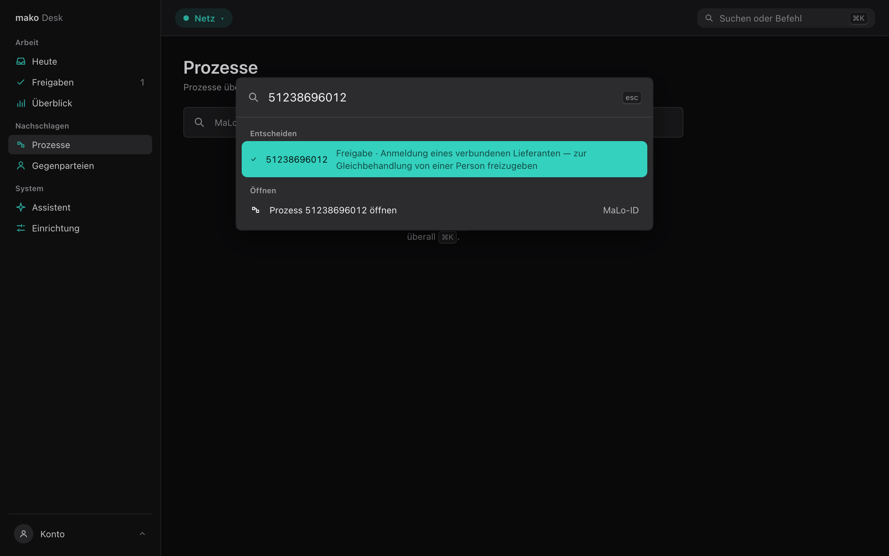](palette-dark.png)

Ein Schlüssel kann mehrere Prozesse benennen — einen Lieferantenwechsel neben
einer Anfrage/Bestellung. Jeder ist eine Karte, sortiert nach seiner frühesten
offenen Frist; Prozesse, die die Rolle der Person nicht lesen darf, fehlen.

Jede Karte trägt den Titel so, wie man im Betrieb sagt — „Lieferantenwechsel ·
Strom" —, mit dem Workflow und seinen IDs unter „Technische Angaben". Sobald
der Marktpartner geantwortet hat, nennt die Karte seinen Antwortcode mit dem
Wortlaut des BDEW aus der Liste, die die Antwort genannt hat, und diese Liste
als Quelle; zu einem Code, für den der Katalog keinen Wortlaut hat, steht die
Liste ohne Bedeutung.

Sein **Verlauf** fädelt die Marktnachrichten auf: Empfangene links, gesendete
rechts, jede mit PID, Berliner Zeit und Dokumentnummer, so wie der Workflow sie
aufgezeichnet hat. Eine Antwort nennt außerdem ihren Code und den Wortlaut des
BDEW aus der Liste, die ihn definiert („A02 — Marktlokation … nimmt nicht an der
Marktkommunikation teil"); wo die Liste keinen Wortlaut für den Code
veröffentlicht, nennt die Zeile nur die Liste. Schritte zwischen zwei
Nachrichten falten sich in eine ruhige Zeile („2 interne Schritte"). Offene
Fristen schließen den Verlauf ab, jede benannt nach dem, was sie ist — eine
„Eingangsbestätigung (APERAK)", eine „Syntaxquittung (CONTRL)" oder eine „Frist
des Prozesses".

Die **Frist-Uhr** zeigt, wie weit eine Frist entfernt ist: schlicht, solange sie
weit weg ist, bernsteinfarben innerhalb eines Tages, rot innerhalb von zwei
Stunden und sobald sie abgelaufen ist — getönter Text, nie ein voller Badge;
Bernstein heißt nur, dass eine Frist nahe ist. Die Zeit daneben ist Berliner
Zeit; Hover oder Fokus zeigt den Zeitpunkt in UTC, so wie er auf der Leitung
steht.

Ein Schlüssel ohne Prozess bekommt einen Satz zum Ablehnungscode der
Marktkommunikation und einen Weg weiter — „Neue Suche"; der eigene Text des
Dienstes wartet unter „Details":

[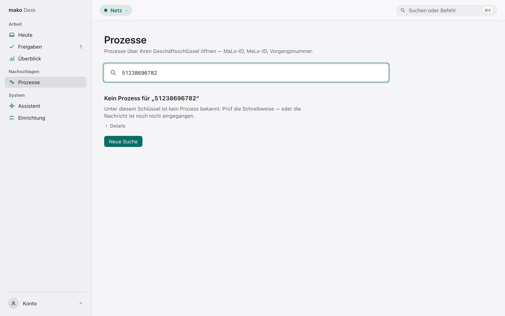](refusal-light.png)
[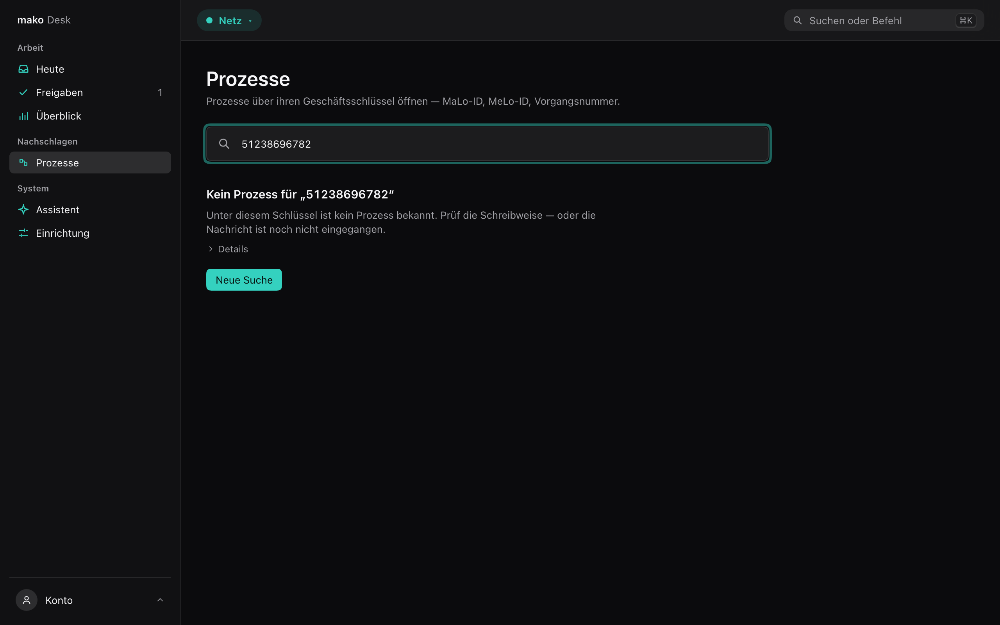](refusal-dark.png)

## Den Assistenten fragen

Unter einem Kunden, den Prozessen einer MaLo und einer Freigabe fragt der Desk
den Assistenten — tippe eine Frage, nimm einen Vorschlag oder drücke
<kbd>⌘J</kbd>. Er liest dieselben Dienste wie der Bildschirm und nennt das
Modell, das antwortet. Die Antwort beginnt mit „KI-generiert." („AI-generated."
auf Englisch); der Assistent liest und handelt nie.

**Die Spur.** Jeder Lesevorgang des Assistenten erscheint unter der Frage als
nummerierte Zeile, sobald agentd ihn journalisiert — „Verlauf gelesen · Prozess
43991093" mit seinem Quellen-Chip —, während unter der Frage eine Haarlinie
läuft. Ein Lesevorgang, dessen Quelle du nicht sehen darfst, bleibt stehen,
markiert „Quelle für dich verborgen"; ein Aufruf, den ein Stopp verhindert hat,
bleibt gedämpft stehen, markiert „nicht beantwortet".

[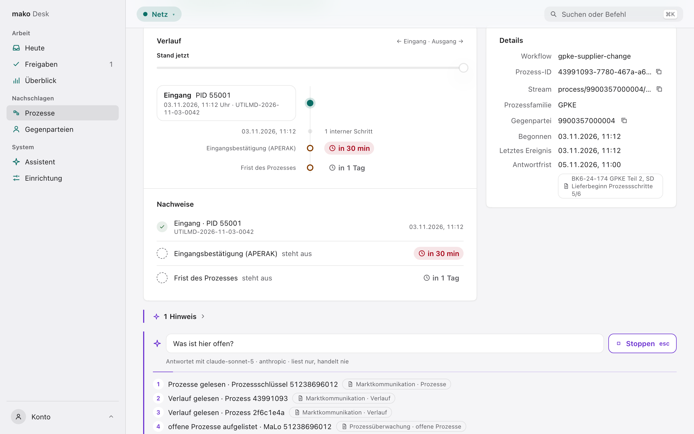](fragen-live-light.png)
[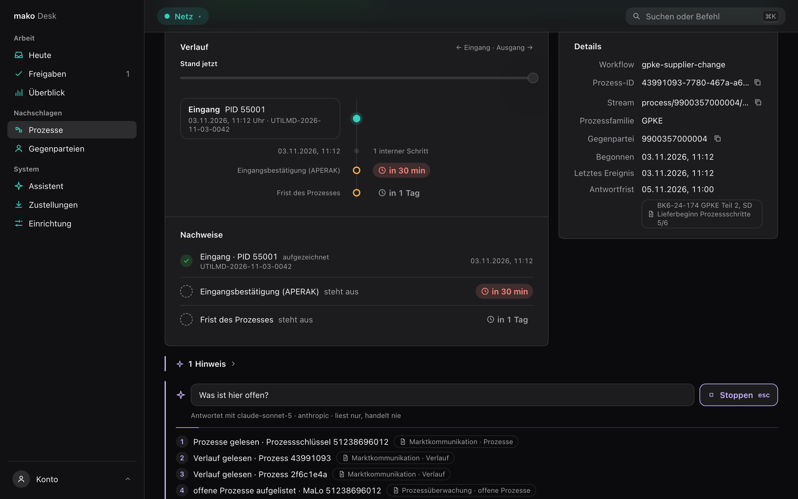](fragen-live-dark.png)

Steht die Antwort, faltet sich die Spur zu „4 Quellen gelesen ▸" — die
Lesevorgänge, deren Quelle du sehen darfst —, und ein Klick darauf öffnet sie
wieder. Bricht die Verbindung ab, setzt der Stream dort fort, wo er abbrach,
ohne eine Zeile zu wiederholen.

**Stoppen.** Während der Assistent liest, wird „Fragen" an derselben Stelle zu
**Stoppen**, und auch <kbd>esc</kbd> stoppt — außer wenn ein Dialog, ein Popover
oder ⌘K offen ist; dann schließt <kbd>esc</kbd> zuerst diesen. agentd beendet
den Lauf beim nächsten Schritt, es wird also nichts mehr dafür verbraucht; die
bereits gemachten Lesevorgänge bleiben stehen, jeder markiert „abgebrochen".
Stoppen ist immer sicher: Der Assistent sendet nie, ein gestoppter Lauf
hinterlässt also keine halbe Entscheidung. Nur wer gefragt hat, kann einen Lauf
hier stoppen.

**Die Belege.** Jeder Satz trägt die Nummern der Spurzeilen, auf denen er
beruht. Fokussierst du eine Nummer oder fährst darüber, wird jede Zeile auf dem
Bildschirm umrandet, die zeigt, was dieser Lesevorgang geliefert hat — etwa der
Verlauf des gelesenen Prozesses —, und <kbd>↵</kbd> darauf öffnet die Spur an
dieser Zeile.

[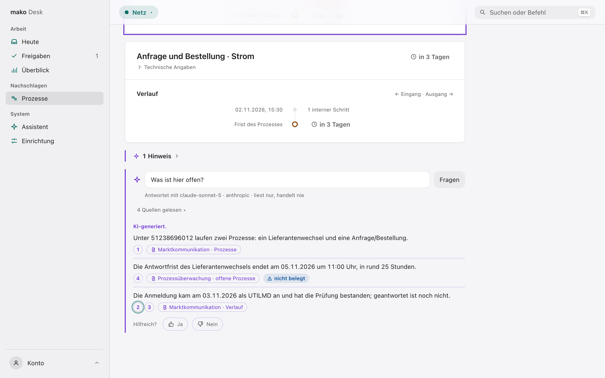](fragen-light.png)
[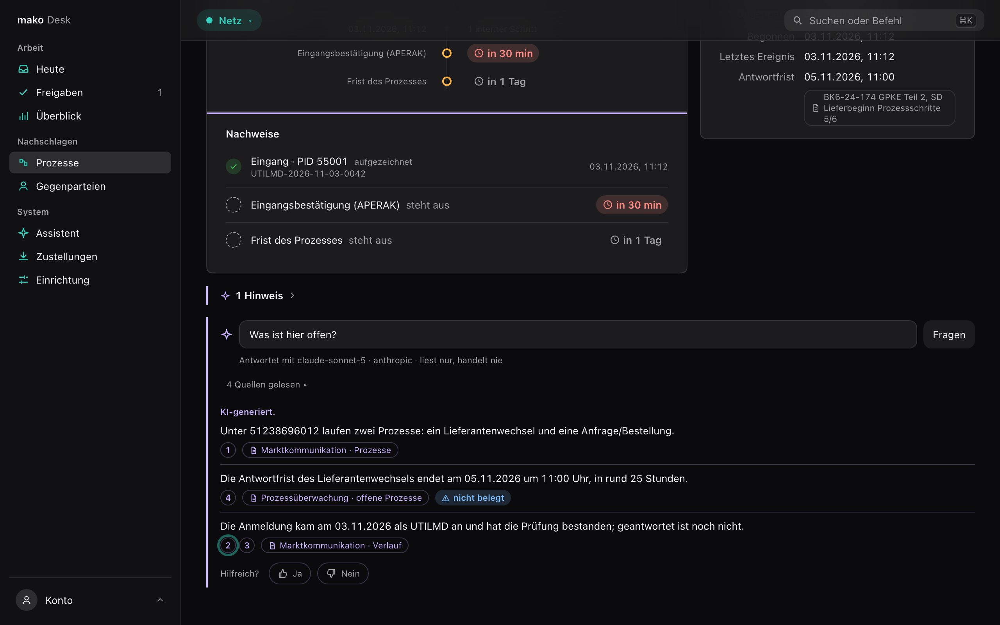](fragen-dark.png)

**Der Lauf kommt mit.** Verlässt du die Seite, während der Assistent liest,
fährt die Frage als Pille in der oberen Leiste mit, mit ihrem jüngsten
Lesevorgang zuerst, und zeigt „Antwort bereit", sobald sie beantwortet ist. Ein
Klick auf die Pille führt zurück zur Frage; hast du die Antwort dort gesehen,
verschwindet die Pille.

[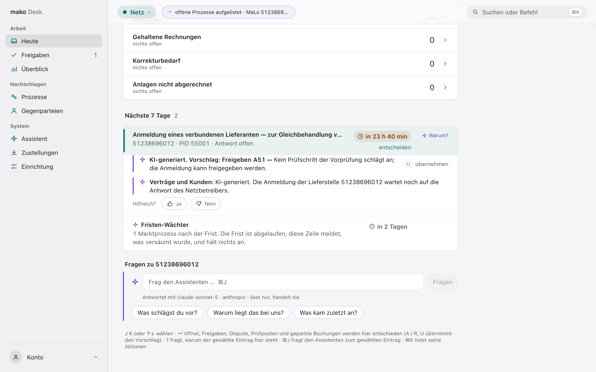](pille-light.png)
[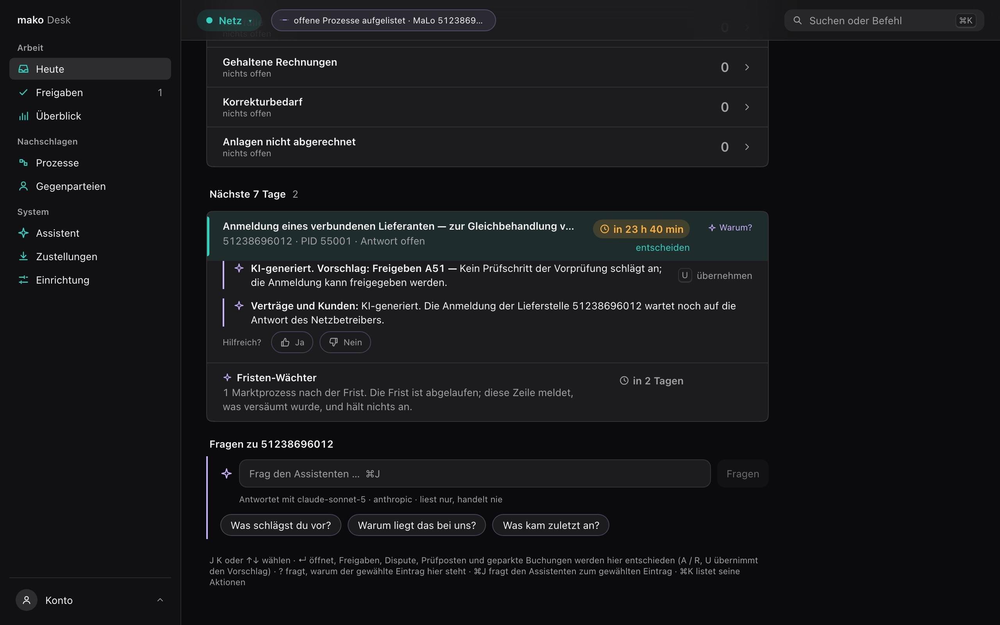](pille-dark.png)

Er antwortet in höchstens fünf Sätzen, jeder mit dem Lesevorgang, auf dem er
beruht, und jeder wird geprüft, bevor er erscheint: Jede MaLo-ID, jedes Datum,
jede Uhrzeit und jeder Betrag darin muss in der Antwort dieses Lesevorgangs
vorkommen. Ein Satz, bei dem das nicht so ist, wird als **nicht belegt**
markiert — typischerweise eine Zahl, die das Modell selbst errechnet hat, etwa
„noch 25 Stunden". Die Prüfung sagt, dass die Zahlen in dem stehen, was er
gelesen hat, nicht, dass seine Schlussfolgerung stimmt.

Findet er keine Antwort, fragt „Nochmal fragen" erneut. Läuft der Assistent
nicht, wird das Panel nicht gezeigt, und der Rest des Desks funktioniert wie
gewohnt. Wo der Stream von agentd nicht gelesen werden kann, liest das Panel
die Antwort, sobald der Lauf abgeschlossen ist, listet darunter die gelesenen
Dienste („Gelesen: …") und sagt, warum, falls agentd ablehnt.

Was ein Skill von sich aus bemerkt hat — eine verstrichene Frist, eine
steckengebliebene Anmeldung —, kommt als **Hinweis**: in Heute unter dem
Eintrag, den er betrifft, und unterhalb der Arbeit auf dem Überblick, einem
Prozess und einem Kunden, gefaltet auf eine Zeile („1 Hinweis"), die sich auf
Klick öffnet, in den eigenen Worten des Skills (ein vom Modell geschriebener
beginnt mit „KI-generiert."). Einen Skill kannst du mit einem Klick
stummschalten und mit einem wieder einblenden; das Stummschalten gilt für
diesen Browser und löscht nichts.

**Assistent** in der Seitenleiste ist der Beipackzettel jedes Skills, gelesen
aus der geprüften Beschreibung, mit der agentd ihn ausführt: wofür er da ist, ob
er hier aktiv ist, was ihn startet — eine Frage oder ein Ereignis —, welches
Modell er nutzt oder dass er keines nutzt, und welche Dienste er lesen darf,
mit der Begründung jedes Tools beim Hovern. Jeder Skill liest nur: Keiner kann
eine Marktnachricht senden, buchen oder Stammdaten ändern.

Die Karte jedes aktiven Skills trägt außerdem seine Bilanz der letzten 30 Tage,
so wie agentd sie zählt: wie viele Läufe er hatte, wie oft eine Person seine
Antwort „hilfreich" fand und was aus seinen Vorschlägen wurde —
**übernommen** (wie vorgeschlagen gesendet), **angepasst** (vor dem Senden
geändert) und **verworfen**. Ein Anteil erscheint erst ab fünf Bewertungen;
darunter nennt die Karte nur die Anzahl („2 Bewertungen"), und ein Skill, den
noch niemand bewertet hat, sagt „Noch keine Bewertungen", nie 0 %. Die Bilanz
hilft dir, einen Vorschlag einzuschätzen; sie entscheidet nie über einen.

[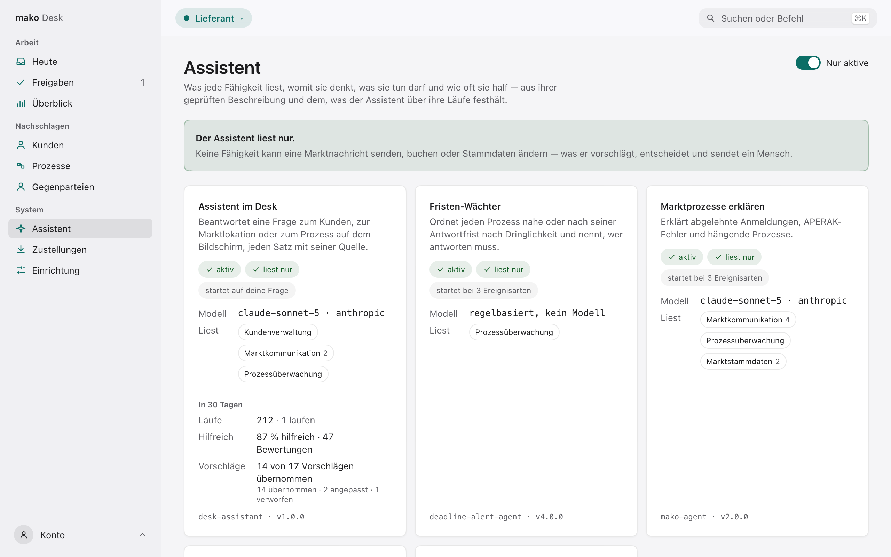](assistent-light.png)
[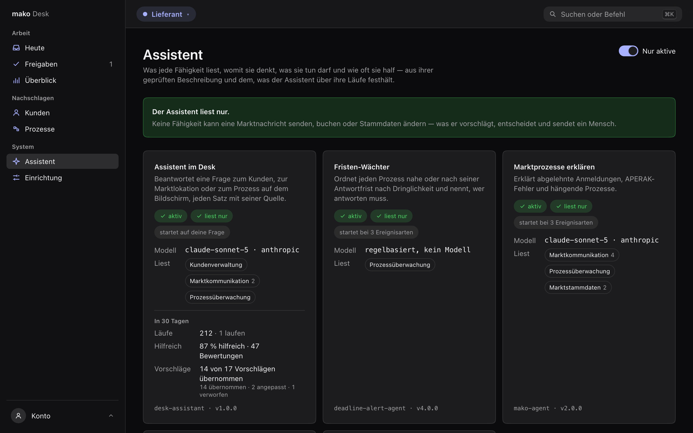](assistent-dark.png)

## Freigaben

Manche Antworten sendet die Prozessüberwachung nicht von sich aus: eine
Anmeldung eines verbundenen Lieferanten, die für eine Person zurückgehalten
wird, oder ein Fall, den ihr Entscheidungsbaum nicht klären konnte.
**Freigaben** listet sie für die Rolle, die du gerade trägst, die früheste
Frist zuerst; die Seitenleiste zeigt, wie viele warten.

Jede beginnt mit ihrem Grund und ihrer Frist. Eine zurückgehaltene Antwort
sagt, welchen Antwortcode sie senden wird; eine offene fragt dich nach dem
Code, und das Formular bietet nur die Codes an, die ihr Entscheidungsbaum
definiert, jeden mit seinem veröffentlichten Wortlaut. Eine E/G-Bestätigung,
deren Bilanzkreis, Versorgungsart oder Abrechnungsintervall die
Prozessüberwachung nicht auflösen konnte, fragt neben dem Code nach jedem davon
und bietet die Werte an, die processd für ihr Segment listet; gesendet wird
erst, wenn sie angegeben sind. Der Verlauf des Prozesses steht daneben. Jede
Entscheidung sendet eine Marktnachricht; was sie sendet, steht neben dem
Button, die Entscheidung wird fünf Sekunden gehalten, bevor sie rausgeht (siehe
[Eine Entscheidung zurücknehmen](#eine-entscheidung-zurucknehmen)), und sie
wird unter deinem Namen protokolliert.

<kbd>J</kbd> und <kbd>K</kbd> gehen durch die Liste, <kbd>A</kbd> wählt
Freigeben und <kbd>R</kbd> Ablehnen; <kbd>↵</kbd> auf dem Button sendet —
gehalten, nie mit Rückfrage. Hat eine Kollegin oder ein Kollege dieselbe
Freigabe zuerst entschieden, sagt der Desk, wer und wann, und deine wird nicht
gesendet. Jede andere Ablehnung erscheint in den eigenen Worten der
Prozessüberwachung; eine, die ihre Policy ausspricht, steht dort, wo die
Bedienelemente waren, bis der Tab geschlossen wird.

Der Assistent schlägt für jede Freigabe eine Entscheidung vor, sobald sie in
die Warteschlange kommt — eine Aktion, einen Code und einen Satz zur
Begründung, markiert „KI-generiert." und geprüft wie jeder Satz, den er
schreibt. Der Vorschlag steht oben in der Entscheidung; <kbd>U</kbd> oder „In
die Entscheidung übernehmen" füllt das Formular aus und sendet nichts. Wo er
noch keinen vorgeschlagen hat, frag ihn „Was schlägst du vor?". Ob du einen
Vorschlag unverändert gesendet, geändert oder verworfen hast, wird neben dem
Lauf des Assistenten festgehalten, und jede Vorschlagskarte endet mit dieser
Bilanz: „In 30 Tagen: 14 von 17 Vorschlägen übernommen" (ab fünf entschiedenen
Vorschlägen; darunter nur die Anzahl).

[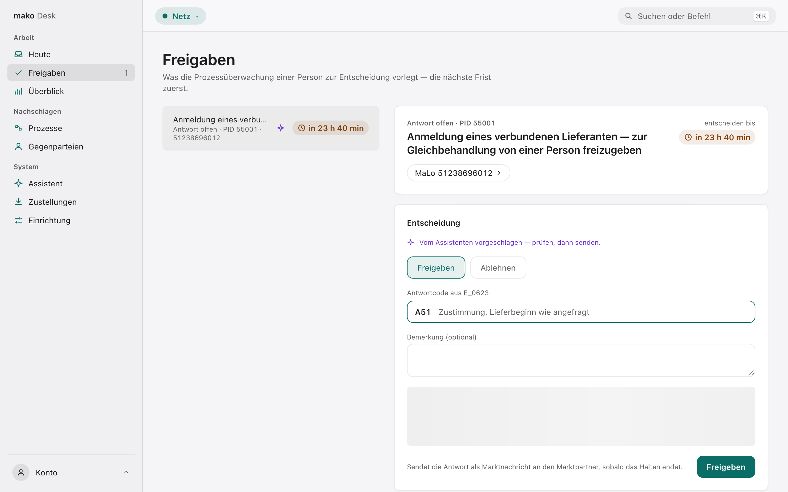](freigaben-light.png)
[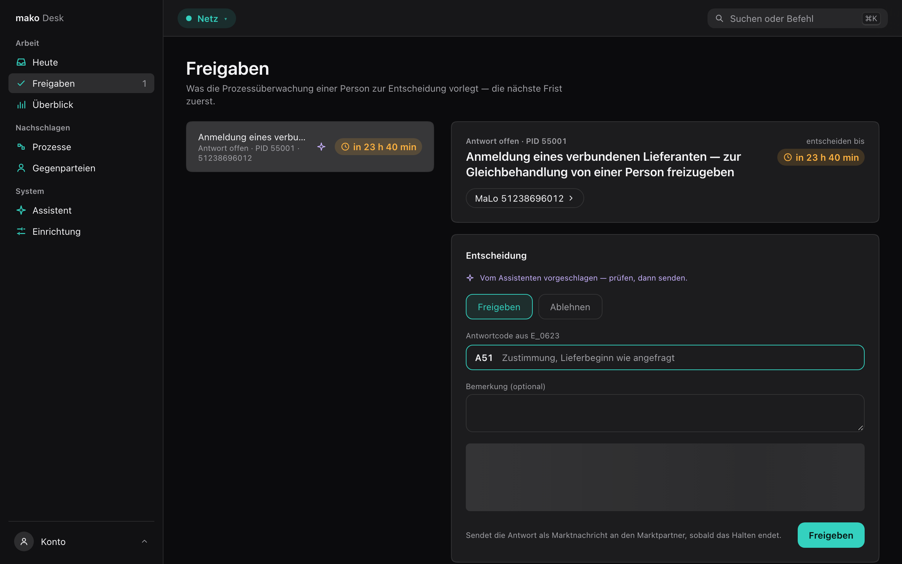](freigaben-dark.png)

## Eine Entscheidung zurücknehmen

Jede Entscheidung — eine Freigabe, ein Rechnungsdisput, eine zurückgehaltene
Rechnung, eine geparkte Buchung, „Hilfreich?" unter einer Antwort, „Verwerfen"
bei einem Vorschlag — erscheint sofort und verlässt den Browser fünf Sekunden
später, in ihrer Ansicht genauso wie in ⌘K. Keine fragt nach einer Bestätigung,
auch nicht eine Marktnachricht. Bis sie rausgeht, zählt ein Ring an ihrem
Eintrag die Haltezeit herunter, ein Toast bietet „Rückgängig" an, und
<kbd>⌘Z</kbd> nimmt die jüngste zurück; es wurde nichts gesendet, also muss
nichts rückabgewickelt werden. Schließt du den Tab, wird gesendet, was noch
gehalten wird. Eine Ablehnung nach der Haltezeit steht in den Worten des
Dienstes am Eintrag, mit dem Formular so, wie du es gesendet hast.

[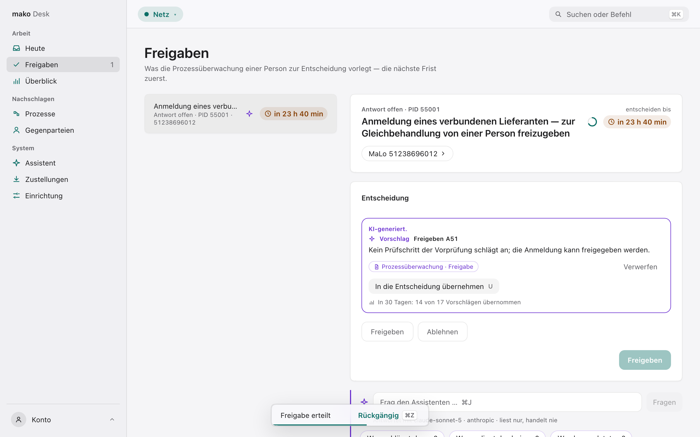](gehalten-light.png)
[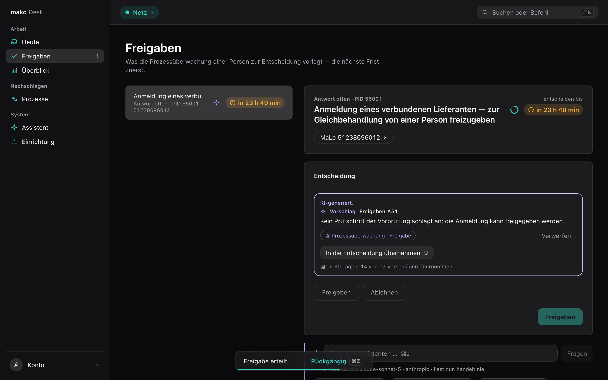](gehalten-dark.png)

## Handeln aus ⌘K

<kbd>⌘K</kbd> entscheidet, was es findet, ohne die Ansicht zu öffnen. Tippe die
Kennung einer offenen Entscheidung — eine MaLo, einen Prozess, eine Freigabe,
eine Rechnungsnummer, einen Beleg —, und die Palette listet unter
**Entscheiden** die Freigaben, Rechnungsdispute, Prüfposten und geparkten
Buchungen, die sie benennt, unter denen, die Heute für die getragene Rolle
listet. Auf einer fokussierten Heute-Zeile oder mit ausgewählter Freigabe
gedrückt, öffnet ⌘K direkt die Aktionen dieses Eintrags.

Ein Eintrag listet genau die Aktionen, die der Desk für ihn anbietet, wie seine
Ansicht: Freigeben und Ablehnen bei einer Freigabe, Beilegen und — solange die
Ablehnung nicht rausgegangen ist — Ablehnung senden bei einem Rechnungsdisput,
Freigeben oder Geprüft bei einem Prüfposten, Neu buchen und Verwerfen bei einer
geparkten Buchung. Tippen filtert sie; <kbd>↵</kbd> wählt die erste,
<kbd>⌘↵</kbd> die zweite, die Pfeiltasten jede; <kbd>esc</kbd> geht einen
Schritt zurück. Eine Aktion, die der Dienst dir in dieser Sitzung abgelehnt
hat, steht in seinen Worten da und ist nicht wählbar. ⌘K liest keinen freien
Text in eine Aktion: Eine Frage geht an den Assistenten.

Wählst du eine Aktion, öffnen sich ihre Parameter in der Palette, nie in einem
Dialog, mit der Frist daneben: der Antwortcode als Auswahl der Codes, die ihr
Entscheidungsbaum veröffentlicht, jeder mit dem Wortlaut, den die
Prozessüberwachung liefert, die Angaben, die eine Freigabe noch braucht, und
die Bemerkung, der Grund oder das Buchungsdatum. Ein ablehnendes Verb ist rot
gezeichnet und fragt nichts weiter. <kbd>↵</kbd> hält die Entscheidung und
schließt die Palette auf den Eintrag — die Freigabe in **Freigaben**, alles
andere in **Heute** —, wo ein Ring die Haltezeit herunterzählt; <kbd>⌘Z</kbd>
nimmt sie zurück, bevor etwas gesendet wurde. Die Anfrage ist dieselbe, die die
eigene Ansicht des Eintrags sendet. Lehnt der Dienst sie nach der Haltezeit ab,
stehen seine Worte am Eintrag.

Wartet ein Vorschlag des Assistenten, trägt die vorgeschlagene Aktion
„Vorschlag", und sie zu wählen füllt aus, was der Vorschlag nennt — den Code,
das Datum, den Grund —, getönt und markiert durch eine Karte, die mit
„KI-generiert." beginnt, die Begründung nennt und mit der 30-Tage-Bilanz des
Assistenten endet. <kbd>Tab</kbd> behält den Vorschlag und geht weiter; Tippen
ersetzt ihn, und die Markierung verschwindet, sobald du änderst, was er
ausgefüllt hat. Eine Bemerkung wird nie ausgefüllt: Sie wird als deine Worte
protokolliert. Ein Prüfposten hat nie einen Vorschlag, und wartet keiner,
öffnen sich die Felder leer. Ob du den Vorschlag unverändert gesendet oder
geändert hast, wird neben dem Lauf des Assistenten festgehalten, wie in den
Ansichten.

[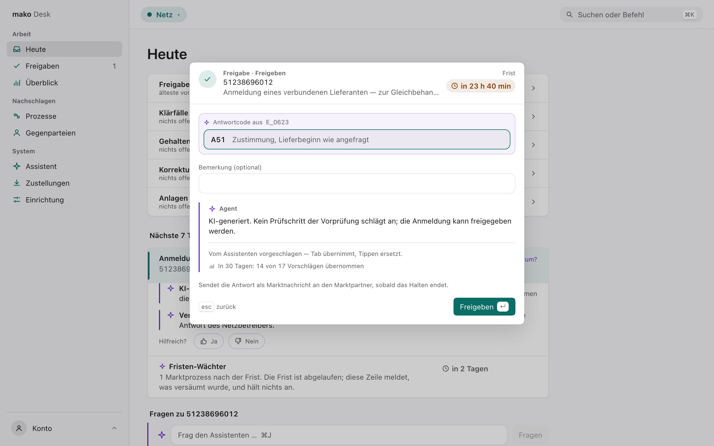](palette-aktion-light.png)
[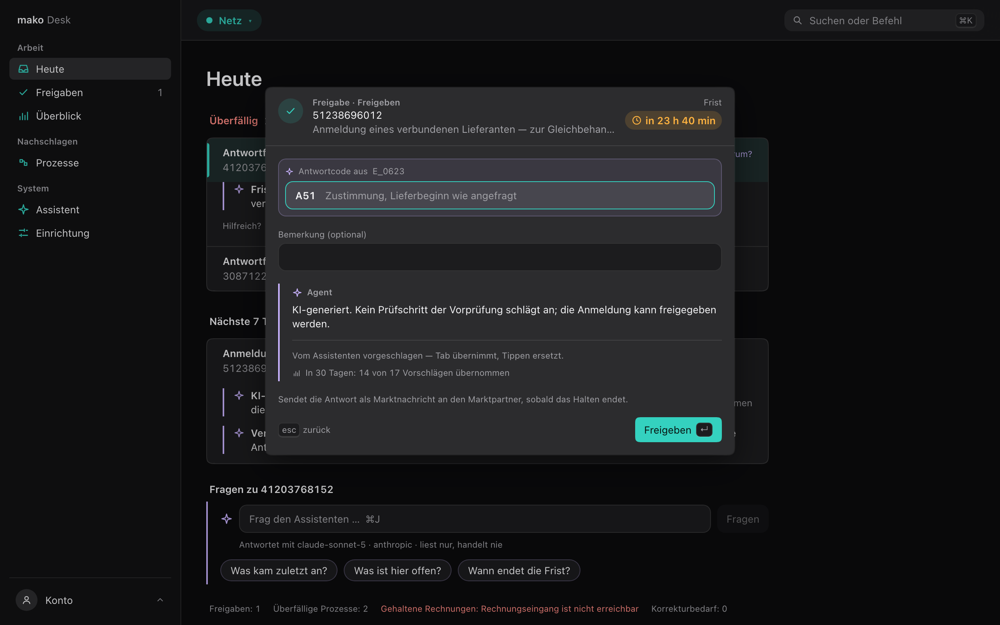](palette-aktion-dark.png)

## Überblick

Ein paar Zahlen pro Rolle für die Person, die für sie verantwortlich ist —
jede so, wie ihr Dienst sie liefert, nie eine Summe, die der Desk errechnet,
und jede Kachel öffnet die Liste, die sie zählt. Eine Kachel wird nur dort rot,
wo der Dienst eine Überschreitung markiert; eine Zahl, die der Dienst gedeckelt
hat, erscheint als Untergrenze („500+").

**Fristen überschritten** listet jeden offenen Prozess, dessen Antwortfrist
verstrichen ist, so wie die Prozessüberwachung ihn führt, jeden mit der
Festlegung, aus der seine Frist stammt. Die Ansicht ist wie Mail aufgebaut: die
Liste links, der ausgewählte Prozess mit seinem Verlauf in der Mitte und seine
Angaben — MaLo, PID, Zustand, wann die Frist endete, die Fundstelle, die
Marktpartner-ID, die Prozess-ID — rechts. <kbd>↑</kbd> <kbd>↓</kbd> bewegen
die Auswahl, und das Detail folgt, <kbd>↵</kbd> wechselt ins Detail,
<kbd>esc</kbd> zurück zur Zeile. Die Auswahl steht in der Adresse, ein Link
öffnet also denselben Prozess. Bei weniger Platz rutschen die Angaben unter das
Detail; in Telefonbreite ist immer nur ein Bereich zu sehen, und „Zurück zur
Liste" führt zurück.

**Dead Letters** (Netz) zählt jede Nachricht, die die Marktkommunikation nicht
annehmen oder zustellen konnte, und listet die jüngsten. Der Lieferant sieht
außerdem **Rechnungsprüfung**, **Rechnungsdispute** und **Geparkte Buchungen**,
die Messstelle **Ableseaufträge überfällig** — jeweils derselbe Lesevorgang wie
ihre Zeile in Heute, die ein Klick öffnet.

Jede Rolle sieht **Assistent**: den Anteil der Antworten des Desk-Assistenten,
die Personen in den letzten 30 Tagen „hilfreich" fanden — das Verhältnis der
beiden Zählungen von agentd, und erst ab fünf Bewertungen; darunter die
Anzahl —, mit dem, was aus seinen Vorschlägen wurde, darunter. Die Kachel
öffnet den Beipackzettel.

[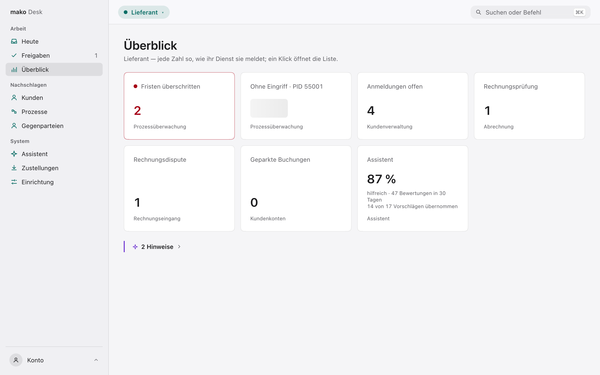](ueberblick-light.png)
[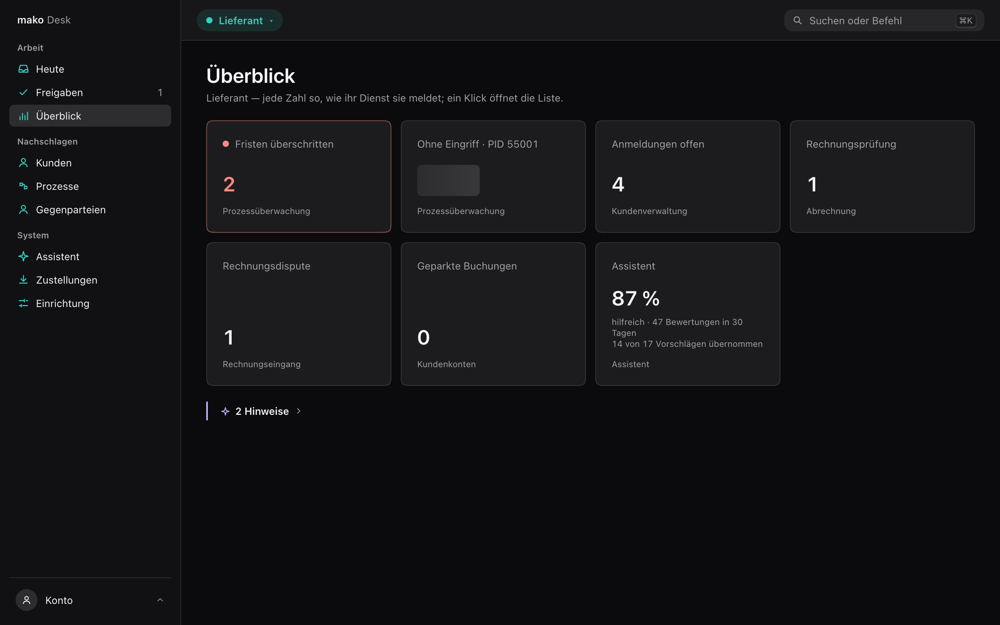](ueberblick-dark.png)
[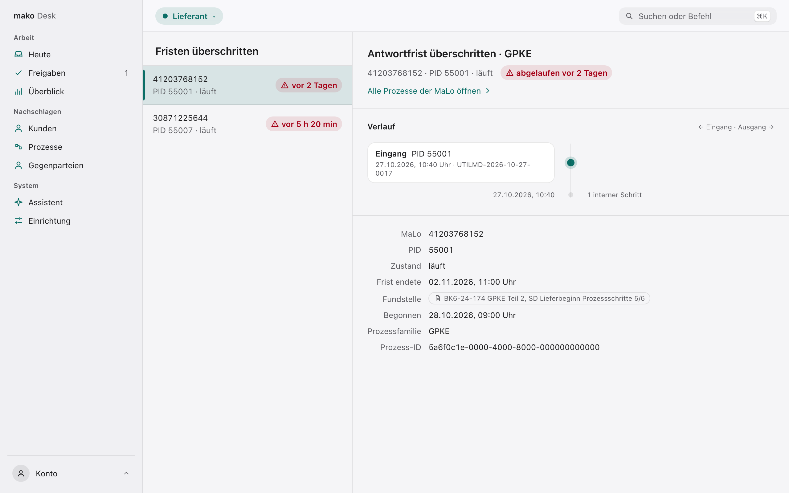](fristen-light.png)
[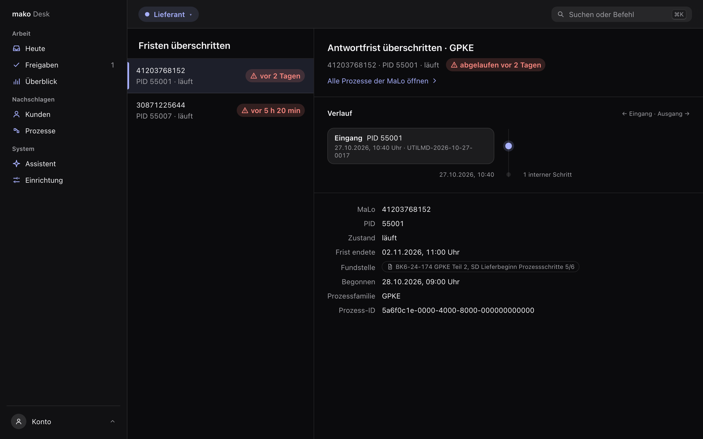](fristen-dark.png)
[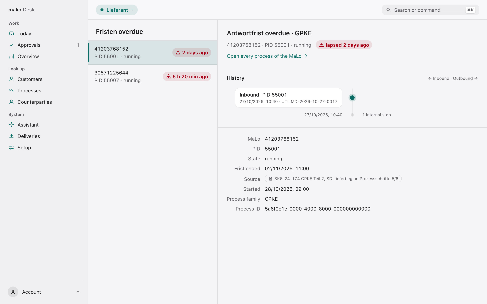](fristen-englisch-light.png)
[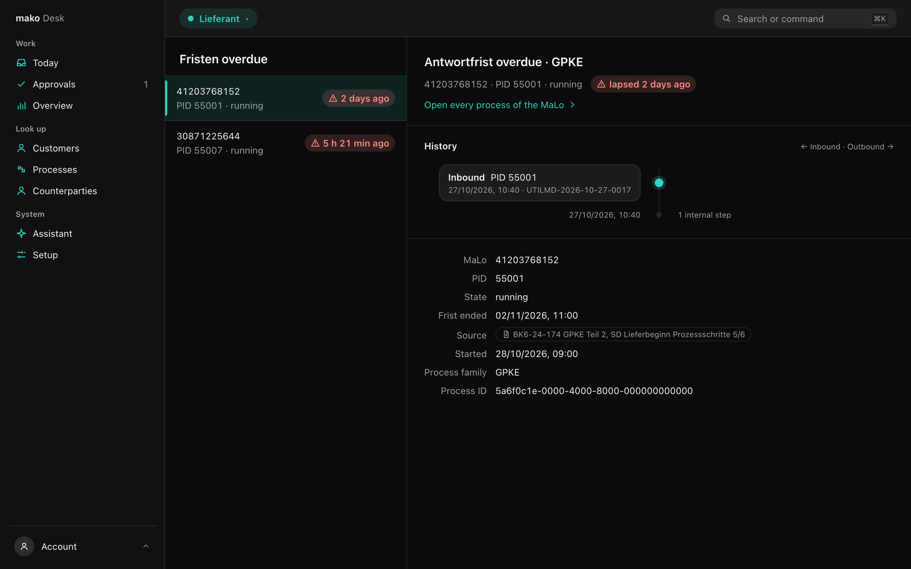](fristen-englisch-dark.png)

## Heute

Jede Rolle öffnet auf **Heute**: alles, was auf dich wartet, in einer Liste.
Jeder Eintrag ist etwas, das ein Dienst für diese Rolle offen hält:

| Rolle | Was Heute listet |
|---|---|
| Netz | Freigaben, überfällige Prozesse, empfangene Rechnungen, die an einem offenen Prüfschritt gehalten werden, Korrekturbedarf nach einer negativen Prüfmitteilung |
| Lieferant | Anmeldungen, die auf den Netzbetreiber warten, Freigaben, überfällige Prozesse, bestrittene Rechnungen, empfangene Rechnungen, die an einem offenen Prüfschritt gehalten werden, zur Prüfung zurückgehaltene Rechnungen, Buchungen, die das Hauptbuch abgelehnt hat, noch nicht gesendete Anmeldungen |
| Messstelle | Freigaben, überfällige Prozesse, überfällige Ableseaufträge |
| Energieservice | Freigaben, überfällige Prozesse, empfangene Rechnungen, die an einem offenen Prüfschritt gehalten werden |

Die Liste ist in Bänder gegliedert — **Überfällig**, **Heute**, **Nächste 7
Tage**, **Später**, **Ohne Frist** — nach der Frist, die jeder Dienst geliefert
hat; der Desk errechnet keine. Eine Zeile liest sich wie eine Mail: zuerst, was
zu tun ist, dann der Kunde oder die MaLo und die PID, die Frist in einer Spalte
rechts. Einen Zustand oder eine Prozessfamilie, die ein Dienst liefert, nennt
der Desk in seinen eigenen Worten („läuft", „GPKE"), nie als Code; ein
überfälliger Prozess öffnet in **Fristen**, wo seine Fundstelle steht. Ein
Hinweis, der einen Prozess benennt, steht nur unter der Zeile dieses Prozesses.
Die Abschnittsköpfe bleiben beim Scrollen sichtbar.

Eine Freigabe wird dort entschieden, wo sie steht: <kbd>↵</kbd> öffnet die
Entscheidung unter der Zeile — <kbd>A</kbd> oder <kbd>R</kbd>, der Code, das
Senden, gehalten zum Rückgängigmachen —, und Heute bleibt auf dem Bildschirm.
Der Vorschlag des Assistenten wartet unter der Zeile; <kbd>U</kbd> öffnet die
Entscheidung mit übernommenem Vorschlag, nicht gesendet.

Eine bestrittene Rechnung wird ebenfalls dort entschieden. Ihre Zeile nennt den
Rechnungssteller so, wie das Marktstammdatenregister ihn führt, mit der
Rechnungsnummer darunter, und die Entscheidung listet die Befunde der Prüfung
mit ihren deutschen Namen. **Beilegen** schließt den Disput mit deiner
Bemerkung und sendet nichts, wird also fünf Sekunden hinter „Rückgängig"
gehalten; solange die Ablehnung (REMADV) nicht rausgegangen ist, sendet
**Ablehnung senden** sie, gehalten dieselben fünf Sekunden. Der Assistent
schlägt eines von beiden vor, mit dem Befund, auf dem der Vorschlag beruht, und
„nicht belegt", wenn die gelesenen Befunde ihn nicht nennen.

Eine empfangene Rechnung, deren Entscheidungsbaum an einem Prüfschritt stehen
blieb, den kein Datensatz beantwortet, ist **gehalten**: Es ging keine Antwort
raus, und ihre Zeile, fällig zum Zahlungsziel, nennt den Rechnungssteller und
den ersten offenen Schritt. Die Entscheidung listet jeden offenen Schritt; für
Prüfschritt 310, 320 und 330 je Position und für 80 bietet sie die beiden
Antworten in Worten an, mit einer Pflicht-Begründung — **Feststellen** —, und
wo eine Leistung der Bestellung der Rechnung offen ist, wählt <kbd>R</kbd>
**Leistungsnachweis** für die Bestellung, ihre Artikel-ID und den Zeitraum. Ein
Schritt, der einen Datensatz statt einer Beurteilung braucht, wird benannt, nie
erfragt. Jede Antwort wird zum Rückgängigmachen gehalten; danach prüft der
Rechnungseingang die Rechnung erneut, und mit ihr jede Rechnung, die an dieser
Bestellung gehalten wird.

Auch eine Rechnung, die die Risikoprüfung der Abrechnung beiseitegelegt hat,
wird an Ort und Stelle entschieden: Eine **zurückgehaltene** wird freigegeben —
und damit ausgestellt —, und eine **in Prüfung** ist bereits rausgegangen,
deshalb nimmt **Geprüft** sie von der Liste; jede wird zum Rückgängigmachen
gehalten. Der Assistent schlägt keine von beiden vor — die Befunde der
Risikoprüfung sind die Belege, aufgelistet in der Entscheidung.

Eine Buchung, die das Hauptbuch der Kundenkonten endgültig abgelehnt hat — ein
versiegelter Monat, ein noch nicht eröffnetes Konto —, ist eine **geparkte
Buchung**: Ihre Zeile nennt den Kunden, den Betrag und die Ablehnung, die
Entscheidung sagt, was zu tun ist. **Neu buchen** bucht sie zu dem Datum, das du
eingibst, vorbelegt mit dem ersten offenen Tag, wo das Hauptbuch einen nennt;
**Verwerfen** verwirft sie mit dem Grund, den du angibst. Beides ist nach dem
Senden endgültig und wird unter deinem Namen protokolliert; jede wird zum
Rückgängigmachen gehalten und fragt nichts weiter, und eine Ablehnung erscheint
in den Worten des Hauptbuchs.

Der Assistent schlägt eines von beiden vor, mit dem Lesevorgang, auf dem der
Vorschlag beruht: **Verwerfen**, wenn das Konto des Kunden bereits denselben
Beleg und Betrag trägt — der Grund nennt diese Buchung —, sonst **Neu buchen**
zum ersten offenen Tag. Öffnest du die Entscheidung, wird der Vorschlag
übernommen, markiert als der des Assistenten; gebucht wird erst, wenn du ihn
sendest und seine Haltezeit endet. Wo die Lesevorgänge es nicht klären, wird
kein Vorschlag gezeigt.

Ein Korrekturbedarf öffnet nichts: Der Desk hat keine Ansicht für Netzentgelte.

[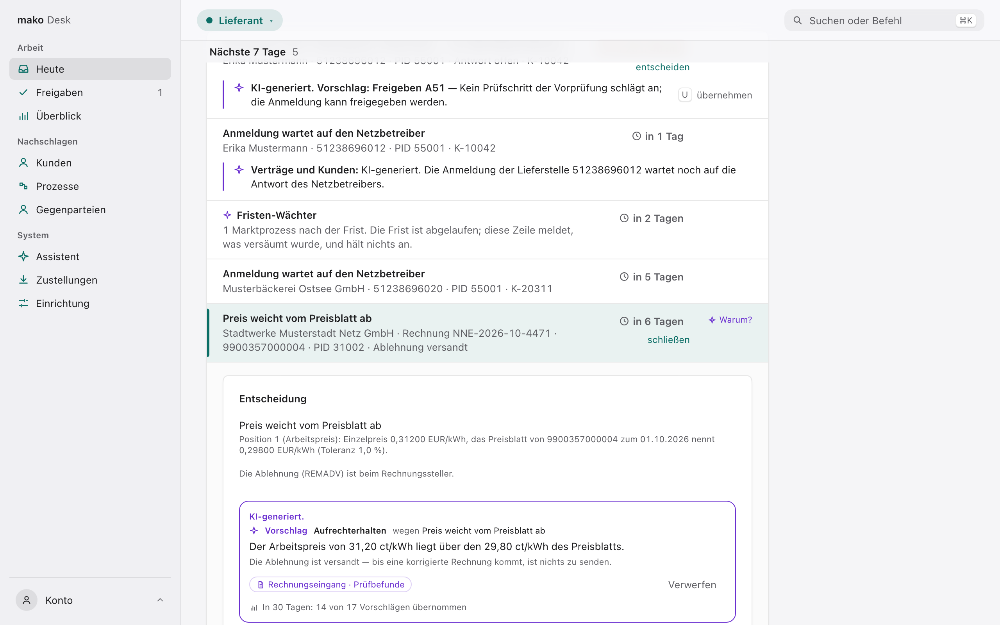](heute-disput-light.png)
[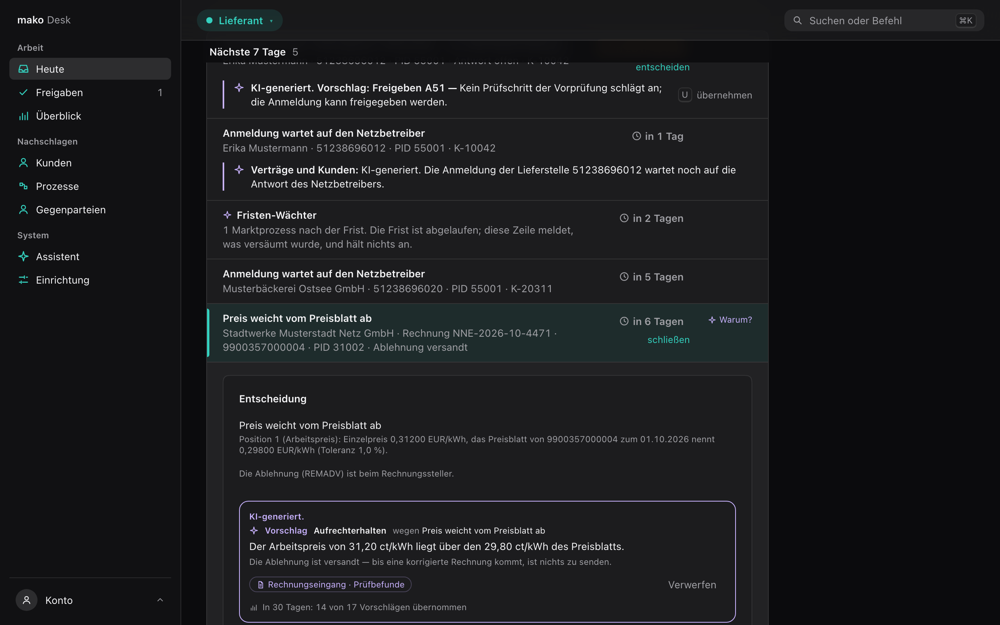](heute-disput-dark.png)

Der Assistent arbeitet in derselben Liste. Sein Hinweis zu einer MaLo oder
einem Prozess steht unter diesem Eintrag, „Hilfreich?" daneben, solange der
Eintrag den Fokus hat; einer, den kein Eintrag trägt, ist ein eigener Eintrag.
<kbd>J</kbd> und <kbd>K</kbd> oder die Pfeiltasten bewegen, <kbd>↵</kbd>
öffnet, und <kbd>⌘J</kbd> fragt den Assistenten nach dem Eintrag, auf dem du
stehst.

**Warum?** — <kbd>?</kbd> auf der ausgewählten Zeile oder ihr kleiner Button —
fragt den Assistenten „Warum steht das auf meiner Liste, und was entscheidet
es?" und antwortet unter dem Eintrag, mit derselben Spur und denselben
geprüften Sätzen; <kbd>?</kbd> blendet die Antwort wieder aus, <kbd>esc</kbd>
stoppt sie. Angeboten wird es dort, wo der Assistent den Datensatz liest, der
den Eintrag auf die Liste gebracht hat — eine Freigabe, einen Prozess, eine
Anmeldung, einen Rechnungsdisput, eine geparkte Buchung, einen Kunden, einen
Hinweis —, und nicht bei einem Korrekturbedarf, einem überfälligen
Ableseauftrag oder einer Rechnung in Prüfung, deren Quellen er nicht liest.
Solange der Assistent nicht erreichbar ist, wird „Warum?" nicht angeboten.

Unter der Liste sagt jede Quelle, wie viele Einträge sie geliefert hat oder
warum sie nicht geantwortet hat — ein einzelner unerreichbarer Dienst leert
Heute nie. Als Lieferant steht oben auf der Seite eine **Lage**-Zeile mit dem,
was die Liste nicht sagen kann — die Gesamtzahlen der Dienste über ihre Seite
hinaus, kein Modell darin —, und sie fehlt, wenn sie nur die Liste wiederholen
würde.

[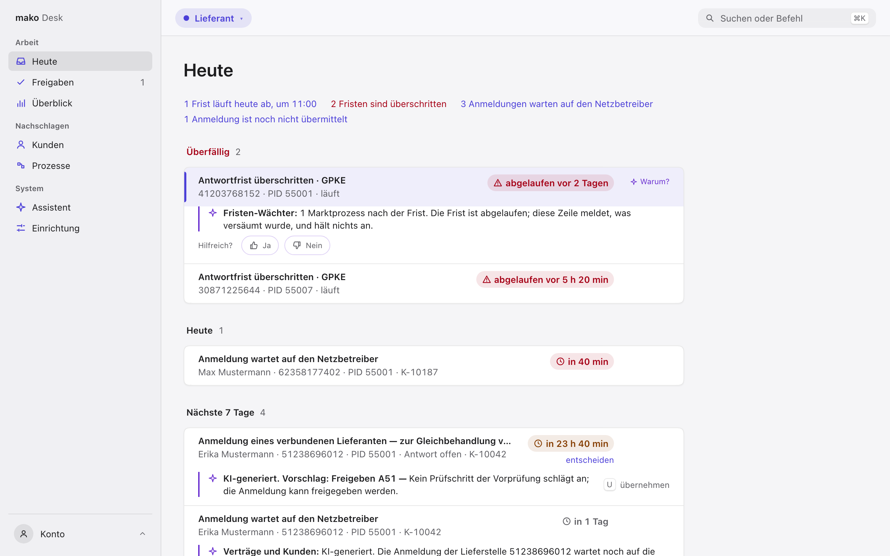](heute-light.png)
[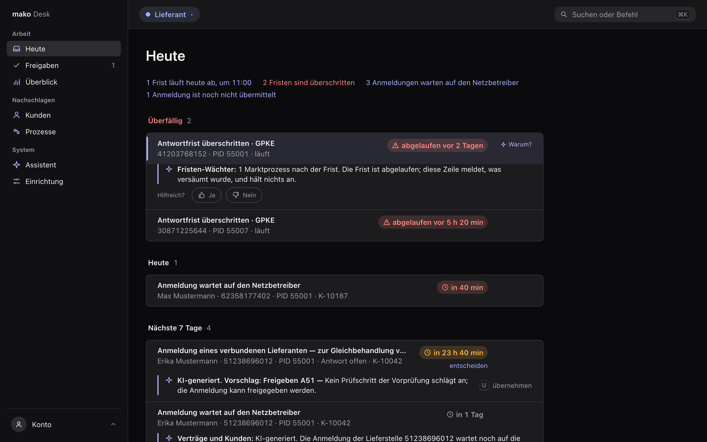](heute-dark.png)

## Der Lieferant beginnt beim Kunden

**Kunden** findet einen Kunden: Tippe den Anfang eines beliebigen Worts eines
Namens, eine Kundennummer oder die MaLo-ID einer Lieferstelle, und die
Kundenverwaltung antwortet schon beim Tippen aus einem Index — höchstens 20
Kunden; im Browser wird nichts durchsucht.

[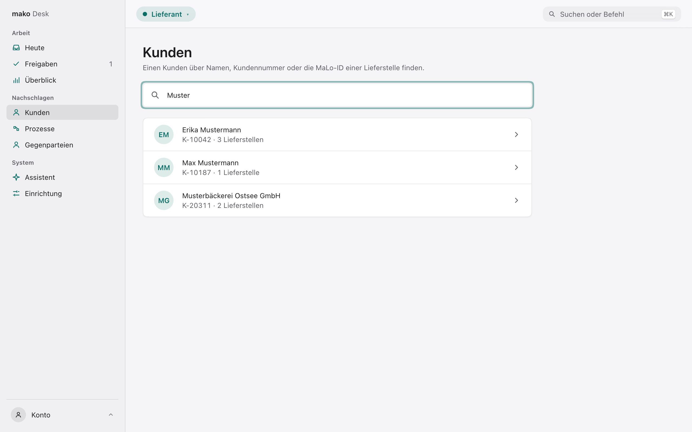](kunden-light.png)
[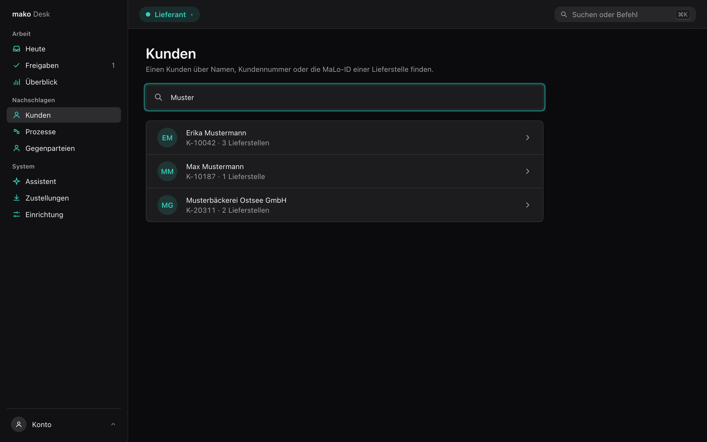](kunden-dark.png)

Ein Kunde zeigt seine Lieferstellen, die neueste zuerst, mit dem Stand ihrer
Belieferung — Anmeldung läuft, beliefert seit, beendet zum — und, wo ein
Prozess läuft, der Frist-Uhr seiner frühesten Frist, alles aus einem
Lesevorgang. Ein Kunde mit mehr als 200 zeigt die neuesten 200 und die
Gesamtzahl; ⌘K findet jede andere über ihre MaLo-ID. Jede öffnet die Prozesse
ihrer MaLo. Zahlungsdaten gehören nicht zur Ansicht.

[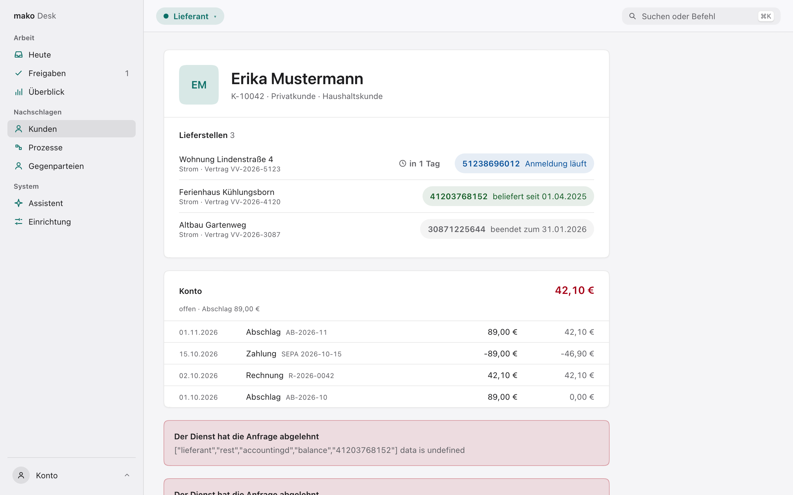](kunde-light.png)
[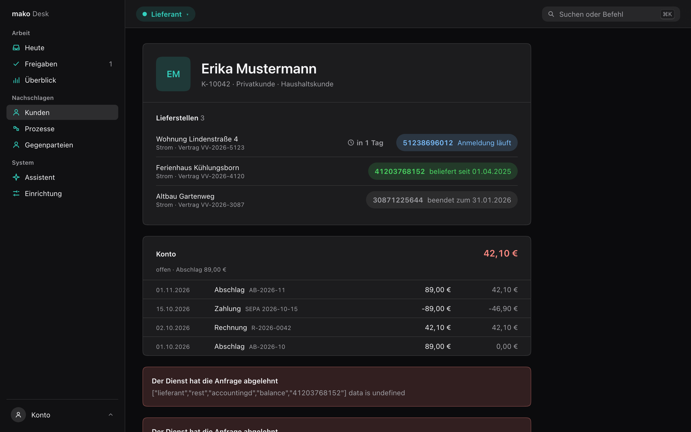](kunde-dark.png)

Auch <kbd>⌘K</kbd> findet Kunden:

[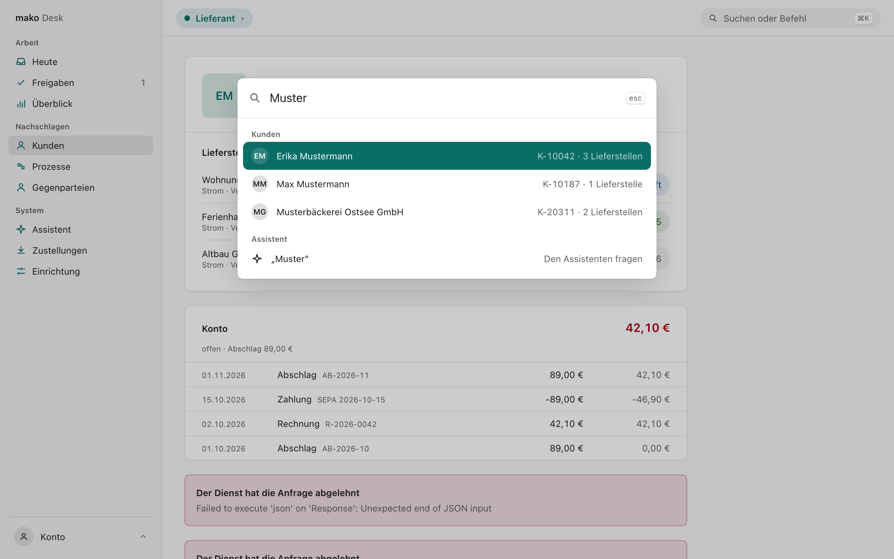](palette-kunden-light.png)
[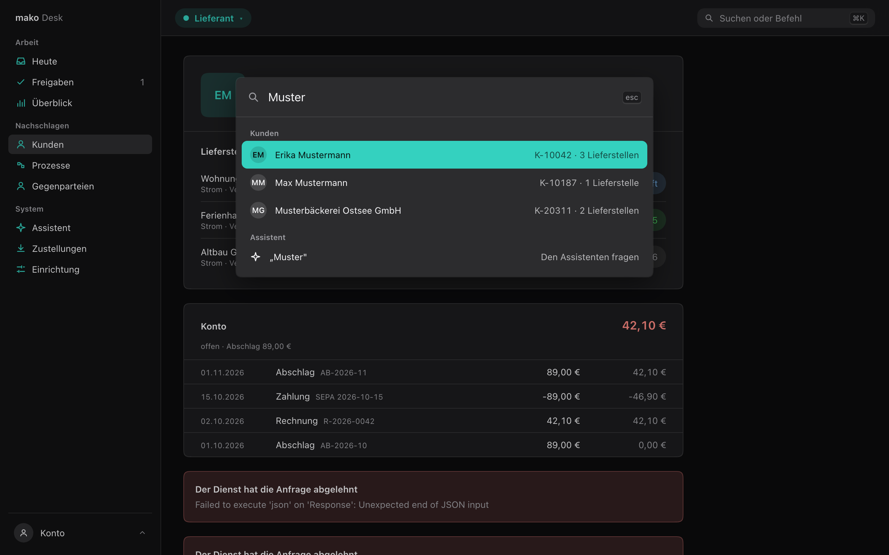](palette-kunden-dark.png)

Eine Frage, die du in die Palette tippst, geht an den Assistenten auf der
Seite, auf der du bist — unter einem Prozess, einem Kunden oder einer
Freigabe — und wird dort beantwortet.

[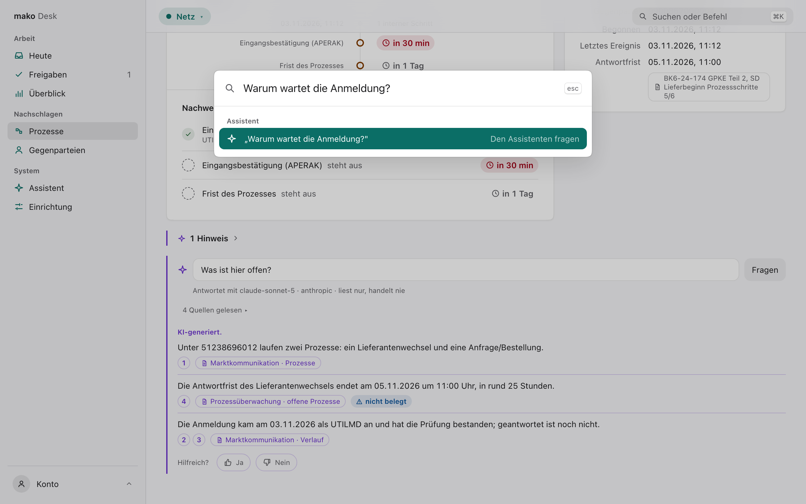](palette-fragen-light.png)
[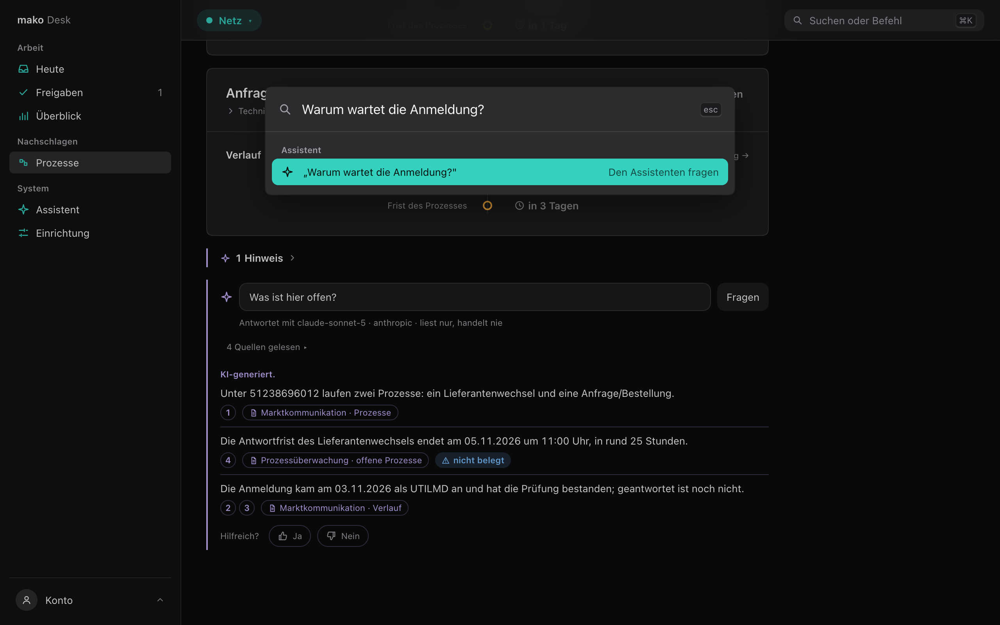](palette-fragen-dark.png)

## Einrichtung: bereit für den Produktivstart

**Einrichtung** öffnet mit der Checkliste des Deployments, so wie die
Marktkommunikation sie aus jedem unter `[[einrichtung.dienst]]` genannten Dienst
zusammenführt (siehe [Einrichtung](@/docs/guide/einrichtung.de.md)): ein Punkt
pro Bereich — Identitäten, Zertifikate, Bilanzierung, Zugriff, Erreichbarkeit,
Formatabdeckung, Konfiguration —, jeder mit seiner Ampel als Symbol und Wort,
und darunter jeder Befund in den Worten des meldenden Dienstes, mit dem Pfad
der Einstellung, einem Link auf ihren Eintrag im Handbuch, wo sie eine
Betreibereinstellung ist, und dem Quellen-Chip der Regel. Ein Dienst, der nicht
gefragt werden kann, ist **nicht erreichbar** — unbekannt, nicht fehlerhaft;
antwortet einer mit etwas anderem als einem Bericht, wird die Antwort so
gezeigt, wie sie kam. Die Liste fragt alle 15 Sekunden und auf **Jetzt prüfen**
erneut; jede Farbe und das Ergebnis oben stammen vom Dienst.

[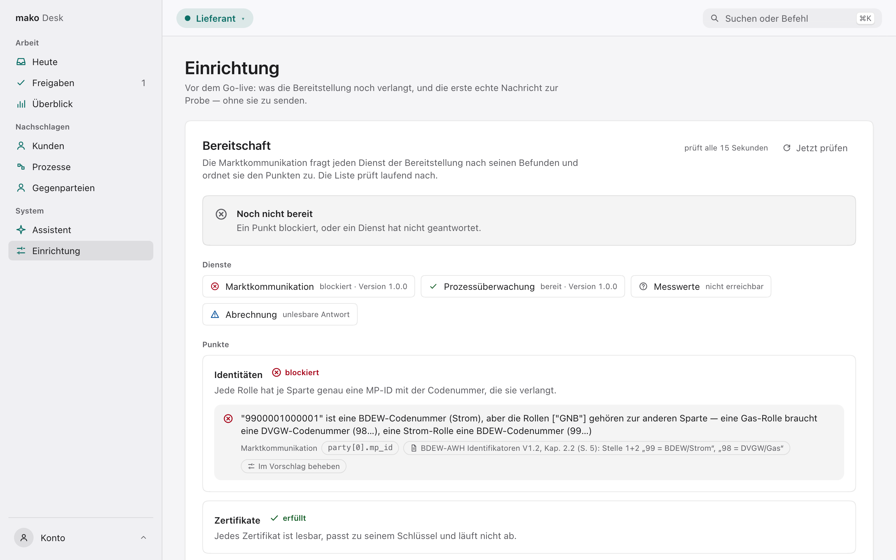](einrichtung-light.png)
[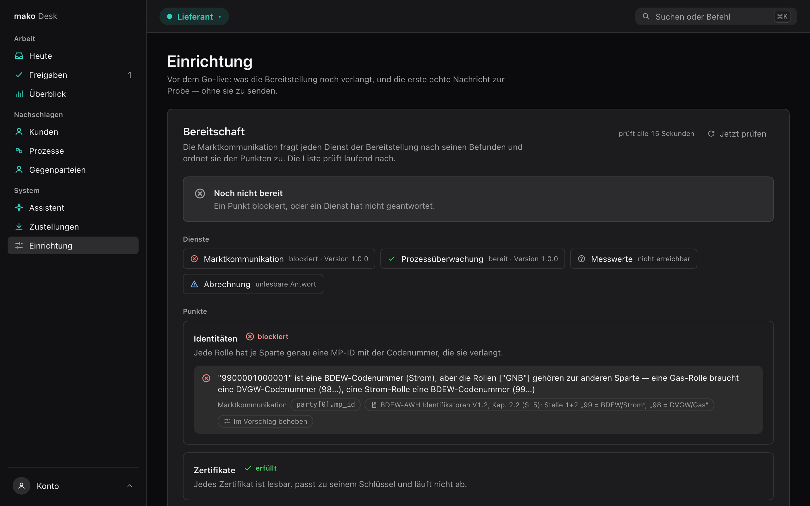](einrichtung-dark.png)

## Die Konfiguration vorschlagen lassen

Unter der Checkliste fragt **Vorschlag**, was die Konfiguration braucht, und
sonst nichts: die Rollen, die das Deployment spielt, und die MP-ID jeder Rolle,
die primäre MP-ID, wo es mehrere gibt, die Bilanzkreise eines Lieferanten je
Sparte, die verbundenen Lieferanten, das AS4-Schlüsselmaterial als Dateipfade
und wo die anderen Dienste laufen. Er beginnt bei dem, womit das Deployment
schon läuft. Daneben schlägt die Marktkommunikation eine Datei pro Dienst vor —
`makod.toml`, `processd.toml` —, jede Zeile gegen das Geladene als **neu**,
**unverändert** oder **entfällt** markiert, unter der Regel oder dem Dokument,
das sie erfüllt; eine Angabe, die niemand gemacht hat, ist eine **Lücke**
(`# FEHLT:`), deren **Zur Frage** zu der Frage springt, die sie füllt, und eine
Antwort, die eine Regel bricht — eine Gas-Rolle unter einem `99…`-Code,
Schlüsselmaterial statt eines Pfads —, wird mit ihrer Quelle abgelehnt.
**Kopieren** und **Herunterladen** geben die Datei heraus; auf einen Server wird
nichts geschrieben.

**Aus einem Satz** liest einen Satz — „Wir sind Lieferant Strom und Gas, Strom
unter 9900357000004" — in vorgeschlagene Antworten, jede mit **Übernehmen**
oder **Verwerfen** angeboten; eine MP-ID, die nicht im Satz steht, wird nie
angeboten. Ohne den Assistenten funktioniert die Befragung genauso. Ein Befund
in der Checkliste, dessen Behebung eine Antwort ist, bietet **Im Vorschlag
beheben** an.

[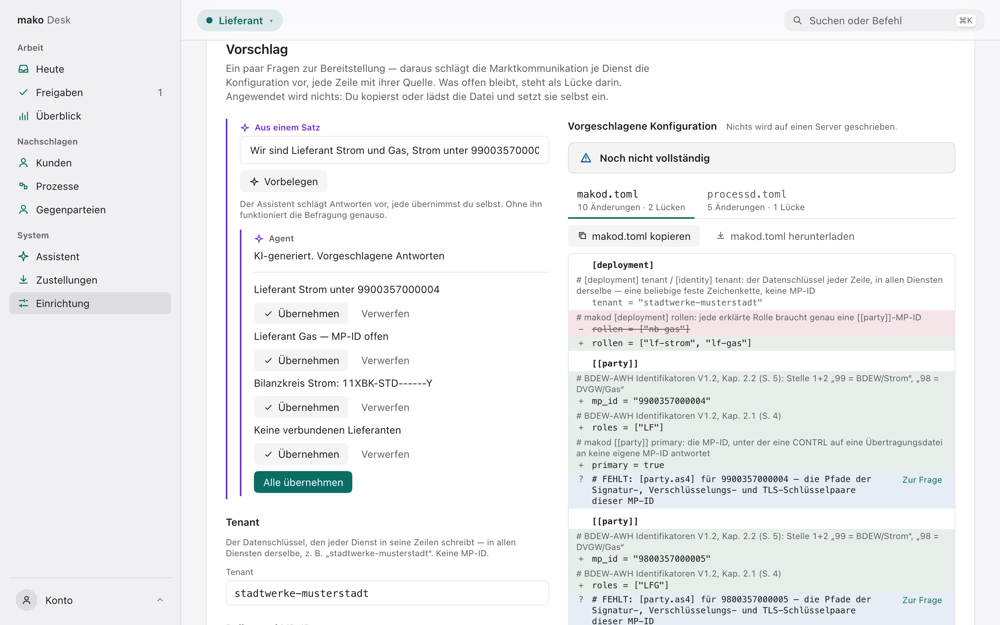](einrichtung-vorschlag-light.png)
[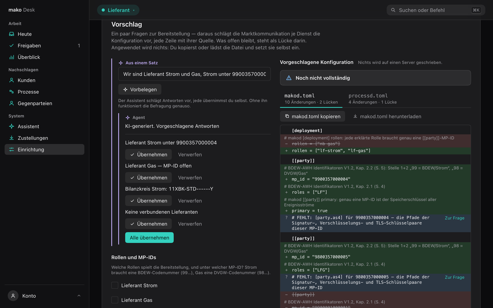](einrichtung-vorschlag-dark.png)

## Eine Nachricht vor dem Produktivstart proben

Unter dem Vorschlag liegt der Probelauf: Wähle eine der Nachrichten, die ein
Lieferant als Erstes sendet — Anmeldung, Abmeldung oder Kündigung, Strom
(55001, 55004, 55016) oder Gas (44001, 44004, 44016) —, prüfe die Angaben, die
mit den Beispielwerten der Profile beginnen, und starte mit <kbd>⌘↵</kbd>. Die
Marktkommunikation baut die Nachricht durch dieselbe Tür, die eine echte nimmt,
hält sie gegen ihr Profil und die Prüfung vor dem Senden und **sendet und
speichert nichts**.

Die Antwort ist ihre eigene: **Besteht**, oder **Abgelehnt** mit der Ablehnung,
die der echte Befehl bekäme — bevor es eine Nachricht gab, oder durch die
Prüfung der gebauten. Darunter die Nachricht selbst, Segment für Segment:
Position, Tag und MIG-Nummer, der AHB-Name der Stelle unter dem Profil der
eigenen Formatversion der Nachricht (über dem Raster genannt) und der Inhalt,
wobei das Datenelement, das ein Befund nennt, an seiner Stelle markiert ist und
der Befund darunter steht. Eine Liste der Befunde setzt den Fokus auf jedes
Segment; die Pfeiltasten bewegen sich durch das Raster; der Interchange, wie er
gesendet würde, lässt sich kopieren. Einen Befehl, den das Deployment nicht
proben kann, oder eine Marktrolle, die es nicht erklärt, lehnt der Dienst in
seinen Worten ab.

[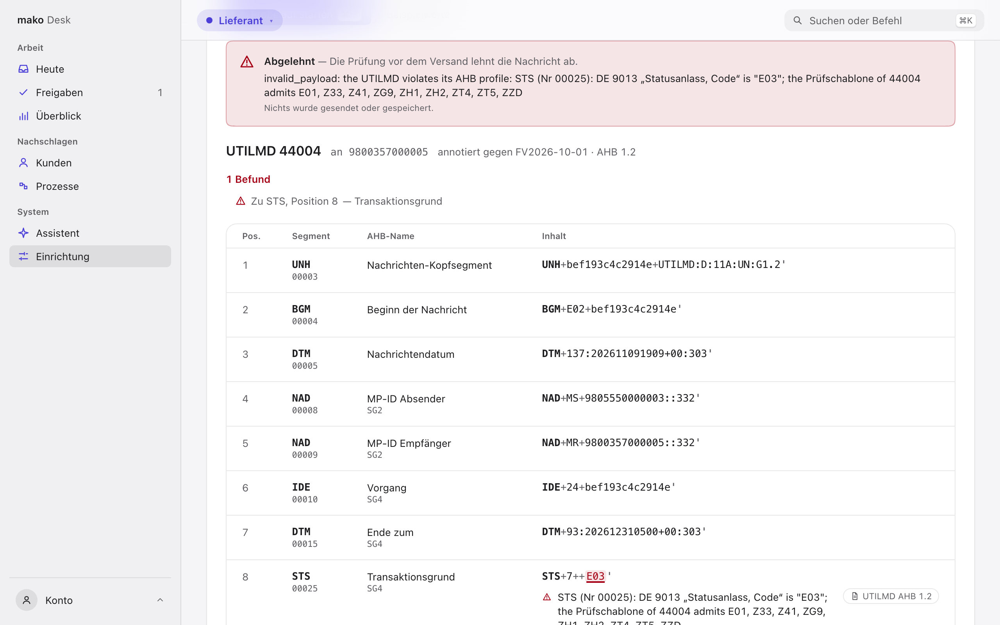](probelauf-light.png)
[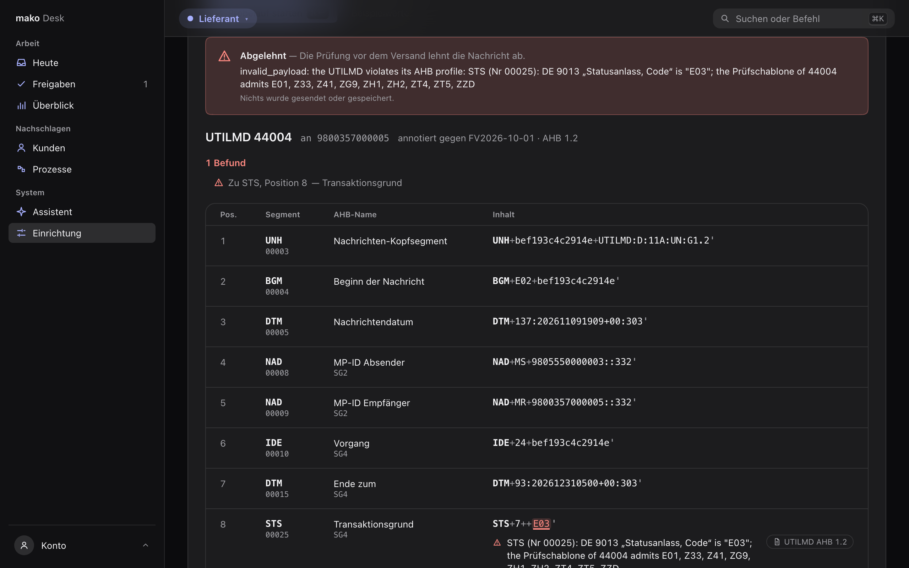](probelauf-dark.png)

## In Telefonbreite

Unter 768 px klappt die Seitenleiste weg: Der Button am Anfang der oberen Leiste
öffnet sie als Sheet über der Ansicht, und esc, ein Tippen daneben oder eine
Auswahl schließt sie, mit dem Fokus zurück auf dem Button. Die Seitenleiste
gruppiert die Ansichten unter **Arbeit**, **Nachschlagen** und **System**. Die
Suche schrumpft auf ihr Symbol, eine Listen-Detail-Ansicht zeigt immer nur
einen Bereich, und keine Ansicht scrollt seitwärts.

[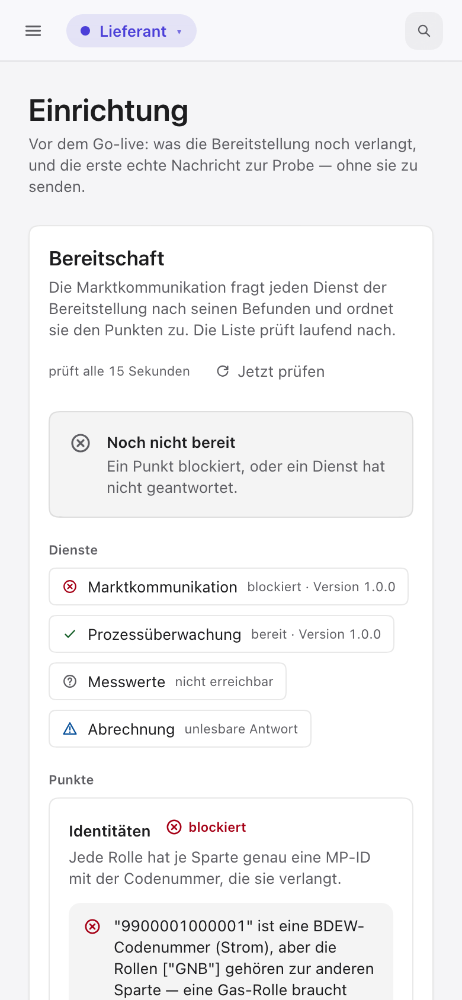](telefon-einrichtung-light.png)
[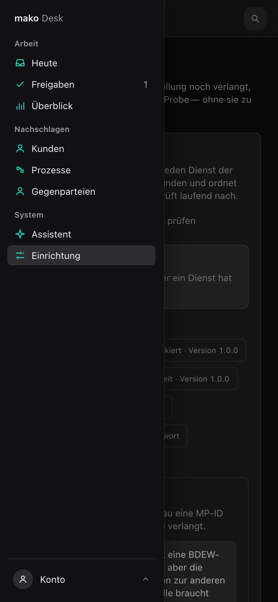](telefon-ansichten-dark.png)

## Eine Rolle zur Zeit

Wer mehrere Marktrollen innehat, trägt immer eine zur Zeit — **Netz** (NB),
**Lieferant** (LF), **Messstelle** (MSB), **Energieservice** (ESA) —, gewählt in
der Werkzeugleiste oder mit <kbd>⌃1</kbd>–<kbd>⌃4</kbd>. Jede hat ihre eigene
Akzentfarbe und Startseite; beim Wechsel bleiben keine Daten der verlassenen
Rolle sichtbar. Was eine Rolle lesen darf, ist die Cedar-Policy des jeweiligen
Dienstes.

[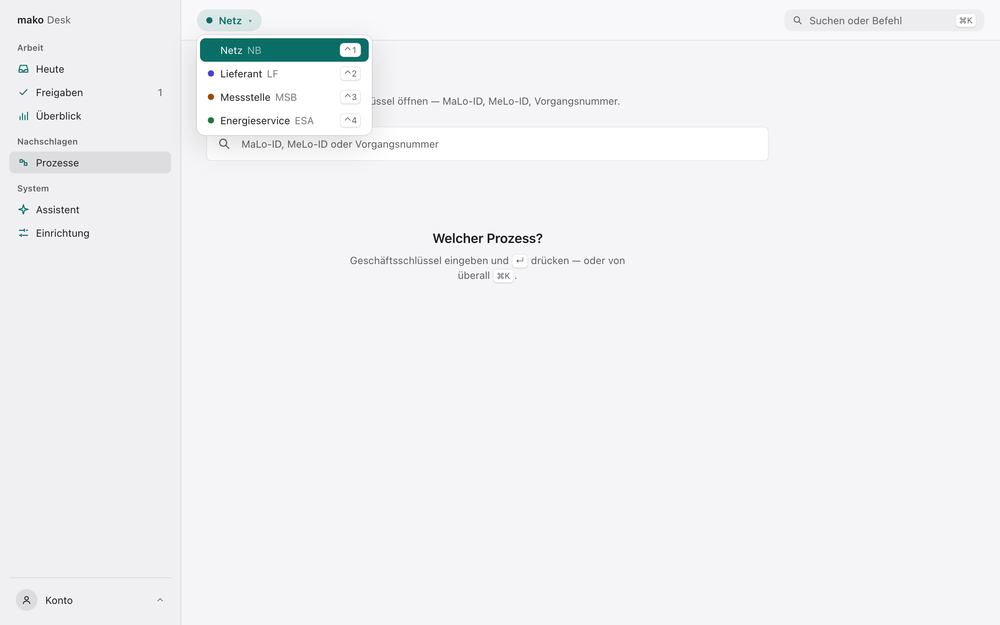](rolle-light.png)
[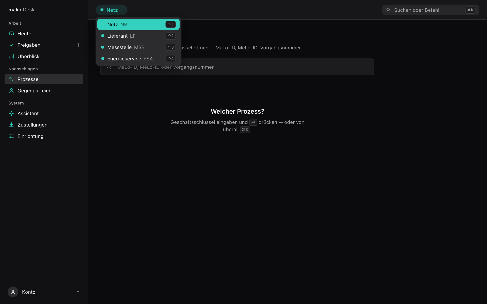](rolle-dark.png)

## Du und deine Tasten

Dein Name steht unten in der Seitenleiste. Sein Menü zeigt die Marktrollen, die
du innehast, und stellt das Erscheinungsbild ein — System, Hell oder Dunkel —
und die **Sprache**, Deutsch oder English; beides wird in diesem Browser
gespeichert. Auf Englisch bleibt das Vokabular des Markts deutsch — MaLo, Frist,
Antwortfrist, PID, APERAK, die Namen der Fundstellen, Marktpartner-ID, die
Prozessnamen —, weil es das Wort ist, das die Festlegungen und die Gegenseite
verwenden. Datum und Zahlen folgen dem Stil der Sprache (`02/11/2026, 11:00`
auf Englisch), und jeder Zeitpunkt ist weiterhin Berliner Zeit. Jede Ansicht,
⌘K, die Tastaturübersicht, die Namen der Rollen und Dienste und die Frage, die
der Desk dem Assistenten stellt, sprechen die gewählte Sprache; was ein Dienst
schreibt — ein Befund, eine Ablehnung, ein Grund —, erscheint in seinen eigenen
Worten. <kbd>⌘/</kbd> listet von überall jede Taste, auf die der Desk reagiert.

[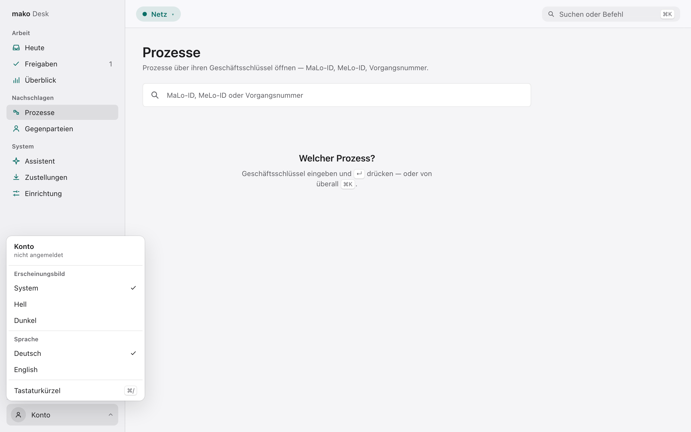](konto-light.png)
[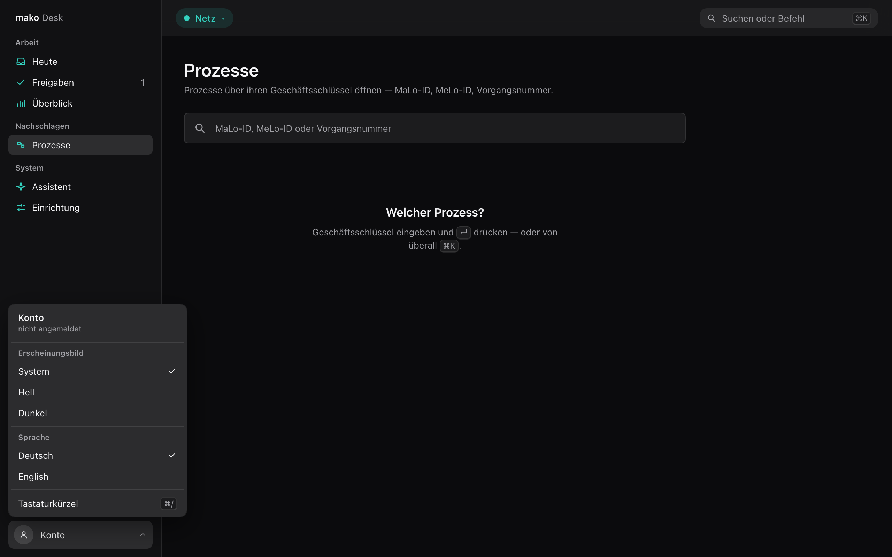](konto-dark.png)
[](tastatur-light.png)
[](tastatur-dark.png)

## Was der Desk nicht tut

- **Eine Frist, einen Werktag, einen Betrag oder ein Ergebnis berechnen** —
  alles davon auf dem Bildschirm stammt vom Dienst.
- **Einen Betrag runden oder ein Datum verschieben** — beides bleibt genau so,
  wie der Dienst es gesendet hat, in Berliner Zeit.
- **Daten zeigen, die er nicht typisieren kann** — eine Ansicht liest nur Tools,
  deren Antwort eine deklarierte Form hat.
- **Entscheiden, wer handeln darf** — er bietet jede Aktion an, und die Policy
  des Dienstes antwortet.

## Das Designsystem

Jede Ansicht sitzt in einem Seitencontainer, am Anfang ausgerichtet mit einem
Rand, in einer von zwei Breiten — Lesebreite (≈720 px) für eine
dokumentartige Ansicht, Arbeitsbreite für eine Liste oder ein Raster —, damit
ein Titel zwischen den Ansichten nie springt. Die Schrift folgt der macOS-Skala
(Large Title 26 pt bis Caption 11 pt, nur Regular und Semibold); ein Status ist
getönter Text auf seiner eigenen blassen Fläche, und die einzige volle Fläche
ist der eine primäre Button. Was der Assistent geschrieben hat, ist aufrechter
Text hinter einer dünnen violetten Linie und seinem Funkeln.

`/dev/gallery` (Entwicklungs-Builds) zeigt jedes Farb-Token, die Schriftskala,
jeden Status und jedes Bedienelement in jedem Zustand, hell und dunkel
nebeneinander — die Seite, auf der eine Designänderung geprüft wird. Die
Screenshots auf dieser Seite stammen aus dem Produktions-Build.

[](gallery.png)

## Für Entwickler

| Befehl | Was er tut |
|---|---|
| `just dev` | jeder Dienst, der Seed und der Desk mit Hot Reload |
| `just dev-ui` | der Desk allein auf seinen aufgezeichneten Antworten (`desk/fixtures`) |
| `just desk-gen` | `services/*/mcp.snapshot.json` aktualisieren und die Typen des Desks neu erzeugen |
| `just desk-check` | erzeugte Typen aktuell, `tsc`, Biome, Vitest — Teil von `just ci` |
| `just desk-screenshots` | die Screenshots auf dieser Seite neu erzeugen |
| `just desk-budgets` | die Interaktionsbudgets im Browser messen (unten); nicht Teil von `just ci` |
| `just desk-axe` | axe-core über Spur, Beleg, Pille und Aktionsbereich von ⌘K des Assistenten; nicht Teil von `just ci` |

`cargo xtask check-desk` hält die ersten beiden Regeln, die
`mcp.snapshot.json` jedes Dienstes die dritte. Die Screenshots erzeugt
`desk/scripts/screenshots.ts`: Vite liefert den Desk aus, die Antworten jedes
Dienstes sind aufgezeichnete Antworten im Schema, das er deklariert, der Stream
von agentd ist ein aufgezeichneter Lauf, die Browseruhr ist fest und die Zone
ist Europe/Berlin, sodass jeder Lauf dieselben Bilder zeichnet.

Der Stream des Assistenten wird ohne agentd und ohne Modell getestet:
`desk/fixtures/run-*.jsonl` sind aufgezeichnete Läufe, ein Stream-Ereignis pro
Zeile, so wie agentd es sendet (beantwortet, gestoppt, ein Lesevorgang mit
verborgener Quelle, ein verspätet gesendeter erster Schritt, eine Antwort, die
lange genug zurückgehalten wird, um die Spur zu fotografieren), in Vitest von
`desk/src/test-support/aufzeichnung.ts` in den Desk eingespielt und für einen
Browserlauf von `desk/scripts/aufzeichnung.ts` als echter Event-Stream
ausgeliefert.

`just desk-budgets` misst drei Budgets in Chromium gegen den Produktions-Build,
mit dem Stream von agentd aus den aufgezeichneten Läufen, jedes am
95. Perzentil von 20 Läufen:

| Interaktion | Budget |
|---|---|
| erster gestreamter Schritt, nachdem die Frage gesendet wurde | ≤ 1 s |
| die ⌘K-Aktionen eines Eintrags, nachdem er gewählt wurde | ≤ 100 ms |
| eine per Tastatur getroffene Entscheidung, in ihrer Ansicht und in ⌘K | ≤ 100 ms INP |

Bevor es misst, beweist es, dass es scheitern kann: `run-verspaetet.jsonl`
sendet seinen ersten Schritt 1,5 s zu spät, und das erste Budget muss ihn
namentlich ablehnen. `just desk-axe` erreicht Spur, Beleg, Pille und
Aktionsbereich allein per Tastatur, hell und dunkel mit reduzierter Bewegung,
und scheitert an einem ernsten oder kritischen axe-Befund, einer laufenden
Animation, einem Bedienelement, das Tab nicht erreicht, oder einer
Quellenangabe, die beim Fokussieren von unten unter der oberen Leiste bleibt.
Der Desk-CI-Job führt beide nach `just desk-check` aus.

`desk/AGENTS.md` enthält die Regeln für die Arbeit am Desk.
