+++
title = "The Desk"
description = "mako Desk, the operator's web UI: processes by business key, every Frist in Berlin time, one market role at a time — on the agents' typed MCP tools."
weight = 3
+++
**mako Desk** is the operator's work surface. It reads the services' MCP
tools — the same typed read surface the agents are granted — and renders what
they answer. It computes nothing that decides: every Frist, amount and verdict
on screen is the one a service returned.

[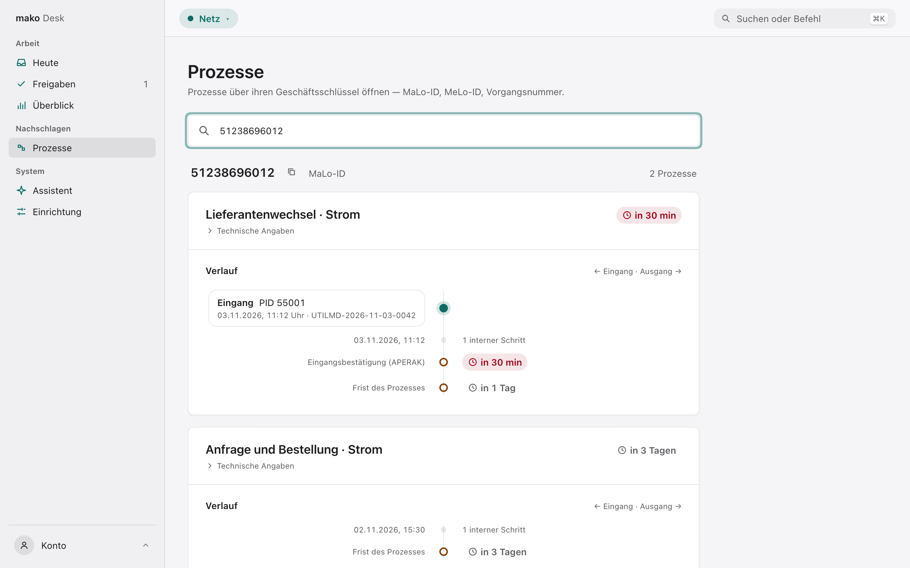](prozesse-light.png)
[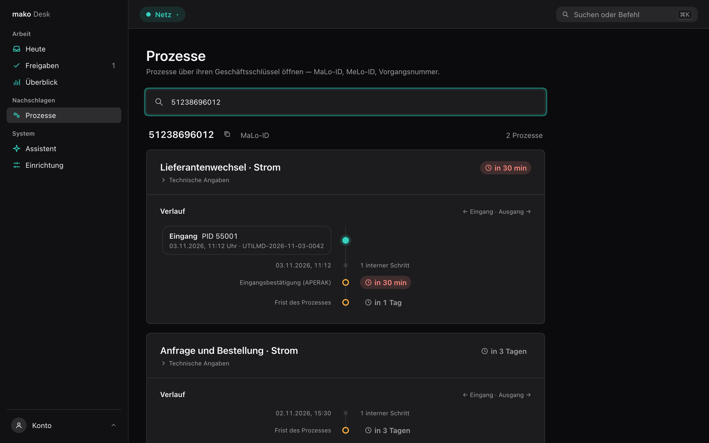](prozesse-dark.png)

## Run it

```sh
just dev
```

starts every service, the seeded Stadtwerk and the Desk with hot reload on
`http://localhost:5173`; `just dev-ui` runs the Desk alone on its recorded
answers.

In production the Desk is the `mako-desk` image — the static bundle on port
8080 — behind [oauth2-proxy](https://oauth2-proxy.github.io/oauth2-proxy/) as
the gateway. The browser talks to one origin and holds no service token: the
gateway signs the person in by OIDC, serves the Desk, and forwards
`/svc/<service>/` to each service the Desk reads — makod, processd, vertragd,
invoicd, billingd, edmd, netzbilanzd and agentd — with the person's access
token as `Authorization: Bearer`. `desk/deploy/gateway.yaml` is the
gateway's routing, ready to adapt.

Each service verifies that token as it does any other, so its
`[oidc] audience` must be in the token's `aud` — an audience mapper at the
identity provider, or one audience shared by all of them. Cedar decides what the
person may do; the Desk keeps no role map. Its CSP allows the bundle's own
script and stylesheet only, plus a per-request nonce for the styles React
Aria injects.

The Desk reads one file at runtime, `/config.json` beside the bundle. It holds
`handbuch`, the address of the operator manual a finding's settings link
opens (default `https://hupe1980.github.io/mako`). Mount your own file over
`/usr/share/nginx/html/config.json` to point it at a manual you host; a
missing file or a value that is not an `https:` or same-origin address keeps
the default.

## A process, by its business key

Type a MaLo-ID, MeLo-ID or Vorgangsnummer on **Prozesse**, or anywhere press
<kbd>⌘K</kbd> and type it: the palette offers to open it directly.

[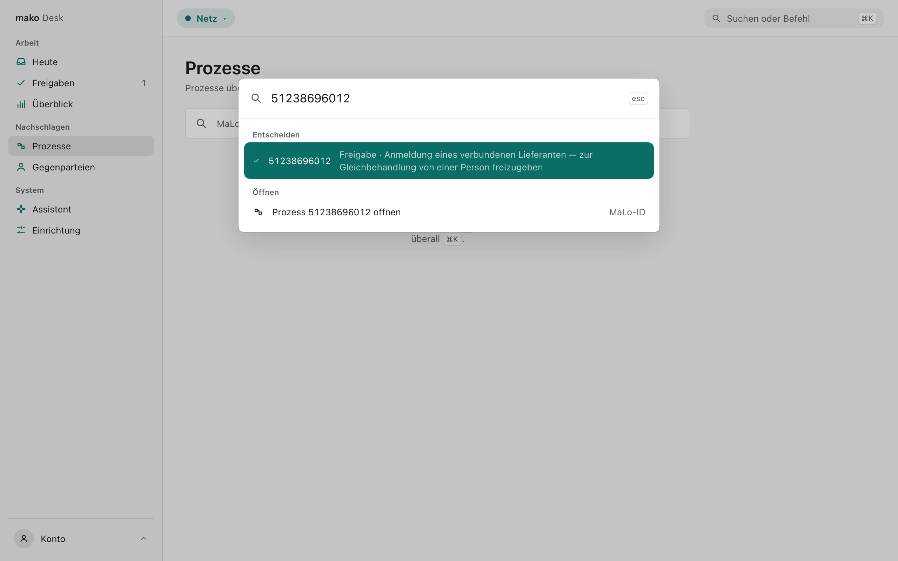](palette-light.png)
[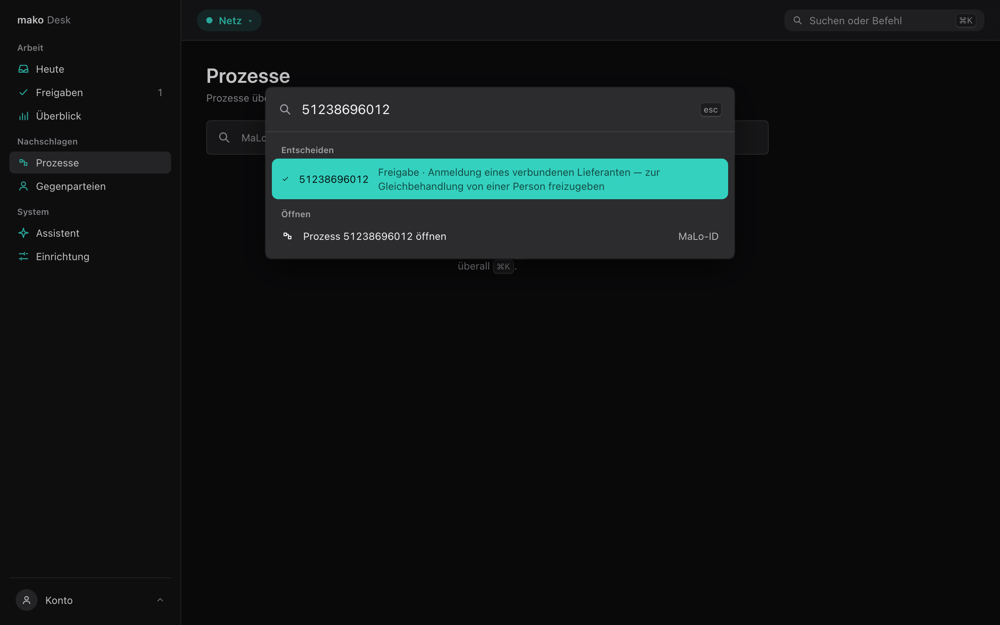](palette-dark.png)

A key can name several processes — a Lieferantenwechsel beside an
Anfrage/Bestellung. They stand as a row of links above the page, ordered by
their earliest pending Frist, the first one open; a process the person's role
may not read is left out.

Every process page reads top to bottom the same way:

- **The head.** The path back to Prozesse, the title the way an operator says
  it — „Lieferantenwechsel · Strom" — with the Prozessüberwachung's state
  beside it („läuft", „abgelehnt"), one line of facts (MaLo, PID, the
  Gegenpartei as the Marktstammdaten name it, the process family), and the
  next pending Frist large on the right, named for what it is.
- **The steps.** Every market message the history records, ticked; then what
  is still awaited — an APERAK, a CONTRL, the answer — for each Frist still
  pending; then the end, ticked once the Prozessüberwachung states one. The
  Desk reads no step off an event's name.
- **The decision bar**, only while the Prozessüberwachung holds a Freigabe for
  this process: „Wartet auf deine Entscheidung", its reason, the
  Entscheidungsbaum as its source and one button, **Entscheiden**, which opens
  the same decision as Freigaben and Heute — held for undo, the market message
  included. A process with nothing to decide has no bar.
- **Verlauf and Nachweise** on the left, **Details** on the right — the
  workflow and its ids, the family, the Gegenpartei's MP-ID, when it began, the
  Antwortfrist with its Festlegung as the source. Once the Marktpartner has
  answered, the details name its Antwortcode with the BDEW's wording from the
  list the answer named, that list as the source; a code the catalogue holds
  no wording for stands with its list and no meaning.

The **Nachweise** are a chain: each message of the process one row, ticked
with its time and document number when the history records it; an APERAK the
Prozessüberwachung recorded with an error code is a row with a warning, not
ticked; and every message a pending Frist still waits for is an open row with
its Frist-Uhr. A missing APERAK is the row that is not ticked.

**Stand** — the slider over the Verlauf — shows the process as it stood at any
of its recorded events: the Verlauf, the steps and the Nachweise up to that
event, „Stand zu 03.11.2026, 11:12" above them. The Fristen pending now are
left out of an earlier Stand, because they say nothing about it. It is the
same read, fewer rows.

Its **Verlauf** threads the market messages: received on the left, sent on the
right, each with PID, Berlin time and document number, as the workflow
recorded them. An answer also states its code and the BDEW's wording from the
list that defines it („A02 — Marktlokation … nimmt nicht an der
Marktkommunikation teil"); where that list publishes no wording for the code,
the line names the list alone. Steps between two messages fold into one quiet
row („2 interne Schritte"). Pending Fristen close the thread, each named for what it is — an
„Eingangsbestätigung (APERAK)", a „Syntaxquittung (CONTRL)" or a „Frist des
Prozesses". Under each step stands who caused it, as makod recorded it:
„automatisch", „von einer Person", or — in the assistant's colour, because a
proposal was involved — „freigegeben, Vorschlag unverändert" or „freigegeben,
Vorschlag geändert".

The **Frist-Uhr** says how far a deadline is: plain while it is far, amber
inside a day, red inside two hours and once it has lapsed — tinted text, never
a solid badge; amber means only that a Frist is near. The time beside it is Berlin time;
hover or focus shows the instant in UTC as the wire carries it.

A key with no process gets a sentence for the Marktkommunikation's refusal
code and one way on — „Neue Suche"; the service's own text waits under
„Details":

[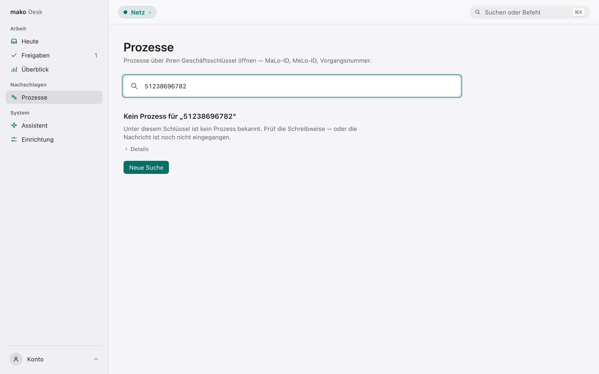](refusal-light.png)
[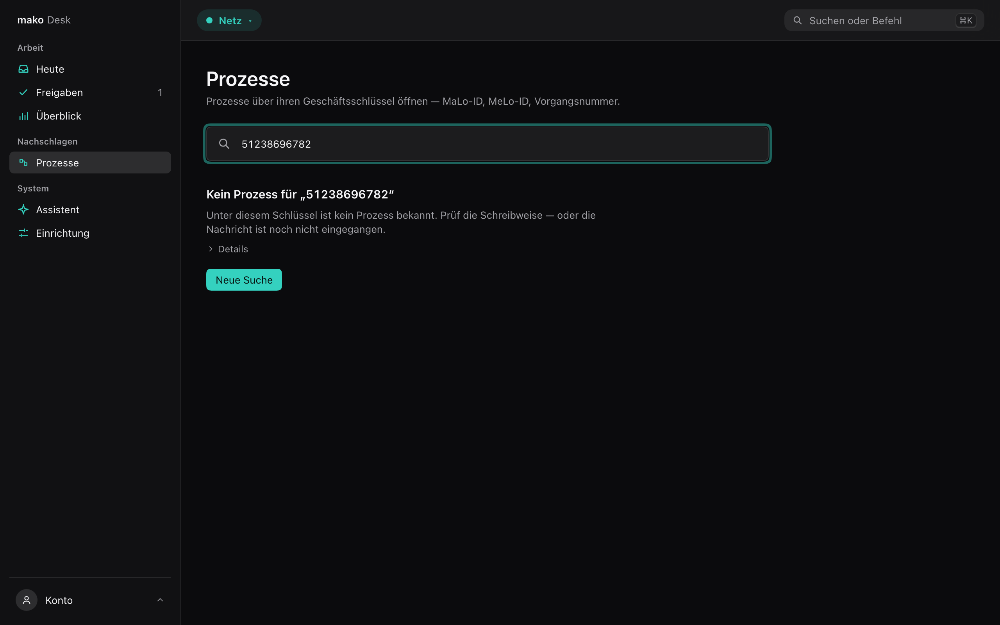](refusal-dark.png)

## Ask the assistant

Under a customer, a MaLo's processes and a Freigabe, the Desk asks the
assistant — type a question, take a suggestion, or press <kbd>⌘J</kbd>. It
reads the same services the screen does and names the model that answers. The
answer opens with „KI-generiert." („AI-generated." in English); the assistant reads and never acts.

**The trail.** Each read the assistant makes appears under the question as a
numbered line the moment agentd journals it — „Verlauf gelesen · Prozess 43991093"
with its source chip — while a hairline runs under the question. A read whose
source you may not see stays, marked „Quelle für dich verborgen"; a call a stop
refused stays muted, marked „nicht beantwortet".

[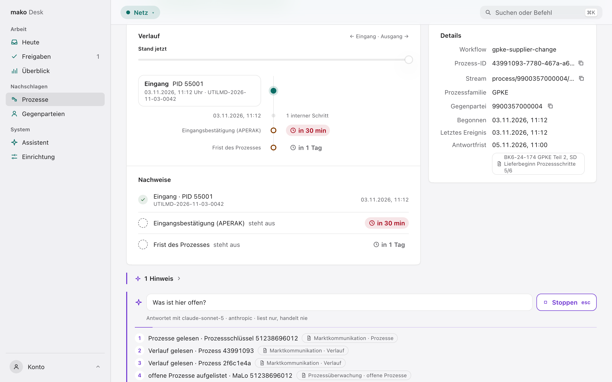](fragen-live-light.png)
[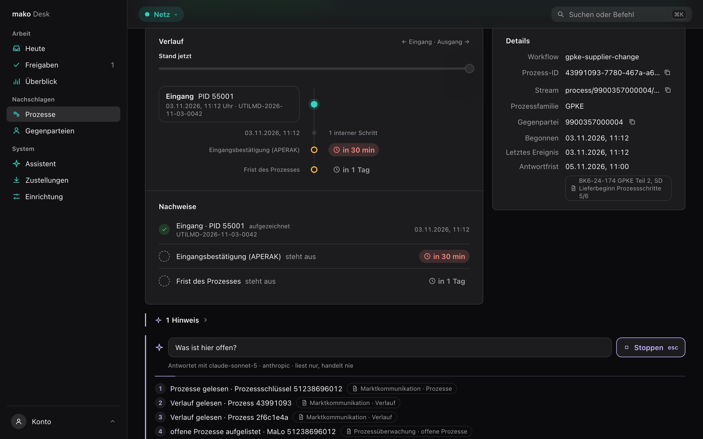](fragen-live-dark.png)

Once the answer stands, the trail folds into „4 Quellen gelesen ▸" — the
reads whose source you can see — and choosing it opens the trail again. A dropped connection resumes the stream
where it broke off, without repeating a line.

**Stop.** While the assistant reads, „Fragen" becomes **Stoppen** in the same
place, and <kbd>esc</kbd> stops too — unless a dialog, a popover or ⌘K is open,
where <kbd>esc</kbd> closes that first. agentd stops the run at its next step,
so nothing more is spent on it; the reads it already made stay, each marked
„abgebrochen". Stopping is always safe: the assistant never sends, so a
stopped run leaves no half-made decision. Only the person who asked can stop a
run here.

**The evidence.** Each sentence carries the numbers of the trail's lines it
rests on. Focusing or hovering a number outlines every row on screen that
shows what that read returned — the Verlauf of the process it read, say — and
<kbd>↵</kbd> on it opens the trail on that line.

[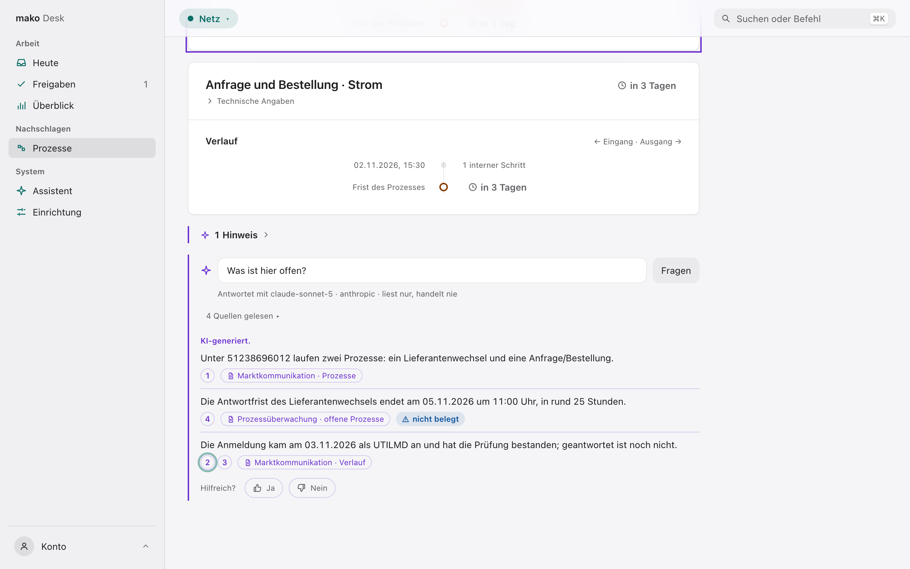](fragen-light.png)
[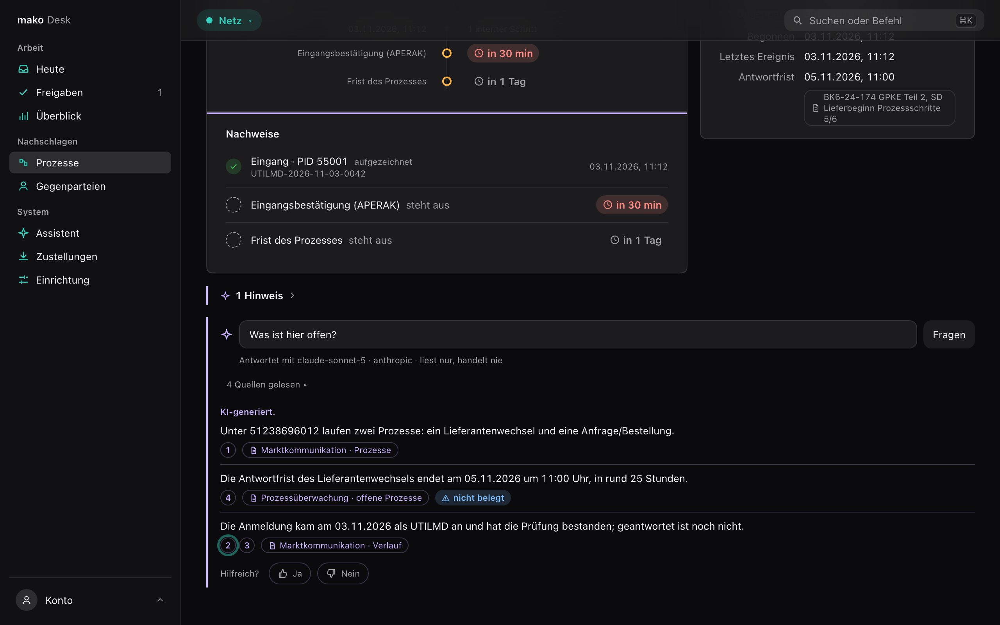](fragen-dark.png)

**The run comes along.** Leave the page while the assistant reads, and the
question rides along as a pill in the top bar with its latest read, newest
first, „Antwort bereit" once it has answered. Choosing the pill returns to the
question; once you have seen the answer there, the pill is gone.

[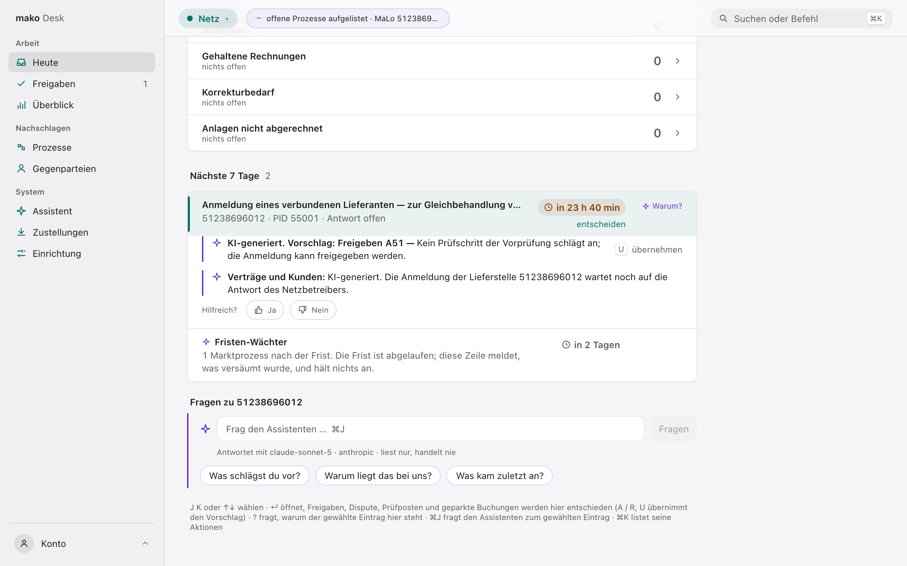](pille-light.png)
[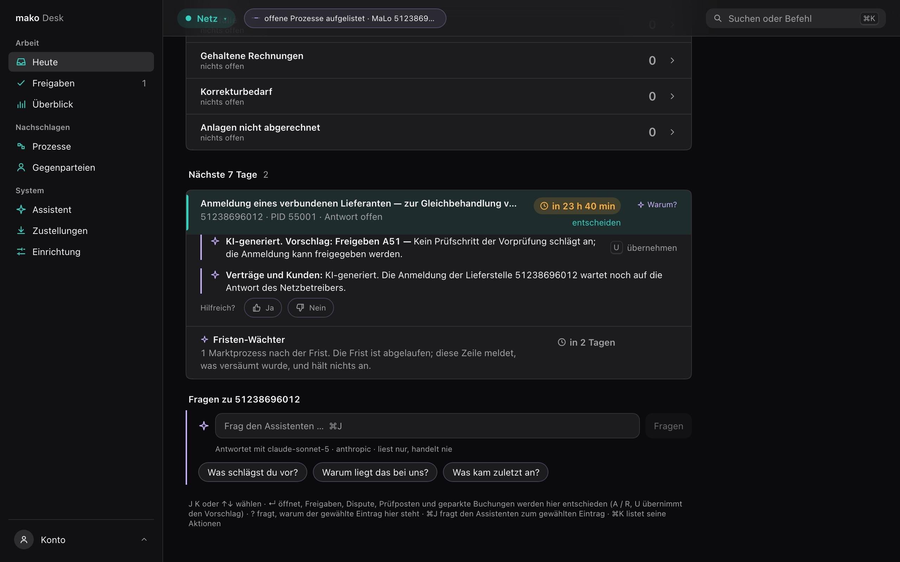](pille-dark.png)

It answers in at most five sentences, each with the read it rests on, and each
checked before it is shown: every MaLo-ID, date, time and amount in it must
appear in that read's answer. One that does not is marked **nicht belegt** —
typically a figure the model worked out itself, such as „noch 25 Stunden".
The check says the figures are in what it read, not that its reasoning is
right.

If it finds no answer, „Nochmal fragen" asks again. When the assistant is not
running, the panel is not shown and the rest of the Desk works as before.
Where agentd's stream cannot be read, the panel reads the answer once the run
has concluded, lists the services it read under it („Gelesen: …") and says why
if agentd refuses it.

What a skill noticed on its own — a Frist that passed, an Anmeldung that
stalled — arrives as a **Hinweis**: in Heute under the item it concerns, and below the
work on the Überblick, a process and a customer, folded to one line („1
Hinweis") that opens on a press, in the skill's own words (a
model-written one opens with „KI-generiert."). A skill can be muted in one
click and shown again in one; muting is this browser's and deletes nothing.

**Assistent** in the sidebar is each skill's package leaflet, read off the
reviewed description agentd runs: what it is for, whether it is active here,
what starts it — a question or an event — which model it uses or that it uses
none, and which services it may read, each tool's reason on hover. Every skill
only reads: none can send a market message, book or change master data.

Each active skill's card also carries its record over the last 30 days, as
agentd counts it: how many runs it made, how often a person found its answer
„hilfreich", and what became of its proposals — **übernommen** (sent as
proposed), **angepasst** (changed before sending) and **verworfen**. A share
is shown only from five verdicts up; below that the card gives the count alone
(„2 Bewertungen"), and a skill nobody has rated yet says „Noch keine
Bewertungen", never 0 %. The record informs your judgement of a proposal; it
never decides one.

[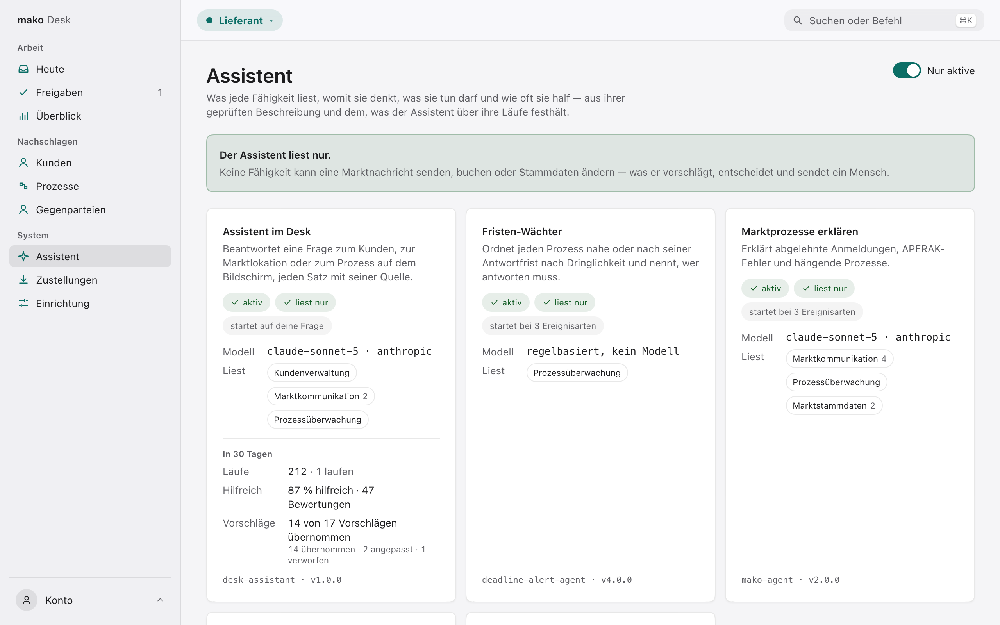](assistent-light.png)
[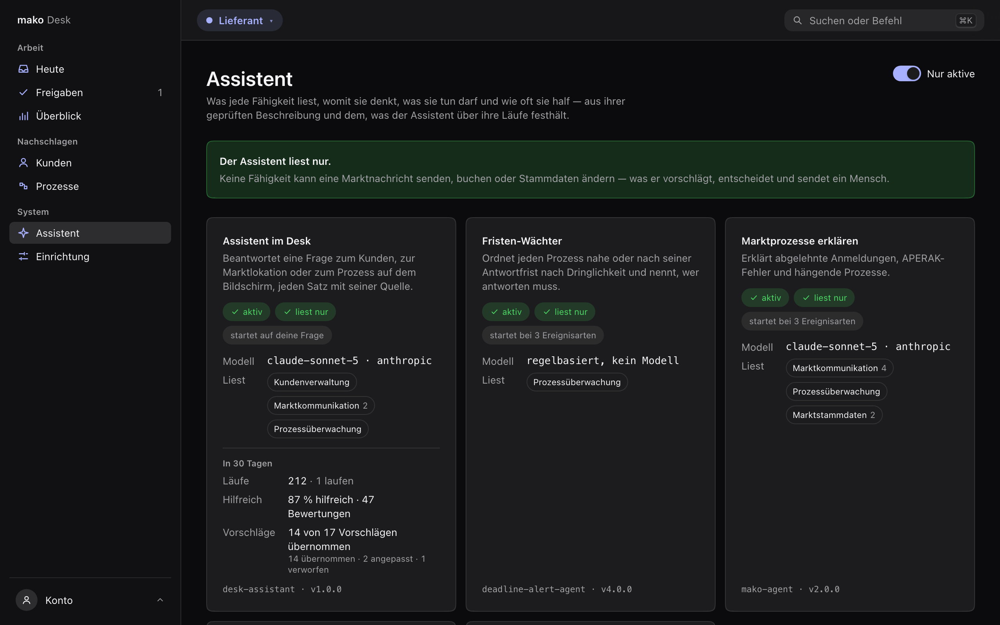](assistent-dark.png)

## Freigaben

Some answers the Prozessüberwachung does not send on its own: an Anmeldung of
an affiliated supplier held for a person, or a case its Entscheidungsbaum
could not settle. **Freigaben** lists them for the Rolle you wear, the
earliest Frist first; the sidebar shows how many wait.

Before you decide, the Freigabe shows what approving would send: the
Prozessüberwachung rehearses the decision, and the Marktkommunikation renders
the message with its AHB names — or says it cannot render it ahead, and shows
the body instead. The approval names that body by its hash, so a decision is
never sent for a body you were not shown. Where the Marktkommunikation cannot
render the message, the assistant's proposal is not taken in unchanged — you
decide yourself — and the Prozessüberwachung refuses a decision its check
did not pass, which the Freigabe says in words, with the rule it broke.

Each opens with its reason and its Frist. A held answer says which Antwortcode
it will send; an open one asks you for the code, and the form offers only the
codes its Entscheidungsbaum defines, each with its published wording. An
E/G Bestätigung whose Bilanzkreis, Versorgungsart or Abrechnungsintervall the
Prozessüberwachung could not resolve asks for each beside the code, offering
the values processd lists for its segment; nothing is sent until they are
given. The process's Verlauf is beside it. Every decision sends a market message; what it
sends is said beside the button, the decision is held for five seconds before
it goes (see [Taking a decision back](#taking-a-decision-back)), and it is
recorded under your name.

<kbd>J</kbd> and <kbd>K</kbd> step through the list, <kbd>A</kbd> chooses
Freigeben and <kbd>R</kbd> Ablehnen; <kbd>↵</kbd> on the button sends — held,
never asked about. When a
colleague decided the same Freigabe first, the Desk says who and when, and
yours is not sent. Any other refusal is shown in the Prozessüberwachung's own
words; one its policy makes stands where the controls were until the tab is
closed.

The assistant proposes a decision for every Freigabe as it is queued — an
action, a code and one sentence why, marked „KI-generiert." and checked like
every sentence it writes. It stands at the top of the decision; <kbd>U</kbd> or
„In die Entscheidung übernehmen" fills the form and sends nothing. Where it has
not proposed one, ask it „Was schlägst du vor?". Whether you sent a proposal as
it was, changed it or dismissed it is kept beside the assistant's run, and every
proposal card ends with that record: „In 30 Tagen: 14 von 17 Vorschlägen
übernommen" (from five decided proposals; below, the count alone).

[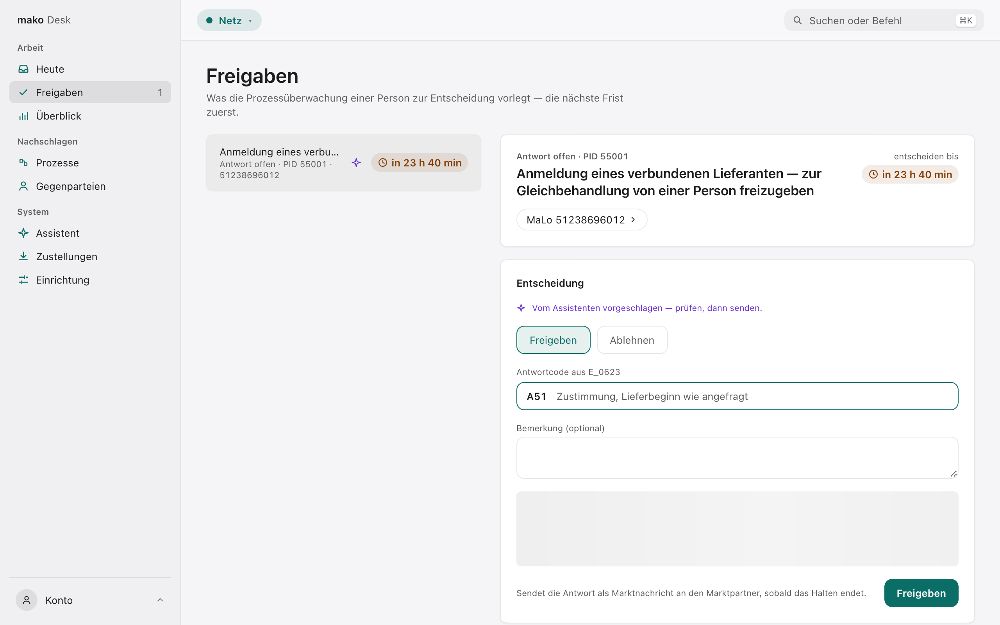](freigaben-light.png)
[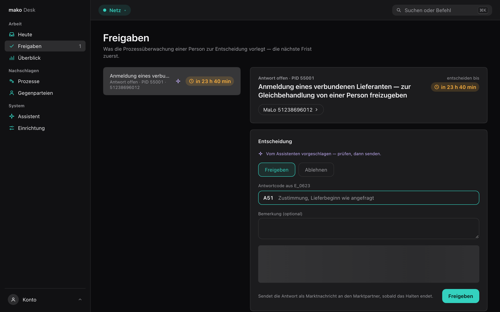](freigaben-dark.png)

## Taking a decision back

Every decision — a Freigabe, a Rechnungsdisput, a held invoice, a geparkte
Buchung, „Hilfreich?" under an answer, „Verwerfen" on a proposal — shows at once
and leaves the browser five seconds later, in its view as in ⌘K. None asks for
confirmation, a market message included. Until it leaves, a ring counts the hold
down on its entry, a toast offers „Rückgängig", and <kbd>⌘Z</kbd> takes back the
newest; nothing was sent, so nothing needs reversing. Closing the tab sends
whatever is still held. A refusal after the hold stands in the service's words
on the entry, with the form back as you sent it.

[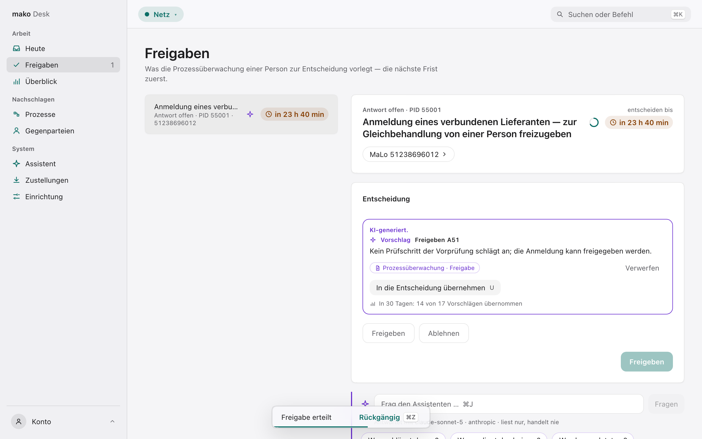](gehalten-light.png)
[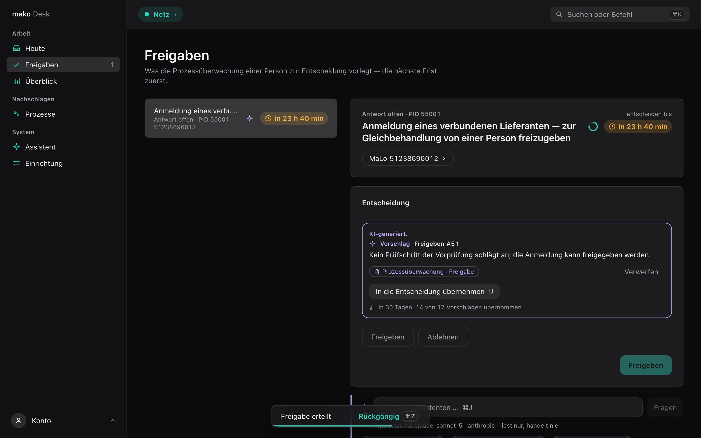](gehalten-dark.png)

## Acting from ⌘K

<kbd>⌘K</kbd> decides what it finds without opening its view. Type the
identifier of an open decision — a MaLo, a process, a Freigabe, a
Rechnungsnummer, a Beleg — and the palette lists, under **Entscheiden**, the
Freigaben, Rechnungsdispute, Prüfposten and geparkten Buchungen it names
among those Heute lists for the Rolle you wear. Pressed on a focused Heute
row or with a Freigabe selected, ⌘K opens on that entry's actions directly.

An entry lists exactly the actions the Desk offers for it, as its view does:
Freigeben and Ablehnen on a Freigabe, Beilegen and — while the refusal has not
gone out — Ablehnung senden on a Rechnungsdisput, Freigeben or Geprüft on a
Prüfposten, Neu buchen and Verwerfen on a geparkte Buchung. Typing filters
them; <kbd>↵</kbd> chooses the first, <kbd>⌘↵</kbd> the second, the arrows
any; <kbd>esc</kbd> goes back a step. An action the service refused you this
session stands in its words and cannot be chosen. ⌘K reads no free text into
an action: a question goes to the assistant.

Choosing an action opens its parameters in the palette, never in a dialog,
with the Frist beside them: the Antwortcode as a choice of the codes its
Entscheidungsbaum publishes, each with the wording the Prozessüberwachung
returns, the facts a Freigabe still needs, and the Bemerkung, Grund or
Buchungsdatum. A refusing verb is drawn
red and asks nothing more. <kbd>↵</kbd> holds the decision and closes the
palette onto the entry — the Freigabe in **Freigaben**, anything else in
**Heute** — where a ring counts the hold down; <kbd>⌘Z</kbd> takes it back
before anything was sent. The request is the one the entry's own view sends.
When the service refuses it after the hold, its words stand on the entry.

Where the assistant's proposal is waiting, the action it proposes carries
„Vorschlag", and choosing it fills in what the proposal names — the code, the
date, the Grund — tinted and marked by a card that opens „KI-generiert.", says
why, and ends with the assistant's 30-day record. <kbd>Tab</kbd> keeps the
suggestion and moves on; typing replaces it, and the mark is gone once you
change what it filled in. A Bemerkung is never filled in: it is recorded as
your words. A Prüfposten never has a proposal, and with none waiting the
fields open empty. Whether you sent the proposal as it was or changed it is
kept beside the assistant's run, as in the views.

[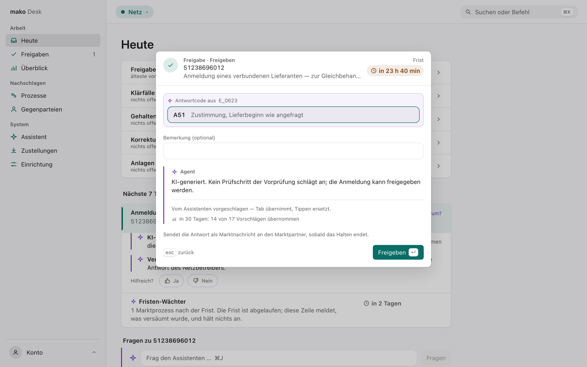](palette-aktion-light.png)
[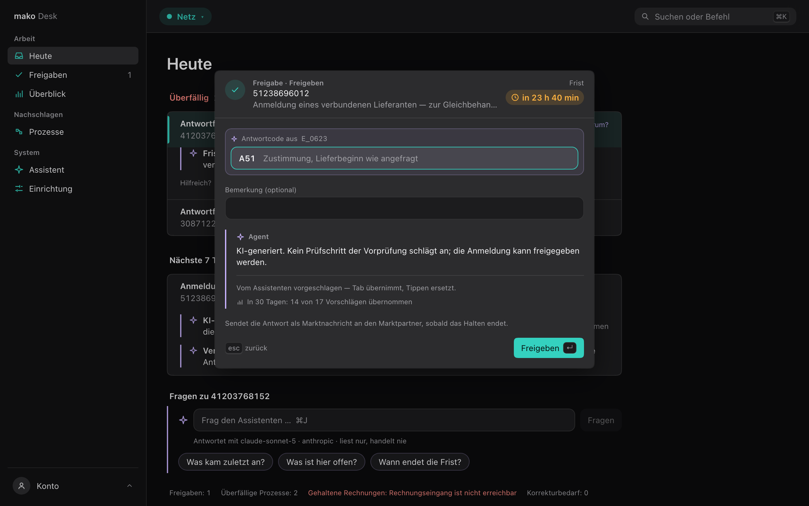](palette-aktion-dark.png)

## Überblick

A few numbers per role for whoever answers for it — each one as its service
returns it, never a sum the Desk works out, and each tile opens the list it
counts. A tile turns red only where the service marks a breach; a
number the service capped shows as a floor („500+").

**Fristen überschritten** lists every open process past its Antwortfrist, as
the Prozessüberwachung has it, each with the Festlegung its deadline came from.
It is laid out like Mail: the list on the left, the selected process with its
Verlauf in the middle, and its Angaben — MaLo, PID, state, when the Frist
ended, the Fundstelle, the Marktpartner-ID, the process id — on the right.
<kbd>↑</kbd> <kbd>↓</kbd> move the selection and the detail follows,
<kbd>↵</kbd> moves into the detail, <kbd>esc</kbd> returns to the row. The
selection is in the address, so a link opens the same process. With less room
the Angaben move under the detail; at a phone's width one pane shows at a time
and „Zurück zur Liste" returns.

**Dead Letters** (Netz) counts every message the Marktkommunikation could not
take or deliver and lists the most recent. The Lieferant also sees
**Rechnungsprüfung**, **Rechnungsdispute** and **Geparkte Buchungen**, the
Messstelle **Ableseaufträge überfällig** — each the same read as its row in
Heute, which a click opens.

**Ohne Eingriff · PID 55001** (the Messstelle: 55039) counts how many of
that PID's processes ended this month with no person among their actors, out
of all that ended — processd's count, with the share only from 20 ended
processes and processd's definition under the number.

Every Rolle sees **Assistent**: the share of the desk-assistant's answers
people found „hilfreich" over the last 30 days — the ratio of agentd's two
counts, and only from five verdicts; below, the count — with what became of
its proposals beneath. It opens the Beipackzettel.

[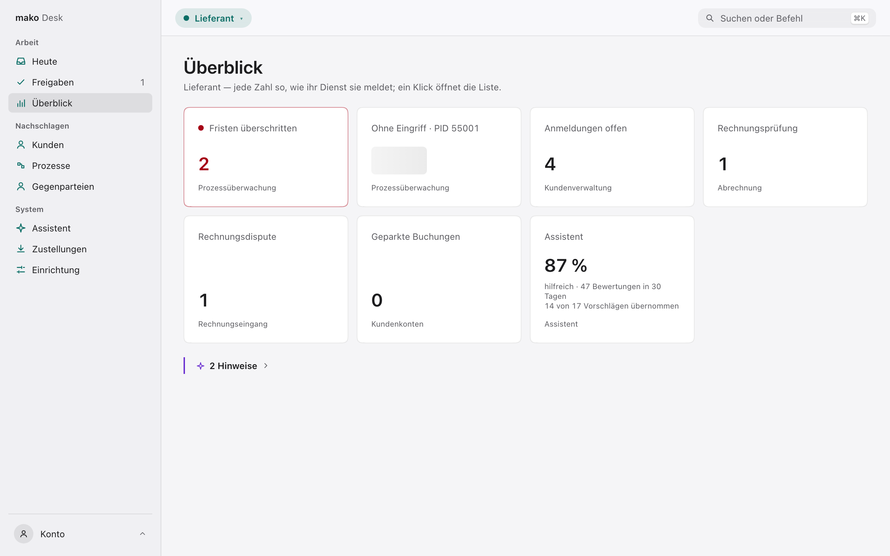](ueberblick-light.png)
[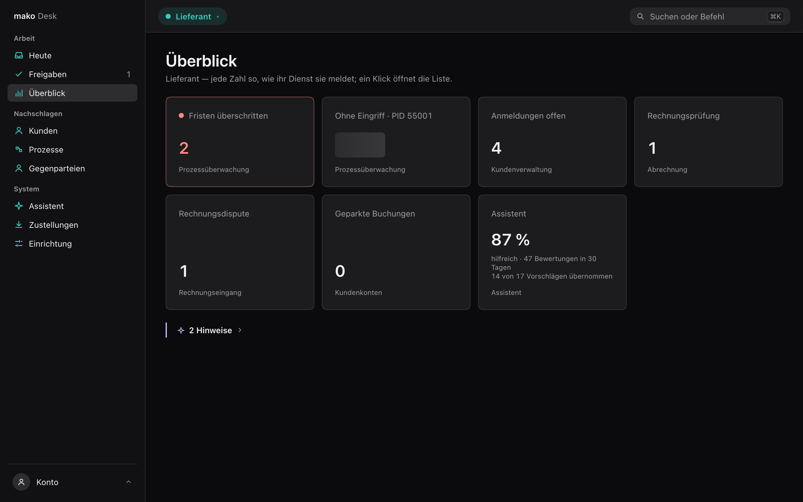](ueberblick-dark.png)
[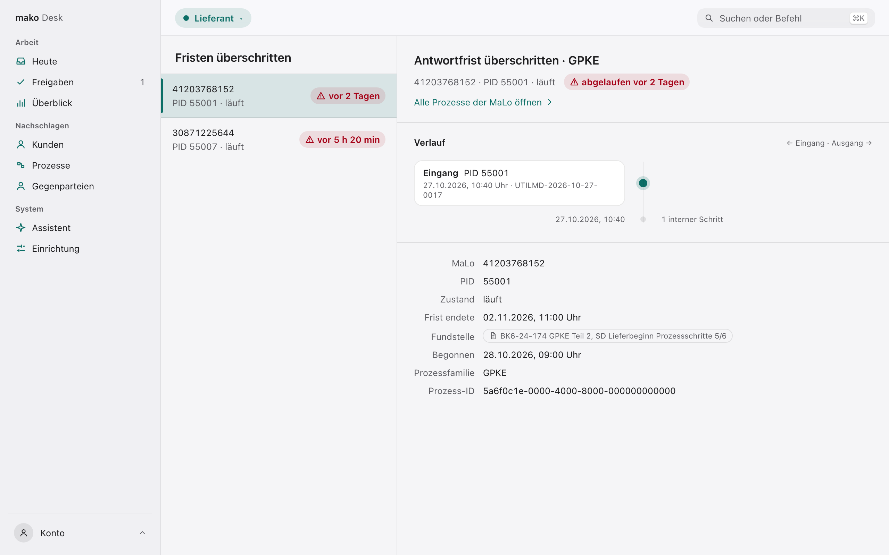](fristen-light.png)
[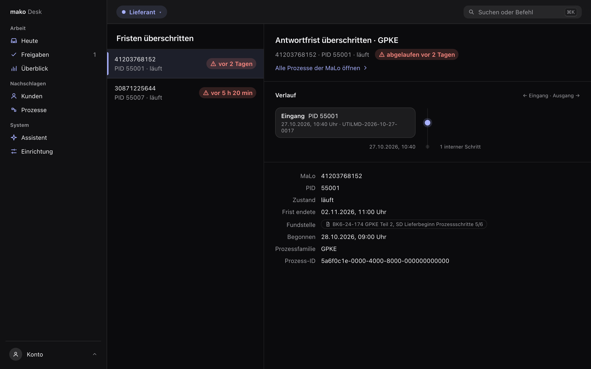](fristen-dark.png)
[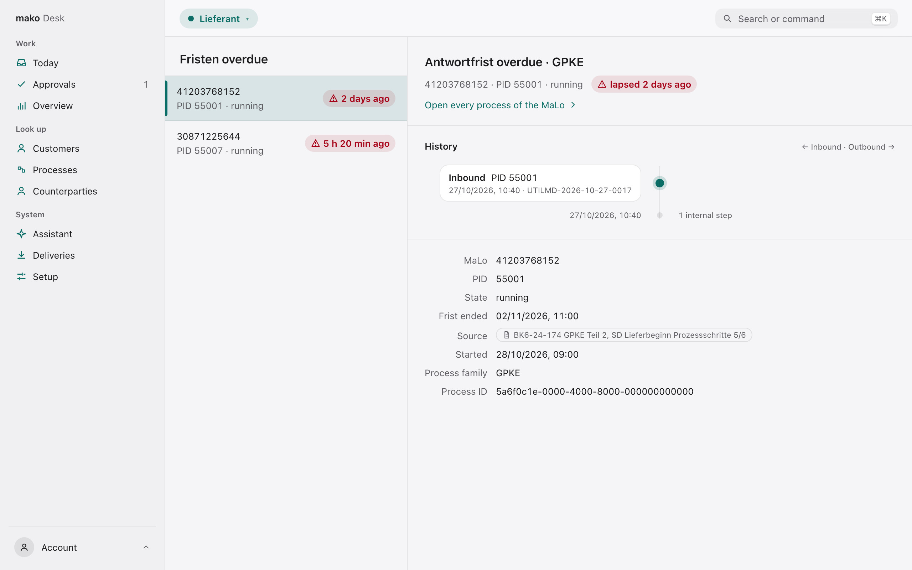](fristen-englisch-light.png)
[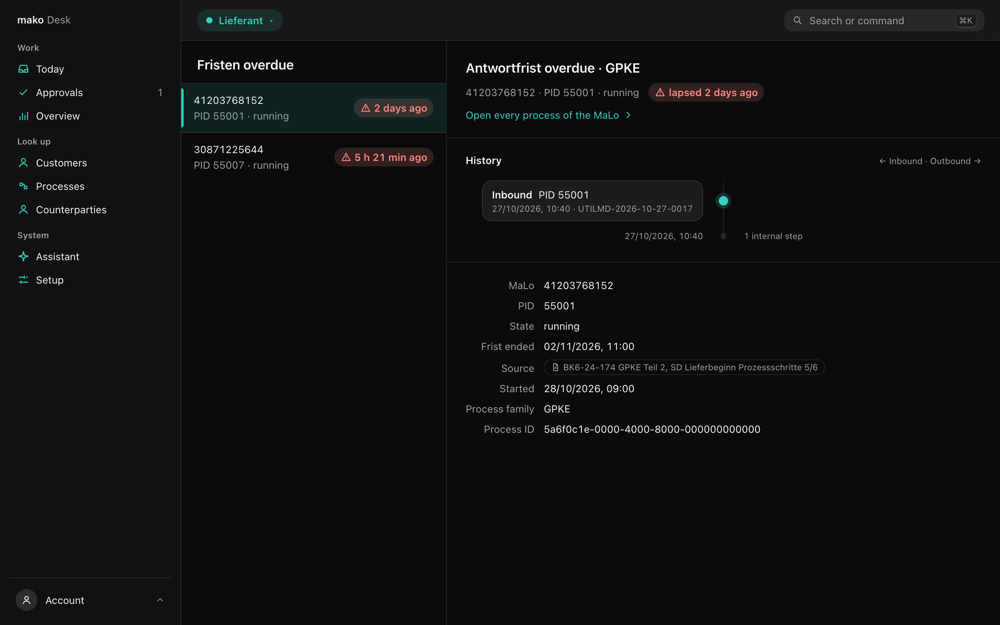](fristen-englisch-dark.png)

## Heute

Every Rolle opens on **Heute**: everything that waits on you, in one list.
Each item is something a service holds open for this Rolle:

| Rolle | What Heute lists |
|---|---|
| Netz | Freigaben, Klärfälle, received invoices held at an open Prüfschritt, Korrekturbedarf after a negative Prüfmitteilung |
| Lieferant | Anmeldungen waiting on the Netzbetreiber, Freigaben, Klärfälle, disputed invoices, received invoices held at an open Prüfschritt, invoices held for review, bookings the ledger refused, Anmeldungen not yet sent, Mahnungen due, billing periods not yet billed — each with the reason in words, its due date and the days left as the Abrechnung counts them |
| Messstelle | Freigaben, Klärfälle, overdue reading orders |
| Energieservice | Freigaben, Klärfälle, received invoices held at an open Prüfschritt |

The list is read in bands — **Überfällig**, **Heute**, **Nächste 7 Tage**,
**Später**, **Ohne Frist** — by the Frist each service returned; the Desk
computes none. A row reads like a mail: what is to be done first, then the
customer or MaLo and the PID, the Frist in one column on the right. A state or
family a service returns is said in the Desk's words („läuft", „GPKE"), never
as its code; an overdue process opens in **Fristen**, where its Fundstelle
stands. A Hinweis that names a process sits under that process's row only.
The section heads stay in view while the list scrolls.

A Freigabe is decided where it stands: <kbd>↵</kbd> opens the decision under
the row — <kbd>A</kbd> or <kbd>R</kbd>, the code, the send, held for undo — and Heute
stays on screen. The assistant's proposal waits under the row;
<kbd>U</kbd> opens the decision with it taken in, unsent.

A disputed invoice is decided there too. Its row names the Rechnungssteller
as the Marktstammdaten register it, with the Rechnungsnummer beneath, and the
decision lists the checker's findings by their German names. **Beilegen**
closes the dispute with your Bemerkung and sends nothing, so it is held for
five seconds behind „Rückgängig"; while the refusal (REMADV) has
not gone out, **Ablehnung senden** sends it, held the same five seconds. The assistant
proposes one of the two with the finding it rests on, „nicht belegt" when the
findings it read do not name it.

A received invoice whose Entscheidungsbaum stopped at a Prüfschritt no record
answers is **gehalten**: no answer went out, and its row, due by the
Zahlungsziel, names the Rechnungssteller and the first open step. The decision
lists every open step; for Prüfschritt 310, 320 and 330 per Position and for
80 it offers the two answers in words, with a required Begründung —
**Feststellen** — and where a Leistung of the invoice's order is open,
<kbd>R</kbd> chooses **Leistungsnachweis** for the order, its Artikel-ID and
period. A step that wants a record rather than a judgement is named, never
asked. Each is held for undo; the Rechnungseingang then checks the invoice
again, and every invoice held on that order with it.

An invoice the Abrechnung's risk check put aside is decided in place as well:
a **held** one is released — which issues it — and one **under review** went
out already, so **Geprüft** takes it off the list; each is held for undo. The assistant proposes neither — the risk check's findings are
the evidence, listed in the decision.

A booking the Kundenkonten' ledger refused for good — a sealed month, an
account not yet open — is a **geparkte Buchung**: its row names the customer,
the amount and the refusal, the decision says what to do about it. **Neu
buchen** books it on the date you enter, filled in with the first open day
where the ledger names one; **Verwerfen** drops it with the Grund you give.
Both are final once sent and recorded under your name; each is held for undo
and asks nothing more, and a refusal is shown in the ledger's words.

The assistant proposes one of the two, with the read it rests on:
**Verwerfen** when the customer's account already carries the same Beleg and
amount — the Grund names that booking — otherwise **Neu buchen** on the first
open day. Opening the decision takes the proposal in, marked as the
assistant's; nothing is booked until you send it and its hold ends. Where the reads do not settle
it, no proposal is shown.

A Korrekturbedarf opens nothing: the Desk has no Netzentgelte view.

A **Klärfall** is one case per cause the Prozessüberwachung opened — a
refused message, a dead letter, a missed Frist. Its row reads as the cause in
the words of the list that defines the code, what to do about it („Korrigieren
und neu senden", „Selbst klären"), and how often it occurred; it is due when
the Prozessüberwachung says. „Warum?" only explains it — the case is closed by
the action, never by the assistant.

On the **Überblick**, „Ohne Eingriff" counts the processes of a PID that ended
this month with no person touching them, as the Prozessüberwachung counts
them: „3 von 13" below 20 ended processes, its share from 20 up, its
definition on the tile.

[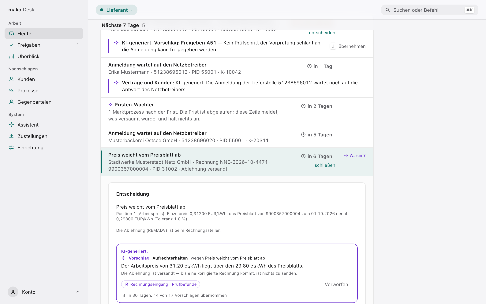](heute-disput-light.png)
[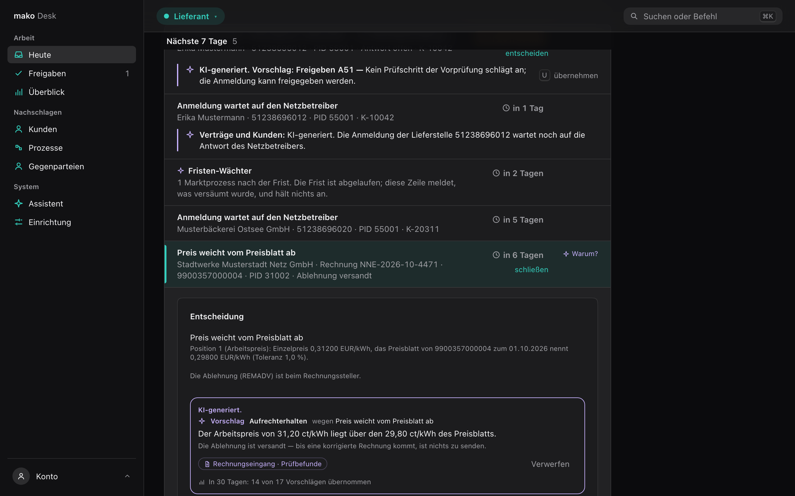](heute-disput-dark.png)

The assistant works in the same list. Its Hinweis on a MaLo or process sits
under that item, „Hilfreich?" beside it while the item has focus; one no item
carries is an item of its own. <kbd>J</kbd> and
<kbd>K</kbd> or the arrows move, <kbd>↵</kbd> opens, and <kbd>⌘J</kbd> asks the
assistant about the item you are on.

**Warum?** — <kbd>?</kbd> on the selected row, or its small button — asks the
assistant „Warum steht das auf meiner Liste, und was entscheidet es?" and
answers under the item, in the same trail and the same checked sentences;
<kbd>?</kbd> again puts it away, <kbd>esc</kbd> stops it. It is offered where the
assistant reads the record that put the item there — a Freigabe, a process, an
Anmeldung, a Rechnungsdisput, a geparkte Buchung, a customer, a Hinweis — and
not on a Korrekturbedarf, an overdue reading order or an invoice under review,
whose sources it does not read. While the assistant is unreachable, „Warum?" is
not offered.

Above the bands the **Arbeitsvorrat** gives each source of the Rolle one row:
its count and — while the service returned the whole list — the day of its
oldest item („älteste vom 22.09.2026"). A source with nothing open keeps its
row with „0"; a source that did not answer says so in its row and shows no
number, because unreachable is not zero — and one unreachable service never
empties Heute. A row opens the source's own view (Freigaben, Fristen) or
narrows Heute to that source. As Lieferant one
**Lage** line heads the page with what the list cannot say — the services'
totals beyond its page, no model in it — and is absent when it would only
repeat the list.

[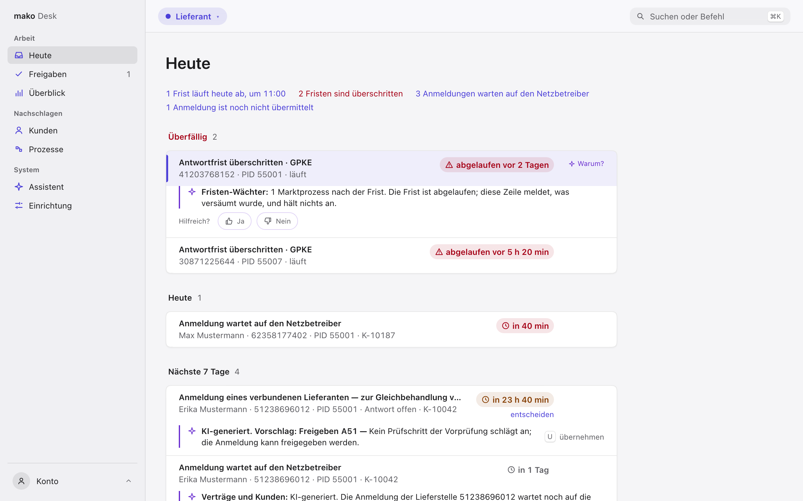](heute-light.png)
[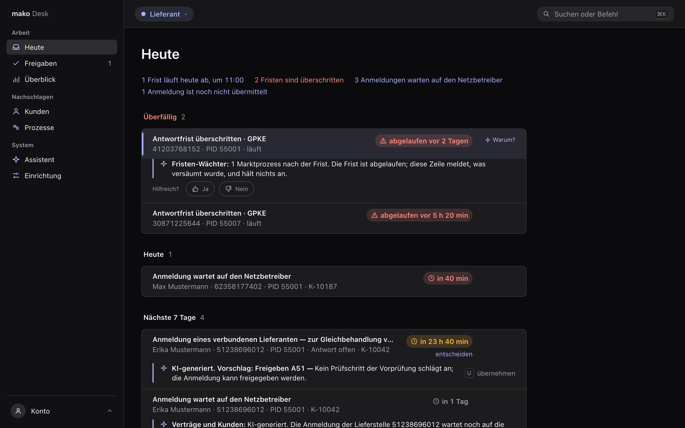](heute-dark.png)

## A Marktlokation, its supply, metering and account

Every MaLo on a process page opens its **Lokation** page, read from the
services' REST API — the same documented API an integrator uses:

- **Versorgung** — one band per state the Marktstammdaten kept, the oldest
  first: Beliefert, Grund- or Ersatzversorgung, unsupplied, each with its
  dates and Lieferant, an announced Zuordnung drawn dashed.
- **Messkonzept** — the Lokationsbündel for today, drawn: the Marktlokation on
  top, its Messlokationen with their Zähler beneath, Netzlokation and
  Ressourcen below, a line for each Zuordnung, the Lokationsbündelcode and the
  day it is resolved for. Two codes in one bündel are named as a contradiction.
- **Messwerte** — a ribbon of the last 30 days, one cell per day as the
  Messwerte service states it (gemessen, Ersatzwert, korrigiert, fehlt), then
  the Lastgang of the last seven days.
- **Konto** (Lieferant) — the balance and the statement with its running
  balance, as the Kundenkonten keep them; the Kunde view shows the same
  Konto for each Lieferstelle.

The Versorgung bands are drawn to the time each state held; the
Lokationsbündelcode carries its BDEW wording; the Messwerte panel adds the
service's quality grade and every correction with its reason; and opened from
a Messlokation (`?knoten=`), the page marks that node in the Messkonzept. In
the Verlauf, each message says who caused it — automatisch, freigegeben with
the proposal unchanged or changed (in the assistant's colour), or a person.

Each panel answers or refuses on its own; one service that does not answer
never empties the page.

[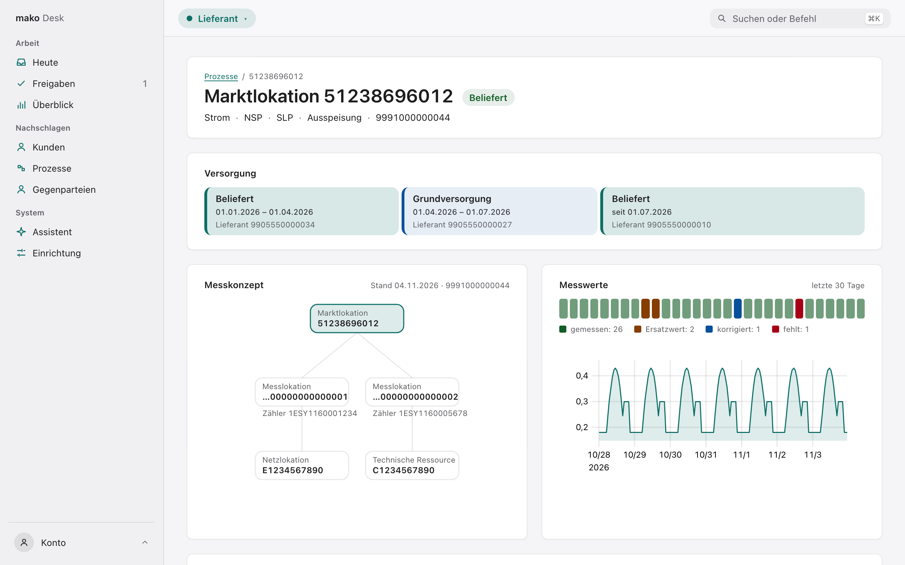](lokation-light.png)
[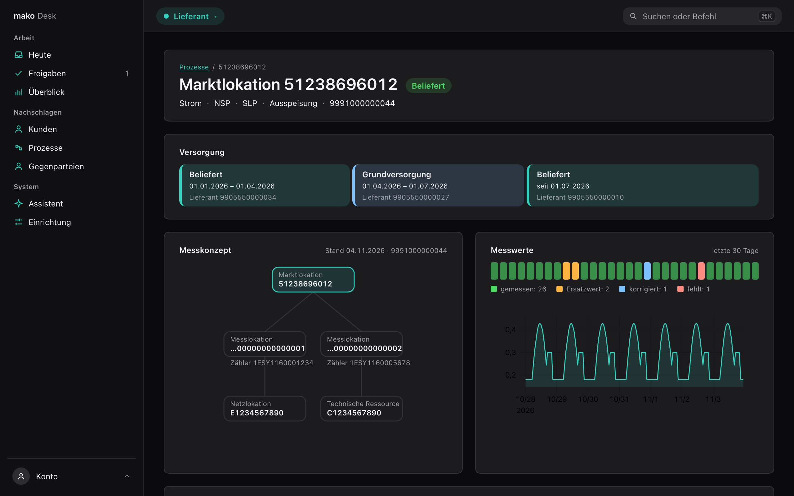](lokation-dark.png)

## Nachrechnen

An invoice under review opens **Nachrechnen**: the Abrechnung recomputes it
from what it was issued from. The verdict leads — „Stimmt überein" with the
amount, or „Weicht ab" naming the line that does not recompute, and whether
the issued invoice's seal still holds — then every line with the quantity and
price it came from, the rule behind it and the arithmetic. None of it is
computed in the Desk.

[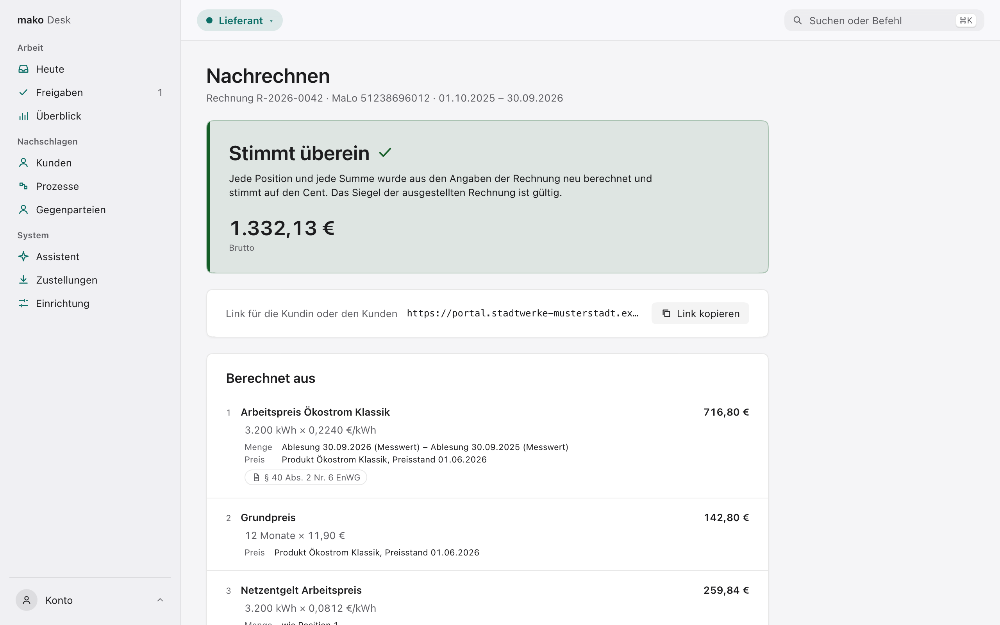](nachrechnen-light.png)
[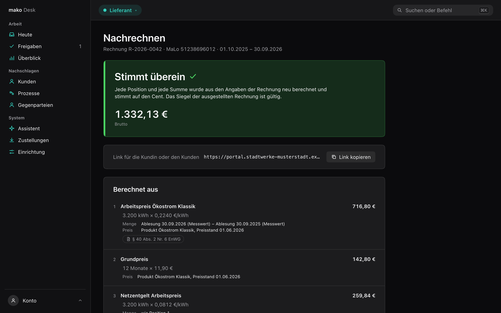](nachrechnen-dark.png)

## Gegenparteien

**Gegenparteien** lists every market partner the Prozessüberwachung counted,
and each opens its record — also from the Gegenpartei on a process page: how
its answers arrived against their Fristen, the share within the Frist only
where the Prozessüberwachung states one (below its threshold the counts
alone), its refusals with the wording of the list that defines each code, and
every process behind a figure. The terms are defined under „Begriffe";
„Als Nachweis exportieren" downloads the record as CSV.

[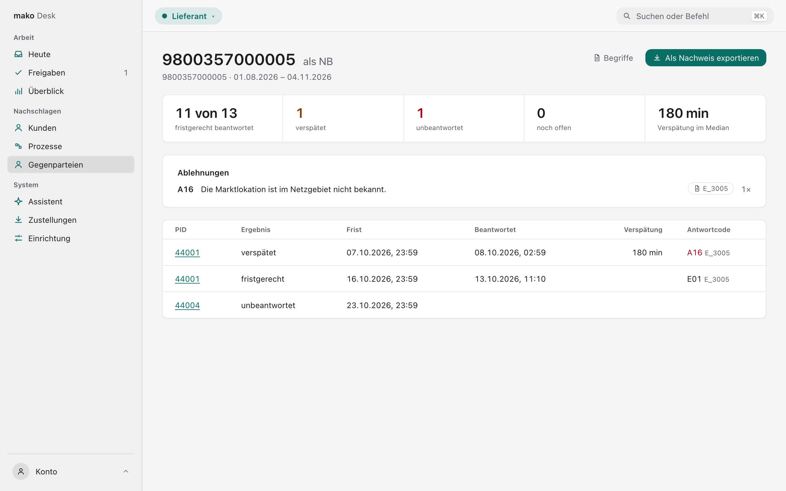](gegenpartei-light.png)
[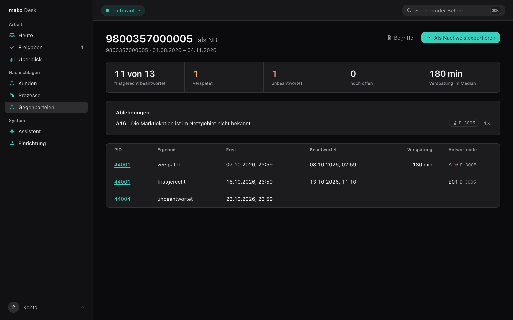](gegenpartei-dark.png)

## Klärfälle, Zahlungen, Anlagen

A **Klärfall** in Heute opens its own page: the cause in the words of the
list that defines its code, where it came from, when it is due, and its
Verlauf. Where the Prozessüberwachung proposes a correction the one action is
„Korrigieren & senden" — choosing another allowed command asks for a reason —
otherwise „Erledigt" with a reason, or „Zuweisen". Each is held for undo like
every decision, and a refusal is said in words.

**Zahlungen** lists, for the Lieferant, every payment no account took — each
with the account the Kundenkonten propose and one key, <kbd>A</kbd>, to assign
it — and every Guthaben past its due date with „Ausgezahlt". Both are rows of
the Arbeitsvorrat. An IBAN is shown only as the service masks it.

An **Anlage** page — opened from a Marktlokation's „Erzeugung" or a Netz
Arbeitsvorrat row (no MaStR entry, support ending, not settled last month) —
shows the EEG-Abrechnung's facts with the Förderende large and the last twelve
settled months, paid where the Kundenkonten say so; a month opens its
statement with the legal basis of every position.

## The Lieferant starts from the customer

**Kunden** finds a customer: type the start of any word of a name, a
Kundennummer or the MaLo-ID of a Lieferstelle, and the Kundenverwaltung answers from an
index as you type — at most 20 customers; nothing is searched in the browser.

[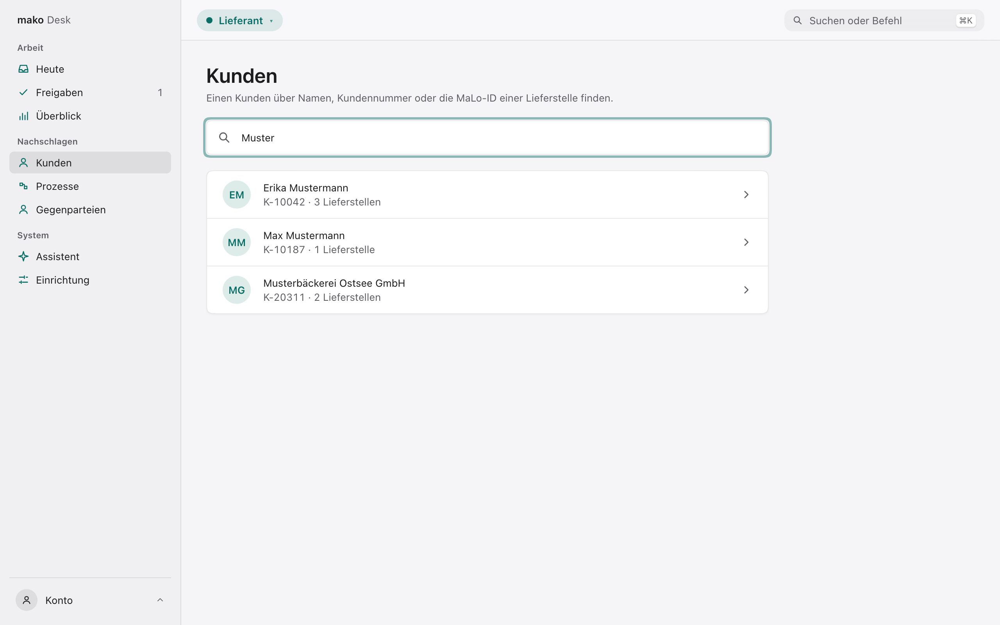](kunden-light.png)
[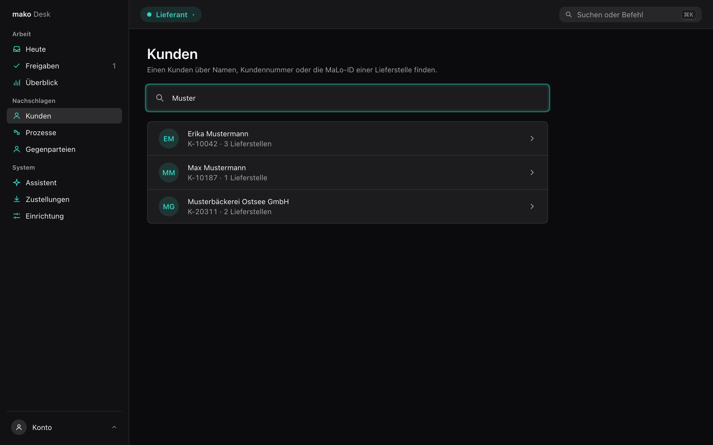](kunden-dark.png)

A customer shows its Lieferstellen, newest first, with the state of its
supply — Anmeldung läuft, beliefert seit, beendet zum — and, where a process
runs, the Frist-Uhr of its earliest deadline, all from one read. A
customer with more than 200 shows the newest 200 and the total; ⌘K finds any
other by its MaLo-ID. Each opens the processes of its MaLo.
Payment data is not part of the view.

[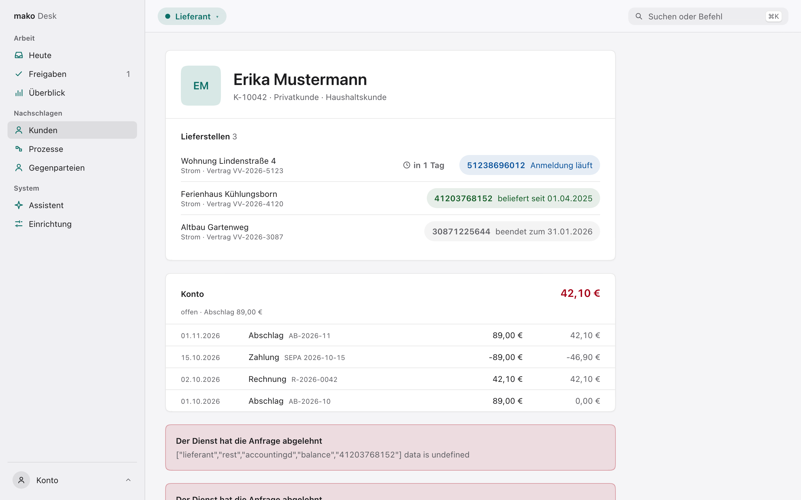](kunde-light.png)
[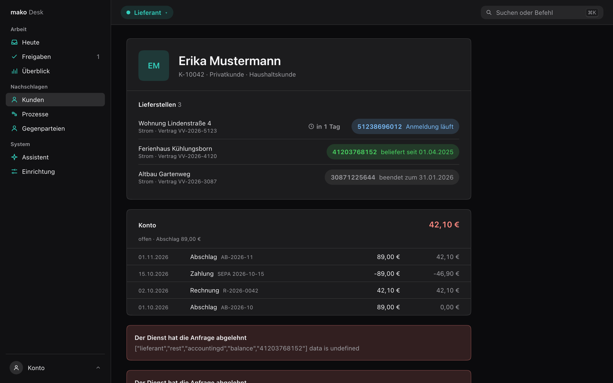](kunde-dark.png)

<kbd>⌘K</kbd> finds customers too:

[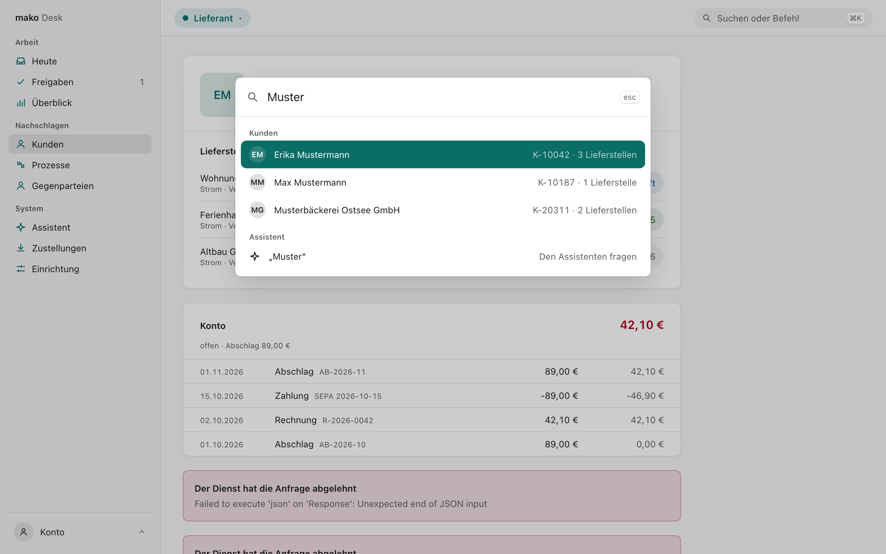](palette-kunden-light.png)
[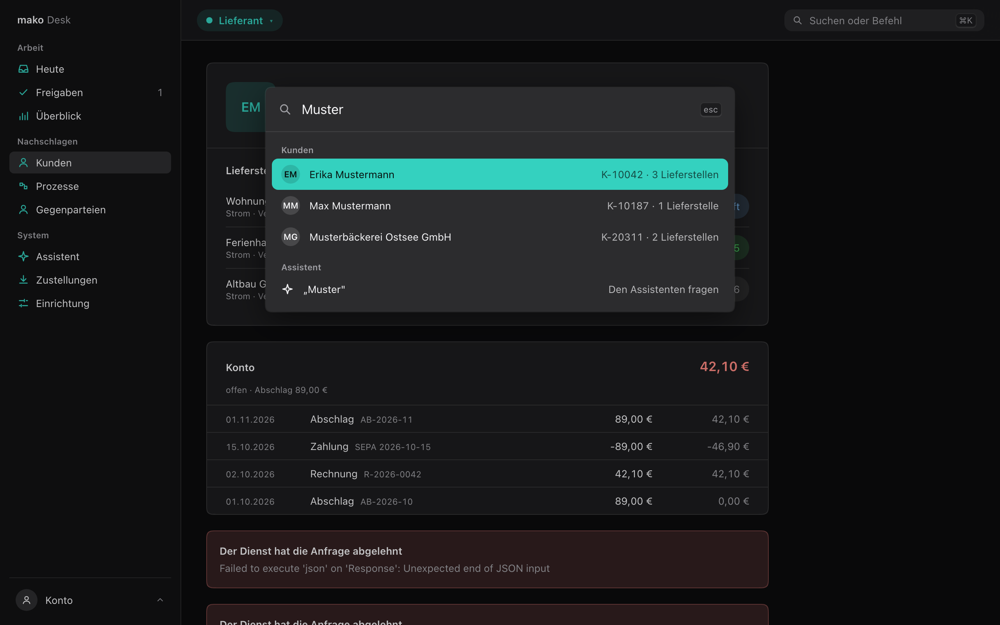](palette-kunden-dark.png)

A question typed into the palette goes to the assistant on the page you are
on — under a process, a customer or a Freigabe — and is answered there.

[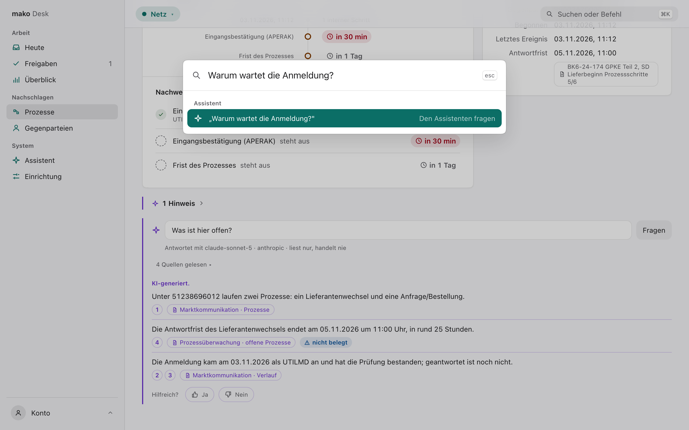](palette-fragen-light.png)
[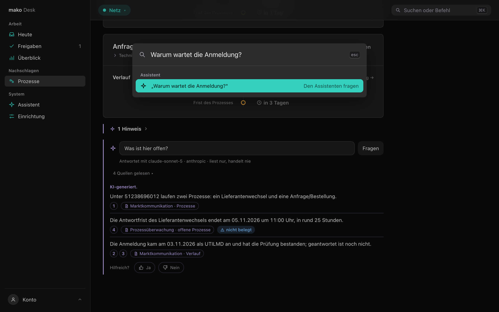](palette-fragen-dark.png)

## Zustellungen: who receives the events

**Zustellungen** is the webhook surface of every service that carries one —
Prozessüberwachung, Marktstammdaten, Kundenverwaltung, Messwerte,
Rechnungseingang, Abrechnung, Netzentgelte and Produktkatalog — read and written through that
service's own subscription API (see
[Webhook subscriptions](@/docs/architecture/erp-integration.md#webhook-subscriptions));
the Desk keeps none of it. Pick the service; its endpoints are listed with
their URL and whether they are active. An endpoint from the service's
`[[subscriptions.endpoints]]` is marked **aus der Konfiguration, nur lesen**:
it changes in the TOML, not here.

Open an endpoint for its deliveries — each with the event type, the service's
status and the last HTTP status code, the latency, and **Erneut senden**.
**Testereignis senden** shows the answer at once, **Letzten Tag erneut senden**
queues everything since yesterday's midnight (Europe/Berlin) again, and
**Schlüssel erneuern** issues a new signing secret while the previous one keeps
signing for 24 hours. A new endpoint is created below the list; its signing
secret is shown exactly once, with a button to copy it — the service never
returns it again. Whether you may do any of this is the service's Cedar
decision (`manage-subscription`); a refusal arrives with its reason.

[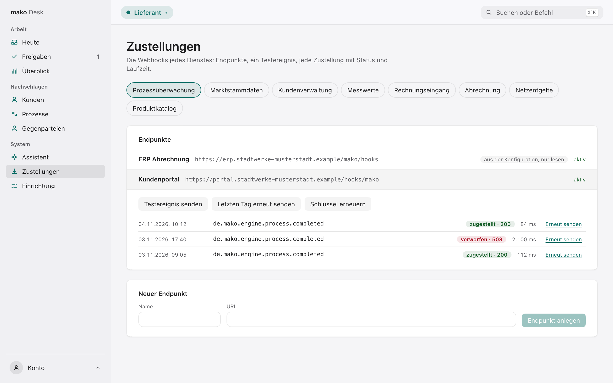](zustellungen-light.png)
[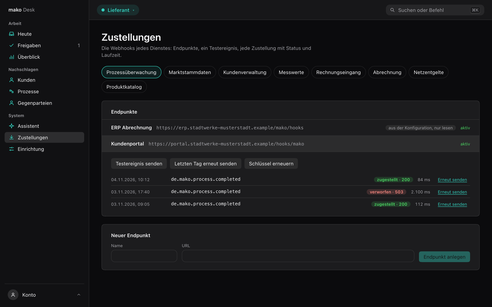](zustellungen-dark.png)

## Einrichtung: ready for go-live

**Einrichtung** opens with the deployment's checklist, as the
Marktkommunikation folds it from every service named under
`[[einrichtung.dienst]]` (see [Einrichtung](@/docs/guide/einrichtung.md)): one
item per area — Identitäten, Zertifikate, Bilanzierung, Zugriff,
Erreichbarkeit, Formatabdeckung, Konfiguration — each with its Ampel as an icon
and a word, and under it every finding in the reporting service's words, with
the setting's path, a link to its entry in the manual where it is an operator
setting, and the source chip of the rule. A service that cannot be asked is
**nicht erreichbar** — unknown, not failing; one that answers with something
other than a report has the answer shown as it came. The list asks again every
15 seconds and on **Jetzt prüfen**; every colour and the verdict at the top are
the service's.

[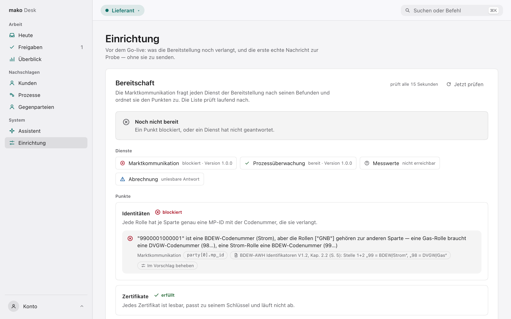](einrichtung-light.png)
[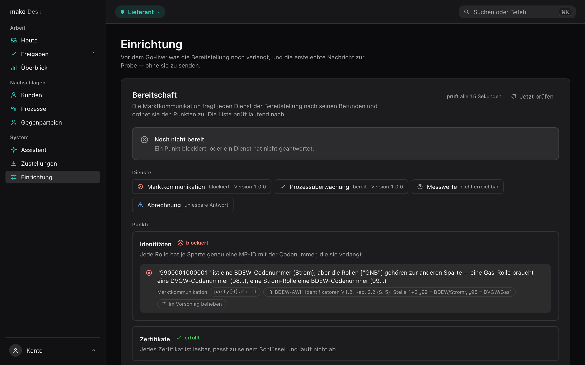](einrichtung-dark.png)

## Propose the configuration

Below the checklist, **Vorschlag** asks what the configuration needs and
nothing else: the Rollen the deployment plays and the MP-ID of each, the
primary MP-ID where there are several, a Lieferant's Bilanzkreise per Sparte,
the affiliated Lieferanten, the AS4 key material as file paths, and where the
other services run. It starts from what the deployment already runs with.
Beside it the Marktkommunikation proposes one file per service — `makod.toml`,
`processd.toml` — every line marked **neu**, **unverändert** or **entfällt**
against what is loaded, under the rule or document it satisfies; a fact nobody
gave is a **Lücke** (`# FEHLT:`) whose **Zur Frage** moves to the question that
fills it, and an answer that breaks a rule — a Gas Rolle under a `99…` code,
key material instead of a path — is refused with its source. **Kopieren** and
**Herunterladen** hand over the file; nothing is written to a server.

**Aus einem Satz** reads one sentence — „Wir sind Lieferant Strom und Gas,
Strom unter 9900357000004" — into proposed answers, each offered with
**Übernehmen** or **Verwerfen**; an MP-ID the sentence does not contain is never
offered. Without the assistant the interview works the same. A finding in the
checklist whose fix is an answer offers **Im Vorschlag beheben**.

[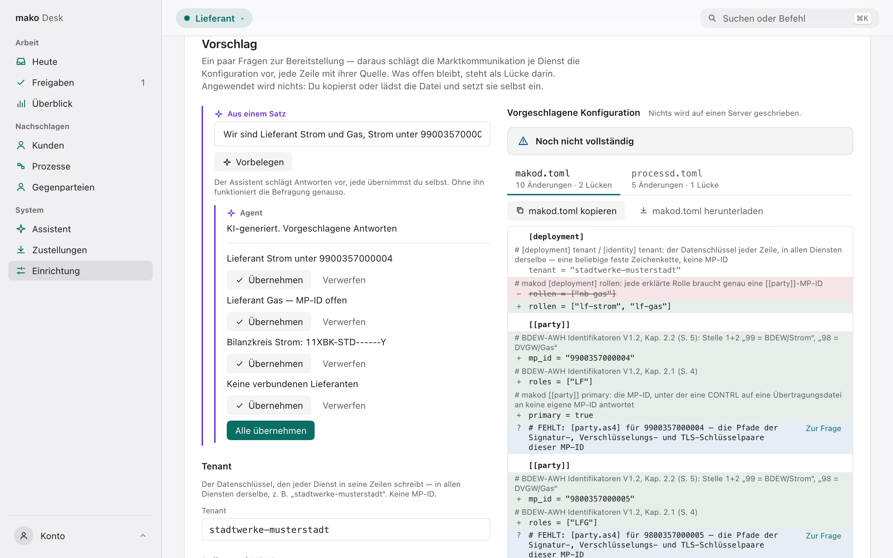](einrichtung-vorschlag-light.png)
[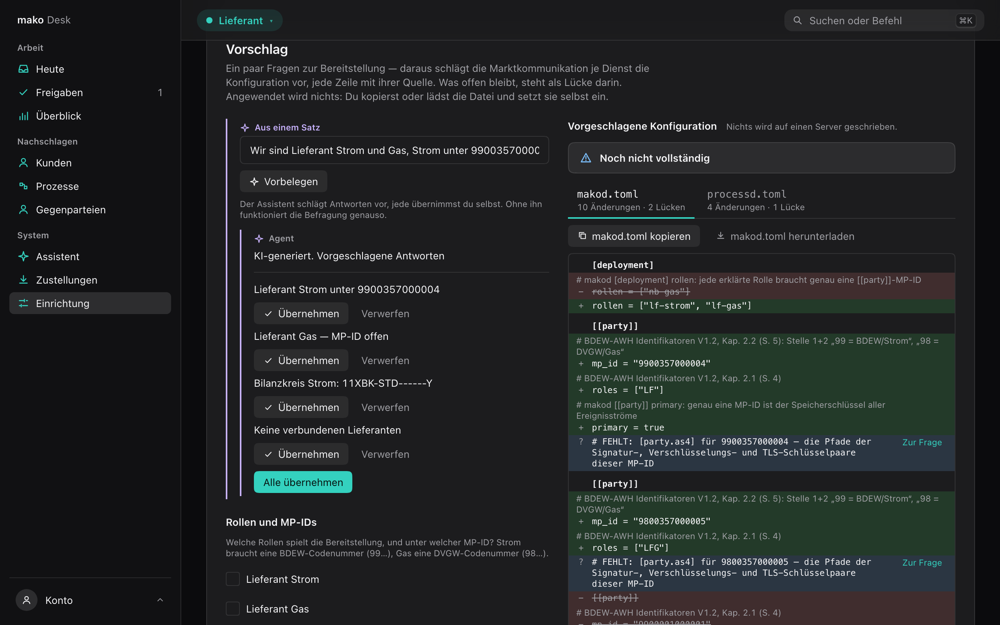](einrichtung-vorschlag-dark.png)

## Rehearse a message before go-live

Below the proposal, the Probelauf: choose one of the messages a Lieferant
sends first — Anmeldung, Abmeldung or Kündigung, Strom (55001, 55004, 55016)
or Gas (44001, 44004, 44016) — check the facts, which start as the profiles'
sample values, and start it with <kbd>⌘↵</kbd>. The Marktkommunikation builds
the message through the same door a real one takes, holds it against its
profile and the pre-send check, and **sends and stores nothing**.

The answer is its own: **Besteht**, or **Abgelehnt** with the refusal the real
command would get — before a message existed, or by the check on the built
one. Below it the message itself, segment by segment: position, tag and MIG
number, the AHB name of the place under the profile of the message's own
format version (named above the grid), and the content, with the data element
a finding names marked where it sits and the finding under it. A list of the
findings moves focus to each segment; arrow keys move through the grid; the
interchange as sent can be copied. A command the deployment cannot rehearse,
or a Marktrolle it does not declare, is refused in the service's words.

[](probelauf-light.png)
[](probelauf-dark.png)

## At a phone's width

Below 768 px the sidebar folds away: the button at the start of the top bar
opens it as a sheet over the view, and esc, a tap outside or a choice closes
it, the focus back on the button. The sidebar groups the views under
**Arbeit**, **Nachschlagen** and **System**. Search shrinks to its icon, a list–detail
view shows one pane at a time, and no view scrolls sideways.

[](telefon-einrichtung-light.png)
[](telefon-ansichten-dark.png)

## One role at a time

Holding several market roles, a person wears one at a time — **Netz** (NB),
**Lieferant** (LF), **Messstelle** (MSB), **Energieservice** (ESA) — in the
toolbar or with <kbd>⌃1</kbd>–<kbd>⌃4</kbd>. The badge names the role you
wear, and each role has its own start page; switching shows no data of the role left. What a role may read is each
service's Cedar policy.

[](rolle-light.png)
[](rolle-dark.png)

## You and your keys

Your name sits at the foot of the sidebar. Its menu shows the market roles you
hold and sets the appearance — System, Hell or Dunkel — and the **Sprache**,
Deutsch or English; both are kept in this browser. In English the market's own
vocabulary stays German — MaLo, Frist, Antwortfrist, PID, APERAK, Fundstelle
names, Marktpartner-ID, the process names — because it is the word the
Festlegungen and the counterparty use. Dates and numbers take the language's
style (`02/11/2026, 11:00`), and every instant is still Berlin time. Every
view, ⌘K, the shortcut sheet, the names of the Rollen and services and the
question the Desk asks the assistant speak the chosen Sprache; what a service
writes — a finding, a refusal, a reason — appears in its own words.
<kbd>⌘/</kbd> lists every key the Desk answers to, from anywhere.

[](konto-light.png)
[](konto-dark.png)
[](tastatur-light.png)
[](tastatur-dark.png)

## What the Desk will not do

- **Compute a Frist, Werktag, amount or verdict** — every one on screen is the
  service's.
- **Round an amount or shift a date** — both stay exactly as the service sent
  them, in Berlin time.
- **Show data it cannot type** — a view reads only tools whose answer has a
  declared shape.
- **Decide who may act** — it offers every action and the service's policy
  answers.

## The design system

Every view sits in one page container, leading-aligned at one gutter, in one
of two widths — reading (≈720 px) for a document-like view, work for a list
or grid — so a title never moves between views. The type is the macOS ramp
(Large Title 26 pt down to Caption 11 pt, Regular and Semibold only); status
is tinted text on its own faint fill, and the only solid fill is the one
primary button. There is one accent colour, teal, for every role — the
primary button, a selection, a link; the only other hue is the assistant's
violet, kept for what a model wrote: upright text behind a thin violet rule
and its sparkle. `desk/src/design/tokens.test.ts` refuses a second accent and
holds every text colour to WCAG AA on every surface, light and dark.

When a service serves one of the tools the Desk was generated against with a
different schema, a banner at the top names that service, instead of a view
failing later. Until the Desk matches that service again it offers no
decision on it, and it checks again whenever the window regains focus.

A decision leaves the Desk with an `Idempotency-Key`, so a request repeated
on the way is one decision at the service. One sent as the tab closed — its
hold flushed on `pagehide` — may never have its answer read; the next load
shows it under „Beim letzten Mal gesendet" with what the service says became
of it (a Freigabe's outcome from the Prozessüberwachung), until you confirm
you have seen it.

When the assistant has prepared a proposal for the Freigabe on a process
page, the decision bar shows it — labelled, with the gate's verdict
(agentd's Prüfvermerk): only a proposal that passed the Entscheidungsbaum and
the pre-send check can be taken in („Übernehmen"); a refused or unchecked one
says why, and the bar's one action is „Bearbeiten", which opens the decision
empty. The decision itself never waits on the assistant.

`/dev/gallery` (development builds) shows every colour token, the type ramp,
each status and every control in every state, light and dark side by side —
the page a design change is reviewed on. The screenshots on this page are
taken from the production build.

[](gallery.png)

## For developers

| Command | What it does |
|---|---|
| `just dev` | every service, the seed and the Desk with hot reload |
| `just dev-ui` | the Desk alone on its recorded answers (`desk/fixtures`) |
| `just desk-gen` | refresh `services/*/mcp.snapshot.json` and regenerate the Desk's types |
| `just desk-check` | generated types current, `tsc`, Biome, Vitest, the production build within its size budget — part of `just ci` |
| `just desk-screenshots` | regenerate the screenshots on this page |
| `just desk-budgets` | measure the interaction budgets in a browser (below); not part of `just ci` |
| `just desk-axe` | axe-core over the assistant's trail, receipt, pill, ⌘K action panel and the process page; not part of `just ci` |
| `just desk-aria` | every route's accessibility tree against its baseline in `desk/aria/` (`--bless` after a deliberate change); not part of `just ci` |

`cargo xtask check-desk` holds the first two rules, and each service's
`mcp.snapshot.json` the third. The screenshots are produced by
`desk/scripts/screenshots.ts`: Vite serves the Desk, each service's answers
are recorded responses in the schema it declares, agentd's stream is a
recorded run, the browser clock is fixed and the zone is Europe/Berlin, so
every run draws the same pictures.

Two lint rules sit beside `check-desk`: Biome's plugin `desk/lint/zahlen.grit`
refuses `Number(` and `parseFloat(` outside `src/format/` as you type — an
amount is a `Decimal` string, and a float would lose or invent a Cent — and
`desk/scripts/umfang.ts` fails `desk-check` when the entry script or the
stylesheet outgrows its gzip budget. The drift banner compares each tool's
fingerprint (`src/data/oberflaeche.ts`), written into `src/data/gen` by
`npm run gen`, with the one computed over what the service lists.

The Desk is becoming a client of the documented REST API: `npm run gen` also
merges every committed `services/<service>/openapi.json` into
`desk/openapi.json` as the gateway routes it and writes the types
`openapi-fetch` reads (`src/data/api/`); a path no document describes does not
type-check, and `desk-check` refuses stale types. Views move to it service by
service as each document lands. The gateway (`desk/deploy/gateway.yaml`)
forwards only each service's `/mcp`, its document and the write routes the
Desk calls — never `/admin`, `/metrics` or `/health`. Biome's plugin
`desk/lint/html.grit` refuses raw HTML sinks and an `href` built from a value,
so a counterparty's text is always rendered as text.

The assistant's stream is tested without agentd or a model:
`desk/fixtures/run-*.jsonl` are recorded runs, one stream event per line as
agentd sends it (answered, stopped, a read with a hidden source, a first step
sent late, an answer held back long enough to photograph the trail), played
into the Desk by `desk/src/test-support/aufzeichnung.ts` in Vitest and served
as a real event stream by `desk/scripts/aufzeichnung.ts` for a browser run.

`just desk-budgets` measures three budgets in Chromium against the production
build, with agentd's stream played from the recorded runs, each at the 95th
percentile of 20 runs:

| Interaction | Budget |
|---|---|
| first streamed step after the question is sent | ≤ 1 s |
| an entry's ⌘K actions after it is chosen | ≤ 100 ms |
| a decision taken from the keyboard, in its view and in ⌘K | ≤ 100 ms INP |

Before it measures, it proves it can fail: `run-verspaetet.jsonl` sends its
first step 1.5 s late, and the first budget must refuse it by name.
`just desk-axe` reaches the trail, receipt, pill and action panel by keyboard
alone, light and dark with reduced motion, and fails on a serious or critical
axe finding, a running animation, a control Tab cannot reach, or a citation
that stays under the top bar when focused from beneath it. The Desk CI job
runs both, and `just desk-aria`, after `just desk-check`.

`desk/AGENTS.md` holds the rules for working on the Desk.
