+++
title = "The Desk"
description = "mako Desk, the operator's web UI: processes by business key, every Frist in Berlin time, one market role at a time — on the agents' typed MCP tools."
weight = 3
+++
**mako Desk** is the operator's work surface. It reads the services' MCP
tools — the same typed read surface the agents are granted — and renders what
they answer. It computes nothing that decides: every Frist, amount and verdict
on screen is the one a service returned.

[](prozesse-light.png)
[](prozesse-dark.png)

## Run it

```sh
just desk
```

starts makod and the Desk with hot reload, and opens `http://localhost:5173`.

In production the Desk is the `mako-desk` image — the static bundle on port
8080 — behind [oauth2-proxy](https://oauth2-proxy.github.io/oauth2-proxy/) as
the gateway. The browser talks to one origin and holds no service token: the
gateway signs the person in by OIDC, serves the Desk, and forwards
`/svc/<service>/` to each service the Desk reads — makod, processd, vertragd,
invoicd, billingd, edmd, netzbilanzd and agentd — with the person's access
token as `Authorization: Bearer`. `desk/deploy/gateway.yaml` is the
gateway's routing, ready to adapt.

Each service verifies that token as it does any other, so its
`[oidc] audience` must be in the token's `aud` — an audience mapper at the
identity provider, or one audience shared by all of them. Cedar decides what the
person may do; the Desk keeps no role map. Its CSP allows the bundle's own
script and stylesheet only, plus a per-request nonce for the styles React
Aria injects.

## A process, by its business key

Type a MaLo-ID, MeLo-ID or Vorgangsnummer on **Prozesse**, or anywhere press
<kbd>⌘K</kbd> and type it: the palette offers to open it directly.

[](palette-light.png)
[](palette-dark.png)

A key can name several processes — a Lieferantenwechsel beside an
Anfrage/Bestellung. Each is a card, ordered by its earliest pending Frist,
leaving out any process the person's role may not read.

Each card is titled the way an operator says it — „Lieferantenwechsel · Strom"
— with the workflow and its ids under „Technische Angaben".

Its **Verlauf** threads the market messages: received on the left, sent on the
right, each with PID, Berlin time and document number, as the workflow
recorded them. An answer also states its code and the BDEW's wording from the
list that defines it („A02 — Marktlokation … nimmt nicht an der
Marktkommunikation teil"); where that list publishes no wording for the code,
the line names the list alone. Steps between two messages fold into one quiet
row („2 interne Schritte"). Pending Fristen close the thread, each named for what it is — an
„Eingangsbestätigung (APERAK)", a „Syntaxquittung (CONTRL)" or a „Frist des
Prozesses".

The **Frist-Uhr** says how far a deadline is: red inside two hours, amber
inside a day, solid red once it has lapsed. The time beside it is Berlin time;
hover or focus shows the instant in UTC as the wire carries it.

A key with no process gets the Marktkommunikation's own answer, said calmly:

[](refusal-light.png)
[](refusal-dark.png)

## Ask the assistant

Under a customer, a MaLo's processes and a Freigabe, the Desk asks the
assistant — type a question, take a suggestion, or press <kbd>⌘J</kbd>. It
reads the same services the screen does and names the model that answers. The
answer opens with „AI-generated."; the assistant reads and never acts.

**The trail.** Each read the assistant makes appears under the question as a
numbered line the moment agentd journals it — „Verlauf gelesen · Prozess 43991093"
with its source chip — while a hairline runs under the question. A read whose
source you may not see stays, marked „Quelle für Sie verborgen"; a call a stop
refused stays muted, marked „nicht beantwortet".

[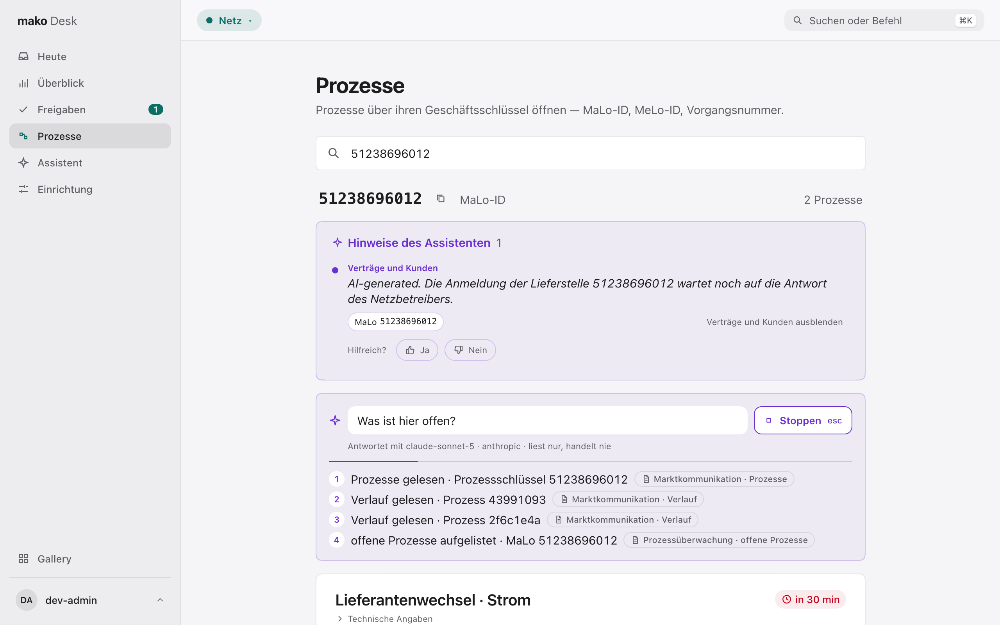](fragen-live-light.png)
[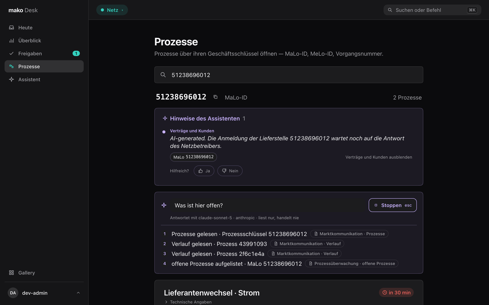](fragen-live-dark.png)

Once the answer stands, the trail folds into „4 Quellen gelesen ▸" — the
reads whose source you can see — and choosing it opens the trail again. A dropped connection resumes the stream
where it broke off, without repeating a line.

**Stop.** While the assistant reads, „Fragen" becomes **Stoppen** in the same
place, and <kbd>esc</kbd> stops too — unless a dialog, a popover or ⌘K is open,
where <kbd>esc</kbd> closes that first. agentd stops the run at its next step,
so nothing more is spent on it; the reads it already made stay, each marked
„abgebrochen". Stopping is always safe: the assistant never sends, so a
stopped run leaves no half-made decision. Only the person who asked can stop a
run here.

**The evidence.** Each sentence carries the numbers of the trail's lines it
rests on. Focusing or hovering a number outlines every row on screen that
shows what that read returned — the Verlauf of the process it read, say — and
<kbd>↵</kbd> on it opens the trail on that line.

[](fragen-light.png)
[](fragen-dark.png)

**The run comes along.** Leave the page while the assistant reads, and the
question rides along as a pill in the top bar with its latest read, newest
first, „Antwort bereit" once it has answered. Choosing the pill returns to the
question; once you have seen the answer there, the pill is gone.

[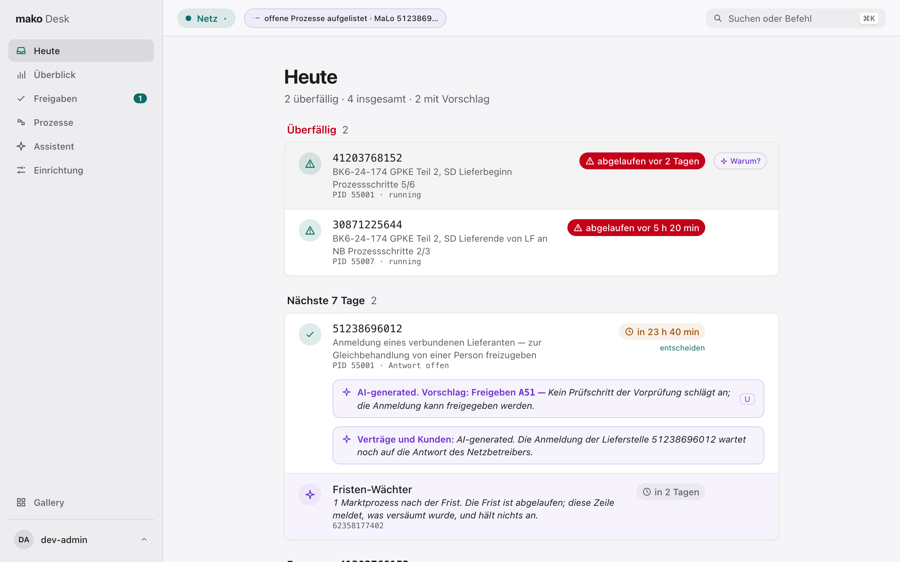](pille-light.png)
[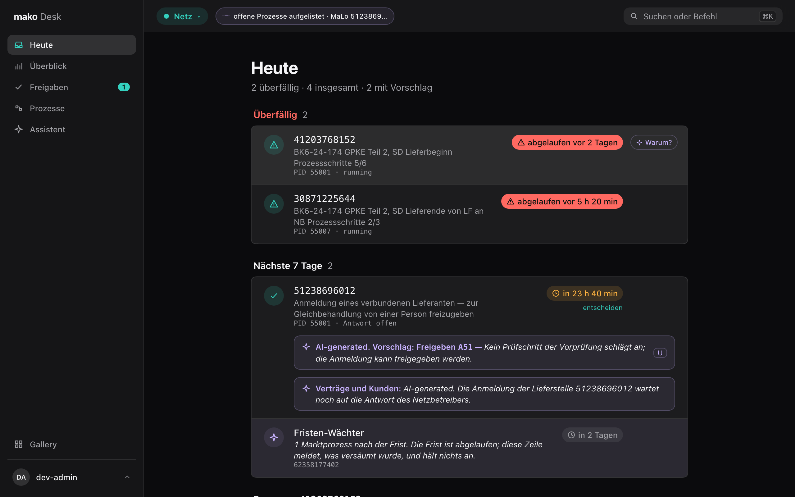](pille-dark.png)

It answers in at most five sentences, each with the read it rests on, and each
checked before it is shown: every MaLo-ID, date, time and amount in it must
appear in that read's answer. One that does not is marked **nicht belegt** —
typically a figure the model worked out itself, such as „noch 25 Stunden".
The check says the figures are in what it read, not that its reasoning is
right.

If it finds no answer, „Nochmal fragen" asks again. When the assistant is not
running, the panel is not shown and the rest of the Desk works as before.
Where agentd's stream cannot be read, the panel reads the answer once the run
has concluded, lists the services it read under it („Gelesen: …") and says why
if agentd refuses it.

What a skill noticed on its own — a Frist that passed, an Anmeldung that
stalled — arrives as a **Hinweis**: at the top of Heute and the Überblick, and
under the customer or MaLo it concerns, in the skill's own words (a
model-written one opens with „AI-generated."). A skill can be muted in one
click and shown again in one; muting is this browser's and deletes nothing.

**Assistent** in the sidebar is each skill's package leaflet, read off the
reviewed description agentd runs: what it is for, whether it is active here,
what starts it — a question or an event — which model it uses or that it uses
none, and which services it may read, each tool's reason on hover. Every skill
only reads: none can send a market message, book or change master data.

Each active skill's card also carries its record over the last 30 days, as
agentd counts it: how many runs it made, how often a person found its answer
„hilfreich", and what became of its proposals — **übernommen** (sent as
proposed), **angepasst** (changed before sending) and **verworfen**. A share
is shown only from five verdicts up; below that the card gives the count alone
(„2 Bewertungen"), and a skill nobody has rated yet says „Noch keine
Bewertungen", never 0 %. The record informs your judgement of a proposal; it
never decides one.

[](assistent-light.png)
[](assistent-dark.png)

## Freigaben

Some answers the Prozessüberwachung does not send on its own: an Anmeldung of
an affiliated supplier held for a person, or a case its Entscheidungsbaum
could not settle. **Freigaben** lists them for the Rolle you wear, the
earliest Frist first; the sidebar shows how many wait.

Each opens with its reason and its Frist. A held answer says which Antwortcode
it will send; an open one asks you for the code, and the form offers only the
codes its Entscheidungsbaum defines, each with its published wording. An
E/G Bestätigung whose Bilanzkreis, Versorgungsart or Abrechnungsintervall the
Prozessüberwachung could not resolve asks for each beside the code, offering
the values processd lists for its segment; nothing is sent until they are
given. The process's Verlauf is beside it. Every decision sends a market message; what it
sends is said beside the button, the decision is held for five seconds before
it goes (see [Taking a decision back](#taking-a-decision-back)), and it is
recorded under your name.

<kbd>J</kbd> and <kbd>K</kbd> step through the list, <kbd>A</kbd> chooses
Freigeben and <kbd>R</kbd> Ablehnen; <kbd>↵</kbd> on the button sends — held,
never asked about. When a
colleague decided the same Freigabe first, the Desk says who and when, and
yours is not sent. Any other refusal is shown in the Prozessüberwachung's own
words; one its policy makes stands where the controls were until the tab is
closed.

The assistant proposes a decision for every Freigabe as it is queued — an
action, a code and one sentence why, marked „AI-generated." and checked like
every sentence it writes. It stands at the top of the decision; <kbd>U</kbd> or
„In die Entscheidung übernehmen" fills the form and sends nothing. Where it has
not proposed one, ask it „Was schlägst du vor?". Whether you sent a proposal as
it was, changed it or dismissed it is kept beside the assistant's run, and every
proposal card ends with that record: „In 30 Tagen: 14 von 17 Vorschlägen
übernommen" (from five decided proposals; below, the count alone).

[](freigaben-light.png)
[](freigaben-dark.png)

## Taking a decision back

Every decision — a Freigabe, a Rechnungsdisput, a held invoice, a geparkte
Buchung, „Hilfreich?" under an answer, „Verwerfen" on a proposal — shows at once
and leaves the browser five seconds later, in its view as in ⌘K. None asks for
confirmation, a market message included. Until it leaves, a ring counts the hold
down on its entry, a toast offers „Rückgängig", and <kbd>⌘Z</kbd> takes back the
newest; nothing was sent, so nothing needs reversing. Closing the tab sends
whatever is still held. A refusal after the hold stands in the service's words
on the entry, with the form back as you sent it.

[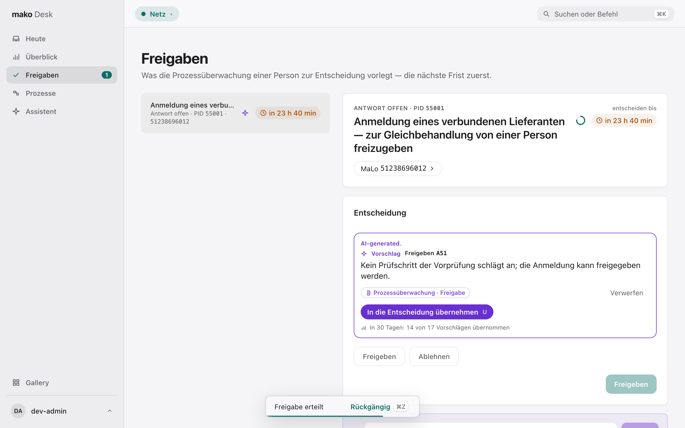](gehalten-light.png)
[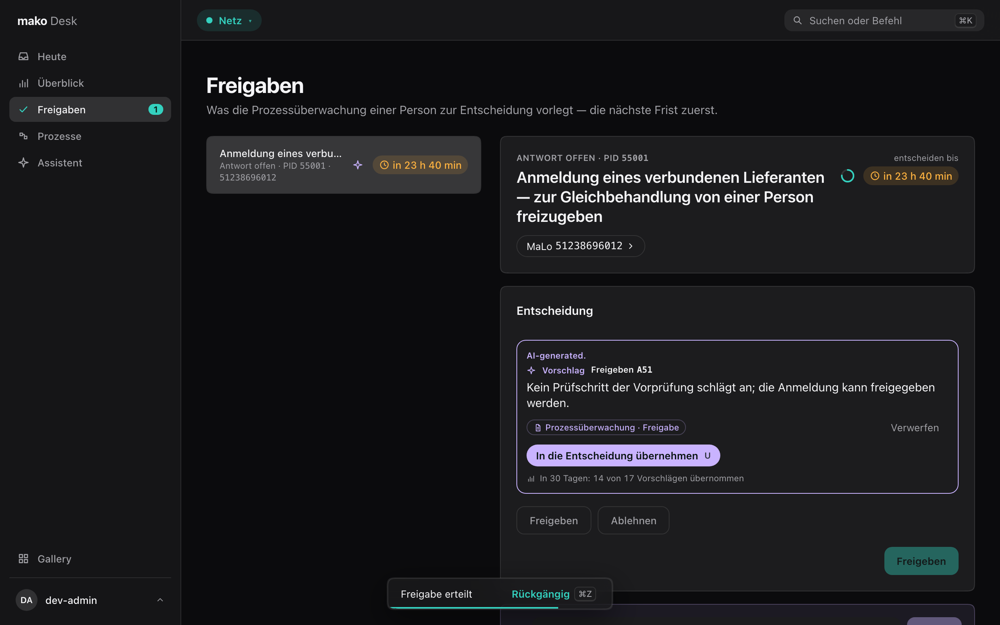](gehalten-dark.png)

## Acting from ⌘K

<kbd>⌘K</kbd> decides what it finds without opening its view. Type the
identifier of an open decision — a MaLo, a process, a Freigabe, a
Rechnungsnummer, a Beleg — and the palette lists, under **Entscheiden**, the
Freigaben, Rechnungsdispute, Prüfposten and geparkten Buchungen it names
among those Heute lists for the Rolle you wear. Pressed on a focused Heute
row or with a Freigabe selected, ⌘K opens on that entry's actions directly.

An entry lists exactly the actions the Desk offers for it, as its view does:
Freigeben and Ablehnen on a Freigabe, Beilegen and — while the refusal has not
gone out — Ablehnung senden on a Rechnungsdisput, Freigeben or Geprüft on a
Prüfposten, Neu buchen and Verwerfen on a geparkte Buchung. Typing filters
them; <kbd>↵</kbd> chooses the first, <kbd>⌘↵</kbd> the second, the arrows
any; <kbd>esc</kbd> goes back a step. An action the service refused you this
session stands in its words and cannot be chosen. ⌘K reads no free text into
an action: a question goes to the assistant.

Choosing an action opens its parameters in the palette, never in a dialog,
with the Frist beside them: the Antwortcode as a choice of the codes its
Entscheidungsbaum publishes, each with the wording the Prozessüberwachung
returns, the facts a Freigabe still needs, and the Bemerkung, Grund or
Buchungsdatum. A refusing verb is drawn
red and asks nothing more. <kbd>↵</kbd> holds the decision and closes the
palette onto the entry — the Freigabe in **Freigaben**, anything else in
**Heute** — where a ring counts the hold down; <kbd>⌘Z</kbd> takes it back
before anything was sent. The request is the one the entry's own view sends.
When the service refuses it after the hold, its words stand on the entry.

Where the assistant's proposal is waiting, the action it proposes carries
„Vorschlag", and choosing it fills in what the proposal names — the code, the
date, the Grund — tinted and marked by a card that opens „AI-generated.", says
why, and ends with the assistant's 30-day record. <kbd>Tab</kbd> keeps the
suggestion and moves on; typing replaces it, and the mark is gone once you
change what it filled in. A Bemerkung is never filled in: it is recorded as
your words. A Prüfposten never has a proposal, and with none waiting the
fields open empty. Whether you sent the proposal as it was or changed it is
kept beside the assistant's run, as in the views.

[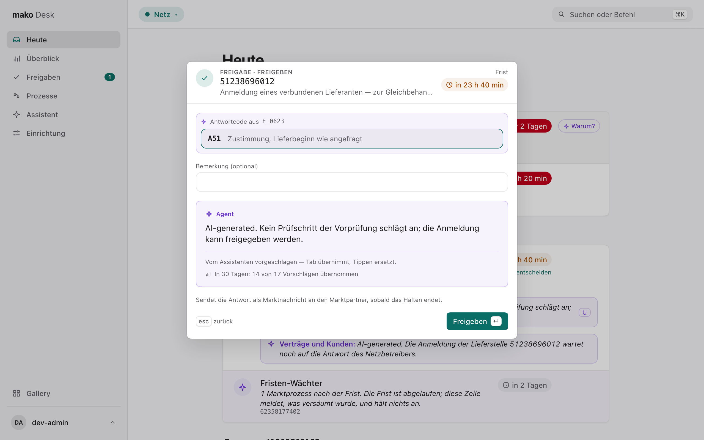](palette-aktion-light.png)
[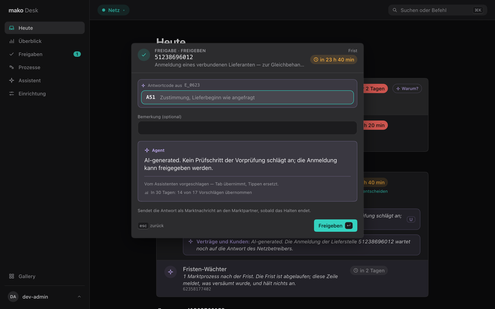](palette-aktion-dark.png)

## Überblick

A few numbers per role for whoever answers for it — each one as its service
returns it, never a sum the Desk works out, and each tile opens the list it
counts. A tile turns red only where the service marks a breach; a
number the service capped shows as a floor („500+").

**Fristen überschritten** lists every open process past its Antwortfrist, as
the Prozessüberwachung has it, each with the Festlegung its deadline came from.

**Dead Letters** (Netz) counts every message the Marktkommunikation could not
take or deliver and lists the most recent. The Lieferant also sees
**Rechnungsprüfung**, **Rechnungsdispute** and **Geparkte Buchungen**, the
Messstelle **Ableseaufträge überfällig** — each the same read as its row in
Heute, which a click opens.

Every Rolle sees **Assistent**: the share of the desk-assistant's answers
people found „hilfreich" over the last 30 days — the ratio of agentd's two
counts, and only from five verdicts; below, the count — with what became of
its proposals beneath. It opens the Beipackzettel.

[](ueberblick-light.png)
[](ueberblick-dark.png)
[](fristen-light.png)
[](fristen-dark.png)

## Heute

Every Rolle opens on **Heute**: everything that waits on you, in one list.
Each item is something a service holds open for this Rolle:

| Rolle | What Heute lists |
|---|---|
| Netz | Freigaben, overdue processes, Korrekturbedarf after a negative Prüfmitteilung |
| Lieferant | Anmeldungen waiting on the Netzbetreiber, Freigaben, overdue processes, disputed invoices, invoices held for review, bookings the ledger refused, Anmeldungen not yet sent |
| Messstelle | Freigaben, overdue processes, overdue reading orders |
| Energieservice | Freigaben, overdue processes |

The list is read in bands — **Überfällig**, **Heute**, **Nächste 7 Tage**,
**Später**, **Ohne Frist** — by the Frist each service returned; the Desk
computes none. A row names the customer where one is known, says in the
service's words why it waits, and opens what it is about.

A Freigabe is decided where it stands: <kbd>↵</kbd> opens the decision under
the row — <kbd>A</kbd> or <kbd>R</kbd>, the code, the send, held for undo — and Heute
stays on screen. The assistant's proposal waits under the row;
<kbd>U</kbd> opens the decision with it taken in, unsent.

A disputed invoice is decided there too. Its row names the Rechnungssteller
as the Marktstammdaten register it, with the Rechnungsnummer beneath, and the
decision lists the checker's findings by their German names. **Beilegen**
closes the dispute with your Bemerkung and sends nothing, so it is held for
five seconds behind „Rückgängig"; while the refusal (REMADV) has
not gone out, **Ablehnung senden** sends it, held the same five seconds. The assistant
proposes one of the two with the finding it rests on, „nicht belegt" when the
findings it read do not name it.

An invoice the Abrechnung's risk check put aside is decided in place as well:
a **held** one is released — which issues it — and one **under review** went
out already, so **Geprüft** takes it off the list; each is held for undo. The assistant proposes neither — the risk check's findings are
the evidence, listed in the decision.

A booking the Kundenkonten' ledger refused for good — a sealed month, an
account not yet open — is a **geparkte Buchung**: its row names the customer,
the amount and the refusal, the decision says what to do about it. **Neu
buchen** books it on the date you enter, filled in with the first open day
where the ledger names one; **Verwerfen** drops it with the Grund you give.
Both are final once sent and recorded under your name; each is held for undo
and asks nothing more, and a refusal is shown in the ledger's words.

The assistant proposes one of the two, with the read it rests on:
**Verwerfen** when the customer's account already carries the same Beleg and
amount — the Grund names that booking — otherwise **Neu buchen** on the first
open day. Opening the decision takes the proposal in, marked as the
assistant's; nothing is booked until you send it and its hold ends. Where the reads do not settle
it, no proposal is shown.

A Korrekturbedarf opens nothing: the Desk has no Netzentgelte view.

[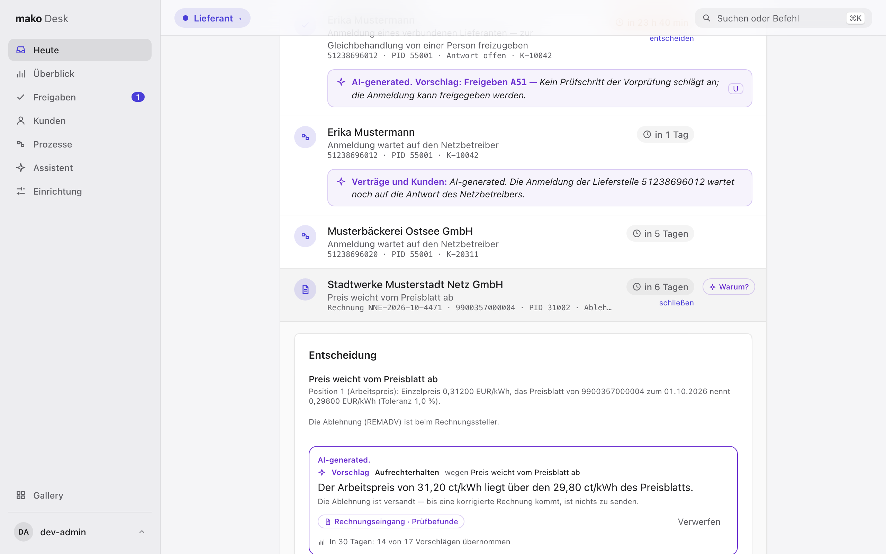](heute-disput-light.png)
[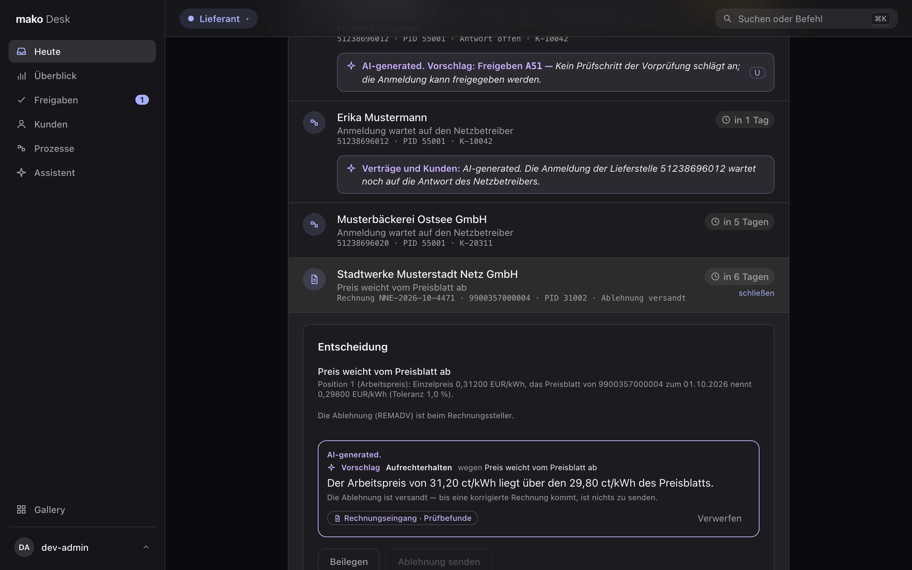](heute-disput-dark.png)

The assistant works in the same list. Its Hinweis on a MaLo or process sits
under that item, „Hilfreich?" beside it while the item has focus; one no item
carries is an item of its own. <kbd>J</kbd> and
<kbd>K</kbd> or the arrows move, <kbd>↵</kbd> opens, and <kbd>⌘J</kbd> asks the
assistant about the item you are on.

**Warum?** — <kbd>?</kbd> on the selected row, or its small button — asks the
assistant „Warum steht das auf meiner Liste, und was entscheidet es?" and
answers under the item, in the same trail and the same checked sentences;
<kbd>?</kbd> again puts it away, <kbd>esc</kbd> stops it. It is offered where the
assistant reads the record that put the item there — a Freigabe, a process, an
Anmeldung, a Rechnungsdisput, a geparkte Buchung, a customer, a Hinweis — and
not on a Korrekturbedarf, an overdue reading order or an invoice under review,
whose sources it does not read. While the assistant is unreachable, „Warum?" is
not offered.

Under the list each source says how many it returned, or why it did not
answer — one unreachable service never empties Heute. As Lieferant the
**Lage** heads the page: the day in the services' own counts, no model in it.

[](heute-light.png)
[](heute-dark.png)

## The Lieferant starts from the customer

**Kunden** finds a customer: type the start of any word of a name, a
Kundennummer or the MaLo-ID of a Lieferstelle, and the Kundenverwaltung answers from an
index as you type — at most 20 customers; nothing is searched in the browser.

[](kunden-light.png)
[](kunden-dark.png)

A customer shows its Lieferstellen, newest first, with the state of its
supply — Anmeldung läuft, beliefert seit, beendet zum — and, where a process
runs, the Frist-Uhr of its earliest deadline, all from one read. A
customer with more than 200 shows the newest 200 and the total; ⌘K finds any
other by its MaLo-ID. Each opens the processes of its MaLo.
Payment data is not part of the view.

[](kunde-light.png)
[](kunde-dark.png)

<kbd>⌘K</kbd> finds customers too:

[](palette-kunden-light.png)
[](palette-kunden-dark.png)

A question typed into the palette goes to the assistant on the page you are
on — under a process, a customer or a Freigabe — and is answered there.

[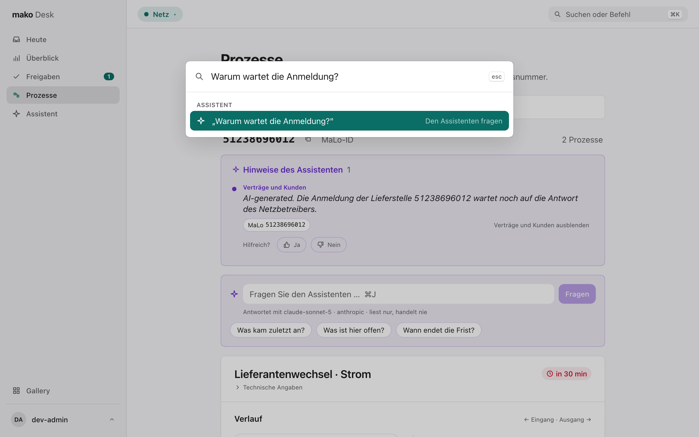](palette-fragen-light.png)
[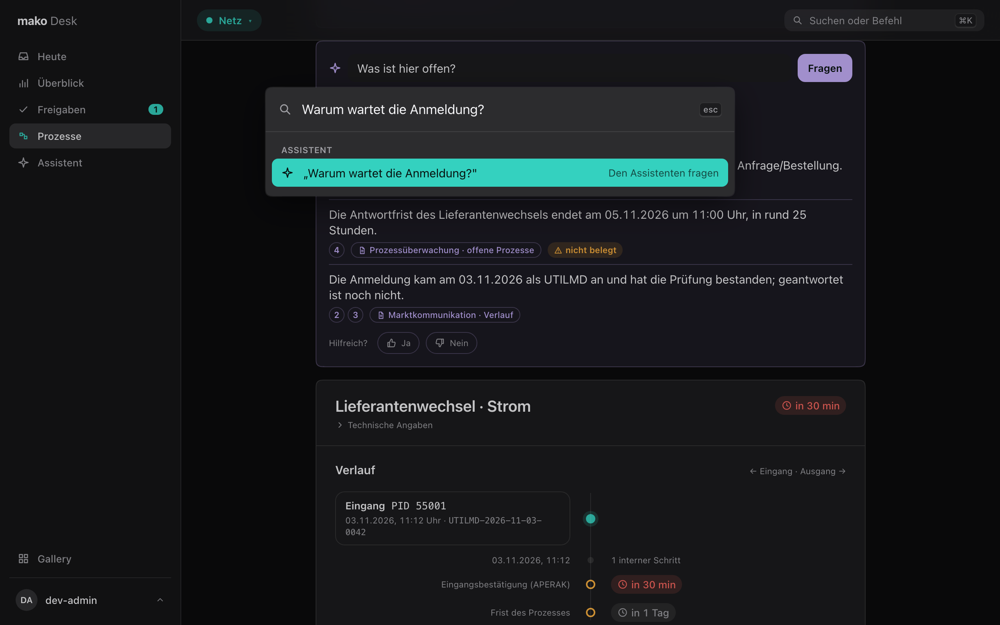](palette-fragen-dark.png)

## One role at a time

Holding several market roles, a person wears one at a time — **Netz** (NB),
**Lieferant** (LF), **Messstelle** (MSB), **Energieservice** (ESA) — in the
toolbar or with <kbd>⌃1</kbd>–<kbd>⌃4</kbd>. Each has its own accent and start
page; switching shows no data of the role left. What a role may read is each
service's Cedar policy.

[](rolle-light.png)
[](rolle-dark.png)

## You and your keys

Your name sits at the foot of the sidebar. Its menu shows the market roles you
hold and sets the appearance: System, Hell or Dunkel, kept in this browser.
<kbd>⌘/</kbd> lists every key the Desk answers to, from anywhere.

[](konto-light.png)
[](konto-dark.png)
[](tastatur-light.png)
[](tastatur-dark.png)

## What the Desk will not do

- **Compute a Frist, Werktag, amount or verdict** — every one on screen is the
  service's.
- **Round an amount or shift a date** — both stay exactly as the service sent
  them, in Berlin time.
- **Show data it cannot type** — a view reads only tools whose answer has a
  declared shape.
- **Decide who may act** — it offers every action and the service's policy
  answers.

## The design system

`/dev/gallery` (development builds) shows every control in every state, light
and dark side by side — the page a design change is reviewed on.

[](gallery.png)

## For developers

| Command | What it does |
|---|---|
| `just desk` | makod + the Desk with hot reload |
| `just desk-gen` | refresh `services/*/mcp.snapshot.json` and regenerate the Desk's types |
| `just desk-check` | generated types current, `tsc`, Biome, Vitest — part of `just ci` |
| `just desk-screenshots` | regenerate the screenshots on this page |
| `just desk-budgets` | measure the interaction budgets in a browser (below); not part of `just ci` |
| `just desk-axe` | axe-core over the assistant's trail, receipt, pill and ⌘K action panel; not part of `just ci` |

`cargo xtask check-desk` holds the first two rules, and each service's
`mcp.snapshot.json` the third. The screenshots are produced by
`desk/scripts/screenshots.ts`: Vite serves the Desk, each service's answers
are recorded responses in the schema it declares, agentd's stream is a
recorded run, the browser clock is fixed and the zone is Europe/Berlin, so
every run draws the same pictures.

The assistant's stream is tested without agentd or a model:
`desk/fixtures/run-*.jsonl` are recorded runs, one stream event per line as
agentd sends it (answered, stopped, a read with a hidden source, a first step
sent late, an answer held back long enough to photograph the trail), played
into the Desk by `desk/src/test-support/aufzeichnung.ts` in Vitest and served
as a real event stream by `desk/scripts/aufzeichnung.ts` for a browser run.

`just desk-budgets` measures three budgets in Chromium against the production
build, with agentd's stream played from the recorded runs, each at the 95th
percentile of 20 runs:

| Interaction | Budget |
|---|---|
| first streamed step after the question is sent | ≤ 1 s |
| an entry's ⌘K actions after it is chosen | ≤ 100 ms |
| a decision taken from the keyboard, in its view and in ⌘K | ≤ 100 ms INP |

Before it measures, it proves it can fail: `run-verspaetet.jsonl` sends its
first step 1.5 s late, and the first budget must refuse it by name.
`just desk-axe` reaches the trail, receipt, pill and action panel by keyboard
alone, light and dark with reduced motion, and fails on a serious or critical
axe finding, a running animation, a control Tab cannot reach, or a citation
that stays under the top bar when focused from beneath it. The Desk CI job
runs both after `just desk-check`.

`desk/AGENTS.md` holds the rules for working on the Desk.
