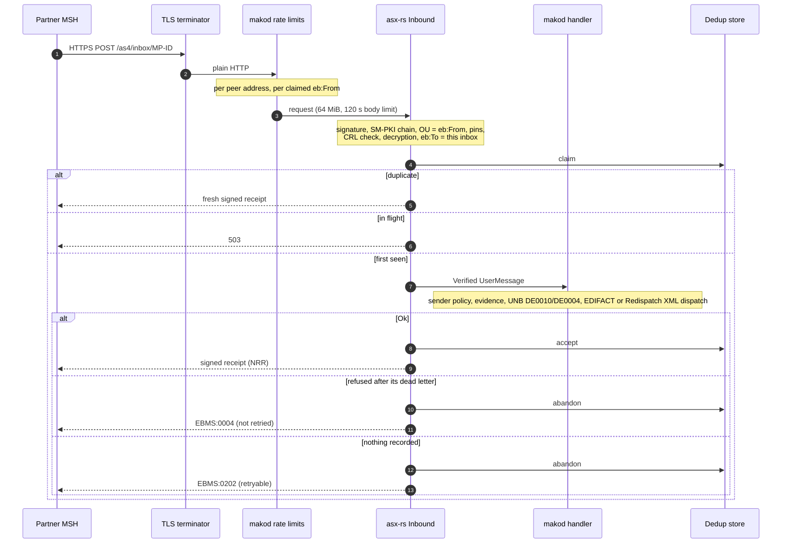
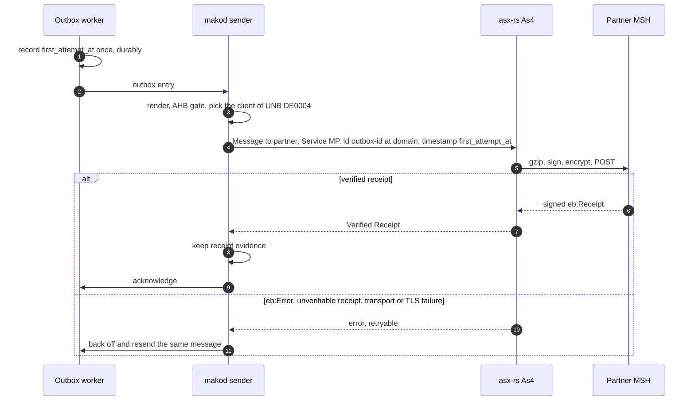

+++
title = "BDEW AS4 Guide"
description = "Configure makod for BDEW AS4-Profil 1.2 on asx-rs 0.19: one identity per MP-ID, the SM-PKI trust anchor, partners, the sender policy, and testing."
weight = 17
+++
AS4 has been the mandatory BDEW MaKo transport since **1 April 2024** (Strom, BK6-22-024)
and **1 April 2025** (Gas, BK7-22-023). This guide covers operating `makod` on it.

`makod` speaks AS4 through [`asx-rs`](https://crates.io/crates/asx-rs) 0.19 and its
`Profile::bdew()` preset, which fixes every security and wire setting of BDEW
AS4-Profil 1.2. Nothing in a `makod` configuration can relax it; what an operator
configures is who the parties are and which PKI they belong to.

---

## What the profile fixes

| Aspect | Value | BDEW AS4-Profil 1.2 |
|---|---|---|
| Signing | ECDSA-SHA256 on BrainpoolP256r1, `BinarySecurityToken` `X509PKIPathv1` | Kap. 2.2.6.2.1, Kap. 2.3.4.3 |
| Signature scope | `eb:Messaging` (`wsu:Id="as4-messaging"`), the Body and every attachment | Kap. 2.2.6.2.1 |
| Encryption | ECDH-ES + ConcatKDF + AES-128-GCM, key reference `X509SKI` — **mandatory** | Kap. 2.2.6.2.2, Kap. 2.3.4.3 |
| Order | gzip, then sign, then encrypt | Kap. 2.2.6.2.2 |
| Payload | SOAP-with-Attachments, empty SOAP Body, `application/octet-stream` part | Kap. 2.2.3.2 |
| Compression | gzip, always | Kap. 2.2.3.3 |
| Service | one of `https://www.bdew.de/as4/communication/services/{MP,FP,RD,KW,SO}` | Kap. 2.3.1.2.1 |
| Action | `http://docs.oasis-open.org/ebxml-msg/as4/200902/action` (fixed) | Kap. 2.3.1.2.2 |
| Roles | `…/200704/initiator` / `…/200704/responder` (fixed) | Kap. 2.3.1.2.3 |
| `ConversationId` | empty | Kap. 2.3.1.2.4 |
| `AgreementRef` | `https://www.bdew.de/as4/communication/agreement`, no `pmode`/`type` | Kap. 2.3.2 |
| Sender | a signer whose SM-PKI certificate carries the `eb:From` MP-ID in its OU and exactly one URI subject alternative name, else `EBMS:0101` | Kap. 2.3.2, Kap. 2.3.4.4; Regelungen zum Übertragungsweg für AS4 2.6 Kap. 5.2 |
| Transport | mutual TLS under BSI TR-03116-3 (TLS 1.2, TLS 1.3 from OpenSSL 3.2; ECDHE-ECDSA, Brainpool groups first), the SM-PKI root as the only TLS root, the server chain CRL-checked before a request is written, SNI for every host name | Kap. 2.2.6.1; Regelungen zum Übertragungsweg für AS4 2.6 Kap. 3 |
| Revocation | CRL at every certificate's distribution point; a CA without a current CRL for 3 days is distrusted | Regelungen zum Übertragungsweg für AS4 2.6 Kap. 5.4 |
| Test service | receipted, never delivered | Kap. 2.3.6 |
| Path switch | `requestSwitch` / `confirmSwitch` accepted | Kap. 2.3.7 |

ConcatKDF uses the SP 800-56A raw-concatenation form, which is what BSI
TR-03116-3 §9.2 requires. On receive, the `eb:Messaging` block the parser
consumes is the block the signature verified, which closes XML Signature
Wrapping.

---

## One identity per MP-ID

BDEW AS4-Profil 1.2 Kap. 2.3.4.4 (S. 17): „Für die Signatur, die Verschlüsselung und
den Aufbau der TLS-Verbindung MÜSSEN unterschiedliche Schlüsselpaare verwendet
werden. Die Schlüsselpaare MÜSSEN EC-basiert sein. … Die MP-ID MUSS Teil des
Zertifikatsgegenstandsnamens sein und mit der PartyId übereinstimmen". Regelungen
zum Übertragungsweg für AS4 2.6 Kap. 5.2 (S. 6) places it: „Das Feld
Organisational Unit („OU") des Subject muss die MP-ID enthalten", and allows one
web-service address per certificate.

A receiving MSH therefore checks the signing certificate's OU against `eb:From`,
and `makod` holds **one AS4 client per `[[party]]`**, each with its own three key
pairs. A combined Strom+Gas operator holds two:

```toml
[deployment]
rollen = ["lf-strom", "msb-strom", "lf-gas", "msb-gas"]

# Strom identity: BDEW-Codenummer (99…)
[[party]]
mp_id   = "9900357000004"
primary = true
roles   = ["LF", "MSB"]

[party.as4]
signing_cert_pem_file    = "/etc/makod/9900357000004/signing.cert.pem"   # EMT.MAK leaf, then intermediates
signing_key_pem_file     = "/etc/makod/9900357000004/signing.key.pem"
encryption_cert_pem_file = "/etc/makod/9900357000004/encryption.cert.pem"
encryption_key_pem_file  = "/etc/makod/9900357000004/encryption.key.pem"
tls_cert_pem_file        = "/etc/makod/9900357000004/tls.cert.pem"
tls_key_pem_file         = "/etc/makod/9900357000004/tls.key.pem"

# Gas identity: DVGW-Codenummer (98…)
[[party]]
mp_id = "9800357000005"
roles = ["LFG", "GMSB"]

[party.as4]
signing_cert_pem_file    = "/etc/makod/9800357000005/signing.cert.pem"
signing_key_pem_file     = "/etc/makod/9800357000005/signing.key.pem"
encryption_cert_pem_file = "/etc/makod/9800357000005/encryption.cert.pem"
encryption_key_pem_file  = "/etc/makod/9800357000005/encryption.key.pem"
tls_cert_pem_file        = "/etc/makod/9800357000005/tls.cert.pem"
tls_key_pem_file         = "/etc/makod/9800357000005/tls.key.pem"

[as4]
addr                  = "0.0.0.0:4080"
message_id_domain     = "as4.company.example"
trust_anchor_pem_file = "/etc/makod/sm-pki-root.pem"
crl_signer_pem_file   = "/etc/makod/sm-pki-ccrl-s-root.pem"
```

Each MP-ID is served at its own path, so each certificate's SAN names one
address:

```
Company X
  MP-ID Strom  9900357000004 ─► https://as4.company.example/as4/inbox/9900357000004
  MP-ID Gas    9800357000005 ─► https://as4.company.example/as4/inbox/9800357000005
```

An inbox answers only for its own `eb:To`. Outbound, the client of the
interchange's sender (UNB DE0004, the same MP-ID as `NAD+MS`) signs — so the
certificate a partner checks is the one issued to the MP-ID it reads in
`eb:From`.

### Mutual TLS

Every party loads its TLS key pair, a party that only receives included:
`tls_cert_pem_file` / `tls_key_pem_file` become the party's
`LocalParty::tls_identity`, an EC key, and `asx-rs`'s built-in client (OpenSSL)
presents it on every connection to a partner MSH. BDEW AS4-Profil 1.2
Kap. 2.2.6.1 (S. 10) states „Client-Authentifizierung ist ERFORDERLICH.", and the
TLS certificate is the third of the Zertifikatstripel (Regelungen zum
Übertragungsweg für AS4 2.6 Kap. 1.3, S. 3), so a `[party.as4]` without the pair
stops the boot naming both. The client trusts the SM-PKI root alone, checks the
server chain against the CRLs before it writes a request, and names the
partner's host by Server Name Indication, which Kap. 3 (S. 5) requires — so a
partner address is a DNS name, never an IP address. A TLS refusal — an unknown
CA, a host the certificate does not name, a revoked server certificate — is a
transport error with nothing written: the outbox retries the same message.

`asx-rs` owns no listener. Inbound, `--as4-addr` binds a plain HTTP listener, and
the server side of mutual TLS belongs to the terminator in front of it. BDEW
AS4-Profil 1.2 Kap. 2.2.6.1 binds that component as it binds the MSH: „Wenn die
TLS-Verbindung nicht im AS4 Message-Handler, sondern in einer anderen Komponente
beendet wird, dann MUSS diese andere Komponente die Anforderungen erfüllen." So
the terminator

- speaks TLS 1.2 or 1.3 with the cipher suites BSI TR-03116-3 recommends,
  Brainpool groups included, and serves the SM-PKI TLS certificate whose URI
  subject alternative name is the inbox's address;
- answers by SNI for each inbox host;
- requires a client certificate and verifies it against the SM-PKI root (and
  its CRLs) — a connection without one is refused before it reaches makod.

The repository ships no AS4 terminator configuration (`desk/deploy/` serves the
Desk, not the AS4 port); whichever proxy an operator puts in front of
`--as4-addr` carries these settings. It must pass the request through
unaltered: `asx-rs` refuses a request with a repeated `Content-Type` header, and a
MIME part with a repeated `Content-ID` or `Content-Type`, as malformed, so a
proxy that adds its own `Content-Type` beside the sender's makes every message
fail. makod's own AS4 route adds no header to the request.

### Trust: the SM-PKI root and the CRL signer

`as4.trust_anchor_pem_file` is the SM-PKI root and the only trust anchor —
every partner signer and every local signer must chain to it; the operator's own
certificate is never an anchor. `as4.crl_signer_pem_file` is the SM-PKI
CCRL-S(Root), which signs the indirect CRL of the Root-CA (BSI TR-03109-4
§4.2.1); `asx-rs` checks that it chains to the root and asserts `cRLSign`.
Outbound HTTP must reach the SM-PKI CRL distribution points (plain `http` is
allowed for CRLs).

### Startup checks

`makod` runs `As4::builder(Profile::bdew())…build()` for every `[[party]]` in its
preflight, so `--check` reports what the boot would refuse:

| Refused | Why |
|---|---|
| A `[[party]]` without `[party.as4]` beside one with it, or `--as4-addr` with none | Each MP-ID needs its own key pairs |
| No `trust_anchor_pem_file`, `crl_signer_pem_file` or `message_id_domain` | No verification, no revocation check, no message id |
| A signer that does not chain to the root, an expired certificate, a missing decrypter, a TLS key that is not EC | The `asx-rs` `Config` refusal names the setting and the section |
| A `[party.as4]` without `tls_cert_pem_file` / `tls_key_pem_file` | BDEW AS4-Profil 1.2 Kap. 2.2.6.1 (S. 10); Regelungen zum Übertragungsweg für AS4 2.6 Kap. 1.3 (S. 3) |
| A `[party.as4]` signing, encryption or TLS certificate, or a partner signing or encryption certificate, whose subject OU is not that party's MP-ID, or that names no URI subject alternative name or several | Regelungen zum Übertragungsweg für AS4 2.6 Kap. 5.2 (S. 6) |
| Two of a party's three certificates certifying one key pair, or a partner whose signing certificate certifies its encryption key | Kap. 2.3.4.4 — compared by key value, so a re-issued certificate over the same key is the same key pair |
| A partner endpoint on `http://` or without an encryption certificate | Kap. 2.2.6.2.2 |
| A partner endpoint other than its encryption certificate's address | Kap. 2 (S. 4) |
| A partner address on an IP address | SNI carries a host name (Kap. 3, S. 5) |
| `as4.zertifikat_warnfenster_tage` below 14 | Ten Werktage are never fewer than 14 days; a shorter window reports an own certificate after its successor was due (Kap. 5.3, S. 6) |
| A `[[as4.partner]]` naming one of the deployment's own MP-IDs | A self-addressed message is delivered in-process |
| `[[as4.partner]] quirks`, `as4.lenient_receipts` or `MAKOD_AS4_LENIENT_RECEIPTS` | No receipt relaxation exists — see [Receipts](#receipts) |

The `asx-rs` refusals name the rule by its short form, `RzÜ AS4 2.6 Kap. n`;
the finding in `GET /admin/einrichtung` and `--check-config` carries the full
source. Each `de0004_ausnahme` entry is a startup warning there.

---

## Partners

Every counterparty is one `[[as4.partner]]`:

```toml
[[as4.partner]]
mp_id                    = "9900000000001"
encryption_cert_pem_file = "/etc/makod/partners/9900000000001.enc.pem"
signing_cert_pem_files   = ["/etc/makod/partners/9900000000001.sig.pem"]

# The same NB in its Gas role is a second partner — its own MP-ID and
# certificates, its own address in them. `endpoint` is optional and, when
# set, must be the address the encryption certificate names.
[[as4.partner]]
mp_id                    = "9800000000002"
endpoint                 = "https://netzbetreiber-a.example/as4/inbox/9800000000002"
encryption_cert_pem_file = "/etc/makod/partners/9800000000002.enc.pem"
```

| Key | Meaning |
|---|---|
| `endpoint` | Optional. The partner's inbox is the URI subject alternative name of its encryption certificate (Regelungen zum Übertragungsweg für AS4 2.6 Kap. 2, S. 4); omitted, it is taken from there. Set, it must be that address — scheme and host case and the default port do not count — over `https` on a host name |
| `encryption_cert_pem_file` | What `makod` encrypts **to**, its OU the partner's MP-ID; with it the partner is deliverable. Omit it for a partner `makod` only receives from |
| `signing_cert_pem_files` | Pins: the partner's messages must be signed by one of these (list both for a rollover, Regelungen zum Übertragungsweg für AS4 2.6 Kap. 5.3). Without pins the SM-PKI chain and the OU decide |
| `agency` | NAD DE3055 agency of the MP-ID; derived from its prefix when omitted |
| `de0004_ausnahme` | MP-IDs this partner may name in `UNB` DE0004; see [The interchange envelope](#the-interchange-envelope) |

The party type in `eb:PartyId/@type` follows the agency — `…iso6523:0088` (GLN),
`…unregistered:BDEW`, `…unregistered:DVGW`, `…unregistered:BAHN` (Kap. 2.3.1.1) — the
same agency the EDIFACT layer writes into `NAD` DE3055, so the two vocabularies
cannot disagree for one MP-ID. A message for an MP-ID that is not a partner with
an encryption certificate is dead-lettered as `PartnerUnknown`.

Configured `endpoint`s are seeded into the durable partner store, alongside the PARTIN
Kommunikationsdaten (PIDs 37000–37006 Strom, 37008–37014 Gas).

### Who may send

`asx-rs` accepts a sender only when its signature verifies under the SM-PKI root
and its certificate's OU carries the claimed MP-ID (and, for a partner with pins,
the signer is one of them). `[policy.as4] unbekannte_absender` decides about a
sender that is **not** a `[[as4.partner]]`:

| Value | Behaviour | Source |
|---|---|---|
| `nur_konfigurierte` (default) | Refused before dispatch, answered `EBMS:0202` (retryable — once configured, the sender's next retry is served) | BDEW AS4-Profil 1.2 Kap. 2.3.7 (S. 19): certificates „KÖNNEN … auf der Grundlage der MP-ID im OU-Feld abgelehnt werden (Whitelist)" |
| `bdew_ou_zulassen` | Served | BDEW AS4-Profil 1.2 Kap. 2.3.2 (S. 16): any `eb:From` is accepted „sofern sie mit den entsprechenden Betreff-Feldern im vorgelegten Zertifikat übereinstimmen" |

### The interchange envelope

Inside a verified message, the EDIFACT `UNB` is bound to the AS4 layer before
anything is dispatched. Each refusal is dead-lettered, then answered `EBMS:0004`:

| Check | Refused when | Source |
|---|---|---|
| Recipient | DE0010 is none of this deployment's MP-IDs (a combined-role instance passes under each of them) | Allgemeine Festlegungen 6.1d Kap. 2.13 (S. 17) |
| Sender | DE0004 is not the authenticated `eb:From` | Kap. 2.13 (S. 17): „Die im UNB- und NAD-Segment für den Absender / Empfänger verwendeten MP-ID sind identisch."; BDEW AS4-Profil 1.2 Kap. 2.3.4.4 (S. 17): the MP-ID in the certificate matches the PartyId |

A payload whose `UNB` does not parse reaches neither check; it is dead-lettered
as unparseable and refused the same way.

A Dienstleister that authenticates as itself and sends for another market
participant is admitted only by name, per partner, and every entry is a
startup warning (`as4.partner[i].de0004_ausnahme`):

```toml
[[as4.partner]]
mp_id           = "9900000000001"
de0004_ausnahme = ["9900000000002"]
```

### Receipts

Every synchronous receipt is verified: signed by the partner, referring to the
sent message id, and echoing the signed digests as NonRepudiationInformation. A
receipt without NonRepudiationInformation is no delivery, for every partner:
Regelungen zum Übertragungsweg für AS4 2.6 Kap. 7.3 (S. 8): „Ohne eine NRR gilt
die Übertragung als gescheitert." No setting relaxes it; a `[[as4.partner]]
quirks` key or `as4.lenient_receipts` stops the boot, naming that rule.

---

## Message flow

### Inbound



An unsigned message is answered `EBMS:0103`, a signature that does not verify
`EBMS:0101`, a decryption failure `EBMS:0102`. Accepted dedup keys are kept for
8 days: `asx-rs` 0.19 accepts an `eb:Timestamp` up to 7 days old and requires
the store to remember accepted keys at least that long.

One limit, `mako_as4::constants::MAX_MESSAGE_BYTES` (64 MiB), bounds both the
request an inbox reads and what its payloads decompress to: gzip expanding the
whole message beyond it is refused with `EBMS:0303` before the handler sees
anything. A message carries exactly one payload part — Regelungen zum
Übertragungsweg für AS4 2.6 Kap. 7.2 (S. 8): „Es wird genau eine
Übertragungsdatei übermittelt." — and its `eb:PartProperties` are recorded on
the receive log line. They are not checked: BDEW AS4-Profil 1.2 Kap. 2.3.5
(S. 18) says a receiving party „KANN die durch diese Eigenschaften gegebenen
Informationen nutzen" and gives it no duty.

A refused message is dead-lettered **before** its claim is released, with the
write awaited, and the refusal is permanent (`EBMS:0004`); `check-as4-controls`
keeps every permanent refusal behind its dead letter. When the dead letter
itself cannot be written, the refusal is the retryable `EBMS:0202`, so the
message comes round again.

### Outbound



Every attempt of one outbox entry is the same AS4 message: the `eb:MessageId` is
`<outbox id>@<message_id_domain>` (RFC 2822 §3.6.4) and the `eb:Timestamp` is the
first attempt, which the worker records durably before the first send. gzip and
the Content-IDs are deterministic, so a retry reproduces every digest the
partner's NRR covers, and a receiver already holding the message answers it as a
duplicate. The retry window is 72 hours (`mako_as4::constants::MAX_RETRY_DURATION_SECS`);
a configuration refusal is permanent.

The payload part is named after Allgemeine Festlegungen V6.1d Kap. 2.12
(`Nachrichtentyp_Anwendungsreferenz_von_an_yyyymmdd_DAR.txt`, the
Anwendungsreferenz from `UNB` DE0026) and carries the `eb:PartProperties` of
Regelungen zum Übertragungsweg für AS4 2.6 Kap. 6 (S. 7), read from the
interchange's envelope by `mako_as4::PartProperties`:

| Property | Value |
|---|---|
| `BDEWDocumentType` | `UNH` DE0065, e.g. `UTILMD` |
| `BDEWApplicationReference` | `UNB` DE0026, only when the interchange carries one |
| `BDEWDocumentDate` | the interchange's creation date, `UNB` DE0017, as `YYYY-MM-DD` |
| `BDEWDocumentNo` | `UNB` DE0020, the Datenaustauschreferenz |

`BDEWFulfillmentDate`, `BDEWSubjectPartyID` and `BDEWSubjectPartyRole` are not
used (Kap. 6), and one AS4 message carries one Übertragungsdatei (Kap. 7.2). The send runs in
a span parented on the outbox entry's trace context; no `traceparent` header goes
to the partner.

---

## Testing with a test SM-PKI

The tests use `asx::testkit` (the `test-util` feature of `asx-rs`, a
dev-dependency only): `TestCa::sm_pki()` plays the SM-PKI root and
`bdew_party_at(mp_id, url)` issues separate BrainpoolP256r1 signing, encryption
and TLS key pairs with the MP-ID as OU and `url` as the one URI subject
alternative name (`bdew_party(mp_id)` issues at
`https://mp<mp_id>.testkit.example/as4`); `Loopback` carries requests between
two real clients with no socket and serves each test CA's CRL; `tls::TlsMsh` is
a real MSH on 127.0.0.1 that requires a client certificate, reached by
`Builder::resolve(host, msh.addr())`, with `pki::CRL_HOST` pinned to
`msh.crl_addr()`.

```toml
[dev-dependencies]
asx-rs = { version = "0.19", features = ["test-util"] }
```

```rust
#[tokio::test]
async fn a_push_is_receipted() {
    let ca = asx::testkit::pki::TestCa::sm_pki();
    let url = "https://lf.test/as4/inbox/9900357000005";
    let nb = ca.bdew_party("9900357000004");
    let lf = ca.bdew_party_at("9900357000005", url);
    let loopback = asx::testkit::loopback::Loopback::new();

    let lf_client = asx::as4::As4::builder(asx::Profile::bdew())
        .local(lf.local())
        .trust_anchor(ca.anchor())
        .http_client(loopback.clone())
        .build()
        .unwrap();
    loopback.mount(
        url,
        lf_client.inbound(
            asx::MemoryDedup::default(),
            |_msg: asx::Verified<asx::as4::UserMessage>| async { Ok(()) },
        ),
    );

    let nb_client = asx::as4::As4::builder(asx::Profile::bdew())
        .local(nb.local())
        .trust_anchor(ca.anchor())
        .partner(lf.partner(url))
        .http_client(loopback.clone())
        .build()
        .unwrap();
    let message = asx::as4::Message::to(&lf.partner(url))
        .service(mako_as4::Service::Marktprozesse.uri())
        .payload(asx::Payload::new(b"UNB+...".to_vec(), "application/octet-stream"));
    nb_client.send(message).await.unwrap();
}
```

`services/makod/tests/it/as4_security.rs` drives makod's own clients, sender and
inbox this way.

### Certificate expiry and rotation

makod re-reads every `[party.as4]` and `[[as4.partner]]` certificate while it
runs. `GET /admin/einrichtung` reports one that expires inside
`as4.zertifikat_warnfenster_tage` (default 30, at least 14) and an expired one
as blocking, and `/metrics` exports `makod_certificate_expiry_days{pfad}`. The
successor is due at least 10 Werktage before a certificate becomes invalid
(Regelungen zum Übertragungsweg für AS4 2.6 Kap. 5.3, S. 6).

Requesting a certificate from the Sub-CA, renewing it, installing it and keeping
its private key are the operator's, in its own key store: makod reads the key
material from the configured files, reports its expiry and picks up a replaced
file. It holds no HSM integration and talks to no CA.

Replace the files in place to rotate. Every five minutes makod rebuilds the AS4
clients and inboxes from changed key material, with no restart:

| Key pair | From the swap |
|---|---|
| Signing | The new key signs at once; its certificate travels in every message (Kap. 5.3) |
| Encryption | The new key decrypts, and the replaced one keeps decrypting until its certificate expires, because partners may encrypt to either inside the overlap |
| TLS | The new identity opens the next connection |
| Partner pins | Several `signing_cert_pem_files` admit a partner's rollover |

Material that does not build is logged and the running clients stay.

### What Regelungen zum Übertragungsweg für AS4 2.6 binds

| Rule | Kap., S. | In makod |
|---|---|---|
| Signing, encryption and TLS certificate form one Zertifikatstripel | 1.3, S. 3 | Three key pairs per `[party.as4]`, distinct by key value (`asx-rs` `build()`); no party without its TLS pair |
| The AS4 address is taken from the certificate's URI alternative name | 2, S. 4 | Omitted, `endpoint` is taken from it; set, it must equal it |
| Exchange and enter communication data within 3 Werktage, keep a path 3 years, announce a change 10 Werktage ahead | 2, S. 4 | The operator's |
| A partner's expired or revoked certificate is replaced from the CA | 2.2, S. 5 | The monitor reports partner certificates too; the replacement is the operator's |
| TLS uses SNI | 3, S. 5 | `asx-rs` sends the host name; a partner address on an IP address is refused |
| One path with one endpoint between two MP-IDs | 4, S. 5 | One `[[as4.partner]]` per MP-ID, one inbox per `[[party]]` |
| Messages under any valid published certificate of an MP-ID are processed | 4, S. 5 | Several `signing_cert_pem_files`; retired decryption keys |
| A failed delivery is repeated within the process Fristen | 4, S. 5 | The outbox retries the same message for 72 hours |
| SM-PKI, Sub-CA per its CP | 5, 5.1, S. 6 | `trust_anchor_pem_file` is the SM-PKI root, the only anchor |
| OU carries the MP-ID; one URI alternative name | 5.2, S. 6 | Refused at startup by `build()` for own and partner certificates; an inbound signer without one URI is `EBMS:0101` |
| Successor 10 Werktage before expiry; both generations processed in the overlap | 5.3, S. 6 | Warning window ≥ 14 days; restart-free rotation keeps the replaced decryption key |
| CRL revocation; a CA without a CRL for 3 days is distrusted | 5.4, S. 7 | `Profile::bdew()`; `crl_signer_pem_file` |
| `PartProperties` `BDEWDocumentType`, `BDEWApplicationReference`, `BDEWDocumentDate`, `BDEWDocumentNo`; three not used | 6, S. 7 | Set on every outbound payload from the EDIFACT envelope; recorded inbound |
| Test service before the first exchange | 7.1, S. 7 | Received and receipted by `asx-rs`; sending one is the operator's |
| Service MP and the fixed Action; no pre-compressed file; one file per message | 7.2, S. 8 | `BdewAction::service`; gzip by `asx-rs` only; one payload |
| Success only on a synchronous NRR | 7.3, S. 8 | The outbox acknowledges a receipt with verified NonRepudiationInformation only; no setting relaxes it |
| Processing stops for a revoked or invalid certificate | 8, S. 8 | `asx-rs` chain, validity and CRL check |
| `EBMS:0101`, `EBMS:0102`, `EBMS:0103` | 9, S. 10 | `asx-rs` answers each |

### Certificate requests with OpenSSL

Production certificates are EMT.MAK certificates of an SM-PKI CA. The requests
carry the MP-ID as the subject OU (Regelungen zum Übertragungsweg für AS4 2.6
Kap. 5.2).

Each also names the inbox address as its one URI subject alternative name
(Kap. 5.2); the TLS certificate names the host as a DNS name besides:

```bash
url=https://as4.company.example/as4/inbox/9900357000004
for use in signing encryption tls; do
  san="URI:$url"
  [ "$use" = tls ] && san="$san,DNS:as4.company.example"
  openssl ecparam -name brainpoolP256r1 -genkey -noout -out "$use.key.pem"
  openssl req -new -key "$use.key.pem" -out "$use.csr.pem" \
    -subj "/CN=Test NB $use/OU=9900357000004/O=Test NB/C=DE" \
    -addext "subjectAltName=$san"
done

# Check the curve and the OU
openssl ec -in signing.key.pem -text -noout | grep "ASN1 OID"
openssl req -in signing.csr.pem -noout -subject
```

---

## Supported EDIFACT message types (`BdewAction`)

`mako_as4::BdewAction` names the 16 standard BDEW EDIFACT message types; any other
is `BdewAction::Custom` with its UNH DE0065 name. Under BDEW AS4-Profil 1.2 the
type travels in the payload and its file name — the AS4 Action is the profile's
fixed value — and every type is sent under the Marktprozesse service
(`BdewAction::service`, Kap. 2.3.1.2.1).

| Variant | EDIFACT type | Used in |
|---|---|---|
| `Utilmd` | UTILMD | GPKE, WiM, GeLi Gas, WiM Gas |
| `Aperak` | APERAK | All processes |
| `Contrl` | CONTRL | All processes |
| `Mscons` | MSCONS | Meter readings / time series |
| `Invoic` | INVOIC | GPKE NNE, WiM MSB, GeLi Gas AWH, MABIS |
| `Remadv` | REMADV | GPKE, MABIS billing |
| `Iftsta` | IFTSTA | GPKE Sperrung / Entsperrung |
| `Ordrsp` | ORDRSP | GPKE Konfiguration, WiM Geräteübernahme |
| `Orders` | ORDERS | WiM Geräteübernahme, GPKE Sperrung |
| `Ordchg` | ORDCHG | WiM Stornierung, GeLi Gas AWH Stornierung |
| `Reqote` | REQOTE | WiM Preisanfrage MSB |
| `Insrpt` | INSRPT | WiM Ablesesteuerung / Gerätebefund |
| `Pricat` | PRICAT | WiM Preisliste MSB |
| `Quotes` | QUOTES | WiM Preisanfrage MSB response |
| `Partin` | PARTIN | GPKE Kommunikationsdaten (PIDs 37000–37006), GeLi Gas (PIDs 37008–37014) |
| `Utilts` | UTILTS | Berechnungsformel, Zählzeit- und Schaltzeitdefinitionen |

```rust
use mako_as4::{BdewAction, Service, bdew_action_from_str};

assert_eq!(BdewAction::Partin.to_string(), "PARTIN");
assert_eq!(bdew_action_from_str("UTILTS"), BdewAction::Utilts);
assert!(matches!(bdew_action_from_str("SLSFCT"), BdewAction::Custom(_)));
assert_eq!(BdewAction::Mscons.service(), Service::Marktprozesse);
```

---

## BDEW Verzeichnisdienst — API-Webdienste endpoint discovery

The BDEW Verzeichnisdienst (Regelungen zum Verzeichnisdienst 1.1) is a registry for **API-Webdienste Strom endpoints** (SM-PKI certificate class EMT.API).
It is **not** used for AS4 EDIFACT delivery — AS4 inbox endpoints are configured per
`[[as4.partner]]` and exchanged via PARTIN Kommunikationsdaten (PIDs 37000–37006
Strom, 37008–37014 Gas).

`makod` uses the Verzeichnisdienst exclusively to discover **MaLo-Identifikation callback
URLs** (API-Kennung `maloIdV1`, stored as `CommunicationChannel { qualifier: "AW" }` in the
partner store):

```bash
--verzeichnisdienst-url https://<verzeichnisdienst-host>/api/directory/v1
```

At startup and every 5 minutes, `makod` queries
`GET <base-url>/record/<lf_mp_id>/maloIdV1/1/v1` for each known LF and refuses a
record whose signature does not verify against the provider's EMT.API
certificate in `[maloid] verzeichnisdienst_signing_certs`, which must chain to
`verzeichnisdienst_trust_anchor_pem_file`.
Static `--maloid-partner GLN=URL` entries always take priority.

---

## Troubleshooting

| Symptom | Likely cause | Fix |
|---|---|---|
| Startup refuses an identity "does not build" | The `asx-rs` message names the setting | A signer outside `trust_anchor_pem_file`, a certificate without the MP-ID in its OU or without exactly one URI subject alternative name, a partner `endpoint` other than its certificate's address, an expired certificate |
| Sends fail with a transport error naming TLS | The handshake was refused before anything was written | The partner's server certificate does not chain to the SM-PKI root, does not name the host, or is revoked; the outbox retries for 72 hours |
| Every inbound message refused as malformed behind a proxy | A repeated `Content-Type` | The terminator in front of `--as4-addr` must pass the request through unaltered |
| Counterparty rejects our signature | Its OU check fails | The signing certificate of the MP-ID in UNB DE0004 must carry that MP-ID as OU |
| Counterparty cannot decrypt | Wrong encryption certificate on our side | `[[as4.partner]] encryption_cert_pem_file` is the partner's **encryption** certificate |
| Every inbound message `EBMS:0101` | Trust or revocation | `trust_anchor_pem_file` is the SM-PKI root, `crl_signer_pem_file` the CCRL-S(Root), the CDPs are reachable (WARN events `ca.fingerprint`) |
| Inbound `EBMS:0202` "not a configured partner" | `unbekannte_absender = nur_konfigurierte` | Add the `[[as4.partner]]`, or choose `bdew_ou_zulassen` |
| Inbound `EBMS:0004` | The message was refused and dead-lettered | The dead letter names the reason (`makod_dead_letter_recorded_total`) |
| `PartnerUnknown` dead letters | The recipient is no `[[as4.partner]]` with an encryption certificate | Add it; a Gas MP-ID is its own partner |
| AS4 dedup does not survive a restart | No `--data-dir` | makod refuses to start without one unless `--allow-volatile` is given |

---

## Test coverage

`services/makod/tests/it/as4_security.rs`:

| Test | Verifies |
|---|---|
| `slatedb_dedup_conforms` | `asx::testkit::dedup::conformance` over `SlateDbDedup` — atomic claim, token-fenced settlement |
| `an_outbound_message_is_delivered_with_its_receipt_evidence` | Service MP, `<outbox id>@<domain>`, Kap. 2.12 file name, receipt evidence kept |
| `a_retry_resends_the_first_attempts_message_id_and_timestamp` | Same `eb:MessageId`, `eb:Timestamp` and digests on the retry |
| `a_partner_refusal_is_retried_and_a_receipt_failure_is_not_acknowledged` | An unverifiable receipt is no delivery |
| `an_interchange_from_a_configured_partner_is_routed` | Verified, dispatched, receipted; the retransmission is a duplicate |
| `a_refusal_is_dead_lettered_before_the_claim_is_released_for_good` | Dead letter before settlement, `EBMS:0004` not retried |
| `an_unrecorded_refusal_is_retryable` | A failed dead-letter write answers `EBMS:0202` and the retry is reprocessed |
| `an_accepted_interchange_settles_after_its_dead_letters` | Dead letters before `accept` |
| `an_unconfigured_sender_is_refused_under_nur_konfigurierte` | The default sender policy |
| `an_unconfigured_sender_is_served_under_bdew_ou_zulassen` | Kap. 2.3.2 |
| `a_tampered_request_is_refused_ebms_0101` | Signature integrity, no claim taken |
| `the_part_properties_travel_with_the_message` | Kap. 6 `eb:PartProperties` on the outbound payload |
| `an_expansion_beyond_the_message_limit_is_refused_ebms_0303` | gzip expands to at most `MAX_MESSAGE_BYTES` per message |
| `the_tls_identity_reaches_the_handshake` | A send to a TLS MSH requiring a client certificate presents the `[party.as4]` TLS certificate, SNI the endpoint's host |
| `a_tls_refusal_is_a_retryable_transport_error` | A server outside the SM-PKI root: `ErrorKind::Transport`, nothing written, the outbox retries |

Run with: `cargo test -p makod --test it -- as4_security`

The Regelungen zum Übertragungsweg für AS4 2.6 checks:

| Test | Verifies |
|---|---|
| `mako-as4` `identity::tests::a_certificate_of_another_mp_id_does_not_build` | Own certificates carry the MP-ID in their OU (Kap. 5.2) |
| `mako-as4` `identity::tests::a_certificate_without_a_uri_does_not_build` | Exactly one URI subject alternative name (Kap. 5.2) |
| `mako-as4` `partner_directory::tests::a_partner_without_an_endpoint_is_reached_at_its_certificates_address` | The address is taken from the certificate (Kap. 2) |
| `mako-as4` `partner_directory::tests::an_endpoint_other_than_the_certificates_address_does_not_build` | `endpoint` equals the certificate's address; no IP address (Kap. 2, 3) |
| `mako-as4` `partner_directory::tests::an_encryption_certificate_of_another_mp_id_does_not_build` | The partner encryption certificate's OU (Kap. 5.2) |
| `mako-as4` `part_properties::tests::*` | The Kap. 6 mapping from `UNB`/`UNH` |
| `makod` `core::preflight::tests::the_as4_2_6_certificate_and_endpoint_rules_stop_the_boot` | The refusals reach the boot |
| `makod` `core::preflight::tests::a_party_without_its_tls_key_pair_is_rejected` | No identity without its TLS pair (Kap. 1.3; AS4-Profil Kap. 2.2.6.1) |
| `makod` `core::preflight::tests::a_configured_quirks_key_is_refused` | No receipt relaxation (Kap. 7.3) |
| `makod` `core::einrichtung::tests::a_warning_window_shorter_than_ten_werktage_blocks` | Kap. 5.3 |

---

## Further reading

| Resource | Description |
|---|---|
| [BDEW AS4-Profil 1.2](https://www.edi-energy.de) | AS4 specification (01.04.2026) |
| [Regelungen zum Übertragungsweg für AS4 2.6](https://www.bundesnetzagentur.de) | Certificates, rollover, revocation (01.10.2026) |
| [BSI TR-03116-3](https://www.bsi.bund.de) | Cryptographic requirements |
| [RFC 5639](https://www.rfc-editor.org/rfc/rfc5639) | BrainpoolP256r1 |
| [makod operator guide](@/docs/services/makod.md) | Full makod configuration reference |
| [ERP integration guide](@/docs/architecture/erp-integration.md) | CloudEvents, Command API, HMAC |
