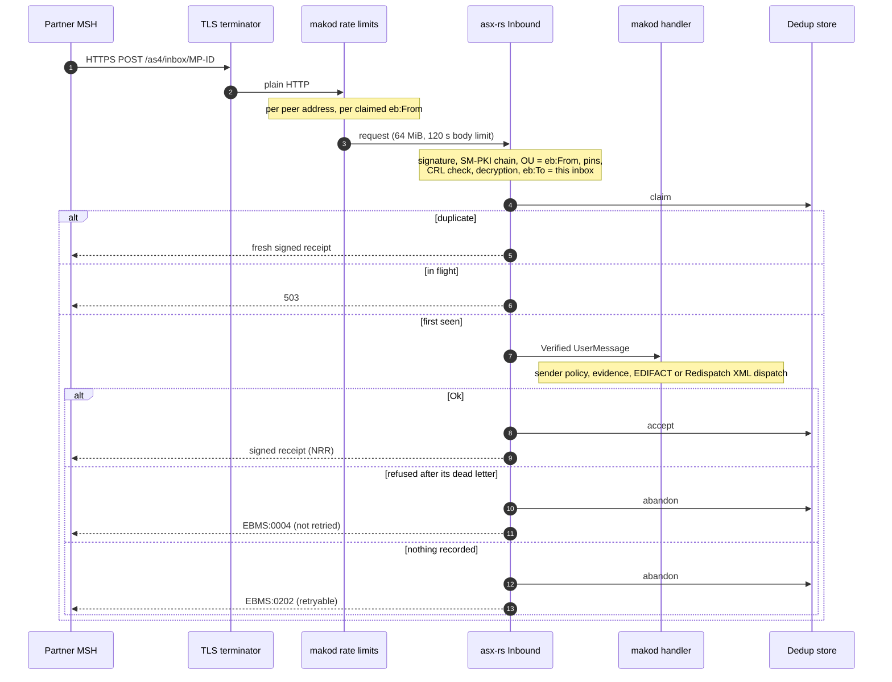
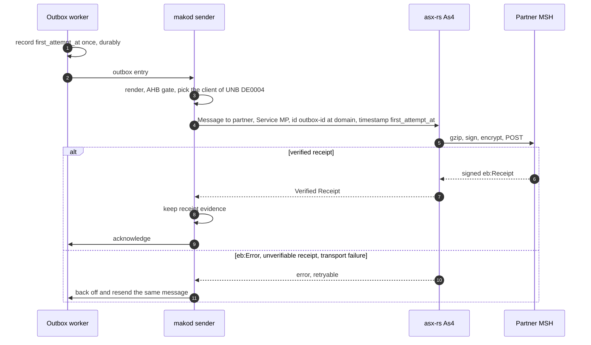

+++
title = "BDEW AS4 Guide"
description = "Configure makod for BDEW AS4-Profil 1.2 on asx-rs 0.16: one identity and client per MP-ID, the SM-PKI trust anchor and CRL signer, partners, the sender policy, and testing with a test SM-PKI."
weight = 17
+++
AS4 has been the mandatory BDEW MaKo transport since **1 April 2024** (Strom, BK6-22-024)
and **1 April 2025** (Gas, BK7-22-023). This guide covers operating `makod` on it.

`makod` speaks AS4 through [`asx-rs`](https://crates.io/crates/asx-rs) 0.16 and its
`Profile::bdew()` preset, which fixes every security and wire setting of BDEW
AS4-Profil 1.2. Nothing in a `makod` configuration can relax it; what an operator
configures is who the parties are and which PKI they belong to.

---

## What the profile fixes

| Aspect | Value | BDEW AS4-Profil 1.2 |
|---|---|---|
| Signing | ECDSA-SHA256 on BrainpoolP256r1, `BinarySecurityToken` `X509PKIPathv1` | §2.2.6.2.1, §2.3.4.3 |
| Signature scope | `eb:Messaging` (`wsu:Id="as4-messaging"`), the Body and every attachment | §2.2.6.2.1 |
| Encryption | ECDH-ES + ConcatKDF + AES-128-GCM, key reference `X509SKI` — **mandatory** | §2.2.6.2.2, §2.3.4.3 |
| Order | gzip, then sign, then encrypt | §2.2.6.2.2 |
| Payload | SOAP-with-Attachments, empty SOAP Body, `application/octet-stream` part | §2.2.3.2 |
| Compression | gzip, always | §2.2.3.3 |
| Service | one of `https://www.bdew.de/as4/communication/services/{MP,FP,RD,KW,SO}` | §2.3.1.2.1 |
| Action | `http://docs.oasis-open.org/ebxml-msg/as4/200902/action` (fixed) | §2.3.1.2.2 |
| Roles | `…/200704/initiator` / `…/200704/responder` (fixed) | §2.3.1.2.3 |
| `ConversationId` | empty | §2.3.1.2.4 |
| `AgreementRef` | `https://www.bdew.de/as4/communication/agreement`, no `pmode`/`type` | §2.3.2 |
| Sender | a signer whose SM-PKI certificate carries the `eb:From` MP-ID in its OU | §2.3.2, §2.3.4.4 |
| Revocation | CRL at every certificate's distribution point; a CA without a current CRL for 3 days is distrusted | Regelungen zum Übertragungsweg für AS4 2.6 Kap. 5.4 |
| Test service | receipted, never delivered | §2.3.6 |
| Path switch | `requestSwitch` / `confirmSwitch` accepted | §2.3.7 |

ConcatKDF uses the SP 800-56A raw-concatenation form, which is what BSI
TR-03116-3 §9.2 requires. On receive, the `eb:Messaging` block the parser
consumes is the block the signature verified, which closes XML Signature
Wrapping.

---

## One identity per MP-ID

BDEW AS4-Profil 1.2 §2.3.4.4 (S. 17): „Für die Signatur, die Verschlüsselung und
den Aufbau der TLS-Verbindung MÜSSEN unterschiedliche Schlüsselpaare verwendet
werden. Die Schlüsselpaare MÜSSEN EC-basiert sein. … Die MP-ID MUSS Teil des
Zertifikatsgegenstandsnamens sein und mit der PartyId übereinstimmen". Regelungen
zum Übertragungsweg für AS4 2.6 Kap. 5.2 (S. 6) places it: „Das Feld
Organisational Unit („OU") des Subject muss die MP-ID enthalten", and allows one
web-service address per certificate.

A receiving MSH therefore checks the signing certificate's OU against `eb:From`,
and `makod` holds **one AS4 client per `[[party]]`**, each with its own three key
pairs. A combined Strom+Gas operator holds two:

```toml
[deployment]
rollen = ["lf-strom", "msb-strom", "lf-gas", "msb-gas"]

# Strom identity: BDEW-Codenummer (99…)
[[party]]
mp_id   = "9900357000004"
primary = true
roles   = ["LF", "MSB"]

[party.as4]
signing_cert_pem_file    = "/etc/makod/9900357000004/signing.cert.pem"   # EMT.MAK leaf, then intermediates
signing_key_pem_file     = "/etc/makod/9900357000004/signing.key.pem"
encryption_cert_pem_file = "/etc/makod/9900357000004/encryption.cert.pem"
encryption_key_pem_file  = "/etc/makod/9900357000004/encryption.key.pem"
tls_cert_pem_file        = "/etc/makod/9900357000004/tls.cert.pem"
tls_key_pem_file         = "/etc/makod/9900357000004/tls.key.pem"

# Gas identity: DVGW-Codenummer (98…)
[[party]]
mp_id = "9800357000005"
roles = ["LFG", "GMSB"]

[party.as4]
signing_cert_pem_file    = "/etc/makod/9800357000005/signing.cert.pem"
signing_key_pem_file     = "/etc/makod/9800357000005/signing.key.pem"
encryption_cert_pem_file = "/etc/makod/9800357000005/encryption.cert.pem"
encryption_key_pem_file  = "/etc/makod/9800357000005/encryption.key.pem"
tls_cert_pem_file        = "/etc/makod/9800357000005/tls.cert.pem"
tls_key_pem_file         = "/etc/makod/9800357000005/tls.key.pem"

[as4]
addr                  = "0.0.0.0:4080"
message_id_domain     = "as4.company.example"
trust_anchor_pem_file = "/etc/makod/sm-pki-root.pem"
crl_signer_pem_file   = "/etc/makod/sm-pki-ccrl-s-root.pem"
```

Each MP-ID is served at its own path, so each certificate's SAN names one
address:

```
Company X
  MP-ID Strom  9900357000004 ─► https://as4.company.example/as4/inbox/9900357000004
  MP-ID Gas    9800357000005 ─► https://as4.company.example/as4/inbox/9800357000005
```

An inbox answers only for its own `eb:To`. Outbound, the client of the
interchange's sender (UNB DE0004, the same MP-ID as `NAD+MS`) signs — so the
certificate a partner checks is the one issued to the MP-ID it reads in
`eb:From`.

**The TLS key pair is outbound only.** `makod` presents it when it connects to a
partner MSH. Inbound, `--as4-addr` binds a plain HTTP listener: the server side
of mutual TLS belongs to whatever terminates TLS in front of it.

### Trust: the SM-PKI root and the CRL signer

`as4.trust_anchor_pem_file` is the SM-PKI root and the only trust anchor —
every partner signer and every local signer must chain to it; the operator's own
certificate is never an anchor. `as4.crl_signer_pem_file` is the SM-PKI
CCRL-S(Root), which signs the indirect CRL of the Root-CA (BSI TR-03109-4
§4.2.1); `asx-rs` checks that it chains to the root and asserts `cRLSign`.
Outbound HTTP must reach the SM-PKI CRL distribution points (plain `http` is
allowed for CRLs).

### Startup checks

`makod` runs `As4::builder(Profile::bdew())…build()` for every `[[party]]` in its
preflight, so `--check` reports what the boot would refuse:

| Refused | Why |
|---|---|
| A `[[party]]` without `[party.as4]` beside one with it, or `--as4-addr` with none | Each MP-ID needs its own key pairs |
| No `trust_anchor_pem_file`, `crl_signer_pem_file` or `message_id_domain` | No verification, no revocation check, no message id |
| A signer that does not chain to the root, a certificate without the MP-ID in its OU, an expired certificate, a missing decrypter | The `asx-rs` `Config` refusal names the setting and the section |
| Two of a party's three certificates certifying one key pair | §2.3.4.4 — compared by public key |
| A partner endpoint on `http://` or without an encryption certificate | §2.2.6.2.2 |
| A `[[as4.partner]]` naming one of the deployment's own MP-IDs | A self-addressed message is delivered in-process |
| An unknown `quirks` entry | Only `receipt-without-non-repudiation` exists |
| `as4.lenient_receipts` or `MAKOD_AS4_LENIENT_RECEIPTS` | No global receipt relaxation exists — see [Receipt quirks](#receipt-quirks) |

---

## Partners

Every counterparty is one `[[as4.partner]]`:

```toml
[[as4.partner]]
mp_id                    = "9900000000001"
endpoint                 = "https://netzbetreiber-a.example/as4/inbox"
encryption_cert_pem_file = "/etc/makod/partners/9900000000001.enc.pem"
signing_cert_pem_files   = ["/etc/makod/partners/9900000000001.sig.pem"]

# The same NB in its Gas role is a second partner — its own MP-ID and
# certificates, possibly the same URL.
[[as4.partner]]
mp_id                    = "9800000000002"
endpoint                 = "https://netzbetreiber-a.example/as4/inbox"
encryption_cert_pem_file = "/etc/makod/partners/9800000000002.enc.pem"
```

| Key | Meaning |
|---|---|
| `endpoint` | The partner's inbox. Omit it for a partner `makod` only receives from |
| `encryption_cert_pem_file` | What `makod` encrypts **to**; required with `endpoint` |
| `signing_cert_pem_files` | Pins: the partner's messages must be signed by one of these (list both for a rollover, Regelungen zum Übertragungsweg für AS4 2.6 Kap. 5.3). Without pins the SM-PKI chain and the OU decide |
| `agency` | NAD DE3055 agency of the MP-ID; derived from its prefix when omitted |
| `quirks` | See [Receipt quirks](#receipt-quirks) |

The party type in `eb:PartyId/@type` follows the agency — `…iso6523:0088` (GLN),
`…unregistered:BDEW`, `…unregistered:DVGW`, `…unregistered:BAHN` (§2.3.1.1) — the
same agency the EDIFACT layer writes into `NAD` DE3055, so the two vocabularies
cannot disagree for one MP-ID. A message for an MP-ID that is not a partner with
an endpoint is dead-lettered as `PartnerUnknown`.

Partner endpoints are seeded into the durable partner store, alongside the PARTIN
Kommunikationsdaten (PIDs 37000–37006 Strom, 37008–37014 Gas).

### Who may send

`asx-rs` accepts a sender only when its signature verifies under the SM-PKI root
and its certificate's OU carries the claimed MP-ID (and, for a partner with pins,
the signer is one of them). `[policy.as4] unbekannte_absender` decides about a
sender that is **not** a `[[as4.partner]]`:

| Value | Behaviour | Source |
|---|---|---|
| `nur_konfigurierte` (default) | Refused before dispatch, answered `EBMS:0202` (retryable — once configured, the sender's next retry is served) | BDEW AS4-Profil 1.2 §2.3.7 (S. 19): certificates „KÖNNEN … auf der Grundlage der MP-ID im OU-Feld abgelehnt werden (Whitelist)" |
| `bdew_ou_zulassen` | Served | BDEW AS4-Profil 1.2 §2.3.2 (S. 16): any `eb:From` is accepted „sofern sie mit den entsprechenden Betreff-Feldern im vorgelegten Zertifikat übereinstimmen" |

### Receipt quirks

Every synchronous receipt is verified: signed by the partner, referring to the
sent message id, and echoing the signed digests as NonRepudiationInformation. A
partner whose **signed** receipt carries no NonRepudiationInformation is declared
per partner:

```toml
[[as4.partner]]
mp_id  = "9900000000001"
quirks = ["receipt-without-non-repudiation"]
```

An unsigned or mis-signed receipt is never accepted.

---

## Message flow

### Inbound



An unsigned message is answered `EBMS:0103`, a signature that does not verify
`EBMS:0101`, a decryption failure `EBMS:0102`. Accepted dedup keys are kept for
8 days: `asx-rs` 0.16.2 accepts an `eb:Timestamp` up to 7 days old and requires
the store to remember accepted keys at least that long.

A refused message is dead-lettered **before** its claim is released, with the
write awaited, and the refusal is permanent (`EBMS:0004`); `check-as4-controls`
keeps every permanent refusal behind its dead letter. When the dead letter
itself cannot be written, the refusal is the retryable `EBMS:0202`, so the
message comes round again.

### Outbound



Every attempt of one outbox entry is the same AS4 message: the `eb:MessageId` is
`<outbox id>@<message_id_domain>` (RFC 2822 §3.6.4) and the `eb:Timestamp` is the
first attempt, which the worker records durably before the first send. gzip and
the Content-IDs are deterministic, so a retry reproduces every digest the
partner's NRR covers, and a receiver already holding the message answers it as a
duplicate. The retry window is 72 hours (`mako_as4::constants::MAX_RETRY_DURATION_SECS`);
a configuration refusal is permanent.

The payload part is named after Allgemeine Festlegungen V6.1d §2.12
(`Nachrichtentyp_Anwendungsreferenz_von_an_yyyymmdd_DAR.txt`). The send runs in
a span parented on the outbox entry's trace context; no `traceparent` header goes
to the partner.

---

## Testing with a test SM-PKI

The tests use `asx::testkit` (the `test-util` feature of `asx-rs`, a
dev-dependency only): `TestCa::sm_pki()` plays the SM-PKI root and
`bdew_party(mp_id)` issues separate BrainpoolP256r1 signing, encryption and TLS
key pairs with the MP-ID as OU; `Loopback` carries requests between two real
clients with no socket and serves each test CA's CRL.

```toml
[dev-dependencies]
asx-rs = { version = "0.16.2", features = ["test-util"] }
```

```rust
#[tokio::test]
async fn a_push_is_receipted() {
    let ca = asx::testkit::pki::TestCa::sm_pki();
    let nb = ca.bdew_party("9900357000004");
    let lf = ca.bdew_party("9900357000005");
    let loopback = asx::testkit::loopback::Loopback::new();
    let url = "https://lf.test/as4/inbox/9900357000005";

    let lf_client = asx::as4::As4::builder(asx::Profile::bdew())
        .local(lf.local())
        .trust_anchor(ca.anchor())
        .http_client(loopback.clone())
        .build()
        .unwrap();
    loopback.mount(
        url,
        lf_client.inbound(
            asx::MemoryDedup::default(),
            |_msg: asx::Verified<asx::as4::UserMessage>| async { Ok(()) },
        ),
    );

    let nb_client = asx::as4::As4::builder(asx::Profile::bdew())
        .local(nb.local())
        .trust_anchor(ca.anchor())
        .partner(lf.partner(url))
        .http_client(loopback.clone())
        .build()
        .unwrap();
    let message = asx::as4::Message::to(&lf.partner(url))
        .service(mako_as4::Service::Marktprozesse.uri())
        .payload(asx::Payload::new(b"UNB+...".to_vec(), "application/octet-stream"));
    nb_client.send(message).await.unwrap();
}
```

`services/makod/tests/it/as4_security.rs` drives makod's own clients, sender and
inbox this way.

### Certificate requests with OpenSSL

Production certificates are EMT.MAK certificates of an SM-PKI CA. The requests
carry the MP-ID as the subject OU (Regelungen zum Übertragungsweg für AS4 2.6
Kap. 5.2):

```bash
for use in signing encryption tls; do
  openssl ecparam -name brainpoolP256r1 -genkey -noout -out "$use.key.pem"
  openssl req -new -key "$use.key.pem" -out "$use.csr.pem" \
    -subj "/CN=Test NB $use/OU=9900357000004/O=Test NB/C=DE"
done

# Check the curve and the OU
openssl ec -in signing.key.pem -text -noout | grep "ASN1 OID"
openssl req -in signing.csr.pem -noout -subject
```

---

## Supported EDIFACT message types (`BdewAction`)

`mako_as4::BdewAction` names the 16 standard BDEW EDIFACT message types; any other
is `BdewAction::Custom` with its UNH DE0065 name. Under BDEW AS4-Profil 1.2 the
type travels in the payload and its file name — the AS4 Action is the profile's
fixed value — and every type is sent under the Marktprozesse service
(`BdewAction::service`, §2.3.1.2.1).

| Variant | EDIFACT type | Used in |
|---|---|---|
| `Utilmd` | UTILMD | GPKE, WiM, GeLi Gas, WiM Gas |
| `Aperak` | APERAK | All processes |
| `Contrl` | CONTRL | All processes |
| `Mscons` | MSCONS | Meter readings / time series |
| `Invoic` | INVOIC | GPKE NNE, WiM MSB, GeLi Gas AWH, MABIS |
| `Remadv` | REMADV | GPKE, MABIS billing |
| `Iftsta` | IFTSTA | GPKE Sperrung / Entsperrung |
| `Ordrsp` | ORDRSP | GPKE Konfiguration, WiM Geräteübernahme |
| `Orders` | ORDERS | WiM Geräteübernahme, GPKE Sperrung |
| `Ordchg` | ORDCHG | WiM Stornierung, GeLi Gas AWH Stornierung |
| `Reqote` | REQOTE | WiM Preisanfrage MSB |
| `Insrpt` | INSRPT | WiM Ablesesteuerung / Gerätebefund |
| `Pricat` | PRICAT | WiM Preisliste MSB |
| `Quotes` | QUOTES | WiM Preisanfrage MSB response |
| `Partin` | PARTIN | GPKE Kommunikationsdaten (PIDs 37000–37006), GeLi Gas (PIDs 37008–37014) |
| `Utilts` | UTILTS | Berechnungsformel, Zählzeit- und Schaltzeitdefinitionen |

```rust
use mako_as4::{BdewAction, Service, bdew_action_from_str};

assert_eq!(BdewAction::Partin.to_string(), "PARTIN");
assert_eq!(bdew_action_from_str("UTILTS"), BdewAction::Utilts);
assert!(matches!(bdew_action_from_str("SLSFCT"), BdewAction::Custom(_)));
assert_eq!(BdewAction::Mscons.service(), Service::Marktprozesse);
```

---

## BDEW Verzeichnisdienst — API-Webdienste endpoint discovery

The BDEW Verzeichnisdienst ("Regelungen zum Verzeichnisdienst" v1.0, applicable 03.04.2025)
is a registry for **API-Webdienste Strom endpoints** (SM-PKI certificate class EMT.API).
It is **not** used for AS4 EDIFACT delivery — AS4 inbox endpoints are configured per
`[[as4.partner]]` and exchanged via PARTIN Kommunikationsdaten (PIDs 37000–37006
Strom, 37008–37014 Gas).

`makod` uses the Verzeichnisdienst exclusively to discover **MaLo-Identifikation callback
URLs** (API-Kennung `maloIdV1`, stored as `CommunicationChannel { qualifier: "AW" }` in the
partner store):

```bash
--verzeichnisdienst-url https://<verzeichnisdienst-host>/api/directory/v1
```

At startup and every 5 minutes, `makod` queries
`GET <base-url>/record/<lf_mp_id>/maloIdV1/1/v1` for each known LF.
Static `--maloid-partner GLN=URL` entries always take priority.

---

## Troubleshooting

| Symptom | Likely cause | Fix |
|---|---|---|
| Startup refuses an identity "does not build" | The `asx-rs` message names the setting | A signer outside `trust_anchor_pem_file`, a certificate without the MP-ID in its OU, an expired certificate |
| Counterparty rejects our signature | Its OU check fails | The signing certificate of the MP-ID in UNB DE0004 must carry that MP-ID as OU |
| Counterparty cannot decrypt | Wrong encryption certificate on our side | `[[as4.partner]] encryption_cert_pem_file` is the partner's **encryption** certificate |
| Every inbound message `EBMS:0101` | Trust or revocation | `trust_anchor_pem_file` is the SM-PKI root, `crl_signer_pem_file` the CCRL-S(Root), the CDPs are reachable (WARN events `ca.fingerprint`) |
| Inbound `EBMS:0202` "not a configured partner" | `unbekannte_absender = nur_konfigurierte` | Add the `[[as4.partner]]`, or choose `bdew_ou_zulassen` |
| Inbound `EBMS:0004` | The message was refused and dead-lettered | The dead letter names the reason (`makod_dead_letter_recorded_total`) |
| `PartnerUnknown` dead letters | The recipient is no `[[as4.partner]]` with an endpoint | Add it; a Gas MP-ID is its own partner |
| AS4 dedup does not survive a restart | No `--data-dir` | makod refuses to start without one unless `--allow-volatile` is given |

---

## Test coverage

`services/makod/tests/it/as4_security.rs`:

| Test | Verifies |
|---|---|
| `slatedb_dedup_conforms` | `asx::testkit::dedup::conformance` over `SlateDbDedup` — atomic claim, token-fenced settlement |
| `an_outbound_message_is_delivered_with_its_receipt_evidence` | Service MP, `<outbox id>@<domain>`, §2.12 file name, receipt evidence kept |
| `a_retry_resends_the_first_attempts_message_id_and_timestamp` | Same `eb:MessageId`, `eb:Timestamp` and digests on the retry |
| `a_partner_refusal_is_retried_and_a_receipt_failure_is_not_acknowledged` | An unverifiable receipt is no delivery |
| `an_interchange_from_a_configured_partner_is_routed` | Verified, dispatched, receipted; the retransmission is a duplicate |
| `a_refusal_is_dead_lettered_before_the_claim_is_released_for_good` | Dead letter before settlement, `EBMS:0004` not retried |
| `an_unrecorded_refusal_is_retryable` | A failed dead-letter write answers `EBMS:0202` and the retry is reprocessed |
| `an_accepted_interchange_settles_after_its_dead_letters` | Dead letters before `accept` |
| `an_unconfigured_sender_is_refused_under_nur_konfigurierte` | The default sender policy |
| `an_unconfigured_sender_is_served_under_bdew_ou_zulassen` | §2.3.2 |
| `a_tampered_request_is_refused_ebms_0101` | Signature integrity, no claim taken |

Run with: `cargo test -p makod --test it -- as4_security`

---

## Further reading

| Resource | Description |
|---|---|
| [BDEW AS4-Profil 1.2](https://www.edi-energy.de) | AS4 specification (01.04.2026) |
| [Regelungen zum Übertragungsweg für AS4 2.6](https://www.bundesnetzagentur.de) | Certificates, rollover, revocation (01.10.2026) |
| [BSI TR-03116-3](https://www.bsi.bund.de) | Cryptographic requirements |
| [RFC 5639](https://www.rfc-editor.org/rfc/rfc5639) | BrainpoolP256r1 |
| [makod operator guide](@/docs/services/makod.md) | Full makod configuration reference |
| [ERP integration guide](@/docs/architecture/erp-integration.md) | CloudEvents, Command API, HMAC |
