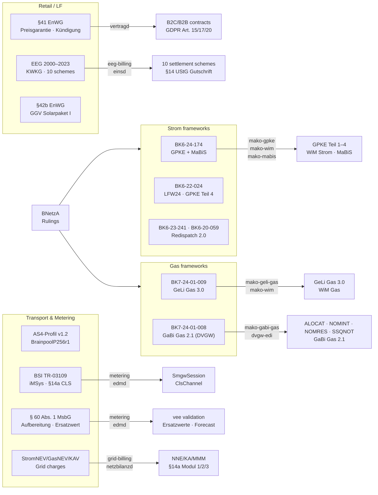

+++
title = "Regulatory"
description = "BNetzA determinations, the Prüfidentifikator catalog, and the legal basis behind each process."
weight = 5
sort_by = "weight"
template = "section.html"
page_template = "page.html"
+++
The BNetzA rulings (BK6 / BK7), the Prüfidentifikator reference for all 17
EDI@Energy message types, and the legal basis each implementation rests on.

| Page | Content |
|---|---|
| [Domain Model](@/docs/architecture/domain-model.md) | Party roles (LF, NB, MSB, BKV, …), market objects (MaLo, MeLo, NeLo, NeBe), identifier formats, EDIFACT encoding |
| [BNetzA Regulatory Reference](@/docs/regulatory/bnetza.md) | BK6 / BK7 rulings, APERAK Fristen, process scopes |
| [Process Catalog](@/docs/reference/processes.md) | Every MaKo process — GPKE, WiM, GeLi Gas, MaBiS, Redispatch 2.0 — with its message flow |
| [PID Reference](@/docs/regulatory/pid-reference.md) | Complete Prüfidentifikator table for all process families, including the DVGW gas transport PIDs |

---

## Regulatory framework coverage

---

## Implemented regulatory frameworks

| Regulation | Domain | Implementation |
|---|---|---|
| **BK6-24-174** (GPKE Teil 1–3 = Anlagen 1a–1c, WiM Teil 1/2 = Anlagen 2a/2b, MaBiS = Anlage 3, in force 06.06.2025) | Strom | `mako-gpke`, `mako-wim`, `mako-mabis` |
| **BK6-22-024** (LFW24 — 24h-Lieferantenwechsel, §20a EnWG; GPKE Teil 4 = Anlage 1d) | Strom | `mako-gpke` |
| **BK7-24-01-009** (GeLi Gas 3.0, BK7 Beschluss 12.09.2025) | Gas | `mako-geli-gas`, `mako-wim` |
| **BK7-24-01-008** (GaBi Gas 2.1 — Kapazitätsabrechnung, DVGW) | Gas | `mako-gabi-gas`, `dvgw-edi` |
| **PARTIN AHB 1.0f** (Kommunikationsdaten Strom + Gas) | Both | `mako-gpke` (37000–37006), `mako-geli-gas` (37008–37014) |
| **§42b Abs. 5 EnWG** (Solarpaket I — GGV Gemeinschaftliche Gebäudeversorgung) | Strom | `metering` crate (`allocation::community::allocate`, `allocation::formula::Formula`), `edmd` |
| **Residuallast** (ordinary supply, no special §) | Strom | `metering` crate (`Residual` rule), `edmd` |
| **EEG 2000–2023 / KWKG** (Feed-in settlement) | Strom | `eeg-billing` crate (10 schemes), `einsd` |
| **§14 Abs. 2 UStG** (Gutschriftverfahren — NB issues the EEG Gutschrift) | Strom | `eeg-billing` (`settlement_to_gutschrift`), `einsd` (`rechnung_json`) |
| **§ 60 Abs. 1 MsbG** (der MSB hat die erhobenen Daten *aufzubereiten* und zu übermitteln — Plausibilisierung und Ersatzwertbildung; Abs. 2 Satz 2 lets that happen outside the Smart-Meter-Gateway) | Both | `metering` crate (`vee::validation`, `vee::substitute`), `edmd` |
| **§ 40a Abs. 2 EnWG** (Verbrauchsschätzung) · **§ 13 Abs. 1 StromGVV** (Abschlagshöhe) | Strom | `metering::project_annual_consumption`, `edmd /api/v1/forecast` |
| **BSI TR-03109** (iMSys / SMGW lifecycle, §14a CLS channels) | Strom | `metering` (`SmgwSession`, `ClsChannel`), `edmd` |
| **StromNEV / GasNEV / KAV** (grid charge settlement) | Both | `grid-billing` crate, `netzbilanzd` (a Gas NNE, Abschlag or AWH period ending after 31.12.2027 is refused: the GasNEV is außer Kraft mit Ablauf des 31.12.2027, Art. 15 Abs. 2 G v. 22.12.2023, BGBl. 2023 I Nr. 405) |
| **§14a EnWG** (Steuerbare Verbrauchseinrichtungen — Modul 1/2/3) | Strom | `grid-billing` (`Sect14aModule`), `processd` (produktcode check, GPKE Teil 3 Kap. 1.3) |
| **§41 EnWG** (Vertragsinhalte, Abs. 5 Preisänderungs-Unterrichtung + Sonderkündigungsrecht) / **§5 Abs. 2 StromGVV/GasGVV** (6-Wochen-Frist) | Both | `vertragd` |
| **§41a EnWG** (Dynamic tariffs — EPEX Spot day-ahead) | Strom | `productd` (EPEX prices), `billingd` (§41a iMSys guard) |
| **GDPR Art. 15/17/20** (data export, pseudonymization, portability) | — | `vertragd` (`/export`, `/anonymize`), `accountingd` (`/anonymize`) |
| **XRechnung 3.0 CII / PEPPOL UBL** (EN 16931 e-invoice) | — | `billingd` |
| **BK6-20-160 Anlage 6** (NZR-EMob / Modell 2 — ladevorgangscharfe bilanzielle Energiemengenzuordnung) · **BK6-24-267** (Modell 2 für Kundenanlagen, § 20 Abs. 1, 1a EnWG) | Strom | `mako-emob` (allocation + Modellwechsel workflows), `mako-mabis` (55235–55237), `mako-pruefung` (`E_0510`–`E_0513`), `marktd` (`malo.abwicklungsmodell`), `makod` |
| **BK6-20-059** TZ 2 (Redispatch 2.0 Datenformate; TZ 1, BK6-20-060 and BK6-20-061 repealed by BK6-23-241) | Strom | `mako-redispatch` (8 workflows), `redispatch-xml` (9 document types), `makod` (AS4 EDIFACT+XML ingest), `grid-billing` (§13a Vergütung) |
| **BK6-23-241** (BilAReM, Beschluss 07.05.2026 — Planwert-/Prognosemodell, Kap.-3 Ausfallarbeit) | Strom | `mako-redispatch` (`bilarem` model/migration + `ausfallarbeit` engine), `grid-billing` (`bilarem_finanzielle_korrektur`), `netzbilanzd` (compute endpoints) |
| **§19 Abs. 2/3 StromNEV + BK8-25-003-A / GBK-25-01 (AgNeS, draft)** | Strom | `grid-billing::regulatory` (regime turnovers as dates; **AgNeS-era Entgelt settlements are refused** — no Rahmenfestlegung supplies their parameters) |
| **§20b EnWG** (Netzzugangsplattform, G. v. 18.12.2025 — no Festlegung or API exists) | Both | `makod` (`netzzugang.*` commands), `marktd` (`netzzugang_antraege` registry) |
| **BDEW AS4-Profil v1.2** (BrainpoolP256r1, sign+encrypt, ECDH-ES AES128-GCM) | — | `mako-as4` |
| **§ 20 Abs. 1 S. 1 EnWG** (diskriminierungsfreier Netzzugang) + **§ 6a / § 7a Abs. 5 EnWG** (informatorische Entflechtung, Gleichbehandlungsbericht by 31 March) | Both | `processd` (`GET /api/v1/audit/gleichbehandlung`), Cedar ABAC |
| **MsbG §29 Abs. 3 / BSI TR-03109-4 §6.3** (SMGW certificate expiry monitoring) | Strom | `edmd` cert-expiry worker (90/30/7-day `de.messwert.smgw.cert.expiry-warning`), `agentd` `smgw-diagnostics-agent` |

> **Format version coexistence.** Profiles are per message and fv-dated —
> `fv20260401` binds from 01.04.2026, `fv20261001` from 01.10.2026. The
> directory names the **Anwendungszeitpunkt**; Allgemeine Festlegungen 6.1d §2.5
> schedules publication six months earlier, and a deviating date must name the
> Mitteilung that published it. Several format versions run in one instance,
> and a process finishes under the version it started with.
>
> **PID coverage.** `crates/edi-energy/tests/it/skeletons.rs` generates a
> minimal message per Anwendungsfall from its Prüfschablone and validates it;
> `cargo xtask check-pid-coverage` holds the shipped columns against BDEW's
> published Anwendungsübersicht and reports the count.
>
> **Antwortcode fidelity.** `cargo xtask validate-ebd-codes` holds every answer
> code mako can send against the BDEW *Entscheidungsbaum-Diagramme und
> Codelisten* PDF: the tree publishes the code, and the **Cluster** mako assigns
> it is the Cluster the document prints — `A01` is an Ablehnung in `E_0510`
> and a Zustimmung in `E_0511`/`E_0512`. The check needs the mirrored PDF
> (`cargo xtask sync-regulatories --download`) and skips without it.
