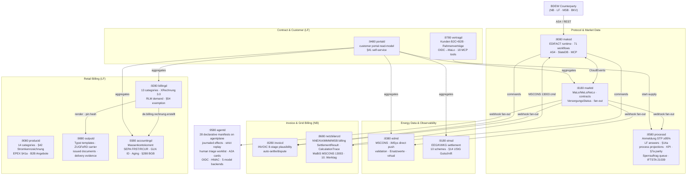
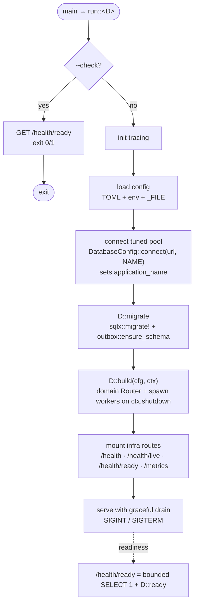

+++
title = "Services"
description = "Operator guides for the 14 production daemons — ports, config, APIs, deployment."
weight = 4
sort_by = "weight"
template = "section.html"
page_template = "page.html"
+++
mako implements the BDEW **Marktkommunikation** between the four German market
roles — **LF** (Lieferant), **NB** (Netzbetreiber), **MSB**
(Messstellenbetreiber) and **BKV** (Bilanzkreisverantwortlicher); see
[Party Roles](@/docs/architecture/domain-model.md#party-roles-marktrollen).

mako consists of **14 independently deployable services**, each a self-contained
Docker image built on the [`mako-service`](https://github.com/hupe1980/mako/tree/main/crates/mako-service)
SDK, with TOML configuration (`env:` and `_FILE` secrets), OIDC/JWT and API-key
authentication, Cedar ABAC, OpenTelemetry, `/health/live` · `/health/ready` ·
`/metrics`, and an MCP server at `/mcp` (Streamable HTTP) on 11 of the 14 —
all except outputd, portald and agentd (the MCP host). `just dev <service>` runs one
against `dev/config/<service>.toml`.

---

## Service Map



---

## Protocol & Market Data

| Service | Port | Role | Purpose |
|---|---|---|---|
| [makod](@/docs/services/makod.md) | `:8080` · `:4080` · `:8090` | All | Protocol daemon — 71 workflows over 469 Prüfidentifikatoren, AS4/REST/iMS |
| [marktd](@/docs/services/marktd.md) | `:8180` | All | Market Data Hub — MaLo/MeLo/contracts, VersorgungsStatus, typed BO4E API, durable fan-out, MMMA monthly import worker |
| [processd](@/docs/services/processd.md) | `:8580` | NB + LF + MSB | Process Decision Engine — Anmeldung STP ≥95%, LF answers to the NB-initiated GPKE processes, MSB REQOTE auto-response, §14a produktcode check; the process read model (per-PID KPIs, `GET /api/v1/audit/gleichbehandlung` for § 7a Abs. 5 EnWG); the NB Sperr-/Entsperrauftrag queue with IFTSTA 21039; role-gated builds |

## Invoice & Grid Billing

| Service | Port | Role | Purpose |
|---|---|---|---|
| [invoicd](@/docs/services/invoicd.md) | `:8280` | LF | INVOIC plausibility-check — eight stages plus the WiM 31003 send window (incl. ToU band routing via `zaehlzeitregister`), auto-settle/dispute, § 147 AO / GoBD receipts |
| [netzbilanzd](@/docs/services/netzbilanzd.md) | `:8680` | NB/ÜNB | NNE/KA/MMM/MSB/AWH billing — INVOIC 31001/31002/31005/31009/31011, REMADV lifecycle, §14a Modul 3 ToU, §42b EnWG GGV, Redispatch 2.0 Kostenblatt; MaBiS Summenzeitreihen filed with the BIKO as MSCONS 13003 on the 10. Werktag; 12-tool MCP server |

## Energy Data & Observability

| Service | Port | Role | Purpose |
|---|---|---|---|
| [edmd](@/docs/services/edmd.md) | `:8380` | All | Energy Data Management — MSCONS, iMSys direct push, Kafka batch ingest, quality scoring and validation, virtual meters, tiered storage; 16-tool MCP server |
| [einsd](@/docs/services/einsd.md) | `:9180` | NB/LF | Einspeiser Registry + EEG/KWKG settlement — 10 settlement schemes; issues the **§14 UStG Gutschrift** (Gutschriftverfahren) per billable settlement as a BO4E `Rechnung` with per-rate USt breakdown; 20-tool MCP server |

## Retail Billing (LF)

| Service | Port | Role | Purpose |
|---|---|---|---|
| [productd](@/docs/services/productd.md) | `:9080` | LF | Product & Tariff Catalog — user-defined energy products, EPEX Spot for §41a, B2B Angebote/quotations |
| [billingd](@/docs/services/billingd.md) | `:9280` | LF | Energy Billing Engine — 13 categories, §41a dynamic, §42b EnWG GGV community solar, EN 16931 e-invoicing (XRechnung 3.0 CII / PEPPOL UBL); the ZUGFeRD PDF renders via outputd |
| [outputd](@/docs/services/outputd.md) | `:9880` | — | Customer Communications — operator Typst templates, the ZUGFeRD PDF/A-3 carrier, Mahnung and Preisanpassung, the append-only store of issued documents and their delivery evidence (portal, e-mail, print, ERP) |
| [accountingd](@/docs/services/accountingd.md) | `:9380` | LF | Customer Account Ledger — tamper-evident double-entry ledger (`doubleentry`, period seals for GoBD/§146 AO); per-MaLo Kontokorrent, FIFO clearing, Verzugszinsen §288 BGB; SEPA pain.008 and CAMT.054; dunning delivered through outputd |

## B2C & AI

| Service | Port | Role | Purpose |
|---|---|---|---|
| [vertragd](@/docs/services/vertragd.md) | `:9780` | LF + MSB | Contract & Customer Management — Kunden (B2C+B2B), Rahmenverträge, Versorgungsverträge, Tarifwechsel with its § 41 Abs. 5 EnWG Preisänderungsanzeige, Kündigung, OIDC→MaLo auth gateway for portald |
| [portald](@/docs/services/portald.md) | `:9480` | LF | Customer Portal gateway — stateless aggregation over the LF services plus the §41 EnWG self-service writes (Tarifwechsel, Kündigung, SEPA, GDPR Art. 16) and the outputd document inbox; ownership resolved through `vertragd`; no MCP server |
| [agentd](@/docs/services/agentd.md) | `:9580` | All | Multi-agent LLM orchestration — **28 declarative manifests** on the agentplane durable runtime, every effect journaled; read-only by construction, so oversight is a triage worklist |

---

## Shared foundation — the `mako-service` SDK

Every daemon is built on the [`mako-service`](https://github.com/hupe1980/mako/tree/main/crates/mako-service)
crate. A service's `main` is a single line:

```rust
#[tokio::main]
async fn main() -> anyhow::Result<()> {
    mako_service::run::<Billingd>().await   // Billingd: Daemon impl
}
```

`run::<D>()` owns the whole lifecycle. A `Daemon` implementation supplies only what is
service-specific — the config type, the migrations, and a `build()` that assembles the domain
router and spawns background workers:



What every service gets for free from the runner:

| Concern | Provided by `run::<D>()` |
|---|---|
| **Tracing** | Structured logs + optional OTLP export (`RUST_LOG`, `OTEL_EXPORTER_OTLP_ENDPOINT`) |
| **Config** | `[database]` + service blocks, `env:`/`_FILE` substitution, `<SVC>_CONFIG` path |
| **Pool** | Tuned sizing with a per-service `application_name` for `pg_stat_activity` |
| **Migrations** | Applied at startup before the first request |
| **Readiness** | Real `/health/ready` — a bounded `SELECT 1` DB ping, not a static `true` |
| **Shutdown** | SIGINT/SIGTERM graceful drain; workers observe `ctx.shutdown` |
| **Health probe** | `--check` in-container HEALTHCHECK (no shell, no curl) |

Event-emitting services — accountingd, billingd, edmd, einsd,
netzbilanzd, processd and vertragd — use the SDK's **transactional outbox**: each
CloudEvent is written to `event_outbox` *in the same transaction* as the
business change and drained by an `OutboxWorker` with retry and a status-column
dead-letter queue. `marktd` keeps its own `event_log` outbox ahead of the durable
fan-out, and `invoicd` retries ERP notifications from columns on
`invoic_receipts`. Emission always goes through `CloudEvent::new` +
`post_ce_with_retry`, signed as Standard Webhooks (`webhook-signature`).

The SDK outbox and marktd's `event_log` wake their worker from an `AFTER INSERT`
trigger's `NOTIFY`, which Postgres holds until commit; the 30 s poll is the fallback.

`makod` alone keeps its own `main` (SlateDB event store, AS4 runtime); every
other service runs on `mako_service::run`.

---

## Deployment

All services are available as multi-stage Docker images built with `cargo-chef`:

```bash
# Single all-in-one daemon (makod only)
docker pull ghcr.io/hupe1980/mako-makod:latest

# NB STP demo — UTILMD 55001 Lieferbeginn end-to-end
git clone https://github.com/hupe1980/mako
cd mako/demos/nb-stp
docker compose up

# EEG billing demo — solar plant registration + §21 EEG 2023 settlement
cd ../eeg-billing
docker compose up

# Order-to-cash demo — Tarif → Vertrag → Rechnung → Dokument → Offener Posten
cd ../o2c
docker compose up
```

See the [Getting Started](@/docs/guide/getting-started.md) guide for the full deployment walkthrough.
