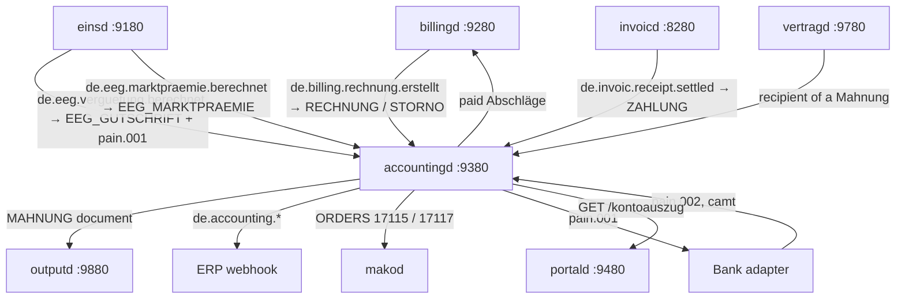
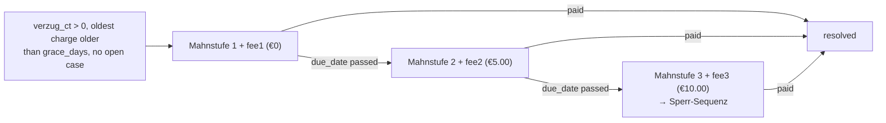
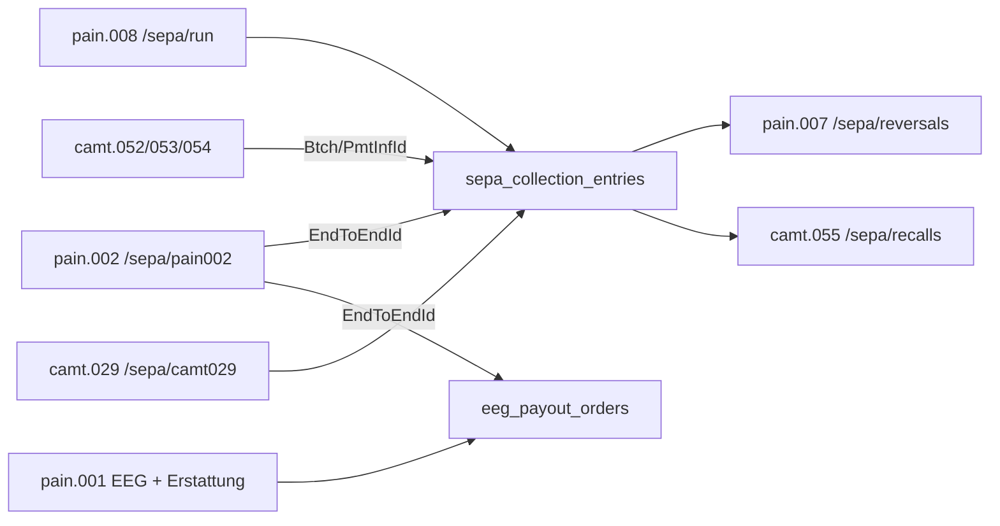

+++
title = "accountingd Operator Guide"
description = "Operator guide for accountingd, the LF Massenkontokorrent: a tamper-evident double-entry ledger, SEPA and camt payment flows, Mahnwesen and Jahresabschluss."
weight = 34
+++
`accountingd` is the **FI-CA equivalent** for the retail billing stack, on port
**`:9380`**: the customer Kontokorrent behind
[billingd](@/docs/services/billingd.md)'s invoices — Offene Posten, dunning, the
§§ 41f/41g EnWG Sperr-Sequenz, SEPA collection and payout, bank-statement import,
the Jahresabschluss and period sealing.

Vocabulary: an account is keyed on a **Marktlokation** ([MaLo vs
MeLo](@/docs/architecture/domain-model.md#malo-vs-melo-the-critical-distinction));
**LF** is the supplier whose books these are. An **Abschlag** is a monthly
advance, the **Jahresabschluss** the annual settlement, **Mahnwesen** dunning
(Mahnstufe 1–3, each with a Mahngebühr), a **Sperrung** the regulated
disconnection of a defaulting customer, **Festschreibung** the irreversible
closing of a period.

SEPA messages: **pain.008** direct debit, **pain.001** credit transfer,
**pain.007** creditor reversal, **pain.002** bank status, **camt.052/053/054**
account reports, **camt.055/029** recall and its answer.

The ledger is event-driven and idempotent: every posting carries an idempotency
key (the CloudEvent id for inbound events), and an identical replay is a
store-level no-op.



---

## Ledger

The ledger is the [`doubleentry`](https://github.com/hupe1980/doubleentry) crate
in the `doubleentry` schema of accountingd's database (applied by
`PgLedger::connect` at startup): balanced by construction, an append-only BLAKE3
Merkle log with `O(log n)` proofs, period seals, open-item clearing and
store-level idempotency. accountingd owns the chart of accounts
([`ledger::Chart`](https://github.com/hupe1980/mako/blob/main/services/accountingd/src/ledger.rs));
doubleentry owns the invariants.

Soll = Haben is enforced in the engine and by a deferred constraint trigger (§
238 HGB).

Each Buchungsart is one entry with two legs: the customer's **Kontokorrent**
(`Kontokorrent:<lf_mp>:<malo>`, the SKR 1400 Debitoren subledger) and a GL
contra account. Money is `i64` cents throughout; no `f64` touches it.

| `entry_type` | Kontokorrent | GL contra | Raised by |
|---|---|---|---|
| `RECHNUNG` | Debit | Erlöse (SKR 4000) | `de.billing.rechnung.erstellt`, `is_correction=false` |
| `STORNO` | by sign | Erlöse | the same event, `is_correction=true` (a Gutschrift is a negated Rechnung) |
| `GUTSCHRIFT` | Credit | Erlöse | operator `POST /buchen` only |
| `KORREKTUR` | by sign | Erlöse | operator `POST /buchen` |
| `ABSCHLAG` | Debit | Erhaltene Anzahlungen (SKR 03 1718 / SKR 04 3272) | the Abschlagslauf — a demand, not a receipt |
| `ABSCHLAG_VERRECHNUNG` | Credit | Erhaltene Anzahlungen | the settling invoice discharges the advances it deducted |
| `ZAHLUNG` | Credit | Bank (SKR 1200) | camt import, `de.invoic.receipt.settled` |
| `BANKRUECKLAST` | Debit | Bank | a returned direct debit |
| `SEPA_STORNO` | Debit | Bank | a pain.007 reversal |
| `MAHNGEBUEHR` | Debit | Mahnerlöse (SKR 4003) | dunning fee per Mahnstufe |
| `VERZUGSZINSEN` | Debit | Zinserträge (SKR 2650) | § 288 BGB interest |
| `EEG_GUTSCHRIFT` | Credit | EEG-Aufwand | `de.eeg.verguetung.berechnet` |
| `EEG_MARKTPRAEMIE` | Credit | EEG-Aufwand | `de.eeg.marktpraemie.berechnet` |
| `JAHRESABSCHLUSS` | Debit (Erstattung) | Erstattungen | the annual settlement |

`ledger::ENTRY_TYPES` is the single list: `Chart::contra` maps it and
`POST /buchen` refuses anything outside it.

**Balance** is the signed Kontokorrent net — positive is debt, negative a credit
balance. `accounts.balance_ct` is a read cache, set absolutely from the ledger
after every post.

### The Abschlag pair

An Abschlag is a demand for a part-payment on a supply not yet billed (§ 40
Abs. 1 EnWG, § 14 Abs. 5 UStG), booked against Erhaltene Anzahlungen, never
against Bank:

```
Abschlagslauf   ABSCHLAG              Dr Kontokorrent  / Cr Erhaltene Anzahlungen
money arrives   ZAHLUNG               Cr Kontokorrent  / Dr Bank
Endrechnung     RECHNUNG (gross)      Dr Kontokorrent  / Cr Erlöse
   …the same    ABSCHLAG_VERRECHNUNG  Cr Kontokorrent  / Dr Erhaltene Anzahlungen
```

So an **unpaid advance is an open receivable** that reaches `verzug_ct` and the
Mahnwesen; the **payment is booked once**, on the camt receipt; and the
Endrechnung is booked **gross**, with the deduction it states
(`gesamtbrutto − zuZahlen`) as the matching credit.

`abschlag_forderungen` records what a posting cannot: the **USt rate** each
advance was raised at (§ 14 Abs. 5 Satz 2 UStG) and **which invoice absorbed
it**. Whether it was received is the residual of its ledger entry after FIFO
clearing. `GET /api/v1/accounts/{malo_id}/abschlaege` lists the received,
unabsorbed advances a settling invoice may deduct, oldest first, with their rate.

### Idempotency keys

| Key | Written by |
|---|---|
| CloudEvent id | every inbound event |
| `ABSCHLAG-{malo}-{YYYY}-{MM}` | the Abschlagslauf |
| `mahngebuehr:{case_id}:{stufe}` | the dunning fee, per case |
| `interest:{malo}:{from}:{to}` | a § 288 BGB charge |
| `bank:{txn}` | every bank import |
| `jahresabschluss:{malo}:{year}` | the annual settlement |
| `manual:{uuid}` | `POST /buchen` without `reference_id` |

The same key with different content is refused. `POST /buchen` is idempotent
only when it carries a `reference_id`.

---

## Endpoints

Every `/api/v1/*` route requires a JWT and a Cedar action — see
[Authorization](#authorization). `/webhook` is signature-authenticated instead.

| Method | Path | Description |
|---|---|---|
| `POST` | `/webhook` | Inbound CloudEvents (billingd, einsd, invoicd), Standard Webhooks signature |
| `GET/PUT` | `/api/v1/accounts/{malo_id}` | Account master data (IBAN, Abschlag, `billing_day`) |
| `GET` | `/api/v1/accounts/{malo_id}/balance` | Balance in ct; `overdue` / `credit` / `settled` |
| `GET` | `/api/v1/accounts/{malo_id}/ledger` | Movements, newest first, with `opening_ct` |
| `GET` | `/api/v1/accounts/{malo_id}/kontoauszug` | Statement for portald; `?from=&to=` returns `eroeffnungssaldo_ct` / `bewegung_ct` / `schlusssaldo_ct` |
| `GET` | `/api/v1/accounts/{malo_id}/open-items` | Offene Posten after clearing |
| `POST` | `/api/v1/accounts/{malo_id}/clear` | Run the FIFO Zahlungszuordnung |
| `POST` | `/api/v1/clearings/{clearing_id}/reset` | Release a mis-assigned clearing |
| `GET` | `/api/v1/trial-balance` | Summen- und Saldenliste (§ 238 HGB) |
| `PUT` | `/api/v1/accounts/{malo_id}/abschlag` | Change the monthly advance |
| `GET` | `/api/v1/accounts/{malo_id}/abschlaege` | Deductible advances with their USt rate (`?from=&to=`) |
| `GET/PUT` | `/api/v1/accounts/{malo_id}/vorauszahlung` | `rubo4e::current::Vorauszahlung` through [the BO4E gate](@/docs/architecture/domain-model.md#the-bo4e-gate) |
| `GET/PUT` | `/api/v1/accounts/{malo_id}/zahlungsinformation` | `rubo4e::current::Zahlungsinformation` through the gate; strict enums keep `zahlungsart` valid |
| `POST` | `/api/v1/accounts/{malo_id}/buchen` | Manual booking |
| `POST` | `/api/v1/accounts/{malo_id}/reconcile` | Compare `balance_ct` with the ledger; `?repair=true` resets it |
| `POST` | `/api/v1/accounts/{malo_id}/anonymize` | GDPR Art. 17 pseudonymization |
| `GET/POST` | `/api/v1/accounts/{malo_id}/interest-charges` | § 288 BGB interest |
| `GET/POST` | `/api/v1/accounts/{malo_id}/payment-plans` | Zahlungsvereinbarungen |
| `GET/DELETE` | `/api/v1/payment-plans/{plan_id}` | One plan with its schedule; cancel |
| `PUT` | `/api/v1/accounts/{malo_id}/business-partner` | Link to a `kunden_nr` |
| `GET` | `/api/v1/business-partners/{kunden_nr}/accounts` · `/balance` | A partner's accounts; consolidated balance |
| `GET` | `/api/v1/aging` | Receivables in 0–30 / 31–60 / 61–90 / >90 day buckets |
| `GET` | `/api/v1/offene-posten` | Overdue accounts |
| `POST` | `/api/v1/periods/{period_id}/seal` | Festschreibung; body `{ "start", "end" }` |
| `GET` | `/api/v1/periods/seals` | Seal history, `chain_valid`, `sealed_through` |
| `GET` | `/api/v1/entries/{entry_id}/proof` | Merkle inclusion proof |
| `GET` | `/api/v1/periods/{period_id}/balance-proof` | Closing balance of a Kontokorrent in a sealed period (`?malo_id=&lf_mp_id=`) |
| `GET` | `/api/v1/entries/consistency-proof` | Append-only proof since `?since=<tree_size>` |
| `GET` | `/api/v1/dunning` | Open dunning cases |
| `POST` | `/api/v1/dunning/{account_id}/escalate` | Manual Mahnstufe |
| `POST` | `/api/v1/dunning/{id}/resolve` | Resolve a case |
| `POST` | `/api/v1/dunning/{id}/abwendung/angebot` | Record the Abwendungsvereinbarung offer (§ 41g Abs. 1 S. 2 EnWG) |
| `GET/POST` | `/api/v1/dunning/{id}/locks` | Mahnsperren: history; place one |
| `DELETE` | `/api/v1/dunning/locks/{lock_id}` | Lift one, with a reason |
| `GET` | `/api/v1/dunning/locks/review` | Open-ended locks (`?older_than_days=`) |
| `GET/POST` | `/api/v1/dunning/{id}/einwaende` | Forderungseinwände (§ 41f Abs. 3 S. 3–5 EnWG) |
| `POST` | `/api/v1/einwaende/{einwand_id}/erledigen` | Close an objection |
| `POST` | `/api/v1/sepa/mandates` | Register a mandate (IBAN mod-97) |
| `GET/DELETE` | `/api/v1/sepa/mandates/{mandate_id}` | Fetch; revoke |
| `GET` | `/api/v1/sepa/mandates/dormant` | Mandates at or near the 36-month dormancy limit |
| `POST` | `/api/v1/sepa/run` | Build and archive one pain.008; `409` if the date was dispatched |
| `GET` | `/api/v1/sepa/collections/{run_id}/entries` | What a run collected, with status |
| `POST` | `/api/v1/sepa/pain002` | Apply a pain.002 (payouts and collections, with VoP) |
| `POST` | `/api/v1/sepa/reversals` | pain.007 for a settled collection |
| `POST` | `/api/v1/sepa/recalls` | camt.055 for a submitted collection |
| `POST` | `/api/v1/sepa/camt029` | Apply the bank's answer to a recall |
| `POST` | `/api/v1/payments/import/camt053` · `camt054` · `camt052` | Bank statements |
| `POST` | `/api/v1/payments/import` | Flat JSON bank export |
| `GET` | `/api/v1/eeg/payouts` · `/{payout_id}` | EEG payout orders (`?status=`); one with its pain.001 |
| `POST` | `/api/v1/eeg/payouts/run` | Build pain.001 for every unbatched `EEG_GUTSCHRIFT` |
| `PUT` | `/api/v1/eeg/payouts/{payout_id}/status` | Decoded pain.002 status (`ACCP`/`RJCT`/`CANC`) |
| `POST` | `/api/v1/jahresabschluss/{malo_id}` | Annual settlement (`?year=`, `?dry_run=true`) |
| `GET` | `/accountingd/metrics` | Ledger and dunning gauges |
| `GET` | `/health/live` · `/health/ready` | Liveness; readiness |
| `POST/GET` | `/mcp` | MCP Streamable HTTP |

### Manual booking

```bash
curl -X POST "http://accountingd:9380/api/v1/accounts/51238696012/buchen" \
  -H "Content-Type: application/json" \
  -d '{
    "entry_type":   "ZAHLUNG",
    "amount_ct":    -5000,
    "reference_id": "BANK-TXN-2026-07-10",
    "description":  "Überweisung Kunde (ausserhalb SEPA)"
  }'
```

`entry_type` is one of `ledger::ENTRY_TYPES`; positive `amount_ct` is a debit,
negative a credit.

### Vorauszahlung (§ 40 Abs. 1 EnWG)

```bash
curl -X PUT "http://accountingd:9380/api/v1/accounts/51238696012/vorauszahlung" \
  -H "Content-Type: application/json" \
  -d '{
    "_typ": "VORAUSZAHLUNG",
    "betrag": { "_typ": "BETRAG", "wert": "75.00", "waehrung": "EUR" },
    "gueltigkeit": { "_typ": "ZEITRAUM", "startdatum": "2026-08-01" }
  }'
```

This sets `abschlag_ct = 7500` in the same write. Without a stored object the
`GET` synthesises one from `abschlag_ct`.

---

## Offene Posten and balance integrity

Every post records a FIFO **Zahlungszuordnung** in doubleentry's clearing
register: open credits (payments, Abschläge, Gutschriften) against the oldest
open debits (Einzelbewertung, § 252 Abs. 1 Nr. 4 HGB). `open-items` lists the
debits with a residual above zero, oldest first:

```json
{
  "malo_id": "51238696012",
  "balance_ct": 8500,
  "balance_eur": "85.00",
  "open_item_count": 2,
  "open_items": [
    { "entry_id": "…", "entry_type": "RECHNUNG", "amount_ct": 12000,
      "outstanding_ct": 4500, "booking_date": "2026-06-15",
      "document": "R2026-06-001" },
    { "entry_id": "…", "entry_type": "MAHNGEBUEHR", "amount_ct": 500,
      "outstanding_ct": 500, "booking_date": "2026-07-20",
      "document": null }
  ]
}
```

`POST …/clear` re-runs the match (a no-op when cleared); `POST
/clearings/{id}/reset` releases a mis-assignment and keeps the record of it.

`GET /api/v1/trial-balance` gives Soll/Haben/Saldo per GL account with the
Kontokorrent leaves aggregated into one Debitoren line; `balanced: true` holds
by construction.

`POST …/reconcile` returns `{ is_consistent, cached_balance_ct,
recomputed_balance_ct, drift_ct }`; `?repair=true` resets the cache from the
ledger. Drift is not expected, because the cache is set absolutely.

`GET /api/v1/aging` buckets overdue accounts by the oldest unresolved
`dunning_cases.issued_at`, falling back to `accounts.updated_at`.

---

## Mahnwesen



With `dunning_auto_enabled = true` a daily worker escalates (idempotent through
`auto_dunning_runs`) and then runs the [Sperr-Sequenz](#sperr-sequenz). Its
first step closes every open case whose account owes nothing and clears its
§§ 41f/41g state, so a paid-up customer is never walked into disconnection.
`POST /api/v1/dunning/{account_id}/escalate` is the manual override.

**The Mahnung document.** Every open case without a document is rendered as a
`MAHNUNG` through `outputd` (`outputd::document::mahnung::MahnungView`) and
queued on the customer's channels; the document id is stamped on the case.

Set `outputd_url` **and** `vertragd_url`: accountingd holds no customer master,
and a case whose recipient cannot be resolved is not documented, because an
unaddressed Mahnung is not Textform (§ 126b BGB). The Posten are the live open
receivables after clearing; Verzugsschaden is on its own lines; the § 41f Abs. 1
threat block prints only once `sperrandrohung_at` is set.

### Sperr-Sequenz

Payment-default disconnection of a Haushaltskunde follows **§§ 41f/41g EnWG**
(consolidated version of 23.12.2025, BGBl. 2025 I Nr. 347). The daily worker
calls `sperr::run_sperr_sequence` every cycle and advances each qualifying
Mahnstufe-3 case one phase:

| Phase | Trigger | Action | Basis |
|---|---|---|---|
| 1. Sperrandrohung | Mahnstufe 3, both thresholds cleared, no lock | `de.accounting.sperrandrohung`; sets `sperrandrohung_at` | § 41f Abs. 1 |
| 2. Sperrankündigung | `sperrandrohung_frist_days` (default 28) after the Androhung | `de.accounting.sperrankuendigung`; `geplantes_sperrdatum` = today + `sperrankuendigung_frist_werktage` (default 8) Werktage | § 41f Abs. 5 |
| 3. Sperrauftrag | `geplantes_sperrdatum` reached | `gpke.sperrung.beauftragen` → **ORDERS 17115** via makod; `de.accounting.sperrauftrag` | § 41f |
| 4. Entsperrauftrag | arrears settled, an Abwendungsvereinbarung accepted, or Schutzbedürftigkeit found | `gpke.entsperrung.beauftragen` → **ORDERS 17117**; `de.accounting.entsperrauftrag` | § 41f Abs. 7 |

Phases 1 and 2 commit the state and the event in one transaction. Phase 3 marks
the case **before** enqueueing, so a lost announcement is replayable and a
second disconnection order is impossible. Phase 4 is a sweep because restoration
is owed *unverzüglich* without the customer asking. Phases 3 and 4 are market
messages: the NB answers with ORDRSP 19116/19117 and reports execution with
IFTSTA 21039, tracked by the LF's `gpke-sperrung-lf` process.

**Thresholds (§ 41f Abs. 3), re-checked at every phase.** The case stays eligible
only while both hold:

- Satz 2: Zahlungsverzug ≥ `sperrung_threshold_ct` (default 100 EUR);
- Satz 1: Zahlungsverzug ≥ **2×** the monthly `abschlag_ct`, or, with no
  Abschlag, ≥ **⅙** of the last annual bill (`jahresabschluss_runs.annual_bill_ct`).
  With neither on record the case is excluded.

The Zahlungsverzug is `accounts.verzug_ct`: open debit residuals after clearing,
less Verzugsschaden (Mahngebühren and Verzugszinsen), less open
Forderungseinwände. It is refreshed absolutely on every posting, every objection
and at the start of each run. Fees are excluded so the dunning cannot push a
customer over the threshold it is measured against.

**Notice content (§ 41f Abs. 6).** Both notices carry the Grund and the expected
`sperrkosten_ct` / `entsperrkosten_ct` (a Pauschale is permitted under § 41f
Abs. 7 S. 2 if it does not exceed actual cost); the Androhung adds the § 41f
Abs. 4 avoidance options. Unset costs announce a free disconnection.

**Configuration gates.** Without `makod_url` the sequence does not run (startup
warning); `makod_url` without `makod_api_key` is a startup error. Without
`erp_webhook_url` the notice phases pause, because the ERP renders and sends the
letters, and nothing progresses to a Sperrauftrag (a warning every cycle).

The § 41g Abs. 3–6 Sozialhilfeträger flow is the ERP's, off the emitted events;
the Abwendungsvereinbarung terms (zinsfrei, 6–18 months, 12–24 above 300 EUR)
ride on `de.accounting.abwendung.angeboten`.

### Mahnsperren

Every halt is a row in `dunning_locks`, **account-scoped**, with a ground, a
validity and the operator who set it:

| `grund` | Norm | Meaning |
|---|---|---|
| `abwendungsvereinbarung` | § 41g Abs. 1 S. 10 | Accepted in Textform before the disconnection; bars it |
| `schutzbeduerftigkeit` | § 41f Abs. 2 | Konkrete Gefahr für Leib oder Leben |
| `zahlungsaussicht` | § 41f Abs. 1 S. 2 | Hinreichende Aussicht auf Zahlung |
| `operator` | — | Operator decision; a note is required |

Lifting with **`vereinbarung_gebrochen`** applies § 41g Abs. 1 S. 11: the
Ankündigung state is cleared, so the sequence resumes with a fresh 8-Werktage
announcement, and `de.accounting.abwendung.gebrochen` is emitted.
Open-ended locks are allowed and listed by
`GET /api/v1/dunning/locks/review?older_than_days=90`.

### Forderungseinwände (§ 41f Abs. 3 S. 3–5)

Amounts kept **out of the Verzug** rather than halts — the sequence stops by
itself when what remains falls below the thresholds:

| `art` | Norm |
|---|---|
| `forderung_bestritten` | S. 3 — schlüssig bestritten, not titled |
| `preiserhoehung_bestritten` | S. 4 |
| `schlichtung` | S. 5 — before a § 111b EnWG Schlichtungsverfahren |
| `ratenzahlung_nicht_faellig` | S. 3 — instalments not yet due |

Recording or closing one refreshes `verzug_ct` immediately.

### Verzugszinsen (§ 288 BGB)

```bash
curl -X POST "http://accountingd:9380/api/v1/accounts/51238696012/interest-charges" \
  -H "Authorization: Bearer $TOKEN" \
  -H "Content-Type: application/json" \
  -d '{
    "invoice_reference": "R2026-05-001",
    "principal_ct":      50000,
    "is_b2b":            false,
    "period_from":       "2026-06-15",
    "period_to":         "2026-07-15"
  }'
```

| Customer | Rate | Basis |
|---|---|---|
| B2C | Basiszinssatz + 5 pp | § 288 Abs. 1 BGB |
| B2B | Basiszinssatz + 9 pp | § 288 Abs. 2 BGB |

The Basiszinssatz (§ 247 BGB, announced by the Deutsche Bundesbank on 1 January
and 1 July) is read from `ecb_base_rates`, seeded through 01.07.2026 (1.27 %
from 01.07.2025, unchanged on 01.01.2026, 1.52 % from 01.07.2026); add later
rates by SQL. A period without a seeded rate **refuses the request**.
`interest_ct = principal_ct × rate × days / 36500`, integer only, booked as
`VERZUGSZINSEN`; `rate_segments` itemises each rate in force across a Stichtag.

### Payment plans

```bash
curl -X POST "http://accountingd:9380/api/v1/accounts/51238696012/payment-plans" \
  -H "Authorization: Bearer $TOKEN" \
  -H "Content-Type: application/json" \
  -d '{
    "total_ct":        30000,
    "installment_ct":  10000,
    "billing_day":     1,
    "first_due_date":  "2026-08-01",
    "dunning_case_id": "a1b2-...",
    "note":            "Customer agreed to payment plan #42"
  }'
```

The plan is created `ACTIVE` with `ceil(total_ct / installment_ct)` instalments,
the last covering the remainder; `installment_ct ≤ 0` is refused. `DELETE
/api/v1/payment-plans/{id}` sets `CANCELLED`. The schema admits `COMPLETED` and
`DEFAULTED`, but no code path sets either, and an `ACTIVE` plan does not halt
the Sperr-Sequenz: record the instalments as a `ratenzahlung_nicht_faellig`
Einwand or place a Mahnsperre.

---

## Jahresabschluss (§ 40 Abs. 1 EnWG)

```bash
# Preview — POST like the commit; the route has no GET
curl -X POST "http://accountingd:9380/api/v1/jahresabschluss/51238696012?year=2025&dry_run=true"

# Commit
curl -X POST "http://accountingd:9380/api/v1/jahresabschluss/51238696012?year=2025"
```

```json
{
  "malo_id":                  "51238696012",
  "year":                     2025,
  "rechnung_sum_ct":          120000,
  "abschlag_net_ct":          0,
  "zahlung_net_ct":           -108000,
  "verzugsschaden_ct":        0,
  "sonstige_ct":              0,
  "settlement_ct":            12000,
  "settlement_eur":           "120.00",
  "new_monthly_abschlag_ct":  10000,
  "action":                   "NACHZAHLUNG",
  "committed":                true,
  "ce_id":                    "jahresabschluss:51238696012:2025"
}
```

`settlement_ct` is the net of the year's **whole** Kontokorrent movement; the
buckets partition it and `sonstige_ct` takes any kind they do not name.

- **Nachzahlung** (> 0): no entry is written; the balance is the open
  receivable.
- **Erstattung** (< 0): a clearing debit zeroes the credit and a **pain.001**
  refund goes to the stored IBAN (`de.accounting.erstattung.faellig`); without
  an IBAN the credit is carried forward.

It is idempotent per `(tenant, malo_id, year)` (`jahresabschluss_runs`), resets
`abschlag_ct` to the year's supply billing ÷ 12 (Verzugsschaden excluded), and
emits `de.accounting.jahresabschluss.abgeschlossen` in the same transaction.

**Annual worker (§ 40b Abs. 1 EnWG).** `jahresabschluss_auto_enabled = true`
settles the previous year for every account without a run row, through the same
function, at most 500 accounts per daily pass, and not before
`jahresabschluss_start_day` (default `"02-01"`): the settlement moves money, and
§ 40c Abs. 2 EnWG leaves six weeks to render the bill.

---

## Festschreibung and audit proofs

Sealing a period (GoBD, § 146 AO, § 239 HGB) commits, as chained BLAKE3 Merkle
roots, to the entries it contains and the cumulative closing balances by
**booking date**. A backdated booking into a sealed period is refused; a
correction books into an open period carrying its original date (§ 146 Abs. 4
AO).

```bash
curl -X POST "http://accountingd:9380/api/v1/periods/2026-01/seal" \
  -H 'content-type: application/json' \
  -d '{"start":"2026-01-01","end":"2026-01-31"}'
# → { "ledger", "period", "seal_hash", "tree_root", "tree_size",
#     "trial_balance_root", "trial_balance_size", "accounts_root",
#     "accounts_size", "entry_count", "prev_seal" }

curl "http://accountingd:9380/api/v1/periods/seals"
# → { count, chain_valid, sealed_through: "2026-01-31", seals:[…] }
```

**`sealed_through` is a watermark**: every date at or before the greatest sealed
end date is closed, whether or not a period covers it. Seal in order and expect
everything below the watermark to close at once. It is rebuilt from the period
table at startup. Seals chain (`chain_valid` detects a removed or reordered
one), name the ledger inside their hash, and publish every root with the size of
its tree.

| Question | Endpoint | Returns |
|---|---|---|
| Is this booking in the books? | `GET /entries/{entry_id}/proof` | `content_hash`, `tree_size`, `tree_root`, `verified`, `proof` |
| What did this customer owe at the balance-sheet date (§ 147 AO)? | `GET /periods/{id}/balance-proof?malo_id=&lf_mp_id=` | `balance_ct`, `debits_ct`, `credits_ct`, `verified`, `seal`, `sealed_balance` |
| Has the journal only been appended to? | `GET /entries/consistency-proof?since=<tree_size>` | `archived_size/root`, `current_size/root`, `verified`, `proof` |

All three are `O(log n)` and verifiable without this service.

- The **balance proof** bundles two proofs in `sealed_balance` that must be
  checked together: the balance sat in the sealed trial balance under an account
  handle, and that handle was bound to this Kontokorrent. Before answering, the
  service rebuilds the closing balance and fails if it does not reproduce the
  seal.
- **Nothing to prove** has two answers, neither a zero balance:
  `{ "absent": true, "reason": "not_yet_registered" }` (not on the books yet) and
  `"no_row"` (nameable, but nothing booked on or before the period's end).
- The **consistency proof** refuses `since=0`: every log extends the empty tree,
  so it would verify against anything. Watch `vacuous` in the answer.

---

## Bank statement import

| Endpoint | Input | Use when |
|---|---|---|
| `/api/v1/payments/import/camt053` | camt.053 XML | End-of-day statement — the authoritative record, with closing balance |
| `/api/v1/payments/import/camt054` | camt.054 XML | Intraday notifications |
| `/api/v1/payments/import/camt052` | camt.052 XML | Intraday account report |
| `/api/v1/payments/import` | flat JSON array | No camt available |

Prefer camt: `EndToEndId`, `NtryDtls/Btch` and return reasons do not survive
flattening.

```bash
curl -X POST "http://accountingd:9380/api/v1/payments/import/camt053" \
  -H "Content-Type: application/xml" --data-binary @statement.xml

curl -X POST "http://accountingd:9380/api/v1/payments/import" \
  -H "Content-Type: application/json" \
  -d '[{ "iban": "DE89 3704 0044 0532 0130 00", "amount_eur": "155.42",
          "reference": "Rechnung R2026-06-001", "date": "2026-07-10",
          "bank_transaction_id": "NTRY-REF-20260710-001" }]'
```

Response: `{ "accepted", "deduplicated", "skipped", "unmatched", "malformed",
"failed", "total" }`. `skipped` is the sum of three:

| | Meaning | Action |
|---|---|---|
| `malformed` | Bad IBAN, amount or date (`warn`) | Fix the export |
| `unmatched` | No account claims it (`warn`) | Reconcile by hand |
| `failed` | Lookup or ledger write errored (`error`) | Not applied — retry |

**Only `BOOK` entries post.** `INFO`, `PDNG` and `FUTR` are counted `not_booked`;
an append-only ledger cannot un-book a provisional entry.

**Sign.** camt is signed from the bank's side; `sepa::bank_to_ledger_ct` is the
single negation every path uses. A row gives money back when it carries a return
reason **or** debits the account.

**Resolving the customer**, strongest evidence first (`matched_by` records the
rung): `iban` → `end_to_end_id` (a reference accountingd generated) →
`remittance_token` (an exact Mandatsreferenz or MaLo-ID among whole tokens of
the Verwendungszweck, matched against the generated
`sepa_mandates.mandatsref_norm`, so `MND 000123` and `mnd000123` both find
`MND-000123`).

A reference naming two customers resolves to nothing and counts `unresolved` —
alert on it.

**Batches.** `NtryDtls/Btch/PmtInfId` is stored on `bank_import_log` and counted
as `batches_matched`; a booking whose `EndToEndId` names a collection sets that
entry `SETTLED`, or `RETURNED` for an R-transaction. Batches expand per
`TxDtls`, reading the return reason per detail. Details that do not add up to the
entry total are logged and returned as `unreconciled_batches`.

**Deduplication** is on `bank_transaction_id` (`AcctSvcrRef`, per detail by
`EndToEndId`; otherwise a hash of `iban|amount|date|reference`), tenant-scoped in
`bank_import_log`, so an intraday report and the evening camt.053 book once.

**IBAN lookup** uses `iban_hash`, a keyed BLAKE3 of the normalised IBAN under
`iban_hash_secret`, so matching works when the IBAN column is encrypted.
Without the secret the hash is unkeyed and a startup warning says so (dev only).
Amounts parse with `sepa::ct_from_eur_str`, integer only.

---

## SEPA

accountingd uses the [`sepa`](https://crates.io/crates/sepa) crate (0.7).
Defaults are `pain.008.001.08` and `pain.001.001.09`; `pain008_schema` /
`pain001_schema` pin another (an unknown value is a startup error). Every
message is validated before serialisation, and the crate's CI checks output
against the ISO schemas and the Deutsche Kreditwirtschaft GBIC 5 subsets.



### Structured addresses — 15 November 2026

Version 1.1 of the 2025 SEPA rulebooks (in force since 5 October 2025) ends
unstructured addresses on **15 November 2026**; from then a scheme message must
carry `TwnNm` and `Ctry`. `pain.001.001.09` and `pain.008.001.08` are mandatory
since 19 November 2023.

| Party | Element | Source |
|---|---|---|
| The operator | `Cdtr/PstlAdr` (pain.008, pain.007) · `Dbtr/PstlAdr` (pain.001) | `[creditor_address]` |
| A direct-debit customer | `Dbtr/PstlAdr` (pain.008) | `sepa_mandates.debtor_*` |
| A payee | `Cdtr/PstlAdr` (pain.001) | `accounts.addr_*` (BO4E `Zahlungsinformation` has no address) |

A half-filled address is refused (`AddressParts::to_postal_address`); `Ctry` is
checked against ISO 3166; the legacy DK schemas (`pain.008.003.02`,
`pain.001.003.03`) carry no structured address, so it is dropped with a warning
— move off them before the cut-over.

### pain.008 direct debit

```bash
curl -X POST "http://accountingd:9380/api/v1/sepa/run" > batches.json
```

One message per collection date, one `PmtInf` group per `SequenceType` present
(FRST, RCUR, FNAL, OOFF; `PmtInfId = <MsgId>-<SEQ>`) — the EPC SDD Core Rulebook
§ 3.8 separates FRST and RCUR. The XML is returned only after the run and its
entries are archived; a date already dispatched answers **`409`**, and the
scheduler holds an advisory lock so one replica builds the day's batch.

```json
{
  "run_id": "9f1c…",
  "msg_id": "DD-2026-07-25",
  "collection_date": "2026-07-25",
  "entry_count": 43,
  "total_ct": 320000,
  "groups": [
    { "sequence_type": "FRST", "payment_info_id": "DD-2026-07-25-FRST", "entry_count": 1,  "total_ct": 5000 },
    { "sequence_type": "RCUR", "payment_info_id": "DD-2026-07-25-RCUR", "entry_count": 42, "total_ct": 315000 }
  ],
  "xml": "<?xml version=\"1.0\"?>..."
}
```

- `creditor_id` (Gläubiger-ID, EPC AT-02) is checked by
  `sepa::validate_creditor_id` and required; missing or invalid, or a missing or
  invalid `creditor_iban`, is **`503`**.
- `Mandatsreferenz` is the `EndToEndId`, ≤ 35 characters (registration check and
  DB `CHECK`).
- `Purp/Cd` follows the account's Sparte from `de.billing.rechnung.erstellt`:
  `ELEC`, `GASB`, `WTER`, `ENRG` (district heating); `STROM_UND_GAS` emits none.
- `Ustrd` is `"Abschlag YYYY-MM"`; the 140-character limit binds after
  transliteration.
- A mandate moves from `FRST` to `RCUR` after its first collection
  (`first_collected_at`).

**Pre-notification.** A daily worker builds and dispatches the pain.008
`sepa_pre_notification_days` (default **14** calendar days, clamped to 1–60)
before each `billing_day` and emits `de.accounting.payment.due`, which the ERP
turns into the debtor's pre-notification (EPC SDD Core Rulebook). This is not
the bank submission lead time.

### Collection entries

| `status` | Set by | From | Typical `status_reason` |
|---|---|---|---|
| `SUBMITTED` | pain.008 | — | — |
| `SETTLED` | accepted pain.002 or a camt booking | `SUBMITTED` | — |
| `REJECTED` | pain.002 `RJCT` (never left the bank) | `SUBMITTED` | `AM04` |
| `RETURNED` | camt R-transaction | `SUBMITTED`, `SETTLED` | `MS03` |
| `REVERSED` | pain.007 | `SUBMITTED`, `SETTLED` | `MD06` |
| `RECALLED` | accepted camt.055 via camt.029 | `SUBMITTED` | `CNCL` |

Each transition is guarded on its legal predecessors; a replayed or impossible
one changes nothing and is logged. A pain.002 rejecting a whole file (matched on
`OrgnlMsgId`) moves every `SUBMITTED` entry of the run to `REJECTED`. Entries
hold no IBAN — it stays on `sepa_mandates`, so erasure works from one place.
Regenerating a run for the same date replaces its entries.

### pain.002 status report

```bash
curl -X POST "http://accountingd:9380/api/v1/sepa/pain002" \
  -H "Content-Type: application/xml" --data-binary @status-report.xml
```

| About | Matched on | Effect |
|---|---|---|
| an EEG payout (pain.001) | `eeg_payout_orders.end_to_end_ref` | status, reason, `settled_at`, VoP outcome |
| a collection (pain.008) | `sepa_collection_entries.end_to_end_id` | `SETTLED` / `REJECTED` + `de.accounting.sepa.collection-rejected` |

`OrgnlEndToEndId` or `OrgnlInstrId` is the key; a report naming neither is
`unmatched`. A missing `TxSts` falls back to the group status; no status is not
an acceptance; `PDNG` and verification statuses are not recorded as lifecycle
steps. `NbOfTxsPerSts` is returned.

**A rejected collection is not a Bankrücklastschrift**: no money moved, so no
`BANKRUECKLAST` is booked and the receivable stays open. A settled-then-returned
collection arrives as a camt R-transaction (`de.accounting.bankruecklast`).

**Verification of Payee** (mandatory for euro credit transfers since 9 October
2025) arrives in the same pain.002 on a separate axis:

| Code | `vop_outcome` | Meaning |
|---|---|---|
| `RCVC` | `MATCH` | Name matched |
| `RVMC` | `CLOSE_MATCH` | Actual name in `AddtlInf`, stored in `vop_name` |
| `RVNM` | `NO_MATCH` | Executing anyway shifts liability to the payer |
| `RVNA` | `NOT_APPLICABLE` | No answer, timeout (`AB11`) or PSP outside the scheme (`AG03`) |
| `RVCM` | group level | The file contains mismatches |

Anything but a match emits `de.accounting.payee.verification-mismatch`.

### camt.055 recall and pain.007 reversal

A **recall** asks the bank to stop a collection still `SUBMITTED`:

```bash
curl -X POST "http://accountingd:9380/api/v1/sepa/recalls" \
  -H "Content-Type: application/json" \
  -d '{ "run_id": "…", "reason_code": "UPAY", "end_to_end_ids": ["MND-4711", "MND-4712"] }'
```

`reason_code` is a `CancellationReason5Code` — `UPAY` (default), `DUPL`, `AGNT`,
`CURR`, `CUST`, `CUTA`, `TECH`, `FRAD`. Without `end_to_end_ids` the whole
message is recalled (`GrpCxl`). Nothing changes until the bank answers;
`debtor_agent_bic` must be configured (`503` otherwise).

The camt.029 is matched on `RslvdCase/Id` (an unknown case is `404`): `CNCL` or
all `ACCR` → `RECALLED`; `RJCR` leaves the collection; `PDCR` or an unknown
outcome leaves the case open. Events: `de.accounting.sepa.recall-requested`,
`de.accounting.sepa.recall-resolved`.

A **reversal** gives back a `SETTLED` collection:

```bash
curl -X POST "http://accountingd:9380/api/v1/sepa/reversals" \
  -H "Content-Type: application/json" \
  -d '{ "collection_entry_id": "…", "reason_code": "AM05" }'
```

`reason_code` is an `ExternalReversalReason1Code`, default `MS02`; `AM05`
duplicate collection, `DUPL` duplicate payment, `CUST` customer request.
`reversed_amount_ct` reverses part, never more than collected.

`OrgnlTxRef` is restated from stored data (the DK subset requires it), one
reversal per collection (unique index; a second is `409`), a `SEPA_STORNO`
re-opens the receivable, and an erased mandate makes a reversal impossible. It
emits `de.accounting.sepa.reversal-issued` and is deliberately not an MCP tool.

Revoke a mandate (§ 58 ZAG) with `DELETE /api/v1/sepa/mandates/{mandate_id}`.

### pain.001 — EEG payout (§ 25 EEG 2023)

On `de.eeg.verguetung.berechnet` accountingd books `EEG_GUTSCHRIFT` and, with
`[eeg] auto_payout = true`, builds a pain.001 to the plant operator. The event
carries `bank_iban`, `bank_bic` and `zahlungsempfaenger` from einsd's Einspeiser
record; without them accountingd falls back to the account's
`zahlungsinformation`. § 25 Abs. 1 EEG 2023 requires payment „unverzüglich nach
Ende des Monats".

| Mode | `[eeg] sepa_instant` | `LclInstrm` | Settlement |
|---|---|---|---|
| SCT Inst (EU Reg 2024/886) | `true` | `INST` | < 10 s |
| SCT | `false` | absent | D+1 |

The message version comes from `pain001_schema`; SCT Inst on
`pain.001.003.03` is refused (`UnsupportedBySchema`). `ReqdExctnDt` is always
explicit.

```
created → pain001_xml stored
  └─ POST to bank_submit_url (if set) → pain002_status = PDNG
       ├─ ACCP → settled_at set
       └─ RJCT (reason_code) → de.accounting.eeg.payout.rejected; fix the IBAN and retry
```

```bash
curl "http://accountingd:9380/api/v1/eeg/payouts?malo_id=51238696012&year=2026&month=7"

curl -X POST "http://accountingd:9380/api/v1/eeg/payouts/run" \
  -H "Content-Type: application/json" \
  -d '{ "billing_year": 2026, "billing_month": 7, "instant_override": true }'

curl -X PUT "http://accountingd:9380/api/v1/eeg/payouts/a1b2c3d4-.../status" \
  -H "Content-Type: application/json" \
  -d '{ "status": "RJCT", "reason_code": "AC01" }'
```

`eeg_payout_orders` holds, per payout:

- the payout — `payout_id`, `malo_id`, `tr_id`, `billing_year/month`,
  `amount_ct`, `creditor_iban`, `payment_type` (`SCT_INST` / `SCT_CORE`), and the
  creditor address **as sent**;
- the message — `end_to_end_ref` (unique, `EEG-{malo}-{year}-{month}-{ce_short}`)
  and the full `pain001_xml`;
- the answer — the verbatim `pain002_status` (`ACTC`, `ACCP`, `ACSP`, `ACSC`,
  `ACWC`, `PART`, `PDNG`, `RJCT`, plus `CANC`), `pain002_reason`, `vop_outcome` /
  `vop_name`, `submitted_at`, `settled_at` (first accepted status — only `ACSC`
  means money moved);
- `source_ce_id` (unique) — the idempotency guard.

With `auto_payout = false` (default) payouts run through
`POST /api/v1/eeg/payouts/run`.

---

## GDPR Art. 17

```bash
curl -X POST "http://accountingd:9380/api/v1/accounts/51238696012/anonymize" \
  -H "Content-Type: application/json" \
  -d '{ "requested_by": "operator-1", "legal_basis": "GDPR Art. 17 - customer request #42" }'
```

Pseudonymized: `accounts.iban` and `sepa_mandates.iban`/`kontoinhaber` →
`ANONYMIZED`; `mandatsref`, `zahlungsinformation`, `vorauszahlung`, `addr_*`,
`bic`, `debtor_*` → `NULL`. The ledger is untouched (Art. 17(3)(b); § 257
Abs. 1, 4 HGB and § 147 Abs. 1, 3 AO — ten years for the books, eight for the
Buchungsbelege), as are the address snapshots on `eeg_payout_orders`, which
are Buchungsbelege. Each erasure is logged in `anonymization_log`; a repeat is
`409`.

---

## Events

Emitted through the outbox to `erp_webhook_url`:

| Type | When |
|---|---|
| `de.accounting.abschlag.posted` | An Abschlagsforderung is raised |
| `de.accounting.payment.due` | A pain.008 is scheduled — the ERP's pre-notification |
| `de.accounting.payment.imported` · `de.accounting.bankruecklast` | A camt payment or R-transaction is booked |
| `de.accounting.sepa.collection-rejected` | pain.002 `RJCT` on a collection |
| `de.accounting.sepa.reversal-issued` | A pain.007 is built |
| `de.accounting.sepa.recall-requested` · `.recall-resolved` | camt.055 recorded; camt.029 decided it |
| `de.accounting.payee.verification-mismatch` | VoP other than a match |
| `de.accounting.eeg.payout.rejected` | pain.002 `RJCT` on an EEG payout |
| `de.accounting.erstattung.faellig` | A Jahresabschluss refund |
| `de.accounting.jahresabschluss.abgeschlossen` | Every committed settlement |
| `de.accounting.mahnung.issued` | A Mahnstufe is reached |
| `de.accounting.interest.charged` | A § 288 BGB charge is booked |
| `de.accounting.sperrandrohung` · `.sperrankuendigung` · `.sperrauftrag` · `.entsperrauftrag` | Sperr-Sequenz phases |
| `de.accounting.abwendung.angeboten` · `.gebrochen` | Abwendungsvereinbarung offered; broken |

---

## Database

| Table | Purpose |
|---|---|
| `accounts` | One per `(malo_id, lf_mp_id, tenant)`: `balance_ct` and `verzug_ct` caches, `abschlag_ct`, `billing_day` (1–28), `iban` (ciphertext when `iban_encrypted`), `iban_hash`, `mandatsref`, `sparte`, `addr_*`, `vorauszahlung`, `zahlungsinformation`, `anonymized_at` |
| `doubleentry.*` | Journal, postings, Merkle log, seals, clearings — the crate's own tables |
| `abschlag_forderungen` | USt rate and absorbing invoice per Abschlag |
| `sepa_mandates` | Unique per `(tenant, mandatsref)`; `sequence_type` (defaults `FRST`), `signed_at`, `revoked_at`, `first_collected_at`, `debtor_*`, generated `mandatsref_norm` |
| `sepa_collection_runs` | One per pain.008, with XML and `msg_id`; `UNIQUE (tenant, collection_date)`; `dispatch_status` |
| `sepa_collection_entries` | One per collected mandate — the attribution key for replies |
| `sepa_reversals` | One per pain.007; `UNIQUE (collection_entry_id)` |
| `sepa_recalls` | One per camt.055, with its camt.029 outcome |
| `eeg_payout_orders` | pain.001 payouts |
| `interest_charges` | § 288 BGB charges with `rate_segments`; `UNIQUE (tenant, account_id, period_from, period_to)` |
| `ecb_base_rates` | Bundesbank Basiszinssatz series |
| `payment_plans` · `payment_plan_installments` | Zahlungsvereinbarungen |
| `bank_import_log` | Deduplication for all four import doors; `UNIQUE (tenant, bank_transaction_id)` |
| `dunning_cases` · `dunning_locks` · `forderungs_einwaende` · `auto_dunning_runs` | Dunning state, Mahnsperren, Einwände, run guard |
| `jahresabschluss_runs` | One per `(tenant, malo_id, billing_year)`; `annual_bill_ct` |
| `account_audit_log` | Insert-only master-data change log with `operator_sub` |
| `anonymization_log` | GDPR erasures |

The schema is `migrations/0001_schema.sql`.

---

## Authorization

Every handler extracts `Claims` (a JWT) and checks one Cedar action from
`policies/accountingd.cedar`. accountingd refuses to start without `[oidc]` and
`erp_hmac_secret` unless `allow_insecure_no_auth = true` is set explicitly.

| Action | Covers | Roles |
|---|---|---|
| `read-account` | Account, balance, Kontoauszug, open items, Vorauszahlung, plans, interest, business-partner views | any caller of the tenant |
| `read-banking` | Mandates, `Zahlungsinformation`, collection entries, EEG payouts and their XML | `LF`, `MSB` |
| `read-books` | Trial balance, aging, dunning list, seals, proofs | `LF`, `MSB` |
| `write-account` | Account master data, Abschlag, Vorauszahlung, `Zahlungsinformation`, business-partner link | `LF`, `MSB` |
| `post-entry` | Manual booking, clearing, reset, interest, reconcile | `LF`, `MSB` |
| `manage-sepa` | Mandates, collection run, pain.002, pain.007 | `LF`, `MSB` |
| `import-payments` | camt and flat imports | `LF`, `MSB` |
| `run-payout` | EEG payout run and status | `LF`, `MSB` |
| `manage-dunning` | Escalation, resolution, Abwendung offer, Mahnsperren, Einwände | **`LF`** |
| `close-period` | Jahresabschluss, seal | **`LF`** |
| `erase-pii` | Anonymization | **`LF`** |
| `use-mcp` | Open the MCP surface | any caller of the tenant |

Roles are market roles from `mako_roles`; an MSB runs the same receivable
machinery for its Messentgelte. `tests/it/authorization_guard.rs` fails the build
on a routed handler without `Claims` or without a Cedar check, on an action in
code but not in policy (or the reverse), and on an MCP tool without a mapping.

### Inbound webhook

`POST /webhook` verifies the Standard Webhooks signature against
`erp_hmac_secret` (held as `SecretString`); a missing or invalid signature is
`403`.

---

## Configuration

Every table block goes last: in TOML a bare key after a table header belongs to
that table.

```toml
port                  = 9380
tenant                = "9910000000002"
erp_webhook_url       = "http://erp:8000/webhooks/accounting"
erp_hmac_secret       = "env:ACCOUNTINGD_INBOUND_HMAC_SECRET"
iban_hash_secret      = "env:ACCOUNTINGD_IBAN_HASH_SECRET"

# Dunning
dunning_fee_stufe1_ct = 0
dunning_fee_stufe2_ct = 500
dunning_fee_stufe3_ct = 1000
dunning_grace_days    = 30
dunning_auto_enabled  = true          # default false

# Mahnung documents
outputd_url           = "http://outputd:9880"
vertragd_url          = "http://vertragd:9780"

# §§ 41f/41g EnWG Sperr-Sequenz
makod_url                         = "http://makod:8080"
makod_api_key                     = "env:ACCOUNTINGD_MAKOD_API_KEY"
sperrkosten_ct                    = 4500
entsperrkosten_ct                 = 4500
sperrung_threshold_ct             = 10000
sperrandrohung_frist_days         = 28
sperrankuendigung_frist_werktage  = 8

# Jahresabschluss worker (default false; start day default "02-01")
jahresabschluss_auto_enabled = false
# jahresabschluss_start_day  = "02-01"

# SEPA
creditor_iban         = "DE89370400440532013000"   # required for pain.008 (503 otherwise)
creditor_id           = "DE74ZZZ09999999999"       # Gläubiger-ID, required
creditor_name         = "Muster Energie GmbH"      # defaults to tenant
# debtor_agent_bic    = "…"                        # required for camt.055 recalls
# pain008_schema      = "pain.008.001.02"          # default pain.008.001.08
# pain001_schema      = "pain.001.001.03"          # default pain.001.001.09
sepa_pre_notification_days = 14

[creditor_address]   # optional until 2026-11-15; never half-filled
street          = "Musterstraße"
building_number = "12"
post_code       = "10115"
town            = "Berlin"
country         = "DE"

[eeg]
sepa_instant    = true
auto_payout     = true
debtor_iban     = "env:LF_BANK_IBAN"
bank_submit_url = "https://banking-adapter.internal/api/v1/pain001"
bank_api_key    = "env:BANK_API_KEY"

[database]
url = "postgresql://accountingd:secret@db:5432/accountingd"

[oidc]   # required unless allow_insecure_no_auth = true
issuer   = "https://keycloak:8080/realms/mako"
audience = "accountingd"
```

`outputd_api_key` and `vertragd_api_key` authenticate the two clients; `[mcp]`
configures the MCP credential layer.

---

## Metrics

`GET /accountingd/metrics` — gauges queried on scrape:
`accountingd_open_receivables_ct`, `accountingd_credit_balances_ct`,
`accountingd_dunning_open{stufe}`, `accountingd_sepa_runs_pending`,
`accountingd_sepa_collections{status}`, `accountingd_sepa_collections_open_ct`,
`accountingd_sperrung_pending`, `accountingd_accounts_total`.

The path is its own because the runner owns `/metrics` — see [what `/metrics`
carries on every
service](@/docs/architecture/_index.md#what-metrics-carries-on-every-service).

---

## MCP server

`accountingd` exposes **13 tools** at `/mcp` (Streamable HTTP 2025-11-25). Every
tool is authorized by `mcp_server::tool_action` against the Cedar action its
REST twin enforces; a tool without a mapping is refused. An `[mcp]` key
authorizes as `User::"<key name>"` with the roles its `roles` list declares.

| Tool | Description | Action |
|---|---|---|
| `get_balance` | Balance in ct | `read-account` |
| `list_ledger` | Ledger entries of a MaLo | `read-account` |
| `suggest_payment_match` | Match a transfer: exact resolution first, amount ranking as fallback | `read-account` |
| `trigger_jahresabschluss` | **Preview** of the annual settlement | `read-account` |
| `list_dunning` | Open dunning cases | `read-books` |
| `list_overdue` | Overdue accounts | `read-books` |
| `compute_bilanzielle_abgrenzung` | pRAP/aRAP for the HGB § 250 period close | `read-books` |
| `list_sepa_collections` | Collections and their status | `read-banking` |
| `update_abschlag` | Change the monthly advance | `write-account` |
| `import_payments` | Flat bank-export import | `import-payments` |
| `run_sepa_collection` | Build a pain.008 for two days out without archiving it | `manage-sepa` |
| `run_abschlag_cycle` | Abschlagslauf for one billing day | `post-entry` |
| `post_manual_booking` | Manual ledger entry | `post-entry` |

One prompt: `check-customer-account`. agentd's `payment-reconciliation-agent`
uses these tools.

---

## Testing

```bash
cargo test -p accountingd --all-features   # unit, pure-logic and guard tests
just test-accountingd-db                   # DB scenarios against a throwaway PostgreSQL
```

The DB scenarios (`tests/it/db_scenarios.rs`, `#[ignore]` without
`DATABASE_URL`) cover replay idempotency, a year of advances through the
Endrechnung, clearing with a balanced trial balance, sealing and the watermark
(including across a restart), inclusion, balance and consistency proofs, and the
two distinct „nothing to prove" answers.
