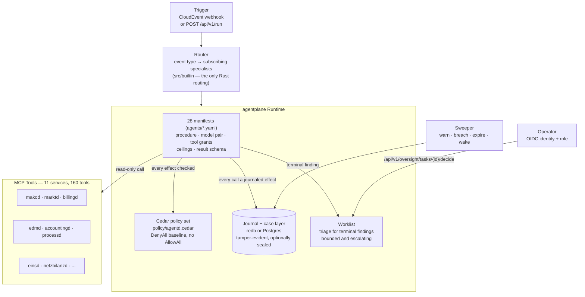
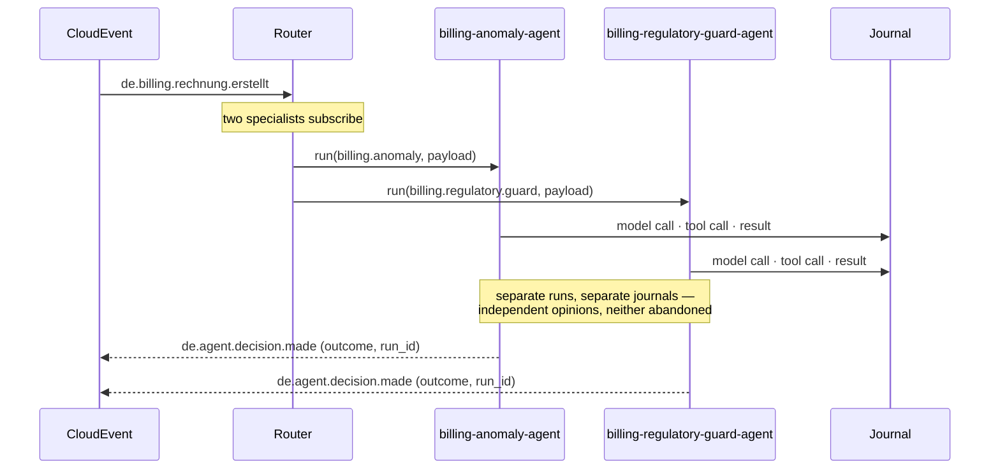
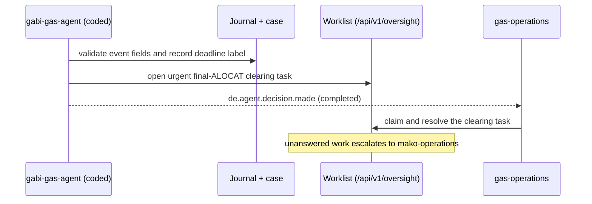
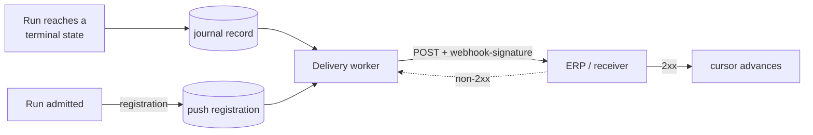

+++
title = "agentd Operator Guide"
description = "agentd operator guide: 28 specialist manifests on agentplane — typed results, durable triage, semantic trust labels and journal-backed runs."
weight = 38
+++
`agentd` is the **AI automation layer**. It connects language models to
[the production services](@/docs/services/_index.md) over MCP for analysis and
decision support. Every specialist is a **declarative manifest** run by
[agentplane](https://github.com/hupe1980/agentplane) 0.47, a journal-first
durable agent runtime: every model call and tool call is a journaled effect, so a
run resumes after a crash and replays for audit. As an MCP client it offers
protocol revision `2026-07-28` (`server/discover`), falls back to the
`2025-11-25` `initialize` handshake for servers that do not speak it, and
refuses a server that settles on any other revision.

Port: **`:9580`**

## The terms this page assumes

| Term | What it is |
|---|---|
| **Marktrolle** | the role an operator plays in the German energy market — **LF** (supplier), **NB** (grid operator), **MSB** (metering operator), **BKV** (balancing-group manager). `agentd` builds role-scoped, so an LF binary contains no NB specialist. See [Party Roles](@/docs/architecture/domain-model.md#party-roles-marktrollen) |
| **Marktlokation (MaLo)** | the delivery point a run is correlated on, identified by an 11-digit MaLo-ID — the unit a case, a memory subject and a GDPR erasure are all scoped to. See [Identifier Formats](@/docs/architecture/domain-model.md#identifier-formats) |
| **Frist / Werktag** | a regulated deadline counted in BDEW Werktage. Agent approval windows resolve through the same calendar the protocol daemon [`makod`](@/docs/services/makod.md) uses for an EDIFACT Antwortfrist |
| **APERAK** | the EDIFACT technical acknowledgement of a received market message. An APERAK timeout is one of the events that wakes `mako-agent` |

| Endpoint | Description |
|---|---|
| `POST /webhook` | Inbound CloudEvent trigger (Standard Webhooks-verified). Admits durably, then answers `202` with the run ids |
| `POST /api/v1/run` | Manual agent invocation (OIDC JWT **and** Cedar `api:run.start`; honours `Idempotency-Key`). Waits for the answer |
| `POST /api/v1/erasure` | Destroy a case wrapping key and/or forget a memory subject (OIDC + `api:erasure.execute`; reason required). `409` when a case is named and no `[keyring]` is configured; a key-service or memory-store failure is a `500` carrying an `error_id` |
| `GET /api/v1/agents` | Activated specialists and subscriptions. OIDC + `api:agent.list`; version and digest are in `/api/v1/agents/catalog` |
| `GET /api/v1/agents/catalog` | Every specialist compiled into this binary. OIDC + `api:agent.list` |
| `GET /.well-known/agents/{name}` | A2A Agent Card, derived from the manifest |
| `/api/v1/oversight/*` | The operator surface: worklist, runs, cases, breached obligations, event delivery (OIDC required) |
| `GET /health/live` · `GET /health/ready` · `GET /metrics` | Liveness, readiness, agentplane instruments (from the `mako_service` runner) |

---

## Key design decisions

### The manifest is the agent

A specialist is `agents/<name>.yaml`: procedure, model, each granted tool,
ceilings and the result schema. The manifest is digest-covered, so editing a
procedure is a version change a reviewer sees. The only Rust routing is the
subscription table in `src/builtin/mod.rs` — which CloudEvent types reach which
specialist. There are **no per-agent config overrides**: moving a decision to a
different model is a manifest edit.

### Two properties that matter for a regulated deployment

**The active plane is advisory.** All 151 grants are read-only. Model-backed
specialists collect evidence and return structured findings; terminal findings
open triage rows. An approved decision becomes an ordinary `makod` command, so
what goes on the wire is still a pure function of a recorded command.

**Trust is semantic.** MaLo and market-participant check digits, EIC check
characters, UUID v4 and real calendar dates are validated before a field is
promoted; free text, amounts, malformed identifiers and the tenant key stay
untrusted. `deadline-alert-agent` and `gabi-gas-agent` are coded skills with
zero inference spend and the same journal, policy, case and worklist controls.

### What the record is worth to somebody who is not us

| Mechanism | Answers | Configured by |
|---|---|---|
| Hash chain + Merkle root | Was *this* history edited? | always on |
| Per-record attestation | Which workload wrote each record? | `[attestation]` |
| Checkpoint cosignature | Does a *second* history exist? | `[witness]` |

Only the witness involves a party other than the operator: it cosigns a
checkpoint only when it provably extends the last one it saw, so a split view
becomes a refusal or two contradicting cosignatures. A witness you host
yourself proves nothing about you.

`plane::attest` signs records (store) and outward claims (runtime) from one key,
which the deployment supplies. An unattested plane starts with a warning;
`required = true` refuses. History written unattested stays unattested.

Witnessing runs **off the run path**, after sealing. A shortfall is reported as
a finding, and a witness that remembers a different history is reported even
when the quorum was met. Cosignatures stay at the witness: an auditor asks it
what it last cosigned for `mako/agentd/<tenant>`.

### Durability instead of a dead-letter queue

A failed run resumes from its last completed effect; there is no retry worklist
and no exhaustion event. `de.agent.decision.made` carries the real outcome in
the journal's own spelling — `succeeded`, `failed`, `exhausted`, `quarantined`,
`cancelled`, `abandoned`, `withheld` — see [CloudEvents emitted](#cloudevents-emitted).

### At-least-once delivery, at-most-once admission

Inbound delivery is at-least-once ([`marktd`](@/docs/services/marktd.md)'s fan-out
retries until 2xx, and an operator may replay a dead letter days later). A `202`
therefore means *this message will be acted on*: the policy gate, quota
reservation, case binding and admission-key claim all commit before
`POST /webhook` returns, and the body carries the run ids. A run then holds a
lease; a lapsed lease is resumed by the sweeper. `tests/it/ingest.rs` pins this:
a second delivery is answered with the first one's run the instant the first
call returns.

The status code is a retry instruction (mako's emitter retries 429 and 5xx):

| Answer | When | What the emitter does |
|---|---|---|
| `202` | at least one specialist admitted — the run ids are in the body | done; a retry meets the runs already holding its keys |
| `204` | nothing subscribes to this event type | done |
| `400` | `id`, `source` or `type` missing | dead-letters |
| `429` | nothing admitted, something transient — a `[quota]` ceiling reached; a problem body whose `admissions` holds each specialist's refusal | resends |
| `422` | nothing admitted and resending cannot help — a problem body whose `admissions` holds each specialist's refusal | dead-letters **now**, where an operator sees it |

Unknown refusals count as transient (`RuntimeError` is `#[non_exhaustive]`).
The admission key is the CloudEvent's `(source, id)` joined with the
specialist's name, claimed inside the transaction that appends the run's first
record; a refused admission spends no key. A duplicate is **answered** with the
original run, which matters most for a run parked on a four-eyes decision. Keys
are kept forever unless `admission_retention_days` is set.

### A2A Protocol compliance

Each specialist exposes an [A2A Agent Card](https://a2a-protocol.org/) at
`/.well-known/agents/{name}`, derived from the manifest by agentplane — its
skills and version are the declaration's.

### Fan-out

Several specialists subscribed to one event are independent opinions, each with
its own run and journal. There is **no first-wins mode**: cancelling the losers
could leave a mutating call with an unknown outcome, so every branch runs to
completion.

---

## Role scoping

`agentd` builds role-scoped: `role-lf`, `role-nb`, `role-msb`, no flags meaning
all roles. A role build **does not contain** the other arms' specialists, so it
cannot answer as a role it was not built for. The five cross-cutting specialists
(`mako-agent`, deadlines, compliance, process, regulatory reporting) carry no
gate.

| Build | Specialists |
|---|---|
| default (no flags) | all 28 |
| `role-lf` | 5 cross-cutting + 11 supply-side (billing, invoicing, contracts, tariffs, portal, VPP) |
| `role-nb` | 5 cross-cutting + 8 grid-side (NNE billing, Sperrung, EEG ×2, grid anomaly, MaBiS, GaBi Gas, einsd batch) |
| `role-msb` | 5 cross-cutting + 4 metering (MSB history, meter data, Ersatzwerte, SMGW diagnostics) |

`just clippy-roles` lints each profile and runs the guard test asserting the
exclusions. A worklist row may not cross arms either: desks are classified
supply, grid, metering or cross-cutting, and no compiled specialist hands a
finding to another arm's desk.

---

## Human oversight

A person enters an agent's loop in front of the answer or beside it:

| | **Approval** — in front of the answer | **Triage** — beside the answer |
|---|---|---|
| Declared as | `approval: tools-only` + `requires_approval` on the grant | `approval: none` + `oversight.triage` rules |
| What waits | the run suspends before the tool call | nothing; the run completes and returns |
| Who is asked | `oversight.approvers` | the rule's `audience` |
| When it fires | reaching a mutating tool | the answer matches a predicate over `output.schema` |
| Used by | — no active manifest grants a mutating tool | 18 specialists, on a terminal finding |

The two coded specialists reach the same worklist from Rust through
`StepCtx::open_task` (a manifest without `execution` cannot declare
`oversight`): same store, audience rules and escalation.

Triage exists because most specialists **cannot** act: a `tool-calling`
agent's arguments come from a model completion, which the taint gate refuses at
a mutating sink. A triage rule changes nothing about the run; its only effect
is a worklist row — a § 40 EnWG invoice-content violation, an EEG breach, a § 7a
Abs. 5 parity deviation, arrears at the § 41f threshold. A triage rule may
carry a predicate, `approval` may not. Every predicate `path` is typed against
the agent's own `output.schema` at parse time, and a schema that can report a
terminal finding with no rule to tell anyone fails a test.

The worklist itself is agentplane's operator surface, mounted at
`/api/v1/oversight`:

| Route | The question it answers |
|---|---|
| `GET /tasks` | What is waiting for me? |
| `GET /tasks/{id}` | What is this proposal, and may I decide it? |
| `POST /tasks/{id}/claim` · `/release` | This one is mine — don't duplicate the work |
| `POST /tasks/{id}/decide` | Approve or reject, **as myself** |
| `GET /runs?outcome=…` · `GET /runs/{run}` | What ended this way, and why is this one not finishing? |
| `GET /runs/live` · `GET /runs/waiting` · `GET /attention` | What is executing, what is waiting and for what, and what needs a person now? |
| `GET /runs/{run}/history` | The run's journal, record by record — its inputs, model exchanges and arguments |
| `GET /cases/{case}` | What has happened on this matter, and by when must it end? |
| `GET /obligations` · `POST /obligations/acknowledge` | What did we miss? — obligations in the `breached` state, and accounting for one |
| `GET /halts` · `POST /halts` · `POST /halts/lift` | The emergency stop: what stands, throw one, lift one |
| `GET /holds` · `POST /holds` · `POST /holds/release` | Legal holds: what is preserved, place one, release one |
| `GET /drill` | The last recovery rehearsal's verdict |
| `POST /runs/{run}/cancel` | Stop it, with a reason on the record |
| `POST /runs/{run}/reconcile` · `/reopen` · `/abandon` | A quarantined run: what actually happened, judge it again, or write it off |
| `GET /dead-letters` | Which message arrived that no run was waiting for? |
| `GET /push` · `POST /push/rearm` | Which receivers stopped acknowledging, and resume one |
| `POST /events` | This message arrived; wake whoever wanted it |

Controls on that surface:

- **An approval may carry an `amendment`, and it is the call** — labelled
  trusted, attributed to `task:agent.approve_call`, and put through the tool's
  schema, menus, ceilings and field rules. An approval without one releases
  nothing a trusted field demands.
- **The actor comes from the token, never the body.** Four-eyes is enforced in
  the task store: the proposer cannot approve, nor can the caller who started
  the run; a barred reviewer still sees the task, marked so. A decision may name
  the task `digest` it was made against, and is refused when the row changed
  since.
- **No OIDC, no surface.** Without OIDC the routes are not mounted.
- **Two-layer eligibility.** Cedar decides who may use the surface; the task
  store narrows by `candidate_roles`. A test parses the manifests and fails when
  an `oversight.approvers`, `triage[].audience` or `escalate_to` role is not
  admitted by the policy.
- **Every route is authorized** under its own `api:` verb (read, claim, decide;
  `POST /events` is the machine door). A test walks
  `agentplane::api::action::ALL` and fails on a verb granted to no role.
  `api:obligation.list` is held to `mako-operations` and `regulatory`, because
  `GET /obligations` does not narrow by domain — and so are
  `api:obligation.acknowledge`, `api:run.history` (a run's inputs and
  arguments, plane-wide), `api:drill.read`, `api:hold.list` and
  `api:hold.place`. Releasing a hold is what lets the next erasure destroy the
  matter, so `api:hold.release` is `regulatory`'s alone; throwing and lifting the
  emergency stop are `mako-operations`'. mako embeds its own Cedar set, never
  agentplane's shipped `serve-policy.cedar`, so that bundle's on-call grants do
  not reach this plane; a test in `plane::policy` holds each narrowing.
- **A quarantine has three verbs.** A run is quarantined when an effect's
  outcome cannot be established. *Reconcile* (look the outcome up; domain
  audience), *reopen* (judge again; an intervention) and *abandon* (close
  without unwinding; `mako-operations` / `regulatory`). Cancelling a
  quarantined run is refused.

The **sweeper** ticks every `sweep_interval_secs`: it warns on approaching
obligations, breaches passed ones, applies each overdue task's `on_expiry`,
wakes runs and dead-letters uncorrelated events. An approval expires with
`deny` (an unanswered window sends nothing); all eighteen triage specialists
declare `escalate` with an `escalate_to` audience, which joins the audience and
keeps the row waiting. A triage-only block declares no block-level `deadline`
and no `approvers`: each rule's own deadline bounds its row, and agentplane
refuses a field nothing reads.

`kind: working-days` resolves through mako's BDEW Werktage calendar — the same
holiday table and Europe/Berlin resolution as a [`makod`](@/docs/services/makod.md)
Frist — and the calendar's digest is journaled with the instant it produced.

---

## Cases, and erasure (GDPR Art. 17)

Every run is admitted with **correlation keys** from the event's re-validated
identifiers — `malo`, `melo`, `process` — so every run about one Marktlokation
joins one case; an event with none gets a case keyed on its CloudEvent id. The
case is the matter an operator reads, the retention unit and the erasure unit.

Runs are sealed: a key ring wraps journal, case state, buffered events and task
proposals, and erasing a case (`POST /api/v1/erasure`) destroys its wrapping
key — reaching backups and replicas too. Specialists are handed identifiers,
not customer records, and each declares `max_sensitivity_journaled`.

> **Deployment note.** Each erasure scope has its own HashiCorp Vault transit
> key, named `ap-` and the hex SHA-256 of the scope
> (`agentplane::keyring::VaultTransit::key_name`). Each must be configured with
> `deletion_allowed=true`; erasure against a default key fails loudly.

A plane with no key ring starts with a warning that personal data written to the
chain cannot be erased later; `[keyring] required = true` refuses instead.

---

## Where the trust boundary is

A CloudEvent payload comes from mako's own services, but almost everything in it
originated on the wire. A field is promoted to trusted only if `agentd`
**re-validates it at admission** against its defined format — an 11-digit MaLo,
a 5-digit Prüfidentifikator, a 33-character MeLo, a UUID mako generated.
Everything else is untrusted and names the event it arrived on. That is what
makes `protected_fields` with `require_trusted` meaningful: a re-validated
identifier satisfies it, a counterparty-authored string does not.

### Two shapes, and what each buys

| | `tool-calling` (26) | coded skill (2) |
|---|---|---|
| Input | whole payload, per-field labels | whole payload, per-field labels |
| Control flow | model chooses read-only evidence calls | Rust |
| Mutating grants | none | none |
| Model spend | bounded by the manifest | zero; `models: {}` |
| Best fit | open-ended investigation | total functions and event translation |

The coded skills declare `models: {}` and no `execution` block; their behaviour
is a registered skill in `agentd::skills`. `deadline-alert-agent` reads
`deadline_at` and `partner_mp_id` from `processd`'s read model, subtracts the journaled clock and
classifies — `BREACH` past the Frist, `CRITICAL` under 30 minutes, `WARNING`
under 2 hours, `COMPLIANT` beyond — tested at every boundary. The tool call and
the clock read are still journaled effects through the policy gate. A procedure
belongs in `skills/` when it is a total function of what the tools return.

> [!NOTE]
> A model-free agent declares **no** `max_tokens`. A zero ceiling reads as
> parsimony but means "exhausted before the first effect of any kind" — the
> tool call included. The ceilings that bind it are `max_steps`, `max_effects`
> and `max_wallclock_secs`.

### Every answer is a shape

All 28 specialists declare `output.schema`, and every schema is **closed**
(`additionalProperties: false`, pinned by a test). Every model-backed schema
also fits strict constrained decoding — each property listed in `required`, an
optional one spelled nullable (`type: [string, "null"]`, with `null` in its
`enum`) — so the Anthropic driver sends it as a strict tool and the model is
held to the shape while it writes, not only checked after. The runtime folds
the schema into the effect key and the manifest digest, so editing it reports
divergence on replay.

### The legal basis is part of the answer

A wrong citation is a wrong answer. Specialists **quote the service that
computes the number** where one exists (the
[Sperrauftrag queue](@/docs/services/processd.md#sperr-entsperrauftrag-queue-nb-role)'s
`frist_ueberschritten`, `energy-billing`'s `guthabenerstattung` for § 40c
Abs. 3) and **label anything else as an operating default**: § 60 Abs. 2 MsbG
names no substitution method and § 20 EnWG no straight-through rate.

### Knowledge is granted, not copied

mako's MCP servers publish 54 step-by-step prompts across 11 servers, and 25
specialists declare `context.prompts` against their own service instead of a
paraphrase in `constraints`. A context grant authorises no action but is
declared where a reviewer sees it. The three without one: the two coded skills,
and `vpp-billing-agent`, whose steps are fixed before anything untrusted is read.

### Memory, scoped to the party the run is about

`memory_formation.subject` is the unit `forget_subject` erases. Seven
specialists form memories: **five bind `$correlation/malo`** (`billing-anomaly`,
`grid-anomaly`, `meter-data`, `msb-history`, `payment-reconciliation`), so an
Art. 17 erasure destroys exactly one customer's pile; **two carry a literal**
(`compliance-agent`, `regulatory-reporting-agent`) because their subject is the
operator itself. A lint refuses any other literal and any binding the labeller
does not produce; an unresolvable binding fails the run. A plane registering a
memory-forming manifest without a memory store refuses to start. Formation reads
model output, so every remembering specialist declares a **quarantined** model;
no other specialist declares one.

### Nobody delegates

All 28 declare `topology: { mode: single, role: specialist }`: one agent, one
context, many tools. mako routes in Rust, so no agent hands off to another.

## Build-time guards

Four checks run in CI:

| Guard | Refuses |
|---|---|
| `cargo xtask check-tool-grants` | A grant naming a tool no MCP server declares; a `mutates` flag that disagrees with the server's own `read_only_hint`; a mutating grant on a `tool-calling` agent, which could never dispatch it |
| `cargo xtask check-prompt-tools` | A *procedure* instructing a call the manifest never granted — **and** a grant no procedure step mentions |
| `cargo xtask check-wire-timestamps` | A `time` value reaching a JSON wire as its component array instead of RFC 3339 |
| `plane::` unit tests | Seven kinds of declaration that read as correct and are not — listed below |

The `plane::` suite parses every manifest and refuses:

- a specialist in `agents/` that the Rust subscription table never wires up, or the reverse;
- an answer-schema object that names its fields and then accepts others;
- a model-backed answer schema outside strict constrained decoding;
- a finding code the procedure emits that its schema cannot carry;
- a memory subject that pools customers instead of binding `$correlation/malo`;
- a terminal finding no triage rule reports;
- a role a manifest names — approver, triage audience or `escalate_to` — that the Cedar
  policy set does not admit;
- a model id nobody reviewed.

`check-prompt-tools` reads each procedure *sentence* — an instruction verb
outside the backticks, no negation, a tool-shaped backticked name — because a
procedure naming an ungranted tool does not crash: agentplane reports the unknown
tool to the model, which improvises. Run both ways, it holds the grants and the
procedure to the **same set** — 151 grants across 28 manifests.

---

## Architecture



### One event, one run per subscribing specialist



### Deterministic GaBi triage

`gabi-gas-agent` is a coded specialist. The event is emitted only after makod's
workflow records a missing binding final ALOCAT, so no model or MCP lookup is
needed to reconfirm it.



---

## Specialists

Each row is a subscription in `src/builtin/mod.rs` paired with a manifest in
`agents/`. **Reach** is every tool the specialist may call, held to its
procedure by `cargo xtask check-prompt-tools`.

| Specialist | Capability | Shape | Reach | Subscribes to |
|---|---|---|---|---|
| `mako-agent` | `mako` | `tool-calling` | 7 on makod, marktd, processd | `de.mako.process.failed`, `de.mako.aperak.timeout`, `de.mako.aperak.*` |
| `deadline-alert-agent` | `deadline.alert` | **coded skill** (no model) | 1 on processd | `de.mako.process.failed`, `de.mako.aperak.timeout`, `de.obs.deadline.approaching` |
| `billing-agent` | `billing` | `tool-calling` | 9 on accountingd, billingd, invoicd, marktd | `de.invoic.receipt.disputed`, `de.accounting.mahnung.issued` |
| `netzbilanz-agent` | `netzbilanz` | `tool-calling` | 7 on marktd, netzbilanzd | `de.netzbilanz.invoic.drafted`, `de.netzbilanz.invoic.dispatched`, `de.netzbilanz.invoic.dispatch-overdue`, `de.netzbilanz.invoic.disputed` |
| `invoice-reconciliation-agent` | `invoice.reconciliation` | `tool-calling` | 6 on accountingd, billingd, invoicd | `de.invoic.payment.overdue`, `de.invoic.receipt.*` |
| `billing-anomaly-agent` | `billing.anomaly` | `tool-calling` | 6 on billingd, edmd | `de.billing.rechnung.erstellt` |
| `billing-regulatory-guard-agent` | `billing.regulatory.guard` | `tool-calling` | 5 on billingd, marktd, productd, vertragd | `de.billing.rechnung.erstellt` |
| `jahresabrechnung-agent` | `jahresabrechnung` | `tool-calling` | 7 on accountingd, edmd, marktd, productd | _manual / scheduled_ |
| `eeg-agent` | `eeg` | `tool-calling` | 4 on edmd, einsd, productd | `de.eeg.anlage.foerderung-auslaufend`, `de.messwert.reading.direct.stored` |
| `eeg-compliance-agent` | `eeg.compliance` | `tool-calling` | 5 on einsd | `de.eeg.anlage.*`, `de.eeg.verguetung.*`, `de.eeg.marktpraemie.*`, `de.eeg.compliance.*`, `de.eeg.veraeusserungsform.gewechselt` |
| `payment-reconciliation-agent` | `payment.reconciliation` | `tool-calling` | 4 on accountingd | `de.accounting.payment.due`, `de.accounting.bankruecklast`, `de.accounting.sepa.collection-rejected`, `de.accounting.sperrandrohung`, `de.accounting.sperrankuendigung`, `de.accounting.abwendung.angeboten`, `de.accounting.abwendung.gebrochen` |
| `compliance-agent` | `compliance` | `tool-calling` | 5 on processd | `de.obs.stp.parity.alert` |
| `msb-history-agent` | `msb.history` | `tool-calling` | 6 on edmd, marktd | `de.messwert.reading.quality.warning`, `de.messwert.reading.direct.stored`, `de.mako.process.completed`, `de.messwert.reading.order.failed`, `de.messwert.reading.delivery.overdue` |
| `meter-data-agent` | `meter.data` | `tool-calling` | 3 on edmd | `de.messwert.reading.quality.warning`, `de.mako.process.completed` |
| `grid-anomaly-agent` | `grid.anomaly` | `tool-calling` | 3 on marktd | `de.markt.nb-contract.updated`, `de.markt.malo.updated` |
| `tariff-optimization-agent` | `tariff.optimization` | `tool-calling` | 6 on billingd, edmd, productd | `de.billing.rechnung.erstellt`, `de.mako.process.completed` |
| `vertragd-agent` | `vertragd` | `tool-calling` | 9 on marktd, processd, productd, vertragd | `de.vertrag.*`, `de.mako.aperak.rejected`, `de.mako.process.failed`, `de.vertrag.ablauf.ankuendigung`, `de.vertrag.preisaenderung.ankuendigung` |
| `productd-agent` | `productd` | `tool-calling` | 6 on productd | `de.tarif.product.updated`, `de.tarif.angebot.abgelaufen`, `de.tarif.epex.missing` |
| `processd-agent` | `processd` | `tool-calling` | 7 on marktd, processd | `de.mako.process.initiated`, `de.mako.aperak.rejected`, `de.mako.process.failed` |
| `sperrd-agent` | `sperrd` | `tool-calling` | 6 on makod, processd | `de.accounting.sperrauftrag`, `de.sperr.*`, `de.mako.process.completed` |
| `portald-agent` | `portald` | `tool-calling` | 8 on accountingd, billingd, einsd, marktd | `de.billing.rechnung.erstellt`, `de.eeg.anlage.foerderung-auslaufend`, `de.accounting.mahnung.issued`, `de.vertrag.*` |
| `regulatory-reporting-agent` | `regulatory.reporting` | `tool-calling` | 5 on processd | _manual / scheduled_ |
| `replacement-value-agent` | `replacement.value` | `tool-calling` | 3 on edmd | `de.messwert.reading.quality.warning`, `de.mako.process.completed` |
| `mabis-agent` | `mabis.submission` | `tool-calling` | 7 on edmd, netzbilanzd | `de.mabis.submission.failed`, `de.mabis.korrekturbedarf.opened`, `de.messwert.reading.quality.warning` |
| `smgw-diagnostics-agent` | `smgw.diagnostics` | `tool-calling` | 5 on edmd, marktd | `de.messwert.cls.compliance-issue`, `de.messwert.smgw.cert.expiry-warning`, `de.messwert.reading.quality.warning`, `de.messwert.reading.direct.stored`, `de.mako.process.initiated`, `de.markt.geraet.konfiguration.updated` |
| `vpp-billing-agent` | `vpp.billing` | `tool-calling` | 3 on billingd, marktd | `de.vpp.dispatch.confirmed`, `de.vpp.settlement.berechnet` |
| `gabi-gas-agent` | `gabi.gas.balancing` | **coded skill** (no model) | 0 | `de.gabi.alocat.missing` |
| `einsd-batch-agent` | `einsd.batch` | `tool-calling` | 8 on edmd, einsd, productd | `de.eeg.settlement.batch-due`, `de.eeg.compliance.*`, `de.eeg.anlage.foerderung-auslaufend` |

Activate them with `[bundled_agents]`. A role-scoped build contains only its own
role's specialists, so `enable_all` never activates another Marktrolle's agents.

---

## Model providers

`agentplane` ships the drivers; `[providers.<name>]` supplies the credentials.
The key must match the `provider` a manifest's `spec.models` names.

| Provider | `backend` | Notes |
|---|---|---|
| Anthropic | `anthropic` | Claude — the default in every shipped manifest |
| OpenAI | `openai` | `api_base` overrides the endpoint (Azure, a gateway, a recording proxy) |
| Google Gemini | `gemini` | |
| Self-hosted | `chat-completions` | The OpenAI-compatible wire: TGI, vLLM, Ollama, llama.cpp. `api_base` is **required**; a local endpoint may have no key |
| AWS Bedrock | `bedrock` | Behind `--features bedrock`. Credentials come from the standard AWS chain, never from `agentd.toml` |

The table key is the name a manifest refers to; `backend` is the wire. So
`[providers.anthropic]` backed by `chat-completions` against your own vLLM
changes not one of the 28 manifests — and keeps customer data off a third-party endpoint
(Art. 28 / Art. 44 DSGVO). `agentd` refuses to start with no provider, an unknown
`backend`, a hosted driver with no key, or `chat-completions` without
`api_base`.

---

## Security

| Concern | Implementation |
|---|---|
| **`POST /api/v1/run` auth** | OIDC/JWT via `Claims`, with the deployment tenant pinned; startup refuses missing OIDC unless `allow_insecure_no_auth = true` |
| **`POST /api/v1/run` authorization** | Cedar `api:run.start`, from the same compiled set the runtime checks every effect against. `api:agent.list` gates the two inventory reads. A valid token is not a grant |
| **Oversight surface auth** | OIDC only — no dev mode. Not mounted when OIDC is disabled |
| **Oversight authorization** | Cedar `api:*` verbs; reading, claiming and deciding are separate, and `POST /events` is the machine door |
| **Effect authorization** | Cedar on every effect: server allowlist, secret-to-model refusal, delegation depth, no declassification. `DenyAll` baseline — there is no `AllowAll` |
| **Inbound webhook HMAC** | Standard Webhooks (`webhook-signature`) required in production; constant-time verification; 401 on mismatch |
| **Mutating tools** | None are granted by active manifests |
| **Admission** | payload fields are re-validated at the boundary; only identifiers that pass are trusted |
| **Authority-bearing arguments** | `protected_fields` with `require_trusted` — counterparty-derived values are refused |
| **Tool transport** | one MCP client per server, routed by the server component of a `tool://` grant, so a call cannot reach a different server offering the same tool name |
| **Personal data at rest** | Key ring seals journal, cases, events and task proposals; erasure destroys the case's wrapping key |
| **Egress ceiling** | `max_sensitivity_egress` and `max_sensitivity_journaled` per agent |
| **Record attribution** | `[attestation]` signs every journal record under the workload identity; unset is a startup warning, `required = true` a refusal |
| **Split-view detection** | `[witness]` submits checkpoints for cosignature over C2SP `tlog-witness`; a witness refuses a history that does not extend the one it saw |
| **Back-pressure** | `[quota] max_concurrent_runs`, reserved in the store at admission — durable, cross-instance, and released when a run suspends. 429 when exhausted |
| **Readiness** | `/health/ready` reads a journal checkpoint under a two-second ceiling — the store this plane cannot admit without, and the one the built-in database ping does not cover |
| **Arm boundary on a worklist row** | A role build asserts no compiled specialist hands a finding to another arm's desk, so a misconfiguration fails closed. The confidentiality duty of §§ 6a, 7a EnWG is the deployment's Cedar policy, enforced at runtime |
| **Declaration identity** | `/api/v1/agents` and `/agents/catalog` report each specialist's `version` and the digest over its canonical manifest, so a running plane can be checked against the file a reviewer approved |
| **Observability** | agentplane's instruments (runs by terminal status, policy denials, budget refusals, quarantines, breached obligations, open cases and tasks) are bridged onto `GET /metrics`. They are emitted at `info`: a `warn` deployment must admit `agentplane.metric=info` |
| **Manual-run timeout** | `session_timeout_secs` bounds a *manual* run's wait; `POST /webhook` waits for nothing. Each run stays journaled and resumable either way |
| **API keys** | `api_key`, `mcp_api_key`, `keyring.vault.token`, `audit_hmac_secret` are `SecretString` — never in logs or debug output. Bedrock credentials come from the AWS chain, not from config |
| **Grant truth** | `cargo xtask check-tool-grants` checks every `tool://` grant against the server's own `read_only_hint`, and refuses a mutating grant on a `tool-calling` agent |
| **Least privilege** | `cargo xtask check-prompt-tools` holds the grants and the procedure to the same set in both directions, so a specialist cannot hold a server's whole read surface again |

---

## Upgrading agentplane

agentplane is pre-freeze: a minor may change a durable format — id spellings,
chain digests, effect keys, sealed-envelope bindings, store schemas — with no
migration, and the store is then **recreated**, never opened in place. agentd
holds no production data a recreate loses beyond the runs themselves, so every
such upgrade takes the same steps:

1. **Drain.** Stop the emitters (or route `POST /webhook` away) and let running
   work conclude. A run still open after the upgrade does not resume: its
   declaration or policy-bundle digest moved, so agentplane quarantines it
   naming both, and its admission key does not deduplicate a redelivery under
   the new build.
2. **Keep what an auditor may ask for.** `agentplane export` with the *old*
   binary writes the journal to a file; keep that binary beside it, because
   `agentplane verify` of the same build is what checks it.
3. **Stop agentd and recreate the store.** redb: move the journal file aside.
   PostgreSQL: drop and recreate the database `journal.url` names — agentplane
   creates its schema on connect.
4. **Re-provision the Vault transit keys** when the key-name derivation moved:
   one key per erasure scope, named by `VaultTransit::key_name`, each with
   `deletion_allowed=true`.
5. **Witnesses.** The recreated log publishes under the same origin
   `mako/agentd/<tenant>`, and a witness holds every checkpoint to the last it
   cosigned, so its first submission is refused as an integrity failure —
   correctly: it is another history under that name. Arrange the reset with each witness
   operator before starting, or start with `[witness]` removed until they have.
6. **Start agentd.** Startup refuses a store this build cannot read before
   anything appends to it: redb refuses a file an earlier build wrote at open
   (its tables have other shapes), and for both backends the newest run must
   verify end to end under the running build
   (`Stores::refuse_an_unreadable_journal`, `tests/it/durability.rs`).

The `agentplane` operator CLI against the store takes `--store` as a path or a
`postgres://` URL with `--tenant`; `halt` and `hold` take `--actor`;
`reconcile` and `acknowledge` take `--reason`; a decision is
`decide <task> approve|reject`.

---

## Configuration

```toml
# agentd.toml
#
# Every top-level key comes before the first table header: TOML binds a bare
# key to the most recent table, and every config type is `deny_unknown_fields`.
#
# `tenant` scopes every store key and the erasure keys with them.
tenant          = "9900357000004"
public_base_url = "https://agentd.internal:9580"

session_timeout_secs = 300   # bounds a *manual* run's wait; /webhook waits for nothing
sweep_interval_secs  = 60    # warns, breaches, escalates, expires, wakes, recovers

mcp_api_key         = "env:AGENTD_MCP_API_KEY"
inbound_hmac_secret = "env:AGENTD_INBOUND_HMAC_SECRET"

# Where a completed run's decision is delivered, durably — see below.
audit_webhook_url = "https://erp.example/hooks/agent-decisions"
audit_hmac_secret = "env:AGENTD_AUDIT_HMAC"

# How long a claimed admission key is kept; absent means forever. A retired key
# admits its duplicate again. `0` is refused.
# admission_retention_days = 30

[http]
addr = "0.0.0.0:9580"

# ── Back-pressure ─────────────────────────────────────────────────────────────
# Per-tenant, reserved in the store at admission, so it holds across instances.
# A slot is released when a run seals, fails or *suspends*. Absent means
# unbounded (each run is still held to its manifest's `budgets`). Exceeding it
# answers /webhook 429.
[quota]
# max_concurrent_runs  = 64
# max_tokens_per_month = 200_000_000

# ── Who wrote each record ─────────────────────────────────────────────────────
# Required for [witness]. The key comes from you and is never minted here.
# `openssl rand -base64 32` produces a seed. Publish the public half.
# [attestation]
# required = true
# key_id   = "spiffe://mako/agentd"
# seed     = "env:AGENTD_SIGNING_SEED"

# ── Somebody else who saw the log grow ────────────────────────────────────────
# Requires [attestation].
# [witness]
# quorum        = 1     # zero is refused; above the witness count is refused
# interval_secs = 3600
# [[witness.witnesses]]
# name       = "witness.example.org"
# url        = "https://witness.example.org"
# public_key = "..."    # 32 bytes, standard base64

# ── Durable state ─────────────────────────────────────────────────────────────
# One backend holds the journal, the cases, the tasks, the timers and the
# events. Put it on persistent storage.
[journal]
backend = "redb"                        # a single instance
path    = "/var/lib/agentd/journal.redb"
# backend = "postgres"                  # several instances sharing one store,
# url     = "env:AGENTD_JOURNAL_URL"    # where Postgres arbitrates the fencing

# ── Model providers ───────────────────────────────────────────────────────────
# The key is the name a manifest's `spec.models` refers to; `backend` is the
# wire it speaks.
[providers.anthropic]
backend = "anthropic"
api_key = "env:ANTHROPIC_API_KEY"

# [providers.local]
# backend  = "chat-completions"
# api_base = "http://vllm:8000/v1"      # required — no default for your server

# ── Which specialists this deployment runs ────────────────────────────────────
# Prompts, models, tool grants, ceilings and subscriptions are the manifests'
# and the subscription table's; config only picks which specialists run.
[bundled_agents]
enable_all = true
# enable = ["mako-agent", "billing-anomaly-agent"]   # or name them

# ── Identity ──────────────────────────────────────────────────────────────────
# Required for the oversight surface and the roles `api:run.start` and
# `api:agent.list` are decided from. Startup refuses its absence unless
# allow_insecure_no_auth = true (development only).
[oidc]
issuer   = "https://keycloak:8080/realms/mako"
audience = "agentd"

# ── Sealing ───────────────────────────────────────────────────────────────────
# The wrapping key is created inside Vault and never leaves it. Omit and the
# plane starts unsealed, with a warning.
[keyring]
required = true
[keyring.vault]
address = "https://vault.internal:8200"
mount   = "transit"
token   = "env:VAULT_TOKEN"

# ── Authorization ─────────────────────────────────────────────────────────────
# Omit to use mako's own, embedded from policy/agentd.cedar. A file here
# *replaces* them: Cedar allows on any matching permit, so a least-privilege
# file cannot narrow one it inherited.
[policy]
# path = "/etc/agentd/policy.cedar"

# ── Tool transports ───────────────────────────────────────────────────────────
# Every server a manifest grants a tool on must appear here, or startup fails.
# A key may not contain `-` (agentplane reserves hyphens in tool wire names).
[mcp_servers]
makod       = "http://makod:8080/mcp"
marktd      = "http://marktd:8180/mcp"
processd    = "http://processd:8580/mcp"
billingd    = "http://billingd:9280/mcp"
edmd        = "http://edmd:8380/mcp"
invoicd     = "http://invoicd:8280/mcp"
accountingd = "http://accountingd:9380/mcp"
einsd       = "http://einsd:9180/mcp"
netzbilanzd = "http://netzbilanzd:8680/mcp"
productd    = "http://productd:9080/mcp"
vertragd    = "http://vertragd:9780/mcp"
```

A name in `enable` that matches no compiled specialist is a **startup failure**,
not an inactive agent. In a role-scoped build the usual cause is a name that
exists only in another Marktrolle's binary.

---

## Triggering an agent run

**Via CloudEvent webhook:**

```bash
curl -X POST http://agentd:9580/webhook \
  -H "Content-Type: application/cloudevents+json" \
  -H "webhook-id: $WEBHOOK_ID" \
  -H "webhook-timestamp: $WEBHOOK_TIMESTAMP" \
  -H "webhook-signature: $WEBHOOK_SIGNATURE" \
  -d '{
    "specversion": "1.0",
    "type": "de.billing.rechnung.erstellt",
    "source": "urn:mako:billingd:tenant:9900357000004",
    "id": "123e4567-e89b-12d3-a456-426614174000",
    "data": { "malo_id": "51238696012", "record_id": "..." }
  }'
```

`type`, `source` and `id` are required; reposting the same envelope answers
`202` with the run it already started.

**Manual run** — `agent` addresses one specialist directly, bypassing routing.
An `Idempotency-Key` makes a retried request answer with the run it already
started; without one, each request is its own event. A name no activated
specialist answers to is `404`, not an empty result:

```bash
curl -X POST http://agentd:9580/api/v1/run \
  -H "Authorization: Bearer $JWT" \
  -H "Content-Type: application/json" \
  -H "Idempotency-Key: dispute-R2026-001" \
  -d '{
    "agent": "billing-anomaly-agent",
    "event_type": "manual.billing.dispute-analysis",
    "input": { "malo_id": "51238696012", "note": "Invoice R2026-001 disputed" }
  }'
```

The payload is labelled the same way a webhook's is: `malo_id` re-validates and
is admitted trusted, `note` is free text and is not.

**Resolving triage** — what an operator's console does:

```bash
# What is waiting for me?
curl -H "Authorization: Bearer $JWT" \
  http://agentd:9580/api/v1/oversight/tasks

# Reserve it, then decide. No actor field: it comes from the token.
curl -X POST -H "Authorization: Bearer $JWT" \
  http://agentd:9580/api/v1/oversight/tasks/$TASK/claim
curl -X POST -H "Authorization: Bearer $JWT" -H "Content-Type: application/json" \
  -d '{"approved": true, "reason": "correction due today", "amendment": null}' \
  http://agentd:9580/api/v1/oversight/tasks/$TASK/decide
```

---

## CloudEvents emitted

| Event type | When |
|---|---|
| `de.agent.decision.made` | A run reaches a terminal state. Carries `{run, case, outcome, chain_head}` under a `tenantid` extension, with the run id as both `id` and `subject`. |

The answer is not in it: shipping a run's output would be an undeclared egress.
`chain_head` lets a receiver ask this plane to prove the run;
`GET /api/v1/oversight/runs/{run}` holds the reasoning. There is no `time`
attribute — time inside a run comes from journaled `clock.now` effects.

`outcome` is the journal's spelling of the conclusion (`RunStatus::as_str`):
`succeeded` for a completed run, and otherwise the word `POST /api/v1/run`
answers with — `failed`, `exhausted`, `quarantined`, `cancelled`, `abandoned`,
`withheld`. `quarantined` means an effect's outcome cannot be established (a
failure may be unwound, an unknown outcome may not); `abandoned` is that doubt
closed by a person; `withheld` is a run paused because the authority it acts
for was withdrawn by a `subject:` halt, resumed when the halt is lifted. The
manual-run answer adds `completed` (for `succeeded`), `suspended` (waiting for
a human or an event), `replanning`, `running` and `not-admitted`. A failed run carries
**`reason`**, absent (not `null`) on success — asserted in `tests/it/evidence.rs`.

---

## Decision delivery

When a destination is configured, every conclusion is delivered durably —
**the journal is the outbox.**



The registration is made at admission and the cursor advances **only on HTTP
2xx**, so a crash re-delivers rather than loses. A receiver past the retry
ceiling is **parked**, not deleted: rows and cursor survive and
`PushStore::parked` lists it; `POST /api/v1/oversight/push/rearm` resumes it.

```toml
audit_webhook_url = "https://erp.example/hooks/agent-decisions"
# Standard Webhooks: `webhook-signature: v1,<base64>` over
# `{webhook-id}.{webhook-timestamp}.{body}`, verifiable with
# `mako_service::webhook::verify_request`.
audit_hmac_secret = "env:AGENTD_AUDIT_HMAC"

# Mid-rotation only: deliveries carry both signatures; alone it is a startup failure.
# audit_hmac_secret_previous = "env:AGENTD_AUDIT_HMAC_OLD"
```

A bad key is refused at startup, naming the destination.
