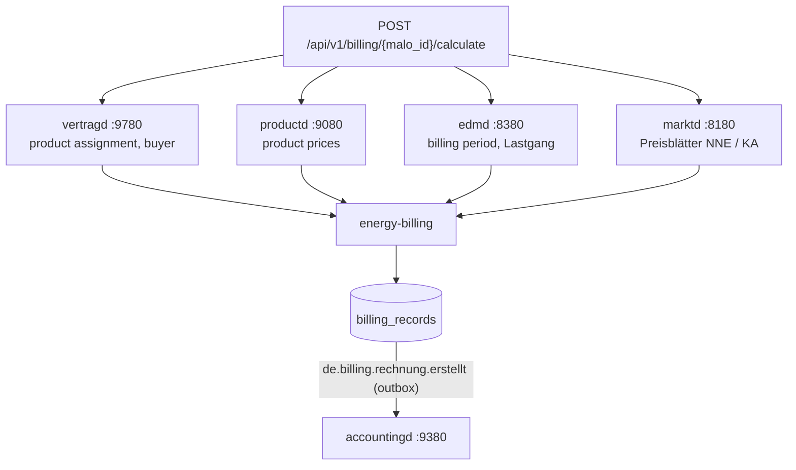
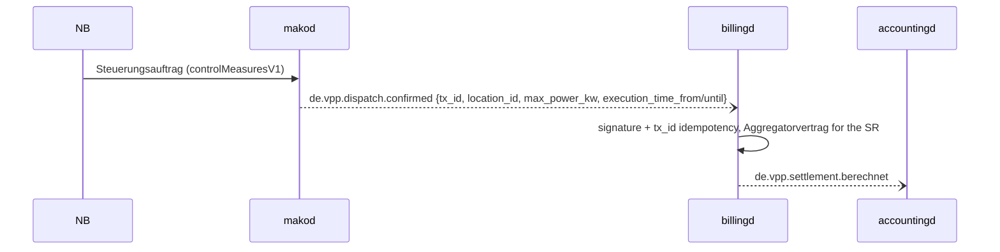

+++
title = "billingd Operator Guide"
description = "Operator guide for billingd, the LF multi-product billing engine: 13 product categories, §41a dynamic tariffs, §14a modules and EN 16931 e-invoicing."
weight = 32
+++
`billingd` is the LF's **billing service**, on port **`:9280`**. It holds no
grid topology and no business policy: prices come from the product in
`productd`, quantities from `edmd`, pass-through grid charges from `marktd`, the
customer from `vertragd`. Given the same inputs a run produces the same
`Rechnung`, so an auditor can re-run it (§ 147 AO / GoBD).

| Term | Meaning |
|---|---|
| **LF** | Lieferant, the role billingd runs as; see [Party Roles](@/docs/architecture/domain-model.md#party-roles-marktrollen) |
| **MaLo** | The delivery point billed, not the meter — see [MaLo vs MeLo](@/docs/architecture/domain-model.md#malo-vs-melo-the-critical-distinction) |
| **NNE** | Netzentgelt, a pass-through priced from the NB's Preisblatt |
| **EN 16931** | The European e-invoice model; XRechnung (German B2G CIUS) and ZUGFeRD (PDF/A-3 hybrid) are profiles of it, CII and UBL its syntaxes |
| **BO4E** | Every issued document is stored as a BO4E `Rechnung` and checked by [the BO4E gate](@/docs/architecture/domain-model.md#the-bo4e-gate) |

---

## The `energy-billing` engine

The arithmetic lives in the pure **`energy-billing`** crate (no I/O, no async):

```
billingd (HTTP service)
    │   config · persistence · CloudEvents · EN 16931 rendering · upstream clients
    └── energy-billing
            Product (13 variants) · Quantities · BillingContext · RegulatoryRates
            BillingEngine → Invoice { positions, warnings, netto, mwst, brutto }
            ├── ElectricityProvider          § 41a EPEX; HT/NT; block tariffs; RLM demand
            ├── ControllableLoadProvider     § 14a Modul 1/2/3 (WAERMEPUMPE, WALLBOX)
            ├── GasProvider                  § 25 Nr. 4 MessEV Brennwertkorrektur; BEHG CO₂
            ├── HeatProvider                 Fernwärme
            ├── WaterProvider                Trinkwasser 7 %; gesplittete Abwassergebühr
            ├── SolarProvider                Mieterstrom (§ 42a EnWG); GGV (§ 42b EnWG)
            ├── EegProvider                  LF-side Gutschrift
            ├── EinspeisungProvider          Direktvermarktung Marktwert
            ├── HemsProvider · EmobilityProvider · ServiceProvider
            ├── DynamicElectricityProvider   § 41a per-interval EPEX (iMSys guard)
            ├── EnergyShareProvider          § 42c Energiegemeinschaft credit
            └── MwStProvider                 per-position VAT (19 / 7 / 0 %)
```

`BillingEngine::bill()` returns `Result<Invoice, EngineError>`; every error has a
stable `code()` that billingd surfaces. `Invoice::to_rechnung()` yields a typed
`rubo4e::current::Rechnung` (`rechnungstyp`, `istStorno`,
`originalRechnungsnummer`, `faelligkeitsdatum`, `zuZahlen`, typed
`marktlokation`/`zaehler`/`vertrag`; mako facts as `zusatzAttribute`).

**`rechnungspositionen` are net supply lines only.** Tax goes to
`steuerbetraege`/`gesamtsteuer` and advances to `vorauszahlungen`/`zuZahlen`, so
the engine's `Tax` and `Abschlag` positions are not wire positions
(`BillingPosition::is_rechnungsposition`). `Info` positions stay — they carry
`net_eur == 0` and the § 40 EnWG Zählerstand and Brennwert lines.

**One rounding point per line.** The engine computes to 10⁻⁵ EUR;
`Invoice::from_positions` rounds each position's net to the cent **once**
(kaufmännisch, DIN 1333, `RoundingStrategy::MidpointAwayFromZero`), and the BO4E
`Rechnung`, the EN 16931 model and the tax breakdown are all derived from those
rounded lines — so they state the same totals and each Steuerbetrag is its
printed base × rate.

Quantity and unit price keep full precision.
`crates/energy-billing/tests/it/one_rounding_point.rs` pins it; `cargo xtask
check-rounding` refuses banker's rounding workspace-wide.

**Inputs are strict.** `GridInput` — the `grid` override on `/calculate` —
denies unknown fields: every field is optional and adds a position only when
set, so a mistyped key would otherwise bill no Netzentgelt at all.



---

## Product categories

All commercial prices come from `productd`. Statutory rates come from dated
series in `energy_billing::rates`; `billingd.toml` `[rates]` only fills a period
a series does not cover. A product may override the Stromsteuer and
Energiesteuer rate.

| Category | Positions |
|---|---|
| `STROM` | Grundpreis (ct/day), Arbeitspreis (ct/kWh), Leistungspreis (RLM, ct/kW/month); NNE Grund-/Arbeits-/Leistungspreis and Konzessionsabgabe from marktd; § 14a modules; Stromsteuer; MwSt. Eintarif, Zweitarif, Mehrtarif, § 41a dynamic |
| `WAERMEPUMPE` · `WALLBOX` | As `STROM` plus the § 14a positions |
| `GAS` | Brennwertkorrektur (`kWh_Hs = m³ × Hs × Z`), Grund-/Arbeitspreis, Gasnetzentgelt, Konzessionsabgabe, Bilanzierungsumlage, Energiesteuer, BEHG CO₂, MwSt |
| `WAERME` | Grundpreis (EUR/month), Leistungspreis (EUR/kW/month), Arbeitspreis (ct/kWh_th), CO₂ cost line |
| `WASSER` | Trinkwasser 7 %, gesplittete Abwassergebühr, Absetzungen |
| `SOLAR` | Mieterstrom / GGV supply price, contractual GGV-Preisvorteil, § 42a Abs. 4 cap |
| `EEG` | LF-side feed-in Gutschrift (Vergütung, Marktprämie, KWKG) |
| `EINSPEISUNG` | Direktvermarktung: Marktwert − Vermarktungsgebühr |
| `HEMS` · `EMOBILITY` · `ENERGIEDIENSTLEISTUNG` | Platform/operating fees plus per-event or per-kWh charges |
| `SHARING` | § 42c Energy-Sharing credit |

`productd`'s `BUNDLE` is decomposed into its components; it never appears as a
billed category. `Product` deserialises from productd's JSON on the
`"category"` discriminator; `product.build_engine(&grid, &rates)` builds the
engine.

### STROM

The supplier's Leistungspreis is **monthly**
(`leistungspreis_strom_ct_per_kw_month` × months, on `spitzenleistung_kw` from
edmd; RLM or iMSys). The passed-through NNE demand charge is **annual**
(`nne_leistungspreis_eur_per_kw_year` × the billed fraction of a year, § 17 Abs.
2 StromNEV Jahresleistungspreis).

Mixing the two under-bills twelvefold. Which Leistungspreissystem a price sheet
states (`JAHR` or `MONAT`) is the NB-side engine's business — see
[netzbilanzd](@/docs/services/netzbilanzd.md).

### § 14a EnWG modules

Numbered by **BK8-22/010-A** (NSAVER); BK6-22-300 governs the netzorientierte
Steuerung and numbers nothing.

| Modul | What it is | Field |
|---|---|---|
| 1 | Pauschale Reduzierung des Netzentgelts — flat annual amount, billed as quantity 1 „Jahr" × billed years | `sect14a_modul1_pauschale_eur_per_year` |
| 2 | Prozentuale Reduzierung des Arbeitspreises on the device's separately metered energy; Tenor 2. b) fixes the reduced price at **40 %** of the Niederspannungs-Arbeitspreis ohne Leistungsmessung | `sect14a_modul2_nne_reduktion_ct_per_kwh` |
| 3 | Zeitvariable Netzentgelte from 01.04.2025, Tarifstufen HT/ST/NT, iMSys required | `sect14a_modul3_nne_ht/st/nt_ct_per_kwh` |

Modul 1 is `80 EUR + 3 750 kWh × Arbeitspreis × 0,2` nationwide — no per-kW
component, so it fits an SLP heat pump. **Modul 1 + Modul 3 is the only pair.**
Refusals: `MODUL1_AND_MODUL2` (two forms of the base module),
`MODUL2_AND_MODUL3` (both re-price the Arbeitspreis), `MODUL3_AND_FLAT_NNE`,
`MODUL3_OHNE_MODUL1` (BK8-22/010-A offers Modul 3 only with Modul 1) and
`MODUL3_IMSYS_REQUIRED`.

A Steuerungsentschädigung (`sect14a_steuerungsentschaedigung_ct_per_kwh` /
`_eur_per_kw_year`) pays for a dispatch that happened and carries no module
number.

### GAS

```
Brennwertkorrektur      [info]       m³ × Hs × Z → kWh_Hs  (§ 25 Nr. 4 MessEV)
Grundpreis / Arbeitspreis            productd
Gasnetzentgelt GP / AP, KA, Bilanzierungsumlage   marktd
Energiesteuer Erdgas    series       § 2 Abs. 3 S. 1 Nr. 4 EnergieStG, 0.55 ct/kWh_Hs
                        or exemption notice (energiesteuer_tarif = BEFREIUNG,
                        §§ 25–28 EnergieStG, Erlaubnis nach § 24 Abs. 2)
Entlastungshinweis      [info]       § 53a / § 54 EnergieStG — billed in full; the customer files
CO₂-Abgabe BEHG         series       e.g. 60 EUR/t in 2026
MwSt
```

Supply `gas_meter.messung_qm3`, `brennwert_kwh_per_qm3` and `zustandszahl`.
`gasqualitaet` (`H_GAS` / `L_GAS`, from `marktd.malo.gasqualitaet`) is recorded
as a `ZusatzAttribut` and does not change the amount — the measured Brennwert
already reflects the gas (DVGW G 260). An H2-blend quality has no BO4E wire value
and is not representable.

### The nEHS price (BEHG)

The certificate price is auction-formed from 2026 (§ 10 Abs. 1 BEHG: weekly EEX
auctions from 01.07.2026 inside the § 10 Abs. 2 corridor of 55–65 EUR/t, then a
Verkaufsphase at 68 EUR/t). Resolution for a Gas or Fernwärme period:

1. productd's `GET /api/v1/nehs-prices/latest?date={period_from}` — only a point
   set in the period's own year;
2. the § 10 BEHG table (`energy_billing::behg_ct_per_kwh_for_year`): Festpreise
   2021–2025 and, for 2026, the § 4 Abs. 1 Nr. 2 CO2KostAufG Mittelwert of
   60 EUR/t;
3. a `[[rates.behg_eur_per_t]]` row covering the whole period;
4. otherwise **`RATE_REFUSED`**, naming the year and the missing price.

Before 2021 there is no CO₂ component. EUR/t becomes ct/kWh with the **delivery
year's EBeV Emissionsfaktor**, Brennwert-based because kWh_Hs is billed: Anlage 2
EBeV 2030 Nr. 6 (`3,2508 GJ/MWh` × `0,0558 t CO₂/GJ`) → **0.18139464 kg
CO₂/kWh_Hs**; EBeV 2022 (`0,056`) → 0.18204480 for 2021–2022. § 3 Abs. 2
CO2KostAufG requires the BEHG Standardwerte, so only the price is the
operator's.

**2027 has no statutory price.** `[rates] behg_regime` names the regime that
binds:

| `behg_regime` | Legal basis | A supplied 2027 price must |
|---|---|---|
| `rvo_bezugspreis` (default) | § 10 Abs. 3 Satz 2 Nr. 4/Nr. 5 BEHG in force — the „mengengewichteten Durchschnittspreis der Versteigerungen von Berechtigungen nach § 10 des Treibhausgas-Emissionshandelsgesetzes in dem jeweils vorletzten vorangegangenen Quartal" | be positive |
| `korridor` | § 10 Abs. 2 Satz 4 BEHG as the 3. BEHG-ÄndG (BT-Drs. 21/7869, a Gesetzentwurf) would word it: „Für die Jahre 2026 und 2027 … Mindestpreis von 55 Euro … Höchstpreis von 65 Euro" | lie within 55–65 EUR/t |

A 2027 Gas period with neither a 2027 series point nor a `behg_eur_per_t` row
is **refused** under either regime. Under `korridor` an out-of-corridor point is
refused, and an out-of-corridor row already at startup. The CO₂ line's legal
basis names the regime. `behg_gas_ct_per_kwh_override` on a product applies only
where the period has a lawful price.

**The § 3 Abs. 1 CO2KostAufG statement.** Every Gas and Fernwärme invoice
carries, beside the levy (Nr. 2), informational `co2kostaufg` positions: Nr. 1
Brennstoffemissionen (kg CO₂, derived from Nr. 3 × Nr. 4), Nr. 3
heizwertbezogener Emissionsfaktor (kg CO₂/kWh; a Wärmeprodukt's g/kWh is
converted), Nr. 4 Energiegehalt (kWh), Nr. 5 Hinweis auf die
Erstattungsansprüche nach § 6 Abs. 2 / § 8 Abs. 2.

Nr. 6 concerns the Vermieter's building (§ 43 GEG) and is not emitted.

### Statutory rates by year

| Tax | Rate | Series |
|---|---|---|
| Stromsteuer, § 3 StromStG | 2,05 ct/kWh (20,50 EUR/MWh) | 2003–2027 |
| Energiesteuer Erdgas, § 2 Abs. 3 Satz 1 Nr. 4 EnergieStG | 0,55 ct/kWh_Hs (5,50 EUR/MWh) | 2006–2027 |

`STROMSTEUER_SERIE` and `ENERGIESTEUER_GAS_SERIE` end at the last year the
statute was read for — each row names the provision and the reading date
(2026-10-05, no announced change for 2027).

**A 2028 period is refused** (`RATE_REFUSED`, naming the tax and year) by the
provider that bills that tax; a Strom invoice is never refused for a gas rate.
Nothing stands in: not the last row, not a default. Extend the series after
re-reading the statute, or add a dated `[rates]` row with its source. A product
override still wins.

Heating gas has been 0,55 ct/kWh_Hs throughout — the 2022
Energiesteuersenkungsgesetz and the time-limited Fassungen of § 68 EnergieStG
reach motor fuels only. VAT: `mwst_rate_for_period()` covers the 2020 16 %
window; `mwst_rate_for_gas_waerme_period()` adds the **7 % gas/Fernwärme window
01.10.2022–31.03.2024** (§ 28 Abs. 5/6 UStG).

### A period crossing a rate boundary is refused

A period straddling a statutory Stichtag has no correct single rate:

```json
{
  "error": {
    "code": "ZEITRAUM_UEBERSCHREITET_SATZGRENZE",
    "category": "GAS",
    "period_from": "2024-03-01",
    "period_to": "2024-04-30",
    "stichtage": ["2024-04-01"],
    "legal_basis": "§28 Abs. 5/6 UStG (Gas/Fernwärme), §10 BEHG"
  }
}
```

`energy_billing::steuer_stichtage_im_zeitraum` computes the Stichtage: the USt
windows (commodity-aware), the BEHG price step at every year boundary for gas,
and the 1 January after which a rate series ends. An explicit `[rates]
mwst_rate` suppresses the refusal at a **VAT** Stichtag only. The billing
pipeline normally splits such periods itself — see
[legs](#a-period-is-billed-in-legs).

### SOLAR — Mieterstrom and GGV

```
Arbeitspreis Solar      productd   ct/kWh
GGV-Preisvorteil        productd   contractual, § 42b Abs. 2 Nr. 2 EnWG
Preisobergrenze         [info]     § 42a Abs. 4 EnWG — 90 % of the Grundversorgungs-
                                   Arbeitspreis; a price above it is refused
Stromsteuer             none       § 9 Abs. 1 Nr. 3 StromStG, ground stated on the invoice
MwSt
```

The § 9 Abs. 1 Nr. 3 Befreiung (installations up to 2 MW, supply im räumlichen
Zusammenhang or self-consumption) is the default and is conditioned on the
customer's Erlaubnis (§ 9 Abs. 4); a non-qualifying supply sets
`stromsteuer_tarif = {"art": "REGEL"}`.

On a GGV invoice the allocated PV is exempt and the residual grid draw carries
full Stromsteuer. The Mieterstromzuschlag (§ 21 Abs. 3 EEG 2023) is the
Anlagenbetreiber's claim against the NB, settled by `einsd`, never a tenant
surcharge.

### EEG and EINSPEISUNG (LF side)

The `EEG` category bills **private** contracts where the LF is the contracting
party — the statutory § 51 regime is `einsd`'s. A contract that mirrors § 51
supplies `eeg_meter.kwh_during_negative_epex`; the KWKG Zuschlag is exempt.

A Kleinunternehmer (§ 19 UStG) operator's Gutschrift is 0 % with
`kleinunternehmer_19_ustg: true` — an election, not a function of plant size (§
12 Abs. 3 UStG zero-rates the PV system supply, which this engine does not
bill).

### Regulatory fields

| Field / finding | Law |
|---|---|
| `kleinunternehmer_19_ustg` → 0 % on a feed-in Gutschrift | § 19 UStG |
| `stromsteuer_tarif` → Befreiung or Ermäßigung | § 9 Abs. 1 / 2 / 3 StromStG |
| `steuerentlastungen` → note, levy billed in full | § 9a/9b/9c StromStG, §§ 53a, 54 EnergieStG |
| `grundversorgung_arbeitspreis_ct_per_kwh` → Mieterstrom cap | § 42a Abs. 4 EnWG |
| `waerme_co2_kosten_ct_per_kwh` → CO₂ line + § 3 Abs. 1 statement | CO2KostAufG § 3 |
| `settlement_form` → Endrechnung (BT-113 paid) or Restrechnung | § 14 Abs. 5 Satz 2 UStG; BMF 15.10.2024 Rn. 48 |
| `en16931_blocked` → paper or refusal | EN 16931 BR-O-11 ff.; § 27 Abs. 38 UStG |
| Statutory `Info` disclosures → BT-22 notes | CO2KostAufG § 3 · § 53a EnergieStG · § 40 Abs. 2 Nr. 6 EnWG · § 14 WPG · § 41a Abs. 6 EnWG |
| `ablesungsart` beside the readings | § 40 Abs. 2 Nr. 6 EnWG |
| `ZWEITARIF_OHNE_HT_NT_AUFTEILUNG` / `HT_NT_SUMME_WEICHT_AB` refused | § 41 EnWG |
| `preisgarantie_bis` disclosed | § 41 Abs. 1 Nr. 4 EnWG |
| `MeteringMode` (SLP/RLM/iMSys) | § 29 Abs. 1 Nr. 1 MsbG |
| `is_estimated` → hervorgehobener Hinweis | § 40a Abs. 2 Satz 3 EnWG |
| `zaehler_replaced` → Zählerwechsel notice | § 41 EnWG |
| `Sect41aAnnualComparison` | § 41a Abs. 6 EnWG |

### A product that cannot price its commodity is refused

`KEIN_ARBEITSPREIS` (Error severity) refuses a Strom, Gas or Fernwärme product
with no way to price energy — a renamed `preistyp` maps to `None` silently and
would bill only the Grundpreis and taxes. An operator who charges nothing states
`0.0`. `KEIN_TRINKWASSERPREIS` does the same for water priced only on the
Abwasser side.

---

## Billing a period

```http
POST /api/v1/billing/51238696012/calculate
Content-Type: application/json

{
  "lf_mp_id":   "9910000000002",
  "nb_mp_id":   "9900000000001",
  "period_from": "2026-06-01",
  "period_to":   "2026-06-30",
  "rechnungsnummer": "R2026-06-001"
}
```

billingd fetches the product assignment from vertragd (`GET
/api/v1/malo/{malo_id}/produkte?from=&to=`) priced by productd (`POST
/api/v1/products/{lf_mp_id}/resolve`), the reading from edmd (`GET
/api/v1/billing-period/{malo_id}`), and the NNE and KA sheets from marktd
(`/api/v1/preisblaetter/{nb_mp_id}`, `/api/v1/preisblaetter-ka/{nb_mp_id}`).

Any input can be passed in the body instead — `tariff`, `meter`, `grid`,
`gas_meter`, `waerme_meter`, `wasser_meter`, `solar_meter`, `eeg_meter`,
`hems_meter`, `emobility_meter`, `service_meter`, `eeg_gutschrift_eur`:

```http
POST /api/v1/billing/51238696012/calculate
Content-Type: application/json

{
  "lf_mp_id": "9910000000002",
  "nb_mp_id": "9900000000001",
  "period_from": "2026-06-01",
  "period_to": "2026-06-30",
  "meter": { "arbeitsmenge_kwh": "312.5", "sparte": "STROM" },
  "tariff": {
    "category": "STROM",
    "grundpreis_ct_per_day": "20.0",
    "arbeitspreis_ct_per_kwh": "32.0"
  }
}
```

`POST …/preview` runs the same pipeline without persisting, emitting or
consuming a number (placeholder `PREVIEW-{malo}-{period_from}`) and returns
`{ "preview": true, "netto_eur", "brutto_eur", "warnings", "rechnung" }`.

The Grundpreis is pro-rated when `vertragsbeginn` or `vertragsende` falls in
the period. Every run has a `billing_run_id`, stored on the record and as
`zusatzAttribute["mako:billing_run_id"]`.

### A period is billed in legs

| Split at | Detected from |
|---|---|
| a **Tarifwechsel** | vertragd reports several product slices in the period |
| a **statutory Stichtag** | a VAT or levy regime changes inside the period |

Each leg is billed under its own product and rates, with its **own meter
reading**, and the legs merge into one document (§ 41 Abs. 1 Nr. 4 EnWG asks for
old and new price with their periods).

The record is filed as `category = TARIFWECHSEL` with a `product_code` naming
every product (`STROM-ALT+STROM-NEU`). A leg whose reading the caller supplied
cannot be split further and is refused with the Stichtage named. The § 40b
sweep, `/calculate` and `/tarifwechsel` all take this path.

For a switch whose two readings the operator already holds:

```http
POST /api/v1/billing/{malo_id}/tarifwechsel
Content-Type: application/json

{
  "lf_mp_id":    "9910000000002",
  "period_from": "2026-01-01",
  "period_to":   "2026-01-31",
  "switch_date": "2026-01-15",
  "old_tariff":  { "category": "STROM", "arbeitspreis_ct_per_kwh": "28.0" },
  "new_tariff":  { "category": "STROM", "arbeitspreis_ct_per_kwh": "32.0" },
  "old_meter":   { "arbeitsmenge_kwh": "140" },
  "new_meter":   { "arbeitsmenge_kwh": "170" }
}
```

### § 41a dynamic tariff (iMSys)

With `dynamic_epex: true` on the product, billingd:

1. fetches the 15-minute **Bezug** from edmd
   (`GET /api/v1/energy/{malo_id}?direction=BEZUG&from=&to=`, Berlin-midnight
   bounds) — the register projection, never `/lastgang`, which would add
   Einspeisung, double-count `1.8.1`/`1.8.2` and price a kW register as energy;
2. fetches the 15-minute EPEX prices from productd
   (`GET /api/v1/epex-prices/{date}/quarter-hourly`, keyed on each MTU's UTC
   start);
3. bills `Σ kWh_MTU × (EPEX_MTU + auf_abschlag_ct_per_kwh) / 100`, with an
   optional `dynamic_epex_floor_ct_kwh` (`null` full pass-through, `0` no
   credit);
4. adds NNE, KA and Stromsteuer as usual. `arbeitspreis_ct_per_kwh` is ignored.

There is **no fallback**:

| Situation | Answer |
|---|---|
| No 15-minute series | `422 SECT41A_NO_LASTGANG` |
| edmd unreachable | `502 UPSTREAM_UNAVAILABLE` |
| Consumption intervals without a price | `422 VALIDATION_BLOCKED` / `SECT41A_MISSING_EPEX_PRICES` |
| Not an iMSys | `422 VALIDATION_BLOCKED` / `SECT41A_IMSYS_REQUIRED` (§ 41a Abs. 1) |
| Series empty against a meter reporting consumption | `SECT41A_KEINE_INTERVALLE` |
| Series misses the register total by > 0,5 % (1 kWh floor) | `SECT41A_INTERVALLSUMME_WEICHT_AB` |

Import EPEX prices daily into productd (`PUT /api/v1/epex-prices/{date}`).

---

## Issuing, numbering and correcting

### The Rechnungsnummer is a counter

`invoice_number_series (tenant, series, year)` issues the **fortlaufende**
number § 14 Abs. 4 Nr. 4 UStG requires; `year` is the billed period's year.

| Series | Document |
|---|---|
| `RE-2026-000123` | Rechnung — `/calculate`, Tarifwechsel, § 40b sweep, each participant line of a bundle |
| `SR-2026-000004` | Consolidated — Sammelrechnung, § 42b GGV bundle |
| `ST-2026-000002` | Storno |
| `VG-2026-000017` | § 41e Gutschrift |

A caller may state its own number. Numbers are drawn **before** the engine runs
under a row lock, so a refused calculation leaves a gap — lawful, since UStAE
14.5 Abs. 11 requires uniqueness, not gaplessness.

- **`br_unique_rechnungsnummer (tenant, rechnungsnummer)`** — a collision is
  `409 RECHNUNGSNUMMER_IN_USE`.
- **`br_unique_original`** — one live original per `(malo_id, lf_mp_id,
  period_from, period_to, product_code, tenant)`, excluding corrections, the
  children of a Sammelrechnung, `cancelled` rows and `category = 'VPP'`. Upserts
  repeat the predicate.

Re-running a request replaces the record **only while it is withheld**
(`outcome = 'generated'`). An issued record answers `409 PERIOD_ALREADY_BILLED`
naming `record_id`, `rechnungsnummer` and `outcome`. `outcome` becomes
`dispatched` on every release, with or without an ERP webhook.

### Korrekturrechnung (§ 147 AO / GoBD)

`POST /api/v1/billing/{id}/correction` with `{ "reason": "…" }` writes, in one
transaction, a record with every monetary field negated (`is_correction = true`,
`originalRechnungsnummer`, an `ST` number), enqueues
`de.billing.rechnung.erstellt` with `is_correction: true` (accountingd books the
credit), and sets the original's `outcome = cancelled`.

The negated document crosses the same
[`ensure_conformant`](@/docs/architecture/domain-model.md#the-bo4e-gate) gate as
an invoice; the § 41e VPP-Gutschrift does too.

Cancelling **releases the period**: call `/calculate` again for the corrected
amounts, which draws the next `RE` number. A second Storno is
`409 ALREADY_CANCELLED`; a record never issued is `409 NOT_YET_ISSUED` (no
receivable stands behind it — re-bill or release it). The original's content is
never modified; both documents stay for **eight years** (§ 147 Abs. 3 AO, from
01.01.2025).

### Risk gate

Every outgoing document — including Sammelrechnung and GGV bundles — is scored
by `billingd::risk` (`[risk]`, on by default) from coded findings: tax-sum
reconciliation, VAT-rate validity, zero energy or negative consumption (moved
energy, so feed-in credits count), estimate chains (§ 40a Abs. 2 EnWG), period
overlap or gap to the previous invoice, rolling deviation. The score is 0–100.

| Band | Default threshold | Effect |
|---|---|---|
| SAMPLE | `sample_at = 20` | Dispatched |
| REVIEW | `review_at = 50` | Listed in the review queue |
| HELD | `hold_at = 80` | Withheld until `POST …/release` |

`MWST_STICHTAG_IM_ZEITRAUM` and `BEHG_JAHRESGRENZE_IM_ZEITRAUM` are **blocking**
findings: they hold the invoice regardless of score, because no single rate is
correct for such a period. Thresholds are validated at start (`sample_at <
review_at < hold_at ≤ 100`);

`hold_dispatch = false` runs the gate in shadow mode. `GET
/api/v1/billing/review-queue` lists REVIEW and HELD; a release stamps `outcome =
dispatched`, `released_by`, `released_at` and sends the event.

---

## E-invoicing (EN 16931)

At bill time `Invoice::to_en16931(spec, seller, buyer)` builds the EN 16931
model from the rounded lines and billingd stores it in
`billing_records.en16931_json`.

The [`en16931`](https://docs.rs/en16931) crate derives BG-23 and BG-22 via
`reconcile`, and [`en16931-formats`](https://docs.rs/en16931-formats) writes CII
and UBL. Every render reads the stored model and answers `422` when it is
missing; nothing rebuilds it from BO4E.

| Render | Output |
|---|---|
| `GET …/{id}/xrechnung` | CII; profile `urn:cen.eu:en16931:2017#compliant#urn:xeinkauf.de:kosit:xrechnung_3.0` on the B2G path |
| `GET …/{id}/ubl` | PEPPOL BIS Billing 3.0 UBL 2.1 |
| `GET …/{id}/pdf` | ZUGFeRD PDF/A-3 (page + `factur-x.xml`) via outputd |

**BT-24 declares plain EN 16931** for a retail invoice: XRechnung needs a
Leitweg-ID (BT-10) and a Peppol endpoint (BT-49) a household lacks, and § 14
UStG requires EN 16931 conformance.

`POST …/submit-b2g` supplies the buyer and the `reference` Leitweg-ID, renders
with `cii::to_string_for(&model, &XRECHNUNG)` — which validates against the full
XRechnung 3.0 profile first — and on success emits
`de.billing.xrechnung.b2g.ready` for the ERP's PEPPOL gateway; a violation is
`422` with `violated_rules` and `buyer_gaps`.

**Per-line VAT.** Each line carries its own BT-151/BT-152; `Tax`, `Abschlag` and
`Info` positions are outside the base, and zero-rated bases (category `Z`) are
included so the bases sum to the net.

BO4E `steuerbetraege` come from `tax_subtotals_of` over the same lines and are
derived, never stored. Reverse charge (`steuerart = Rcv`, § 13b Abs. 2 Nr. 5
lit. b UStG) follows the customer master (`vertragd
kunden.stromwiederverkaeufer`); a request flag cannot switch it off.

| Rate | Case |
|---|---|
| 19 % | Standard supply |
| 7 % | Trinkwasser (§ 12 Abs. 2 Nr. 1 UStG); gas/Fernwärme only 01.10.2022–31.03.2024 |
| 0 % | Kleinunternehmer feed-in Gutschrift, § 19 UStG |

**Advances.** A Jahresabrechnung lists each paid Abschlag as a BO4E
`Vorauszahlung`; in CII, BT-113 `TotalPrepaidAmount` is their gross sum and
BT-115 `DuePayableAmount` = BT-112 − BT-113 (BR-CO-16).
`Invoice::abschlag_ust_eur` is the tax § 14 Abs. 5 Satz 2 UStG requires an
Endrechnung to state. `[billing] settlement_form` chooses `ENDRECHNUNG`
(default) or `RESTRECHNUNG`; a request may override it.

**Buyer (BG-7).** One recipient on the `BillingContext` feeds both the BO4E
document and the EN 16931 model. A partly known address is dropped to the name
plus `mako:adresse_unvollstaendig`. A vertragd outage falls back to naming the
supply site.

| Path | Buyer |
|---|---|
| Retail, GGV per Teilnehmer, VPP, Sammelrechnung line | The MaLo's customer — `vertragd` `GET /vertraege/by-malo/{id}` |
| Sammelrechnung document | The Rahmenvertrag holder — `GET /api/v1/rahmenvertraege/{id}/malos` |
| GGV bundle | The § 42b operator — `GET /api/v1/ggv/{ggv_id}/betreiber` (set with `PUT`) |

**Seller.** BT-23, BG-16 (means code 58 + `seller_iban`) and the `[seller]`
address/contact (BR-DE-2..7) are stamped from config; BT-9 is issue + 14 days (§
40c Abs. 1 EnWG); BG-14 carries the Leistungszeitraum (§ 14 Abs. 4 Nr. 6 UStG).

BT-34 is the operator's MP-ID under EAS `0088` only when
`Identifier::eas_checked` accepts it as a GLN; otherwise it is omitted and
logged (the B2G path then refuses). billingd runs `einvoice::validate` on every
model against its declared profile and logs findings.

### Paper only where § 27 Abs. 38 UStG admits it

A document with no EN 16931 representation (`en16931_blocked` — a category-`O`
Abwassergebühr beside a taxable line, BR-O-11 ff.) cannot be an E-Rechnung. The
E-Rechnung is owed „für eine Leistung an einen anderen Unternehmer für dessen
Unternehmen" (§ 14 Abs. 2 Satz 2 Nr. 1 UStG); § 27 Abs. 38 UStG grants paper
graces keyed on when the Umsatz was **ausgeführt** (the record's last day) and
when the paper is **übermittelt** (today, Europe/Berlin):

| Supply executed | Paper until | Condition |
|---|---|---|
| before 01.01.2025 | — | outside the new § 14 (§ 27 Abs. 1 Satz 1 UStG) |
| 2025–2026 | 31.12.2026 (Nr. 1) | — |
| 2027 | 31.12.2027 (Nr. 2) | the issuer's 2026 Gesamtumsatz (§ 19 Abs. 2 UStG) „nicht mehr als 800 000 Euro" |
| otherwise | — | an E-Rechnung is owed |

The render endpoints answer `422 MODEL_NOT_REPRESENTABLE` where paper is
admissible, naming the ground, and **`422 PAPIER_UNZULAESSIG`** where it is not.
A recipient who is no Unternehmer is outside the duty. Neither fact is assumed
when missing: the recipient comes from `billing_records.empfaenger_unternehmer`
(recorded from vertragd's `kundentyp`: `B2C` no, `B2B_*` yes), the Gesamtumsatz
from `[e_rechnung]`; an unrecorded year never admits paper.

```toml
[[e_rechnung.gesamtumsatz]]
jahr = 2026
eur  = "…"
```

The EDI grace of Nr. 3 belongs to the INVOIC issuers, not this path.

### The PDF and sending it

`GET …/pdf` sends the stored model, the CII XML and BT-24 to
[outputd](@/docs/services/outputd.md) (`POST /api/v1/render/INVOICE`), which
renders with the tenant's template and answers the PDF plus
`X-Mako-Template-Hash`. billingd validates the payload first (a B2G document
through `einvoice::render_xrechnung_cii`); an invalid model is `422`.

For an **issued** record the first render pins `billing_records.template_hash`
(`COALESCE`, never overwritten), so the PDF reproduces the sent document; a
pinned document answers `ETag` + `Cache-Control: immutable`. A draft pins
nothing.

`POST …/{id}/versenden` issues the invoice: outputd's
`POST /api/v1/documents/INVOICE` renders inside the call that stores the bytes
(§ 147 Abs. 1 Nr. 2–3 AO, eight years) and queues them on the customer's
channels. Idempotent on the Rechnungsnummer; a held draft is `409`.

### Invoice content

- **§ 40c Abs. 2 EnWG issue deadline:** six weeks after the billed period; six
  weeks after the end of the Lieferverhältnis for a Schlussrechnung; **three
  weeks** where § 40b Abs. 1 monthly billing applies — the agreed cadence
  (`"monatliche_abrechnung": true`, set by the sweep from `abrechnungszyklus`),
  never inferred from the period's length. Missing it raises
  `SECT40C_DEADLINE_EXCEEDED`.
- **§ 40c Abs. 1 Fälligkeit:** at the earliest two weeks after the request
  reaches the customer, so the due date runs from the issue date.
- **§ 40c Abs. 3 Guthaben:** offset against the next Abschlag or paid out within
  two weeks (always paid out from an Abschlussrechnung); stated as the
  `guthabenerstattung` ZusatzAttribut.
- **Schlussrechnung:** `"schlussrechnung": true` on `/calculate`, with
  `"abschlaege": [{datum, betrag_eur, ust_satz}]` each at its own rate (§ 14
  Abs. 5 UStG).
- **§ 40 Abs. 2 EnWG:** supplier identity plus the statutory hints
  (Schlichtungsstelle Energie § 111b EnWG, BNetzA Verbraucherservice,
  Energieberatung, § 41c Wechselhinweis) on every document.

### E-invoicing mandates

| Regime | Basis | Status |
|---|---|---|
| B2G (federal contracting authorities) | § 4a EGovG + ERechV (in force 27.11.2018), Directive 2014/55/EU | Mandatory since 27.11.2020; orders up to EUR 1 000 exempt (§ 3 Abs. 3 ERechV); Länder have their own rules |
| B2B (domestic) | § 14 UStG as amended by the Wachstumschancengesetz (27.03.2024) | Receiving since 01.01.2025; issuing from 01.01.2027 above EUR 800 000 prior-year turnover, from 01.01.2028 for all |

---

## § 40b scheduled runs

`[billing_runs]` (default off) sweeps daily after `run_hour_utc` (default 4).
vertragd supplies the active contracts and their `abrechnungszyklus` (`GET
/api/v1/vertraege/billing-candidates`).

For each contract the sweep walks back from the most recently completed period
(month, quarter, half-year, or the year before the `vertragsbeginn` anniversary
for `JAEHRLICH`) until it finds one already billed — a `cancelled` row does not
count — at most `catch_up_periods` (default 13), billing each through the
`/calculate` pipeline. `billing_run_log` keeps one row per tenant/LF/month with
`records_count`, `errors_count` (any error marks the month `failed`) and
`skipped_count`.

**Advances.** A Jahresrechnung deducts the paid Abschläge, each at its own rate
(§ 40 Abs. 1 EnWG, § 14 Abs. 5 Satz 2 UStG), read from accountingd
(`GET /api/v1/accounts/{malo}/abschlaege`). An unreachable accountingd is an
error. Without `accountingd_url` settling cadences are skipped unless
`jahresrechnung = true` declares that no advances are collected.

**Sending.** `versand` (default **true**) issues each invoice through outputd
outside the billing transaction; a failure is logged at `error` and retried with
`POST …/versenden`. A held invoice is never sent.

**§ 40b Abs. 3 EnWG.** With `abrechnungsinformation` (default true) iMSys MaLos
get the free monthly `de.billing.abrechnungsinformation.monatlich`, claimed once
per MaLo and month in `abrechnungsinfo_log` and released again on every path
that does not deliver.

---

## VPP dispatch settlement (§ 41e EnWG)

A confirmed WiM Steuerungsauftrag — JSON over the BDEW API-Webdienste Strom
`controlMeasuresV1` channel, run by makod as `wim-steuerungsauftrag`, no EDIFACT
and no Prüfidentifikator — reaches billingd as `de.vpp.dispatch.confirmed`. The
settlement is a **Gutschrift** (§ 14 Abs. 2 Satz 2 UStG): the aggregator pays the
flexibility provider. § 41e EnWG governs the contract; the remuneration is
contractual.



`POST /api/v1/webhooks/vpp-dispatch` settles **only when `sender_mp_id` is the
contracted `aggregator_mp_id`**: a § 14a Steuerung by the NB rides the same
channel and is recorded, not paid.

1. Register the Aggregatorvertrag in vertragd (an overlapping window for the
   same SR is `409`, `agg_no_overlap`):

   ```bash
   curl -s -X PUT "http://vertragd:9780/api/v1/aggregatorvertraege/C0001234567890" \
     -H "Authorization: Bearer <token>" \
     -H "Content-Type: application/json" \
     -d '{
       "vpp_id": "VPP-PORTFOLIO-001",
       "malo_id": "51238696012",
       "aggregator_mp_id": "9910000000002",
       "capacity_price_eur_per_kwh": "0.12",
       "vertragsbeginn": "2026-01-01",
       "vertragsende": null,
       "mwst_rate_override": null
     }'
   ```

2. Set `vpp_auto_billing = true` and `inbound_webhook_secret` in `billingd.toml`.
3. Subscribe billingd in marktd, with the same secret as the subscription's
   `webhook_secret`:

   ```bash
   curl -s -X PUT "http://marktd:8180/api/v1/subscriptions/billingd-vpp" \
     -H "Authorization: Bearer <token>" \
     -H "Content-Type: application/json" \
     -d '{
       "webhook_url": "http://billingd:9280/api/v1/webhooks/vpp-dispatch",
       "webhook_secret": "<the value of BILLINGD_INBOUND_HMAC_SECRET>",
       "event_types": ["de.vpp.dispatch.confirmed"]
     }'
   ```

`flexibility_kwh = max_power_kw × (execution_time_until − execution_time_from) /
3600`; without an end time billingd assumes **15 minutes** — an operating
default, not a statutory minimum.

The Gutschrift has `category = "VPP"`, `product_code = "VPP_{vpp_id}"`,
`rechnungsart = GUTSCHRIFT`, one `vpp_dispatch` credit position (legal basis `§
41e EnWG, Art. 17 RL (EU) 2019/944, VPP-Vertrag`), `zusatzAttribute` `vpp_id`,
`tx_id`, `sr_id`, `flexibility_kwh`, and a `VG` number; VAT runs through
`MwStProvider` with the contract's `mwst_rate_override`.

`vpp_dispatch_ledger (tx_id, tenant, record_id)` records each `tx_id` once and
is shared by the webhook and `POST /api/v1/billing/vpp/{vpp_id}`: a manual
`dispatch_events[]` entry with a `tx_id` already settled is reported
`skipped_already_settled`. A retried delivery answers `202`.

An event with neither `data.tx_id` nor a CloudEvent `id` is `400`. Without
auto-billing or a contract the dispatch is recorded in the ledger without a
document. agentd's `vpp-billing-agent` checks completeness, arithmetic and the
Art. 17 audit fields.

---

## Endpoints

| Method | Path | Description |
|---|---|---|
| `POST` | `/api/v1/billing/{malo_id}/calculate` | Bill, persist, emit |
| `POST` | `/api/v1/billing/{malo_id}/preview` | Dry run |
| `GET` | `/api/v1/billing` | Records (`?malo_id=&lf_mp_id=&outcome=&category=&is_correction=`, filtered in the query) |
| `GET` | `/api/v1/billing/{id}` | One record with its `Rechnung` |
| `GET` | `/api/v1/billing/{id}/xrechnung` · `/ubl` · `/pdf` | Renderings of the stored model |
| `POST` | `/api/v1/billing/{id}/versenden` | Issue to the customer via outputd |
| `POST` | `/api/v1/billing/{id}/correction` | Stornorechnung |
| `POST` | `/api/v1/billing/{malo_id}/tarifwechsel` | Hand-split Tarifwechsel |
| `POST` | `/api/v1/billing/sammelrechnung/{rahmenvertrag_id}` | B2B Sammelrechnung, one transaction, scored as a bundle |
| `POST` | `/api/v1/billing/ggv/{ggv_id}` | § 42b EnWG GGV run, one transaction |
| `POST` | `/api/v1/billing/vpp/{vpp_id}` | Manual § 41e settlement |
| `POST` | `/api/v1/webhooks/vpp-dispatch` | Signed `de.vpp.dispatch.confirmed` |
| `GET` | `/api/v1/billing/review-queue` | REVIEW and HELD, highest risk first |
| `POST` | `/api/v1/billing/{id}/release` | Release a held record |
| `POST` | `/api/v1/billing/{id}/submit-b2g` | XRechnung B2G (§ 4a EGovG i.V.m. ERechV) |
| `GET` | `/health/live` · `/health/ready` | Liveness; readiness |
| `POST/GET` | `/mcp` | MCP |

### Errors

One envelope, `{ "error": { "code", "message", … } }`:

| Code | Status | Meaning |
|---|---|---|
| `INVALID_PERIOD`, `INVALID_DATE`, `SWITCH_DATE_OUTSIDE_PERIOD` | 400 | Malformed, reversed or misplaced date |
| `FORBIDDEN` | 403 | Cedar denied |
| `RECORD_NOT_FOUND` | 404 | No such record in this tenant |
| `PERIOD_ALREADY_BILLED` | 409 | An issued document holds the period |
| `RECHNUNGSNUMMER_IN_USE` | 409 | § 14 Abs. 4 Nr. 4 UStG collision |
| `NOT_HELD`, `ALREADY_CANCELLED`, `NOT_YET_ISSUED` | 409 | Wrong record state |
| `ZEITRAUM_UEBERSCHREITET_SATZGRENZE` | 422 | Period straddles a Stichtag |
| `RATE_REFUSED` | 422 | No lawful statutory rate for the period (e.g. a 2028 tax, a 2027 nEHS price) |
| `VALIDATION_BLOCKED` | 422 | The engine refused; the body lists every blocking warning |
| `SECT41A_NO_LASTGANG` | 422 | Dynamic tariff without interval data |
| `NO_METER_DATA`, `NO_ACTIVE_PRODUCT` | 422 | edmd / productd has nothing |
| `TARIFSTAFFEL_OHNE_MENGE` | 422 | No Preisstaffel tier selectable (no or too low `jahresverbrauch_kwh`, or kW tiers) |
| `MODEL_MISSING`, `XRECHNUNG_NOT_CONFORMANT`, `BT24_NOT_AN_INVOICE` | 422 | Stored EN 16931 model absent or inconsistent |
| `MODEL_NOT_REPRESENTABLE` · `PAPIER_UNZULAESSIG` | 422 | No EN 16931 form; paper admissible · not admissible |
| `NUTZUNGSPLAN_INVALID`, `NUTZUNGSPLAN_INCOMPLETE`, `RABATT_EXCEEDS_ARBEITSPREIS` | 422 | GGV input that would mis-bill |
| `UPSTREAM_UNAVAILABLE` | 502 | An upstream did not answer; the body names it |
| `NO_ERP_WEBHOOK` | 503 | B2G submission with nothing to transmit it |

---

## Authorization

`policies/billingd.cedar`; every business route checks one action, tenant
equality is part of every rule, and Cedar is default-deny.

| Action | Routes | Roles |
|---|---|---|
| `read-billing` | `GET /api/v1/billing…`, review queue, renderings | any caller of the tenant |
| `preview-billing` | `…/preview` | any caller of the tenant |
| `run-billing` | `/calculate`, `/tarifwechsel`, `/sammelrechnung/…`, `/ggv/…` | `LF`, `MSB`, `ESA` |
| `issue-billing` | `…/versenden` | `LF`, `MSB`, `ESA` |
| `settle-flexibility` | `/billing/vpp/{vpp_id}` | `LF`, `MSB`, `ESA` |
| `correct-billing` | `…/correction` | `LF`, `MSB`, `ESA` |
| `release-billing` | `…/release` | `LF`, `MSB`, `ESA` |
| `submit-b2g` | `…/submit-b2g` | `LF`, `MSB`, `ESA` |
| `use-mcp` | `/mcp`, after the `[mcp]` / OIDC credential check | any caller of the tenant |

The VPP webhook is signature-authenticated and carries no Cedar action.
`mako_roles` are market roles, so the policy cannot separate „may bill" from
„may release"; `released_by` / `released_at` keep releases attributable.

---

## MCP server

`/mcp` (Streamable HTTP 2025-11-25): **eleven tools** and six prompts, every
tool **read-only**, run in process. There is no `calculate_billing`: issuing a
Rechnung is a legally binding act for an OIDC identity, not a model.

| Tool | Description |
|---|---|
| `list_billing_records` | Records of a MaLo (summary) |
| `get_billing_record` | Full `Rechnung` of one record |
| `preview_billing` | The `/preview` pipeline |
| `get_xrechnung` | CII from the stored model |
| `check_billing_anomaly` | Rolling 3-month deviation check |
| `list_vpp_settlements` | § 41e settlements (filtered in the query) |
| `list_corrections` | Storno chains (filtered in the query) |
| `list_product_categories` | The 13 categories and their fields |
| `get_billing_summary` | Aggregates per MaLo or LF, each euro once |
| `validate_tariff_config` | Engine validation (incl. `KEIN_ARBEITSPREIS`), § 41a iMSys guard, § 42 Energiemix disclosure |
| `explain_invoice_position` | `PositionTrace` of a position |

Prompts: `order-to-cash`, `preview-invoice`, `check-dynamic-tariff`,
`14a-steuerungsrabatt`, `eeg-billing`, `gas-billing`. agentd's
`tariff-optimization-agent` uses `list_billing_records` and
`get_billing_summary`.

---

## Database

| Table | Purpose |
|---|---|
| `billing_records` | `id`, `malo_id`, `lf_mp_id`, `product_code`, `category`, `rechnungsnummer`, `period_from/to`, `rechnung_json` (BO4E), `en16931_json` (model), `en16931_blocked`, `empfaenger_unternehmer`, `bo4e_version`, totals, `outcome` (`generated` → `dispatched` → `paid`/`partial`/`disputed`; `cancelled`), `risk_score/band/findings`, `released_by/at`, `template_hash`, `billing_run_id` |
| `invoice_number_series` | `(tenant, series, year)` → `last_value`, allocated by upsert under a row lock |
| `vpp_dispatch_ledger` | `tx_id` (PK), `tenant`, `record_id` |
| `billing_run_log` | Monthly sweep audit |
| `abrechnungsinfo_log` | § 40b Abs. 3 claims |

`template_hash` is a plain value because it crosses a service boundary;
outputd's append-only template store keeps it resolvable.

---

## Configuration

```toml
port          = 9280
tenant        = "9910000000002"

productd_url  = "http://productd:9080"    # required
edmd_url      = "http://edmd:8380"        # required
marktd_url    = "http://marktd:8180"      # required
vertragd_url    = "http://vertragd:9780"  # product assignment, buyer
outputd_url     = "http://outputd:9880"   # render and issue
accountingd_url = "http://accountingd:9380" # paid Abschläge

# § 14 Abs. 4 Nr. 2 UStG: one of the two is required, or billingd refuses to start.
seller_name       = "Stadtwerke Musterstadt GmbH"
seller_vat_id     = "DE123456789"          # BT-31
seller_tax_number = "123/456/78901"        # BT-32
seller_iban       = "DE89370400440532013000" # BT-84, BG-16
seller_bic        = "COBADEFFXXX"          # BT-86

erp_webhook_url        = "http://erp:8000/webhooks/billing"
vpp_auto_billing       = false
inbound_webhook_secret = "env:BILLINGD_INBOUND_HMAC_SECRET"

# ── Tables follow; TOML binds a bare key to the most recent header ──────
[seller]   # BG-5 / BG-6, one EN 16931 term per key (BR-DE-2..7)
street    = "Musterweg 1"
post_code = "12345"
city      = "Musterstadt"
country   = "DE"
phone     = "+49 30 123456"
email     = "rechnung@example.de"

[rates]
mwst_rate    = "0.19"
behg_regime  = "rvo_bezugspreis"   # or "korridor"
# A dated, sourced row fills a period no statutory series covers. A row for a
# covered year, an overlapping row or a row without `quelle` is refused at
# startup; a BEHG row is checked against behg_regime.
# [[rates.behg_eur_per_t]]
# von    = "2027-01-01"
# bis    = "2027-03-31"
# wert   = "…"            # EUR/t
# quelle = "…"
# [[rates.stromsteuer_ct_per_kwh]]        # ct/kWh, same shape
# [[rates.energiesteuer_gas_ct_per_kwh]]  # ct/kWh_Hs, same shape

[billing_runs]
enabled = false

[database]
url = "postgresql://billingd:secret@db:5432/billingd"
```

Further keys: `*_api_key` for each upstream, `erp_hmac_secret`,
`min_meter_coverage_pct`, `vergleichsgruppe_kwh_pro_jahr` /
`vergleichsgruppe_label`, `[billing] settlement_form`, `[e_rechnung]`, `[risk]`
(`enabled`, `hold_dispatch`, `sample_at`, `review_at`, `hold_at`), `[mcp]`,
`[oidc]`, `allow_insecure_no_auth`.

`[rates]`, `[seller]`, `[e_rechnung]`, `[billing_runs]` and `[risk]` deny
unknown fields — a year-less
`stromsteuer_ct_per_kwh = "2.05"` is refused at startup. The top level does not:
a `mwst_rate` written above the first table header binds to nothing. The removed
free-text `seller_address` / `seller_contact` keys are refused at startup, naming
their replacements.
