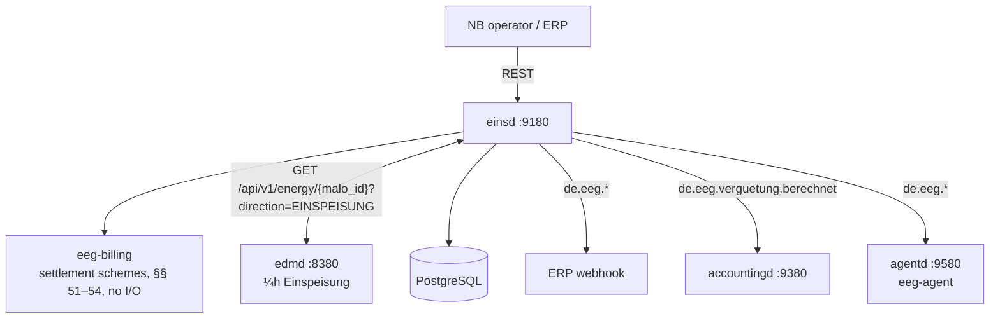
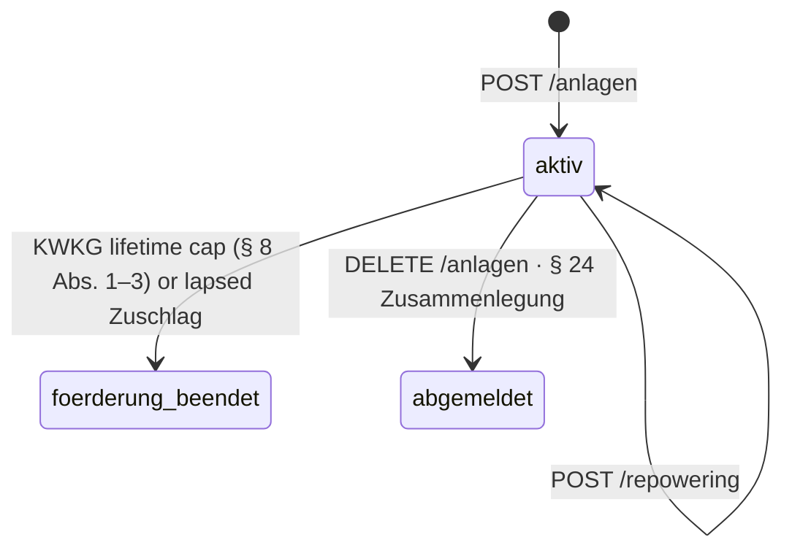

+++
title = "einsd Operator Guide"
description = "Operator guide for einsd, the EEG/KWKG feed-in settlement daemon: plant registry, §51 Negativpreisregel, §52 Pflichtzahlungen, 20 MCP tools, eeg-agent."
weight = 28
+++
`einsd` is the **Einspeiser registry and EEG/KWKG settlement daemon** for the
Netzbetreiber, on port **`:9180`**.

It registers feed-in plants under every EEG (2000–2023) and CHP plants under the
KWKG, settles them monthly under **12 settlement models** on the ten formula
schemes of
[`eeg-billing`](https://github.com/hupe1980/mako/tree/main/crates/eeg-billing)
(pure, `Decimal` only, no I/O), and issues the § 14 UStG Gutschrift each payment
rests on.

**Einspeisevergütung** is the fixed tariff the NB pays for fed-in electricity;
in **Direktvermarktung** the operator sells on the market and the NB pays a
**Marktprämie**. Which applies is the plant's **Veräußerungsform** (§ 21b EEG
2023).



---

## EEG versions

`eeg_anlagen.eeg_gesetz` (stored as 0, 2000, 2004, 2009, 2012, 2017, 2021 or
2023; `from_db_year()` maps intermediate years, e.g. 2018 → 2017) selects the
law-year rules — the § 52 regime and the § 100 Übergangsbestimmungen — through
the `EegGesetz` enum (`Kwkg`, `Eeg2000` … `Eeg2023`).

**§ 51 is not one of them.** The Solarspitzengesetz rewrote § 51 on 25 February
2025, inside the EEG 2023 range, so § 51 is keyed on the **Inbetriebnahmedatum**
by `NegativpreisRegime::fuer_inbetriebnahme` — see [§ 51](#negativpreisregel).

Bestandsschutz follows § 100 EEG (§ 100 Abs. 1 Satz 4 EEG 2017, § 100 Abs. 2
Nr. 13 EEG 2021, § 100 Abs. 1 EEG 2023).

For a plant under a specific § 100 provision, supply
`tariff_source = Transitional(rule)`; `SettleInput::effective_eeg_gesetz()` and
`SettleInput::negativpreis_regime()` then derive both from the rule rather than
from the plant record:

| `Paragraph100Rule` | Effective regime | Source |
|---|---|---|
| `Pre2016Bestandsschutz` | § 51 never applies | § 100 Abs. 1 Satz 4 EEG 2017 |
| `Eeg2017Negativpreis6h` | ≥ 6 h, 3 MW/500 kW | § 100 Abs. 2 Nr. 13 EEG 2021 |
| `BiomassOldFuelClassContinuation` | EEG 2017 — old §§ 42–44 fuel rules | § 100 Abs. 6 EEG 2023 |
| `SmallBiomassBelow150kw` | EEG 2017 — small biomass FiT | § 100 Abs. 11 EEG 2023 |
| `OldPlantBeforeEeg2023` | ≥ 4 h, 500 kW (all types) | § 100 Abs. 1 EEG 2023 |
| any other | the plant's own commissioning date | — |

### § 53 Vergütungsabzug and the rate table

The Einspeisevergütung deducts a flat amount from the gross anzulegender Wert
(AW): **−0,4 ct/kWh** for solar and wind, **−0,2 ct/kWh** for biomass, hydro and
the gases. `verguetungssatz_ct` always stores the **net** rate
(`eeg_billing::rates::sect53_deduction(ErzeugungsArt)`). § 53 does not apply to
Direktvermarktung, `POST_EEG_SPOT` or KWKG. There is no additive
Managementprämie: marketing costs are folded into the AW.

`eeg_verguetungssaetze` is generated from the Startwerte as enacted, stepped
down by each statute's Absenkung, and stored net:

| Erzeugungsart | § EEG 2023 | Shape |
|---|---|---|
| Wasserkraft | § 40 Abs. 1 | seven tiers, 12,03 → 3,37 ct |
| Deponie-, Klär-, Grubengas | § 41 Abs. 1 / 2 / 3 | one ladder each |
| Biomasse | § 42 Satz 1 | 12,67 ct ≤ 150 kW; above that, tender |
| Bioabfall- / Güllevergärung | § 43 / § 44 | separate, higher claims |
| Geothermie | § 45 Abs. 1 | flat 25,20 ct |
| Solar | § 48 | in the version § 101 Abs. 1 Satz 2 keeps in force |

There is no wind-onshore row: § 22 Abs. 2 makes the claim depend on a BNetzA
Zuschlag and § 36h derives the value from it, so an awarded value is imported
per plant. `eeg_billing::seed::verguetungssatz_rows()` projects
`eeg_billing::rates` into the seed and `tests/it/verguetungssaetze_seed_guard.rs`
compares the migration row for row.

---

## Generator types and settlement models

| `erzeugungsart` | Technology | Legal basis |
|---|---|---|
| `SOLAR_AUFDACH` | On a Gebäude or Lärmschutzwand (zweites Segment, § 3 Nr. 41b) | § 48 Abs. 2 / 2a EEG 2023 |
| `SOLAR_FREIFLAECHE` | Freiflächenanlage (erstes Segment, § 3 Nr. 41a) | § 48 Abs. 1 / 1a EEG 2023 |
| `SOLAR_AGRIPV` | Agri-PV, a besondere Solaranlage | § 48 Abs. 1 S. 1 Nr. 5 lit. a + Abs. 1b EEG 2023 |
| `SOLAR_MIETERSTROM` | Building community solar | § 21 Abs. 3 + § 48a EEG 2023 |
| `SOLAR_STECKER` | Steckersolargerät ≤ 2 kW and ≤ 800 VA | § 8 Abs. 5a EEG 2023 |
| `WIND_ONSHORE` | Wind an Land | § 46 (AW) · § 36 (Gebote) EEG 2023 |
| `WIND_OFFSHORE` | Wind auf See | Windenergie-auf-See-Gesetz (§ 22 Abs. 1) |
| `BIOMASSE` / `BIOMASSE_HOLZ` | Solid biomass | § 42 EEG 2023 |
| `BIOGAS` / `BIOMETHAN` | Fermentation / upgraded gas | § 42 (Biomethan excluded by Satz 2) · § 43 · § 44 |
| `KLAERGAS` / `GRUBENGAS` / `DEPONIEGAS` | Sewage / mine / landfill gas | § 41 Abs. 2 / 3 / 1 EEG 2023 |
| `WASSERKRAFT` / `GEZEITEN` | Hydro, tidal (§ 3 Nr. 21 lit. a) | § 40 EEG 2023 |
| `GEOTHERMIE` | Geothermal | § 45 EEG 2023 |
| `KWKG` | Combined heat & power | § 7 KWKG 2023 |

There is no generic `SOLAR`: the § 48 rate depends on the Bauform. Every plant
also carries a `verguetungsform` (`UEBERSCHUSS` · `VOLLEINSPEISUNG` ·
`KWK_ZUSCHLAG`) — Überschuss and Volleinspeisung differ by the § 48 Abs. 2a
bonus (8,11 vs 12,87 ct/kWh net for a ≤ 10 kWp roof plant in the 1 February
2024 window).

One token per model in `eeg_anlagen.settlement_model` and on every receipt; the
schema `CHECK` and `einsd::models::ALL` are pinned equal by
`tests/it/schema_code_guard.rs`.

| `settlement_model` | Regulation | Formula | CloudEvent |
|---|---|---|---|
| `VERGUETUNG` | § 21 Abs. 1 EEG 2023 | `kwh × verguetungssatz_ct / 100` | `de.eeg.verguetung.berechnet` |
| `AUSFALLVERGUETUNG` | § 21 Abs. 1 Satz 1 Nr. 3 | same, reduced 20 % (§ 53 Abs. 3) | `de.eeg.verguetung.berechnet` |
| `MIETERSTROM` | § 21 Abs. 3 | `kwh × (verguetung + mieter_zuschlag) / 100` | `de.eeg.verguetung.berechnet` |
| `GGV` | § 42b EnWG | § 21 rate on the grid feed-in at the GGV MaLo | `de.eeg.verguetung.berechnet` |
| `DIREKTVERMARKTUNG` | § 20 | Anlage 1 gleitende Marktprämie | `de.eeg.marktpraemie.berechnet` |
| `AUSSCHREIBUNG` | § 22 | the same, AW from the BNetzA tender | `de.eeg.marktpraemie.berechnet` |
| `SONSTIGE_DIREKTVERMARKTUNG` | § 21a | EUR 0 | — |
| `POST_EEG_SPOT` | after the Förderdauer | `kwh × Marktwert_ct / 100` (configurable floor) | `de.eeg.verguetung.berechnet` |
| `EIGENVERBRAUCH` | no grid feed-in | EUR 0 | — |
| `KWKG_ZUSCHLAG` | § 7 KWKG 2023 | `eligible_kwh × rate / 100`, hour-capped | `de.eeg.verguetung.berechnet` |
| `FLEXIBILITAET` | § 50b | `kwh × (verguetung + flex_praemie) / 100` | `de.eeg.verguetung.berechnet` |
| `FLEXIBILITAET_ZUSCHLAG` | § 50a | `kw × rate_eur_per_kw / 12` | `de.eeg.verguetung.berechnet` |

Every result carries `positions` with `Σ positions[*].eur = settlement_eur`;
rounding follows
[Quantities and money on the wire](@/docs/architecture/domain-model.md#quantities-and-money-on-the-wire).

### Anlage 1 — die gleitende Marktprämie

```
Marktprämie = max(0, AW − MW) × kwh / 100
```

**The Marktwert series is the plant's vintage.** Anlage 1 Nr. 2 sends plants
commissioned **or bezuschlagt** before 01.01.2023 to the
energieträgerspezifische **Monatsmarktwert** (Nr. 3) and newer ones to the
**Jahresmarktwert** (Nr. 4);

Satz 3 moves a Satz-1 plant onto the Jahresmarktwert once it claims under the §
19 Abs. 3b/3c Abgrenzungs- or Pauschaloption (`speicher_option`). A 2024 plant
on a 2022 award stays on the Monatsmarktwert. A settlement without an
Inbetriebnahme is refused.

**A `PAUSCHAL` plant is refused (`422`).** MiSpeL (BNetzA, Az. 618-25-02) Tz. 9 b)
applies the Pauschaloption „frühestens für Netzeinspeisung ab dem ersten
Kalendertag des Kalendermonats …, der auf die beihilferechtliche Genehmigung der
Europäischen Kommission zu § 19 Abs. 3c EEG … folgt". No approval exists.
`ABGRENZUNG` is unaffected.

`marktwert_preise` holds both series (`art`). The lookup goes exact technology →
`DEFAULT` row → for the Monatsmarktwert only, the EPEX monthly average →
`price_missing`. It never substitutes one series for the other, and
`price_missing` is retried by the monthly worker.

A Jahresmarktwert may be `vorlaeufig`; the receipt records it, and `GET
/api/v1/marktwert/{year}/nachbewertung` lists the months to recompute through
the [correction](#corrections) once the binding figure is published.

```http
PUT /api/v1/marktwert/2026/monat/SOLAR_FREIFLAECHE
{ "billing_month": 6, "avg_ct_kwh": "3.1400", "source": "netztransparenz.de" }

PUT /api/v1/marktwert/2026/jahr/SOLAR_FREIFLAECHE
{ "avg_ct_kwh": "4.8100", "vorlaeufig": true, "source": "netztransparenz.de" }
```

When the Marktwert exceeds the AW the premium is zero. `AUSSCHREIBUNG` is the
same formula with `TariffSource::Auction`; award validity, reductions and
revocation are resolved before the library sees the AW.

### KWKG

§ 7 Abs. 1 Satz 1 prices the KWK-Zuschlag **per Leistungsanteil**:
`eeg_billing::kwkg::zuschlag_ct_kwh` blends the bands the KWK-Leistung spans and
`zuschlag_leistungsanteile` itemises them.

| Leistungsanteil | Rate | Nummer |
|---|---|---|
| ≤ 50 kW | 8,0 ct/kWh | Nr. 1 |
| > 50 – 100 kW | 6,0 ct/kWh | Nr. 2 |
| > 100 – 250 kW | 5,0 ct/kWh | Nr. 3 |
| > 250 kW – 2 MW | 4,4 ct/kWh | Nr. 4 |
| > 2 MW | 3,4 (neu / modernisiert) · 3,1 (nachgerüstet) ct/kWh | Nr. 5 lit. a–c |

A 2 MW new plant is `(50×8 + 50×6 + 150×5 + 1750×4,4) / 2000` = **4,575
ct/kWh**. § 7 Abs. 1 Satz 2 adds 0,5 ct on Nr. 5 lit. a for plants in
Dauerbetrieb from 01.01.2023 (§ 35 Abs. 18), only once the BMWK Feststellung is
published (`kwk_bmwk_feststellung`).

§ 7 Abs. 2 has lower ladders for KWK-Strom not fed into a Netz der allgemeinen
Versorgung (`kwk_verwendung`: `NETZ_DER_ALLGEMEINEN_VERSORGUNG` and four
`NICHT_EINGESPEIST_*` values). § 7 Abs. 3a replaces the ladder with a flat 16 ct
(eingespeist) or 8 ct for a new plant up to 50 kW.

**Förderdauer in Vollbenutzungsstunden (§ 8):**

| Anlagenart | Condition | Vollbenutzungsstunden |
|---|---|---|
| neu (Abs. 1) | — | 30 000 |
| modernisiert (Abs. 2 Nr. 1) | ≥ 10 % Kostenanteil, 2 Jahre Karenz, Dampfsammelschiene > 50 MW | 6 000 |
| modernisiert (Abs. 2 Nr. 2) | ≥ 25 %, 5 Jahre Karenz | 15 000 |
| modernisiert (Abs. 2 Nr. 3) | ≥ 50 %, 10 Jahre Karenz | 30 000 |
| nachgerüstet (Abs. 3 Nr. 1) | ≥ 10 % und < 25 % | 10 000 |
| nachgerüstet (Abs. 3 Nr. 2) | ≥ 25 % und < 50 % | 15 000 |
| nachgerüstet (Abs. 3 Nr. 3) | ≥ 50 % | 30 000 |

A Modernisierung meeting no Nummer has none (`foerderdauer_vollbenutzungsstunden`
→ `None`). § 8 Abs. 4 caps each calendar year: 5 000 h in 2021/22, 4 000 h in
2023/24, 3 500 h in 2025, 3 300 h in 2026, then 3 100 · 2 900 · 2 700 and 2 500 h
from 2030. Exhausting the year's cap is `jahreskontingent_erschoepft`, not the
end of the Förderung.

---

## Beihilfevorbehalt from 01.01.2027

The Commission's state-aid approval of the EEG 2023 „bis zum 31. Dezember 2026
befristet ist" (BT-Drs. 21/7867, Begründung zu § 104 EEG 2027). The Entwurf's §
104 Abs. 1 lets the Bestimmungen des Teils 3 „erst nach der beihilferechtlichen
Genehmigung durch die Europäische Kommission und nur nach Maßgabe dieser
Genehmigung" be applied;

Abs. 2 has the BMWE announce it in the Bundesanzeiger. Every EEG payment for a
supply period from **01.01.2027** — including a Marktprämie for an existing
plant — therefore has no approval behind it until one is recorded. KWKG plants
are outside it.

### `[policy] beihilfe_politik` {#policy-beihilfe-politik}

What einsd does with an uncovered payment is the operator's reading; none of
the three is a legal outcome mako asserts. Each option rests on the same
source (BT-Drs. 21/7867 S. 248, Zu § 104).

| `beihilfe_politik` | Effect |
|---|---|
| `verweigern` (default) | Refused with `422` naming the reservation and the setting; no receipt is written and the sweep retries the month |
| `unter_vorbehalt` | Settled and paid; the receipt and the Gutschrift carry a zero-euro position stating the reservation |
| `halten` | Stored with status `gehalten`, no Gutschrift number, no payout CloudEvent; the auto-settle worker re-settles and pays every held month once a recorded approval covers it |

A receipt paid under reservation or held carries `policy_json` — the
`{key, value, quelle}` of the reading — and the settlement result returns it
as `policy`. The batch endpoint counts held plants under `gehalten`. The
setting changes only by editing `einsd.toml` and restarting;
`[beihilfevorbehalt] politik` is refused at startup, naming this one.

A recorded approval opens the supply periods it covers under every policy:

```toml
[policy]
beihilfe_politik = "verweigern"

[[beihilfevorbehalt.genehmigungen]]
eingang        = "2027-…"   # Eingang bei der Bundesregierung
gilt_ab        = "2027-01-01"
# gilt_bis     = "…"         # when the decision is limited
bundesanzeiger = "BAnz AT …"
umfang         = "…"         # scheme and scope as the decision states them
```

**Reductions follow the Fassung of the payment period.** §§ 53b–54 reduce the AW
under the EEG Fassung of the supply period (`eeg_billing::Fassung`), not the
plant's vintage — the EEG 2027 Entwurf renumbers the § 53c Stromsteuer
reduction as § 53b. Only the EEG 2023 is tabled, for supply periods 01.01.2023
to 31.12.2026. A period outside it with a recorded reduction settles as
`fassung_nicht_tabelliert` — nothing paid, retried by the sweep.

**A plant keeps the Fassung of its commissioning.** A plant commissioned on or
before 31.12.2026 settles every later period under its own Fassung. For one
commissioned later no Fassung is tabled — the EEG 2027 (BT-Drs. 21/7867) is not
verkündet — so its settlement is `fassung_nicht_tabelliert` too, even under a
recorded Genehmigung, rather than computed on EEG 2023 arithmetic.

---

## Plant lifecycle



| Status | Meaning |
|---|---|
| `aktiv` | Registered and settling — also while MaStR is missing (§ 52 EEG 2023 charges alongside) and past an EEG Förderende |
| `foerderung_beendet` | § 8 KWKG lifetime hours used up, or an Ausschreibungs-Zuschlag lapsed (§§ 36e / 37e / 39e EEG 2023) |
| `abgemeldet` | Decommissioned, or merged into a parent under § 24 |

A KWK plant whose **annual** contingent runs out stays `aktiv`; its receipts
carry `jahreskontingent_erschoepft` until January. A correction that removes kWh
can move a `foerderung_beendet` KWK plant back to `aktiv`.

`settlement_state` tracks the billing position, and
`settlement_state_transitions` logs each change with its reason
(`MastrRegistered`, `Sect52ViolationDetected`, `FoerderungExpired`, …):

| `settlement_state` | Meaning |
|---|---|
| `active` | Full Vergütung |
| `reduced` | § 52 EEG 2023 Pflichtzahlung running; Vergütung unchanged |
| `suspended` | § 52 EEG ≤ 2021 `VerguetungAufNull` |
| `interrupted` | No meter data or price |
| `post_eeg` | Förderdauer over (EEG only) |
| `ended` | Decommissioned |

### Registering a plant

Register the Anlagenbetreiber first, then the plant; confirm MaStR when it is
done.

```http
POST /api/v1/anlagen
Content-Type: application/json

{
  "tr_id":              "DE0123456789012345678901234567890",
  "malo_id":            "51238696012",
  "eeg_gesetz":         2023,
  "inbetriebnahme":     "2024-06-01",
  "leistung_kwp":       "9.8",
  "erzeugungsart":      "SOLAR_AUFDACH",
  "verguetungssatz_ct": "8.11",
  "settlement_model":   "VERGUETUNG",
  "mastr_registriert":  true,
  "mastr_nummer":       "SEE900000012345",
  "einspeiser_id":      "EB-4711"
}
```

`verguetungssatz_ct` is net: for a ≤ 10 kWp roof plant in the 1 February 2024
window, 8,60 ct × 0,99 = 8,51 ct gross AW − 0,4 ct = **8,11 ct**.
`POST /api/v1/verguetungssatz-lookup` returns the gross AW.

`foerderendedatum` is derived for an **EEG** plant: 31 December of year + 20 for
statutory plants (§ 25 Abs. 1 Satz 2 EEG; 2024-06-01 → `2044-12-31`), the exact
anniversary for an Ausschreibungsanlage (`ausschreibungs_zuschlag_id` set;
`2044-06-01`). A **KWKG plant has none** — `foerderendedatum` is `NULL`; it ends
on `kwk_foerderdauer_h`, given directly or derived from `kwk_anlagenart` (+
`kwk_kostenanteil`). Every reader must handle `NULL`.

```http
POST /api/v1/anlagen/{tr_id}/mastr-registrierung
{ "mastr_nummer": "SEE900000012345", "mastr_datum": "2024-06-15" }
```

This clears the § 52 Abs. 1 Nr. 11 clock and emits
`de.eeg.anlage.mastr-registriert`.

**Validation** (`validate::check`) refuses, naming the field:

| Rejected | Why |
|---|---|
| `DIREKTVERMARKTUNG` without a positive `direktverm_aw_ct` | Every month would settle to EUR 0 as `calculated` |
| `AUSSCHREIBUNG` without an AW or `ausschreibungs_zuschlag_id` | The same, and an award value without an award cannot be audited |
| `leistung_kwp ≤ 0` | It drives the § 9 band, the § 52 charge, the § 44b quota and the § 51 size test |
| `MIETERSTROM` without `mieter_zuschlag_ct` | It would settle as plain Einspeisevergütung |
| `KWKG_ZUSCHLAG` with neither `kwk_foerderdauer_h` nor `kwk_anlagenart` (a `MODERNISIERT`/`NACHGERUESTET` plant also needs `kwk_kostenanteil`) | The Zuschlag would never end |
| Technology and statute disagreeing | A KWK plant with `eeg_gesetz ≠ 0`, an EEG plant with `0`, solar on the KWKG model, a `verguetungsform` of the other statute |

A tender plant may carry its AW in either column; `zuschlagswert_ct` wins. The
engine independently treats a Marktprämie without an AW as `PriceMissing`.

### Einspeiser (Anlagenbetreiber)

`einspeiser`, keyed by an operator-assigned `einspeiser_id`, is a party record,
not a Vertrag — § 7 Abs. 1 EEG 2023 („Gesetzliches Schuldverhältnis") forbids
making the NB's obligations conditional on one. `eeg_anlagen.einspeiser_id` is
mandatory.

| Field | Meaning |
|---|---|
| `ust_status` | `KLEINUNTERNEHMER` (§ 19 UStG → 0 %, EN 16931 category `E`) or `REGELBESTEUERUNG` (19 %, `S`; default) |
| `bank_iban` / `bank_bic` / `zahlungsempfaenger` | Payout account, forwarded in the settlement event for accountingd's pain.001 |
| `mastr_akteur_id` | MaStR Marktakteursnummer (`SEE…`/`ABR…`) |

```http
PUT /api/v1/einspeiser/EB-4711
Content-Type: application/json

{
  "name":               "Max Mustermann",
  "mastr_akteur_id":    "ABR900000012345",
  "ust_status":         "KLEINUNTERNEHMER",
  "bank_iban":          "DE89370400440532013000",
  "bank_bic":           "COBADEFFXXX",
  "zahlungsempfaenger": "Max Mustermann"
}
```

An unknown `ust_status` aborts the settlement. § 12 Abs. 3 UStG (0 % on PV
hardware) is not a feed-in category.

---

## § 9 / § 52 — Steuerbarkeit und Pflichtzahlungen

§ 52 Abs. 1 lists **thirteen** Pflichtverstöße (Nr. 1–12 plus Nr. 9a). Each
charges 10 €/kW per calendar month (Abs. 2), some drop to 2 € (Abs. 3), four run
past the breach (Abs. 4), the total is capped at 10 €/kW per month (Abs. 5), and
the claim may be netted against the Vergütung (Abs. 6).
`sect52::derive_pflichtverstoesse` merges two sources:

| `SanktionsTyp` | Nr. | Rate | Abs. 3 cure → 2 € | Source |
|---|---|---|---|---|
| `FernsteuerbarkeitFehlend` | 1 | 10 € | yes | derived — routes × capacity × Veräußerungsform |
| `SpeicherAnforderungNichtErfuellt` | 2 | 10 € | no | recorded |
| `IMssAnforderungNichtErfuellt` | 3 | 10 € | yes | recorded |
| `Sect10bVorgabenVerletzt` | 4 | 10 € | yes | recorded |
| `AusfallverguetungHoechstdauerUeberschritten` | 5 | 10 € | no | derived — from receipts |
| `EinspeiseverguetungUnzulaessigeNutzung` | 6 | 10 € | no | recorded |
| `VeraeusserungsformWechselUngueltig` | 7 | 10 € | no | recorded |
| `VeraeusserungsformNachweispflichtVerletzt` | 8 | 10 € | no | recorded |
| `ZuordnungsWechselNichtGemeldet` | 9 | 10 € | no | derived — `veraeusserungsform_notification_sent_at` |
| `InbetriebnahmeVorgabeVerletzt` | 9a | **2 € always** | n/a | recorded |
| `VolleinspeisungspflichtVerletzt` | 10 | **2 € always** | n/a | recorded |
| `MastrNichtRegistriert` | 11 | 10 € | yes | derived — `mastr_registriert`, clock `mastr_violation_start` |
| `DoppelvermarktungsverbotVerletzt` | 12 | 10 € | no | recorded |

The recorded ones are findings (a site visit, a § 10b Nachweis), filed in the
register:

```http
POST /api/v1/anlagen/{tr_id}/pflichtverstoesse
{ "typ": "I_MSS_ANFORDERUNG_NICHT_ERFUELLT", "beginn": "2026-01-01",
  "technischer_defekt": false, "notiz": "Vor-Ort-Prüfung 12.01.2026" }

PUT  /api/v1/anlagen/{tr_id}/pflichtverstoesse/I_MSS_ANFORDERUNG_NICHT_ERFUELLT/behoben
{ "behoben_am": "2026-06-20" }
```

`409` when one of that Nummer is already open; an unknown `typ` is `400` listing
the vocabulary (`SanktionsTyp::ALL`, pinned to the SQL `CHECK`).

| Field | Effect |
|---|---|
| `beginn` | § 52 Abs. 2 charges every month „in dem ganz oder zeitweise ein Pflichtverstoß … vorliegt"; without it, one month |
| `behoben_am` | § 52 Abs. 3 Satz 1 Nr. 1 drops the rate to 2 €/kW „zurück bis zum Beginn" — Nr. 1, 3, 4 and 11 only |
| `technischer_defekt` | § 52 Abs. 3 Satz 2 waives the defect month and the next for Nr. 1/3/4/8 (breaches after 31.12.2023); the burden of proof is the operator's |

A cure makes months already settled at 10 € an overcharge — correct them (the
response says so). A record never creates a breach for Nr. 1, 5, 9 or 11, where
the plant record decides; a § 10b record against a plant on the
Einspeisevergütung charges nothing (§ 10b Abs. 1 binds a direct-marketing plant
over 25 kW).

**§ 52 Abs. 4**, applied by `SanktionsTyp::abs4_monate`: Nr. 7 + 3 months, Nr. 9
+ 1 month, Nr. 10 the whole calendar year (a replacement), Nr. 12 + 6 months.
Nr. 5 is not named and gets nothing.

**At settlement** `run_settlement` re-reads the register in its own transaction;
`monate_des_verstosses` counts inclusive months from `beginn` to the earlier of
the billing month and `behoben_am`, plus the Abs. 4 tail. `mastr_violation_start`
is set to `heute()` (Europe/Berlin) when a plant registers unconfirmed and
cleared on MaStR confirmation.

**EEG ≤ 2021 plants** (via § 100) use `SanktionAlt` — the breach cuts the
Vergütung, no separate Pflichtzahlung: `VerguetungAufNull` (Abs. 1 — EUR 0),
`VerguetungAufMarktwert` (Abs. 2 — the Monatsmarktwert),
`VerguetungReduziert20Prozent` (Abs. 3 — × 0,80).

### § 9 is staged by capacity and Veräußerungsform

| Installed capacity | Ferngesteuerte Reduzierung | 60 % Wirkleistungsbegrenzung | Basis |
|---|---|---|---|
| Steckersolargerät ≤ 2 kW **und** ≤ 800 VA | – | – | § 9 Abs. 2 Satz 4 |
| < 25 kW | – | geförderte Anlagen and KWK-Anlagen | § 9 Abs. 2 Satz 1 Nr. 3 |
| 25 kW – < 100 kW | ja | geförderte Anlagen | § 9 Abs. 2 Satz 1 Nr. 2 lit. a **und** lit. b |
| ≥ 100 kW | ja | – | § 9 Abs. 2 Satz 1 Nr. 1 |

„Geförderte Anlagen" are those „der Einspeisevergütung oder dem
Mieterstromzuschlag nach § 19 Absatz 1 Nummer 2 oder Nummer 3 zugeordnet".
Record both routes — `{ "sect9_fernsteuerbarkeit": true, "sect9_begrenzung_60": true }`
— and `wechselrichterleistung_va` for the Steckersolar carve-out (unset keeps it
shut). Missing a required route is a § 52 Abs. 1 Nr. 1 breach; carrying more is
never one.

---

## § 51 — Negativpreisregel {#negativpreisregel}

During negative EPEX periods the AW falls to zero. The version is keyed on the
**Inbetriebnahmedatum** (Solarspitzengesetz, in force 25 February 2025):

| Inbetriebnahme | Trigger | Exemption | § 51a extension |
|---|---|---|---|
| ≤ 2015-12-31 | never (§ 100 Abs. 1 Satz 4 EEG 2017) | — | — |
| 2016-01-01 – 2020-12-31 | ≥ **6** consecutive hours | Wind < 3 MW · other < 500 kW | none |
| 2021-01-01 – 2022-12-31 | ≥ **4** consecutive hours | < 500 kW | ausschreibungspflichtige only |
| 2023-01-01 – 2025-02-24 | staged **4-3-2-1 h** (4 h for IBN 2023, 3 h from IBN 2024) | < **400 kW** | ausschreibungspflichtige only |
| ≥ 2025-02-25 | first negative quarter-hour | < 100 kW until iMSys · < 2 kW until the § 85 Abs. 2 Nr. 12 Festlegung | all plants |

Pilotwindenergieanlagen (§ 3 Nr. 37 EEG 2023) are exempt under every version
(`ist_pilotwindanlage: true`).

**§ 100 opt-in.** An older plant may declare in Textform that §§ 51 and 51a apply;
it runs at the earliest from the end of the calendar year in which the plant got
an iMSys, and from then the plant is paid 0,6 ct/kWh more on its AW outside
negative prices. Record `sect51_optin_erklaert_am` and `imesys_rollout_datum`;
einsd picks the regime per period. § 100 Abs. 47 EEG 2023 is reserved by § 101
Abs. 1 Satz 1 until „der beihilferechtlichen Genehmigung durch die Europäische
Kommission" (Arbeitsausgabe 23.12.2025, p. 218), and no approval date is
recorded (`eeg_billing::SECT100_ABS47_GENEHMIGT_AB` is `None`): until it is, an
effective declaration earns no uplift and the plant keeps its own Fassung's
negative-price rule.

**Inputs.** The settle request may carry `kwh_during_negative_epex` (§ 51) and
`negative_price_quarter_hours` (§ 51a):

```http
POST /api/v1/anlagen/{tr_id}/settle/2026/7
Content-Type: application/json

{ "einspeisemenge_kwh": "1000", "kwh_during_negative_epex": "80", "negative_price_quarter_hours": 16 }
```

Result: `effective_kwh = 920`. **Or omit both**: einsd overlays the plant's ¼h
feed-in from edmd on the stored day-ahead prices for the Europe/Berlin billing
month and applies the regime in `eeg-billing::negativpreis`.

```http
PUT /api/v1/epex-spot
Content-Type: application/json

{ "source": "epex-day-ahead",
  "prices": [ { "delivery_start": "2026-07-01T12:00:00Z", "resolution_min": 15, "price_ct_kwh": "-1.5" }, … ] }
```

The derivation is skipped (and logged) when edmd reports coverage below 95 % or
any non-billable interval — § 40a Abs. 2 EnWG Satz 3 permits no undisclosed
estimate; supply the figure or backfill edmd. A month with no qualifying
quarter-hour derives as zero, recorded as such. Explicit request values win.
`edmd_api_key` must be registered in edmd's `[[oidc.service_keys]]`.

Applies to `VERGUETUNG`, `AUSFALLVERGUETUNG`, `MIETERSTROM`, `GGV`,
`DIREKTVERMARKTUNG`, `AUSSCHREIBUNG`, `FLEXIBILITAET`; not to `POST_EEG_SPOT`,
`KWKG_ZUSCHLAG`, `EIGENVERBRAUCH`, `SONSTIGE_DIREKTVERMARKTUNG`,
`FLEXIBILITAET_ZUSCHLAG`.

**§ 51a — Verlängerung.** einsd accrues the raw lost quarter-hours
(`negative_price_qh_gesamt`) and rounds **once over the total**: solar × 0,5
into Volllastviertelstunden drawn against the § 51a Abs. 2 monthly table (73 in
December, 508 in June); others rounded up to whole days (96 QH/day, Abs. 1 Satz
2).

`foerderendedatum` stays statutory; `effektives_foerderende` derives the
extension. KWKG plants have none to extend. A correction without § 51 figures
leaves the period's accrual unchanged.

**§ 51 Abs. 3 — reporting duty on the Ausfallvergütung.** Where the quantity fed
in during continuously negative prices cannot be established, the claim falls
5 % per calendar day with such a period (20 days extinguish it). einsd counts the
days in Europe/Berlin from the EPEX store; a figure derived from edmd counts as
established. § 53 Abs. 3 cuts the AW first, then § 51 Abs. 3 the claim.

**§ 51b — biogas tender plants.** For a biogas (not biomethane)
Ausschreibungsanlage (`is_biogas_sect51b: true`), an EPEX average ≤ 2 ct/kWh sets
the AW to zero; §§ 51/51a do not apply (§ 51b Satz 2). § 51b applies only from
**18 September 2025** (§ 101 Abs. 2 Satz 1); `eeg_billing::version::sect51b_anwendbar`
keys on the supply period, and a period straddling that day must be billed as
two.

---

## Other settlement rules

### Ausfallvergütung (§ 21 Abs. 1 Satz 1 Nr. 3)

For a plant whose Direktvermarkter drops out: the AW is reduced **20 %** (§ 53
Abs. 3; register the ordinary rate), at most **three consecutive** and **six per
calendar year** months — exceeding either is § 52 Abs. 1 Nr. 5, counted from the
receipts, and the month is still paid.

### Direktvermarktungspflicht (§ 21 Abs. 1 Satz 1 Nr. 1)

The Einspeisevergütung mit gesetzlich bestimmtem AW exists only „für Strom aus
Anlagen mit einer installierten Leistung von bis zu 100 Kilowatt". A larger
plant on `VERGUETUNG` is **unpaid**, not penalised: it settles `kein_anspruch`
with a EUR 0 position, and `check_einspeiseverguetung_anspruch` lists such
plants.

It is not a § 52 Abs. 1 Nr. 4 case — that is a § 10b breach by a plant in
Direktvermarktung. Plants commissioned before 2016-01-01 fall under the EEG 2014
staging, which mako does not carry: `direktvermarktungspflicht` answers `None`,
the plant is paid, and the MCP tool lists it under `ungeklaert`.

### Ausschreibungspflicht (§ 22 Abs. 2–5)

Exempt „bis einschließlich":

| Technology | Exempt up to | Source |
|---|---|---|
| Solar, erstes Segment (§ 3 Nr. 41a) | 1 MW | § 22 Abs. 3 Satz 2 Nr. 1 |
| Solar, zweites Segment (§ 3 Nr. 41b) | 750 kW | § 22 Abs. 3 Satz 2 Nr. 1a |
| Wind an Land | 1 MW | § 22 Abs. 2 Satz 2 Nr. 1 |
| Biomasse | 150 kW (bestehende Anlagen nach § 39g always need a Zuschlag) | § 22 Abs. 4 Satz 2 |
| Wasserkraft, Deponie-, Klär-, Grubengas, Geothermie | any size | § 22 Abs. 5 Satz 2 |
| Wind auf See | nothing — WindSeeG | § 22 Abs. 1 |

`eeg_billing::direktverm::requires_ausschreibung` does not apply the
Pilotwind cohort (§ 22 Abs. 2 Satz 2 Nr. 2) or Bürgerenergiegesellschaften
(Wind ≤ 18 MW, Solar ≤ 6 MW, § 22b) — neither is a capacity test. Agri-PV is
erstes Segment and takes 1 MW.

### Veräußerungsformwechsel (§ 21b)

`POST /api/v1/anlagen/{tr_id}/switch-veraeusserungsform` accepts the four models
that name a Veräußerungsform (§ 21b Abs. 1 Satz 1): `VERGUETUNG`,
`AUSFALLVERGUETUNG`, `DIREKTVERMARKTUNG` (Nr. 1) and
`SONSTIGE_DIREKTVERMARKTUNG` (Nr. 4). `AUSSCHREIBUNG` is not one.
`eeg_billing::direktverm::validate_wechsel` decides; a refusal is `422` naming
the rule.

| Rule | Source |
|---|---|
| Effective only on the first of a month | § 21b Abs. 1 Satz 2 |
| Mitteilung before the preceding month begins — earliest the 1st of the month after next | § 21c Abs. 1 Satz 1 |
| Over 100 kW: no Einspeisevergütung mit gesetzlich bestimmtem Wert (the Ausfallvergütung stays open) | § 21 Abs. 1 Satz 1 Nr. 1 |
| No Ausfallvergütung within 24 months of an unentgeltliche Abnahme | § 21b Abs. 1 Satz 4 |

```http
POST /api/v1/anlagen/{tr_id}/switch-veraeusserungsform
Content-Type: application/json

{
  "new_model": "DIREKTVERMARKTUNG",
  "effective_date": "2026-08-01",
  "direktvermarkter_mp_id": "9910000000001",
  "direktverm_aw_ct": "6.28"
}
```

The § 21c Abs. 1 Satz 2 fünftletzter-Werktag variant is not applied. A success
updates `last_veraeusserungsform_switch` and emits
`de.eeg.veraeusserungsform.gewechselt` in the same transaction.
`GET /api/v1/anlagen/by-malo/{malo_id}/veraeusserungsform` gives processd the
form in force and the `E_0623` Prüfschritt 540 Direktvermarktungspflicht.

### §§ 53b–54 — reductions of the AW

These cut the **AW** before any formula runs: a deduction after the
`max(0, AW − Marktwert)` floor would drive a settlement negative. Each is
recorded as a zero-euro audit position. Only triggering facts are stored; every
amount but § 53c's is statutory.

| § | Trigger | Amount | Table |
|---|---|---|---|
| 53b | A Regionalnachweis (§ 79a) issued, **and** the AW is gesetzlich bestimmt | −0,1 ct/kWh | `eeg_regionalnachweise` |
| 53c | Grid-transited electricity exempt from Stromsteuer | −the granted exemption, capped at the § 3 StromStG rate 2,05 ct/kWh | `eeg_stromsteuerbefreiungen` |
| 54 | Solar erstes Segment tender: Zahlungsberechtigung after 18 months (Abs. 1), Flurstück mismatch (Abs. 2), missing Agri-PV Nutzungsnachweis (Abs. 3), § 37c Abs. 2 Landesverordnung breach (Abs. 4) | −0,3 / −0,3 / −2,5 ct/kWh; Abs. 4 AW → 0 | `eeg_sect54_solar_defekte` |

```http
POST /api/v1/anlagen/{tr_id}/aw-reduktionen/regionalnachweis
{ "nachweis_ref": "HKNR-RN-2026-0001", "effective_from": "2026-01-01" }

POST /api/v1/anlagen/{tr_id}/aw-reduktionen/stromsteuerbefreiung
{ "befreiung_ct_kwh": "2.05", "rechtsgrundlage": "§9 Abs. 1 Nr. 1 StromStG", "effective_from": "2026-01-01" }

POST /api/v1/anlagen/{tr_id}/aw-reduktionen/sect54-defekt
{ "zahlungsberechtigung_nach_18_monaten": true, "effective_from": "2026-01-01" }

POST /api/v1/anlagen/{tr_id}/aw-reduktionen/sect54-defekt/{id}/nachweis-erbracht
{ "effective_until": "2026-07-31" }

GET  /api/v1/anlagen/{tr_id}/aw-reduktionen?on=2026-07-01
```

§ 53b turns on how the AW was determined, not on the marketing: a
statutory-AW plant in Direktvermarktung is in scope, a tender plant is not.
§ 53c is narrow in practice — § 9 Abs. 1 Nr. 1 and Nr. 3 StromStG involve no grid
transit. § 54 Abs. 3 Satz 2/3 lapse the deduction once the Nachweis arrives:
close the row's period, never delete it. A § 54 request setting no defect is
refused.

### § 36h Abs. 2 — wind Standortgüte re-evaluation

The Gütefaktor is re-evaluated from the start of operating years 6, 11 and 16
against the preceding five years:

```http
POST /api/v1/anlagen/{tr_id}/wind-reevaluation
{ "wirksam_ab_jahr": 6, "guetefaktor": "0.95" }
```

`build_settle_input` picks the Korrekturfaktor in force. `reconciliation_required`
flags a deviation over 2 percentage points (§ 36h Abs. 2 Satz 2): settle the
reviewed period's difference as a correction (interest EURIBOR-12M + 1 pp,
Satz 3).

### § 13a EnWG — curtailment compensation

`einspeisemanagement_kwh` adds a separate § 13a EnWG position at the AW rate; § 51
does not touch these kWh (§ 51 Abs. 1 EEG 2023 excludes them).

```http
POST /api/v1/anlagen/{tr_id}/settle/2024/6
{ "einspeisemenge_kwh": "850", "einspeisemanagement_kwh": "150" }
```

### § 49 solar degression

Solar AW fall **1 %** every six months (1 February and 1 August, from
01.02.2024), compounding on the unrounded value and rounded kaufmännisch per
step. The window bounds the **Inbetriebnahmedatum**; a plant keeps its window's
value. Base ladder (§ 48 Abs. 2 / 2a), gross, for IBN 01.01.2023 – 31.01.2024:

| Capacity | Überschuss | Volleinspeisung |
|---|---|---|
| ≤ 10 kWp | 8.60 ct/kWh | 13.40 ct/kWh |
| ≤ 40 kWp | 7.50 ct/kWh | 11.30 ct/kWh |
| ≤ 100 kWp | 6.20 ct/kWh | 11.30 ct/kWh |
| ≤ 400 kWp | 6.20 ct/kWh | 9.40 ct/kWh |
| ≤ 1 MWp | 6.20 ct/kWh | 8.10 ct/kWh |

These are not the Solarpaket-I figures (8,51 / 7,43 / 7,64): § 101 Abs. 1 Satz 1
holds § 48 Abs. 2 back pending EU state-aid approval, and Satz 2 applies the
version in force on 15 May 2024 until then — the series the Bundesnetzagentur
publishes. Seeded net Überschuss rates:

| Inbetriebnahme window | ≤ 10 kWp | > 10–40 kWp | > 40–1000 kWp |
|---|---|---|---|
| 2023-01-01 – 2024-01-31 | 8.20 ct | 7.10 ct | 5.80 ct |
| 2024-02-01 – 2024-07-31 | 8.11 ct | 7.03 ct | 5.74 ct |
| 2024-08-01 – 2025-01-31 | 8.03 ct | 6.95 ct | 5.68 ct |
| 2025-02-01 – 2025-07-31 | 7.94 ct | 6.88 ct | 5.62 ct |
| 2026-02-01 – 2026-07-31 | 7.78 ct | 6.73 ct | 5.50 ct |

The seed runs to 2030; `eeg_billing::rates::aw_ct_bei_inbetriebnahme` computes
any window. Use `lookup_statutory_rate` or `POST /api/v1/verguetungssatz-lookup`.
See [BNetzA Einspeisevergütungen](https://www.bundesnetzagentur.de/DE/Fachthemen/ElektrizitaetundGas/ErneuerbareEnergien/Einspeiseverguetung/start.html).

### Metering

einsd settles on the **aggregated Einspeisemenge** edmd returns from
`GET /api/v1/energy/{malo_id}?direction=EINSPEISUNG`; the Messkonzept (Überschuss
split, § 42b EnWG GGV allocation `CCI+ZG6` / `Z74`) is computed in edmd with the
[`metering`](https://github.com/hupe1980/metering) crate. It does not read
`/api/v1/billing-period/{malo_id}`, whose `arbeitsmenge_kwh` is the Bezug and
reads `0 kWh` on an Erzeugungs-MaLo.

---

## Settlement

```http
POST /api/v1/anlagen/DE0123456789.../settle/2024/6
Content-Type: application/json

{
  "einspeisemenge_kwh": "312.5",
  "kwh_during_negative_epex": "0",
  "negative_price_quarter_hours": 0,
  "einspeisemanagement_kwh": "0",
  "billing_days_fraction": null
}
```

```json
{
  "id": "3fa85f64-...", "billing_year": 2024, "billing_month": 6,
  "settlement_eur": "23.22", "faelligkeitsdatum": "2024-07-15", "status": "calculated",
  "positions": [
    { "description": "Einspeisevergütung §21 EEG 2023", "legal_basis": "§21 EEG 2023",
      "kwh": "312.5", "rate_ct_kwh": "7.43", "eur": "23.22" }
  ]
}
```

`faelligkeitsdatum` is the 15th of the following month (§ 26 Abs. 1 EEG 2023).
Re-running overwrites the initial receipt (after snapshotting it to
`settlement_receipt_history`).

| Status | Meaning |
|---|---|
| `calculated` | Computed |
| `no_data` | No `einspeisemenge_kwh` |
| `price_missing` | No Marktwert (`PUT /api/v1/marktwert/…`) or EPEX average (`PUT /api/v1/epex-monthly/…`); retried |
| `foerderung_beendet` | EEG Förderende passed, KWKG lifetime hours used up, or Zuschlag lapsed; prorated |
| `jahreskontingent_erschoepft` | § 8 Abs. 4 KWKG annual hours used up; resumes in January |
| `sanctioned` | § 52 Abs. 1 EEG ≤ 2021 — EUR 0 |
| `kein_anspruch` | No § 19 Abs. 1 claim: § 21 Abs. 1 Satz 1 Nr. 1 (> 100 kW on the Einspeisevergütung) or § 39i Abs. 1 (biogas over its Getreide-/Mais-Höchstanteil). Terminal on the same facts |
| `fassung_nicht_tabelliert` | A recorded reduction under an EEG Fassung not tabled, or a plant commissioned after 31.12.2026, for which no Fassung is tabled; retried |

**Partial months (§ 25).** `billing_days_fraction` is derived when `null`: from a
mid-month commissioning `(days_in_month − day + 1) / days_in_month`, to a
mid-month Förderende `day / days_in_month`. It scales `settlement_eur` and the
positions, not `pflichtzahlung_eur`.

**Batch.** `POST /api/v1/settle/{year}/{month}` with `{ "dry_run": false }`
returns `total_plants`, `settled` (`calculated` + `foerderung_beendet`),
`skipped_no_data`, `skipped_price_missing`, `errors`, `total_settlement_eur` and
up to 100 `results_sample` rows.

**Auto-settle worker.** Wakes about every 23 h and settles the previous month
from `auto_settle_from_day` (default the 7th — the ÜNB publishes the Marktwert
around the 5th), revisiting `auto_settle_catchup_months` back (default 3,
clamped 1–24).

**Jahresabrechnung.** `POST /api/v1/anlagen/{tr_id}/jahresabrechnung/{year}`
sums each month's **latest** receipt (the correction where one exists).
`missing_months` is bounded by commissioning and Förderende.

### Corrections

```http
POST /api/v1/anlagen/{tr_id}/settlements/{year}/{month}/correction
Content-Type: application/json

{
  "einspeisemenge_kwh": "340.5",
  "reason": "MeterDataCorrected",
  "reason_detail": "Corrected reading after Zählernachlesung on 2024-07-20"
}
```

A correction is a **new** receipt (`is_correction = true`,
`correction_of = <original>`) beside the original, which stays unchanged (§ 147
AO / GoBD). `reason` is one of `MeterDataCorrected`, `TariffCorrected`,
`MastrRegistrationConfirmed`, `CapacityCorrected`, `RegulatoryReprocessing`,
`FoerderendedatumCorrected`, `Other`. „The receipt for a month" is the latest
row (`ORDER BY is_correction DESC, settled_at DESC`).

### Repowering and Zusammenlegung

`POST /api/v1/anlagen/{tr_id}/repowering` with
`{ "repowering_datum": "2026-05-01", "leistung_kwp_neu": "6.2" }` models the
**full-repowering** case: the Förderdauer restarts (31 December of year + 20,
§ 25 Abs. 1 Satz 2), `eeg_gesetz` and `verguetungssatz_ct` move to current law,
and `ursprungs_inbetriebnahme` keeps the original date. Partial repowering is not
modelled.

`POST /api/v1/anlagen/{tr_id}/zusammenlegen` evaluates **§ 24 Abs. 1** and
refuses with `422` naming the rule when the pair does not fuse. Satz 1 needs all
four: same site or unmittelbare räumliche Nähe (`standort_id`, or
`unmittelbare_raeumliche_naehe` on the request), gleichartige Energien
(`erzeugungsart`), a size-dependent § 19 Abs. 1 claim, and commissioning within
twelve consecutive calendar months. Then:

| Satz | Rule |
|---|---|
| 2 | Biogas from the **same** Biogaserzeugungsanlage fuses regardless (`biogaserzeugungsanlage_id`) |
| 3 | Freiflächenanlagen never fuse with building or Lärmschutzwand solar (`solar_montage`) |
| 4 | Building solar behind different Netzverknüpfungspunkte is not one plant (`netzverknuepfungspunkt`) |
| 5 | Steckersolargeräte ≤ 2 kW / ≤ 800 VA behind a Letztverbraucher are disregarded |

Satz 1 opens „unabhängig von den Eigentumsverhältnissen" — ownership is no test.

```http
POST /api/v1/anlagen/{tr_id}/zusammenlegen
{ "parent_tr_id": "DE_PARENT_MAIN", "combined_leistung_kwp": "19.0", "unmittelbare_raeumliche_naehe": false }
```

On success the child becomes `abgemeldet`, the parent's `foerderendedatum` is
unchanged, and settlements run on the parent; update `verguetungssatz_ct` if a
band boundary is crossed. A fused plant keeps a rate per block
(`capacity_blocks`); the metered kWh (and the § 51 kWh) are split by installed
capacity by **largest remainder**, so the blocks sum to the reading exactly. A
block past its Förderdauer is allocated and then dropped.

---

## § 14 UStG Gutschrift

EEG feed-in is settled by **Gutschrift** (§ 14 Abs. 2 Satz 2 UStG). For every
billable settlement `run_settlement` builds one (`settlement_to_gutschrift`, VAT
from `einspeiser.ust_status`), stores it as a BO4E `rubo4e::current::Rechnung`
in `settlement_receipts.rechnung_json` with `gutschrift_nummer`
(`GS-EEG-<tr>-<year>-<month>`), and passes it through the BO4E outbound gate
first.

One that fails the gate is dropped with a warning and the settlement is stored
without a document. Non-billable statuses issue none.

---

## Endpoints

| Method | Path | Description |
|---|---|---|
| `GET` | `/api/v1/einspeiser` · `/{einspeiser_id}` | Anlagenbetreiber |
| `PUT` | `/api/v1/einspeiser/{einspeiser_id}` | Register or update one |
| `POST` | `/api/v1/anlagen` | Register a plant |
| `GET` | `/api/v1/anlagen` | List (`?malo_id=&erzeugungsart=&status=`) |
| `GET/PUT/DELETE` | `/api/v1/anlagen/{tr_id}` | Fetch, update, decommission |
| `POST` | `/api/v1/anlagen/{tr_id}/mastr-registrierung` | Confirm MaStR |
| `POST` | `/api/v1/anlagen/{tr_id}/repowering` | Full repowering |
| `POST` | `/api/v1/anlagen/{tr_id}/zusammenlegen` | § 24 merge, or `422` |
| `GET/POST` | `/api/v1/anlagen/{tr_id}/pflichtverstoesse` | § 52 register; `409` on a second open entry |
| `PUT` | `/api/v1/anlagen/{tr_id}/pflichtverstoesse/{typ}/behoben` | Cure date |
| `GET` | `/api/v1/anlagen/{tr_id}/aw-reduktionen` | AW cuts in force on `?on=` |
| `POST` | `/api/v1/anlagen/{tr_id}/aw-reduktionen/regionalnachweis` · `stromsteuerbefreiung` · `sect54-defekt` | §§ 53b, 53c, 54 |
| `POST` | `/api/v1/anlagen/{tr_id}/aw-reduktionen/sect54-defekt/{id}/nachweis-erbracht` | Close a § 54 period |
| `GET` | `/api/v1/anlagen/by-malo/{malo_id}/veraeusserungsform` | Form in force, for processd |
| `POST` | `/api/v1/anlagen/{tr_id}/switch-veraeusserungsform` | § 21b switch |
| `POST` | `/api/v1/anlagen/{tr_id}/wind-reevaluation` | § 36h Abs. 2 |
| `GET` | `/api/v1/anlagen/foerderung-auslaufend` | Förderende within `?days=` |
| `POST` | `/api/v1/anlagen/{tr_id}/settle/{year}/{month}` | Monthly settlement |
| `POST` | `/api/v1/anlagen/{tr_id}/settlements/{year}/{month}/correction` | Correction receipt |
| `GET` | `/api/v1/anlagen/{tr_id}/settlements` | History (`?year=&month=&limit=`; unknown parameters are `400`) |
| `POST` | `/api/v1/settle/{year}/{month}` | Batch settle |
| `POST` | `/api/v1/anlagen/{tr_id}/jahresabrechnung/{year}` | Annual reconciliation |
| `PUT/GET` | `/api/v1/epex-monthly/{year}/{month}` | EPEX monthly average (`DIREKTVERMARKTUNG`, `POST_EEG_SPOT` fallback) |
| `PUT` | `/api/v1/epex-spot` | Day-ahead spot prices |
| `PUT/GET` | `/api/v1/marktwert/{year}/{art}/{erzeugungsart}` | Anlage 1 Marktwert, `art` = `monat` \| `jahr` |
| `GET` | `/api/v1/marktwert/{year}/nachbewertung` | Months on a provisional Jahresmarktwert |
| `POST` | `/api/v1/verguetungssatz-lookup` | Rate lookup |
| `GET` | `/api/v1/policy` | Operator policy report (`read-policy`) |
| `GET/POST` | `/mcp` | MCP (Streamable HTTP 2025-11-25) |
| `GET` | `/health/live` · `/health/ready` | Liveness; readiness |

---

## Authentication and authorization

einsd refuses to boot without `[oidc]` unless `allow_insecure_no_auth = true`.
`policies/einsd.cedar` states **12 actions** in three grants; every handler checks
one before touching the database, and a refusal is `403` with the Cedar decision
in `error`. Context: `principal_tenant` / `principal_roles` from `mako_tenant` /
`mako_roles`, `resource_tenant` from the row's owner.

| Grant | Actions | Requires |
|---|---|---|
| Reads | `read-anlage`, `read-einspeiser`, `read-settlement`, `read-marktdaten`, `use-mcp`, `read-policy` | matching tenant |
| Writes | `write-anlage`, `write-einspeiser`, `run-settlement`, `manage-lifecycle`, `write-marktdaten` | `NB`, `LF` or `UENB` |
| Corrections | `correct-settlement` | `NB` or `UENB` |

| Action | Guards |
|---|---|
| `read-anlage` | Plant reads, `foerderung-auslaufend`, `by-malo/…/veraeusserungsform`, the `pflichtverstoesse` and `aw-reduktionen` reads |
| `write-anlage` | `POST`/`PUT`/`DELETE` on plants |
| `read-einspeiser` / `write-einspeiser` | `/einspeiser` |
| `read-settlement` | `GET …/settlements` |
| `run-settlement` | Single and batch settle, Jahresabrechnung |
| `correct-settlement` | `…/correction` |
| `manage-lifecycle` | Repowering, merge, MaStR, Veräußerungsform switch, the § 52 register, §§ 53b–54, § 36h |
| `read-marktdaten` | EPEX and Marktwert reads, `nachbewertung`, `verguetungssatz-lookup` |
| `write-marktdaten` | EPEX and Marktwert writes |
| `use-mcp` | `/mcp` |
| `read-policy` | `GET /api/v1/policy` |

---

## Configuration

| Key | Default | Description |
|---|---|---|
| `[database] url` | — (required) | PostgreSQL (`env:…` supported) |
| `[http] addr` | `0.0.0.0:9180` | Listen address |
| `tenant` | — (required) | Tenant identifier — data-isolation key written to every database row. Typically the operator's BDEW- or DVGW-Codenummer, but any stable unique string is valid |
| `erp_webhook_url` · `erp_hmac_secret` | — | ERP webhook and its signing secret |
| `edmd_url` · `edmd_api_key` | — | Feed-in from edmd |
| `alert_interval_secs` | `21600` | Förderende alert interval |
| `jahresmarktwert_url` | — | ÜNB source for the **monthly** Marktwert import; the Jahresmarktwert is imported by hand |
| `jahresmarktwert_import_interval_secs` | `86400` | Poll interval; also runs 60 s after start |
| `auto_settle_from_day` | `7` | First day the worker settles the previous month |
| `auto_settle_catchup_months` | `3` | Months revisited per sweep (1–24) |
| `[mcp]` | — | MCP API key (`api_key = "env:EINSD_MCP_API_KEY"`) |
| `[oidc]` | — (required) | REST token verification |
| `allow_insecure_no_auth` | `false` | Development only |
| `[beihilfevorbehalt]` | no approvals | Recorded state-aid approvals; see [Beihilfevorbehalt](#beihilfevorbehalt-from-01-01-2027) |
| `[policy] beihilfe_politik` | `verweigern` | See [`beihilfe_politik`](#policy-beihilfe-politik); every operator setting is listed in [Operator policy](@/docs/reference/operator-policy.md) |

```toml
tenant   = "9910000000002"
edmd_url = "http://edmd:8380"

[http]
addr = "0.0.0.0:9180"

[database]
url = "postgresql://einsd:secret@db:5432/einsd"
```

---

## Database

`services/einsd/migrations/0001_schema.sql`.

**`eeg_anlagen`** — one row per Technische Ressource, PK `(tr_id, tenant)`, with
the `malo_id` it feeds
([Identifier Formats](@/docs/architecture/domain-model.md#identifier-formats)).

| Group | Columns |
|---|---|
| Identity and status | `einspeiser_id` (FK, not null), `status`, `settlement_state`, `inbetriebnahme_typ`, `foerderendedatum` (nullable), `foerderung_alert_sent_at` |
| Rate | `settlement_model`, `verguetungsform`, `verguetungssatz_ct` (`CHECK >= 0`), `direktverm_aw_ct`, `zuschlagswert_ct`, `mieter_zuschlag_ct`, `leistung_kwp` (`CHECK > 0`), `capacity_blocks` |
| Tender | `ausschreibungs_zuschlag_id`, `zuschlag_erloeschen_datum` (§§ 36e / 37e / 39e; expiry derived per period, distinct from § 35a Entwertung), `is_biogas_sect51b` |
| § 9 / § 52 | `sect9_fernsteuerbarkeit`, `sect9_begrenzung_60`, `wechselrichterleistung_va`, `fernsteuerbarkeit_datum`, `mastr_*`, `mastr_violation_start`, `last_veraeusserungsform_switch` |
| § 51 | `negative_price_qh_gesamt`, `ist_pilotwindanlage`, `sect51_optin_erklaert_am` |
| Wind | `wind_guetegrad`, `wind_korrekturfaktor`, `wind_guetefaktor_reevaluations` |
| KWKG and storage | `kwk_anlagenart`, `kwk_verwendung`, `kwk_bmwk_feststellung`, `speicher_option` (`KEINE` · `ABGRENZUNG` · `PAUSCHAL`) |
| § 24 | `standort_id`, `solar_montage`, `netzverknuepfungspunkt`, `biogaserzeugungsanlage_id` |

`direktvermarktung` is a request flag: `true` forces `DIREKTVERMARKTUNG`, and
nothing sets it from capacity.

| Table | Purpose |
|---|---|
| `einspeiser` | Anlagenbetreiber |
| `settlement_receipts` | One initial receipt per period (partial unique index `WHERE is_correction = false` — upserts must repeat the predicate) plus corrections; `pflichtzahlung_eur`, `marktwert_vorlaeufig`, `rechnung_json`, `gutschrift_nummer`, `faelligkeitsdatum`, `verlaengerungsanspruch_qh`, `billing_days_fraction`, `positions_json`, `is_correction`, `correction_of` |
| `settlement_receipt_history` | Snapshot of an initial receipt before a re-settle overwrites it |
| `settlement_state_transitions` | `from_state`, `to_state`, `effective_from`, `reason` |
| `eeg_pflichtverstoesse` | § 52 register; partial unique index `ep_offen` — one open entry per Nummer |
| `eeg_regionalnachweise` · `eeg_stromsteuerbefreiungen` · `eeg_sect54_solar_defekte` | §§ 53b, 53c, 54 facts |
| `eeg_verguetungssaetze` | Seeded statutory rates |
| `marktwert_preise` | Both Anlage 1 series; `billing_month` NULL for a Jahresmarktwert |
| `epex_monthly_prices` · `epex_spot_prices` | EPEX monthly averages and day-ahead prices |
| `settlement_period_accruals` | Each period's absolute contribution to the § 51a, § 44b and KWKG counters, so a re-settle applies only the difference |
| `jahresabrechnungen` | Annual reconciliations |

---

## CloudEvents

| Type | When | Payload |
|---|---|---|
| `de.eeg.verguetung.berechnet` | Einspeisevergütung, KWKG or post-EEG settled | `tr_id`, `malo_id`, `billing_year/month`, `settlement_model`, `einspeisemenge_kwh`, `settlement_eur` (net), `status`, `pflichtzahlung_kumuliert_eur` (the running § 52 claim), `gutschrift_nummer`, `gutschrift_steuer_eur`, `gutschrift_brutto_eur`, `bank_iban`, `bank_bic`, `zahlungsempfaenger` |
| `de.eeg.marktpraemie.berechnet` | Marktprämie settled | the same payload |
| `de.eeg.anlage.mastr-registriert` | MaStR confirmed | `tr_id`, `mastr_nummer` |
| `de.eeg.anlage.foerderung-auslaufend` | EEG Förderende within 180 days, once per plant (worker every 6 h; never for KWKG) | `tr_id`, `foerderendedatum`, `days_remaining` |
| `de.eeg.veraeusserungsform.gewechselt` | § 21b switch accepted | `tr_id`, new model, effective date |
| `de.eeg.settlement.batch-due` | Monthly batch due | `billing_year`, `billing_month` |

The bank fields come from `einspeiser` so accountingd can build the pain.001;
they are null for `EIGENVERBRAUCH`. Deliveries are
`application/cloudevents+json` with a Standard Webhooks signature, source
`urn:mako:einsd:tenant:{tenant}`.

```json
{
  "specversion": "1.0",
  "type":        "de.eeg.verguetung.berechnet",
  "source":      "urn:mako:einsd:tenant:9910000000002",
  "id":          "a1b2c3d4-...",
  "subject":     "TR-SOLAR-001",
  "data": {
    "tr_id":           "TR-SOLAR-001",
    "malo_id":         "51238696012",
    "billing_year":    2026,
    "billing_month":   7,
    "settlement_model": "VERGUETUNG",
    "einspeisemenge_kwh": "280.500",
    "settlement_eur":  "22.736",
    "status":          "calculated",
    "gutschrift_nummer":    "GS-EEG-TR-SOLAR-001-2026-07",
    "gutschrift_steuer_eur": "4.31984",
    "gutschrift_brutto_eur": "27.05584",
    "bank_iban":       "DE89370400440532013000",
    "bank_bic":        "COBADEFFXXX",
    "zahlungsempfaenger": "Franz Huber"
  }
}
```

---

## MCP server

At `/mcp` (Streamable HTTP 2025-11-25), authenticated by `[mcp]`.

**20 tools:**
`get_policy` · `list_plants` · `get_plant` · `list_expiring` · `list_settlements` ·
`lookup_verguetungssatz` · `lookup_statutory_rate` · `trigger_settle` ·
`list_unsettled_plants` · `get_epex_monthly_price` · `import_epex_monthly_price` ·
`get_compliance_status` · `list_plants_without_mastr` ·
`check_einspeiseverguetung_anspruch` · `check_sect44b_quota` ·
`import_marktwert` · `get_marktwert` ·
`get_settlement_state_history` · `explain_settlement` · `get_aw_reduktionen`

`check_einspeiseverguetung_anspruch` lists active plants over 100 kW on the
Einspeisevergütung (they settle `kein_anspruch`). `check_sect44b_quota` reports
the § 44b EEG 2023 biogas cap, YTD kWh and remaining quota, warning at 75 % and
critical at 90 % (plants > 100 kW).

**6 prompts:**
`register-eeg-plant` · `settle-monthly` · `check-foerderung-expiry` ·
`ausschreibung-workflow` · `post-eeg-transition` · `anlagenerweiterung`

In agentd, `eeg-agent` handles `de.eeg.*` and
`de.messwert.reading.direct.stored` (an iMSys push lifts the < 100 kW § 51
exemption); `eeg-compliance-agent` runs the § 52 / § 44b / § 21 checks;
`einsd-batch-agent` drives the monthly batch. See the
[agentd guide](@/docs/services/agentd.md).

---

## Testing

```bash
cargo test -p eeg-billing -p einsd --all-features
```

`eeg-billing` carries the formula tests, `prop_tests` (proptest invariants:
FeedInTariff exactness, Marktprämie non-negativity, § 51 bounds, post-EEG floor),
`regulatory_showcase` and doctests. einsd's `tests/it/` holds the
schema/code guards, the seed guard, the authorization guard and the settlement
integration suite.
