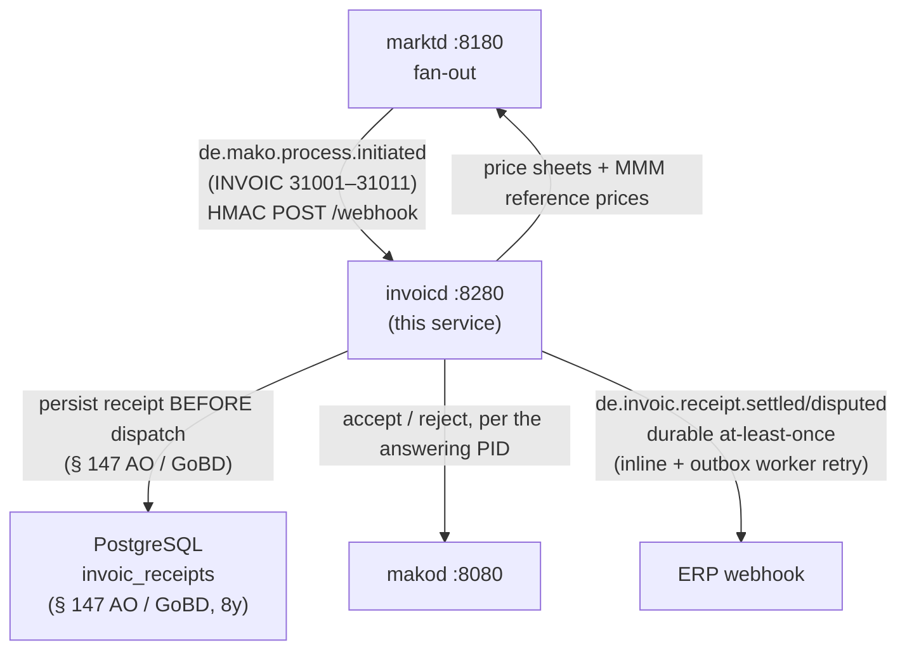
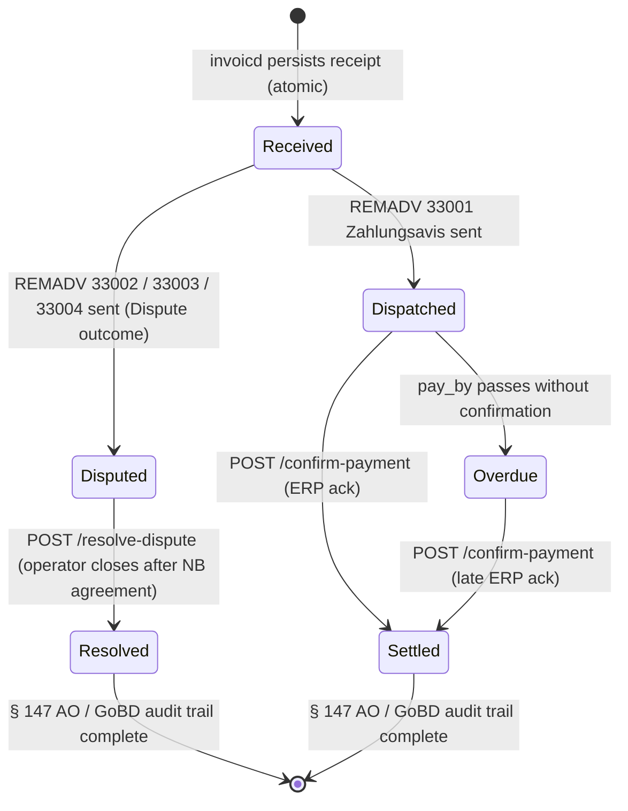

+++
title = "invoicd Operator Guide"
description = "invoicd operator guide: the LF-side INVOIC plausibility check over ten inbound billing PIDs, with § 147 AO receipts and the answer back through makod."
weight = 24
+++
`invoicd` is the **INVOIC plausibility-check daemon** on the receiving side: it
checks the invoices other market partners send this operator. Issuing invoices
is [billingd](@/docs/services/billingd.md) and
[netzbilanzd](@/docs/services/netzbilanzd.md). Terms (INVOIC, REMADV, PID, the
Marktrollen) are in the [domain model](@/docs/architecture/domain-model.md#party-roles-marktrollen)
and the [PID reference](@/docs/regulatory/pid-reference.md).

For each inbound INVOIC it:

1. Routes the PID through `src/routing.rs` (check, price sheet, answer commands).
2. Fetches that PID's reference data from `marktd` and runs `invoic-checker`.
3. **Persists the receipt** — a received INVOIC is a Buchungsbeleg (§ 147 AO /
   § 14b UStG, 8 years). A failed write aborts the dispatch.
4. Answers the counterparty through `makod` — accept or dispute.
5. Notifies the ERP with `de.invoic.receipt.*`, durable at-least-once.

Every PID of 31001–31011 is either routed or **refused** into `invoic_dlq` with
its reason (`routing::INVOIC_PIDS`, `REFUSED`); none is answered with a default
command, and an event that cannot become a receipt lands there too.



---

## Routes and authorization

`/webhook` is HMAC-authenticated (`marktd`, with timestamp replay protection).
Every `/api/v1/*` route needs a JWT and a Cedar action (paths under `/api/v1`):

| Routes | Action | Granted to |
|---|---|---|
| `GET /receipts`, `/receipts/{id}`, `/receipts/{id}/rechnung` (BO4E), `/zahlungsstatus/{malo_id}` | `read-receipt` | any caller in the tenant |
| `GET /disputes` | `read-disputes` | any caller in the tenant |
| `GET /overdue-remadv` | `read-overdue-remadv` | any caller in the tenant |
| `POST /receipts/{id}/confirm-payment`, `/dispatch-answer`, `/resolve-dispute` | `write-receipt` | **LF role** |
| `POST /selbstausstellen` | `dispatch-selbstausstellen` | **LF role** |
| `POST\|GET /mcp` | `use-mcp` | any caller in the tenant (OIDC or `[mcp]` key) |

The runner adds `/health/live`, `/health/ready` and `/metrics`; invoicd's own
gauges are at `GET /invoicd/metrics`. `tests/it/cedar_actions.rs` holds the
actions in code and policy to each other in both directions.

### `POST /api/v1/receipts/{id}/dispatch-answer`

Re-sends the answer for a receipt whose automatic dispatch failed
(`dispatched_at IS NULL`), using the stored INVOIC reference and the routing
table's command. `409` when already dispatched, `422` without a message
reference.

---

## Reading the inbound Rechnung

The BO4E payload crosses the gate on its
[**received-document** setting](@/docs/architecture/domain-model.md#the-bo4e-gate):
a document that will not **type** (wrong `_typ`, out-of-schema `rechnungstyp`) is
dead-lettered; one that types but breaks a BO4E rule (a `gesamtbrutto` that is
not net plus tax) is **disputable** and answered by a REMADV from check stage 7.

---

## Handled PIDs

| PID | Description | Direction | Sparte | Status |
|-----|-------------|-----------|--------|--------|
| 31001 | Abschlagsrechnung Netznutzung (NB → LF) | Inbound | ⚡🔥 | ✅ |
| 31002 | NN-Rechnung — Netznutzungsabrechnung (NB → LF) | Inbound | ⚡🔥 | ✅ |
| 31003 | WiM-Rechnung — Abrechnung von Dienstleistungen im Messwesen (MSBA → NB · MSBA → MSBN) | Inbound | ⚡🔥 | ✅ |
| 31004 | Stornorechnung — universal Storno (GPKE/MMM/WiM/Kapazität/AWH/GeLi) | Inbound | **Strom + Gas** | ✅ arithmetic-only (`check_storno`) |
| 31005 | MMM-Rechnung Mehr-/Mindermengensaldo | Inbound | Strom | ✅ |
| 31006 | MMM Mehrmenge, selbst ausgestellt (LF → NB) | Inbound + Outbound | Strom | ✅ |
| 31007 | GaBi Gas Aggreg. MMM-Rechnung (NB → MGV) | Inbound | Gas | ✅ + MMM-Preisprüfung |
| 31008 | GaBi Gas selbst ausgest. Aggreg. MMM-Rechnung | Inbound | Gas | ✅ + MMM-Preisprüfung |
| 31009 | MSB-Rechnung (MSB → **NB / LF / ESA**, WiM) | Inbound | Strom | ✅ `PreisblattMessung` — or the accepted **Angebot** toward an ESA |
| 31010 | Kapazitätsrechnung (NB → KN) | Inbound | Gas | ⛔ refused into `invoic_dlq` |
| 31011 | Rechnung sonstige Leistung (NB → LF) — in practice the Sperr-/Entsperrkosten | Inbound | **Strom + Gas** | ✅ |

**PID 31010 is refused into `invoic_dlq`.** INVOIC AHB 1.0b Kap. 3.1.4 states
the Kommunikation as „NB an KN" (the Kapazitätsnutzer), a role this deployment
does not play and no answer command permits, and `BGM` DE1004 names the PDF
Kapazitätsrechnung that is the actual document (Änd-ID 26872). The DLQ row
carries that reason, so it is settled by hand.

**PID 31009** prices metering service and is checked against
`PreisblattMessung`; when the Rechnung is not in the process payload, `invoicd`
asks `makod` for it.

**Toward an ESA the price basis is the accepted Angebot.** 31009 goes to the NB,
LF or ESA (WiM Teil 1 Kap. 6.2 / Teil 2 Kap. 4.5); a Kapitel-4.6 Messprodukt has
no published Preisblatt because §35 MsbG leaves its Entgelt to be agreed.
`makod` files the accepted QUOTES 15003 at `marktd` on the ORDRSP 19011
(`esa_messprodukt_preise`), and `invoicd` joins exactly on Artikel-ID
(`SG27 PIA+Z02` ↔ `SG26 LIN` DE 7143 `Z09`).

The Use-Case is on the wire: `IMD+7081` = `KON` (Universalbestellprozess, the
ESA billing of WiM Teil 2 Kap. 4.5), `MSB` (Messstellenbetrieb toward NB or LF),
`TEC` (Änderung der Technik). An accepted offer on record is the fallback when
the qualifier is missing. `SG1 RFF+ACE` (Muss) names the order — ORDERS on
`KON` (hint `[501]`), QUOTES on `MSB` (`[508]`) — and is what `E_0264`
Prüfschritt 40 checks; both ride the process, as BO4E has no field for them.

| Finding | Meaning |
|---|---|
| `AngebotDeviation` | a position billed away from the agreed price — dispute |
| `AngebotPositionUnknown` | an Artikel-ID the offer never priced — a charge nobody agreed to; dispute |
| `TariffNotFound` | no accepted offer on record — **warn and skip**, never dispute: a gap in mako's records is not a defect in the invoice |

### The answer names the tree the Use-Case publishes

A REMADV Abweisung carries `SG7 AJT`: DE 4465 the code, DE 1082 the
Entscheidungsbaum. Every invoice Use-Case has its own quartet:

| PID | Empfänger | Rechnung | Nicht-Zahlungsavis | erneut | Storno |
|---|---|---|---|---|---|
| 31001/31002/31005/31006 | LF | `E_0406` | `E_0452` | `E_0407` | `E_0459` |
| 31009 | **ESA** (`IMD+7081` = `KON`) | `E_0264` | `E_0265` | `E_0266` | `E_0267` |
| 31009 | NB, Messstellenbetrieb (`MSB`) | `E_0566` | `E_0567` | `E_0568` | `E_0569` |
| 31009 | NB, **Preisblatt B** (`TEC`) | `E_0273` | `E_0274` | `E_0277` | `E_0275` |
| 31009 | LF, Messstellenbetrieb (`MSB`) | `E_0210` | `E_0211` | — | `E_0243` |
| 31009 | LF, **Preisblatt B** (`TEC`) | `E_0270` | `E_0271` | `E_0276` | `E_0272` |
| 31003 | NB / MSBN | `E_0259` | `E_0260` | — | `E_0261` |

`mako_pruefung::codes::rechnungspruefung(pid, empfaenger, gegenstand)` is that
table. The recipient's Marktrolle (`[identity] marktrolle`, configuration — not
inferred) narrows 31009's five Use-Cases to two, and `IMD+7081` decides: `TEC`
is the MSB's **Preisblatt B** (AWH „Änderung der Technik an Lokationen", priced
from PRICAT 27002), `MSB` / `KON` the Messstellenbetrieb and the ESA. An
unlabelled invoice is read as Messstellenbetrieb, because `E_0270`/`E_0273`
refuse with `A04` where no Bestellung exists. A walked ESA answer outranks the
setting.

The answer's shape picks the REMADV PID (REMADV AHB 1.0a): one code rides 33002
(§3.1.1), a set rides 33003 (Kopf/Summe) or 33004 (Position) (§3.1.2).

| Family | Walk |
|---|---|
| ESA (`E_0264`) and both Preisblatt-B (`E_0270`, `E_0273`) | walked in full by `mako_pruefung::rechnung`, codes emitted with Ebene and Positionsnummer |
| Messstellenbetrieb (`E_0566`, `E_0210`) | trees and Codelisten resolve, so inbound REMADVs read correctly; no walk — the dispute carries **no** code and is logged for an operator |

`E_0264` has three levels with disjoint codes: Kopf 10–90 (`A01`–`A07`, `A90`),
Position 300–430 (`A09`–`A15`, `A20`, `A99`), Summe 500–550 (`A21`–`A24`, `A96`).
A Kopf refusal ends the walk; settlement is „ganz oder gar nicht" (WiM Teil 2 UC
4.5.1). Five Prüfschritte need facts no INVOIC carries (50, 310, 370, 10, and
`E_0266` 1); each is optional on `mako_pruefung::RechnungsFakten` and an unknown
answer never refuses. A `marktd` outage passes Prüfschritt 40.

**PID 31004** is the universal, Sparte-neutral Storno (INVOIC AHB §3.1.2): the
Sparte comes from `Rechnung.sparte`, the check is arithmetic only, and the
answer is `invoic.stornorechnung.{annehmen,ablehnen}`. Any Rechnung flagged
`ist_storno` takes the same arithmetic-only check.

**MMM reference prices.** Strom is one nationwide monthly BDEW series (§ 13
Abs. 3 StromNZV; GPKE Teil 1 Kap. 8.4 from 01.01.2026), keyed on the month
alone; Gas prices are per Marktgebiet (Trading Hub Europe).

---

## invoic-checker — checks

| # | Stage | Finding | Outcome |
|---|---|---|---|
| 1 | **Storno reference** — `ist_storno=true` must name `original_rechnungsnummer` | `StorniertWithoutReference` | `Dispute` |
| 2 | **Billing period validity** — boundaries present and consistent | `PeriodInvalid` | `Dispute` |
| 3 | **Zahlungsziel** — `faelligkeitsdatum` not before `rechnungsdatum`, and within `max_zahlungsziel_days` | `ZahlungszielInvalid` · `ZahlungszielExceeded` | `Dispute` · `Warn` |
| 3a | **WiM 31003 send window** — a Dienstleistungsrechnung dated more than 20 Werktage after the period it bills (WiM Teil 1 Kap. 3.7.2 Nr. 1) | `RechnungZuSpaet` | `Warn` |
| 4 | **Currency agreement** — every monetary field on one currency | `WaehrungMismatch` | `Dispute` |
| 5 | **Position arithmetic** — quantity × unit price = line net | `ArithmeticError` | `Dispute` |
| 6 | **Document total** — Σ line nets = `gesamtnetto` | `TotalMismatch` | `Warn` |
| 7 | **Umsatzsteuer** — the § 14 Abs. 4 Nr. 8 UStG block: a rate and an amount, `gesamtbrutto = gesamtnetto + gesamtsteuer`, and no tax stated on a reverse-charge invoice | `SteuerMissing` · `SteuerMismatch` · `ReverseChargeStatesTax` | `Dispute` |
| 8 | **Tariff / Angebot** — the unit price against the published Preisblatt, or against the accepted ESA offer | `TariffDeviation` · `TariffNotFound` · `AngebotDeviation` · `AngebotPositionUnknown` | `Warn` or `Dispute` |

Stage 3 is skipped when `max_zahlungsziel_days = 0`; stage 3a runs only on PID
31003; stage 8 is skipped for a Stornorechnung. Stage 4 runs before the
arithmetic so a `CHF` amount is never read as EUR. `RechnungZuSpaet` is never
escalated by `auto_dispute_threshold_eur`: no REMADV tree publishes a code for
lateness.

Which price basis stage 8 uses is the routing table's decision, not the stage's:

| Route | Basis | PIDs |
|---|---|---|
| `Netznutzung` | `PreisblattNetznutzung` of the sending NB | 31001, 31002, 31011 |
| `NetznutzungMitMmmStrom` / `…Gas` | the same sheet, **plus** a Mehr-/Mindermengen settlement-price check against the BDEW Strom series resp. the Gas MGV's | 31005, 31006 / 31007, 31008 |
| `Messung` | `PreisblattMessung`, plus every negative position matched to a contracted `AufAbschlag` name (WiM PRICAT 27001–27003) | 31003, 31009 |
| `ArithmetikNur` | none — stages 1–6 only | 31004, and any `ist_storno` document |

Stage 8 matches an INVOIC position's text against the Preisblatt's
`zeitvariablePreispositionen` band codes (`zaehlzeitregister`) first, then the
flat `preisstaffeln`. The `Messung` and ESA paths run stages 2–7 and their own
price basis; stages 3 and 7 apply to 31003/31009 as to every invoice (the AHB
makes `SG8 DTM+265` and the `TAX`/`MOA` block Muss there too). A § 13b invoice
stating 0,00 EUR with an `RCV` Steuerbetrag is not `SteuerMissing`.

The MMM check is skipped when the month's prices are not yet published; an
unreachable `marktd` aborts the check with `ReferenceDataUnavailable`. `Warn`
outcomes auto-approve unless the invoice net exceeds `auto_dispute_threshold_eur`
(`0` = always approve, the default). For Gas, energy = m³ ×
`brennwert_kwh_per_m3` × `zustandszahl`, both from `edmd` via PID 13007.

---

## Payment CloudEvents

`invoicd` notifies the ERP (`[erp] webhook_url`) after every checked INVOIC:

| CloudEvents `type` | Trigger |
|---|---|
| `de.invoic.receipt.settled` | Outcome `Ok`, `AcceptedPartial`, or `Warn` |
| `de.invoic.receipt.disputed` | Outcome `Dispute` |
| `de.invoic.receipt.dispatched` | Self-issued 31006 sent |
| `de.invoic.payment.overdue` | Zahlungsziel passed without `confirm-payment` |

`dispatched` in the payload says whether the market answer actually went out.

```json
{
  "specversion": "1.0",
  "type": "de.invoic.receipt.settled",
  "source": "urn:mako:invoicd:tenant:9900357000004",
  "subject": "<process_id>",
  "data": {
    "process_id": "...",
    "pid": 31001,
    "direction": "inbound",
    "sender_mp_id": "9904234560001",
    "outcome": "Ok",
    "pay_by": "2026-10-15",
    "findings_count": 0,
    "dispatched": true
  }
}
```

The `payment_overdue` worker (every 6 h) emits `de.invoic.payment.overdue`
**once** per accepted, dispatched receipt whose `pay_by` passed without
`payment_confirmed_at` (`overdue_notified_at` stamps it); disputed invoices are
never overdue.

```json
{
  "specversion": "1.0",
  "type": "de.invoic.payment.overdue",
  "source": "urn:mako:invoicd:tenant:9900357000004",
  "subject": "<receipt_id>",
  "data": {
    "receipt_id": "550e8400-...",
    "process_id": "...",
    "pid": 31001,
    "sender_mp_id": "9904234560001",
    "pay_by": "2026-10-15T00:00:00Z",
    "tenant": "9900357000004"
  }
}
```

### Delivery guarantee — durable at-least-once

The first attempt runs inline after the market answer is dispatched and does
not spend the budget. On failure the `erp_outbox` worker retries, leasing each
batch with `UPDATE … RETURNING` (which also counts the attempt), so replicas do
not double-deliver and a lost outcome write cannot retry forever:

| Attempt | Delay before retry |
|---------|--------------------|
| 1       | 30 s               |
| 2       | 5 min              |
| 3       | 30 min             |
| 4       | 2 h                |
| 5       | dead-lettered      |

2xx sets `erp_notified_at`; 4xx dead-letters immediately; 5xx and transport
errors retry. `[erp] hmac_secret` signs each POST (Standard Webhooks). The
market answer never waits on the ERP. Dead letters count in
`invoicd_erp_dead_lettered_total`. Without `[erp] webhook_url` nothing delivers
and the service warns at startup.

---

## Idempotency and § 147 AO / GoBD

Each receipt is written **before** any command goes to `makod`; `UNIQUE
(process_id)` makes a redelivered event a no-op. Retention is 8 years (§ 147
Abs. 3 AO / § 14b UStG), driven by `received_at`. An inbound receipt without
`invoice_ref` (BGM 1004, what `makod` routes the answer by) is refused by the
schema.

---

## Payment Lifecycle & Zahlungsstatus

Payment happens outside EDIFACT. The ERP closes the trail with
`POST /api/v1/receipts/{id}/confirm-payment` (body `{}`): `204` sets
`payment_confirmed_at`, `404` when unknown or already confirmed, `403` without
`write-receipt`.

### `GET /api/v1/zahlungsstatus/{malo_id}`

All receipts of one MaLo, with overdue / pending / settled counts:

```bash
curl -s http://invoicd:8280/api/v1/zahlungsstatus/10001234558 \
  -H "Authorization: Bearer <token>" | jq .
```

```json
{
  "malo_id": "10001234558",
  "overdue_count": 1,
  "pending_count": 2,
  "settled_count": 14,
  "items": [
    {
      "id": "550e8400-...",
      "pid": 31001,
      "zahlungsstatus": "overdue",
      "pay_by": "2026-10-15T00:00:00Z",
      "dispatched_at": "2026-10-01T09:12:00Z",
      "payment_confirmed_at": null,
      "received_at": "2026-10-01T08:00:00Z"
    }
  ]
}
```

**`zahlungsstatus` values:**

| Value | Condition |
|---|---|
| `settled` | `payment_confirmed_at IS NOT NULL` |
| `overdue` | `dispatched_at IS NOT NULL` AND `pay_by < now()` AND `payment_confirmed_at IS NULL` |
| `pending` | `dispatched_at IS NOT NULL` AND `pay_by >= now()` AND `payment_confirmed_at IS NULL` |
| `undispatched` | `dispatched_at IS NULL` |

### Payment lifecycle state machine



---

## Configuration reference

`invoicd` reads `INVOICD_CONFIG` (default `invoicd.toml`); `"env:VAR"` values
defer secrets, `INVOICD_<SECTION>__<KEY>` overrides any key, unknown keys are
refused, and `--check` probes `/health/ready` for the container HEALTHCHECK.

### Full `invoicd.toml` reference

```toml
[http]
addr = "0.0.0.0:8280"          # default

[database]
# Required for § 147 AO / § 14b UStG receipt retention (Buchungsbelege, 8 years).
url       = "env:DATABASE_URL"   # required; use env: for secrets
pool_size = 10                   # default

[identity]
tenant     = "9900357000004"           # required — MP-ID of the operator
marktrolle = "lieferant"               # lieferant (default) | netzbetreiber | esa

[makod]
url     = "http://makod:8080"          # required
api_key = "env:INVOICD_MAKOD_API_KEY" # required

[marktd]
url     = "http://marktd:8180"            # required
api_key = "env:INVOICD_MARKTD_API_KEY"   # required

[webhook]
inbound_secret = "env:INVOICD_INBOUND_SECRET"  # required unless allow_insecure_no_auth

[subscription]
# Self-registers with marktd on startup. The event type and PID filter are
# fixed: de.mako.process.initiated for the PIDs in the routing table.
webhook_url   = "http://invoicd:8280/webhook"  # public URL marktd POSTs to
subscriber_id = "invoicd"                        # default

[check]
# Relative tolerances for invoic-checker plausibility pipeline.
arithmetic_tolerance       = 0.01   # 1 % — qty × price = line net
total_tolerance            = 0.01   # 1 % — Σ line nets = Gesamtnetto
tariff_tolerance           = 0.03   # 3 % — PRICAT unit price vs INVOIC
require_tariff             = false  # true → missing tariff escalates to Dispute
auto_dispute_threshold_eur = 0.0    # 0.0 → Warn always auto-approved
max_zahlungsziel_days      = 30     # 0 = disable; default 30 (§7 Allg. Festlegungen)

[erp]
# Required for ERP accounts-payable automation.
webhook_url = "https://erp.example.com/webhooks/invoicd"
# Optional: sign outbound requests with HMAC-SHA256.
# The ERP verifies via webhook-signature: v1,<base64>.
hmac_secret = "env:INVOICD_ERP_HMAC_SECRET"

[edmd]
# Required only for POST /api/v1/selbstausstellen (PID 31006), which reads the
# measured quantity for the Bilanzierungsmonat. Omitted, that endpoint answers
# 503; nothing else in the service needs it.
url = "http://edmd:8380"
# api_key = "env:INVOICD_EDMD_API_KEY"

# Required unless allow_insecure_no_auth = true.
[oidc]
# issuer   = "https://login.microsoftonline.com/{tenant-id}/v2.0"
# audience = "api://mako-invoicd"
# jwks_refresh_secs = 300

# [mcp]           # MCP authentication: an API key beside the OIDC verifier
#                 # above, for agent clients that mint no token
# api_key = "env:INVOICD_MCP_API_KEY"

```

---

## Self-issued Mehrmengen-Rechnung (PID 31006)

PID 31006 is the Mehrmenge leg of an MMM settlement written by the receiving
party itself — the Gutschriftverfahren of § 14 Abs. 2 Satz 2 UStG. The endpoint
settles one Bilanzierungsmonat, because the price series is monthly.

```bash
curl -X POST http://invoicd:8280/api/v1/selbstausstellen \
  -H "Authorization: Bearer <token>" \
  -H "Content-Type: application/json" \
  -d '{
    "malo_id":        "51238696012",
    "nb_mp_id":       "9900000000002",
    "year":           2026,
    "month":          6,
    "bilanziert_kwh": "12500.000"
  }'
```

| Input | Source |
|---|---|
| `gemessen_kwh` | `edmd GET /api/v1/imbalance/{malo}/{y}/{m}` — edmd measures |
| `bilanziert_kwh` | the caller — edmd does not balance; the allocated quantity is a commercial figure from the LF's own Bilanzkreis |
| Mehr-/Mindermengenpreise | `marktd GET /api/v1/mmm-preise/strom/{y}/{m}` |

A month with no imported prices is refused `422`. The document is built by
`grid_billing::settle_mmm` with `selbstausgestellt`
(`netznutzungrechnungsart = Selbstausgestellt`,
`netznutzungrechnungstyp = Mehrmindermengenrechnung`) and crosses the BO4E
outbound gate before dispatch, so a non-reconciling document is a `422` here
rather than a REMADV there. The receipt carries `makod`'s process id. Strom
§ 13b needs both parties' §3g status, which a self-issued invoice cannot assert,
so it settles at the ordinary rate.

---

## MCP tools

| Tool | Description |
|------|-------------|
| `get_receipt` | Get a single INVOIC receipt by process UUID |
| `list_disputes` | List all receipts with outcome `Dispute` |
| `get_check_result` | Get the full invoic-checker findings for a process |
| `list_overdue_remadv` | Receipts approaching Zahlungsziel without dispatched REMADV |
| `get_zahlungsstatus` | Payment status per MaLo-ID (settled / pending / overdue counts) |
| `summarize_billing_month` | Monthly billing volume + dispute rate per NB counterparty |
| `list_exceptions` | The two operator queues: undispatched answers, and INVOICs that could not be processed at all |

## MCP prompts

| Prompt | Description |
|--------|-------------|
| `resolve-dispute` | Guided dispute investigation (check classification + resolution steps) |
| `check-overdue-remadv` | Monitor and action overdue REMADV dispatches |
| `monthly-billing-review` | § 147 AO / GoBD monthly reconciliation checklist |
| `detect-systematic-errors` | Find NB counterparties with systematic billing errors |

`agentd`'s `invoice-reconciliation-agent` subscribes to
`de.invoic.payment.overdue` and `de.invoic.receipt.*`.

---

## Monitoring

| Query / metric | Target |
|----------------|--------|
| `outcome IN ('Ok','AcceptedPartial','Warn')` rate | > 95 % |
| `outcome = 'Dispute'` count | < 1 % of volume |
| `pay_by < now() + INTERVAL '3 days' AND dispatched_at IS NULL` | 0 |
| `pay_by < now() AND payment_confirmed_at IS NULL AND dispatched_at IS NOT NULL` | 0 (trigger dunning) |
| `invoic_dlq WHERE resolved_at IS NULL` | 0 — an unprocessed Buchungsbeleg |

A receipt nearing `pay_by` without `dispatched_at` is re-sent with
`POST /api/v1/receipts/{id}/dispatch-answer`.

### Prometheus metrics (`/invoicd/metrics`)

Tenant-scoped gauges:

| Metric | Alert when |
|--------|------------|
| `invoicd_receipts_total` | — |
| `invoicd_disputes_total` | rising against a single counterparty |
| `invoicd_overdue_remadv_total` | `> 0` — an unanswered invoice past its Zahlungsziel |
| `invoicd_erp_dead_lettered_total` | `> 0` — the ERP is not hearing about settled invoices |
| `invoicd_dlq_open_total` | `> 0` — an unprocessed Buchungsbeleg |
| `invoicd_receipts_by_pid_outcome{pid, outcome}` | — |
