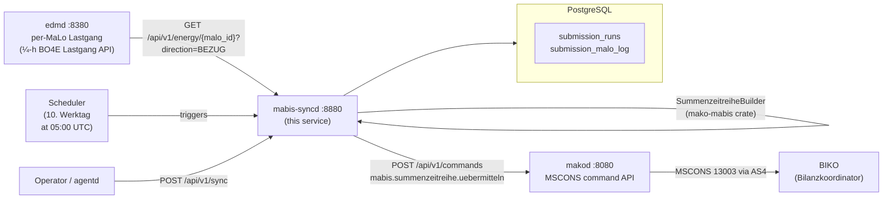
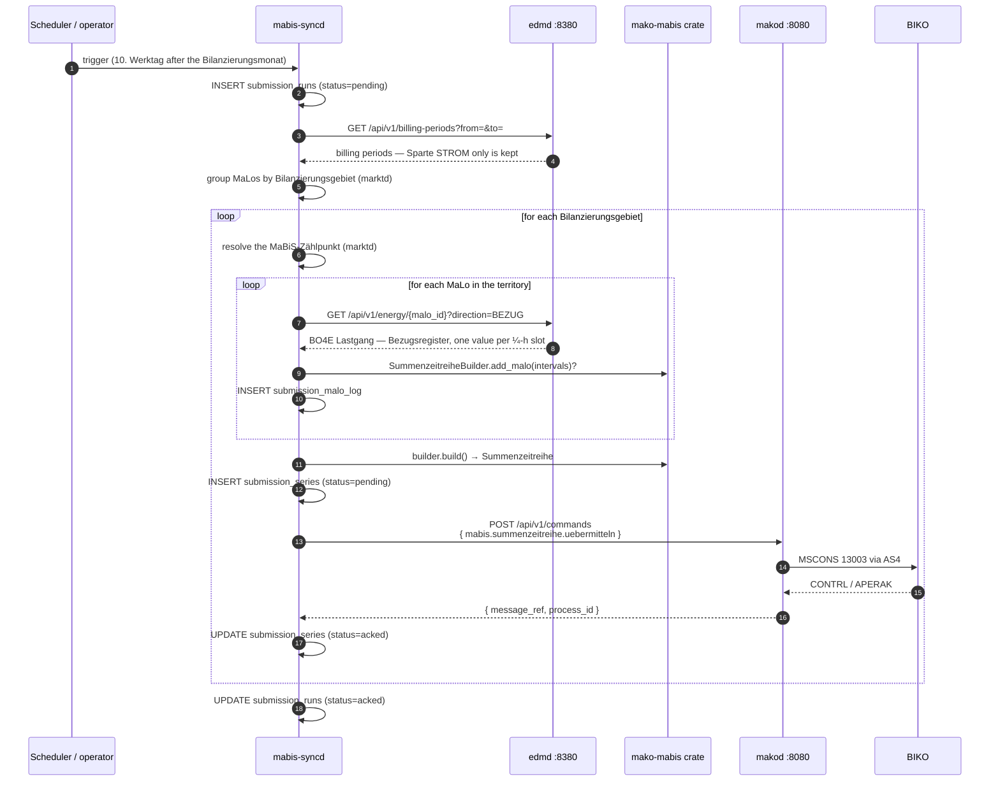

+++
title = "mabis-syncd Operator Guide"
description = "Operator guide for mabis-syncd: aggregates MaBiS Summenzeitreihen per Bilanzierungsgebiet and submits them to the BIKO on the Erstaufschlag-Werktag."
weight = 37
+++
`mabis-syncd` is the **MaBiS synchronisation daemon** — the service that
aggregates per-MaLo Lastgang data from `edmd` and submits monthly
**Summenzeitreihen** to the BIKO (Bilanzkoordinator).

**MaBiS** settles electricity Bilanzkreise after the fact. A
**Summenzeitreihe** is the monthly ¼-h series a grid operator files for one
**Bilanzierungsgebiet**, summed from each
[MaLo](@/docs/architecture/domain-model.md#malo-vs-melo-the-critical-distinction)'s
Lastgang. Metering comes from [`edmd`](@/docs/services/edmd.md), master data from
[`marktd`](@/docs/services/marktd.md), and the message leaves through
[`makod`](@/docs/services/makod.md).

A Summenzeitreihe is an **MSCONS** message, Prüfidentifikator **13003**
("Übertragung Summenzeitreihe", MSCONS AHB 3.2 §8.3.1). UTILTS carries
Berechnungsformel and Zählzeit-/Schaltzeitdefinitionen and has no Summenzeitreihe
use case.

Submission goes out through `makod` as `mabis.summenzeitreihe.uebermitteln`
(Marktrolle `NB`/`ÜNB`), which enqueues the MSCONS directly rather than spawning
a workflow; the BIKO's Datenstatus (IFTSTA 21003/21004) and Prüfmitteilung
(21000/21001) are recorded here, where the version history lives.

The wire message carries the identifying 3-tuple as `LOC` (MaBiS-Zählpunkt),
`DTM+492` (Bilanzierungsmonat, `CCYYMM`) and `DTM+293` (Versionsangabe,
`CCYYMMDDHHMMSSZZZ`), and one `QTY+220` per settlement slot bounded by
`DTM+163`/`DTM+164`. A quantity without those bounds has no time reference, so
the BIKO cannot place it on the grid.

Quantities carry DE 6063 `79` („Energiemenge summiert"); the OBIS in `PIA`
carries DE 7143 `SRW`. The renderer dispatches on the PID:

The **Prüfidentifikator** (PID) is the code the BDEW rulebooks use to name one business
message in one direction; the renderer dispatches on it:

| PID | Anwendungsfall | BGM 1001 | Shape |
|---|---|---|---|
| 13003 | Summenzeitreihe (MaBiS) | `BK` | summed series over settlement slots |
| 13023 | Redispatch 2.0 Ausfallarbeitssummenzeitreihe | `Z46` | same |
| 13015 | Arbeit / Leistungsmaximum im Kalenderjahr vor Lieferbeginn | `Z27` | work entry plus one or two monthly maxima |
| 13016 | Energiemenge und Leistungsmaximum | `Z28` | same |
| 13019 | Energiemenge (Strom) | `7` | work entry only |
| 13027 | Werte nach Typ 2 (MSB → ESA) | `Z83` | per-interval values; `AHB-13027-BGM-1001-Q` admits only `Z83` |

`BGM` DE 1001 is set per Anwendungsfall, because the receiver routes by it.
13019 carries energy alone (the AHB has no Leistungsperiode row), so a maximum
under it is refused with a pointer to 13016. Units follow DE 6411's closed list
(`KWH`, `KWT`, `D54`, `MTS`; MIG 2.5). 13015 repeats SG9 for the energy from the
start of the year to Lieferbeginn and for one or two monthly maxima, each with
`DTM+306` (format `610` monthly/yearly, `102` daily) and DE 6063 `220` (Wahrer
Wert) or `67` (Ersatzwert). Any other Anwendungsfall is refused by name.
Rendered messages are validated against the release profile by `makod`'s
conformance suite.



## Aggregation is per Bilanzierungsgebiet

MaBiS settles per territory, so `aggregate()` returns **one Summenzeitreihe per
Bilanzierungsgebiet**, not one per run.

Each MaLo's territory comes from `marktd` (`GET /api/v1/malos/{id}` →
`bilanzierungsgebiet`). A MaLo whose master data names none is excluded and
**fails the run** — never folded into another zone. `identity.bilanzierungsgebiet_id`
keys the run itself (the `submission_runs` row, the live-run check, the
failure event).

### MaBiS-Zählpunkt vs Bilanzierungsgebiet

The 13003 column of the MSCONS AHB marks `SG6 LOC` with qualifier `172` only:
the series is filed under its **MaBiS-Zählpunkt**, and the Bilanzierungsgebiet
EIC selects which Zählpunkt to send.

The assignment is **marktd master data**, not service configuration. Before each
submission `mabis-syncd` resolves it over HTTP:

```
GET /api/v1/bilanzierungsgebiete/{eic}/mabis-zp   → { "mabis_zp_id": "DE0004030099000000000000000012345", ... }
PUT /api/v1/bilanzierungsgebiete/{eic}/mabis-zp   (NB role, Cedar `write-mabis-zp`)
GET /api/v1/mabis-zp                             → every assignment for the tenant
```

Every failure path **refuses**: an unassigned territory (`404`), an unreachable
marktd, a malformed response, or a response echoing the EIC as the Meldepunkt
aborts the submission. marktd also rejects the EIC-as-Meldepunkt on write (`400`
and a table `CHECK`). This needs the `[marktd]` section.

A submission that discovers **no** MaLos fails the run: an empty series would
settle the territory at zero.

## Aggregation is quarter-hourly

MaBiS settles on a **¼-h grid**, so `fetch_lastgang` reads
`GET /api/v1/energy/{malo_id}?direction=BEZUG` — edmd's register projection,
one entry per slot. The BO4E `/api/v1/lastgang` export is not used: on a
dual-tariff MaLo `1-0:1.8.0` and its `1.8.1`/`1.8.2` decomposition would all be
summed. Monthly buckets would give the right total and the wrong shape.

Three checks fail the run rather than file a wrong series:

- `SummenzeitreiheBuilder` is constructed with the slot length it expects
  (`MABIS_SLOT` = 15 min) and returns `SlotResolutionError` for any interval that
  does not match. The MaLo is excluded and the run fails.
- `Summenzeitreihe::missing_slot_count()` > 0 — slots no MaLo covered.
- The Meldepunkt is a validating newtype (`MabisZaehlpunktId`, also on
  `Deserialize`), and `Summenzeitreihe::validate_identifiers()` refuses a
  Meldepunkt equal to its Bilanzierungsgebiet — `SG6 LOC+172` is free text at
  the MIG level, and marktd's `mabis_zp_not_the_gebiet` CHECK guards only its own
  table.

Quality flags map conservatively: anything not plainly `ABGELESEN` counts as
non-measured.

## Regulatory basis

| Rule | Requirement |
|---|---|
| **BK6-24-174 Anlage 3 §3.8.2** | Version ascending per (MaBiS-ZP, Bilanzierungsmonat) |
| **BK6-24-174 Anlage 3 §3.8.3** | Datenstatus assigned exclusively by the BIKO |
| **BK6-24-174 Anlage 3 §3.10** | BG-SZR: Erstaufschlag 1.–10. WT, Clearing 11.–30. WT; BK-SZR: 1.–12. / 13.–30. WT; KBKA to month 7; Abrechnungsstichtage 18./42. WT |
| **BK6-24-174 Anlage 3 §9.8.1** | Negative Prüfmitteilung → corrected Summenzeitreihe |
| **MSCONS AHB 3.2 §8.3.1** | PID 13003, Summenzeitreihe message format |
| **IFTSTA AHB 2.1** | PID 21000/21001 Prüfmitteilung, 21003/21004 Datenstatus |
| **§ 147 AO / GoBD** | Audit retention for billing-relevant data (Buchungsbelege: 8 years) |

---

## Routes

| Route | Purpose |
|---|---|
| `POST /api/v1/sync` | trigger an aggregation run |
| `GET /api/v1/runs` · `/runs/{id}` | recent runs; one run with its per-territory `series` |
| `PUT /api/v1/runs/{id}/retry` | retry a failed run (≤ 3 attempts) |
| `POST /api/v1/datenstatus` | record the BIKO Datenstatus (IFTSTA 21003/21004) |
| `POST /api/v1/pruefmitteilung` | record a Prüfmitteilung (IFTSTA 21000/21001) |
| `GET /api/v1/korrekturbedarf` | negative Prüfmitteilungen not yet corrected |
| `/mcp` | read-only MCP server |

The runner adds `/health/live`, `/health/ready` and `/metrics`.

---

## MCP server and CloudEvents

The `/mcp` surface is **read-only**, read by `agentd`'s `mabis-syncd-agent`;
filing stays on the authenticated REST surface.

| Tool | Description |
|---|---|
| `get_submission_status` | Recent runs + failed / retry-exhausted / open-Korrekturbedarf counts |
| `list_failed_submissions` | Failed runs, newest first, with `attempt_count` and `error_msg` |
| `get_submission_run` | One run by UUID (version as RFC 3339) |
| `list_korrekturbedarf` | Open negative Prüfmitteilungen (§9.8.1 obligations) |

One prompt, `submission-triage`. In `agentd`'s `[mcp_servers]` the key is
`mabis_syncd` (agentplane refuses `-` there). Two CloudEvents leave through the
transactional outbox to `erp_webhook_url`; a healthy cycle is silent:

| Type | When |
|---|---|
| `de.mabis.submission.failed` | Aggregation or BIKO submission failed; carries `run_id`, `bilanzierungsgebiet_id`, period, phase, `attempt_count` (at 3 the scheduler stops retrying) |
| `de.mabis.korrekturbedarf.opened` | A negative Prüfmitteilung was recorded — a corrected Summenzeitreihe is owed within the Clearing window |

---

## Aggregation pipeline



### Versionierung and Datenstatus

A Summenzeitreihe is identified by **(MaBiS-Zählpunkt, Bilanzierungsmonat,
Version)**, and §3.8.2 requires only that the version ascend: *"Die Version einer
Summenzeitreihe ist jeweils aufsteigend zu vergeben und ist über die gesamte BKA
beizubehalten."* A correction is the same series under a higher version. The
version is a timestamp (`SG6 DTM+293`, format 304); `BGM 1225` is always `9`.

**Datenstatus** is the separate, inbound axis. It is assigned exclusively by the
BIKO (§3.8.3: *"Der Datenstatus wird ausschließlich vom BIKO vergeben"*) and
arrives via IFTSTA `SG7 STS+Z04`:

| Datenstatus | Meaning |
|---|---|
| `Prüfdaten` | received, not yet accepted for settlement |
| `Abrechnungsdaten` | accepted for the ordinary BKA |
| `Abrechnungsdaten KBKA` | accepted for the Korrekturbilanzkreisabrechnung |
| `abgerechnete Daten` | settled in the BKA |
| `abgerechnete Daten KBKA` | settled in the KBKA |

Settlement uses the **highest version carrying `Abrechnungsdaten`** (or
`Abrechnungsdaten KBKA`). `mabis-syncd` only records what the BIKO sent.

### Fristen (§3.10, Tabelle 2)

Werktage after the end of the Bilanzierungsmonat, measured at **arrival at the
BIKO**; executable as `mako_mabis::Bilanzierungsmonat`. `mabis-syncd` files a
**BG-SZR (Kategorie B)**:

| Zeitreihe | BKA Erstaufschlag | BKA Clearing | KBKA |
|---|---|---|---|
| **BG-SZR (Kategorie B)** · NZR | **1.–10. WT** | **11.–30. WT** | 31. WT – end of month 7 |
| BK-SZR (Kategorie A und B) | 1.–**12.** WT | **13.**–30. WT | 31. WT – end of month 7 |
| DZÜ | — | 31.–34. WT | 1.–8. WT of month 8 |

| Abrechnungsstichtag | BKA | KBKA |
|---|---|---|
| Vorläufige Bilanzierung | 18. WT, Datenstand 15. WT | 8. WT of month 5, Datenstand end of month 4 |
| Abrechnungsrelevante Bilanzierung | 42. WT, Datenstand 30. WT | end of month 8, Datenstand end of month 7 |

The Redispatch-Ausfallarbeit series have their own windows (Kap. 17.3.1.3);
`mabis-syncd` files none of them.

Within the Erstaufschlag a new version is assigned `Abrechnungsdaten`
automatically; after it a new version starts as `Prüfdaten` and needs a positive
Prüfmitteilung (§3.8.3). A BG-SZR filed on the 11. WT is already in the
Clearingphase, so the scheduler submits on the **10. Werktag** by default.

**There is no Prüfmitteilung deadline.** §9.8.2 Nr. 1 leaves the Frist cell
empty — the receiving party „kann" answer — and §13.8.2 defines no answer at
all; its two rows are the BIKO's own dispatch dates above. What bounds a
Prüfmitteilung is the clearing window. The two genuine 1-Werktag Fristen are the
BIKO's: forwarding a Prüfmitteilung (§9.8.2 Nr. 3) and dispatching the
Datenstatus (§9.9.2 Nr. 1).

---

## MaLo discovery

Discovery reads `edmd`'s billing periods — every MaLo with readings in the
period. It asks for up to 5 000 (`edmd`'s cap) and fails the run on a
`truncated` (or unstated) answer. Only `sparte` Strom is kept (gas balances under
GaBi Gas), excluded Sparten are logged, and only the Bezugsregister (OBIS
`1.x.y`) contributes. A discovered MaLo that cannot be aggregated fails the run;
to exclude one deliberately, remove its billing-period records from `edmd`.

---

## Submission target

`submission_target` selects where Summenzeitreihen are filed. One value is
accepted:

```toml
submission_target = "biko-bilateral"   # default
```

`"mabis-hub"` (BK6-24-210) parses and then **refuses at startup**: no Beschluss
publishes a wire format, endpoint or payload shape.

---

## Configuration reference

```toml
# Top-level keys before any table header. Unset, de.mabis.* events are
# enqueued but not delivered, and startup says so.
erp_webhook_url = "http://erp:8000/events"
erp_hmac_secret = "env:MABIS_SYNCD_ERP_HMAC_SECRET"
submission_target = "biko-bilateral"   # default; the only implemented target

[http]
addr = "0.0.0.0:8880"       # default

[database]
url = "env:MABIS_SYNCD_DATABASE_URL"   # required

[identity]
tenant                  = "env:MABIS_SYNCD_TENANT"             # BDEW Codenummer of ÜNB / NB
sender_mp_id            = "env:MABIS_SYNCD_SENDER_MP_ID"       # NAD+MS in MSCONS
receiver_mp_id          = "env:MABIS_SYNCD_RECEIVER_MP_ID"     # NAD+MR in MSCONS (BIKO)
bilanzierungsgebiet_id  = "env:MABIS_SYNCD_BILANZIERUNGSGEBIET_ID"  # Y-type (Area) EIC; keys the run

[edmd]
url     = "http://edmd:8380"
api_key = "env:MABIS_SYNCD_EDMD_API_KEY"

[marktd]                    # required — per-MaLo Bilanzierungsgebiet lookup
url     = "http://marktd:8180"
api_key = "env:MABIS_SYNCD_MARKTD_API_KEY"

[makod]
url     = "http://makod:8080"
api_key = "env:MABIS_SYNCD_MAKOD_API_KEY"

[oidc]                      # required unless allow_insecure_no_auth = true
issuer   = "https://login.microsoftonline.com/{tenant-id}/v2.0"
audience = "api://mako-mabis-syncd"

[schedule]
erstaufschlag_werktag = 10   # Werktag after the Bilanzierungsmonat to submit on
run_hour_utc    = 5     # 05:00 UTC = 06:00 CET / 07:00 CEST

[mcp]                   # read-only MCP server at /mcp
api_key = "env:MABIS_SYNCD_MCP_API_KEY"
```

Startup refuses a `bilanzierungsgebiet_id` that is not a 16-character EIC of
object type **`Y` (Area)** (a Bilanzkreis is type `X`) and an unimplemented
`submission_target`. Every value may be `env:VARNAME`; an unset variable fails
startup with its name.

## Authentication

A filing cannot be withdrawn once acked, so every route is authorised and the
service refuses to start without `[oidc]` unless `allow_insecure_no_auth = true`.

`services/mabis-syncd/policies/mabis-syncd.cedar` states **four actions in three grants**:

| Route | Cedar action | Granted to |
|---|---|---|
| `GET /api/v1/runs`, `/runs/{id}`, `/korrekturbedarf` | `read-mabis-run` | any caller in the tenant |
| `/mcp` | `use-mcp` | any caller in the tenant — same grant as the reads |
| `POST /api/v1/datenstatus`, `/pruefmitteilung` | `record-biko-response` | any caller in the tenant |
| `POST /api/v1/sync`, `PUT /api/v1/runs/{id}/retry` | `trigger-mabis-run` | **NB / ÜNB** |

Recording a BIKO response only states what arrived, so the relaying ingest
identity needs no filing power. `tests/it/authorization_guard.rs` holds code and
policy together and asserts the two ingest routes do **not** require
`trigger-mabis-run`.

---

## Submission run lifecycle

```
pending ──► submitted ──► acked      (terminal — every territory filed)
   │            │
   └────────────┴──► failed          (retry allowed, attempt_count < 3)
```

A retry carries the original's `corrects_run_id`. One MSCONS goes out per
Bilanzierungsgebiet, so a run may be **partly filed**: `submission_series`
records each territory's `message_ref` or failure, a retry skips the acked ones,
and the run still fails as a whole. `POST /api/v1/sync` refuses a period with a
live run — a re-filing is a correction under `corrects_run_id`.

---

## API examples

```bash
# Trigger a submission for May 2026. The version is assigned by the service —
# it must ascend (§3.8.2) — and the phase follows from the Werktag calendar.
curl -X POST http://mabis-syncd:8880/api/v1/sync \
  -H "Content-Type: application/json" \
  -d '{ "period_from": "2026-05-01", "period_to": "2026-05-31" }'

# Check status of all runs
curl http://mabis-syncd:8880/api/v1/runs \
  | jq '.runs[] | {id, version, abrechnungslauf, datenstatus, status, total_kwh}'

# Record the Datenstatus the BIKO assigned (IFTSTA 21003/21004)
curl -X POST http://mabis-syncd:8880/api/v1/datenstatus \
  -H "Content-Type: application/json" \
  -d '{ "bilanzierungsgebiet_id": "11YAPG4CTRDNZ--P",
        "period_from": "2026-05-01", "period_to": "2026-05-31",
        "version": "2026-06-15T05:00:00Z", "datenstatus": "Abrechnungsdaten" }'

# Record a Prüfmitteilung (IFTSTA 21000/21001). A negative one requires a
# corrected Summenzeitreihe under a higher version.
curl -X POST http://mabis-syncd:8880/api/v1/pruefmitteilung \
  -H "Content-Type: application/json" \
  -d '{ "bilanzierungsgebiet_id": "11YAPG4CTRDNZ--P",
        "period_from": "2026-05-01", "period_to": "2026-05-31",
        "version": "2026-06-15T05:00:00Z", "positiv": false,
        "sender_mp_id": "9900077000006", "pid": 21000,
        "begruendung": "Abweichung MaLo 51238696012" }'

# Open Korrekturbedarf — negative Prüfmitteilungen with no correction yet
curl http://mabis-syncd:8880/api/v1/korrekturbedarf

# Send the correction, naming the run it corrects
curl -X POST http://mabis-syncd:8880/api/v1/sync \
  -H "Content-Type: application/json" \
  -d '{ "period_from": "2026-05-01", "period_to": "2026-05-31",
        "corrects_run_id": "550e8400-e29b-41d4-a716-446655440000" }'

# Retry a failed run (a fresh attempt, so a new version)
curl -X PUT http://mabis-syncd:8880/api/v1/runs/550e8400-e29b-41d4-a716-446655440000/retry
```

---

## PostgreSQL schema

| Table | Purpose |
|---|---|
| `submission_runs` | One row per aggregation + submission attempt: status, period, version, Datenstatus. |
| `submission_series` | One row per **Bilanzierungsgebiet** per run — the MSCONS that actually went out, with its `message_ref` or its failure reason. |
| `submission_malo_log` | One row per MaLo per run: coverage and gap analysis. |
| `pruefmitteilung` | Inbound BIKO objections (IFTSTA 21000/21001) and the run that corrected each. |

---

## Monitoring

| Metric / Alert | Target |
|---|---|
| `submission_runs.status = failed` older than 24 h | Immediate escalation — regulatory deadline at risk |
| `submission_series.status <> 'acked'` on an otherwise finished run | A territory was not filed; the month is settled short |
| No acked submission by the 10. Werktag | Erstaufschlag window closed — a later version starts as `Prüfdaten` (§3.10) |
| Open Korrekturbedarf after the 30. Werktag | Clearingphase for the ordinary BKA closing (§3.10) |
| MaLo coverage < 95 % in `submission_malo_log` | Missing data — check `edmd` quality warnings |

## Integration with `mako-mabis`

The aggregation is `mako_mabis::SummenzeitreiheBuilder`, constructed per
Bilanzierungsgebiet with its `MabisZaehlpunktId`, the period, the version,
sender and receiver MP-IDs and `MABIS_SLOT`; `add_malo` refuses a wrong-shaped
interval, and the built `Summenzeitreihe` offers `validate_identifiers`,
`is_complete` / `missing_slot_count` and `monthly_totals` (reporting only).
`BilanzierungsgebietId` and `BilanzkreisId` are `mako-mabis`'s canonical types.
