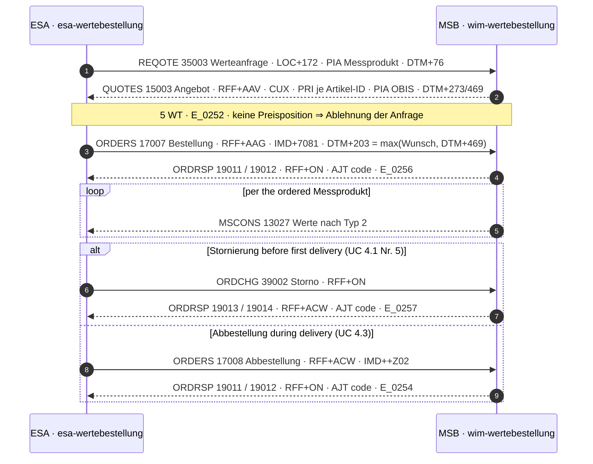
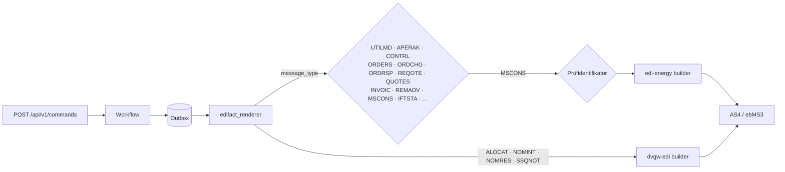

+++
title = "makod Operator Guide"
description = "makod operator guide: ports, CLI flags, the config file, persistent and volatile storage, AS4 inbound, the REST API and Kubernetes deployment."
weight = 21
+++
`makod` is the production daemon for the Mako process engine. It assembles the
seven domain modules `startup::production_modules()` registers — GPKE, WiM,
GeLi Gas, GaBi Gas, MaBiS, NZR-EMob and Redispatch — on a durable
[SlateDB](https://github.com/slatedb/slatedb) event store, and serves three
independent ports: AS4 inbound, HTTP REST, and BDEW API-Webdienste Strom.

It parses an inbound EDIFACT message, routes it by
[Prüfidentifikator (PID)](@/docs/architecture/domain-model.md#prufidentifikator-pid)
to a workflow, runs the [Frist](@/docs/architecture/domain-model.md#frist-and-werktag)
as a durable deadline, and renders the answer back onto the wire.

The terms —
LF, NB, MSB, BKV, [AHB and MIG](@/docs/architecture/domain-model.md#ahb-and-mig),
the [message types](@/docs/architecture/domain-model.md#edifact-message-types) —
are defined in the [glossary](@/docs/architecture/domain-model.md#glossary);
which PID belongs to which process is the [process map](@/docs/reference/processes.md).

---

## Port Layout

| Port | Flag | Serves |
|---|---|---|
| `:4080` | `--as4-addr` | AS4/ebMS3 inbound (EDIFACT + Redispatch XML) |
| `:8080` | `--http-addr` | REST API (`POST /edifact`, `/api/v1/commands`, admin), `/mcp`, `/metrics`, OpenAPI |
| `:8090` | `--api-webdienste-addr` | API-Webdienste Strom (iMS REST/JSON) |

Each port is optional and enabled independently. `/health`, `/health/live` and
`/health/ready` are mounted on every enabled port.

Daemons `makod` exchanges commands and events with most directly:

| Daemon | Port | Role |
|--------|------|------|
| [`marktd`](@/docs/services/marktd.md) | `:8180` | Master data (MaLo/MeLo/contracts), webhook fan-out, price sheets |
| `invoicd` | `:8280` | INVOIC plausibility, receipt persistence, REMADV auto-dispatch |
| [`edmd`](@/docs/services/edmd.md) | `:8380` | Meter-data store (MSCONS), time-series API, Mehr-/Mindermengen |
| `obsd` | `:8480` | Business-process observability, BNetzA KPI reports, alerting |
| [`processd`](@/docs/services/processd.md) | `:8580` | Walks the Entscheidungsbäume and posts the answer command back |
| `netzbilanzd` | `:8680` | NNE/MMM/MSB INVOIC generation |

The [service index](@/docs/services/_index.md) lists every daemon.

---

## Quick Start

### Development

```bash
just dev makod     # cargo run with dev/config/makod.toml
```

`dev/config/makod.toml` runs an in-memory event store, the permit-all Cedar
baseline and one synthetic NB/LF/MSB identity. Its load-bearing keys:

```toml
[authz]
permit_all = true              # dev only: every authenticated caller is admin

[storage]
allow_volatile = true          # in-memory; data is lost on exit

[http]
addr      = "127.0.0.1:8080"
auth_keys = ["dev=dev-makod-key"]

[[party]]
mp_id   = "9900357000004"
roles   = ["NB", "LF", "MSB"]
primary = true

[as4]
allow_no_signing      = true   # no AS4 credentials: log outbound EDIFACT
allow_no_trust_anchor = true
```

Each of those is a startup refusal without its opt-in:

| Key | Refusal it waives |
|---|---|
| `allow_volatile` (`MAKOD_ALLOW_VOLATILE`, `--allow-volatile`) | No `data_dir` and no object store |
| `auth_keys` or an `[oidc]` issuer | `[http] addr` set with no authentication |
| `permit_all` or `cedar_policy_dir` | Default-deny authorization with no policy — every request would be `403` |
| `allow_no_signing` | No AS4 signing material and no `[erp] edifact_outbox_webhook_url` |

> **⚠ Volatile mode is development and CI only.** All event streams, outbox
> messages, snapshots, registry entries and deadlines live in RAM. Any exit,
> crash, restart or reschedule loses every in-flight process, undelivered APERAK
> and CONTRL, and the § 147 AO / GoBD audit trail.
> `makod_volatile_mode_active` is `1` while it is on.

### Production

A production deployment carries key material, so it belongs in the config file:
a secret passed as a flag is visible in `ps`.

```bash
makod --check --config /etc/makod/makod.toml   # gate the pipeline on this
makod --config /etc/makod/makod.toml
```

---

## Configuration file

Every CLI flag has a config-file key, and every secret has a `*_file` companion
read at startup. Unknown keys are **rejected**, and supplying both an inline
secret and its `*_file` companion is an error. Precedence:

```
CLI flags  >  Environment variables  >  Config file  >  Built-in defaults
```

```toml
# /etc/makod/makod.toml

[logging]
level  = "info"     # trace | debug | info | warn | error
format = "json"     # pretty | compact | json

[otel]
# endpoint     = "http://otel-collector:4317"
# service_name = "makod"

[storage]
backend = "s3"      # local | s3 | gcs | azure
# data_dir          = "/var/lib/makod"   # required for backend = "local"
# max_stream_events = 10000              # per-stream quota; 0 disables

[storage.s3]
bucket = "my-makod-events"
prefix = "makod"
# endpoint = "http://minio:9000"

# One entry per Marktpartner-ID. Allgemeine Festlegungen §2.13 requires a
# separate code per Energieart and Marktrolle.
[[party]]
mp_id   = "9900357000004"
roles   = ["NB"]
primary = true

[http]
addr           = "0.0.0.0:8080"
auth_keys_file = "/etc/makod/auth-keys"         # NAME=TOKEN per line

[authz]
cedar_policy_dir = "/etc/makod/cedar"           # start from conservative.cedar

[oidc]
# issuer   = "https://login.microsoftonline.com/{tenant-id}/v2.0"
# audience = "api://makod"

[webdienste]
addr = "0.0.0.0:8090"

[engine]
# deadline_poll_interval_secs = 30
# marktrollen                 = ["NB"]   # defaults to the [[party]] union

[as4]
addr                    = "0.0.0.0:4080"
party_id                = "9900357000004"
signing_key_pem_file    = "/etc/makod/signing.key.pem"
signing_cert_pem_file   = "/etc/makod/signing.cert.pem"
decryption_key_pem_file = "/etc/makod/decryption.key.pem"
trust_anchor_pem_file   = "/etc/makod/bdew-pki-ca.pem"
partners = [
  "9900000000001=https://partner-a.example/as4/inbox",
]
partner_cert_files = [
  "9900000000001=/etc/makod/partners/9900000000001.enc.pem",
]
partner_signing_cert_files = [
  "9900000000001=/etc/makod/partners/9900000000001.sig.pem",
]

[erp]
webhook_url         = "https://erp.example.com/mako/events"
webhook_secret_file = "/etc/makod/erp-webhook.secret"

[marktd]
# url          = "http://marktd:8180"
# api_key_file = "/etc/makod/marktd.key"

[maloid]
# partners              = ["9900000000001=https://partner-a.example/maloid"]
# verzeichnisdienst_url = "https://verzeichnisdienst.example/api"
```

### Secrets

Use the `*_file` form for every secret; the file forms compose with Kubernetes
Secrets, the Secrets Store CSI driver, a vault-agent tmpfs sink or systemd
`LoadCredential=`. Environment variables are readable from the process
environment and the container spec.

| Inline | File companion |
|---|---|
| `as4.signing_key_pem` · `signing_cert_pem` · `decryption_key_pem` · `trust_anchor_pem` | the same key with `_file` |
| `as4.partner_certs` · `as4.partner_signing_certs` | `as4.partner_cert_files` · `as4.partner_signing_cert_files` |
| `as4.client_tls_cert_pem` · `client_tls_key_pem` | the same key with `_file` |
| `webdienste.client_cert_pem` · `client_key_pem` · `signing_key_pem` · `signing_cert_pem` | the same key with `_file` |
| `http.auth_keys` | `http.auth_keys_file` |
| `erp.webhook_secret` | `erp.webhook_secret_file` |
| `marktd.api_key` | `marktd.api_key_file` |

---

## All Configuration Options

### `[logging]` / `[otel]`

| TOML key | Env var | CLI flag | Default |
|---|---|---|---|
| `logging.level` | `MAKOD_LOG_LEVEL` | `--log-level` | `info` |
| `logging.format` | `MAKOD_LOG_FORMAT` | `--log-format` | `pretty` (`compact`, `json`) |
| `otel.endpoint` | `MAKOD_OTEL_ENDPOINT` | `--otel-endpoint` | *(unset — no export)* |
| `otel.service_name` | `MAKOD_OTEL_SERVICE_NAME` | `--otel-service-name` | `makod` |

`OTEL_EXPORTER_OTLP_ENDPOINT` / `OTEL_SERVICE_NAME` are honoured as well and
take precedence over the file. With an endpoint set, spans export via OTLP/gRPC
with W3C propagation and the subscriber is the JSON layer (`logging.format`
does not apply).

### `[storage]` — event store backend

| TOML key | Env var | CLI flag | Default | Description |
|---|---|---|---|---|
| `backend` | `MAKOD_OBJECT_STORE` | `--object-store` | `local` | `local` `s3` `gcs` `azure` |
| `data_dir` | `MAKOD_DATA_DIR` | `--data-dir` | *(in-memory)* | Local path (`backend = "local"`) |
| `allow_volatile` | `MAKOD_ALLOW_VOLATILE` | `--allow-volatile` | `false` | Required to run without `data_dir`; never production |
| `max_stream_events` | `MAKOD_MAX_STREAM_EVENTS` | `--max-stream-events` | `10000` | Per-stream event quota; `0` disables |
| `allow_multi_instance` | `MAKOD_ALLOW_MULTI_INSTANCE` | `--allow-multi-instance` | `false` | Only behind an external lock — see [Scaling](#scaling) |

| Section | Keys (env `MAKOD_<SECTION>_<KEY>`, flag `--<section>-<key>`) | Credentials |
|---|---|---|
| `[storage.s3]` | `bucket` *(required)*, `prefix` (`makod`), `endpoint` (MinIO/compatible) | `AWS_ACCESS_KEY_ID`, `AWS_SECRET_ACCESS_KEY`, `AWS_REGION` |
| `[storage.gcs]` | `bucket` *(required)*, `prefix` (`makod`) | `GOOGLE_SERVICE_ACCOUNT_KEY` or `GOOGLE_APPLICATION_CREDENTIALS` |
| `[storage.azure]` | `container`, `account` *(both required)*, `prefix` (`makod`) | `AZURE_STORAGE_ACCOUNT_KEY`, or `AZURE_CLIENT_ID` + `AZURE_TENANT_ID` + `AZURE_CLIENT_SECRET` |

### `[engine]`

| TOML key | Env var | CLI flag | Default | Description |
|---|---|---|---|---|
| `shutdown_timeout_secs` | `MAKOD_SHUTDOWN_TIMEOUT_SECS` | `--shutdown-timeout-secs` | `30` | Shutdown grace period |
| `deadline_poll_interval_secs` | `MAKOD_DEADLINE_POLL_INTERVAL_SECS` | `--deadline-poll-interval-secs` | `30` | Deadline scheduler poll (min 1 s). Keep well under the Redispatch 2.0 `AcknowledgementDocument` Frist of 3 minutes |
| `snapshot_interval` | `MAKOD_SNAPSHOT_INTERVAL` | `--snapshot-interval` | `100` | Events between snapshots; `0` disables |
| `projection_checkpoint_interval` | `MAKOD_PROJECTION_CHECKPOINT_INTERVAL` | `--projection-checkpoint-interval` | `60` | Seconds between projection cursor writes; `0` stops the projection workers |
| `worker_threads` | `MAKOD_WORKER_THREADS` | `--worker-threads` | logical CPUs | Tokio worker threads |
| `marktrollen` | `MAKOD_MARKTROLLEN` | `--marktrollen` | `[[party]]` role union | Roles the command API accepts commands for |
| `deployment_roles` | `MAKOD_DEPLOYMENT_ROLES` | `--deployment-roles` | `[[party]]` role union | Roles that gate PID registration: `NB`, `LF`, `MSB`, `NMSB`, `AMSB`, `BKV`, `UENB`/`ÜNB`/`UNB`/`FNB`, `BIKO`, `ESA`; `GNB`/`ANB`/`VNB` → `NB`, `LFG` → `LF`, `GMSB` → `MSB`. Unrecognised values are dropped with a `WARN` |

A command for a role outside `marktrollen` is refused with
`422 role_not_configured`. Typical values: `LF` (supplier), `LF,LFG`
(dual-fuel), `NB`, `NB,MSB` (Stadtwerke), `BKV`.

### `[[party]]` — operator identities (required)

At least one entry; one per Marktpartner-ID.

| TOML key | Required | Description |
|---|---|---|
| `mp_id` | yes | 13-digit BDEW- (`99…`) or DVGW-Codenummer (`98…`), GS1 GLN, or 16-char EIC |
| `roles` | yes | Case-insensitive. Strom: `NB`, `LF`, `MSB`, `ANB`, `VNB`, `NMSB`, `AMSB`, `BKV`, `UNB`, `BIKO`, `ESA`, `DP`, `EIV`. Gas: `GNB`, `LFG`, `GMSB`, `MGV`, `FNB`, `KN`. Both: `RB`. `MGV`, `DP`, `EIV`, `KN`, `RB` route no PIDs |
| `primary` | no | Storage partition key (derives the `TenantId`) and default sender MP-ID; the first entry when none is marked |
| `agency` | no | NAD DE 3055 override; derived from the prefix otherwise (`99…` → `293`, `98…` → `332`, EIC → `ZEW`, else `9`) |

### `[http]` / `[authz]` — REST API

| TOML key | Env var | CLI flag | Default | Description |
|---|---|---|---|---|
| `http.addr` | `MAKOD_HTTP_ADDR` | `--http-addr` | *(disabled)* | Listen address |
| `http.max_body_bytes` | `MAKOD_HTTP_MAX_BODY_BYTES` | `--http-max-body-bytes` | `10485760` | Max `POST /edifact` body |
| `http.auth_keys` | `MAKOD_AUTH_KEYS` (comma-separated) | `--auth-key` (repeatable) | — | `NAME=TOKEN` API keys |
| `http.auth_keys_file` | — | — | — | File of `NAME=TOKEN` lines |
| `authz.cedar_policy_dir` | `MAKOD_CEDAR_POLICY_DIR` | `--cedar-policy-dir` | — | `*.cedar` files merged into one policy set |
| `authz.permit_all` | `MAKOD_CEDAR_PERMIT_ALL` | `--cedar-permit-all` | `false` | **Development only** — every authenticated principal is admin |

`makod` refuses to start when `http.addr` is set with neither an API key nor an
OIDC issuer, and when neither a policy directory nor `permit_all` is set.

---

## Role Feature Flags

Cargo features decide which domain modules are compiled in;
`startup::production_modules()` is the list.

| Feature flag | Modules compiled in |
|---|---|
| `role-lf-strom` | `GpkeModule` (LF side) · `EmobModule` (the LF answers 55240) |
| `role-nb-strom` | `GpkeModule` · `WimModule` · `MabisModule` · `EmobModule` · `RedispatchModule` |
| `role-lf-gas` | `GeliGasModule` (LF side) |
| `role-nb-gas` | `GeliGasModule` (GNB side) · `WimModule` · `GaBiGasModule` |
| `role-msb-strom` / `role-msb-gas` | `WimModule` |
| `role-esa-strom` | `WimModule` (`esa-wertebestellung` and its `wim-wertebestellung` counterpart) |
| `role-lf` · `role-nb` · `role-msb` | the Strom + Gas pair of each |

`WimModule` covers both Sparten. `RedispatchModule` is NB Strom only — LF, MSB
and gas-only deployments have no §§ 13/13a obligations (BK6-20-059/060/061 as
consolidated by BK6-23-241).

`default` enables every role. A role-scoped build turns it off:

```dockerfile
RUN cargo build -p makod --release --no-default-features --features role-lf
```

Selecting no role is refused at startup. Each role build registers a strict
subset of the default's **71 workflows over 469 Prüfidentifikatoren**, and the
startup log records both counts. Feature flags remove code; `--marktrollen`
only refuses commands at runtime.

---

## Authorization
{: #authorization }

Every endpoint except `/health*` and the OpenAPI document is authorized by
[Cedar](https://cedarpolicy.com) ABAC. The shared mechanics (named keys with
constant-time matching, Bearer/JWT routing, schema-validated policy loading)
live in `mako_service::cedar_schema`; makod adds the `MaKo::` actions,
entities and schema. Policies are validated in **strict mode** at startup, and a
type error prevents startup.

**Authorization is default-deny.** `--cedar-policy-dir` is the only source of
access; `services/makod/src/cedar/conservative.cedar` is the least-privilege
starting point and is written for § 6a EnWG role separation.
`--cedar-permit-all` installs the permit-all baseline, under which additional
policies can only *remove* access via `forbid`.

### Identity model

```
MaKo namespace
├── Principal          — caller identity (API-key name or JWT sub)
├── Command            — attrs: name, marktrolle, pid, tenant
├── EdifactIngest      — attrs: tenant
├── AdminMaloRecord    — attrs: tenant, malo_id (optional)
├── AdminPartnerRecord — attrs: tenant, gln (optional)
├── MetricsEndpoint · McpEndpoint · RechnungEndpoint
├── MigrationEndpoint · WebdiensteEndpoint
└── ProcessRecord      — attrs: tenant, workflow

Actions
├── SubmitCommand · IngestEdifact
├── ReadMetrics · UseMcp · ReadRechnung · AdminMigrations · UseWebdienste
├── ReadProcess        — evaluated per workflow (§ 6a EnWG role separation)
├── AdminMalo (group)    → AdminMaloRead / Write / Delete / Stats
└── AdminPartner (group) → AdminPartnerRead / Write / Delete / Import
```

| Action | Guards |
|---|---|
| `SubmitCommand` | `POST /api/v1/commands`, MCP `submit_command` |
| `IngestEdifact` | `POST /edifact` |
| `AdminMalo*` / `AdminPartner*` | `/admin/malo/*`, `/admin/partners/*` |
| `ReadMetrics` | `GET /metrics` |
| `UseMcp` | `/mcp` (transport only — see [MCP authorization](#mcp-authorization)) |
| `ReadRechnung` | `GET /api/v1/invoic/{process_id}/rechnung` |
| `AdminMigrations` | `POST /admin/migrations` — grant to a break-glass principal for the FV cutover only; `conservative.cedar` grants it to nobody |
| `UseWebdienste` | every `:8090` route |
| `ReadProcess` | MCP `get_process`, `list_overdue_deadlines`, `list_dead_letters`; carries the workflow name, so an NB principal can be kept off LF process state |

Policies can name the `AdminMalo` / `AdminPartner` groups:

```cedar
// /etc/makod/cedar/read_only_grafana.cedar — under --cedar-permit-all
forbid(
  principal == MaKo::Principal::"ops-grafana",
  action in [MaKo::Action::"AdminMalo", MaKo::Action::"AdminPartner"],
  resource
)
unless {
  action == MaKo::Action::"AdminMaloStats"
  || action == MaKo::Action::"AdminPartnerRead"
};
```

### OIDC / JWT authentication

| TOML key | Env var | CLI flag | Default |
|---|---|---|---|
| `oidc.issuer` | `MAKOD_OIDC_ISSUER` | `--oidc-issuer` | — |
| `oidc.audience` | `MAKOD_OIDC_AUDIENCE` | `--oidc-audience` | — |
| `oidc.jwks_refresh_secs` | `MAKOD_OIDC_JWKS_REFRESH_SECS` | `--oidc-jwks-refresh-secs` | `300` |

At startup makod fetches `<issuer>/.well-known/openid-configuration` and the
JWKS, verifies tokens locally and refreshes the keys in the background. Any
standards-compliant provider works (Entra ID, Keycloak, Okta, Cognito, Kubernetes
workload identity).

- Only asymmetric algorithms (RS256/384/512, ES256/384, PS256/384/512); `HS*`
  is rejected.
- `iss`, `aud` and `exp` are checked on every token.
- **`mako_tenant` must equal the primary MP-ID**, and a missing claim is
  rejected. In a shared realm another operator's token is otherwise
  cryptographically valid here. The check sits in `BearerAuthenticator`, which
  every Cedar-gated endpoint uses.
- The JWT `sub` becomes the Cedar principal ID (for a Kubernetes service account,
  `system:serviceaccount:<namespace>:<name>`).

API keys and OIDC can be active at the same time.

---

### `[as4]` — AS4/ebMS3 inbound and outbound

Four kinds of certificate material, each with a different job:

| Material | Keys | Used for |
|---|---|---|
| Own identity | `signing_key_pem` / `signing_cert_pem`, `decryption_key_pem` | Signing outbound, decrypting inbound |
| Trust anchor | `trust_anchor_pem` | Proves a signer is *a* BDEW/DVGW market participant |
| Partner encryption certs | `partner_certs` | Encrypting what is **sent** to each partner |
| Partner signing certs | `partner_signing_certs` | Authenticating what each partner **sends** |
| WIRK TLS client cert | `client_tls_cert_pem` / `client_tls_key_pem` | Transport credential to a partner MSH (optional; an egress proxy may present it) |

BDEW AS4-Profil v1.2 §2.2.6.2.1/§2.2.6.2.2 (with BSI TR-03116-3 §9.1) requires
EC keys on BrainpoolP256r1 and separate keypairs for signing and encryption.

| TOML key | Env var | CLI flag | Description |
|---|---|---|---|
| `addr` | `MAKOD_AS4_ADDR` | `--as4-addr` | Listen address |
| `party_id` | `MAKOD_AS4_PARTY_ID` | `--as4-party-id` | Operator MP-ID (default: primary `[[party]]`) |
| `signing_key_pem` / `_file` | `MAKOD_AS4_SIGNING_KEY_PEM` | `--as4-signing-key-pem` | Own signing key |
| `signing_cert_pem` / `_file` | `MAKOD_AS4_SIGNING_CERT_PEM` | `--as4-signing-cert-pem` | Own signing certificate |
| `decryption_key_pem` / `_file` | `MAKOD_AS4_DECRYPTION_KEY_PEM` | `--as4-decryption-key-pem` | Own inbound decryption key |
| `trust_anchor_pem` / `_file` | `MAKOD_AS4_TRUST_ANCHOR_PEM` | `--as4-trust-anchor-pem` | BDEW/BNetzA PKI CA certificate |
| `partners` | `MAKOD_AS4_PARTNER` | `--as4-partner` | `MP-ID=HTTPS-URL` pairs (repeatable; comma-separated in the env var) |
| `partner_certs` / `partner_cert_files` | `MAKOD_AS4_PARTNER_CERT` | `--as4-partner-cert` | Partner **encryption** certs, `MP-ID=<PEM or path>` |
| `partner_signing_certs` / `partner_signing_cert_files` | `MAKOD_AS4_PARTNER_SIGNING_CERT` | `--as4-partner-signing-cert` | Partner **signing** certs |
| `client_tls_cert_pem` / `_file` | `MAKOD_AS4_CLIENT_TLS_CERT_PEM` | `--as4-client-tls-cert-pem` | WIRK TLS client chain |
| `client_tls_key_pem` / `_file` | `MAKOD_AS4_CLIENT_TLS_KEY_PEM` | `--as4-client-tls-key-pem` | Its key |
| `allow_unencrypted` | `MAKOD_ALLOW_UNENCRYPTED_AS4` | `--allow-unencrypted-as4` | **Dev/test:** downgrade the encryption and partner-signing-cert refusals to warnings |
| `allow_no_signing` | `MAKOD_ALLOW_NO_AS4_SIGNING` | `--allow-no-as4-signing` | **Dev/test:** start without signing material or outbox webhook; outbound EDIFACT is logged |
| `allow_no_trust_anchor` | `MAKOD_ALLOW_NO_AS4_TRUST_ANCHOR` | `--allow-no-as4-trust-anchor` | **Dev/test:** run with no trust anchor (every partner signature is rejected) |
| `lenient_receipts` | `MAKOD_AS4_LENIENT_RECEIPTS` | `--as4-lenient-receipts` | Interop bring-up: tolerate an unsigned or non-NRR `eb:Receipt` |

Partners are bootstrapped into the durable `PartnerStore`; runtime changes via
`PUT /admin/partners/{mp_id}` or inbound PARTIN survive restarts.

**Startup refusals** (all also run under `--check`):

| Condition | Why |
|---|---|
| AS4 active, no `partner_signing_certs` | The listener would accept nothing |
| No trust anchor | The anchor falls back to the own certificate and every inbound message is rejected |
| No decryption key, or a partner without an encryption certificate | §2.2.6.2.2 requires encryption; the send would fail anyway |
| Signing key and certificate do not build a session, or a partner endpoint is `http://` | Caught at boot rather than per message |

The BDEW profile stack declares a sign-and-encrypt **security floor**; `asx-rs`
rejects a relaxing override layer with
`ProfileValidationCode::SecurityFloorViolation`.

**Receipts and retries.**

- Inbound messages get a signed `eb:Receipt` with NonRepudiationInformation.
- An outbound delivery counts only after `verify_sync_response` proves the
  receipt signature covers the signal, `RefToMessageId` and every NRI digest
  match, and the receipt is inside the replay window.
- An `eb:Error` or unverifiable receipt backs off and retries — safe, because the
  MessageId is the stable outbox id and the receiver deduplicates. P-Mode,
  partner certificate and rendering are resolved per attempt, so a configuration
  fix heals delivery without re-enqueueing.
- The retry budget is **72 hours** from creation. `outbox_delivery_attempted`
  logs `counterparty_error`, `receipt_unverified` or `transport_error`.

**Connectivity pings** carrying both ebMS3 Test Service URIs (Core §5.2.2) are
acknowledged and not delivered.

**Outbound wire format.** A complete Übertragungsdatei `UNB … UNZ`. UNB
sender/receiver equal `NAD+MS`/`NAD+MR` (Allgemeine Festlegungen 6.1d Kap. 2);
DE 0007 follows the MP-ID (`500` BDEW, `502` DVGW, `14` GS1); the DE 0020
Datenaustauschreferenz — also in UNZ and the §2.12 filename — derives from the
outbox id, so retries reuse it.

**Tracing.** An inbound `traceparent` is captured into every outbox message the
request creates and re-injected on the ERP webhook, the CloudEvent and the
outbound AS4 request.

**Webhook transport substitute.** With `[erp] edifact_outbox_webhook_url` set,
outbound interchanges are POSTed as CloudEvents of type
`de.mako.edifact.outbound` (`message_type`, `recipient`, `edifact`), the outbox
id as CloudEvent `id` and `X-Idempotency-Key`, signed with Standard Webhooks
under `[erp] webhook_secret` — which is then required.

It is a development and ERP-integration path; `MaloIdentCallback` messages still
go to the MaLo-ID sender.

**Who owns an outbox message.** Two consumers share one outbox: the wire
transport (`BdewAs4Sender` / `WebhookEdifactSender`) and the ERP notifier
(`OutboxErpWorker`). `core::erp_adapter::is_erp_notification` decides — types
mapping to an `ErpEventType` and the `ERP_` prefix belong to the ERP notifier,
everything else to the transport. A worker leaves the other's messages untouched.

AS4 security tests (sign+encrypt round trip, tamper rejection, replay dedup,
P-Mode defaults) run without WIRK certificates:

```bash
cargo test -p makod --test it -- as4_security
```

### `[webdienste]` — BDEW API-Webdienste Strom

`addr` and the trust keys describe the inbound `:8090` port; the `client_*` and
`signing_key_*` keys describe the identity used when calling another party's
API-Webdienste.

| TOML key | Env var | CLI flag | Description |
|---|---|---|---|
| `addr` | `MAKOD_API_WEBDIENSTE_ADDR` | `--api-webdienste-addr` | Listen address |
| `allow_unauthenticated` | `MAKOD_WEBDIENSTE_ALLOW_UNAUTHENTICATED` | `--webdienste-allow-unauthenticated` | Drop the bearer/OIDC + Cedar layer — only behind an mTLS-terminating proxy; logs a `WARN` |
| `trust_client_mp_id_header` | `MAKOD_WEBDIENSTE_TRUST_CLIENT_MP_ID_HEADER` | `--webdienste-trust-client-mp-id-header` | Read the caller from `X-Mako-Client-MP-ID`; implied by `allow_unauthenticated` |
| `client_cert_pem` / `_file` | `MAKOD_WEBDIENSTE_CLIENT_CERT_PEM` | `--webdienste-client-cert-pem` | Outbound mTLS chain (EMT.API, BSI SM-PKI) |
| `client_key_pem` / `_file` | `MAKOD_WEBDIENSTE_CLIENT_KEY_PEM` | `--webdienste-client-key-pem` | Its PKCS#8 key |
| `client_root_ca_pem_files` | `MAKOD_WEBDIENSTE_ROOT_CA_PEM` | `--webdienste-root-ca-pem` | SM-PKI roots to trust when calling out |
| `signing_key_pem` / `_file` | `MAKOD_WEBDIENSTE_SIGNING_KEY_PEM` | `--webdienste-signing-key-pem` | EMT.API key for content signing |
| `signing_cert_pem` / `_file` | `MAKOD_WEBDIENSTE_SIGNING_CERT_PEM` | `--webdienste-signing-cert-pem` | Its certificate, sent as `X-BDEW-CERT`; required with the key, and the boot refuses a pair that does not belong together |
| `allow_unauthenticated_client` | `MAKOD_ALLOW_UNAUTHENTICATED_WEBDIENSTE_CLIENT` | `--allow-unauthenticated-webdienste-client` | **Dev/test:** call out without identity or signing key |

- **Outbound identity is required.** The API-Webdienste authenticate callers by
  mTLS with an EMT.API certificate; without one the call fails at the
  counterparty. makod refuses to start when `--verzeichnisdienst-url` or
  `--maloid-partner` is set without a client identity.
- **Content signing is a second layer.** Regelungen zum Übertragungsweg für
  API-Webdienste 1.2, Kap. 3.3 („Jede API-Interaktion und der übertragene
  Payload wird signiert.") signs the URI, the RFC 8785 canonical body,
  `creationDateTime`, `transactionId` and — when present —
  `initialTransactionId`, with the algorithms of TR-03116-3; the digest travels
  in `X-BDEW-DIGEST`, the signature in `X-BDEW-SIGNATURE` and the certificate in
  `X-BDEW-CERT`.
  It applies to Control Measures and MaLo Identification; the Verzeichnisdienst
  uses JWS. Without a signing key, makod refuses to start when `addr`,
  `--maloid-partner` or `--verzeichnisdienst-url` is set.
- **Inbound signatures are verified.** A request carrying `X-BDEW-SIGNATURE` /
  `X-BDEW-DIGEST` / `X-BDEW-CERT` (Kap. 3.3; certificate in RFC 9440 encoding)
  is checked against the named certificate's key over
  `https://{Host}{path?query}`, the canonical body and the `creationDateTime` /
  `transactionId` / `initialTransactionId` headers before any handler runs. A
  mismatch or a partial or repeated header set is `401`; an unsigned request
  passes with a warning. The proxy, not makod, validates the SM-PKI chain.
- **mTLS is the proxy's job.** makod does not terminate TLS; front `:8090` with a
  proxy (Nginx, Envoy, ALB) enforcing mTLS against the BDEW PKI CA. By default
  every `:8090` route also requires bearer/OIDC and Cedar `UseWebdienste`.

#### Caller identity — `X-Mako-Client-MP-ID`

The Control Measures request names no sender, so the proxy forwards the client
certificate's Marktpartner-ID and must strip any client-supplied copy:

```nginx
proxy_set_header X-Mako-Client-MP-ID $ssl_client_s_dn_cn;
```

The header is read only with `trust_client_mp_id_header`. A request with no
establishable caller is `400` — the §14a Endantwort and the WiM Bestätigung are
addressed to the caller. The value must be a 13-digit MP-ID or a 16-character
EIC; a repeated header is `400`. A WiM Order body whose `netzbetreiber_id`
differs from the caller is `403`, checked before the `transactionId` idempotency
guard.

### §20b EnWG Netzzugangsplattform adapter {#netzzugangsplattform}

§20b EnWG Abs. 2 requires a joint Netzbetreiber platform for Zählpunktanordnungen
(Nr. 1), Verrechnungskonzepte (Nr. 2) and Energy-Sharing registration under §42c
(Nr. 3); interfaces are left to a BNetzA Festlegung (Abs. 3), and none has been
published. makod ships the client side:

| Command | §20b anchor | Roles |
|---|---|---|
| `netzzugang.zaehlpunktanordnung.beauftragen` | Abs. 2 Nr. 1 (`aktion`: `bestellung` \| `aenderung` \| `abbestellung`) | LF, MSB |
| `netzzugang.verrechnungskonzept.beauftragen` | Abs. 2 Nr. 2 (same `aktion`s) | LF, MSB |
| `netzzugang.energysharing.registrieren` | Abs. 2 Nr. 3 | LF |

Payload: `netzanschluss_id`, `nb_mp_id`, `antragsteller_ref` (opaque, no PII),
optional `details`. Each command records an `erfasst` entry in marktd's
`netzzugang_antraege` and enqueues a `NetzzugangAntrag` outbox message, which is
delivered:

1. to `--netzzugang-endpoint-url` (`MAKOD_NETZZUGANG_ENDPOINT_URL`) when set —
   the entry becomes `uebermittelt`, with a `platform_ref` if returned;
2. else to the ERP webhook as `de.mako.netzzugang.uebermittlungsbedarf`, for
   submission via the NB's Webportal (signed when `--erp-webhook-secret` is set);
3. else, or on an undeserialisable payload, marked `fehlgeschlagen` and acked.

The answer is recorded via marktd
`PATCH /api/v1/netzzugang/antraege/{id}/status`, which emits
`de.markt.netzzugang.antrag.updated`.

---

## MCP Server

`/mcp` on the `--http-addr` port speaks the MCP Streamable HTTP transport
(spec 2025-11-25): `POST` for JSON-RPC, `GET` for SSE. Sessions are in memory.
Every request needs `Authorization: Bearer <token>` (API key or OIDC) and the
Cedar `UseMcp` action; unauthenticated requests are `401`.

### Tools

`makod` ships **12 MCP tools**:

| Tool | Annotations | Description |
|---|---|---|
| `list_commands` | `read_only` | Commands for this instance's Marktrollen, with role, primary PID and whether `marktrolle` is required — call first |
| `submit_command` | `destructive` | Same as `POST /api/v1/commands`, with progress notifications |
| `get_malo` | `read_only` | Cached Marktlokation by 11-digit ID |
| `list_partners` | `read_only` | Registered trading partners |
| `get_partner` | `read_only` | Partner by 13-digit MP-ID |
| `get_health` | `read_only` | Version, tenant, Marktrollen, MaLo cache stats |
| `get_process` | `read_only` | Business key (`malo_id`/`melo_id`/`vorgang`) → active process |
| `list_overdue_deadlines` | `read_only` | Overdue APERAK/response deadlines — alert if non-empty |
| `list_active_processes` | `read_only` | Count of registered process instances |
| `get_outbox_status` | `read_only` | Pending outbox count and oldest age — alert when stuck > 5 min |
| `list_dead_letters` | `read_only` | 20 most recent dead letters (§ 147 AO / GoBD) |
| `get_format_version_coverage` | `read_only` | Per message type: `stable` or `transition`, and which releases are in force today |

`tool_inventory_tests` in `mcp_server.rs` pins this list.

#### Authorization {#mcp-authorization}

`UseMcp` opens the transport only. Each tool that touches tenant data evaluates
the action its REST twin enforces:

| Tool | Additional Cedar action |
|---|---|
| `submit_command` | `SubmitCommand` (command, Marktrolle, PID) |
| `get_malo` | `AdminMaloRead` |
| `list_partners`, `get_partner` | `AdminPartnerRead` |
| `get_process`, `list_overdue_deadlines` | `ReadProcess`, per workflow (`get_process` denies as `not_found`) |
| `list_dead_letters` | `ReadProcess` across workflows — a workflow-scoped principal is denied outright |
| `list_commands`, `get_health`, `get_format_version_coverage`, `list_active_processes`, `get_outbox_status` | none — no tenant data |

#### `submit_command` parameters

| Field | Type | Required | Description |
|---|---|---|---|
| `command` | string | ✓ | `<domain>.<prozess>.<aktion>`, e.g. `gpke.lieferbeginn.anmelden` |
| `payload` | object | ✓ | Command payload, e.g. `{"malo_id": "51238696012", "lieferbeginn_datum": "2026-10-01", "bilanzkreis": "11XBK-STD-----9"}` |
| `marktrolle` | string | – | Required for multi-role commands |
| `idempotency_key` | string | – | Supplied: a repeat replays the recorded response (24 h), reuse for another request is refused. Omitted: a random UUID, no replay record |

`get_malo` takes `malo_id`; `get_partner` takes `mp_id`.

### Resources and prompts

| Resource | Content |
|---|---|
| `malo://{malo_id}` | `MaloIdentResultPositive` record from the MaLo cache |
| `partner://{mp_id}` | Partner record with AS4 URL, roles and channels |

| Prompt | Arguments | Guides |
|---|---|---|
| `gpke-lieferbeginn` | `malo_id`, `lieferbeginn_datum` | GPKE Lieferbeginn Strom |
| `geli-lieferbeginn` | `malo_id`, `lieferbeginn_datum` | GeLi Gas Lieferbeginn |
| `wim-geraetewechsel` | `melo_id`, `process_date`, `receiver_mp_id`, `marktrolle` | WiM Gerätewechsel |
| `msb-preisanfrage` | — | MSB Preisanfrage (REQOTE/QUOTES, PRICAT 27003) |
| `wim-gas-anmeldung` | — | GNB answers a gMSB Anmeldung (UTILMD G 44042–44053) |
| `gpke-sperrung` | — | GPKE Sperrung Strom |

The server instructions returned on connect carry the tenant, the Marktrollen,
the filtered command list, a per-PID deadline table from `mako_fristen::antwort`
(MaBiS has none — see `mako_mabis::fristen`) and the error-prefix glossary.

### Client configuration

```json
{
  "mcpServers": {
    "makod": {
      "url": "http://localhost:8080/mcp",
      "headers": { "Authorization": "Bearer <auth-key-or-oidc-token>" }
    }
  }
}
```

That is Claude Desktop's `claude_desktop_config.json`; VS Code's `.vscode/mcp.json`
takes the same entry under `"mcp": {"servers": …}` with `"type": "http"`. In a
cluster, reach `/mcp` through `kubectl port-forward` or an internal `Service`.

---

## REST API Endpoints

All on the `--http-addr` port.

| Method | Path | Auth | Description |
|--------|------|------|-------------|
| `POST` | `/api/v1/commands` | Bearer · `SubmitCommand` | [ERP command](#erp-commands-post-api-v1-commands) |
| `POST` | `/edifact` | Bearer · `IngestEdifact` | Raw EDIFACT interchange |
| `GET` | `/api/v1/invoic/{process_id}/rechnung` | Bearer · `ReadRechnung` | BO4E billing data of an INVOIC process |
| `GET` `PUT` `DELETE` | `/admin/partners/{mp_id}` · `GET /admin/partners` · `POST /admin/partners/import` | Bearer · `AdminPartner*` | [Partner registry](#partner-management-admin-partners) |
| `GET` `PUT` `DELETE` | `/admin/malo/{malo_id}` · `GET /admin/malo/stats` | Bearer · `AdminMalo*` | [MaLo cache](#malo-cache-admin-malo) |
| `POST` | `/admin/migrations` | Bearer · `AdminMigrations` | Migrate in-flight process streams between format versions while live (`{"from":"FV2025-10-01","to":"FV2026-10-01"}`) |
| `GET` | `/metrics` | Bearer · `ReadMetrics` | Prometheus |
| `POST` `GET` | `/mcp` | Bearer · `UseMcp` | [MCP server](#mcp-server) |
| `GET` | `/api/v1/openapi.json` · `/api/v1/docs/` | public | OpenAPI 3.1 spec · Swagger UI |
| `GET` | `/health/live` · `/health/ready` · `/health` | public | [Probes](#health-checks) |

The OpenAPI document is generated from the handler annotations.

### `POST /edifact`

```http
POST /edifact HTTP/1.1
Content-Type: text/plain; charset=utf-8
Authorization: Bearer <token>

UNB+UNOC:3+9900357000004:500+4012345000023:14+261001:1200+001++TL
UNH+...
```

```json
{
  "accepted": 1,
  "rejected": 0,
  "messages": [
    { "message_type": "UTILMD", "pid": 55001, "workflow": "gpke-supplier-change",
      "status": "routed", "process_id": "3181967a-02d1-4d0e-9105-0cc46f3b25c9",
      "malo_id": "51238696012" }
  ]
}
```

`200` when at least one message was accepted, `422` when none was, `400` for an
empty body, `415` for a Content-Type other than `text/plain`,
`application/edifact` or `application/octet-stream`, and `500` when a dead
letter the request owed could not be written — the refusal has no record, so
resubmit it.

| `status` | Meaning | Counted as |
|---|---|---|
| `routed` | PID found and a workflow registered | accepted |
| `unknown_pid` | PID found, no workflow — dead-lettered | accepted |
| `no_pid` | CONTRL, which carries none by design | accepted |
| `missing_pid` | A PID-bearing type without one — dead-lettered | **rejected** |
| `missing_party` | `NAD+MS` or `NAD+MR` absent — dead-lettered (Allgemeine Festlegungen V6.1d §2.13) | **rejected** |
| `parse_error` | Not parseable | **rejected** |
| `dispatch_failed` | Routed, but the workflow command failed; dead-lettered, `error` names it | **rejected** |

- **A partly broken interchange is rejected whole** on both `POST /edifact` and
  AS4: none of its messages is dispatched, each is dead-lettered, and the sender
  gets the CONTRL Syntaxfehlermeldung (CONTRL AHB 1.0 Kap. 1.2; see
  [CONTRL](#contrl)).
- **A dead letter is written before the door answers.** Every `reject` awaits
  the `dr/` write; there is no in-memory buffer to overflow or drain on
  shutdown. On AS4 the dedup claim is accepted only after that write: when it
  fails, the claim is abandoned and the request answered `500` without a
  receipt, so the counterparty's retransmission is processed as first-seen
  rather than answered as a duplicate. The outbox workers likewise delete an
  exhausted entry only once its dead letter is written.
- **`dispatch_failed` is a rejection** so the gateway redelivers. A routed PID
  with no dispatch arm is dead-lettered as `not_dispatchable` — a coverage bug on
  this side. A reply to a closed process, or one with nothing to correlate on, is
  logged but not recorded.
- **The PID** is read from `SG1 RFF+Z13` and `BGM` DE 1004 in the order the
  profile's `pid_source` declares; only a plausible 5-digit code is accepted.
- The AS4 door and `POST /edifact` classify through one shared function.

#### DVGW gas transport

DVGW messages (ALOCAT, NOMINT, NOMRES, SSQNOT; PIDs 70000–79999) ride `ORDERS`
or `ORDRSP`, so the BDEW parser would accept them as the wrong type.
`dvgw_edi::sniff` reads `BGM` C002 DE 1001 first on every inbound path
(`POST /edifact`, AS4, loopback). The response has the same shape with the DVGW
`message_type`, no `malo_id`, and two extra outcomes in `error`:

| `skipped` | Meaning |
|---|---|
| `no_correlation_key` | No Zuordnungstupel is published for the PID (ALOCAT 5.11a §3.3), or a `ZO-T*` tuple had no gas day |
| `process_not_found` | A NOMRES with no nomination to answer — only NOMINT initiates |

The CONTRL Empfangsbestätigung is owed for a DVGW interchange too (CONTRL AHB
1.0 §2.3.1); the AS4 `eb:Receipt` does not discharge it.

### Ingest durability

| Property | Mechanism |
|---|---|
| **A spawn is one atomic write, on every door** | Events, outbox entries, deadlines and correlation-index entries commit in one SlateDB transaction — inbound message, ERP command or API-Webdienste request alike; a resumed process gains keys in its step's write. `cargo xtask check-atomic-spawn` refuses a key registration outside that batch |
| **A settled process yields its key** | The correlation index is append-only, so each initiating arm asks its crate's occupancy verdict (`OccupiesBusinessKey`): settled yields, live keeps. An INVOIC is keyed on its own message reference. `cargo xtask check-occupancy` holds the count of arms still deciding on presence |
| **One business key, one process** | Lookup→spawn is serialised per business key on one lock map shared by ingest and the command door, so two initiating messages or commands for one MaLo take turns instead of producing `AmbiguousProcess` later |
| **Self-addressed messages meet the network's standard** | The [loopback](#integrated-operators-nb-msb-same-mp-id) runs the same pre-send AHB conformance gate, refuses an interchange that will not parse back, and treats "dispatched nothing" as an error — except when no workflow for the receiving side is compiled in, where it acknowledges |

The business-key lock is in-process; that suffices because the data-directory
lock makes makod a single writer. `--allow-multi-instance` needs an external
lock.

---

## ERP Commands (`POST /api/v1/commands`)

The ERP names the process command and supplies business data; the engine
resolves sender/receiver MP-IDs, PID and message reference, renders the EDIFACT
and dispatches it. See [ERP integration](@/docs/architecture/erp-integration.md)
for the full contract.

### Request envelope

```json
{
  "command": "gpke.lieferbeginn.anmelden",
  "payload": {
    "malo_id":            "51238696012",
    "lieferbeginn_datum": "2026-10-01",
    "bilanzkreis":        "11XBK-STD-----9"
  }
}
```

| Field | Required | Description |
|---|---|---|
| `command` | ✓ | `<domain>.<prozess>.<aktion>` |
| `marktrolle` | multi-role commands | Selects the EDIFACT qualifier and workflow variant; ignored for single-role commands |
| `payload` | ✓ | Command fields (see [payload fields](#erp-payload-fields-per-command)) |

**`Idempotency-Key` header is required.** Missing or empty: `422
missing_idempotency_key`; sent twice: `400 duplicate_idempotency_key_header`.
The accepted response is replayed verbatim for 24 hours. A business-level guard
also refuses a second initiating command while a process for the same business
key is live — even under a fresh key — with `409 duplicate_process` and that
process's id.

Treat `409 duplicate_process` as success
([details](@/docs/architecture/erp-integration.md#what-idempotency-key-does)).

**Bilanzkreis on an Anmeldung.** `bilanzkreis` is required on 55001 and 55077:
UTILMD AHB Strom 2.2 Kap. 5.3 makes the Produktpaket `SG8 SEQ+Z79` Muss — „ohne
die Angabe eines für den LF gültigen Bilanzkreises [kann] der NB den LF der
Marktlokation bzw. Tranche nicht zuordnen". It renders as Produkt-Code
`9991000002082` with the value in `SG10 CAV+ZV4`.

Gas has no Produktpaket:
`geli.lieferbeginn.anmelden` renders the same field as `SG10 CCI+Z19` (UTILMD AHB
Gas 1.2, Muss on 44001).

**The erzeugende Anmeldung (55077)** requires `transaktionsgrund_ergaenzung`:
`ZW0` (100 %ige Zuordnung), `ZW1` (bestehende Tranche) or `ZW2` (neu zu bildende
Tranche); there is no default. `ZW2` also requires `tranchengroesse`
(Produkt-Code `9991000002090`, „zwingend" per Codeliste der Konfigurationen 1.4
Kap. 6.1.1): a bare string is the prozentuale Aufteilung (> 0, < 100, at most two
decimals), or `{"art": "aufteilungsfaktor" | "technische_ressourcen", "wert": …}`.

### Error responses

| HTTP | `error` | Cause |
|------|---------|-------|
| `400` | `duplicate_idempotency_key_header` | `Idempotency-Key` sent twice |
| `401` / `403` | — | No valid bearer token / Cedar denied `SubmitCommand` |
| `404` | `process_not_found` | No active process for the business key (answer commands) |
| `409` | `duplicate_process` | A live process holds the business key — treat as success |
| `409` | `ambiguous_process` | More than one live process for the key — a data-integrity issue |
| `409` | `invalid_state` | The process refuses the command in its current state |
| `422` | `missing_idempotency_key` | No `Idempotency-Key` |
| `422` | `command_rejected` — detail `unknown_command` · `marktrolle_required` · `role_not_permitted` · `role_not_configured` | Name not registered · multi-role without `marktrolle` · role not allowed for this command · role not in `--marktrollen` |
| `422` | `idempotency_key_reuse` | Key used for a different command or payload |
| `422` | `malo_not_found` | `malo_id` not in the MaLo cache — seed it via `PUT /admin/malo/{malo_id}` |
| `422` | `invalid_payload` | Missing or malformed payload field |
| `500` | `engine_error` | Storage or engine failure |
| `501` | `not_implemented` | Registered but not dispatchable in this build — do not retry automatically |
| `503` | `idempotency_unavailable` | The idempotency record could not be read — retry |

**Success `202 Accepted`:**

```json
{
  "idempotency_key": "01924f4e-3b4a-7e12-8c47-0022f4b2d3a1",
  "command":         "gpke.lieferbeginn.anmelden",
  "marktrolle":      "LF",
  "status":          "accepted",
  "process_id":      "3181967a-02d1-4d0e-9105-0cc46f3b25c9"
}
```

`mabis.summenzeitreihe.uebermitteln` also returns `message_ref` — the `UNH`
DE 0062 the MSCONS 13003 goes out with, which the BIKO's Datenstatus and
Prüfmitteilung name.

### Fields the engine owns — never supply these

| Field | Source |
|---|---|
| `sender_mp_id` | The `[[party]]` MP-ID of the role (primary as fallback) |
| `receiver_mp_id` | MaLo cache (`data_market_location_network_operators`) |
| `pruefidentifikator` | The command name |
| `message_ref` | Generated, replay-stable |
| `document_date` | Dispatch time |

### What a GPKE Bestätigung has to say

`mako_gpke::AntwortForm` holds the answer shapes and the workflow gates on it:

| | 55002 | 55003 | 55005 | 55006 | 55078 | 55080 |
|---|---|---|---|---|---|---|
| `BGM` DE 1001 | `E01` | `E01` | `E02` | `E02` | `E01` | `E01` |
| `STS+7` Ergänzung | `ZW6`/`ZW7`/`ZAP` | `ZW4` | — | — | `ZW0`/`ZW1`/`ZW2` | `ZW3` |
| `SG4 DTM` | `92` | — | `93` | — | `92` | — |
| `SG5 LOC` + `SG8` Lokationsdaten | ✓ | — | — | — | ✓ | — |
| `SG6 RFF+Z60` geplantes Produktpaket | ✓ | — | — | — | ✓ | — |

The NB supplies the facts only it holds:

| Payload field | Segment | Content |
|---|---|---|
| `malo_art` | `SG4 STS+7` DE 9013 el. 3 | `ZW6` pauschale, `ZW7` gemessene, `ZAP` ruhende Marktlokation; `ZW4` is not admitted. Unset: derived from whether `messlokationen` is non-empty |
| `geplantes_produktpaket` | `SG6 RFF+Z60` | Defaults to the Produktpaket the Anmeldung offered |
| `messlokationen` / `malo_msb` | `SG5 LOC+Z17`, `SG8 SEQ+Z98`/`SEQ+ZF3` | Every Messlokation (Bedingung `[623]`) with its MSB: `CAV+Z91:<MP-ID>::<Z39\|Z40\|Z41>:<Z19\|Z20>`, `CAV+ZF0` for the gMSB |

```json
{
  "antwort_code": "A51",
  "antwort_codeliste": "E_0623",
  "malo_art": "ZW7",
  "messlokationen": [{
    "melo_id": "DE00056266802AO6G56M11SN51G21M24S",
    "msb": { "mp_id": "9903456000009", "rolle": "Z39",
             "grundlage": "Z19", "gmsb_mp_id": "9903456000009" }
  }],
  "malo_msb": { "mp_id": "9903456000009", "rolle": "Z39",
                "grundlage": "Z19", "gmsb_mp_id": "9903456000009" }
}
```

A `ZW7` answer with no Messlokation, or a Messlokation with no MSB, is refused
at render time (`tests/it/e2e_gpke_antwort_conformance.rs`).

### Command registry

`mako_markt::commands` holds a constant per command another service posts;
`cargo xtask check-answer-commands` refuses a bare literal there.

| Command | Marktrolle | Domain | PIDs | Notes |
|---------|-----------|--------|------|---------|
| `gpke.lieferbeginn.anmelden` | `LF` | GPKE | 55001 | New supplier registers supply start |
| `gpke.lieferbeginn.bestaetigen` | `NB` | GPKE | 55002/55003 | DSO accepts/rejects supply start |
| `gpke.lieferende.anmelden` | `LF` | GPKE | 55004 | Old supplier registers supply end (Abmeldung/Lieferende LF → NB) |
| `gpke.lieferende.bestaetigen` | `NB` | GPKE | 55005/55006 | DSO accepts/rejects supply end |
| `gpke.kuendigung.anmelden` | `LF` | GPKE | 55016 | LFN terminates the old supply contract (Kündigung LFN → LFA; 55017 is the Bestätigung) |
| `gpke.beendigung-zuordnung.anfragen` | `NB` | GPKE | 55010 | Asks the LFA to release the Marktlokation (SD Lieferbeginn Nr. 3). The LFA answers 55011/55012 by **09:00 Uhr des 1. WT**; silence counts as Zustimmung |
| `gpke.zuordnung.informieren` | `NB` | GPKE | 55036 | Tells the LFN **die Identität des LFA** (SD Lieferbeginn Nr. 2, 07:00 Uhr des 1. WT nach dem ÜT) |
| `gpke.zuordnung.beenden` | `NB` | GPKE | 55037 | Ends the LFA's Zuordnung, naming Grund and Zuordnungsende (Nr. 10, 12:00 Uhr des 1. WT) |
| `gpke.zuordnung.aufheben` | `NB` | GPKE | 55038 | Cancels a future LFZ Zuordnung (Nr. 13, 12:00 Uhr des 1. WT) |
| `gpke.msb-zuordnung.beenden` | `NB` | GPKE | 55611 | Tells the MSB its Zuordnung ends (`ZC8`) or the MSBZ that a future one is cancelled (`ZH1`) — SD Lieferende von NB an LF Nr. 11 / 13 |
| `geli.zuordnung.informieren` | `GNB` | GeLi Gas | 44036 | Gas twin — Ablauf des 4. WT nach Eingang der Anmeldung |
| `geli.zuordnung.beenden` | `GNB` | GeLi Gas | 44037 | Gas twin — am selben Tag wie die Antwort, nur bei Bestätigung |
| `geli.zuordnung.aufheben` | `GNB` | GeLi Gas | 44038 | Gas twin — am selben Tag wie die Antwort |
| `gpke.eog.anmelden` | `NB` | GPKE | 55013 | NB assigns a contractless MaLo to the Grundversorger (§36/§38 EnWG) |
| `geli.eog.anmelden` | `GNB` | GeLi Gas | 44013 | Gas twin of `gpke.eog.anmelden` |
| `gpke.eog.bestaetigen` | `LF` | GPKE | 55014 | E/G confirms the EoG Zuordnung (Versorgungsart + Bilanzkreis, `SG8 SEQ+Z79`) |
| `gpke.eog.ablehnen` | `LF` | GPKE | 55015 | E/G rejects the EoG Zuordnung (EBD E_0615: A02/A04/A05) |
| `gpke.sperrung.beauftragen` | `LF` | GPKE | 17115 | LF orders a disconnection from the NB |
| `gpke.entsperrung.beauftragen` | `LF` | GPKE | 17117 | LF orders a reconnection from the NB |
| `gpke.sperrung.stornieren` | `LF` | GPKE | 39000 | LF cancels a pending Sperrauftrag (ORDCHG) |
| `gpke.sperrung.bestaetigen` | `NB` | GPKE | 17115/17117 | NB reports successful execution → IFTSTA 21039 |
| `gpke.sperrung.fehlgeschlagen` | `NB` | GPKE | 17115/17117 | NB reports failed execution + reason → IFTSTA 21039 |
| `gpke.abrechnung.annehmen` | `LF` | GPKE | 31001/31002 | The LF settles an inbound Netznutzungsabrechnung → REMADV 33001 |
| `gpke.abrechnung.ablehnen` | `LF` | GPKE | 31001/31002 | The LF disputes it → REMADV 33003/33004, `AJT` code from `E_0406` |
| `geli.lieferbeginn.anmelden` | `LFG` | GeLi Gas | 44001 | Gas supplier registers supply start |
| `geli.lieferbeginn.bestaetigen` | `GNB` | GeLi Gas | 44002/44003 | Gas DSO accepts/rejects supply start |
| `geli.lieferende.anmelden` | `LFG` | GeLi Gas | 44004 | Gas supplier registers supply end (Abmeldung NN) |
| `geli.kuendigung.anmelden` | `LFG` | GeLi Gas | 44016 | LFN sends the Kündigung to the Altlieferant (GeLi Gas 3.0 § 3.1) |
| `geli.lieferende.bestaetigen` | `GNB` | GeLi Gas | 44005/44006 | Gas DSO accepts/rejects supply end |
| `wim.geraetewechsel.beauftragen` | `NB` or `MSB` | WiM | 55039/55042/55051/55168 | Commission a meter-device change |
| `wim.geraetewechsel.bestaetigen` | `NB` or `MSB` | WiM | 55040/55043/55052/55169 | Business Bestätigung — UTILMD with `SG4 STS+E01` from the process's EBD |
| `wim.rechnungsabwicklung.beenden` | `LF` or `MSB` | WiM | 17006 | End the Rechnungsabwicklung MSB über LF (either side may) |
| `wim.rechnungsabwicklung.zustimmen` | `LF` or `MSB` | WiM | 19009 | Confirm a received Beendigung (ORDRSP) |
| `wim.rechnungsabwicklung.ablehnen` | `LF` or `MSB` | WiM | 19010 | Reject a received Beendigung (ORDRSP) |
| `wim.steuerungsauftrag.bestaetigen` | `MSB` | WiM | — | MSB sends final positive control-measure response |
| `wim.steuerungsauftrag.ablehnen` | `MSB` | WiM | — | MSB sends final negative control-measure response |
| `mabis.abrechnung.einleiten` | `BKV` | MaBiS | 13003 · 13020 · 13023 | Record a version of a Summenzeitreihe; opens the settlement on the first one. Requires `zeitreihe` (`SG10 CAV` code) and `version` (Erstellungszeitpunkt) |
| `mabis.abrechnung.daten-einreichen` | `BKV` | MaBiS | 21000 · 21001 · 21005 | Send a Prüfmitteilung for one version. Requires `antwortcode` from the Entscheidungsbaum of this Summenzeitreihe, plus `grund` except for its Zustimmung. **No Frist** — bounded by the § 3.10 clearing window |
| `mabis.abrechnung.begleichen` | `BKV` or `ÜNB` | MaBiS | — | Close the clearing window. Sets no Datenstatus: that is the BIKO's (§ 3.8.3), via IFTSTA 21003/21004 |
| `mabis.liste.korrigieren` | `LFN`/`NB`/`ÜNB` | MaBiS | 55066 · 55196 · 55202 · 55224 | Answer a Clearingliste with a Korrekturliste, `{ malo, grund }` per disputed MaLo; an empty list is still sent. `sender_rolle` selects the Entscheidungsbaum (`E_0047` NB / `E_0004` ÜNB) |
| `mabis.liste.ablehnen` | `LFN`/`NB`/`ÜNB` | MaBiS | 55066 · 55196 · 55202 · 55224 | Refuse a Clearingliste entire. Whole-list facts (`abonnement_bestellt`, `zeitraum_plausibel`, `mabis_zp_passt`, `version_zugelassen`, `innerhalb_clearingphase`) are tri-state; absent escalates. A list whose whole-list checks all pass is owed a Korrekturliste instead |
| `mabis.summenzeitreihe.uebermitteln` | `NB` or `ÜNB` | MaBiS | 13003 | File a Summenzeitreihe for one Bilanzierungsgebiet with the BIKO |
| `gpke.vollzugsmeldung.empfangen` | `NB`/`LFN`/`LFA` | GPKE | 21024–21033 | Vollzugsmeldung received via REST (manual replay) |
| `wim.iftsta.empfangen` | `NB`/`MSB` | WiM | 21009–21018 | WiM IFTSTA status received via REST (manual replay) |
| `mabis.iftsta.empfangen` | `BKV`/`NB`/`ÜNB`/`BIKO` | MaBiS | 21002 | Abweisung einer Prüfmitteilung (BIKO → NB/ÜNB); requires `abweisungsgrund`. A rejected Prüfmitteilung is never forwarded (§ 9.8.2 Nr. 2) |
| `mabis.datenstatus.empfangen` | `BKV`/`NB`/`BIKO` | MaBiS | 21003 · 21004 | Datenstatus received via REST — 21003 to the NB/ÜNB, 21004 to the BKV. Accepts `STS+Z04` codes `A01`/`A02`/`A03`/`A04`/`A06` or their snake_case names |
| `gpke.lieferbeginn.ablehnen` | `NB` | GPKE | 55003 | DSO rejects supply start (`E_0622`/`E_0623` code) |
| `gpke.neuanlage.bestaetigen` | `NB` | GPKE | 55602/55603 | NB confirms a Neuanlage (`E_0608`; cluster picks the PID) |
| `gpke.neuanlage.ablehnen` | `NB` | GPKE | 55604/55605 | NB refuses a Neuanlage — admissible only after the 60-WT Prüflauf |
| `gpke.abrechnungsdaten.bearbeitungsstand` | `NB` | GPKE | 21047 | Bearbeitungsstand on 55156/55220/55673 (`E_0595`, IFTSTA) |
| `gpke.lieferbeginn.aktivieren` | `LF` | GPKE | — | LF marks its own Anmeldung active once the NB confirmed |
| `gpke.lieferende.ablehnen` | `NB` | GPKE | 55006 | DSO rejects supply end (`E_0607`) |
| `gpke.kuendigung.bestaetigen` | `LF` | GPKE | 55017 | LFA confirms the Kündigung (`E_0614`) |
| `gpke.kuendigung.ablehnen` | `LF` | GPKE | 55018 | LFA rejects the Kündigung (`E_0614`) |
| `gpke.nb-lieferende.bestaetigen` | `LF` | GPKE | 55008 | LF confirms the NB's Ankündigung Lieferende (55007) |
| `gpke.nb-lieferende.ablehnen` | `LF` | GPKE | 55009 | LF rejects the NB's Ankündigung Lieferende |
| `gpke.beendigung-zuordnung.bestaetigen` | `LF` | GPKE | 55011 | LFA confirms the Beendigung der Zuordnung (55010, `E_0624`) |
| `gpke.beendigung-zuordnung.ablehnen` | `LF` | GPKE | 55012 | LFA rejects the Beendigung der Zuordnung |
| `gpke.zuordnung-lf.bestaetigen` | `LF` | GPKE | 55608 | LFN confirms the Ankündigung Zuordnung LF (55607); `bilanzkreis` rides `SG8 SEQ+Z79` |
| `gpke.zuordnung-lf.ablehnen` | `LF` | GPKE | 55609 | LFN rejects the Ankündigung Zuordnung LF |
| `maloid.lieferbeginn.fortsetzen` | `LF` | GPKE | 55001 | Resume an Anmeldung once the MaLo-ID arrived from the MaLo-ID-Vergabe |
| `gpke.abrechnung.selbstausstellen` | `LF` | GPKE | 31006 | LF issues the MMM invoice itself (Gutschriftverfahren) |
| `invoic.nne-abschlag.stellen` | `NB` or `GNB` | Sparte-neutral | 31001 | Abschlagsrechnung Netznutzung |
| `invoic.nne.stellen` | `NB` or `GNB` | Sparte-neutral | 31002 | Netznutzungsabrechnung — one PID in both Sparten |
| `invoic.mmm.stellen` | `NB` or `GNB` | Sparte-neutral | 31005 | Mehr-/Mindermengenrechnung — one PID in both Sparten |
| `wim.msb-rechnung.stellen` | `NB` or `MSB` | WiM | 31009 | MSB invoices the NB/LF/ESA for Messstellenbetrieb |
| `geli.lieferende.ablehnen` | `GNB` | GeLi Gas | 44006 | GNB rejects the Abmeldung (`G_0007`) |
| `geli.nb-lieferende.ablehnen` | `LFG` | GeLi Gas | 44009 | LFG rejects the GNB-initiated Lieferende |
| `geli.beendigung-zuordnung.ablehnen` | `LFG` | GeLi Gas | 44012 | LFA rejects the Abmeldungsanfrage |
| `geli.kuendigung.ablehnen` | `LFG` | GeLi Gas | 44018 | LFA rejects the Kündigung (`G_0005`) |
| `geli.eog.ablehnen` | `LFG` | GeLi Gas | 44015 | E/G rejects the EoG Zuordnung |
| `geli.stornierung.initiieren` | `LFG` | GeLi Gas | 44022 | LF cancels a running Gas Zuordnungsprozess; the GNB answers within the cancelled message's own Antwortfrist; refused with none running (GeLi Gas 3.0 Kap. 2.7) |
| `geli.datenabruf.anfragen` | `LFG` | GeLi Gas | 17103 | LF requests Abrechnungsbrennwert and Zustandszahl (ORDERS); `zeitspanne_bis` required — answer due 10 WT after the Anfrage, not before the 10. WT of the following month (GeLi Gas 3.0 Kap. 4.2) |
| `wim.geraetewechsel.ablehnen` | `NB` or `MSB` | WiM | 55041/55044/55053/55170 | Business Ablehnung — requires an `antwortcode` from the process's EBD |
| `wim.geraetewechsel.aperak` | `NB` or `MSB` | WiM | 55039/55042/55051/55168 | Technical APERAK (45 min, APERAK AHB 1.1 §2.4.1) — not the business answer |
| `wim.gesamtvorgang.melden` | `MSB` or `nMSB` | WiM | 21010/21009 | MSBN reports the Gesamtvorgang outcome; its date becomes the Zuordnungsbeginn |
| `wim.zuordnung.bestaetigen` | `NB` | WiM | 21012 | NB makes the Zuordnung from the reported date, 00:00 Uhr |
| `wim.zuordnung.ablehnen` | `NB` | WiM | 21011 | NB records the MSB-Scheitermeldung; the MSBA stays assigned |
| `wim.preisanfrage.angebot-senden` | `MSB` | WiM | 15001 | MSB answers a Preisanfrage with a QUOTES Angebot |
| `wim.weiterverpflichtung.beantworten` | `MSB` | WiM | 19003/19004 | MSBA answers the Weiterverpflichtungsauftrag; `Z13`/`Z14`/`Z22` against the 3-Monats- resp. 1-Monats-Kappung |
| `wim.stoerung.bestaetigen` | `MSB` | WiM | 23004 | MSB confirms an inbound Störungsmeldung; opens the Ergebnisfrist |
| `wim.stoerung.ablehnen` | `MSB` | WiM | 23003 | MSB rejects the Störungsmeldung; the Use-Case ends |
| `wim.stoerung.ergebnis-melden` | `MSB` | WiM | 23008 | MSB sends the Ergebnisbericht and closes the Use-Case |
| `wim.rechnung.annehmen` | `LF`, `NB`, `GNB`, `MSB`, `NMSB`, `ESA` | WiM | 31009 · 31003 · 31004 | The payer accepts the invoice (REMADV) |
| `wim.rechnung.ablehnen` | `LF`, `NB`, `GNB`, `MSB`, `NMSB`, `ESA` | WiM | 31009 · 31003 · 31004 | The payer disputes the invoice (REMADV; `AJT` tree from `rechnungspruefung(pid, empfaenger, gegenstand)` — `E_0264` ESA, `E_0566`/`E_0273` NB, `E_0210`/`E_0270` LF, the second when `IMD+7081` is `TEC`) |
| `invoic.stornorechnung.annehmen` | every billing family's recipients | INVOIC | 31004 | Accept a Sparte-neutral Stornorechnung (REMADV); the permitted set is derived from the family commands |
| `invoic.stornorechnung.ablehnen` | every billing family's recipients | INVOIC | 31004 | Dispute a Stornorechnung by the invoice's Zahlungsziel |
| `invoic.sonstige-leistung.stellen` | `NB` or `GNB` | Sparte-neutral | 31011 | Rechnung sonstige Leistung (GPKE Teil 2 · AWH Sperrprozesse Gas) |
| `invoic.sonstige-leistung.annehmen` | `LF`, `LFG`, `LFN`, `LFA` | Sparte-neutral | 31011 | LF accepts the invoice (REMADV) |
| `invoic.sonstige-leistung.ablehnen` | `LF`, `LFG`, `LFN`, `LFA` | Sparte-neutral | 31011 | LF disputes the invoice (REMADV) |
| `gabi.rechnung.annehmen` | `BKV` · `MGV` | GaBi Gas | 31007 | Settles a GaBi Gas invoice — the MGV the aggregated MMM-Rechnung 31007/31008, the BKV the Kapazitätsrechnung 31010 |
| `gabi.rechnung.ablehnen` | `BKV` · `MGV` | GaBi Gas | 31007 | Disputes one — same family, same two roles |
| `gabi.nominierung.senden` | `BKV` | GaBi Gas (DVGW) | 70030 | Nominates a gas day: `positionen` state point, direction and `kwh_pro_h` per period |
| `gabi.nominierung.beantworten` | `NB` · `MGV` | GaBi Gas (DVGW) | 70036 | Answers a nomination — `entscheidung` `bestaetigt` / `teilweise` / `abgelehnt`, with `bestaetigte_positionen` when curtailed |
| `gabi.mehrmindermengen.melden` | `NB` | GaBi Gas (DVGW) | 70095 | Reports a Netzkonto's Mehr-/Mindermenge (SSQNOT); `verfahren` `slp` or `rlm` |
| `geli.lieferbeginn.ablehnen` | `GNB` | GeLi Gas | 44003 | GNB rejects the Anmeldung Netznutzung (`G_0011`) |
| `geli.nb-lieferende.bestaetigen` | `LFG` | GeLi Gas | 44008 | LFG confirms the GNB-initiated Lieferende |
| `geli.beendigung-zuordnung.bestaetigen` | `LFG` | GeLi Gas | 44011 | LFA confirms the Abmeldungsanfrage |
| `geli.kuendigung.bestaetigen` | `LFG` | GeLi Gas | 44017 | LFA confirms the Kündigung (`G_0006`) |
| `geli.eog.bestaetigen` | `LFG` | GeLi Gas | 44014 | E/G confirms the EoG Zuordnung |

The ESA commands are listed under [ESA messages](#esa-messages) and the §20b
commands under [Netzzugangsplattform](#netzzugangsplattform).
Commands listing two Marktrollen always require `marktrolle`.

### ERP payload fields per command

Only fields the ERP owns; MP-IDs are resolved by the engine.

| Command | Required ERP payload fields |
|---------|-----------------------------|
| `gpke.lieferbeginn.anmelden` | `malo_id`, `lieferbeginn_datum`, `bilanzkreis`, `transaktionsgrund`¹ |
| `gpke.eog.anmelden` | `malo_id`, `gv_mp_id`, `process_date`, `transaktionsgrund`, `haushaltskunde`¹ |
| `geli.eog.anmelden` | `malo_id`, `gv_mp_id`, `process_date` |
| `gpke.eog.bestaetigen` | `malo_id`, `versorgungsart` (ZC9/ZD0/ZE3/ZZD), `bilanzkreis`¹ |
| `gpke.eog.ablehnen` | `malo_id`, `reason` |
| `gpke.lieferende.anmelden` | `malo_id`, `lieferende_datum` |
| `gpke.kuendigung.anmelden` | `malo_id`, `kuendigung_datum`, `alter_lf_mp_id`¹ |
| `gpke.sperrung.beauftragen` · `gpke.entsperrung.beauftragen` · `gpke.sperrung.stornieren` | `malo_id` |
| `gpke.sperrung.bestaetigen` | `malo_id`, optional `note`/`reason` |
| `gpke.sperrung.fehlgeschlagen` | `malo_id`, **`reason`** (or `note`) |
| `gpke.abrechnung.annehmen` | `rechnung` (BO4E `RECHNUNG`) |
| `gpke.abrechnung.ablehnen` | `rechnung`, `ablehnungsgrund` |
| `geli.lieferbeginn.anmelden` | `malo_id`, `lieferbeginn_datum`, `bilanzkreis` |
| `geli.lieferende.anmelden` | `malo_id`, `lieferende_datum` |
| `geli.kuendigung.anmelden` | `malo_id`, `zaehlpunkt`, `process_date` |
| `wim.geraetewechsel.beauftragen` | `melo_id`², `process_date` (YYYYMMDD), `receiver_mp_id`, optional `pid` (default 55042) |
| `wim.geraetewechsel.bestaetigen` | `melo_id`², optional `antwortcode` (default: the tree's unconditional Zustimmung), `bemerkung`, `abweichender_termin` (required with `Z01`) |
| `wim.geraetewechsel.ablehnen` | `melo_id`², **`antwortcode`** (`E_0200`/`E_0201`/`E_0202`/`E_0240`), optional `bemerkung`, `abweichender_termin` (required with `Z12`) |
| `wim.geraetewechsel.aperak` | `melo_id`², **`positiv`** (`true` = `BGM+312`, `false` = `BGM+313`), optional `reason` |
| `wim.gesamtvorgang.melden` | `melo_id`², **`erfolgreich`**, **`zuordnungsbeginn`** (YYYYMMDD, on success) |
| `wim.zuordnung.bestaetigen` / `.ablehnen` | `melo_id`² |
| `mabis.abrechnung.einleiten` | `zeitreihe`, `mabis_zp_id`, `bilanzierungsmonat`, `version`, `biko_id`, `absender_mp_id` |
| `mabis.abrechnung.daten-einreichen` | `version`, `pid`, `antwortcode`, `grund` (unless the code is the tree's Zustimmung) |

¹ Conditional: `alter_lf_mp_id` only when the old supplier is a different legal
entity — the ERP derives it from contract data.
² WiM Gerätewechsel is keyed by `melo_id`; NB and MSB MP-IDs come from the MeLo
cache entry.

### Integrated operators (NB + MSB, same MP-ID)

A Stadtwerke operating as NB and MSB under one MP-ID lists both roles on its
`[[party]]`. For multi-role commands `marktrolle` selects the qualifier (`DDM`
NB, `MS` MSB) and the workflow variant — a dispatch hint, not an identity claim.

#### In-process loopback for self-addressed outbox messages

When the recipient is one of this deployment's own MP-IDs, `BdewAs4Sender`
renders the interchange as usual, re-parses it via `Platform::parse_interchange`
and hands each message to `EdifactIngestDispatcher::dispatch` — no AS4 round trip
and no `--as4-partner` entry. Self-addressed by design:

| Message | Workflow | Sender → Recipient |
|---|---|---|
| ORDERS 17116 (Anfrage Sperrung Strom) | `gpke-sperrung` | NB → MSB |
| ORDERS 17116 (Anfrage Gas-Sperrung) | `geli-gas-sperrung-nb` | GNB → gMSB |
| ORDERS 17134/17135 (Konfiguration) | `gpke-konfiguration` | NB → MSB |
| ORDERS 17001/17009 (Geräteübernahme) | `wim-geraeteubernahme` | NB → MSBA |

| PID(s) received via loopback | Action | Workflow |
|---|---|---|
| 17115, 17117 (ORDERS Strom / Gas) | spawn by MaLo | `gpke-sperrung` / `geli-gas-sperrung-nb` — `ReceiveSperrung` |
| 19118, 19119 (ORDRSP) | resume by MaLo | `gpke-sperrung` — `ReceiveMsbAntwort` |
| 19116, 19117 (ORDRSP Strom / Gas) | resume by MaLo | `gpke-sperrung-lf` / `geli-gas-sperrung-lf` — `ReceiveOrdrsp` |
| 55001, 55004, 55077 | spawn by MaLo | `gpke-supplier-change` — `ReceiveUtilmd` |
| 55016 | spawn by MaLo | `gpke-kuendigung` — `ReceiveKuendigung` |
| 55003–55006, 55017, 55018 | resume by MaLo | `gpke-lf-anmeldung` — `ReceiveAntwort` |
| 44001–44021 | spawn by MaLo | `geli-gas-supplier-change` — `ReceiveUtilmd` |
| 55036–55038 · 44036–44038 | spawn per Meldung | `gpke-zuordnungsmeldung` / `geli-gas-zuordnungsmeldung` — `Empfangen` |

Other combined-role pairs (`wim-rechnungsabwicklung` 17005/17006 ↔ 19009/19010,
the ESA Wertebestellung) follow the same pattern. **Runaway guard:** loopback
hops are counted per `conversation_id` and the delivery is dead-lettered past
**32** (in-memory, reset on restart).

A self-addressed PID with no handler on this side — e.g. ORDERS 17116 with no
gMSB workflow running — is acknowledged with a `warn!`; the waiting NB workflow
continues until its deadline or until the ERP reports the outcome:

```bash
# NB reports successful execution → IFTSTA 21039 to the LF
curl -X POST http://localhost:8080/api/v1/commands \
  -H "Authorization: Bearer ${TOKEN}" \
  -H "Content-Type: application/json" \
  -H "Idempotency-Key: sperrung-51238696012-ausgefuehrt" \
  -d '{
    "command": "gpke.sperrung.bestaetigen",
    "marktrolle": "NB",
    "payload": { "malo_id": "51238696012", "note": "Zähler gesperrt, Plombe gesetzt" }
  }'

# NB reports failure — `reason` is mandatory
curl -X POST http://localhost:8080/api/v1/commands \
  -H "Authorization: Bearer ${TOKEN}" \
  -H "Content-Type: application/json" \
  -H "Idempotency-Key: sperrung-51238696012-fehlgeschlagen" \
  -d '{
    "command": "gpke.sperrung.fehlgeschlagen",
    "marktrolle": "NB",
    "payload": { "malo_id": "51238696012", "reason": "Zutritt verweigert" }
  }'
```

`sperrd` issues both from `PUT /api/v1/sperr-orders/{id}/execute` and `.../fail`.

### A Prüfidentifikator two Sparten share

A PID two Sparten claim is registered **Sparte-qualified**, and
`resolve_workflow` prefers that entry by the recipient MP-ID's Sparte; the
unqualified table is last-wins across modules.

| PID | Strom | Gas |
|---|---|---|
| ORDERS **17115** / **17117** Sperrauftrag | `gpke-sperrung` | `geli-gas-sperrung-nb` |
| INSRPT **23001** | `wim-insrpt` | `wim-insrpt` (Sparte in the command) |
| COMDIS **29001** Ablehnung REMADV | `gpke-abrechnung` · `wim-invoic` | `gabi-gas-invoic` |

Between the two Strom claimants of 29001, conversation-ID correlation decides.

---

### ESA messages

REQOTE **35003** „Anfrage von Werten" is ESA → MSB (REQOTE AHB 1.2 §4.3) and
routes to `wim-wertebestellung` on the PID alone. **35002** is a different
process (LF → MSB, WiM Teil 1, §4.2).

`deployment-roles ESA` registers the ESA side's inbound answers (QUOTES 15003,
ORDRSP 19011–19014). An MSB serving an ESA registers ORDERS 17007 under `MSB`.
The sets are disjoint, so an integrated deployment may hold both.

#### The ordering handshake (WiM Teil 2, Kap. 4)

One correlated process per side: `esa-wertebestellung` (ESA),
`wim-wertebestellung` (MSB).



| Rule | Detail |
|---|---|
| **Messprodukt** | From *Codeliste der Konfigurationen* 1.4 Kap. 4.6 (`SG27 PIA+5 … :Z11`); validated before rendering. A code outside Kap. 4.6, one for another Lokationsebene, or a Kap. 4.6.2 (SM-PKI) product without target address and certificates is `422` |
| **Lokationsebene** | Decided by the Messprodukt, not the ID (`[950]` serves MaLo and Tranche) — `mako_wim::esa::ebene_fuer_messprodukt` |
| **Angebot** | A priced offer (QUOTES AHB 1.1a §4.3): `SG4 CUX`, 1–3 `PIA+Z02` Artikel-IDs each with `PRI+CAL` (`Z01` Einrichtung, `Z02` Transaktion, `Z03` Betrieb), 1–23 `PIA+5 … :SRW` OBIS, `DTM+469`, `DTM+273` (a duration: count + `802`/`803`/`804`). Prices tell an Angebot from an Ablehnung |
| **Ausführungsdatum** | ORDERS `DTM+203` = `max(Wunschtermin, DTM+469)` |
| **Subscription** | The (Meldepunkt, Messprodukt) pair; a second product at one location is a new subscription. Follow-up commands take `messprodukt`, optional while only one exists |
| **Answers** | `SG2 AJT` is Muss on all four ORDRSP PIDs and no free text is published (only `FTX+Z27`/`Z28`, the MSB's IP address); the code is resolved against `mako_pruefung`'s catalogue into `mako_wim::esa::Antwort`. A code whose Cluster contradicts its PID is resolved by the PID |
| **Notification** | An MSB deployment emits `de.mako.process.initiated` on 35003/17007/39002/17008 — the input to `processd`'s ESA module |

**Correlation.** Only the REQOTE carries a location; every later message is
matched by the Belegnummer it echoes, per the Zuordnungsschlüssel of the
*Anwendungsübersicht der Prüfidentifikatoren* 4.0. Renderer and ingest read
one table (`mako_wim::esa::korrelation`):

| PID | Schlüssel | Segment | Points at |
|---|---|---|---|
| 35003 | `ZO-T17` | `SG11 LOC+172` | the Meldepunkt |
| 15003 | `ZG-T16` | `SG1 RFF+AAV` | the REQOTE |
| 17007 | `ZG-T24` | `SG1 RFF+AAG` | the QUOTES Angebot |
| 17008 | `ZG-T41` | `SG1 RFF+ACW` | the ORDERS Bestellung |
| 39002 | `ZG-T51` | `SG1 RFF+ON` | the ORDERS Bestellung |
| 19011 / 19012 | `ZG-T14` | `SG1 RFF+ON` | the ORDERS answered |
| 19013 / 19014 | `ZG-T50` | `SG1 RFF+ACW` | the ORDCHG |
| 21042 | `ZG-T47` | `SG15 RFF+AGI` | the ORDERS Bestellung |

MSCONS 13027 carries the same reference as `SG1 RFF+AGI` (`ZG-T42`); it closes
the ESA-side Stornierung window and lets `edmd` name the subscription a Typ-2 gap
belongs to.

#### Consent gate

With `--marktd-url` set, an inbound 35003 or 17007 is checked against marktd
(`GET /api/v1/esa/consent-check`, `perspective=msb_inbound`) before the workflow
runs:

| Consent state | Result |
|---|---|
| Revoked (GDPR Art. 7(3)), nothing superseding | Ablehnung (QUOTES 15003 / ORDRSP 19012) |
| Framework agreement without EDI agreement or with a negative cert state | Ablehnung (UC 4.1.1 Vorbedingung) |
| Active, or **no record at all** | Proceeds — BNetzA Mitteilung Nr. 3 (07.02.2024) forbids rejecting over a consent that deviates from the BDEW template |

The inbound gate fails **open** (marktd unreachable → proceeds with a warning);
the durable stop is the 17008 Abbestellung marktd fires on revocation. Without
`--marktd-url` the gate is off.

An ESA deployment originating requests uses `perspective=esa_outbound`, which
also blocks a missing record (`no_consent` — no lawful basis, GDPR Art. 7) and
fails **closed**.

#### ESA-outbound origination workflow

| Command | Message | Consent gate |
|---|---|---|
| `esa.werteanfrage.stellen` | REQOTE 35003 Werteanfrage | `esa_outbound` |
| `esa.bestellung.beauftragen` | ORDERS 17007 Bestellung | `esa_outbound` (re-checked) |
| `esa.stornierung.beauftragen` | ORDCHG 39002 Stornierung | — (before delivery) |
| `esa.abbestellung.beauftragen` | ORDERS 17008 Abbestellung | **none** — stopping is always possible |

`esa.werteanfrage.stellen` payload:

| Field | Notes |
|---|---|
| `messprodukt` | **Required**, Kap.-4.6 code, spaced or bare; uncatalogued codes are refused |
| `wunschtermin` (or `zeitraum_von`) | `YYYY-MM-DD` |
| `abonnement` | `Z01` (default, running) or `Z03` (single transmission) |
| `msb_mp_id` | Optional. Omitted: resolved from marktd's dated MSB timeline (`GET /melos/{id}/msb?at=`) using `melo_id` and `zeitraum_von` — the MSB of the requested period (UC 4.1.1). A `zeitraum_bis` spanning an MSB change is `422` |
| `smgw` | Kap. 4.6.2 products: IPv4/IPv6 target URIs, certificate issuer and subject, Schwellwerte |
| `contact`, `contact_comm` | `SG14 CTA+IC` / `COM`, verbatim |

**Revocation loop.** marktd's `DELETE /api/v1/esa/einwilligungen/{id}` emits
`de.markt.einwilligung.widerrufen` and posts `esa.abbestellung.beauftragen` per
covered location. Without `messprodukt` the command stops **every**
subscription there — ORDERS 17008 for an Abo, ORDCHG 39002 for a one-shot (a
one-shot is not abbestellbar: `E_0254` answers `A01`). `beendigung_zum` (alias
`ausfuehrungsdatum`) sets `DTM+203`; default today.

#### MSB → ESA value delivery (UC 4.2)

`wim.wertebestellung.liefern` (role `MSB`) sends MSCONS 13027 „Werte nach Typ 2"
to the ESA (the §60 Abs. 1 MsbG delivery duty). It runs only while the process
is in `lieferung_erlaubt`; `404 process_not_found` means no confirmed
subscription. Cadence follows the Messprodukt: Rohdaten „unverzüglich, jedoch
spätestens bis 9:30 Uhr", aufbereitete Daten per *WiM Teil 2 Kapitel 2.5.5*.

```json
{ "command": "wim.wertebestellung.liefern",
  "payload": { "malo_id": "51238696012",
               "reads": [ { "dtm_from": "2026-06-01T00:00:00+00:00",
                            "dtm_to":   "2026-06-01T00:15:00+00:00",
                            "quantity_kwh": "0.250", "obis_code": "1-0:1.29.0" } ] } }
```

Inbound 13027 readings land on `ProcessCompleted` as `reads` beside `malo_id`
(always present, so `edmd` records a receipt even without decodable intervals).
`quality` maps `SG10 QTY` DE 6063: `220` → `MEASURED`, `67` → `SUBSTITUTED`,
`Z18` → `PRELIMINARY`. Periods are read from `DTM+163`/`+164` format `303`; any
other format is skipped and counted. The values land in `edmd.esa_typ2_reads`,
never a billing path.

#### MSB-side answer commands

| Command | Answer on the wire | EBD |
|---|---|---|
| `wim.wertebestellung.anbieten` | QUOTES 15003 Angebot — takes `preise` (`{artikel_id, betrag}`), `obis`, `waehrung` (default `EUR`) | `E_0252` |
| `wim.wertebestellung.anfrage-ablehnen` | QUOTES 15003 Ablehnung — no priced position, grounds in `FTX+ACB` | `E_0252` |
| `wim.wertebestellung.bestellung-beantworten` | ORDRSP 19011 / 19012 | `E_0256` |
| `wim.wertebestellung.stornierung-beantworten` | ORDRSP 19013 / 19014 | `E_0257` |
| `wim.wertebestellung.abbestellung-beantworten` | ORDRSP 19011 / 19012 | `E_0254` |

The three ORDRSP commands take an `antwort_code`: its Zustimmungs- or
Ablehnungs-Cluster selects the PID (ORDRSP AHB 1.1b §4.15). Resolve it with
`mako_pruefung::esa::wertebestellung`; an unpublished code is `422`. `E_0257`
refuses a Stornierung after delivery with `A02` (running Abo) or `A03`
(one-shot already sent); `E_0254` publishes four refusals, and a refused
Beendigung leaves delivery running.

---

### Partner management (`/admin/partners/`)

| Method | Path | Description |
|--------|------|-------------|
| `GET` | `/admin/partners` | List partner records for this tenant |
| `GET` | `/admin/partners/{mp_id}` | One record |
| `PUT` | `/admin/partners/{mp_id}` | Create or update |
| `DELETE` | `/admin/partners/{mp_id}` | Remove |
| `POST` | `/admin/partners/import` | Import from a raw PARTIN interchange |

The `PUT` body is a `PartnerRecord`: only `mp_id` is required and must equal the
path; unknown fields are `400` (the field is `mp_id`, not `gln`). This is
makod's PARTIN registry (`channels`, `roles`, `contacts`), distinct from marktd's
`PUT /api/v1/partners/{mp_id}` (BO4E `Geschaeftspartner` + `makoadresse`).

```json
{
  "mp_id": "9900000000001",
  "display_name": "Stadtwerke Beispiel GmbH",
  "channels": [
    { "qualifier": "AK", "address": "https://partner.example/as4/inbox" },
    { "qualifier": "EM", "address": "edifact@partner.example" }
  ],
  "roles": ["NB"],
  "valid_from": "2025-10-01T00:00:00Z",
  "country_code": "DE"
}
```

**Delivery channels must be HTTPS.** A channel makod delivers to (`AK`/`AS4`,
`AW` for the API-Webdienste callback, which carries personal data — DSGVO
Art. 32) must be `https://` (`localhost` exempt), whichever of the four paths
sets it: `--as4-partner` / `--maloid-partner`, this endpoint, the
Verzeichnisdienst, or PARTIN `COM` segments.

`PUT` and the flags refuse an
offending record; a PARTIN import drops the offending channel, keeps the rest,
and logs the MP-ID and address.

### MaLo cache (`/admin/malo/`)

| Method | Path | Description |
|--------|------|-------------|
| `GET` | `/admin/malo/{malo_id}` | Cached MaLo record |
| `PUT` | `/admin/malo/{malo_id}` | Upsert — the NB's `MaloIdentResultPositive` |
| `DELETE` | `/admin/malo/{malo_id}` | Remove |
| `GET` | `/admin/malo/stats` | Per-tenant statistics |

A command whose `malo_id` is not cached is `422 malo_not_found`.

---

## EDIFACT Rendering

`orchestrator/edifact_renderer/` turns outbox messages into wire bytes,
dispatching on the message type and, for MSCONS, the PID. BDEW families go
through the `edi-energy` builders; `ALOCAT`, `NOMINT`, `NOMRES` and `SSQNOT`
through `dvgw-edi`, checked against the Nachrichtenbeschreibung — an unfillable
`Muss` row is a render error, never a message on the wire.



**IFTSTA 21042** carries WiM Strom Teil 2 UC 4.4 „Beendigung durch MSB"
(MSB → ESA): `BGM+Z09`, SG14 `CNI`, SG15 `STS` 9015=Z21 / 4405=105, `RFF+Z13`,
`RFF+AGI` to the Bestellung, `DTM+93` Vertragsende.

### Dates on the wire

`DTM+137` is DE 2379 **`303`** (`CCYYMMDDHHMMZZZ`) in every EDI@Energy AHB,
`[931]` fixes the zone to `+00`. In UTILMD `SG4`, `92`, `93`, `76` and `157` are
`303`; `154` (Annahmedatum) is `102` and `Z10` (Kündigungstermin) `106`. A
command may pass `YYYYMMDD`; builders normalise it to `CCYYMMDD0000+00`. Inbound,
a counterparty's `102` document date is accepted.

### MSCONS use cases

An unimplemented MSCONS Anwendungsfall is refused by name.

| PID | Anwendungsfall | BGM DE 1001 | Shape |
|---|---|---|---|
| 13003 | Summenzeitreihe (MaBiS) | `BK` | `LOC+172` MaBiS-Zählpunkt, `DTM+492` Bilanzierungsmonat, `DTM+293` Version, one `QTY` per slot bounded by `DTM+163`/`164` |
| 13023 | Redispatch 2.0 Ausfallarbeitssummenzeitreihe | `Z46` | same |
| 13015 | Arbeit + Leistungsmaximum im Kalenderjahr vor Lieferbeginn | `Z27` | work entry plus one or two monthly maxima (`DTM+306`, `610` or `102`) |
| 13016 | Energiemenge und Leistungsmaximum | `Z28` | same |
| 13019 | Energiemenge (Strom) | `7` | work entry only; a maximum is refused (use 13016) |
| 13027 | Werte nach Typ 2 (MSB → ESA) | `Z83` | work entry only |

Quantities carry DE 6063 `220` (Wahrer Wert) or `67` (Ersatzwert); units are
checked against DE 6411 (`KWH`, `KWT`, `D54`, `MTS`, MIG 2.5).
`tests/it/mscons_conformance.rs` renders each, parses it back and validates it
against the release profile.

### Which of our MP-IDs signs an outbound message

`NAD+MS` must be the MP-ID of the role owning the process. Resolution:

1. `payload["sender"]` when the workflow names it.
2. The PID's sending Marktrolle from the *Anwendungsübersicht
   Prüfidentifikatoren* 4.0, narrowed by `payload["sparte"]` for shared PIDs
   (`17115`–`17117`).
3. The primary MP-ID, with a warning naming the PID.

`orders_sender_coverage` pins step 2 for every routed ORDERS PID; `17118`
(sender: weiterer MSB, GPKE Teil 3) and `17301` (RB HKN-R, receive-only) are
exempt.

**Sparte of an interchange** comes from the **recipient MP-ID** (UNB DE 0010):
every `[[party]]` is one Sparte (§2.13), so `MpIdRegistry::sparte_of` decides.
Release codes and NAD agency codes cannot — only UTILMD releases carry a Sparte
prefix. For a recipient that is not an own MP-ID, a PID counts as Gas only when
every row of the PID overview 4.0 for it is Gas. Five look Gas-only and are not,
so they resolve by recipient:

| PID | | Also |
|---|---|---|
| INVOIC **31004** | Stornorechnung | Sparte-neutral Storno of any INVOIC (INVOIC AHB §3.1.2) |
| INVOIC **31003** | WiM-Rechnung | WiM Strom Teil 1, MSBA → MSBN |
| INVOIC **31011** | Rechnung sonstige Leistung | GPKE Teil 2, NB → LF |
| INSRPT **23005** / **23009** | Informationsmeldung | WiM Strom Teil 2 |

INVOIC **31009** is Strom in all seven rows; IFTSTA **21028** is a GeLi Gas
Informationsmeldung inside a Strom range.

---

## CONTRL — Empfangsbestätigung und Syntaxfehlermeldung {#contrl}

(**CONTRL AHB 1.0** Kap. 2)

| Ausprägung | `UCI` DE 0083 | Sparte | When |
|---|---|---|---|
| Empfangsbestätigung | `7` | **Gas only** | Every inbound Gas Übertragungsdatei and every Gas APERAK (§2.3.1) |
| Syntaxfehlermeldung in der Übertragungsdatei | `4` + DE 0085 | **Both** | The fault cannot be placed on a message; the file „wird nicht weiterbearbeitet" (§2.3.2 / §2.4.2) |
| Syntaxfehlermeldung in der Nachricht | `4`, no DE 0085 | **Both** | One `SG1 UCM` per broken message, with `SG2 UCS` / `UCD` naming segment and element — or `UCM` DE 0085 + DE 0013 for a `UNH`/`UNT` fault (Kap. 3; CONTRL MIG 2.0b) |

One CONTRL answers one Übertragungsdatei and „entweder … bestätigt oder die
gesamte Übertragungsdatei zurückgewiesen" (Kap. 1.3), so a broken message
rejects the readable ones beside it. In Strom the CONTRL is used „ausschließlich
als Syntaxfehlermeldung" (§2.4): the Sparte decides whether a clean interchange
is acknowledged, never whether a broken one is reported.

| What arrived | Window | Fundstelle |
|---|---|---|
| A Strom UTILMD or ORDERS | **15 minutes**; 6 hours when it arrived on a Saturday | §2.4.1 |
| A GABi-Gas ALOCAT | **45 minutes**, either Ausprägung | §2.3.1 |
| Anything else, either Sparte | **6 hours** | §2.3.1, §2.4.1 |

Saturday is a Berlin Saturday (`mako_fristen::contrl_due_at`). A CONTRL falling
due inside a Formatumstellung window — 31.3. 18:00 to 2.4. 00:00 or 30.9. 18:00
to 2.10. 00:00 gesetzlicher deutscher Zeit — is due at its end (§2.3.1, §2.4.1).
A Formatumstellung the BNetzA dates elsewhere is not modelled.

| Case | Answer |
|---|---|
| Every message failed to parse | Syntaxfehlermeldung in der Übertragungsdatei; DE 0085 from the parser error (`12` „Ungültiger Wert" by default) |
| Some parsed, some did not | None is processed; every message is dead-lettered; Syntaxfehlermeldung in der Nachricht naming each broken message (or in der Übertragungsdatei when a fault cannot be located) |
| `UNB` DE 0035 = `1` on the production endpoint | Syntaxfehlermeldung, DE 0085 **`25`** „Test-Kennzeichen nicht unterstützt" |
| `UNB` unreadable | **No CONTRL** (§2.2.2.1) — dead-lettered |
| The interchange is a CONTRL | **No CONTRL** (§2.2.2.2) |

DE 0085 codes come from `edifact_rs::contrl::SyntaxError` (ISO 9735-4 Annex A)
and are tested against CONTRL AHB 1.0 Kap. 3. The CONTRL and its escalation
deadline are written in one transaction (`enqueue_outbox_with_deadlines`); the
outbox worker discharges the deadline on delivery. The sender is the recipient
MP-ID, so a Strom+Gas deployment answers from the Sparte-correct identity.

---

## Docker Deployment

The root `Dockerfile` is a cargo-chef + distroless build with one runtime stage
per service; `runtime` is makod's.

- OpenSSL linked statically (`OPENSSL_STATIC=1`).
- `TZ=Europe/Berlin` with the zone data copied in, for deadline arithmetic.
- Runs as uid 65532 (`nonroot`); `/var/lib/makod` is pre-owned and declared a
  `VOLUME`.
- Defaults `MAKOD_LOG_FORMAT=json`, `MAKOD_DATA_DIR=/var/lib/makod`,
  `MAKOD_HTTP_ADDR=0.0.0.0:8080`; exposes 8080, 4080, 8090.
- `HEALTHCHECK` runs `makod --check`.

Release images are multi-arch (`linux/amd64`, `linux/arm64`) on GHCR, tagged with
the version, its major.minor, and `latest`; pin a version in production.

```bash
docker pull ghcr.io/hupe1980/mako-makod:latest
docker run --rm ghcr.io/hupe1980/mako-makod:latest --check

# Local build (--build-arg PROFILE=dev for a debug build)
docker build --target runtime \
  --build-arg OCI_REVISION=$(git rev-parse HEAD) \
  --build-arg OCI_CREATED=$(date -u +%Y-%m-%dT%H:%M:%SZ) \
  -t makod:latest .

docker run -d \
  -v /srv/makod/data:/var/lib/makod \
  -v /srv/makod/config:/etc/makod:ro \
  -p 4080:4080 -p 8080:8080 -p 8090:8090 \
  -e MAKOD_CONFIG=/etc/makod/makod.toml \
  makod:latest
```

Mount keys and config read-only; the data volume must be writable by uid 65532
(`user: "65532:65532"` under docker-compose).

### Kubernetes example

```yaml
apiVersion: apps/v1
kind: Deployment
metadata:
  name: makod
spec:
  replicas: 1          # single writer; see Scaling
  selector:
    matchLabels: { app: makod }
  template:
    metadata:
      labels: { app: makod }
    spec:
      # Above --shutdown-timeout-secs (30 s) plus the store close's 10 s floor;
      # a SIGKILL during the close can leave the last writes unflushed.
      terminationGracePeriodSeconds: 60
      containers:
        - name: makod
          image: ghcr.io/hupe1980/mako-makod:latest
          ports:
            - containerPort: 4080    # AS4
            - containerPort: 8080    # HTTP REST
            - containerPort: 8090    # Webdienste
          env:
            - name: MAKOD_CONFIG
              value: /etc/makod/makod.toml
          volumeMounts:
            - { name: config, mountPath: /etc/makod }
            - { name: data,   mountPath: /var/lib/makod }
          livenessProbe:
            httpGet: { path: /health/live, port: 8080 }
            initialDelaySeconds: 5
            periodSeconds: 10
          readinessProbe:
            httpGet: { path: /health/ready, port: 8080 }
            periodSeconds: 5
          startupProbe:              # a new pod replays its event store first
            httpGet: { path: /health/ready, port: 8080 }
            periodSeconds: 5
            failureThreshold: 60     # up to 5 min
      volumes:
        - name: config
          secret: { secretName: makod-config }
        - name: data
          persistentVolumeClaim: { claimName: makod-data }
```

### Scaling

Run **one writer**. On `local`, makod holds an exclusive lock on
`<data-dir>/.makod.lock` and a second instance refuses to start. Object-store
backends have no such lock: use a leader-election layer (Kubernetes lease, etcd)
and pass `--allow-multi-instance` only with that lock in place — AS4 inbox
deduplication and the business-key lock are per instance. There is no read-only
replica mode.

---

## Startup Validation (`--check`)

`makod --check` runs every validation the boot runs and exits without opening a
socket or spawning a worker. **Exit 0 means this configuration will start**; the
boot consumes the same preflight output.

| Phase | What it proves |
|---|---|
| Config file | Schema parses; no unknown key; no secret both inline and by file |
| `[[party]]` | MP-ID format, one code per Marktrolle, no mixed Strom+Gas entry (§2.13) |
| Profiles | Every module has an active `edi-energy` profile for each of its message types |
| Adapter coverage | Every adapter registry accepts every format version the profile registry declares |
| Dispatch completeness | Every workflow the `PidRouter` reaches has an ingest dispatch arm |
| Store | The object store opens and the data-directory lock is acquired |
| AS4 material | Signing session builds; decryption key present; every partner endpoint HTTPS with an encryption certificate |
| Cedar | The policy set compiles, including `authz.cedar_policy_dir` |
| Ports | Every authenticated port has a key or an OIDC issuer; an issuer has an audience and HTTPS |
| Transports | At least one ingest transport, and outbound EDIFACT has somewhere to go |

OIDC discovery and the JWKS fetch are deferred, so `--check` needs no route to
the identity provider. It changes no domain state — registry reconciliation runs
after the check exit — but it takes the data-directory lock (so it refuses while
the daemon runs) and SlateDB writes its own manifest bookkeeping.

---

## Health Checks

Mounted on every enabled port, unauthenticated, exempt from rate limiting.

| Route | Fails when | Probe |
|---|---|---|
| `/health/live` | never, if the process answers | `livenessProbe` |
| `/health/ready` | store unreachable, or a worker heartbeat is stale | `readinessProbe` |
| `/health` | alias of `/health/ready` | — |

```
HTTP 200 {"status":"ok","instance_id":"makod-0-1","version":"<version>"}
HTTP 503 {"status":"degraded","instance_id":"makod-0-1","version":"<version>",
          "reason":"worker_stale:deadline-scheduler"}
```

`reason` is `store_unavailable` or `worker_stale:<name>` — no paths, safe for
alerts. Dependency state belongs on readiness: a restart fixes neither an
unreachable store nor a stalled worker.

**Fenced writer.** A second process opening the same object-store path fences
the first, which keeps its listeners and fails every write. makod detects this,
drains as on `SIGTERM`, logs `event store closed underneath the daemon` and
**exits non-zero** so the orchestrator recycles it.

| Worker heartbeat | Stale after | What a stall costs |
|---|---|---|
| `deadline-scheduler` | 3 × poll interval | **Regulatory deadlines expire unnoticed** |
| `outbox-worker` | 120 s | Outbound EDIFACT stops |
| `erp-webhook-worker` | 120 s | ERP stops receiving CloudEvents |
| `erp-log-worker` | 120 s | Replaces the above without `--erp-webhook-url`; ERP outbox entries accumulate |
| `projection-worker:mabis-zp-register` | 5 × checkpoint interval (min 300 s) | The MaBiS-ZP register goes stale |
| `retention-purge-worker` | 26 h | AS4 dedup and `Idempotency-Key` records accumulate |

---

## Background Workers

`startup::spawn_workers` starts the workers on one `CancellationToken`; shutdown
cancels it and **joins** every handle before closing the store. Cancellation is
observed between units of work — a delivery runs to its acknowledge, a deadline
commits its events and outbox entries together — and anything undone stays
durable for the next start.

| Worker | Interval | Purpose |
|--------|----------|---------|
| **OutboxWorker** | continuous, exponential backoff | Delivers EDIFACT via AS4 (or the webhook substitute) and MaLo callbacks |
| **OutboxErpWorker** | continuous (with `--erp-webhook-url`) | POSTs CloudEvents to the ERP webhook |
| **DeadlineScheduler** | `--deadline-poll-interval-secs` (30 s) | Dispatches due deadlines |
| **MabisZpRegister projection** | `--projection-checkpoint-interval` | Folds the MaBiS-ZP lifecycle into the set of activated Zählpunkte |
| **retention-purge-worker** | daily | Evicts AS4 dedup entries (72 h + 24 h) and spent `Idempotency-Key` records |
| JWKS refresh | `oidc.jwks_refresh_secs` | With OIDC enabled |

### Deadline dispatch

Deadlines are never cancelled when a process moves on, so every one fires — the
healthy path included. `orchestrator::deadline_dispatch` decides each firing in
one place; the workflow's `on_deadline` (via its `WorkflowDriver`) owns the
outcome. See [Compensation](@/docs/architecture/compensation.md) for the sourced
outcomes.

| Fired deadline | What happens | What the operator sees |
|---|---|---|
| A delivery window (APERAK, CONTRL) | No workflow is consulted; the outbox worker discharges it on delivery, so firing means a miss | `ERROR REGULATORY ALERT: delivery window expired …`, `makod_aperak_missed_total` |
| A label not in the workflow's `DEADLINE_LABELS`, or a workflow with no driver in this build | Nothing acts | `ERROR deadline fired under a label its workflow does not own` |
| An owned label whose window is closed (the answer went out or came in) | Nothing acts | nothing |
| An owned label whose window is open | The Festlegung's outcome for the silence, or `FristAbgelaufen` where it gives none | `WARN Frist lapsed with its window still open`; the workflow's `de.mako.aperak.timeout` where it carries one |

`FristAbgelaufen` is a breach to act on, not an outcome: the process keeps
waiting, and a late answer still goes out or still lands.

### The MaBiS-ZP register reports a repealed series

BK6-23-241 Tenorziffer 5 repeals MaBiS Kap. 17.2 with the end of **30.09.2026**,
and the tägliche Ausfallarbeitsüberführungszeitreihe (55197/55198) is not
republished in the Anlage zur BilAReM. `ReceiveAnfrage` refuses an Aktivierung
whose Abrechnungszeitraum starts after the series ends.

Already-activated
Zählpunkte stay activated; the `MabisZpRegister` projection logs each one whose
series has ended (Zählpunkt, series, end date, Abrechnungszeitraum) after every
tick. makod reports and does not send a Deaktivierung — that is the operator's
call. A family with no Antwort counts as activated on the recorded Anfrage.

---

## Observability
{: #observability }

### Logging and traces

```json
{"timestamp":"2026-06-17T10:00:00.000Z","level":"INFO","target":"makod","fields":{"addr":"0.0.0.0:8080","authenticated":true,"msg":"HTTP REST API listening"}}
```

`format = "json"` in production. OTLP traces cover inbound AS4/REST
(parse → route → execute → write), outbox delivery attempts and deadline
scheduler ticks. `RUST_LOG=mako_engine=debug,edi_energy=debug` for verbose
output.

### Prometheus (`GET /metrics`, Cedar `ReadMetrics`)

| Counter | Labels | Alert condition |
|---|---|---|
| `makod_process_initiated_total` | `family` | Baseline |
| `makod_process_completed_total` | `family`, `result` | `result != "accepted"` for NB-STP |
| `makod_outbox_delivery_attempts_total` | `result` | `transport_error` spikes |
| `makod_deadline_fired_total` | `family` | Baseline |
| `makod_dead_letter_recorded_total` | `reason` | Any. `not_dispatchable` is a mako coverage bug; `missing_interchange_party` a defect in the sender's message |
| `makod_inbound_messages_total` | `pid`, `result` | `result = "error"` |
| `makod_validation_failed_total` | `message_type`, `release` | A counterparty sends non-conformant messages |
| **`makod_aperak_missed_total`** | `label` | **> 0** — an undelivered APERAK (APERAK AHB 1.1 §2.4.1 Strom / §2.3.1 Gas) |

| Gauge (unlabelled) | Reads | Alert condition |
|---|---|---|
| `makod_outbox_pending_total` | Undelivered outbound messages | A level that stops falling |
| `makod_deadline_pending_total` | Registered, not fired | Baseline |
| `makod_overdue_deadlines_total` | Past `due_at`, not dispatched | **> 0 sustained** — scheduler lag |
| `makod_registry_total` | Live process instances | Capacity |
| `makod_dead_letter_recent_total` | DLQ records in the last 1000 scanned | Non-zero (§ 147 AO) |
| `makod_volatile_mode_active` | `1` when storage is in memory | **`1`** in production |
| `makod_build_info` | `1`, labelled `version` | Rollout verification |

- `family` is `gpke`, `wim`, `esa`, `geli-gas`, `gabi-gas`, `mabis`, `emob`,
  `redispatch`, `netzzugang` or `other`, all from `orchestrator::process_family`.
  An `invoic.*` command carries the family of the workflow it enters;
  `netzzugang` is counted as initiated, never completed.
- `result` is `accepted`, `rejected` (negative APERAK), `timeout` or
  `cancelled`. Completions are counted as the ERP outbox drains terminal events;
  an accepted APERAK is not a completion.
- `makod_validation_failed_total` counts inbound messages once each at the
  ingest boundary; parse failures are dead letters instead.
- `makod_aperak_missed_total` counts APERAK windows still registered at their
  due time — the outbox worker discharges a window on delivery.

### Inbound rate limiting

GCRA per peer address, 100 req/s sustained, burst 50, answering `429` with
`Retry-After: 1`; health routes are exempt. The AS4 port has its own bucket,
separate from the one `:8080` and `:8090` share, plus a per-sender limit of
50 req/s (burst 25) keyed on `eb:From` PartyId (read before verification; both
limits always apply, so spoofing gains no capacity). `X-Forwarded-For` is not
trusted — a load balancer must enforce its own per-client limits.

---

## Operational Runbook

### First-time setup

```bash
# 1. Signing keypair — ECDSA-SHA256 over BrainpoolP256r1
openssl ecparam -name brainpoolP256r1 -genkey -noout -out signing.key.pem
openssl req -new -x509 -key signing.key.pem -out signing.cert.pem -days 1095 \
  -subj "/CN=9900357000004/O=Stadtwerke Beispiel/C=DE"

# 2. Encryption keypair — ECDH-ES, same curve, different key
openssl ecparam -name brainpoolP256r1 -genkey -noout -out decryption.key.pem
openssl req -new -x509 -key decryption.key.pem -out encryption.cert.pem -days 1095 \
  -subj "/CN=9900357000004/O=Stadtwerke Beispiel/C=DE"
# Production certificates come from the BDEW PKI; self-signed is for a partner test MSH.

# 3. Exchange certificates: publish yours; reference each partner's encryption
#    and signing certificate from as4.partner_cert_files /
#    as4.partner_signing_cert_files; install the BDEW PKI CA as
#    as4.trust_anchor_pem_file.

# 4. Validate, then start
makod --check --config /etc/makod/makod.toml
makod --config /etc/makod/makod.toml

# 5. Seed partner records not in the config
curl -X PUT http://localhost:8080/admin/partners/9900000000001 \
  -H "Authorization: Bearer ${TOKEN}" \
  -H "Content-Type: application/json" \
  -d '{
    "mp_id": "9900000000001",
    "channels": [{"qualifier":"AK","address":"https://partner.example/as4/inbox"}]
  }'
```

### Everyday checks

```bash
curl -s http://localhost:8080/health/ready | jq .

curl -X POST http://localhost:8080/edifact \
  -H "Authorization: Bearer ${TOKEN}" \
  -H "Content-Type: text/plain; charset=utf-8" \
  --data-binary @my_message.edi

curl -s http://localhost:8080/admin/partners \
  -H "Authorization: Bearer ${TOKEN}" | jq .
```

| Symptom | Look at |
|---|---|
| `/health/ready` 503 `worker_stale:deadline-scheduler` | Scheduler stalled — Fristen are not being dispatched |
| `makod_outbox_pending_total` not falling | `outbox_delivery_attempted` logs: `counterparty_error` / `receipt_unverified` / `transport_error`; partner URL and certificates |
| Every inbound AS4 message rejected | Trust anchor and `partner_signing_certs` |
| `422 malo_not_found` on commands | Seed `PUT /admin/malo/{malo_id}` |
| `409 duplicate_process` | A live process holds the key — treat as success |
| `makod_dead_letter_recorded_total{reason="not_dispatchable"}` | A routed PID without a dispatch arm — a mako bug |
| Exit with `event store closed underneath the daemon` | A second writer on the same object-store path |

---

## Outbox Auto-Integrations

### WiM Stammdaten — register auto-population

An inbound WiM Stammdaten ORDERS from the MSB (PIDs **17102–17133**) is parsed by
`wim_stammdaten_uebermittlung_registry()`; the `ZAK`/`ZE`/`ZD` segments become
`zaehlwerke` on the `de.mako.process.completed` event, which marktd upserts into
`ZaehlzeitRegister` / `ZaehlzeitSaison` — the input to `billingd`'s §14a Modul 3
tariff zones (HT/ST/NT).

| Segment | Field | Values |
|---|---|---|
| `ZAK` el. 0 / 1 / 2 | `obis_kennzahl` / `zaehlerauspraegung` / `bezeichnung` | OBIS · `Z01` HT, `Z02` NT, `Z03` EINZEL · label |
| `ZE` el. 0 | `saison` | `Z01` SOMMER, `Z02` WINTER, `Z03` GESAMT |
| `ZD` el. 0 / 1..N | `tagtyp` / time windows | `Z01` WERKTAG, `Z02` SAMSTAG, `Z03` SONNTAG_FEIERTAG · `"HHMM:RegisterCode"` |

Active whenever `wim-stammdaten` is registered (`role-msb-strom` or
`role-nb-strom`).

### WiM Steuerungsauftrag — VPP dispatch billing

`wim.steuerungsauftrag.bestaetigen` on a Konfiguration (PID 55168 positive
Endantwort) enqueues a `DispatchConfirmed` outbox message, delivered as
`de.vpp.dispatch.confirmed`:

```json
{
  "tx_id": "abc123", "location_id": "C0001234567890", "location_type": "sr",
  "execution_time_from": "2026-01-15T10:00:00Z",
  "execution_time_until": "2026-01-15T10:15:00Z",
  "max_power_kw": "11.0", "command_type": "Konfiguration",
  "sender_mp_id": "9900123456789", "produkt_code": "TX-MODUL2-HT"
}
```

`billingd` receives it at `POST /api/v1/webhooks/vpp-dispatch` and settles it
(see the [billingd guide](@/docs/services/billingd.md)). `InitialZustand` resets
emit no event.

---

## See Also

- [Getting Started](@/docs/guide/getting-started.md) — first workflow in 5 minutes
- [Process Engine Guide](@/docs/architecture/engine.md) — event-sourcing architecture
- [ERP Integration](@/docs/architecture/erp-integration.md) — CloudEvents webhooks, the Command API contract
- [API-Webdienste Strom](@/docs/architecture/api-webdienste.md) — REST/JSON channel for iMS processes
- [AS4 / BDEW](@/docs/reference/as4-bdew.md) — the AS4 profile
- [`marktd`](@/docs/services/marktd.md) · [`edmd`](@/docs/services/edmd.md) · [`processd`](@/docs/services/processd.md)
- [Annual Release Workflow](@/docs/compliance/annual-release-workflow.md) — incorporating new BDEW specs
