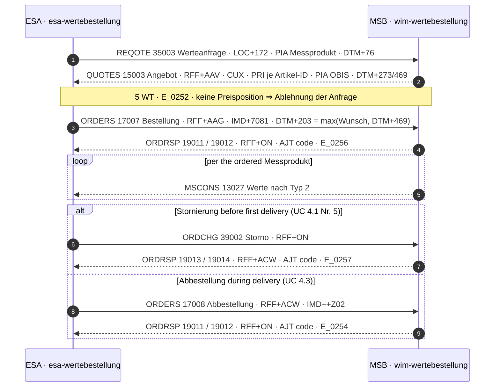
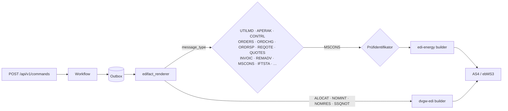

+++
title = "makod Operator Guide"
description = "makod operator guide: ports, CLI flags, the config file, persistent and volatile storage, AS4 inbound, the REST API and Kubernetes deployment."
weight = 21
+++
`makod` is the production daemon for the Mako process engine. It assembles the
seven domain modules `startup::production_modules()` registers — GPKE, WiM,
GeLi Gas, GaBi Gas, MaBiS, NZR-EMob and Redispatch — on a durable
[SlateDB](https://github.com/slatedb/slatedb) event store, and serves three
independent ports: AS4 inbound, HTTP REST, and BDEW API-Webdienste Strom.

It parses an inbound EDIFACT message, routes it by
[Prüfidentifikator (PID)](@/docs/architecture/domain-model.md#prufidentifikator-pid)
to a workflow, runs the [Frist](@/docs/architecture/domain-model.md#frist-and-werktag)
as a durable deadline, and renders the answer back onto the wire.

The terms —
LF, NB, MSB, BKV, [AHB and MIG](@/docs/architecture/domain-model.md#ahb-and-mig),
the [message types](@/docs/architecture/domain-model.md#edifact-message-types) —
are defined in the [glossary](@/docs/architecture/domain-model.md#glossary);
which PID belongs to which process is the [process map](@/docs/reference/processes.md).

---

## Port Layout

| Port | Flag | Serves |
|---|---|---|
| `:4080` | `--as4-addr` | AS4/ebMS3 inbound (EDIFACT + Redispatch XML) |
| `:8080` | `--http-addr` | REST API (`POST /edifact`, `/api/v1/commands`, admin), `/mcp`, `/metrics`, OpenAPI |
| `:8090` | `--api-webdienste-addr` | API-Webdienste Strom (iMS REST/JSON) |

Each port is optional and enabled independently. `/health`, `/health/live` and
`/health/ready` are mounted on every enabled port.

Daemons `makod` exchanges commands and events with most directly:

| Daemon | Port | Role |
|--------|------|------|
| [`marktd`](@/docs/services/marktd.md) | `:8180` | Master data (MaLo/MeLo/contracts), webhook fan-out, price sheets |
| [`invoicd`](@/docs/services/invoicd.md) | `:8280` | INVOIC plausibility, receipt persistence, REMADV auto-dispatch |
| [`edmd`](@/docs/services/edmd.md) | `:8380` | Meter-data store (MSCONS), time-series API, Mehr-/Mindermengen |
| [`processd`](@/docs/services/processd.md) | `:8580` | Walks the Entscheidungsbäume and posts the answer command back; keeps the process read model (BNetzA KPIs, Fristen alerts) and the NB Sperrauftrag queue |
| [`netzbilanzd`](@/docs/services/netzbilanzd.md) | `:8680` | NNE/MMM/MSB INVOIC generation |

The [service index](@/docs/services/_index.md) lists every daemon.

---

## Quick Start

### Development

```bash
just dev makod     # cargo run with dev/config/makod.toml
```

`dev/config/makod.toml` runs an in-memory event store, the permit-all Cedar
baseline and one synthetic NB/LF/MSB identity. Its load-bearing keys:

```toml
[authz]
permit_all = true              # dev only: every authenticated caller is admin

[storage]
allow_volatile = true          # in-memory; data is lost on exit

[http]
addr      = "127.0.0.1:8080"
auth_keys = ["dev=dev-makod-key"]

[deployment]
rollen = ["nb-strom", "lf-strom", "msb-strom"]

[[party]]
mp_id   = "9900357000004"
roles   = ["NB", "LF", "MSB"]
primary = true

[as4]
allow_no_signing = true        # no [party.as4]: log outbound EDIFACT
```

Each of those is a startup refusal without its opt-in:

| Key | Refusal it waives |
|---|---|
| `allow_volatile` (`MAKOD_ALLOW_VOLATILE`, `--allow-volatile`) | No `data_dir` and no object store |
| `auth_keys` or an `[oidc]` issuer | `[http] addr` set with no authentication |
| `permit_all` or `cedar_policy_dir` | Default-deny authorization with no policy — every request would be `403` |
| `allow_no_signing` | No `[party.as4]` key material and no `[erp] edifact_outbox_webhook_url` |

> **⚠ Volatile mode is development and CI only.** All event streams, outbox
> messages, snapshots, registry entries and deadlines live in RAM. Any exit,
> crash, restart or reschedule loses every in-flight process, undelivered APERAK
> and CONTRL, and the § 147 AO / GoBD audit trail.
> `makod_volatile_mode_active` is `1` while it is on.

### Production

A production deployment carries key material, so it belongs in the config file:
a secret passed as a flag is visible in `ps`.

```bash
makod --check-config --config /etc/makod/makod.toml   # every finding; no store, nothing written
makod --check --config /etc/makod/makod.toml          # gate the pipeline on this
makod --config /etc/makod/makod.toml
```

`--check-config` prints every configuration finding — severity, `makod.toml`
path, source — and exits non-zero on a blocking one; `--check-config --json`
prints the body `GET /admin/einrichtung` serves. Boot refuses on the same
blocking findings and logs every warning. See [Einrichtung](#einrichtung).

---

## Configuration file

Every CLI flag has a config-file key, and every secret has a `*_file` companion
read at startup. Unknown keys are **rejected**, and supplying both an inline
secret and its `*_file` companion is an error. Precedence:

```
CLI flags  >  Environment variables  >  Config file  >  Built-in defaults
```

```toml
# /etc/makod/makod.toml

[logging]
level  = "info"     # trace | debug | info | warn | error
format = "json"     # pretty | compact | json

[otel]
# endpoint     = "http://otel-collector:4317"
# service_name = "makod"

[storage]
backend = "s3"      # local | s3 | gcs | azure
# data_dir          = "/var/lib/makod"   # required for backend = "local"
# max_stream_events = 10000              # per-stream quota; 0 disables

[storage.s3]
bucket = "my-makod-events"
prefix = "makod"
# endpoint = "http://minio:9000"

# The roles this instance plays — each needs exactly one [[party]] MP-ID.
[deployment]
rollen = ["nb-strom"]

# One entry per Marktpartner-ID. Allgemeine Festlegungen Kap. 2.13 requires a
# separate code per Energieart and Marktrolle.
[[party]]
mp_id   = "9900357000004"
roles   = ["NB"]
primary = true

[http]
addr           = "0.0.0.0:8080"
auth_keys_file = "/etc/makod/auth-keys"         # NAME=TOKEN per line

[authz]
cedar_policy_dir = "/etc/makod/cedar"           # start from conservative.cedar

[oidc]
# issuer   = "https://login.microsoftonline.com/{tenant-id}/v2.0"
# audience = "api://makod"

[webdienste]
addr = "0.0.0.0:8090"

[engine]
# deadline_poll_interval_secs = 30
# marktrollen                 = ["NB"]   # defaults to the [[party]] union

[as4]
addr                  = "0.0.0.0:4080"
message_id_domain     = "as4.stadtwerke-beispiel.de"
trust_anchor_pem_file = "/etc/makod/sm-pki-root.pem"
crl_signer_pem_file   = "/etc/makod/sm-pki-ccrl-s-root.pem"

[[as4.partner]]
mp_id                    = "9900000000001"
endpoint                 = "https://partner-a.example/as4/inbox"
encryption_cert_pem_file = "/etc/makod/partners/9900000000001.enc.pem"
signing_cert_pem_files   = ["/etc/makod/partners/9900000000001.sig.pem"]

# Each [[party]] (above) carries its own key pairs:
# [party.as4]
# signing_cert_pem_file    = "/etc/makod/9900357000004/signing.cert.pem"
# signing_key_pem_file     = "/etc/makod/9900357000004/signing.key.pem"
# encryption_cert_pem_file = "/etc/makod/9900357000004/encryption.cert.pem"
# encryption_key_pem_file  = "/etc/makod/9900357000004/encryption.key.pem"
# tls_cert_pem_file        = "/etc/makod/9900357000004/tls.cert.pem"
# tls_key_pem_file         = "/etc/makod/9900357000004/tls.key.pem"

[policy.as4]
# unbekannte_absender = "nur_konfigurierte"   # the default

[erp]
webhook_url         = "https://erp.example.com/mako/events"
webhook_secret_file = "/etc/makod/erp-webhook.secret"

[marktd]
# url                 = "http://marktd:8180"
# api_key_file        = "/etc/makod/marktd.key"
# webhook_url         = "http://makod:8080/webhooks/marktd"   # required with url
# webhook_secret_file = "/etc/makod/marktd-webhook.secret"

[maloid]
# partners              = ["9900000000001=https://partner-a.example/maloid"]
# verzeichnisdienst_url = "https://verzeichnisdienst.example/api"
# verzeichnisdienst_signing_certs = ["9900000000001=/etc/makod/partners/9900000000001.api-sig.pem"]
# verzeichnisdienst_trust_anchor_pem_file = "/etc/makod/sm-pki-root.pem"   # required with them
```

### Secrets

Use the `*_file` form for every secret; the file forms compose with Kubernetes
Secrets, the Secrets Store CSI driver, a vault-agent tmpfs sink or systemd
`LoadCredential=`. Environment variables are readable from the process
environment and the container spec.

| Inline | File companion |
|---|---|
| `webdienste.client_cert_pem` · `client_key_pem` · `signing_key_pem` · `signing_cert_pem` | the same key with `_file` |
| `http.auth_keys` | `http.auth_keys_file` |
| `erp.webhook_secret` | `erp.webhook_secret_file` |
| `marktd.api_key` | `marktd.api_key_file` |
| `marktd.webhook_secret` | `marktd.webhook_secret_file` |

AS4 key material and certificates have only the file form: `[party.as4]`,
`as4.trust_anchor_pem_file`, `as4.crl_signer_pem_file` and the
`[[as4.partner]]` certificate files.

---

## All Configuration Options

### `[logging]` / `[otel]`

| TOML key | Env var | CLI flag | Default |
|---|---|---|---|
| `logging.level` | `MAKOD_LOG_LEVEL` | `--log-level` | `info` |
| `logging.format` | `MAKOD_LOG_FORMAT` | `--log-format` | `pretty` (`compact`, `json`) |
| `otel.endpoint` | `MAKOD_OTEL_ENDPOINT` | `--otel-endpoint` | *(unset — no export)* |
| `otel.service_name` | `MAKOD_OTEL_SERVICE_NAME` | `--otel-service-name` | `makod` |

`OTEL_EXPORTER_OTLP_ENDPOINT` / `OTEL_SERVICE_NAME` are honoured as well and
take precedence over the file. With an endpoint set, spans export via OTLP/gRPC
with W3C propagation and the subscriber is the JSON layer (`logging.format`
does not apply).

### `[storage]` — event store backend

| TOML key | Env var | CLI flag | Default | Description |
|---|---|---|---|---|
| `backend` | `MAKOD_OBJECT_STORE` | `--object-store` | `local` | `local` `s3` `gcs` `azure` |
| `data_dir` | `MAKOD_DATA_DIR` | `--data-dir` | *(in-memory)* | Local path (`backend = "local"`) |
| `allow_volatile` | `MAKOD_ALLOW_VOLATILE` | `--allow-volatile` | `false` | Required to run without `data_dir`; never production |
| `max_stream_events` | `MAKOD_MAX_STREAM_EVENTS` | `--max-stream-events` | `10000` | Per-stream event quota; `0` disables |

| Section | Keys (env `MAKOD_<SECTION>_<KEY>`, flag `--<section>-<key>`) | Credentials |
|---|---|---|
| `[storage.s3]` | `bucket` *(required)*, `prefix` (`makod`), `endpoint` (MinIO/compatible) | `AWS_ACCESS_KEY_ID`, `AWS_SECRET_ACCESS_KEY`, `AWS_REGION` |
| `[storage.gcs]` | `bucket` *(required)*, `prefix` (`makod`) | `GOOGLE_SERVICE_ACCOUNT_KEY` or `GOOGLE_APPLICATION_CREDENTIALS` |
| `[storage.azure]` | `container`, `account` *(both required)*, `prefix` (`makod`) | `AZURE_STORAGE_ACCOUNT_KEY`, or `AZURE_CLIENT_ID` + `AZURE_TENANT_ID` + `AZURE_CLIENT_SECRET` |

### `[engine]`

| TOML key | Env var | CLI flag | Default | Description |
|---|---|---|---|---|
| `shutdown_timeout_secs` | `MAKOD_SHUTDOWN_TIMEOUT_SECS` | `--shutdown-timeout-secs` | `30` | Shutdown grace period |
| `deadline_poll_interval_secs` | `MAKOD_DEADLINE_POLL_INTERVAL_SECS` | `--deadline-poll-interval-secs` | `30` | Deadline scheduler poll (min 1 s). Keep well under the Redispatch 2.0 `AcknowledgementDocument` Frist of 3 minutes |
| `snapshot_interval` | `MAKOD_SNAPSHOT_INTERVAL` | `--snapshot-interval` | `100` | Events between snapshots; `0` disables |
| `projection_checkpoint_interval` | `MAKOD_PROJECTION_CHECKPOINT_INTERVAL` | `--projection-checkpoint-interval` | `60` | Seconds between projection cursor writes; `0` stops the projection workers |
| `worker_threads` | `MAKOD_WORKER_THREADS` | `--worker-threads` | logical CPUs | Tokio worker threads |
| `marktrollen` | `MAKOD_MARKTROLLEN` | `--marktrollen` | `[[party]]` role union | Roles the command API accepts commands for |

A command for a role outside `marktrollen` is refused with
`422 role_not_configured`. Typical values: `LF` (supplier), `LF,LFG`
(dual-fuel), `NB`, `NB,MSB` (Stadtwerke), `BKV`.

The roles that gate PID registration inside the registered modules are the
`[[party]]` roles, which `[deployment] rollen` admits — there is no second
declaration that could widen them.

### `[deployment]` — the roles this instance plays (required)

| TOML key | Required | Description |
|---|---|---|
| `rollen` | yes | `lf-strom`, `lf-gas`, `nb-strom`, `nb-gas`, `msb-strom`, `msb-gas`, `esa-strom`. Each needs exactly one `[[party]]` MP-ID; see [Deployment roles](#deployment-roles) |

### `[[party]]` — operator identities (required)

At least one entry; one per Marktpartner-ID.

| TOML key | Required | Description |
|---|---|---|
| `mp_id` | yes | 13-digit BDEW- (`99…`) or DVGW-Codenummer (`98…`) or GS1 GLN. An EIC is refused: it is not an MP-ID (BDEW-AWH Identifikatoren V1.2 Kap. 2.1, S. 4). A Gas role under a `99…` code, or a Strom role under a `98…` code, is refused (BDEW-AWH Identifikatoren V1.2 Kap. 2.2, S. 5: Stelle 1+2 „99 = BDEW/Strom", „98 = DVGW/Gas") |
| `roles` | yes | Case-insensitive. Strom: `NB`, `ANB`, `VNB` (`nb-strom`), `LF` (`lf-strom`), `MSB`, `NMSB`, `AMSB` (`msb-strom`), `ESA` (`esa-strom`). Gas: `GNB` (`nb-gas`), `LFG` (`lf-gas`), `GMSB` (`msb-gas`). Each must belong to a declared `rollen` token; `BKV`, `UNB`, `BIKO`, `DP`, `EIV`, `MGV`, `FNB`, `KN` and `RB` have no module and are refused |
| `primary` | no | Storage partition key (derives the `TenantId`) and default sender MP-ID; the first entry when none is marked |
| `agency` | no | NAD DE 3055 override, one of `9`, `293`, `332` — the MIGs' NAD code list (UTILMD MIG Strom S2.2 S. 32–33, UTILMD MIG Gas G1.2 S. 17–18); anything else is refused. Derived from the MP-ID otherwise, by the same rule that renders the NAD: `99…` → `293`, `98…` → `332`, other 13 digits → `9` |

### `[http]` / `[authz]` — REST API

| TOML key | Env var | CLI flag | Default | Description |
|---|---|---|---|---|
| `http.addr` | `MAKOD_HTTP_ADDR` | `--http-addr` | *(disabled)* | Listen address |
| `http.max_body_bytes` | `MAKOD_HTTP_MAX_BODY_BYTES` | `--http-max-body-bytes` | `10485760` | Max `POST /edifact` body |
| `http.auth_keys` | `MAKOD_AUTH_KEYS` (comma-separated) | `--auth-key` (repeatable) | — | `NAME=TOKEN` API keys |
| `http.auth_keys_file` | — | — | — | File of `NAME=TOKEN` lines |
| `authz.cedar_policy_dir` | `MAKOD_CEDAR_POLICY_DIR` | `--cedar-policy-dir` | — | `*.cedar` files merged into one policy set |
| `authz.permit_all` | `MAKOD_CEDAR_PERMIT_ALL` | `--cedar-permit-all` | `false` | **Development only** — every authenticated principal is admin |

`makod` refuses to start when `http.addr` is set with neither an API key nor an
OIDC issuer, and when neither a policy directory nor `permit_all` is set.

---

## Deployment roles

`[deployment] rollen` decides which domain modules register;
`startup::MODULE_TABLE` maps each role to its modules. Startup — and `--check` —
refuses a configuration that declares no role, a declared role without exactly
one `[[party]]` MP-ID, an MP-ID for a role the deployment does not declare, and
a `[[party]]` role no module answers for (`BKV`, `UNB`, `BIKO`, `FNB`, `MGV`,
`KN`, `DP`, `EIV`, `RB`). One MP-ID per role and Sparte is BDEW-AWH
Identifikatoren V1.2 Kap. 2.1 (S. 4): „Für jede Sparte (Gas bzw. Strom) und
jede Rolle hat ein Markteilnehmer genau eine MP-ID."

```toml
[deployment]
rollen = ["nb-strom", "msb-strom"]

[[party]]
mp_id = "9900357000004"
roles = ["NB", "MSB"]
```

| `rollen` token | `[[party]]` roles | Modules registered |
|---|---|---|
| `lf-strom` | `LF` | `GpkeModule` (LF side) · `EmobModule` (the LF answers 55240) |
| `nb-strom` | `NB` · `ANB` · `VNB` | `GpkeModule` · `WimModule` · `MabisModule` · `EmobModule` · `RedispatchModule` |
| `lf-gas` | `LFG` | `GeliGasModule` (LF side) |
| `nb-gas` | `GNB` | `GeliGasModule` (GNB side) · `WimModule` · `GaBiGasModule` |
| `msb-strom` | `MSB` · `NMSB` · `AMSB` | `GpkeModule` (the ORDERS a MSB receives: 17116, 17004/17102/17113, the GPKE Teil 3 Konfiguration ORDERS) · `WimModule` |
| `msb-gas` | `GMSB` | `GeliGasModule` (the Anfrage Sperrung 17116 only) · `WimModule` |
| `esa-strom` | `ESA` | `WimModule` (`esa-wertebestellung` and its `wim-wertebestellung` counterpart) |

`WimModule` covers both Sparten. `RedispatchModule` is NB Strom only — LF, MSB
and gas-only deployments have no §§ 13/13a obligations (BK6-20-059/060/061 as
consolidated by BK6-23-241).

Every build links every domain crate; the declaration selects registrations,
and `--marktrollen` additionally refuses commands at runtime. Declaring every
role registers the full **77 workflows over 498 Prüfidentifikatoren**, and the
startup log records the counts a declaration registers. Which principal may
read which role's processes is the Cedar policy's decision
([Authorization](#authorization)).

---

## Authorization
{: #authorization }

Every endpoint except `/health*` and the OpenAPI document is authorized by
[Cedar](https://cedarpolicy.com) ABAC. The shared mechanics (named keys with
constant-time matching, Bearer/JWT routing, schema-validated policy loading)
live in `mako_service::cedar_schema`; makod adds the `MaKo::` actions,
entities and schema. Policies are validated in **strict mode** at startup, and a
type error prevents startup.

**Authorization is default-deny.** `--cedar-policy-dir` is the only source of
access; `services/makod/src/cedar/conservative.cedar` is the least-privilege
starting point and is written for § 6a EnWG role separation.
`--cedar-permit-all` installs the permit-all baseline, under which additional
policies can only *remove* access via `forbid`.

### Identity model

```
MaKo namespace
├── Principal          — caller identity (API-key name or JWT sub)
├── Command            — attrs: name, marktrolle, pid, tenant
├── EdifactIngest      — attrs: tenant
├── AdminMaloRecord    — attrs: tenant, malo_id (optional)
├── AdminPartnerRecord — attrs: tenant, gln (optional)
├── MetricsEndpoint · McpEndpoint · RechnungEndpoint
├── MigrationEndpoint · WebdiensteEndpoint · EinrichtungEndpoint
└── ProcessRecord      — attrs: tenant, workflow

Actions
├── SubmitCommand · RehearseCommand · IngestEdifact
├── ReadMetrics · UseMcp · ReadRechnung · AdminMigrations · UseWebdienste
├── AdminEinrichtung
├── ReadProcess        — evaluated per workflow (§ 6a EnWG role separation)
├── AdminMalo (group)    → AdminMaloRead / Write / Delete / Stats
└── AdminPartner (group) → AdminPartnerRead / Write / Delete / Import
```

| Action | Guards |
|---|---|
| `SubmitCommand` | `POST /api/v1/commands`, MCP `submit_command` |
| `RehearseCommand` | `POST /api/v1/probe/{command}`, MCP `rehearse_command` — same `Command` resource as `SubmitCommand`; `conservative.cedar` grants it to `erp-operator` |
| `IngestEdifact` | `POST /edifact` |
| `AdminMalo*` / `AdminPartner*` | `/admin/malo/*`, `/admin/partners/*` |
| `ReadMetrics` | `GET /metrics` |
| `UseMcp` | `/mcp` (transport only — see [MCP authorization](#mcp-authorization)) |
| `ReadRechnung` | `GET /api/v1/invoic/{process_id}/rechnung` |
| `AdminMigrations` | `POST /admin/migrations` — grant to a break-glass principal for the FV cutover only; `conservative.cedar` grants it to nobody |
| `AdminEinrichtung` | `GET /admin/einrichtung`, `GET /admin/einrichtung/deployment`, `POST /admin/einrichtung/vorschlag`, `GET /api/v1/policy`, MCP `get_policy`, `einrichtung_checkliste` and `einrichtung_vorschlag` — read-only; `conservative.cedar` grants it to `erp-operator` and `admin-readonly` |
| `UseWebdienste` | every `:8090` route |
| `ReadProcess` | MCP `get_process`, `get_process_history`, `list_overdue_deadlines`, `list_dead_letters`; carries the workflow name, so an NB principal can be kept off LF process state |

Policies can name the `AdminMalo` / `AdminPartner` groups:

```cedar
// /etc/makod/cedar/read_only_grafana.cedar — under --cedar-permit-all
forbid(
  principal == MaKo::Principal::"ops-grafana",
  action in [MaKo::Action::"AdminMalo", MaKo::Action::"AdminPartner"],
  resource
)
unless {
  action == MaKo::Action::"AdminMaloStats"
  || action == MaKo::Action::"AdminPartnerRead"
};
```

### OIDC / JWT authentication

| TOML key | Env var | CLI flag | Default |
|---|---|---|---|
| `oidc.issuer` | `MAKOD_OIDC_ISSUER` | `--oidc-issuer` | — |
| `oidc.audience` | `MAKOD_OIDC_AUDIENCE` | `--oidc-audience` | — |
| `oidc.jwks_refresh_secs` | `MAKOD_OIDC_JWKS_REFRESH_SECS` | `--oidc-jwks-refresh-secs` | `300` |

At startup makod fetches `<issuer>/.well-known/openid-configuration` and the
JWKS, verifies tokens locally and refreshes the keys in the background. Any
standards-compliant provider works (Entra ID, Keycloak, Okta, Cognito, Kubernetes
workload identity).

- Only asymmetric algorithms (RS256/384/512, ES256/384, PS256/384/512); `HS*`
  is rejected.
- `iss`, `aud` and `exp` are checked on every token.
- **`mako_tenant` must equal the primary MP-ID**, and a missing claim is
  rejected: in a shared realm another operator's token is otherwise
  cryptographically valid here.
- The JWT `sub` becomes the Cedar principal ID (for a Kubernetes service account,
  `system:serviceaccount:<namespace>:<name>`).

API keys and OIDC can be active at the same time.

---

### `[as4]` — AS4/ebMS3 inbound and outbound

`asx-rs` 0.16's `Profile::bdew()` fixes every security and wire setting of BDEW
AS4-Profil 1.2: ECDSA on brainpoolP256r1 with an `X509PKIPathv1` token,
ECDH-ES/ConcatKDF/AES-128-GCM with an `X509SKI` reference, sign then encrypt,
gzip, the fixed Action, roles and `AgreementRef`, an empty `ConversationId`, CRL
revocation with the three-day distrust rule (Regelungen zum Übertragungsweg für
AS4 2.6 Kap. 5.4). Nothing in the configuration can relax it. What is
configured is who the parties are:

| Material | Where | Used for |
|---|---|---|
| Each MP-ID's signing, encryption and TLS key pairs | `[party.as4]` of every `[[party]]` | Signing outbound messages and receipts, decrypting inbound, the mutual-TLS connection |
| SM-PKI root | `as4.trust_anchor_pem_file` | The one trust anchor every signer — partner and own — chains to |
| CCRL-S(Root) | `as4.crl_signer_pem_file` | Signs the indirect Root-CA CRL (BSI TR-03109-4 §4.2.1) |
| Partner encryption cert | `[[as4.partner]] encryption_cert_pem_file` | Encrypting what is **sent** to the partner |
| Partner signing certs | `[[as4.partner]] signing_cert_pem_files` | Pins: the partner's messages must be signed by one of them (several for a rollover) |

BDEW AS4-Profil 1.2 §2.3.4.4 requires different EC key pairs for signing,
encryption and TLS, issued by an SM-PKI CA, with the MP-ID in the subject — in
its OU (Regelungen zum Übertragungsweg für AS4 2.6 Kap. 5.2: „Das Feld
Organisational Unit („OU") des Subject muss die MP-ID enthalten"). A receiving
MSH checks that OU against `eb:From`, so **every MP-ID has its own key pairs and
its own AS4 client**: a combined Strom+Gas deployment holds two `[party.as4]`.

| Key | Description |
|---|---|
| `[as4] addr` (`MAKOD_AS4_ADDR`, `--as4-addr`) | Listen address. Each `[[party]]` is served at `/as4/inbox/<MP-ID>` — one web-service address per certificate (RzÜ AS4 2.6 Kap. 5.2) |
| `[as4] message_id_domain` | The `id-right` of every `eb:MessageId`: `<outbox id>@<domain>` (RFC 2822 §3.6.4) |
| `[as4] trust_anchor_pem_file` | SM-PKI root certificate |
| `[as4] crl_signer_pem_file` | SM-PKI CCRL-S(Root) certificate |
| `[as4] zertifikat_warnfenster_tage` | Days before expiry a `[party.as4]` or `[[as4.partner]]` certificate is reported as a warning, with its date; an expired one blocks. Default `30`. Re-read every six hours and on each request, so `GET /admin/einrichtung` and `makod_certificate_expiry_days` show the files as they stand. Key rotation without a restart: [Certificate expiry and rotation](@/docs/reference/as4-bdew.md#certificate-expiry-and-rotation) |
| `[as4] allow_no_signing` (`MAKOD_ALLOW_NO_AS4_SIGNING`, `--allow-no-as4-signing`) | **Dev/test:** start without AS4 key material and without an outbox webhook; outbound EDIFACT is logged |
| `[party.as4] signing_cert_pem_file` · `signing_key_pem_file` | The MP-ID's EMT.MAK signing certificate (leaf first, then intermediates) and key |
| `[party.as4] encryption_cert_pem_file` · `encryption_key_pem_file` | Its encryption certificate and decryption key |
| `[party.as4] tls_cert_pem_file` · `tls_key_pem_file` | Its TLS client certificate and key |
| `[[as4.partner]] mp_id` · `agency` | The partner's MP-ID; the agency (party type) is derived from its prefix unless set |
| `[[as4.partner]] endpoint` | Its inbox, `https://` only; omit for a partner makod only receives from |
| `[[as4.partner]] encryption_cert_pem_file` | Required with `endpoint` |
| `[[as4.partner]] signing_cert_pem_files` | Pinned signing certificates; without any, the SM-PKI chain and the OU decide |
| `[[as4.partner]] quirks` | `["receipt-without-non-repudiation"]` accepts that partner's **signed** receipt without NonRepudiationInformation |
| `[[as4.partner]] de0004_ausnahme` | MP-IDs the partner may name in `UNB` DE0004 while authenticating as itself (a Dienstleister); without it DE0004 must be the partner's own MP-ID, and each entry is a startup warning |

Partner endpoints are seeded into the durable `PartnerStore`; runtime changes via
`PUT /admin/partners/{mp_id}` or inbound PARTIN survive restarts.

#### `[policy.as4] unbekannte_absender` {#policy-as4-unbekannte-absender}

Whether the inbox serves a sender that is not a `[[as4.partner]]`. `asx-rs`
verifies every sender against the SM-PKI root and the MP-ID in its certificate's
OU in either case.

| Value | Behaviour | Source |
|---|---|---|
| `nur_konfigurierte` (default) | A sender missing from `[[as4.partner]]` is refused before dispatch, answered `EBMS:0202` — once the operator configures it, the sender's next retry is served | BDEW AS4-Profil 1.2 Kap. 2.3.7 (S. 19): certificates „KÖNNEN … auf der Grundlage der MP-ID im OU-Feld abgelehnt werden (Whitelist)"; the whitelist is the operator's partner master data |
| `bdew_ou_zulassen` | Any sender whose verified SM-PKI certificate carries the claimed MP-ID in its OU is served | BDEW AS4-Profil 1.2 Kap. 2.3.2 (S. 16): the receiver accepts any `eb:From` PartyId „sofern sie mit den entsprechenden Betreff-Feldern im vorgelegten Zertifikat übereinstimmen" |

The default is the direction that cannot act on a message from a party the
operator has not chosen to deal with. makod logs the value with its source at
startup and under `--check`.

#### `[policy.ingest] unbekannter_vorgang` {#policy-ingest-unbekannter-vorgang}

What a follow-up no process takes is answered with, where the PID-Übersicht
puts its assignment into the Verarbeitbarkeitsprüfung („Stelle der
Zuordnungsprüfung" `V`).

| Value | Behaviour | Source |
|---|---|---|
| `z33` (default) | Refused with the Verarbeitbarkeitsfehlermeldung `Z33` „Referenziertes Geschäftsvorfall-Tupel nicht vorhanden" | APERAK AHB 1.1 Kap. 2.1.3 (S. 14), Kap. 4.3 (S. 43) |
| `zur_pruefung` | Recorded as a dead letter for a person; no APERAK goes out | APERAK AHB 1.1 Kap. 1.3 (S. 7): „Sofern die Ursache für das Misslingen auf Seiten des Empfängers liegt, hat dieser die ursprüngliche Übertragungsdatei in die fristgerechte Verarbeitung aufzunehmen" |

`z33` is right whenever makod's process store is the whole of the operator's
Geschäftsvorfälle. Set `zur_pruefung` for a cutover from another MaKo system,
or while initiating messages still leave through another system: their answers
reach makod for processes it never started, and the tuple does exist at the
operator. Set it back once the cutover is complete.

**Startup refusals** (all also run under `--check`):

| Condition | Why |
|---|---|
| `--as4-addr` with no `[party.as4]`, or one `[[party]]` without it beside one with it | Each MP-ID's inbox and messages need its own key pairs |
| No `trust_anchor_pem_file`, `crl_signer_pem_file` or `message_id_domain` | Nothing verifies, nothing below the root passes the CRL check, no message id can be formed |
| `As4::builder(..).build()` refuses (a signer not chaining to the root, no MP-ID in a certificate's OU, an expired certificate, …) | The `asx-rs` refusal names the setting and the profile section |
| Two of a party's signing, encryption and TLS certificates certify one key pair | §2.3.4.4; compared by public key, not by certificate |
| A partner endpoint on `http://`, or an endpoint without an encryption certificate | §2.2.6.2.2 encrypts every message for its recipient |
| `as4.lenient_receipts` or `MAKOD_AS4_LENIENT_RECEIPTS` set | Every receipt is verified; the refusal names the per-partner `quirks` setting |

**Sending.** A message for a partner goes out through the client of the
interchange's sender (UNB DE0004) under Service
`https://www.bdew.de/as4/communication/services/MP` — every EDIFACT
Übertragungsdatei of the Marktkommunikation is a Marktprozess (BDEW AS4-Profil
1.2 §2.3.1.2.1). The `eb:MessageId` is `<outbox id>@<message_id_domain>`, and
the `eb:Timestamp` is the outbox entry's first attempt, which the outbox worker
records durably before the first send. Every retry resends the same id and
timestamp, so its digests are the first attempt's and a receiver that already
holds the message answers it as a duplicate (`asx-rs` accepts an `eb:Timestamp`
up to 7 days old; the retry window is 72 hours).

**Receipts and retries.**

- A delivery counts only when `As4::send` returns a verified receipt: signed by
  a pinned or SM-PKI certificate of the partner, referring to the sent message
  id, echoing the signed digests as NonRepudiationInformation (unless the
  partner's `quirks` say otherwise). Its evidence is kept (`as4ev/` in the store)
  before the outbox entry is acknowledged.
- A partner `eb:Error`, an unverifiable receipt and a transport failure back off
  and retry inside the **72-hour** window — protocol-safe with the same id and
  timestamp. `outbox_delivery_attempted` logs `counterparty_error`,
  `receipt_unverified` or `transport_error`; a configuration refusal is
  permanent.
- Inbound: a verified message is claimed in the durable dedup store, dispatched
  and answered with a signed receipt. A duplicate gets a fresh signed receipt, a
  message whose claim is still held gets `503`. A refused message is
  dead-lettered first and answered `EBMS:0004` (not retried); when the dead letter
  itself cannot be written, the answer is the retryable `EBMS:0202`. Accepted
  keys are kept 8 days.

**Connectivity pings** (the ebMS3 test service, BDEW AS4-Profil 1.2 §2.3.6) are
receipted by `asx-rs` and never delivered. A transmission-path switch (§2.3.7)
is receipted and logged; the `confirmSwitch` answer is the operator's.

**Outbound wire format.** A complete Übertragungsdatei `UNB … UNZ`. UNB
sender/receiver equal `NAD+MS`/`NAD+MR` (Allgemeine Festlegungen 6.1d Kap. 2);
DE 0007 follows the MP-ID (`500` BDEW, `502` DVGW, `14` GS1); the DE 0020
Datenaustauschreferenz — also in UNZ and the Kap. 2.12 filename — derives from the
outbox id, so retries reuse it.

**Tracing.** An inbound `traceparent` is captured into every outbox message the
request creates and re-injected on the ERP webhook and the CloudEvent. The AS4
send runs in a span parented on it (`makod.as4.send`, with `asx.send` beneath);
no `traceparent` header goes to the partner.

**Webhook transport substitute.** With `[erp] edifact_outbox_webhook_url` set,
outbound interchanges are POSTed as CloudEvents of type
`de.mako.edifact.outbound` (`message_type`, `recipient`, `edifact`), the outbox
id as CloudEvent `id` and `X-Idempotency-Key`, signed with Standard Webhooks
under `[erp] webhook_secret` — which is then required.

It is a development and ERP-integration path; `MaloIdentCallback` messages still
go to the MaLo-ID sender.

### `[webdienste]` — BDEW API-Webdienste Strom

`addr` and the trust keys describe the inbound `:8090` port; the `client_*` and
`signing_key_*` keys describe the identity used when calling another party's
API-Webdienste.

| TOML key | Env var | CLI flag | Description |
|---|---|---|---|
| `addr` | `MAKOD_API_WEBDIENSTE_ADDR` | `--api-webdienste-addr` | Listen address |
| `allow_unauthenticated` | `MAKOD_WEBDIENSTE_ALLOW_UNAUTHENTICATED` | `--webdienste-allow-unauthenticated` | Drop the bearer/OIDC + Cedar layer — only behind an mTLS-terminating proxy; logs a `WARN` |
| `trust_client_mp_id_header` | `MAKOD_WEBDIENSTE_TRUST_CLIENT_MP_ID_HEADER` | `--webdienste-trust-client-mp-id-header` | Read the caller from `X-Mako-Client-MP-ID`; implied by `allow_unauthenticated` |
| `client_cert_pem` / `_file` | `MAKOD_WEBDIENSTE_CLIENT_CERT_PEM` | `--webdienste-client-cert-pem` | Outbound mTLS chain (EMT.API, BSI SM-PKI) |
| `client_key_pem` / `_file` | `MAKOD_WEBDIENSTE_CLIENT_KEY_PEM` | `--webdienste-client-key-pem` | Its PKCS#8 key |
| `client_root_ca_pem_files` | `MAKOD_WEBDIENSTE_ROOT_CA_PEM` | `--webdienste-root-ca-pem` | SM-PKI roots to trust when calling out |
| `signing_key_pem` / `_file` | `MAKOD_WEBDIENSTE_SIGNING_KEY_PEM` | `--webdienste-signing-key-pem` | EMT.API key for content signing |
| `signing_cert_pem` / `_file` | `MAKOD_WEBDIENSTE_SIGNING_CERT_PEM` | `--webdienste-signing-cert-pem` | Its certificate, sent as `X-BDEW-CERT`; required with the key, and the boot refuses a pair that does not belong together |
| `allow_unauthenticated_client` | `MAKOD_ALLOW_UNAUTHENTICATED_WEBDIENSTE_CLIENT` | `--allow-unauthenticated-webdienste-client` | **Dev/test:** call out without identity or signing key |

- **Outbound identity is required.** The API-Webdienste authenticate callers by
  mTLS with an EMT.API certificate; without one the call fails at the
  counterparty. makod refuses to start when `--verzeichnisdienst-url` or
  `--maloid-partner` is set without a client identity.
- **Content signing is a second layer.** Regelungen zum Übertragungsweg für
  API-Webdienste 1.2, Kap. 3.3 („Jede API-Interaktion und der übertragene
  Payload wird signiert.") signs the URI, the RFC 8785 canonical body,
  `creationDateTime`, `transactionId` and — when present —
  `initialTransactionId`, with the algorithms of TR-03116-3; the digest travels
  in `X-BDEW-DIGEST`, the signature in `X-BDEW-SIGNATURE` and the certificate in
  `X-BDEW-CERT`.
  It applies to Control Measures and MaLo Identification; the Verzeichnisdienst
  uses JWS. Without a signing key, makod refuses to start when `addr`,
  `--maloid-partner` or `--verzeichnisdienst-url` is set.
- **Inbound signatures are required and verified.** Kap. 3.3: „MUST Jede
  API-Interaktion und der übertragene Payload wird signiert". Every request
  carries `X-BDEW-SIGNATURE` / `X-BDEW-DIGEST` / `X-BDEW-CERT` (certificate in
  RFC 9440 encoding), checked against the named certificate's key over
  `https://{Host}{path?query}`, the canonical body and the `creationDateTime` /
  `transactionId` / `initialTransactionId` headers before any handler runs. An
  unsigned request, a mismatch and a partial or repeated header set are `401`.
  The proxy, not makod, validates the SM-PKI chain.
- **Directory records are verified.** A Verzeichnisdienst record is the
  provider's statement, verifiable against its EMT.API signature certificate
  (Regelungen zum Verzeichnisdienst 1.1, Kap. 2.2, S. 6), and the directory
  distributes no certificates (Kap. 1.6, S. 4). makod uses a record only when
  its JWS verifies against a certificate in `[maloid]
  verzeichnisdienst_signing_certs` (`--verzeichnisdienst-signing-cert
  MP-ID=PATH`, repeatable for a rollover) and it names the entry requested; a
  redirect is followed and its record held to the same check. A partner with no
  certificate configured has every record refused and keeps its stored
  endpoint. Each certificate file holds the leaf, then its Sub-CA; it must chain
  to `verzeichnisdienst_trust_anchor_pem_file` (`--verzeichnisdienst-trust-anchor`,
  the SM-PKI root), be inside its validity and carry the MP-ID as OU (Kap. 3.2,
  S. 7) — otherwise, or without the anchor, the boot is refused. The CRL is not
  checked.
- **mTLS is the proxy's job.** makod does not terminate TLS; front `:8090` with a
  proxy (Nginx, Envoy, ALB) enforcing mTLS against the BDEW PKI CA. By default
  every `:8090` route also requires bearer/OIDC and Cedar `UseWebdienste`.

#### Caller identity — `X-Mako-Client-MP-ID`

The Control Measures request names no sender, so the proxy forwards the client
certificate's Marktpartner-ID and must strip any client-supplied copy:

```nginx
proxy_set_header X-Mako-Client-MP-ID $ssl_client_s_dn_cn;
```

The header is read only with `trust_client_mp_id_header`. A request with no
establishable caller is `400` — the §14a Endantwort and the WiM Bestätigung are
addressed to the caller. The value must be a 13-digit MP-ID or a 16-character
EIC; a repeated header is `400`. A WiM Order body whose `netzbetreiber_id`
differs from the caller is `403`, checked before the `transactionId` idempotency
guard.

### §20b EnWG Netzzugangsplattform adapter {#netzzugangsplattform}

§20b EnWG Abs. 2 requires a joint Netzbetreiber platform for Zählpunktanordnungen
(Nr. 1), Verrechnungskonzepte (Nr. 2) and Energy-Sharing registration under §42c
(Nr. 3); interfaces are left to a BNetzA Festlegung (Abs. 3), and none has been
published. makod ships the client side:

| Command | §20b anchor | Roles |
|---|---|---|
| `netzzugang.zaehlpunktanordnung.beauftragen` | Abs. 2 Nr. 1 (`aktion`: `bestellung` \| `aenderung` \| `abbestellung`) | LF, MSB |
| `netzzugang.verrechnungskonzept.beauftragen` | Abs. 2 Nr. 2 (same `aktion`s) | LF, MSB |
| `netzzugang.energysharing.registrieren` | Abs. 2 Nr. 3 | LF |

Payload: `netzanschluss_id`, `nb_mp_id`, `antragsteller_ref` (opaque, no PII),
optional `details`. Each command records an `erfasst` entry in marktd's
`netzzugang_antraege` and enqueues a `NetzzugangAntrag` outbox message, which is
delivered:

1. to the ERP webhook as `de.mako.netzzugang.uebermittlungsbedarf`, for
   submission via the NB's Webportal (signed when `--erp-webhook-secret` is set);
2. else, or on an undeserialisable payload, marked `fehlgeschlagen` and acked.

No platform interface is published — § 20b Abs. 3 EnWG leaves it to a BNetzA
Festlegung — so `--netzzugang-endpoint-url` (`MAKOD_NETZZUGANG_ENDPOINT_URL`,
`[erp] netzzugang_endpoint_url`) is refused at startup.

The answer is recorded via marktd
`PATCH /api/v1/netzzugang/antraege/{id}/status`, which emits
`de.markt.netzzugang.antrag.updated`.

---

## MCP Server

`/mcp` on the `--http-addr` port speaks the MCP Streamable HTTP transport
(revisions 2026-07-28 and 2025-11-25): `POST` for JSON-RPC. No session is held
on either revision, so any replica answers any request and `GET` opens no
stream (`405`).
Every request needs `Authorization: Bearer <token>` (API key or OIDC) and the
Cedar `UseMcp` action; unauthenticated requests are `401`.

### Tools

`makod` ships **17 MCP tools**:

| Tool | Annotations | Description |
|---|---|---|
| `list_commands` | `read_only` | Commands for this instance's Marktrollen, with role, primary PID and whether `marktrolle` is required — call first |
| `submit_command` | `destructive` | Same as `POST /api/v1/commands`, with progress notifications |
| `rehearse_command` | `read_only` | Same as `POST /api/v1/probe/{command}` — the door up to its pre-send check, nothing written (`outputSchema` declared) |
| `get_malo` | `read_only` | Cached Marktlokation by 11-digit ID |
| `list_partners` | `read_only` | Registered trading partners |
| `get_partner` | `read_only` | Partner by 13-digit MP-ID |
| `get_health` | `read_only` | Version, tenant, Marktrollen, MaLo cache stats |
| `get_policy` | `read_only` | Same as `GET /api/v1/policy` — the `[policy]` settings with origin and source, `deployment.rollen` and every `allow_*` posture |
| `einrichtung_checkliste` | `read_only` | Same as `GET /admin/einrichtung/deployment` — the readiness checklist across `[[einrichtung.dienst]]` (`outputSchema` declared) |
| `einrichtung_vorschlag` | `read_only` | Same as `POST /admin/einrichtung/vorschlag` — the configuration the setup interview's answers propose, per daemon, against what is loaded (`outputSchema` declared) |
| `get_process` | `read_only` | Business key (`malo_id`/`melo_id`/`vorgang`) or process id → every process indexed under it, each with its pending deadlines (`outputSchema` declared) |
| `get_process_history` | `read_only` | A process's events, oldest first; a market message carries `richtung`, `pid` and `message_ref` as its workflow states them (`EventPayload::verlauf`), never parsed from the event type; an answer adds `antwortcode`, `codeliste` (`EventPayload::antwort`) and the BDEW's `bedeutung`, resolved through `mako_pruefung::codes::lies` in that list only (`outputSchema` declared) |
| `list_overdue_deadlines` | `read_only` | Deadlines past due and not yet fired — the deadline worker's backlog, not missed Fristen (those are processd `list_overdue_processes`) |
| `list_active_processes` | `read_only` | Processes started for the tenant, finished ones included — one event stream each |
| `get_outbox_status` | `read_only` | Pending outbox count and oldest age — alert when stuck > 5 min |
| `list_dead_letters` | `read_only` | Typed `{ dead_letters, gesamt }`: the 20 most recent dead letters, each with `rejected_at` (RFC 3339), `reason_label` and `reason_detail`, and how many the store holds in all (`outputSchema` declared) |
| `get_format_version_coverage` | `read_only` | Per message type: `stable` or `transition`, and which releases are in force today |

`tool_inventory_tests` in `mcp_server.rs` pins this list.

#### Authorization {#mcp-authorization}

`UseMcp` opens the transport only. Each tool that touches tenant data evaluates
the action its REST twin enforces:

| Tool | Additional Cedar action |
|---|---|
| `submit_command` | `SubmitCommand` (command, Marktrolle, PID) |
| `rehearse_command` | `RehearseCommand` (command, Marktrolle, PID) |
| `get_malo` | `AdminMaloRead` |
| `list_partners`, `get_partner` | `AdminPartnerRead` |
| `get_process`, `get_process_history`, `list_overdue_deadlines` | `ReadProcess`, per workflow (`get_process` leaves out each process the caller may not read, and answers `not_found` when none remains; `get_process_history` answers a refused process `not_found`) |
| `get_policy`, `einrichtung_checkliste`, `einrichtung_vorschlag` | `AdminEinrichtung` |
| `list_dead_letters` | `ReadProcess` across workflows — a workflow-scoped principal is denied outright |
| `list_commands`, `get_health`, `get_format_version_coverage`, `list_active_processes`, `get_outbox_status` | none — no tenant data |

#### `submit_command` parameters

| Field | Type | Required | Description |
|---|---|---|---|
| `command` | string | ✓ | `<domain>.<prozess>.<aktion>`, e.g. `gpke.lieferbeginn.anmelden` |
| `payload` | object | ✓ | Command payload, e.g. `{"malo_id": "51238696012", "lieferbeginn_datum": "2026-10-01", "bilanzkreis": "11XBK-STD------Y"}` |
| `marktrolle` | string | – | Required for multi-role commands |
| `idempotency_key` | string | – | Supplied: a repeat replays the recorded response (24 h), reuse for another request is refused. Omitted: a random UUID, no replay record |

`get_malo` takes `malo_id`; `get_partner` takes `mp_id`.

### Resources and prompts

| Resource | Content |
|---|---|
| `malo://{malo_id}` | `MaloIdentResultPositive` record from the MaLo cache |
| `partner://{mp_id}` | Partner record with AS4 URL, roles and channels |

| Prompt | Arguments | Guides |
|---|---|---|
| `gpke-lieferbeginn` | `malo_id`, `lieferbeginn_datum` (YYYY-MM-DD) | GPKE Lieferbeginn Strom — the 55001 body with every Muss fact, as `GpkeLieferbeginnAnmelden` reads it |
| `geli-lieferbeginn` | `malo_id`, `process_date` (YYYYMMDD) | GeLi Gas Lieferbeginn — the 44001 body with every Muss fact, as `GeliLieferbeginnAnmelden` reads it |
| `wim-geraetewechsel` | `melo_id`, `process_date`, `receiver_mp_id`, `marktrolle` | WiM Gerätewechsel |
| `msb-preisanfrage` | — | MSB Preisanfrage (REQOTE/QUOTES, PRICAT 27003) |
| `wim-gas-anmeldung` | — | GNB answers a gMSB Anmeldung (UTILMD G 44042–44053) |
| `gpke-sperrung` | — | GPKE Sperrung Strom |

The server instructions returned on connect carry the tenant, the Marktrollen,
the filtered command list, a per-PID deadline table from `mako_fristen::antwort`
(MaBiS has none — see `mako_mabis::fristen`) and the error-prefix glossary.

### Client configuration

```json
{
  "mcpServers": {
    "makod": {
      "url": "http://localhost:8080/mcp",
      "headers": { "Authorization": "Bearer <auth-key-or-oidc-token>" }
    }
  }
}
```

That is Claude Desktop's `claude_desktop_config.json`; VS Code's `.vscode/mcp.json`
takes the same entry under `"mcp": {"servers": …}` with `"type": "http"`. In a
cluster, reach `/mcp` through `kubectl port-forward` or an internal `Service`.

---

## Einrichtung {#einrichtung}

Every startup check reports a finding instead of stopping at the first:
`[[party]]`, `[deployment] rollen`, the Codenummer each MP-ID's prefix implies,
adapter coverage per format version, AS4 key material and certificate expiry,
Cedar policies, the credentials of every port, callback URLs, the `[marktd]`
subscription. Each finding names its severity (`blockiert` refuses the boot,
`warnung` is logged), its checklist area, the `makod.toml` path and, where a
document fixes the rule, the document.

| Surface | What it shows |
|---|---|
| `makod --check-config [--json]` | The findings; exit non-zero on a blocking one. Opens no store |
| `GET /admin/einrichtung` | The same JSON: `dienst`, `version`, `bereit`, `befunde`, `policy`, `parteien` |
| `GET /admin/einrichtung/deployment` | The checklist across makod and every `[[einrichtung.dienst]]`: one item per area — green, amber, red, or unknown when a daemon cannot be reached — and a finding when two daemons name different MP-IDs for one Rolle and Sparte |
| `POST /admin/einrichtung/vorschlag` | The setup interview's answers in, a proposed `makod.toml` and `processd.toml` out — see [Einrichtung](@/docs/guide/einrichtung.md#the-proposal). Writes nothing |

```toml
[[einrichtung.dienst]]
name         = "processd"
url          = "http://processd:8580"
api_key_file = "/etc/makod/processd.key"   # or api_key; a credential its read-config admits
```

At each boot makod compares its policy report with the one it stored at the
previous boot and logs every changed value at `warn`.

## REST API Endpoints

All on the `--http-addr` port.

| Method | Path | Auth | Description |
|--------|------|------|-------------|
| `POST` | `/api/v1/commands` | Bearer · `SubmitCommand` | [ERP command](#erp-commands-post-api-v1-commands) |
| `POST` | `/api/v1/probe/{command}` | Bearer · `RehearseCommand` | [Rehearse a command](#rehearse-a-command-post-api-v1-probe-command) — writes nothing |
| `POST` | `/edifact` | Bearer · `IngestEdifact` | Raw EDIFACT interchange |
| `GET` | `/api/v1/invoic/{process_id}/rechnung` | Bearer · `ReadRechnung` | BO4E billing data of an INVOIC process |
| `GET` `PUT` `DELETE` | `/admin/partners/{mp_id}` · `GET /admin/partners` · `POST /admin/partners/import` | Bearer · `AdminPartner*` | [Partner registry](#partner-management-admin-partners) |
| `GET` `PUT` `DELETE` | `/admin/malo/{malo_id}` · `GET /admin/malo/stats` | Bearer · `AdminMalo*` | [MaLo cache](#malo-cache-admin-malo) |
| `POST` | `/admin/migrations` | Bearer · `AdminMigrations` | Migrate in-flight process streams between format versions while live (`{"from":"FV2025-10-01","to":"FV2026-10-01"}`) |
| `GET` | `/admin/einrichtung` | Bearer · `AdminEinrichtung` | [Configuration findings](#einrichtung) — the `--check-config --json` body |
| `GET` | `/admin/einrichtung/deployment` | Bearer · `AdminEinrichtung` | [Deployment checklist](#einrichtung) across `[[einrichtung.dienst]]` |
| `GET` | `/api/v1/policy` | Bearer · `AdminEinrichtung` | The policy report: `[policy]`, `deployment.rollen`, every `allow_*` posture |
| `GET` | `/metrics` | Bearer · `ReadMetrics` | Prometheus |
| `POST` | `/mcp` | Bearer · `UseMcp` | [MCP server](#mcp-server) |
| `GET` | `/api/v1/openapi.json` | public | OpenAPI 3.1 document — open it in any Swagger UI or Redoc |
| `GET` | `/health/live` · `/health/ready` · `/health` | public | [Probes](#health-checks) |

The OpenAPI document is generated from the handler annotations.

### `POST /edifact`

```http
POST /edifact HTTP/1.1
Content-Type: text/plain; charset=utf-8
Authorization: Bearer <token>

UNB+UNOC:3+9900357000004:500+4012345000023:14+261001:1200+001++TL
UNH+...
```

```json
{
  "accepted": 1,
  "rejected": 0,
  "messages": [
    { "message_type": "UTILMD", "pid": 55001, "workflow": "gpke-supplier-change",
      "status": "routed", "process_id": "3181967a-02d1-4d0e-9105-0cc46f3b25c9",
      "malo_id": "51238696012" }
  ]
}
```

`200` when at least one message was accepted, `422` when none was, `400` for an
empty body, `415` for a Content-Type other than `text/plain`,
`application/edifact` or `application/octet-stream`, and `500` when a dead
letter the request owed could not be written — the refusal has no record, so
resubmit it.

| `status` | Meaning | Counted as |
|---|---|---|
| `routed` | PID found and a workflow registered | accepted |
| `unknown_pid` | PID found, no workflow — dead-lettered | accepted |
| `no_pid` | CONTRL, which carries none by design | accepted |
| `missing_pid` | A PID-bearing type without one — dead-lettered | **rejected** |
| `missing_party` | `NAD+MS` or `NAD+MR` absent — dead-lettered (Allgemeine Festlegungen V6.1d Kap. 2.13) | **rejected** |
| `parse_error` | Not parseable | **rejected** |
| `dispatch_failed` | Routed, but the workflow command failed; dead-lettered, `error` names it | **rejected** |

- **A partly broken interchange is rejected whole** on both `POST /edifact` and
  AS4: none of its messages is dispatched, each is dead-lettered, and the sender
  gets the CONTRL Syntaxfehlermeldung (CONTRL AHB 1.0 Kap. 1.2; see
  [CONTRL](#contrl)).
- **A dead letter is written before the door answers.** On AS4 the dedup claim
  is accepted only after that write, so when it fails the counterparty's
  retransmission is processed as first-seen rather than answered as a
  duplicate. The outbox workers delete an exhausted entry only once its dead
  letter is written.
- **`dispatch_failed` is a rejection** so the gateway redelivers. A routed PID
  with no dispatch arm is dead-lettered as `not_dispatchable` — a coverage bug on
  this side. A reply to a closed process, or one with nothing to correlate on, is
  logged but not recorded.
- **The PID** is read from `SG1 RFF+Z13` and `BGM` DE 1004 in the order the
  profile's `pid_source` declares; only a plausible 5-digit code is accepted.

#### DVGW gas transport

DVGW messages (ALOCAT, NOMINT, NOMRES, SSQNOT; PIDs 70000–79999) ride `ORDERS`
or `ORDRSP`, so the BDEW parser would accept them as the wrong type.
`dvgw_edi::sniff` reads `BGM` C002 DE 1001 first on every inbound path
(`POST /edifact`, AS4, loopback). The response has the same shape with the DVGW
`message_type`, no `malo_id`, and two extra outcomes in `error`:

| `skipped` | Meaning |
|---|---|
| `no_correlation_key` | No Zuordnungstupel is published for the PID (ALOCAT 5.11a §3.3), or a `ZO-T*` tuple had no gas day |
| `process_not_found` | A NOMRES with no nomination to answer — only NOMINT initiates |

The CONTRL Empfangsbestätigung is owed for a DVGW interchange too (CONTRL AHB
1.0 Kap. 2.3.1); the AS4 `eb:Receipt` does not discharge it.

### Ingest durability

| Property | Mechanism |
|---|---|
| **A spawn is one atomic write, on every door** | Events, outbox entries, deadlines and correlation-index entries commit in one SlateDB transaction — inbound message, ERP command or API-Webdienste request alike |
| **A settled process yields its key** | Each initiating arm asks the replayed process state (`OccupiesBusinessKey`): settled yields, live keeps. An INVOIC is keyed on its own message reference |
| **One business key, one process** | Lookup→spawn is serialised per business key on one lock map shared by ingest and the command door, so two initiating messages or commands for one MaLo take turns instead of producing `AmbiguousProcess` later |
| **Self-addressed messages meet the network's standard** | The [loopback](#integrated-operators-nb-msb-same-mp-id) runs the same pre-send AHB conformance gate, refuses an interchange that will not parse back, and treats "dispatched nothing" as an error — except when no workflow for the receiving side is compiled in, where it acknowledges |

The business-key lock is in-process; that suffices because the data-directory
lock makes makod a single writer.

---

## ERP Commands (`POST /api/v1/commands`)

The ERP names the process command and supplies business data; the engine
resolves sender/receiver MP-IDs, PID and message reference, renders the EDIFACT
and dispatches it. See [ERP integration](@/docs/architecture/erp-integration.md)
for the full contract.

### Request envelope

```json
{
  "command": "gpke.lieferbeginn.anmelden",
  "payload": {
    "malo_id":            "51238696012",
    "lieferbeginn_datum": "2026-10-01",
    "transaktionsgrund":  "E03",
    "bilanzkreis":        "11XBK-STD------Y",
    "haushaltskunde":     true,
    "enfg_grundlage":     "ZG1",
    "kunde": {
      "nachname": "Mustermann",
      "anschrift": { "strasse": "Hauptstraße", "hausnummer": "1",
                     "postleitzahl": "50667", "ort": "Köln", "landescode": "DE" }
    }
  }
}
```

| Field | Required | Description |
|---|---|---|
| `command` | ✓ | `<domain>.<prozess>.<aktion>` |
| `marktrolle` | multi-role commands | Selects the EDIFACT qualifier and workflow variant; ignored for single-role commands |
| `payload` | ✓ | Command fields (see [payload fields](#erp-payload-fields-per-command)) |

**`Idempotency-Key` header is required.** Missing or empty: `422
missing_idempotency_key`; sent twice: `400 duplicate_idempotency_key_header`.
The accepted response is replayed verbatim for 24 hours. A business-level guard
also refuses a second initiating command while a process for the same business
key is live — even under a fresh key — with `409 duplicate_process` and that
process's id.

Treat `409 duplicate_process` as success
([details](@/docs/architecture/erp-integration.md#what-idempotency-key-does)).

**Bilanzkreis on an Anmeldung.** `bilanzkreis` is required on 55001 and 55077:
UTILMD AHB Strom 2.2 Kap. 5.3 makes the Produktpaket `SG8 SEQ+Z79` Muss — „ohne
die Angabe eines für den LF gültigen Bilanzkreises [kann] der NB den LF der
Marktlokation bzw. Tranche nicht zuordnen". It renders as Produkt-Code
`9991000002082` with the value in `SG10 CAV+ZV4`.

Gas has no Produktpaket:
`geli.lieferbeginn.anmelden` renders the same field as `SG10 CCI+Z19` (UTILMD AHB
Gas 1.2, Muss on 44001).

**The erzeugende Anmeldung (55077)** requires `transaktionsgrund_ergaenzung`:
`ZW0` (100 %ige Zuordnung), `ZW1` (bestehende Tranche) or `ZW2` (neu zu bildende
Tranche); there is no default. `ZW2` also requires `tranchengroesse`
(Produkt-Code `9991000002090`, „zwingend" per Codeliste der Konfigurationen 1.4
Kap. 6.1.1): a bare string is the prozentuale Aufteilung (> 0, < 100, at most two
decimals), or `{"art": "aufteilungsfaktor" | "technische_ressourcen", "wert": …}`.

### Error responses

Every refusal is the problem body every mako service answers with —
`error` is the HTTP reason phrase, `detail` the sentence — and carries the
stable machine reason in `code`, the key to branch on:

```json
{ "error": "Conflict", "code": "duplicate_process", "detail": "…", "malo_id": "51238696012", "process_id": "018f3a2b-…" }
```

| HTTP | `code` | Cause |
|------|---------|-------|
| `400` | `duplicate_idempotency_key_header` | `Idempotency-Key` sent twice |
| `401` / `403` | — | No valid bearer token / Cedar denied `SubmitCommand` |
| `404` | `process_not_found` | No active process for the business key (answer commands) |
| `409` | `duplicate_process` | A live process holds the business key — treat as success |
| `409` | `ambiguous_process` | More than one live process for the key — a data-integrity issue |
| `409` | `duplicate_invoice` | An INVOIC with this `invoice_ref` was already issued; `process_id` names its process |
| `409` | `invalid_state` | The process refuses the command in its current state |
| `422` | `missing_idempotency_key` | No `Idempotency-Key` |
| `422` | `command_rejected` — `reason` `unknown_command` · `marktrolle_required` · `role_not_permitted` · `role_not_configured` | Name not registered · multi-role without `marktrolle` · role not allowed for this command · role not in `--marktrollen` |
| `422` | `idempotency_key_reuse` | Key used for a different command or payload |
| `422` | `malo_not_found` | `malo_id` not in the MaLo cache — seed it via `PUT /admin/malo/{malo_id}` |
| `422` | `invalid_payload` | Missing or malformed payload field |
| `422` | `edi_unzulaessig` | The recipient's recorded EDI agreement does not carry this INVOIC — see [Outbound INVOIC and the E-Rechnung](#outbound-invoic-and-the-e-rechnung) |
| `422` | `invoic_nicht_darstellbar` | The `rechnung` cannot go out as the INVOIC of its PID; `places` lists the MIG `Nr`s — see [Issuing the INVOIC](#issuing-the-invoic) |
| `500` | — | Storage or engine failure — the body carries an `error_id` the log line carries, never the cause |
| `501` | `not_implemented` | Registered but not dispatchable in this build — do not retry automatically |
| `503` | `idempotency_unavailable` | The idempotency record could not be read — retry |
| `503` | `marktd_unavailable` | marktd, which holds an INVOIC recipient's EDI agreement, did not answer — retry |

**Success `202 Accepted`:**

```json
{
  "idempotency_key": "01924f4e-3b4a-7e12-8c47-0022f4b2d3a1",
  "command":         "gpke.lieferbeginn.anmelden",
  "marktrolle":      "LF",
  "status":          "accepted",
  "process_id":      "3181967a-02d1-4d0e-9105-0cc46f3b25c9"
}
```

`mabis.summenzeitreihe.uebermitteln` also returns `message_ref` — the `UNH`
DE 0062 the MSCONS 13003 goes out with, which the BIKO's Datenstatus and
Prüfmitteilung name.

### Fields the engine owns — never supply these

| Field | Source |
|---|---|
| `sender_mp_id` | The `[[party]]` MP-ID of the role (primary as fallback) |
| `receiver_mp_id` | MaLo cache (`data_market_location_network_operators`) |
| `pruefidentifikator` | The command name |
| `message_ref` | Generated, replay-stable |
| `document_date` | Dispatch time |

### What a GPKE Bestätigung has to say

`mako_gpke::AntwortForm` holds the answer shapes and the workflow gates on it:

| | 55002 | 55003 | 55005 | 55006 | 55078 | 55080 |
|---|---|---|---|---|---|---|
| `BGM` DE 1001 | `E01` | `E01` | `E02` | `E02` | `E01` | `E01` |
| `STS+7` Ergänzung | `ZW6`/`ZW7`/`ZAP` | `ZW4` | — | — | `ZW0`/`ZW1`/`ZW2` | `ZW3` |
| `SG4 DTM` | `92` | — | `93` | — | `92` | — |
| `SG5 LOC` + `SG8` Lokationsdaten | ✓ | — | — | — | ✓ | — |
| `SG6 RFF+Z60` geplantes Produktpaket | ✓ | — | — | — | ✓ | — |

The NB supplies the facts only it holds:

| Payload field | Segment | Content |
|---|---|---|
| `malo_art` | `SG4 STS+7` DE 9013 el. 3 | `ZW6` pauschale, `ZW7` gemessene, `ZAP` ruhende Marktlokation; `ZW4` is not admitted. Unset: derived from whether `messlokationen` is non-empty |
| `geplantes_produktpaket` | `SG6 RFF+Z60` | Defaults to the Produktpaket the Anmeldung offered |
| `messlokationen` / `malo_msb` | `SG5 LOC+Z17`, `SG8 SEQ+Z98`/`SEQ+ZF3` | Every Messlokation (Bedingung `[623]`) with its MSB: `CAV+Z91:<MP-ID>::<Z39\|Z40\|Z41>:<Z19\|Z20>`, `CAV+ZF0` for the gMSB |

```json
{
  "antwort_code": "A51",
  "antwort_codeliste": "E_0623",
  "malo_art": "ZW7",
  "messlokationen": [{
    "melo_id": "DE00056266802AO6G56M11SN51G21M24S",
    "msb": { "mp_id": "9903456000009", "rolle": "Z39",
             "grundlage": "Z19", "gmsb_mp_id": "9903456000009" }
  }],
  "malo_msb": { "mp_id": "9903456000009", "rolle": "Z39",
                "grundlage": "Z19", "gmsb_mp_id": "9903456000009" }
}
```

A `ZW7` answer with no Messlokation, or a Messlokation with no MSB, is refused
at render time (`tests/it/e2e_gpke_antwort_conformance.rs`).

### Command registry

`mako_markt::commands` holds a constant per command another service posts;
`cargo xtask check-answer-commands` refuses a bare literal there.

| Command | Marktrolle | Domain | PIDs | Notes |
|---------|-----------|--------|------|---------|
| `gpke.lieferbeginn.anmelden` | `LF` | GPKE | 55001 | New supplier registers supply start |
| `gpke.lieferbeginn.bestaetigen` | `NB` | GPKE | 55002/55003 | DSO accepts/rejects supply start |
| `gpke.lieferende.anmelden` | `LF` | GPKE | 55004 | Old supplier registers supply end (Abmeldung/Lieferende LF → NB) |
| `gpke.lieferende.bestaetigen` | `NB` | GPKE | 55005/55006 | DSO accepts/rejects supply end |
| `gpke.kuendigung.anmelden` | `LF` | GPKE | 55016 | LFN terminates the old supply contract (Kündigung LFN → LFA; 55017 is the Bestätigung) |
| `gpke.beendigung-zuordnung.anfragen` | `NB` | GPKE | 55010 | Asks the LFA to release the Marktlokation (SD Lieferbeginn Nr. 3). The LFA answers 55011/55012 by **09:00 Uhr des 1. WT** nach dem ÜT der Anmeldung (`anmeldung_eingang`); silence counts as Zustimmung. The Anfrage also carries the windows of the Meldepflichten 55036 (07:00) and 55037 (12:00), which `gpke.zuordnung.informieren` / `.beenden` discharge |
| `gpke.nb-lieferende.ankuendigen` | `NB` | GPKE | 55007 | Announces the end of an LF's Zuordnung (SD Lieferende von NB an LF Nr. 1, `Z33`/`ZQ7`/`ZT0`). The LF's 55008/55009 resume the process; on silence it sends the Beendigung aufgrund fehlender Antwort (55007 `BGM+Z90`) between **05:00 and 06:00 Uhr des 1. WT** (Nr. 3). A Stilllegung (`Z33`) takes `geraeteausbaudatum` and `msb_mp_id` (optionally `msbz`/`lfz`) and its ending sends 55611 and 55038 with their 07:00 Meldepflicht windows |
| `gpke.zuordnung.informieren` | `NB` | GPKE | 55036 | Tells the LFN **die Identität des LFA** (SD Lieferbeginn Nr. 2, 07:00 Uhr des 1. WT nach dem ÜT) |
| `gpke.zuordnung.beenden` | `NB` | GPKE | 55037 | Ends the LFA's Zuordnung, naming Grund and Zuordnungsende (Nr. 10, 12:00 Uhr des 1. WT) |
| `gpke.zuordnung.aufheben` | `NB` | GPKE | 55038 | Cancels a future LFZ Zuordnung (Nr. 13, 12:00 Uhr des 1. WT) |
| `gpke.msb-zuordnung.beenden` | `NB` | GPKE | 55611 | Tells the MSB its Zuordnung ends (`ZC8`) or the MSBZ that a future one is cancelled (`ZH1`) — SD Lieferende von NB an LF Nr. 11 / 13 |
| `geli.zuordnung.informieren` | `GNB` | GeLi Gas | 44036 | Gas twin — Ablauf des 4. WT nach Eingang der Anmeldung |
| `geli.zuordnung.beenden` | `GNB` | GeLi Gas | 44037 | Gas twin — am selben Tag wie die Antwort, nur bei Bestätigung |
| `geli.zuordnung.aufheben` | `GNB` | GeLi Gas | 44038 | Gas twin — am selben Tag wie die Antwort |
| `gpke.eog.anmelden` | `NB` | GPKE | 55013 | NB assigns a contractless MaLo to the Grundversorger (§36/§38 EnWG) |
| `geli.eog.anmelden` | `GNB` | GeLi Gas | 44013 | Gas twin of `gpke.eog.anmelden` |
| `gpke.eog.bestaetigen` | `LF` | GPKE | 55014 | E/G confirms the EoG Zuordnung (Versorgungsart, Bilanzkreis `SG8 SEQ+Z79`, Grundlage nach EnFG; Gruppenzuordnung and Kunde from marktd) |
| `gpke.eog.ablehnen` | `LF` | GPKE | 55015 | E/G rejects the EoG Zuordnung (EBD E_0615: A02/A04/A05) |
| `gpke.sperrung.beauftragen` | `LF` | GPKE | 17115 | LF orders a disconnection from the NB |
| `gpke.entsperrung.beauftragen` | `LF` | GPKE | 17117 | LF orders a reconnection from the NB |
| `gpke.sperrung.stornieren` | `LF` | GPKE | 39000 | LF cancels a pending Sperrauftrag (ORDCHG) |
| `gpke.sperrung.bestaetigen` | `NB` | GPKE | 17115/17117 | NB reports successful execution → IFTSTA 21039 |
| `gpke.sperrung.fehlgeschlagen` | `NB` | GPKE | 17115/17117 | NB reports failed execution + reason → IFTSTA 21039 |
| `gpke.anfrage-sperrung.beantworten` | `MSB` | GPKE | 19118/19119 | MSB answers the NB's Anfrage Sperrung 17116 out of `E_0488`; the code's Cluster picks the PID, `A02`/`A03` name the problem in `FTX+AAP` |
| `geli.anfrage-sperrung.beantworten` | `MSB` | GeLi Gas | 19118/19119 | gMSB answers the GNB's Anfrage Sperrung 17116 out of `E_1001` |
| `gpke.datenabruf.anfordern` | `LF` · `NB` · `MSB` | GPKE | 17004 | Anforderung von Werten to the MSB, keyed on its `BGM` DE 1004; the MSB's ORDRSP 19007 resumes it by `RFF+ON` |
| `wim.technik-aenderung.bestellen` | `NB` · `LF` | WiM | 17011 | Bestellung Änderung der Technik (`BGM+Z12`) to the MSB, keyed on its `BGM` DE 1004; the MSB's ORDRSP 19005/19006 resumes it by `RFF+ON` |
| `gpke.datenabruf.ablehnen` | `MSB` | GPKE | 19102/19007/19114 | MSB refuses an Anfrage / Anforderung / Reklamation von Werten out of a tree its PID admits (`E_0442`, `E_0219`–`E_0225`, `E_0226`–`E_0230`) |
| `gpke.datenabruf.werte-senden` | `MSB` | GPKE | 13017/13018/13025 | MSB answers an Anfrage von Werten 17102 — the Lastgang on 13018 (`IMD++Z11`) or 13025 (`BGM+Z48`), the Zählerstände on 13017 (`IMD++Z12`); an Energiemenge Anfrage is refused |
| `gpke.konfiguration.beantworten` | `MSB` · `NB` | GPKE | 19132/19120/19127/19131/19130/19121/19124 | Answers a received 17130 / 17121 / 17118 / 17129 / 17128 / 17120 / 17123 out of the tree its ORDRSP column names for the party answered; 19123 is refused by name |
| `gpke.abrechnung.annehmen` | `LF` | GPKE | 31001/31002 | The LF settles an inbound Netznutzungsabrechnung → REMADV 33001 |
| `gpke.abrechnung.ablehnen` | `LF` | GPKE | 31001/31002 | The LF disputes it → REMADV 33003/33004, `AJT` code from `E_0406` |
| `geli.lieferbeginn.anmelden` | `LFG` | GeLi Gas | 44001 | Gas supplier registers supply start |
| `geli.lieferbeginn.bestaetigen` | `GNB` | GeLi Gas | 44002/44003 | Gas DSO accepts/rejects supply start |
| `geli.lieferende.anmelden` | `LFG` | GeLi Gas | 44004 | Gas supplier registers supply end (Abmeldung NN) |
| `geli.kuendigung.anmelden` | `LFG` | GeLi Gas | 44016 | LFN sends the Kündigung to the Altlieferant (GeLi Gas 3.0 Kap. 3.1) |
| `geli.lieferende.bestaetigen` | `GNB` | GeLi Gas | 44005/44006 | Gas DSO accepts/rejects supply end |
| `wim.geraetewechsel.beauftragen` | `NB` or `MSB` | WiM | 55039/55042/55051/55168 | Commission a meter-device change |
| `wim.geraetewechsel.bestaetigen` | `NB` or `MSB` | WiM | 55040/55043/55052/55169 | Business Bestätigung — UTILMD with `SG4 STS+E01` from the process's EBD |
| `wim.rechnungsabwicklung.beenden` | `LF` or `MSB` | WiM | 17006 | End the Rechnungsabwicklung MSB über LF (either side may); `BGM+Z29`, `DTM+203`, `IMD++Z02`, and from the MSB the `SG29` Grund — passes the pre-send gate before the spawn |
| `wim.rechnungsabwicklung.zustimmen` | `LF` or `MSB` | WiM | 19009 | Confirm a received Beendigung (ORDRSP) |
| `wim.rechnungsabwicklung.ablehnen` | `LF` or `MSB` | WiM | 19010 | Reject a received Beendigung (ORDRSP) |
| `wim.steuerungsauftrag.bestaetigen` | `MSB` | WiM | — | MSB sends final positive control-measure response |
| `wim.steuerungsauftrag.ablehnen` | `MSB` | WiM | — | MSB sends final negative control-measure response |
| `mabis.abrechnung.einleiten` | `BKV` | MaBiS | 13003 · 13020 · 13023 | Record a version of a Summenzeitreihe; opens the settlement on the first one. Requires `zeitreihe` (`SG10 CAV` code) and `version` (Erstellungszeitpunkt) |
| `mabis.abrechnung.daten-einreichen` | `BKV` | MaBiS | 21000 · 21001 · 21005 | Send a Prüfmitteilung for one version. Requires `antwortcode` from the Entscheidungsbaum of this Summenzeitreihe, plus `grund` except for its Zustimmung. **No Frist** — bounded by the Kap. 3.10 clearing window |
| `mabis.abrechnung.begleichen` | `BKV` or `ÜNB` | MaBiS | — | Close a clearing window ahead of its deadline (`lauf`: `bka`, the default, or `kbka`). Sets no Datenstatus: that is the BIKO's (Kap. 3.8.3), via IFTSTA 21003/21004 |
| `mabis.liste.korrigieren` | `LFN`/`NB`/`ÜNB` | MaBiS | 55066 · 55196 · 55202 · 55224 | Answer a Clearingliste with a Korrekturliste, `{ malo, grund }` per disputed MaLo; an empty list is still sent. `sender_rolle` selects the Entscheidungsbaum (`E_0047` NB / `E_0004` ÜNB) |
| `mabis.liste.ablehnen` | `LFN`/`NB`/`ÜNB` | MaBiS | 55066 · 55196 · 55202 · 55224 | Refuse a Clearingliste entire. Whole-list facts (`abonnement_bestellt`, `zeitraum_plausibel`, `mabis_zp_passt`, `version_zugelassen`, `innerhalb_clearingphase`) are tri-state; absent escalates. A list whose whole-list checks all pass is owed a Korrekturliste instead |
| `mabis.liste.senden` | `NB` | MaBiS | 55065 · 55201 | NB sends the Lieferantenclearingliste or the LF-AACL, members in `SG1 RFF+AAV`; the LF's Korrekturliste 55066 / 55202 resumes it by Listennummer |
| `mabis.summenzeitreihe.uebermitteln` | `NB` or `ÜNB` | MaBiS | 13003 | File a Summenzeitreihe for one Bilanzierungsgebiet with the BIKO |
| `gpke.vollzugsmeldung.empfangen` | `NB`/`LFN`/`LFA` | GPKE | 21024–21033 | Vollzugsmeldung received via REST (manual replay) |
| `wim.iftsta.empfangen` | `NB`/`MSB` | WiM | 21009–21018 | WiM IFTSTA status received via REST (manual replay) |
| `mabis.iftsta.empfangen` | `BKV`/`NB`/`ÜNB`/`BIKO` | MaBiS | 21002 | Abweisung einer Prüfmitteilung (BIKO → NB/ÜNB); requires `abweisungsgrund`. A rejected Prüfmitteilung is never forwarded (Kap. 9.8.2 Nr. 2) |
| `mabis.datenstatus.empfangen` | `BKV`/`NB`/`BIKO` | MaBiS | 21003 · 21004 | Datenstatus received via REST — 21003 to the NB/ÜNB, 21004 to the BKV. Accepts `STS+Z04` codes `A01`/`A02`/`A03`/`A04`/`A06` or their snake_case names |
| `gpke.lieferbeginn.ablehnen` | `NB` | GPKE | 55003 | DSO rejects supply start (`E_0622`/`E_0623` code) |
| `gpke.neuanlage.anmelden` | `LF` | GPKE | 55600/55601 | LF registers a new Marktlokation with the NB the body names; the answer 55602–55605 resumes it by its `RFF+TN` |
| `gpke.neuanlage.bestaetigen` | `NB` | GPKE | 55602/55603 | NB confirms a Neuanlage (`E_0608`; cluster picks the PID) |
| `gpke.neuanlage.ablehnen` | `NB` | GPKE | 55604/55605 | NB refuses a Neuanlage — admissible only after the 60-WT Prüflauf |
| `gpke.abrechnungsdaten.bearbeitungsstand` | `NB` | GPKE | 21047 | Bearbeitungsstand on 55156/55220/55673 (`E_0595`) and the ÜNB's 55614/55675 (`codeliste` `E_0618` / `E_0613`), IFTSTA |
| `gpke.lieferbeginn.aktivieren` | `LF` | GPKE | — | LF marks its own Anmeldung active once the NB confirmed |
| `gpke.lieferende.ablehnen` | `NB` | GPKE | 55006 | DSO rejects supply end (`E_0607`) |
| `gpke.kuendigung.bestaetigen` | `LF` | GPKE | 55017 | LFA confirms the Kündigung (`E_0614`) |
| `gpke.kuendigung.ablehnen` | `LF` | GPKE | 55018 | LFA rejects the Kündigung (`E_0614`) |
| `gpke.nb-lieferende.bestaetigen` | `LF` | GPKE | 55008 | LF confirms the NB's Ankündigung Lieferende (55007) |
| `gpke.nb-lieferende.ablehnen` | `LF` | GPKE | 55009 | LF rejects the NB's Ankündigung Lieferende |
| `gpke.beendigung-zuordnung.bestaetigen` | `LF` | GPKE | 55011 | LFA confirms the Beendigung der Zuordnung (55010, `E_0624`) |
| `gpke.beendigung-zuordnung.ablehnen` | `LF` | GPKE | 55012 | LFA rejects the Beendigung der Zuordnung |
| `gpke.zuordnung-lf.bestaetigen` | `LF` | GPKE | 55608 | LFN confirms the Ankündigung Zuordnung LF (55607); `bilanzkreis` rides `SG8 SEQ+Z79` |
| `gpke.zuordnung-lf.ablehnen` | `LF` | GPKE | 55609 | LFN rejects the Ankündigung Zuordnung LF |
| `maloid.lieferbeginn.fortsetzen` | `LF` | GPKE | 55001 | Resume an Anmeldung once the MaLo-ID arrived from the MaLo-ID-Vergabe |
| `invoic.nne-abschlag.stellen` | `NB` or `GNB` | Sparte-neutral | 31001 | Abschlagsrechnung Netznutzung |
| `invoic.nne.stellen` | `NB` or `GNB` | Sparte-neutral | 31002 | Netznutzungsabrechnung — one PID in both Sparten |
| `invoic.mmm.stellen` | `NB` or `GNB` | Sparte-neutral | 31005, 31006 | Mehr-/Mindermengenrechnung: the Mindermenge as 31005, a `rechnung` with `netznutzungrechnungsart` `SELBSTAUSGESTELLT` — the Mehrmenge — as 31006; both PIDs in both Sparten |
| `wim.msb-rechnung.stellen` | `NB` or `MSB` | WiM | 31009 | MSB invoices the NB/LF/ESA for Messstellenbetrieb |
| `geli.lieferende.ablehnen` | `GNB` | GeLi Gas | 44006 | GNB rejects the Abmeldung (`G_0007`) |
| `geli.nb-lieferende.ablehnen` | `LFG` | GeLi Gas | 44009 | LFG rejects the GNB-initiated Lieferende |
| `geli.beendigung-zuordnung.ablehnen` | `LFG` | GeLi Gas | 44012 | LFA rejects the Abmeldungsanfrage |
| `geli.kuendigung.ablehnen` | `LFG` | GeLi Gas | 44018 | LFA rejects the Kündigung (`G_0005`) |
| `geli.eog.ablehnen` | `LFG` | GeLi Gas | 44015 | E/G rejects the EoG Zuordnung |
| `geli.stornierung.initiieren` | `LFG` | GeLi Gas | 44022 | LF cancels a running Gas Zuordnungsprozess; the GNB answers within the cancelled message's own Antwortfrist; refused with none running (GeLi Gas 3.0 Kap. 2.7) |
| `geli.stornierung.bestaetigen` | `GNB` | GeLi Gas | 44023 | GNB confirms an inbound Stornierungsanfrage (`E15`, `G_0004`) |
| `geli.stornierung.ablehnen` | `GNB` | GeLi Gas | 44024 | GNB refuses it — `E14` with `bemerkung`, `Z14` or `ZE1` (`G_0003`) |
| `geli.stammdaten.anfrage.beantworten` | `GNB` · `LFG` | GeLi Gas | 44142 · 44157 · 44181 · 44182 · 44138 · 44151 · 44152 | the Verantwortlicher answers an Anfrage zur Stammdatenänderung (UTILMD AHB Gas 1.2 Kap. 5.12) from the column the code selects — the GNB with what marktd holds, the LF with its own facts⁶ |
| `geli.stammdaten-aenderung.beantworten` | `GNB` · `LFG` · `MSB` | GeLi Gas | 44115 · 44111 · 44121 · 44124 · 44119 · 44161 · 44176 | the Berechtigter answers an inbound Stammdatenänderung (UTILMD AHB Gas 1.2 Kap. 5.10–5.11) — the 44115 to the GNB's 44112, and the gMSB's to its 44113 — with a code of its column's Codeliste (`G_0016` publishes `E15` alone); due by the end of the 10. WT after Eingang (AWH GeLi Gas V1.2 Kap. 4.3.2 Nr. 2) |
| `geli.stammdaten-aenderung.senden` | `GNB` · `LFG` | GeLi Gas | 44112 · 44123 · 44175 · 44109 · 44120 | the Verantwortlicher sends a Stammdatenänderung: the GNB's 44112 (Kap. 5.10.1) with the changed groups read from marktd, its bilanzierungsrelevante 44123 (Kap. 5.11.1) with `SG8` whole and its 44175 (Kap. 5.11.2) with every Messlokation of the Marktlokation; the LF's 44109 (Kap. 5.11.3) with its own facts and its 44120 (Kap. 5.11.4) with its Bilanzkreis; the MSB's Änderungen answer `501` |
| `gpke.stornierung.bestaetigen` | `NB` | GPKE | 55023 | NB confirms an inbound Stornierungsanfrage (`E15`, `S_0086`) |
| `gpke.stornierung.ablehnen` | `NB` | GPKE | 55024 | NB refuses it — `E14` with `bemerkung`, `Z14` or `ZE1` (`S_0087`) |
| `gpke.geschaeftsdatenanfrage.anfragen` | `LF` · `MSB` | GPKE | 17132 | LF or MSB asks the NB for a Lokation's Stammdaten (ORDERS, `BGM+Z14` with the Anfrage-Nummer); answer due 1 WT after the Anfrage (GPKE Teil 4 Kap. 3.2 Nr. 2) |
| `gpke.geschaeftsdatenanfrage.beantworten` | `NB` | GPKE | 55035 · 55095 · 55060 | NB answers with the Stammdaten and the Lokationsbündel marktd holds on the Stichtag (UTILMD, `RFF+AAV` = the Anfrage-Nummer); `503 marktd_unavailable` / `422 stammdaten_unvollstaendig` naming each fact, nothing sent |
| `gpke.geschaeftsdatenanfrage.ablehnen` | `NB` | GPKE | 19101 | NB refuses the Anfrage (ORDRSP, `RFF+ON`; `E_0441` for an LF, `E_0443` for an MSB) |
| `geli.geschaeftsdatenanfrage.anfragen` | `LF` · `MSB` | GeLi Gas | 17101 · 17126 | LF (17101) or MSB (17126) asks the Gasnetzbetreiber for a Lokation's Stammdaten; answer due within 10 WT (BK7-24-01-009 Anlage Kap. 4.4) |
| `geli.geschaeftsdatenanfrage.beantworten` | `NB` | GeLi Gas | 44035 · 44060 | GNB answers the Anfrage with the Stammdaten (UTILMD) |
| `geli.geschaeftsdatenanfrage.ablehnen` | `NB` | GeLi Gas | 19101 | GNB refuses the Anfrage (ORDRSP; `G_0049` to a LF, `E_3004` to a MSB) |
| `geli.datenabruf.anfragen` | `LFG` | GeLi Gas | 17103 | LF requests Abrechnungsbrennwert and Zustandszahl (ORDERS); `melo_id`, `zeitspanne_von` and `zeitspanne_bis` required, the Zeitspanne past and ended at most 12 months ago — answer due 10 WT after the Anfrage, not before the 10. WT of the following month (GeLi Gas 3.0 Kap. 4.2) |
| `wim.geraetewechsel.ablehnen` | `NB` or `MSB` | WiM | 55041/55044/55053/55170 | Business Ablehnung — requires an `antwortcode` from the process's EBD |
| `wim.geraetewechsel.aperak` | `NB` or `MSB` | WiM | 55039/55042/55051/55168 | Technical APERAK (45 min, APERAK AHB 1.1 Kap. 2.4.1) — not the business answer |
| `wim.gesamtvorgang.melden` | `MSB` or `nMSB` | WiM | 21010/21009 | MSBN reports the Gesamtvorgang outcome; its date becomes the Zuordnungsbeginn |
| `wim.zuordnung.bestaetigen` | `NB` | WiM | 21012 | NB makes the Zuordnung from the reported date, 00:00 Uhr |
| `wim.zuordnung.ablehnen` | `NB` | WiM | 21011 | NB records the MSB-Scheitermeldung; the MSBA stays assigned |
| `wim.preisanfrage.angebot-senden` | `MSB` | WiM | 15001/15002/15004/15005 | MSB answers a Preisanfrage with the QUOTES Angebot the REQOTE's PID pairs with, back to its sender |
| `wim.preisanfrage.anfragen` | `NMSB`, `MSB`, `LF` or `NB` | WiM | 35001/35002/35004/35005 | Requester sends the REQOTE; the MSB's QUOTES resumes the process by the location. Answer window per PID: 35001 4 WT, 35002 5 WT, 35005 10 WT, 35004 none |
| `wim.ersteinbau.vorabinformation-senden` | `MSB` | WiM | 21029 | gMSB announces the Ersteinbau eines iMS to the wMSB; refused later than 3 Monate und 3 WT before the Umstellungszeitpunkt (WiM Teil 1 Kap. 3.5.2 Nr. 1). Opens the wMSB's 3-WT answer window |
| `wim.ersteinbau.scheitern-melden` | `MSB` | WiM | 21027/21025 | wMSB reports the Scheitern of its `A02` Eigenausbau (`Z74`/`Z75`) to every role of the Use-Case: 21027 to the gMSB and the NB, 21025 to the LF; marktd names NB and LF, an unresolved one is escalated by name |
| `wim.ersteinbau.beantworten` | `MSB` | WiM | 21030/21031 | wMSB answers the Vorabinformation; the `E_0233` code picks the PID — `A03` 21030, `A01`/`A02`/`A04` 21031 |
| `wim.weiterverpflichtung.beantworten` | `MSB` | WiM | 19003/19004 | MSBA answers the Weiterverpflichtungsauftrag; `Z13`/`Z14`/`Z22` against the 3-Monats- resp. 1-Monats-Kappung |
| `wim.technik-aenderung.beantworten` | `MSB` | WiM | 19005/19006 | MSB answers a received ORDERS 17011 out of `E_0249`/`E_0250` (`Z12`) or `E_0279`/`E_0283` (`Z93`), picked by the Besteller and the Auftrag's `BGM` |
| `wim.geraetewechselabsicht.anzeigen` | `MSB` · `NMSB` | WiM | 17009 | MSBN announces the Gerätewechsel to the MSBA; the 19015/19016 resumes it by `RFF+ON` |
| `wim.geraeteuebernahme.bestellen` | `MSB` · `NMSB` | WiM | 17001 | MSBN orders the offered devices; the 19001/19002 resumes it by `RFF+ON` |
| `wim.stoerung.bestaetigen` | `MSB` | WiM | 23004 | MSB confirms an inbound Störungsmeldung; opens the Ergebnisfrist |
| `wim.stoerung.ablehnen` | `MSB` | WiM | 23003 | MSB rejects the Störungsmeldung; the Use-Case ends |
| `wim.stoerung.ergebnis-melden` | `MSB` | WiM | 23008 | MSB sends the Ergebnisbericht and closes the Use-Case |
| `wim.rechnung.annehmen` | `LF`, `NB`, `GNB`, `MSB`, `NMSB`, `ESA` | WiM | 31009 · 31003 · 31004 | The payer accepts the invoice (REMADV) |
| `wim.rechnung.ablehnen` | `LF`, `NB`, `GNB`, `MSB`, `NMSB`, `ESA` | WiM | 31009 · 31003 · 31004 | The payer disputes the invoice (REMADV; `AJT` tree from `rechnungspruefung(pid, empfaenger, gegenstand)` — `E_0264` ESA, `E_0566`/`E_0273` NB, `E_0210`/`E_0270` LF, the second when `IMD+7081` is `TEC`) |
| `invoic.stornorechnung.annehmen` | every billing family's recipients | INVOIC | 31004 | Accept a Sparte-neutral Stornorechnung (REMADV); the permitted set is derived from the family commands |
| `invoic.stornorechnung.ablehnen` | every billing family's recipients | INVOIC | 31004 | Dispute a Stornorechnung by the invoice's Zahlungsziel |
| `invoic.sonstige-leistung.stellen` | `NB` or `GNB` | Sparte-neutral | 31011 | Rechnung sonstige Leistung (GPKE Teil 2 · AWH Sperrprozesse Gas) |
| `invoic.sonstige-leistung.annehmen` | `LF`, `LFG`, `LFN`, `LFA` | Sparte-neutral | 31011 | LF accepts the invoice (REMADV) |
| `invoic.sonstige-leistung.ablehnen` | `LF`, `LFG`, `LFN`, `LFA` | Sparte-neutral | 31011 | LF disputes the invoice (REMADV) |
| `gabi.rechnung.annehmen` | `MGV` | GaBi Gas | 31007 | Settles the aggregated MMM-Rechnung 31007/31008. The Kapazitätsrechnung 31010 runs NB → KN, a role no deployment holds |
| `gabi.rechnung.ablehnen` | `MGV` | GaBi Gas | 31007 | Disputes one |
| `gabi.allokationsliste.ablehnen` | `NB` | GaBi Gas | 19110 | GNB refuses a received Start Abo 17110 out of `E_0803` (`G_0001`) |
| `gabi.nominierung.senden` | `BKV` | GaBi Gas (DVGW) | 70030 | Nominates a gas day: `positionen` state point, direction and `kwh_pro_h` per period |
| `gabi.nominierung.beantworten` | `NB` · `MGV` | GaBi Gas (DVGW) | 70036 | Answers a nomination — `entscheidung` `bestaetigt` / `teilweise` / `abgelehnt`, with `bestaetigte_positionen` when curtailed |
| `gabi.mehrmindermengen.melden` | `NB` | GaBi Gas (DVGW) | 70095 | Reports a Netzkonto's Mehr-/Mindermenge (SSQNOT); `verfahren` `slp` or `rlm` |
| `geli.lieferbeginn.ablehnen` | `GNB` | GeLi Gas | 44003 | GNB rejects the Anmeldung Netznutzung (`G_0011`) |
| `geli.nb-lieferende.bestaetigen` | `LFG` | GeLi Gas | 44008 | LFG confirms the GNB-initiated Lieferende |
| `geli.beendigung-zuordnung.bestaetigen` | `LFG` | GeLi Gas | 44011 | LFA confirms the Abmeldungsanfrage |
| `geli.kuendigung.bestaetigen` | `LFG` | GeLi Gas | 44017 | LFA confirms the Kündigung (`G_0006`) |
| `geli.eog.bestaetigen` | `LFG` | GeLi Gas | 44014 | E/G confirms the EoG Zuordnung |

The ESA commands are listed under [ESA messages](#esa-messages) and the §20b
commands under [Netzzugangsplattform](#netzzugangsplattform).
Commands listing two Marktrollen always require `marktrolle`.

### Outbound INVOIC and the E-Rechnung {#outbound-invoic-and-the-e-rechnung}

Every command that issues an INVOIC (`invoic.nne-abschlag.stellen`,
`invoic.nne.stellen`, `invoic.mmm.stellen`, `wim.msb-rechnung.stellen`,
`invoic.sonstige-leistung.stellen`) is
checked first: an EDI invoice to a Marktpartner stands as an E-Rechnung when
its agreed format extracts into EN 16931 (§ 14 Abs. 1 Satz 6 Nr. 2 UStG), or
under § 27 Abs. 38 Nr. 1 or 3 UStG — each only with the recipient's Zustimmung.

| Input | Read from |
|---|---|
| Supply date | `rechnung.rechnungsperiode.enddatum` |
| Issue date | `rechnung.rechnungsdatum` |
| Transmission date | today, Europe/Berlin |
| Zustimmung, extractability | [marktd's partner record](@/docs/services/marktd.md#trading-partners): `edi_zustimmung`, `edi_extrahierbar` |

A missing date is `invalid_payload`; anything unrecorded is `422
edi_unzulaessig`, the provision in `detail`. A December-2026 invoice sent in
January 2027 needs `edi_extrahierbar = true` on file.

### Issuing the INVOIC {#issuing-the-invoic}

After the check, the command builds the INVOIC from `rechnung`, validates it
against the Prüfschablone of its PID, and spawns the issuing process keyed by
`invoice_ref` in the write that enqueues the message. `invoice_ref` must be
`rechnung.rechnungsnummer`; the same `invoice_ref` again is `409
duplicate_invoice`. A `rechnung` with `ist_storno` goes out as Stornorechnung
31004 (`wim-invoic`).

What BO4E has no field for travels beside `rechnung`:

| Payload field | INVOIC place | When the column requires it |
|---|---|---|
| `zugehoeriges_dokument` | `SG1 RFF+ACE` | 31002 Strom (the Lieferschein-MSCONS), 31011 `Z43` (the ORDERS), 31009 to the LF (the QUOTES) |
| `preise_mp_id` | `SG1 RFF+Z56` | 31002 Strom, period from 01.01.2026 |
| `rechnungstyp` | `IMD` DE 7081 | a code BO4E's `netznutzungrechnungstyp` lacks: `MSB`, `KON`, `TEC` (31009), `Z43`–`Z45` (31011), `SOR` |
| `ausfuehrungsdatum` | `DTM+203` (`YYYY-MM-DD`) | 31011 `Z43` |
| `original_rechnungsdatum` | `DTM+171` (RFC 3339) | every Storno |

A position's `artikel_id` goes out as `Z09` when it is an Artikel-ID
(`1-02-0-002`) and as `Z01` when it is a 13-digit BDEW-Artikelnummer; the
column decides which it admits. The MMM-Rechnung's `IMD` DE 7009 is
`marktlokation.energierichtung`; a Mehrmenge position carries `QTY+Z17:-1`
and its price as an amount, the credit's sign in the factor. A position with
a `zeitbezogene_menge` states it at `QTY+136`.

A place the AHB requires and the command does not fill — a party's
`organisationsname` or address, the `marktlokation`, a position's
`artikel_id` — is refused as `422 invoic_nicht_darstellbar` with its MIG `Nr`
in `places`, never completed with a made-up value; so is a value that breaks
its format (a 36-character name, three Nachkommastellen where `[930]` admits
two).

### ERP payload fields per command

Only fields the ERP owns; MP-IDs are resolved by the engine.

| Command | Required ERP payload fields |
|---------|-----------------------------|
| `gpke.lieferbeginn.anmelden` | `malo_id`, `lieferbeginn_datum`, `transaktionsgrund` (`E01`/`E03`), `bilanzkreis`, `haushaltskunde`, `enfg_grundlage` (with `enfg_grund` beside `ZF9`), `kunde`; optional `transaktionsgrund_ergaenzung` (`ZW4` default, `ZAP`) — no other key¹⁰ |
| `gpke.eog.anmelden` | `malo_id`, `gv_mp_id`, `process_date`, `transaktionsgrund` — nothing else³ |
| `geli.eog.anmelden` | `malo_id`, `gv_mp_id`, `process_date`, `bilanzierungsbeginn`, `transaktionsgrund` — nothing else³ |
| `gpke.eog.bestaetigen` | `malo_id`, `versorgungsart` (ZC9/ZD0/ZE3), `bilanzkreis`, `enfg_grundlage` (ZF9/ZG0/ZG1), `enfg_grund` (ZU5…ZV3, beside ZF9 only)⁹ |
| `gpke.eog.ablehnen` | `malo_id`, `reason` |
| `geli.eog.bestaetigen` | `malo_id`, `antwort_code` (`E_3008`), `bilanzkreis`, `abrechnungsintervall_monate` (1, 3, 6 or 12)⁴ |
| `gpke.neuanlage.anmelden` | `pid` (`55600`/`55601`), `nb_mp_id`, `vertragsbeginn`, `bilanzkreis`; `transaktionsgrund_ergaenzung` (55601: `ZW0`/`ZW2`; 55600: `ZW4`, the default); `tranchengroesse` (`art`, `wert`) beside `ZW2`; on a 55600 `haushaltskunde` and `kunde`; optional `malo_id` where known — no other key |
| `gpke.neuanlage.bestaetigen` / `.ablehnen` | `malo_id` and/or `process_id`, `antwort_code` (`E_0608`), `bemerkung` with `A99`; on a Bestätigung `transaktionsgrund_ergaenzung`, `geplantes_produktpaket`, `messlokationen`, `malo_msb`, and on a `ZW2` 55603 `tranche` (`tranche_id`, `basis` `ZD1`/`ZD2`/`ZH1`, `prozent` beside `ZD1`). A Bestätigung that names the `malo_id` and none of the Lokationsdaten takes them from marktd — no other key⁵ |
| `gpke.lieferende.anmelden` | `malo_id`, `lieferende_datum`, `transaktionsgrund`, optional `transaktionsgrund_ergaenzung`¹ |
| `gpke.kuendigung.anmelden` | `malo_id`, `kuendigung_datum`, `lfa_mp_id` — sent to that Altlieferant, never the NB; `STS+7++E03`¹ |
| `gpke.sperrung.beauftragen` · `gpke.entsperrung.beauftragen` · `gpke.sperrung.stornieren` | `malo_id` |
| `gpke.sperrung.bestaetigen` | `malo_id`, optional `note`/`reason` |
| `gpke.sperrung.fehlgeschlagen` | `malo_id`, **`reason`** (or `note`) |
| `gpke.anfrage-sperrung.beantworten` · `geli.anfrage-sperrung.beantworten` | `malo_id`, `antwortcode` (`E_0488` resp. `E_1001`), `freitext` (with `A02`/`A03`) — no other key |
| `gpke.datenabruf.anfordern` | `msb_mp_id`, `lokation_id`, `grund` (`Z46`/`Z47`/`Z49`), `wertzeitpunkt` (`YYYY-MM-DD`), `dokumentennummer` (optional, an..35) |
| `wim.rechnungsabwicklung.beenden` | `malo_id`, `counterparty_mp_id`, `ausfuehrungsdatum` (`DTM+203`), `grund` (`Z61`/`Z62`/`Z63`, Muss from the MSB, none from the LF), `rolle` (`LF`/`MSB`, where the deployment plays both) |
| `wim.technik-aenderung.bestellen` | `besteller` (`NB`/`LF`), `msb_mp_id`, `melo_id`, `ausfuehrungsdatum` (`YYYY-MM-DD`), `produkte` (Codeliste der Konfigurationen Kap. 7, Ebene Messlokation; an LF only Einbau iMS / kME), `marktlokation` and `msb_marktlokation` (with „weitere Energieflussrichtung"), `dokumentennummer` (optional, an..35) |
| `gpke.datenabruf.ablehnen` | `anfragender_mp_id`, `dokumentennummer`, `codeliste` (the tree), `antwortcode`, `ansprechpartner` (on a 19114) |
| `gpke.datenabruf.werte-senden` | `anfragender_mp_id`, `dokumentennummer`, and either `werte` (each `quantity_kwh`, `dtm_from`, `dtm_to`, `obis_code`, optional `ersatzwert`) or `zaehlerstaende` (each `obis_code`, `quantity`, `gueltig`, optional `ablesedatum`; on an `ersatzwert` its `ersatzwert_verfahren` and `ersatzwert_grund`) with exactly one of `geraetenummer` (`RFF+MG`) or `konfigurations_id` (`RFF+AGK`, iMS) |
| `gpke.konfiguration.beantworten` | `absender_mp_id`, `dokumentennummer`, `codeliste` (a tree of the ORDRSP column), `antwortcode`, `freitext` (where the code names the problem) |
| `gabi.allokationsliste.ablehnen` | `lf_mp_id`, `dokumentennummer` (the 17110's `BGM`), `antwortcode` |
| `gpke.abrechnung.annehmen` | `rechnung` (BO4E `RECHNUNG`) |
| `gpke.abrechnung.ablehnen` | `rechnung`, `ablehnungsgrund` |
| `geli.lieferbeginn.anmelden` | `malo_id`, `process_date` (YYYYMMDD), `transaktionsgrund`, `bilanzkreis`, `abrechnungsintervall_monate` (1, 3, 6 or 12), `haushaltskunde`, `netznutzungsvertrag` (`LIEFERANT_NB`/`KUNDE_NB`), `netznutzung_zahler` (`LIEFERANT`/`KUNDE`), `gemeinderabatt_prozent`, `kunde`, `ablesekarte` — no other key⁷ |
| `geli.lieferende.anmelden` | `malo_id`, `process_date` (YYYYMMDD), `transaktionsgrund` (`SG4 STS+7`, Muss; under `ZG9`/`ZH1`/`ZH2` the date is the confirmed Beginn, `DTM+92`) — no other key |
| `geli.kuendigung.anmelden` | `malo_id`, `process_date`, `lfa_mp_id` — sent to that Altlieferant, never the GNB — no other key |
| `wim.geraetewechsel.beauftragen` | `melo_id`², `process_date` (YYYYMMDD), `receiver_mp_id`, optional `pid` (default 55042) |
| `wim.geraetewechsel.bestaetigen` | `melo_id`², optional `antwortcode` (default: the tree's unconditional Zustimmung), `bemerkung`, `abweichender_termin` (required with `Z01`) |
| `wim.geraetewechsel.ablehnen` | `melo_id`², **`antwortcode`** (`E_0200`/`E_0201`/`E_0202`/`E_0240`), optional `bemerkung`, `abweichender_termin` (required with `Z12`) |
| `wim.geraetewechsel.aperak` | `melo_id`², **`positiv`** (`true` = `BGM+312`, `false` = `BGM+313`), optional `reason` |
| `wim.gesamtvorgang.melden` | `melo_id`², **`erfolgreich`**, **`zuordnungsbeginn`** (YYYYMMDD, on success) |
| `wim.zuordnung.bestaetigen` / `.ablehnen` | `melo_id`² |
| `gpke.stornierung.bestaetigen` · `geli.stornierung.bestaetigen` | `vorgang_id` (the Anfrage's `IDE+24` Vorgangsnummer) |
| `gpke.stornierung.ablehnen` · `geli.stornierung.ablehnen` | `vorgang_id`, `antwortcode` (`E14`/`Z14`/`ZE1`), `bemerkung` (with `E14` only) |
| `geli.stammdaten.anfrage.beantworten` | `malo_id` — or `melo_id` where the Anfrage names a Messlokation (44140, 44162), answered from the Marktlokation marktd assigns it to —, `antwort_code` (a code of the column's Codeliste, table in ⁶); on a 44138 the LF's `abrechnungsintervall_monate` (1/3/6/12), `haushaltskunde`, `kunde` (`vorname`/`nachname` or `organisationsname`, `anschrift`), on a 44151 its `bilanzkreis` — each only where the Anfrage filled its group⁶ |
| `geli.stammdaten-aenderung.beantworten` | `malo_id`, `antwort_code` (a code of the Antwort column's Codeliste) |
| `geli.stammdaten-aenderung.senden` | `malo_id`, `pid` (`44112`/`44123`/`44175`/`44109`/`44120`), `empfaenger_mp_id`, `aenderungsdatum`, `vertragsbeginn` (`YYYYMMDD`), `gruppen` (the changed groups — `TERMIN_NETZNUTZUNGSABRECHNUNG` … `MARKTLOKATIONSANSCHRIFT` on a 44112, `ABRECHNUNGSINTERVALL_LF`, `GRUPPENZUORDNUNG`, `KUNDE_DES_LF`, `KORRESPONDENZANSCHRIFT_KUNDE_LF` on a 44109; none on a 44123, 44175 or 44120); on a 44109 the LF's `abrechnungsintervall_monate`, `haushaltskunde`, `kunde`, on a 44120 its `bilanzkreis` |
| `gpke.geschaeftsdatenanfrage.anfragen` | `lokation_id`, `nb_mp_id`, `anfrage_nummer` (optional, an..35) |
| `gpke.geschaeftsdatenanfrage.beantworten` | `anfragender_mp_id`, `anfrage_nummer`, `antwort_pid`, `stichtag` (optional, `YYYY-MM-DD`; absent = the Berlin day of sending) — the Stammdaten are read from marktd⁸ |
| `gpke.geschaeftsdatenanfrage.ablehnen` | `anfragender_mp_id`, `anfrage_nummer`, `anfragender` (`LF`/`MSB`), `antwortcode` |
| `wim.ersteinbau.vorabinformation-senden` | `melo_id`, `wmsb_mp_id`, `umstellungszeitpunkt` (YYYY-MM-DD) |
| `wim.ersteinbau.beantworten` | `melo_id`, `antwortcode` (`E_0233`) |
| `wim.ersteinbau.scheitern-melden` | `melo_id`, `grund` (`Z74`/`Z75`), `reason` (optional, audit trail) |
| `wim.technik-aenderung.beantworten` | `absender_mp_id`, `dokumentennummer` (the 17011's `BGM` DE 1004), `besteller` (`NB`/`LF`), `antwortcode`, `ansprechpartner` (`name`, `kommunikation`), `freitext` (with `A99`) — no other key; `A04`/`A05` on a `Z93` Bestellung are refused |
| `wim.geraetewechselabsicht.anzeigen` | `msba_mp_id`, `melo_id`, `geraetewechseltermin`, `umfang` (`Z58`/`Z59`), `geraete` (`geraeteart`, `geraetenummern`), `sparte`, `dokumentennummer` (optional) |
| `wim.geraeteuebernahme.bestellen` | `msba_mp_id`, `angebotsnummer` (the QUOTES' `BGM` DE 1004), `ausfuehrungsdatum`, `ansprechpartner`, `positionen` (the QUOTES' `LIN` numbers), `sparte`, `dokumentennummer` (optional) |
| `wim.preisanfrage.anfragen` | `pid`, `empfaenger_mp_id`, `melo_id` or `malo_id` |
| `wim.preisanfrage.angebot-senden` | `melo_id` or `malo_id` — the REQOTE's location |
| `mabis.abrechnung.einleiten` | `zeitreihe`, `mabis_zp_id`, `bilanzierungsmonat`, `version`, `biko_id`, `absender_mp_id` |
| `mabis.abrechnung.daten-einreichen` | `version`, `pid`, `antwortcode`, `grund` (unless the code is the tree's Zustimmung) |

¹ `SG4 STS+7` is Muss on the 55004 and the 55016, Grund and Lokationsart
Ergänzung each from its column; under `ZG9`/`ZH1`/`ZH2` the 55004 names the
confirmed Beginn (`DTM+92`). An unstated Ergänzung is the MaLo's own, from its
MaLo-Ident `energyDirection` (`ZW4` verbrauchende, `ZW3` erzeugende); a Tranche
(`ZW5`) or a ruhende Marktlokation (`ZAP`) is named by the caller (UTILMD AHB
Strom 2.2 Kap. 5.3/5.4).

² WiM Gerätewechsel is keyed by `melo_id`; NB and MSB MP-IDs come from the MeLo
cache entry.

³ The Anmeldung EoG takes only the command's facts; makod reads the
Marktlokation's Stammdaten from marktd for the Zuordnungsbeginn
(`GET /api/v1/malos/{id}/utilmd-stammdaten`) and sets them down as the AHB
column lists them (UTILMD AHB Strom 2.2 55013, Gas 1.2 Kap. 5.9) — `ZW7` when
marktd assigns a Messlokation, `ZW6` when it assigns none. A missing Muss fact
answers `422 stammdaten_unvollstaendig` naming each one; no marktd answers
`503 marktd_unavailable`. A Gas Marktlokation with Lastprofildaten (`SEQ+Z35`),
a Strom TLP Marktlokation and an OBIS whose `[257]`/`[274]` needs a
Wertegranularität are refused by name. The message passes the pre-send AHB
gate before the spawn, or the command is `invalid_payload` with each finding.

⁴ The Bestätigung EoG 44014 restates the 44013's record: makod reads it from
marktd for the process's Zuordnungsbeginn, as for the 44013, drops the
`CCI+Z42` Betriebszustand the 44014 column does not list, and adds the LF's
`CCI+Z19` Bilanzkreis and `SG6 DTM+Z20` Abrechnungsintervall. The 44013's
Transaktionsgrund, Vorgangsnummer (`RFF+TN`) and `DTM+158` come from the
process. The body is read as `mako_markt::commands::GeliEogBestaetigen`, so a
key it does not declare is refused; a missing fact is refused naming it, and the
44014 passes the pre-send gate before anything is written.

⁵ Both run the pre-send gate before the answer is written. The body is
`mako_markt::commands::GpkeNeuanlageBeantworten`. An Anmeldung neue
Marktlokation names its MaLo-ID only „Wenn bekannt", so `process_id` finds the
process and `malo_id` is the Marktlokation the NB identified, which the
Bestätigung names in `LOC+Z16`. A 55602 states `ZW6` or `ZW7` (`ZW7` when it
names Messlokationen); a 55603 restates the Anmeldung's `ZW0`/`ZW2`. The
`RFF+Z60` Produktpaket is the Anmeldung's unless stated. Messlokationen with
their MSB are Muss behind `ZW7` and on every 55603, and a `ZW2` 55603 names
its Tranche (`LOC+Z21`, `SEQ+Z15`, Bedingung `[478]`) or is refused. A
Bestätigung that names the `malo_id` and states no Ergänzung, Messlokation or
MSB — the one processd sends — takes them from marktd's record of the
Marktlokation on the Anmeldung's Vertragsbeginn, the 55602 `ZW7` where marktd
assigns a Messlokation and `ZW6` where it assigns none; without a record it is
refused.

⁶ An inbound Anfrage zur Stammdatenänderung opens the NB's
`geli-gas-stammdatenaenderung` process and sends nothing: the NB checks it and
answers within 10 WT (AWH GeLi Gas V1.2 Kap. 4.4.2 Nr. 2), and an unanswered
Anfrage lapses into `FristAbgelaufen`. On `ZG2` the 44142 carries „die zum
Änderungsdatum gültigen Stammdaten" (EBD 4.3 Codeliste `G_0031`), which makod
reads from marktd on the Anfrage's `DTM+157` for each group the Anfrage filled
(UTILMD AHB Gas 1.2 Kap. 5.12.1, `[336]`): Termine (`RFF+Z18`), the
Turnusablesung des NB (`RFF+Z19 DTM+752`, stated for each Messlokation),
Marktgebiet, Druckebene, Netznutzung (`CCI+++Z88` with `CAV+Z74`/`Z73`/`ZB1`),
OBIS-Daten, Konzessionsabgabe, Gemeinderabatt, Zugeordnete Marktpartner,
Gasqualität and Marktlokationsanschrift. Both `SG4 DTM`, the Transaktionsgrund
and the `RFF+TN` come from the Anfrage. The code selects the Antwort column —
its PID and the Codeliste its `STS+E01` names
(`mako_geli_gas::stammdatenaenderung::ANFRAGE_ANTWORTEN`):

| Anfrage | Code → Antwort (Codeliste) | Carries |
|---|---|---|
| 44139 / 44140 | `ZG2`/`ZG0` → 44142 (`G_0031` / `G_0069`) | the groups above, from marktd |
| 44156 | `ZG2`/`ZG4` → 44157 (`G_0034`) | marktd's Prognosegrundlage (`CCI+++ZC0`, `CCI+++Z17`) — on both codes |
| 44180 | `ZG2` → 44181 (`G_0035`), `ZJ5` → 44182 (`G_0036`) | marktd's Messlokationen in `SG5 LOC+172` (`[590]`) |
| 44137 | `ZG2`/`ZG0` → 44138 (`G_0040`) | the LF's `DTM+Z20`, `CCI+++Z15`/`Z18`, `NAD+Z09`, `NAD+Z04`, stated by the command |
| 44150 | `ZG2`/`ZG4` → 44151 (`G_0038`), `ZG0` → 44152 (`G_0039`) | the LF's `CCI+Z19` Bilanzkreis, stated by the command |

A fact marktd does not hold answers `422 stammdaten_unvollstaendig`; no marktd
answers `503 marktd_unavailable`; a fact of the LF's own the command does not
state, or an LF field on a GNB Antwort, is `invalid_payload` naming it; in each
case nothing is written and the process keeps waiting. A refusal code reads
nothing. A Prognose auf Basis von Profilen is refused on the 44157: its
`SEQ+Z35` Lastprofildaten are not held. The NB's 44163/44164 as Verteiler of a
44162 (Kap. 5.12.7) follow the MSB's 44167 to the 44165 the NB forwards; they
are not assembled and answer `501`.

⁷ The Anmeldung NN 44001 carries the Lieferant's contract facts UTILMD AHB Gas
1.2 Kap. 5.6 makes Muss: `SG6 RFF+Z18 DTM+Z20` Abrechnungsintervall des LF
(S. 48), `SG8 SEQ+Z01` with `CCI+Z19` Bilanzkreis, `CCI+++Z15`/`Z18`
Gruppenzuordnung and `CCI+++Z88` with `CAV+Z74`/`CAV+Z73` Netznutzung (S. 50–52),
`SEQ+Z12 QTY+Z16` Gemeinderabatt (S. 55), `SG12 NAD+Z09` Kunde des LF, `NAD+Z04`
Korrespondenzanschrift and `NAD+Z05` Ablesekarte (S. 63–65). `IMD++Z36+Z12`
(S. 44) is written because the Vorgang names its Marktlokation by ID in
`SG5 LOC+172`; there is no second Lokation, so no Zählpunkt is taken. The body
is `mako_markt::commands::GeliLieferbeginnAnmelden`; a missing or malformed fact
is `invalid_payload` naming it, and the 44001 passes the pre-send gate before
anything is written. `processd` `POST /api/v1/start-supply-gas` builds it from
the supply contract `vertragd` holds.

⁸ The answer to a Geschäftsdatenanfrage is the Lokationsbündel (UTILMD AHB
Strom 2.2 Kap. 9.5, S. 599–665). makod reads the Marktlokation the Anfrage
names from marktd twice for the Stichtag — its UTILMD Stammdaten and its
Lokationsbündel (`GET /api/v1/malos/{id}/lokationsbuendel`) — and sets down
`SG5 LOC+Z16`/`Z17`, `SEQ+ZD5` (`RFF+Z31`), one `SEQ+ZD6` per object
(`RFF+Z33`), `SEQ+Z98`, one `SEQ+ZE1` per Netznutzungsabrechnungsposition, one
`SEQ+ZE3` per OBIS-Kennzahl, `SEQ+ZH9`/`ZF3`/`ZF5`/`ZF6` per Messlokation and
Zähler, `SEQ+ZG1` for an SLP Marktlokation and `SG12 NAD+Z63`. The
Energierichtung `AUSSP` gives the Ergänzung `ZW4` and decides 55035 over 55095.

Not assembled, and refused by name:
Netzlokationen, Technische and Steuerbare Ressourcen, further Marktlokationen
of the bündel, a flexible object's references, an intelligentes Messsystem's
Smartmeter-Gateway, a TLP Marktlokation, more than one Energiemenge-OBIS, an
Anfrage naming a Messlokation (`501`), and the groups only 55095 and 55060
carry — so those two answers are refused. The answer passes the
pre-send gate before anything is written; a refusal leaves the process `Offen`
and its 1-WT window running.

⁹ The Bestätigung EoG 55014 (UTILMD AHB Strom 2.2 Kap. 8.6, S. 124–140)
restates the 55013's Transaktionsgrund with `ZW4` and names it by `SG6
RFF+TN`; it names no `SG5` Lokation and no Marktlokationsanschrift, because
its column lists neither. The command states the E/G's own facts: the
Bilanzkreis (`SG8 SEQ+Z79` Produktpaket), the Versorgungsart (`SEQ+Z01
CCI+Z36`) and the Grundlage nach EnFG (`SEQ+Z75 CCI+Z61`, with `CAV` the § of
the privilege beside `ZF9`, `[463]`). makod reads the Gruppenzuordnung
(`SEQ+Z01 CCI+++Z15`/`Z18`) and the Kunde des LF with his
Korrespondenzanschrift (`SG12 NAD+Z09`/`Z04`, Muss on the Gründe of `[203]`)
from marktd for the Zuordnungsbeginn. A missing fact is refused naming it —
`invalid_payload` for the command's, `422 stammdaten_unvollstaendig` for
marktd's — and the 55014 passes the pre-send gate before anything is written.

¹⁰ The Anmeldung 55001 carries what UTILMD AHB Strom 2.2 Kap. 8.2 makes Muss:
`SG4 STS+7` with `E01` Ein-/Auszug (Umzug) or `E03` Wechsel and the Ergänzung
`ZW4` or `ZAP` (S. 73) — `ZW4` where the caller states none, because the LF
names a ruhende Marktlokation with it too (Kap. 5.5.2.4, S. 49) — the `SG8 SEQ+Z79`
Bilanzkreis (S. 78), `SEQ+Z01 CCI+++Z15`/`Z18` Gruppenzuordnung (S. 83),
`SEQ+Z75 CCI+Z61` Grundlage nach EnFG with `CAV` beside `ZF9` (S. 85), and
`SG12 NAD+Z09` Kunde des Lieferanten with `NAD+Z04` Korrespondenzanschrift
(S. 86). The body is `mako_markt::commands::GpkeLieferbeginnAnmelden`; a missing
fact or a Grund the column does not admit is `invalid_payload` naming the
segment, and the 55001 passes the pre-send gate before anything is written.
`processd` `POST /api/v1/start-supply` builds it from the supply contract
`vertragd` holds.

### Integrated operators (NB + MSB, same MP-ID)

A Stadtwerke operating as NB and MSB under one MP-ID lists both roles on its
`[[party]]`. For multi-role commands `marktrolle` selects the qualifier (`DDM`
NB, `MS` MSB) and the workflow variant — a dispatch hint, not an identity claim.

#### In-process loopback for self-addressed outbox messages

When the recipient is one of this deployment's own MP-IDs, `BdewAs4Sender`
renders the interchange as usual, re-parses it via `Platform::parse_interchange`
and hands each message to `EdifactIngestDispatcher::dispatch` — no AS4 round trip
and no `[[as4.partner]]` entry. Self-addressed by design:

| Message | Workflow | Sender → Recipient |
|---|---|---|
| ORDERS 17116 (Anfrage Sperrung Strom) | `gpke-sperrung-msb` | NB → MSB |
| ORDERS 17116 (Anfrage Gas-Sperrung) | `geli-gas-sperrung-msb` | GNB → gMSB |
| ORDERS 17134/17135 (Einrichtung der Konfigurationen) | `gpke-konfiguration-aenderung` | NB → MSB, MSB → weiterer MSB |

| PID(s) received via loopback | Action | Workflow |
|---|---|---|
| 17115, 17117 (ORDERS Strom / Gas) | spawn by MaLo | `gpke-sperrung` / `geli-gas-sperrung-nb` — `ReceiveSperrung` |
| 19118, 19119 (ORDRSP) | resume by MaLo | `gpke-sperrung` — `ReceiveMsbAntwort` |
| 19116, 19117 (ORDRSP Strom / Gas) | resume by MaLo | `gpke-sperrung-lf` / `geli-gas-sperrung-lf` — `ReceiveOrdrsp` |
| 55001, 55004, 55077 | spawn by MaLo | `gpke-supplier-change` — `ReceiveUtilmd` |
| 17116 (MSB role only) | spawn by MaLo | `gpke-sperrung-msb` — `ReceiveAnfrage`; 3 WT, a lapse counts as Zustimmung; answered by `gpke.anfrage-sperrung.beantworten` |
| 17116 Gas (gMSB role only) | spawn by MaLo | `geli-gas-sperrung-msb` — `ReceiveAnfrage`; no window (the AWH Sperrprozesse Gas is not mirrored); answered by `geli.anfrage-sperrung.beantworten` |
| 17118, 17120–17123, 17128–17131, 17133–17135 (by the receiving role) | spawn by `konfiguration-auftrag:{NAD+MS}:{BGM DE 1004}` | `gpke-konfiguration-aenderung` — `ReceiveAuftrag`; a 17120 opens the NB's 1-WT window |
| 55016 | spawn by MaLo | `gpke-kuendigung` — `ReceiveKuendigung` |
| 55013 | spawn by MaLo | `gpke-eog` — `ReceiveAnmeldung` |
| 55014/55015 | resume by `nb-eog-vorgang:{RFF+TN}` — the 55013's Vorgangsnummer | `gpke-eog` — `ReceiveAntwort` |
| 55003–55006, 55017, 55018 | resume by MaLo | `gpke-lf-anmeldung` — `ReceiveAntwort` |
| 44001–44021 except the six below | spawn by MaLo | `geli-gas-supplier-change` — `ReceiveUtilmd` |
| 44008/44009, 44011/44012, 44014/44015 (NB role only) | resume by `gnb-anfrage:{MaLo}` | `geli-gas-supplier-change` — `ReceiveGnbAntwort`, keeping the `STS+E01` code and its tree (`E_3002` / `E_3020` / `E_3008`) |
| 55036–55038 · 44036–44038 | spawn per Meldung | `gpke-zuordnungsmeldung` / `geli-gas-zuordnungsmeldung` — `Empfangen` |

A process the Netzbetreiber opens itself is keyed apart from the bare MaLo:
`gpke.eog.anmelden` (55013) under `nb-anfrage:{MaLo}`
(`mako_gpke::eog_nb_anfrage_key`) and under its Vorgangsnummer
`nb-eog-vorgang:{IDE+24}` (`mako_gpke::eog_nb_vorgang_key`) — the 55014/55015
column names no Lokation, so the answer's `RFF+TN` is the only key it carries
(UTILMD AHB Strom 2.2 Kap. 8.6, S. 127) —, `geli.eog.anmelden` (44013) under
`gnb-anfrage:{MaLo}` (`mako_geli_gas::gnb_anfrage_key`); every process
answering an inbound Anfrage stays on the bare MaLo. On a deployment that is NB
and LF at once both sides of one EoG run one workflow name (`gpke-eog`,
`geli-gas-supplier-change`) on the same Marktlokation: the LF's copy of the
55013/44013 opens the LF's own process, `gpke.eog.bestaetigen` /
`geli.eog.bestaetigen` and the `…ablehnen` twins answer it, and the
55014/55015 or 44014/44015 resumes the Netzbetreiber's. The MCP `get_process`
lookup by MaLo lists both sides.

Other combined-role pairs (`wim-rechnungsabwicklung` 17005/17006 ↔ 19009/19010,
the ESA Wertebestellung) follow the same pattern. **Runaway guard:** loopback
hops are counted per `conversation_id` and the delivery is dead-lettered past
**32** (in-memory, reset on restart).

A self-addressed PID with no handler on this side — e.g. an ORDERS whose
receiving role the deployment does not hold — is acknowledged with a `warn!`; the
waiting NB workflow continues until its deadline or until the ERP reports the
outcome:

```bash
# NB reports successful execution → IFTSTA 21039 to the LF
curl -X POST http://localhost:8080/api/v1/commands \
  -H "Authorization: Bearer ${TOKEN}" \
  -H "Content-Type: application/json" \
  -H "Idempotency-Key: sperrung-51238696012-ausgefuehrt" \
  -d '{
    "command": "gpke.sperrung.bestaetigen",
    "marktrolle": "NB",
    "payload": { "malo_id": "51238696012", "note": "Zähler gesperrt, Plombe gesetzt" }
  }'

# NB reports failure — `reason` is mandatory
curl -X POST http://localhost:8080/api/v1/commands \
  -H "Authorization: Bearer ${TOKEN}" \
  -H "Content-Type: application/json" \
  -H "Idempotency-Key: sperrung-51238696012-fehlgeschlagen" \
  -d '{
    "command": "gpke.sperrung.fehlgeschlagen",
    "marktrolle": "NB",
    "payload": { "malo_id": "51238696012", "reason": "Zutritt verweigert" }
  }'
```

`processd`'s Sperrauftrag queue issues both from `PUT /api/v1/sperr-orders/{id}/execute` and `.../fail`.

### A Prüfidentifikator two Sparten share

A PID two Sparten claim is registered **Sparte-qualified**, and
`resolve_workflow` prefers that entry by the recipient MP-ID's Sparte; the
unqualified table is last-wins across modules.

| PID | Strom | Gas |
|---|---|---|
| ORDERS **17115** / **17117** Sperrauftrag | `gpke-sperrung` | `geli-gas-sperrung-nb` |
| INSRPT **23001** | `wim-insrpt` | `wim-insrpt` (Sparte in the command) |
| COMDIS **29001** Ablehnung REMADV | `gpke-abrechnung` · `wim-invoic` | `gabi-gas-invoic` |

Between the two Strom claimants of 29001, conversation-ID correlation decides.

---

### ESA messages

REQOTE **35003** „Anfrage von Werten" is ESA → MSB (REQOTE AHB 1.2 Kap. 4.3) and
routes to `wim-wertebestellung` on the PID alone. **35002** is a different
process (LF → MSB, WiM Teil 1; REQOTE AHB 1.2 Kap. 4.2).

The `ESA` party role (`esa-strom`) registers the ESA side's inbound answers (QUOTES 15003,
ORDRSP 19011–19014). An MSB serving an ESA registers ORDERS 17007 under `MSB`.
The sets are disjoint, so an integrated deployment may hold both.

#### The ordering handshake (WiM Teil 2, Kap. 4)

One correlated process per side: `esa-wertebestellung` (ESA),
`wim-wertebestellung` (MSB).



| Rule | Detail |
|---|---|
| **Messprodukt** | From *Codeliste der Konfigurationen* 1.4 Kap. 4.6 (`SG27 PIA+5 … :Z11`); validated before rendering. A code outside Kap. 4.6, one for another Lokationsebene, or a Kap. 4.6.2 (SM-PKI) product without target address and certificates is `422` |
| **Lokationsebene** | Decided by the Messprodukt, not the ID (`[950]` serves MaLo and Tranche) — `mako_wim::esa::ebene_fuer_messprodukt` |
| **Angebot** | QUOTES AHB 1.1a Kap. 4.3: `SG4 CUX`, 1–3 `PIA+Z02` Artikel-IDs each with `PRI+CAL` (`Z01` Einrichtung, `Z02` Transaktion, `Z03` Betrieb), 1–23 `PIA+5 … :SRW` OBIS, `DTM+469`, `DTM+273`. Prices tell an Angebot from an Ablehnung |
| **Ausführungsdatum** | ORDERS `DTM+203` = `max(Wunschtermin, DTM+469)` |
| **Subscription** | The (Meldepunkt, Messprodukt) pair; a second product at one location is a new subscription. Follow-up commands take `messprodukt`, optional while only one exists |
| **Answers** | `SG2 AJT` is Muss on all four ORDRSP PIDs; the code is resolved against `mako_pruefung`'s catalogue into `mako_wim::esa::Antwort`, and a code whose Cluster contradicts its PID is resolved by the PID |
| **Notification** | An MSB deployment emits `de.mako.process.initiated` on 35003/17007/39002/17008 — the input to `processd`'s ESA module |

**Correlation.** Only the REQOTE carries a location; every later message is
matched by the Belegnummer it echoes, per the Zuordnungsschlüssel of the
*Anwendungsübersicht der Prüfidentifikatoren* 4.0. Renderer and ingest read
one table (`mako_wim::esa::korrelation`):

| PID | Schlüssel | Segment | Points at |
|---|---|---|---|
| 35003 | `ZO-T17` | `SG11 LOC+172` | the Meldepunkt |
| 15003 | `ZG-T16` | `SG1 RFF+AAV` | the REQOTE |
| 17007 | `ZG-T24` | `SG1 RFF+AAG` | the QUOTES Angebot |
| 17008 | `ZG-T41` | `SG1 RFF+ACW` | the ORDERS Bestellung |
| 39002 | `ZG-T51` | `SG1 RFF+ON` | the ORDERS Bestellung |
| 19011 / 19012 | `ZG-T14` | `SG1 RFF+ON` | the ORDERS answered |
| 19013 / 19014 | `ZG-T50` | `SG1 RFF+ACW` | the ORDCHG |
| 21042 | `ZG-T47` | `SG15 RFF+AGI` | the ORDERS Bestellung |

MSCONS 13027 carries the same reference as `SG1 RFF+AGI` (`ZG-T42`); it closes
the ESA-side Stornierung window and lets `edmd` name the subscription a Typ-2 gap
belongs to.

#### Consent gate

With `--marktd-url` set, an inbound 35003 or 17007 is checked against marktd
(`GET /api/v1/esa/consent-check`, `perspective=msb_inbound`) before the workflow
runs:

| Consent state | Result |
|---|---|
| Revoked (GDPR Art. 7(3)), nothing superseding | Ablehnung (QUOTES 15003 / ORDRSP 19012) |
| Framework agreement without EDI agreement or with a negative cert state | Ablehnung (UC 4.1.1 Vorbedingung) |
| Active, or **no record at all** | Proceeds — BNetzA Mitteilung Nr. 3 (07.02.2024) forbids rejecting over a consent that deviates from the BDEW template |

The inbound gate fails **open** (marktd unreachable → proceeds with a warning);
the durable stop is the 17008 Abbestellung marktd fires on revocation. Without
`--marktd-url` the gate is off.

An ESA deployment originating requests uses `perspective=esa_outbound`, which
also blocks a missing record (`no_consent` — no lawful basis, GDPR Art. 7) and
fails **closed**.

#### ESA-outbound origination workflow

| Command | Message | Consent gate |
|---|---|---|
| `esa.werteanfrage.stellen` | REQOTE 35003 Werteanfrage | `esa_outbound` |
| `esa.bestellung.beauftragen` | ORDERS 17007 Bestellung | `esa_outbound` (re-checked) |
| `esa.stornierung.beauftragen` | ORDCHG 39002 Stornierung | — (before delivery) |
| `esa.abbestellung.beauftragen` | ORDERS 17008 Abbestellung | **none** — stopping is always possible |

`esa.werteanfrage.stellen` payload:

| Field | Notes |
|---|---|
| `messprodukt` | **Required**, Kap.-4.6 code, spaced or bare; uncatalogued codes are refused |
| `wunschtermin` (or `zeitraum_von`) | `YYYY-MM-DD` |
| `abonnement` | `Z01` (default, running) or `Z03` (single transmission) |
| `msb_mp_id` | Optional. Omitted: resolved from marktd's dated MSB timeline (`GET /melos/{id}/msb?at=`) using `melo_id` and `zeitraum_von` — the MSB of the requested period (UC 4.1.1). A `zeitraum_bis` spanning an MSB change is `422` |
| `smgw` | Kap. 4.6.2 products: IPv4/IPv6 target URIs, certificate issuer and subject, Schwellwerte |
| `contact`, `contact_comm` | `SG14 CTA+IC` / `COM`, verbatim |

**Revocation loop.** Every end of a consent in marktd — a Widerruf, an expiry,
a replacing grant — owes `esa.abbestellung.beauftragen` per location the consent
no longer covers; marktd persists each in the transaction that ends the consent
and delivers it with retry, keyed `esa-abbestellung:{consent}:{location}`. Without `messprodukt` the command stops **every**
subscription there — ORDERS 17008 for an Abo, ORDCHG 39002 for a one-shot (a
one-shot is not abbestellbar: `E_0254` answers `A01`). `beendigung_zum` (alias
`ausfuehrungsdatum`) sets `DTM+203`; default today.

#### MSB → ESA value delivery (UC 4.2)

`wim.wertebestellung.liefern` (role `MSB`) sends MSCONS 13027 „Werte nach Typ 2"
to the ESA (the §60 Abs. 1 MsbG delivery duty). It runs only while the process
is in `lieferung_erlaubt`; `404 process_not_found` means no confirmed
subscription. Cadence follows the Messprodukt: Rohdaten „unverzüglich, jedoch
spätestens bis 9:30 Uhr", aufbereitete Daten per *WiM Teil 2 Kapitel 2.5.5*.

```json
{ "command": "wim.wertebestellung.liefern",
  "payload": { "malo_id": "51238696012",
               "reads": [ { "dtm_from": "2026-06-01T00:00:00+00:00",
                            "dtm_to":   "2026-06-01T00:15:00+00:00",
                            "quantity_kwh": "0.250", "obis_code": "1-0:1.29.0" } ] } }
```

Inbound 13027 readings land on `ProcessCompleted` as `reads` beside `malo_id`
(always present, so `edmd` records a receipt even without decodable intervals).
`quality` maps `SG10 QTY` DE 6063: `220` → `MEASURED`, `67` → `SUBSTITUTED`,
`Z18` → `PRELIMINARY`. Periods are read from `DTM+163`/`+164` format `303`; any
other format is skipped and counted. The values land in `edmd.esa_typ2_reads`,
never a billing path.

#### MSB-side answer commands

| Command | Answer on the wire | EBD |
|---|---|---|
| `wim.wertebestellung.anbieten` | QUOTES 15003 Angebot — takes `preise` (`{artikel_id, betrag}`), `obis`, `waehrung` (default `EUR`) | `E_0252` |
| `wim.wertebestellung.anfrage-ablehnen` | QUOTES 15003 Ablehnung — no priced position, grounds in `FTX+ACB` | `E_0252` |
| `wim.wertebestellung.bestellung-beantworten` | ORDRSP 19011 / 19012 | `E_0256` |
| `wim.wertebestellung.stornierung-beantworten` | ORDRSP 19013 / 19014 | `E_0257` |
| `wim.wertebestellung.abbestellung-beantworten` | ORDRSP 19011 / 19012 | `E_0254` |

The three ORDRSP commands take an `antwort_code`: its Zustimmungs- or
Ablehnungs-Cluster selects the PID (ORDRSP AHB 1.1b Kap. 4.15). Resolve it with
`mako_pruefung::esa::wertebestellung`; an unpublished code is `422`. `E_0257`
refuses a Stornierung after delivery with `A02` (running Abo) or `A03`
(one-shot already sent); `E_0254` publishes four refusals, and a refused
Beendigung leaves delivery running.

---

### Partner management (`/admin/partners/`)

| Method | Path | Description |
|--------|------|-------------|
| `GET` | `/admin/partners` | List partner records for this tenant |
| `GET` | `/admin/partners/{mp_id}` | One record |
| `PUT` | `/admin/partners/{mp_id}` | Create or update |
| `DELETE` | `/admin/partners/{mp_id}` | Remove |
| `POST` | `/admin/partners/import` | Import from a raw PARTIN interchange |

The `PUT` body is a `PartnerRecord`: only `mp_id` is required and must equal the
path; unknown fields are `400` (the field is `mp_id`, not `gln`). This is
makod's PARTIN registry (`channels`, `roles`, `contacts`), distinct from marktd's
`PUT /api/v1/partners/{mp_id}` (BO4E `Geschaeftspartner` + `makoadresse`).

```json
{
  "mp_id": "9900000000001",
  "display_name": "Stadtwerke Beispiel GmbH",
  "channels": [
    { "qualifier": "AK", "address": "https://partner.example/as4/inbox" },
    { "qualifier": "EM", "address": "edifact@partner.example" }
  ],
  "roles": ["NB"],
  "valid_from": "2025-10-01T00:00:00Z",
  "country_code": "DE"
}
```

**Delivery channels must be HTTPS.** A channel makod delivers to (`AK`/`AS4`,
`AW` for the API-Webdienste callback, which carries personal data — DSGVO
Art. 32) must be `https://` (`localhost` exempt), whichever of the four paths
sets it: `[[as4.partner]]` / `--maloid-partner`, this endpoint, the
Verzeichnisdienst, or PARTIN `COM` segments.

`PUT` and the flags refuse an
offending record; a PARTIN import drops the offending channel, keeps the rest,
and logs the MP-ID and address.

### MaLo cache (`/admin/malo/`)

| Method | Path | Description |
|--------|------|-------------|
| `GET` | `/admin/malo/{malo_id}` | Cached MaLo record |
| `PUT` | `/admin/malo/{malo_id}` | Upsert — the NB's `MaloIdentResultPositive` |
| `DELETE` | `/admin/malo/{malo_id}` | Remove |
| `GET` | `/admin/malo/stats` | Per-tenant statistics |

A command whose `malo_id` is not cached is `422 malo_not_found`.

### MaLo cache follows marktd

With `[marktd] url` set, the cache follows marktd's durable fan-out instead of
waiting to be pushed:

| Step | What happens |
|---|---|
| Subscription | At startup makod registers subscriber `makod` for `de.markt.malo.updated` at `[marktd] webhook_url` (required with `url`; the HTTP port must be open) |
| Backfill | makod reads marktd's whole MaLo list (`GET /api/v1/malos`, pages of 500) into the cache. `/health/ready` answers `503 not_ready:malo_backfill` until subscription and backfill have succeeded; both retry with backoff up to 60 s |
| Delivery | `POST /webhooks/marktd`, verified against `[marktd] webhook_secret` (Standard Webhooks; unsigned accepted only without a secret). makod reads the record back with `GET /api/v1/malos/{malo_id}` and upserts it; a `404` drops the entry |
| Failure | A read or cache write that fails answers `503`, so marktd redelivers with backoff and dead-letters after its budget (`/admin/fanout/dlq` on marktd) |

The cache record takes the NB and MSB from the Rollenzuordnungen valid today
(`NB`/`GNB`, `MSB`/`GMSB`); a record without an NB is attributed to the
operator's own NB MP-ID for its Sparte, and one the operator holds none for is
left out and logged. A backfill page older than a record a delivery already
applied does not overwrite it. `PUT /admin/malo/{malo_id}` stays available for
an ERP that keeps the cache itself.

---

## Rehearse a command (`POST /api/v1/probe/{command}`)

Before go-live, the rehearsal shows whether the first real message would pass:
it runs the command's own door on a payload — the same body
`POST /api/v1/commands` takes — up to the door's pre-send check, and answers
with the check's verdict and the message the door built. **Nothing is queued,
sent or stored**: no process, no outbox entry, no idempotency record, so no
`Idempotency-Key` is needed and a repeat is another rehearsal.

The rehearsal runs the registered door itself, so the verdict is the door's
own — where the real command is refused, `grund` is that refusal word for
word. The door ends at its pre-send check, before the duplicate guard and the
spawn, and `spawn_process` refuses inside a rehearsal as a second line.

```http
POST /api/v1/probe/geli.lieferende.anmelden HTTP/1.1
Content-Type: application/json
Authorization: Bearer <token>

{ "payload": { "malo_id": "51238696012", "process_date": "20261231", "transaktionsgrund": "E03" } }
```

```json
{
  "command": "geli.lieferende.anmelden",
  "marktrolle": "LFG",
  "urteil": "abgelehnt",
  "stufe": "pruefung",
  "grund": "invalid_payload: the UTILMD violates its AHB profile: STS (Nr 00025): DE 9013 „Statusanlass, Code“ is \"E03\"; the Prüfschablone of 44004 admits E01, Z33, Z41, ZG9, ZH1, ZH2, ZT4, ZT5, ZZD",
  "nachrichten": [{
    "nachrichtentyp": "UTILMD",
    "pruefidentifikator": 44004,
    "empfaenger": "9800357000005",
    "formatversion": "FV2026-10-01",
    "ahb_version": "1.2",
    "wire": "UNB+UNOC:3+…'UNH+…'…'UNZ+1+…'",
    "segmente": [
      { "position": 8, "tag": "STS", "nr": "00025", "gruppe": "SG4",
        "name": "Transaktionsgrund", "text": "STS+7++E03'",
        "elemente": ["7", "", "E03"],
        "befunde": [{ "text": "STS (Nr 00025): DE 9013 …", "regel": "AHB-44004-00025-STS-9013-CODE",
                      "element": 2, "komponente": 0 }] }
    ],
    "befunde": []
  }]
}
```

| Field | Meaning |
|---|---|
| `urteil` | `besteht` — the door built the message and the check passes it; `abgelehnt` — the door or the check refuses |
| `stufe` | `tuer` — the door refused before a message existed (a missing field, a MaLo not in the cache, a Stammdatum marktd lacks); `pruefung` — the message's profile refuses it. Absent on `besteht` |
| `grund` | The refusal as the real command is answered with (the MCP `submit_command` wording) |
| `nachrichten[]` | Each UTILMD the door built: `formatversion` and `ahb_version` of the profile that named its segments, the rendered `wire`, and `segmente` from `UNH` (position 1) to `UNT` |
| `segmente[]` | `tag`, the MIG place's `nr`, the enclosing groups `gruppe`, the MIG's `name` for the place, the segment `text`, its `elemente` (components joined by `:`) and the `befunde` that sit on it — `element`/`komponente` index into `elemente` |

`200` carries the verdict whether the message passes or not. A refusal to
rehearse is a `422`: `unknown_command`; `not_rehearsable` — the command's door
has no pre-send check that runs before it writes; `role_not_configured`,
naming the Marktrolle the command needs and the ones `[deployment] rollen`
declares; `marktrolle_required`; `role_not_permitted`. Cedar evaluates
`RehearseCommand` on the same `Command` resource as `SubmitCommand`.

Rehearsable — the doors that render and check their UTILMD before they write:

| Command | Prüfidentifikator |
|---|---|
| `gpke.lieferbeginn.anmelden` | 55001 Anmeldung |
| `gpke.lieferende.anmelden` | 55004 Abmeldung |
| `gpke.kuendigung.anmelden` | 55016 Kündigung |
| `geli.lieferbeginn.anmelden` | 44001 Anmeldung NN |
| `geli.lieferende.anmelden` | 44004 Abmeldung NN |
| `geli.kuendigung.anmelden` | 44016 Kündigung |

The Desk's Einrichtung rehearsal panel posts here and renders the answer as
it comes.

## EDIFACT Rendering

`orchestrator/edifact_renderer/` turns outbox messages into wire bytes,
dispatching on the message type and, for MSCONS, the PID. BDEW families go
through the `edi-energy` builders; `ALOCAT`, `NOMINT`, `NOMRES` and `SSQNOT`
through `dvgw-edi`, checked against the Nachrichtenbeschreibung — an unfillable
`Muss` row is a render error, never a message on the wire.



Every renderer reads its message type's typed payload from
`mako_engine::payload`, and the workflow that queues the entry builds the same
struct:

| Message type | Payload |
|---|---|
| UTILMD | `UtilmdPayload` |
| APERAK | `AperakPayload` |
| ORDERS · ORDCHG · ORDRSP | `OrdersPayload` · `OrdchgPayload` · `OrdrspPayload` |
| REQOTE · QUOTES | `ReqotePayload` · `QuotesPayload` |
| IFTSTA · INSRPT | `IftstaPayload` · `InsrptPayload` |
| INVOIC · REMADV | `InvoicPayload` · `RemadvPayload` |
| MSCONS | `MsconsPayload` |

Each refuses a key it does not declare: a payload that spells one (`pruefung`
instead of `antwort_code`) is a render error naming it, not a message with the
segment missing, and a debug build panics where the entry is queued.
`cargo xtask check-event-payloads` refuses a workflow crate that queues one of
these types by hand rather than through `PendingOutbox::typed`.

Where the payload leaves a value open and the Prüfidentifikator's column fixes
exactly one, the column's value is written — `BGM` DE 1001, the
`STS+E01` Codeliste, and the `STS+7` Transaktionsgrund where that segment is
unconditionally Muss (`ZE7` on a GeLi Gas 44115). `SG4 DTM+92` and the process
date ride only where the column lists their place: every GeLi Gas Änderung
column makes both Muss, and of the Antworten only the 44176 restates them
(UTILMD AHB Gas 1.2 Kap. 5.10–5.11).

A GeLi Gas **Antwort auf Änderung** draws its `STS+E01` code from the
Codeliste its column names, one per column (EBD 4.3 Kap. 13.10–13.12):

| Antwort | Answers | Codeliste | Codes |
|---|---|---|---|
| 44115 | 44112 / 44113 | `G_0016` | `E15` |
| 44124 | 44123 | `G_0019` | `E15`, `E17`, `ZI4`, `ZI6`, `ZI7` |
| 44176 | 44175 | `G_0022` | `E15`, `ZJ5` |
| 44111 | 44109 | `G_0023` | `E15` |
| 44121 | 44120 | `G_0025` | `E13`, `E15`, `E17`, `ZE2` |
| 44119 | 44116 (NB answers) / 44117 (LF answers) | `G_0026` / `G_0027` | `E15` |
| 44161 | 44159 (NB answers) / 44160 (LF answers) | `G_0026` / `G_0030` | `E15` |

A code the list does not publish is refused before anything is queued; a
Zustimmung to a bilanzierungsrelevante Änderung dated other than a Monatserster
goes out as `E17`. The Antwort restates the Änderung's `BGM` and names its
`IDE+24` in `SG6 RFF+TN`. No ERP command sends it.

**IFTSTA 21042** carries WiM Strom Teil 2 UC 4.4 „Beendigung durch MSB"
(MSB → ESA): `BGM+Z09`, SG14 `CNI`, SG15 `STS` 9015=Z21 / 4405=105, `RFF+Z13`,
`RFF+AGI` to the Bestellung, `DTM+93` Vertragsende.

**IFTSTA 21009–21013** carry the Gesamtvorgang of an MSB-Wechsel, each in its
own column of IFTSTA AHB 2.1 Kap. 6.2: `STS+Z10` with `Z13` gescheitert or
`Z14` erfolgreich, `SG14 LOC+172`, `DTM+293` the takeover instant on 21010 /
21012, `RFF+ACW` / `RFF+ADY` naming the answered report on 21011 / 21012, the
`Z66` code under `S_0057` / `G_0055` on 21011, `E17` on 21013. An IFTSTA PID
without its own renderer arm is refused, never given another column's shape.

The 21013 („Mitteilung über das Scheitern des Gesamtvorgangs", WiM Teil 1
Kap. 2.3.2 Nr. 16–18) has no command: when the MSBN's 10-WT report window
closes on a confirmed 55042 / 44042 with nothing reported, `wim-device-change`
queues it to the MSBN, the MSBA and the LF and ends the process with the MSBA
assigned. After the Bestätigung makod records the MSBA (the Messlokation's MSB
in marktd on the confirmed Zuordnungsbeginn) and the LF (of its one
Marktlokation); a party marktd could not name is escalated as
`de.mako.process.failed` instead of being skipped.

### Dates on the wire

`DTM+137` is DE 2379 **`303`** (`CCYYMMDDHHMMZZZ`) in every EDI@Energy AHB,
`[931]` fixes the zone to `+00`. In UTILMD `SG4`, `92`, `93`, `76`, `157`,
`158`, `159` and `471` are `303`; `154` (Annahmedatum) is `102` and `Z10`
(Kündigungstermin) `106`.

A `303` process date is the **UTC instant at which the German day begins**
(Allgemeine Festlegungen V6.1d Kap. 3.1): 00:00 MEZ/MESZ in Strom, the
Gastag's 06:00 in Gas. A payload carries the German calendar date (`YYYYMMDD`
or `YYYY-MM-DD`) and the renderer converts it with
`mako_fristen::tagesbeginn_utc`:

| Sparte | Process date | On the wire |
|---|---|---|
| Strom | 01.01.2027 (MEZ) | `DTM+92:202612312300?+00:303` |
| Strom | 01.07.2027 (MESZ) | `DTM+92:202706302200?+00:303` |
| Gas | 01.10.2027 (MESZ) | `DTM+92:202710010400?+00:303` |

A payload instant that begins no German day in its Sparte is refused, and the
`edi-energy` builder refuses a bare `CCYYMMDD` in any `303` DTM rather than
padding it to UTC midnight. A document date given as a date goes out as its
Europe/Berlin midnight. The ESA dates (REQOTE `DTM+76`, ORDERS `DTM+203`,
QUOTES `DTM+469`, IFTSTA 21042 `DTM+93`) are Strom dates.

Inbound, the UTILMD adapters and the ORDERS 17001/17009 Geräteübernahme
adapter (`DTM+203`, `[UB3]`, in the recipient's Sparte) read a `303` process
date back to the German date it names with `mako_fristen::tag_des_beginns` —
`202612312300+00` on a Strom Anmeldung is 01.01.2027 — and refuse one that
begins no day rather than reading its first eight digits. A counterparty's
`102` document date is accepted.

### MSCONS use cases

An unimplemented MSCONS Anwendungsfall is refused by name.

| PID | Anwendungsfall | BGM DE 1001 | Shape |
|---|---|---|---|
| 13003 | Summenzeitreihe (MaBiS) | `BK` | `LOC+172` MaBiS-Zählpunkt, `DTM+492` Bilanzierungsmonat, `DTM+293` Version, one `QTY` per slot bounded by `DTM+163`/`164` |
| 13023 | Redispatch 2.0 Ausfallarbeitssummenzeitreihe | `Z46` | same |
| 13015 | Arbeit + Leistungsmaximum im Kalenderjahr vor Lieferbeginn | `Z27` | work entry plus one or two monthly maxima (`DTM+306`, `610` or `102`) |
| 13016 | Energiemenge und Leistungsmaximum | `Z28` | same |
| 13019 | Energiemenge (Strom) | `7` | work entry only; a maximum is refused (use 13016) |
| 13027 | Werte nach Typ 2 (MSB → ESA) | `Z83` | work entry only |

Quantities carry DE 6063 `220` (Wahrer Wert) or `67` (Ersatzwert); units are
checked against DE 6411 (`KWH`, `KWT`, `D54`, `MTS`, MIG 2.5).
`tests/it/mscons_conformance.rs` renders each, parses it back and validates it
against the release profile.

### Which of our MP-IDs signs an outbound message

`NAD+MS` must be the MP-ID of the role owning the process. Resolution:

1. `payload["sender"]` when the workflow names it.
2. The PID's sending Marktrolle from the *Anwendungsübersicht
   Prüfidentifikatoren* 4.0, narrowed by `payload["sparte"]` for shared PIDs
   (`17115`–`17117`).
3. The primary MP-ID, with a warning naming the PID.

`orders_sender_coverage` pins step 2 for every routed ORDERS PID; `17118`
(sender: weiterer MSB, GPKE Teil 3) and `17301` (RB HKN-R, receive-only) are
exempt.

**Sparte of an interchange** comes from the **recipient MP-ID** (UNB DE 0010):
every `[[party]]` is one Sparte (Kap. 2.13), so `MpIdRegistry::sparte_of` decides.
Release codes and NAD agency codes cannot — only UTILMD releases carry a Sparte
prefix. For a recipient that is not an own MP-ID, a PID counts as Gas only when
every row of the PID overview 4.0 for it is Gas. Five look Gas-only and are not,
so they resolve by recipient:

| PID | | Also |
|---|---|---|
| INVOIC **31004** | Stornorechnung | Sparte-neutral Storno of any INVOIC (INVOIC AHB Kap. 3.1.2) |
| INVOIC **31003** | WiM-Rechnung | WiM Strom Teil 1, MSBA → MSBN |
| INVOIC **31011** | Rechnung sonstige Leistung | GPKE Teil 2, NB → LF |
| INSRPT **23005** / **23009** | Informationsmeldung | WiM Strom Teil 2 |

INVOIC **31009** is Strom in all seven rows; IFTSTA **21028** is a GeLi Gas
Informationsmeldung inside a Strom range.

---

## CONTRL — Empfangsbestätigung und Syntaxfehlermeldung {#contrl}

(**CONTRL AHB 1.0** Kap. 2)

| Ausprägung | `UCI` DE 0083 | Sparte | When |
|---|---|---|---|
| Empfangsbestätigung | `7` | **Gas only** | Every inbound Gas Übertragungsdatei and every Gas APERAK (Kap. 2.3.1) |
| Syntaxfehlermeldung in der Übertragungsdatei | `4` + DE 0085 | **Both** | The fault cannot be placed on a message; the file „wird nicht weiterbearbeitet" (§2.3.2 / §2.4.2) |
| Syntaxfehlermeldung in der Nachricht | `4`, no DE 0085 | **Both** | One `SG1 UCM` per broken message, with `SG2 UCS` / `UCD` naming segment and element — or `UCM` DE 0085 + DE 0013 for a `UNH`/`UNT` fault (Kap. 3; CONTRL MIG 2.0b) |

One CONTRL answers one Übertragungsdatei and „entweder … bestätigt oder die
gesamte Übertragungsdatei zurückgewiesen" (Kap. 1.3), so a broken message
rejects the readable ones beside it. In Strom the CONTRL is used „ausschließlich
als Syntaxfehlermeldung" (Kap. 2.4): the Sparte decides whether a clean interchange
is acknowledged, never whether a broken one is reported.

| What arrived | Window | Fundstelle |
|---|---|---|
| A Strom UTILMD or ORDERS | **15 minutes**; 6 hours when it arrived on a Saturday | Kap. 2.4.1 |
| A GABi-Gas ALOCAT | **45 minutes**, either Ausprägung | §2.3.1 |
| Anything else, either Sparte | **6 hours** | Kap. 2.3.1, Kap. 2.4.1 |

Saturday is a Berlin Saturday (`mako_fristen::contrl_due_at`). A CONTRL falling
due inside a Formatumstellung window — 31.3. 18:00 to 2.4. 00:00 or 30.9. 18:00
to 2.10. 00:00 gesetzlicher deutscher Zeit — is due at its end (Kap. 2.3.1, Kap. 2.4.1).
A Formatumstellung the BNetzA dates elsewhere is not modelled.

| Case | Answer |
|---|---|
| Every message failed to parse | Syntaxfehlermeldung in der Übertragungsdatei; DE 0085 from the parser error (`12` „Ungültiger Wert" by default) |
| Some parsed, some did not | None is processed; every message is dead-lettered; Syntaxfehlermeldung in der Nachricht naming each broken message (or in der Übertragungsdatei when a fault cannot be located) |
| `UNB` DE 0035 = `1` on the production endpoint | Syntaxfehlermeldung, DE 0085 **`25`** „Test-Kennzeichen nicht unterstützt" |
| `UNB` unreadable | **No CONTRL** (Kap. 2.2.2.1) — dead-lettered |
| The interchange is a CONTRL | **No CONTRL** (Kap. 2.2.2.2) |

DE 0085 codes come from `edifact_rs::contrl::SyntaxError` (ISO 9735-4 Annex A)
and are tested against CONTRL AHB 1.0 Kap. 3. The CONTRL and its escalation
deadline are written in one transaction (`enqueue_outbox_with_deadlines`); the
outbox worker discharges the deadline on delivery. The sender is the recipient
MP-ID, so a Strom+Gas deployment answers from the Sparte-correct identity.

---

## Docker Deployment

The root `Dockerfile` is a cargo-chef + distroless build with one runtime stage
per service; `runtime` is makod's.

- OpenSSL linked statically (`OPENSSL_STATIC=1`).
- `TZ=Europe/Berlin` with the zone data copied in, for deadline arithmetic.
- Runs as uid 65532 (`nonroot`); `/var/lib/makod` is pre-owned and declared a
  `VOLUME`.
- Defaults `MAKOD_LOG_FORMAT=json`, `MAKOD_DATA_DIR=/var/lib/makod`,
  `MAKOD_HTTP_ADDR=0.0.0.0:8080`; exposes 8080, 4080, 8090.
- `HEALTHCHECK` runs `makod --check`.

Release images are multi-arch (`linux/amd64`, `linux/arm64`) on GHCR, tagged with
the version, its major.minor, and `latest`; pin a version in production.

```bash
docker pull ghcr.io/hupe1980/mako-makod:latest
docker run --rm ghcr.io/hupe1980/mako-makod:latest --check

# Local build (--build-arg PROFILE=dev for a debug build)
docker build --target runtime \
  --build-arg OCI_REVISION=$(git rev-parse HEAD) \
  --build-arg OCI_CREATED=$(date -u +%Y-%m-%dT%H:%M:%SZ) \
  -t makod:latest .

docker run -d \
  -v /srv/makod/data:/var/lib/makod \
  -v /srv/makod/config:/etc/makod:ro \
  -p 4080:4080 -p 8080:8080 -p 8090:8090 \
  -e MAKOD_CONFIG=/etc/makod/makod.toml \
  makod:latest
```

Mount keys and config read-only; the data volume must be writable by uid 65532
(`user: "65532:65532"` under docker-compose).

### Kubernetes example

```yaml
apiVersion: apps/v1
kind: Deployment
metadata:
  name: makod
spec:
  replicas: 1          # single writer; see Scaling
  selector:
    matchLabels: { app: makod }
  template:
    metadata:
      labels: { app: makod }
    spec:
      # Above --shutdown-timeout-secs (30 s) plus the store close's 10 s floor;
      # a SIGKILL during the close can leave the last writes unflushed.
      terminationGracePeriodSeconds: 60
      containers:
        - name: makod
          image: ghcr.io/hupe1980/mako-makod:latest
          ports:
            - containerPort: 4080    # AS4
            - containerPort: 8080    # HTTP REST
            - containerPort: 8090    # Webdienste
          env:
            - name: MAKOD_CONFIG
              value: /etc/makod/makod.toml
          volumeMounts:
            - { name: config, mountPath: /etc/makod }
            - { name: data,   mountPath: /var/lib/makod }
          livenessProbe:
            httpGet: { path: /health/live, port: 8080 }
            initialDelaySeconds: 5
            periodSeconds: 10
          readinessProbe:
            httpGet: { path: /health/ready, port: 8080 }
            periodSeconds: 5
          startupProbe:              # a new pod replays its event store first
            httpGet: { path: /health/ready, port: 8080 }
            periodSeconds: 5
            failureThreshold: 60     # up to 5 min
      volumes:
        - name: config
          secret: { secretName: makod-config }
        - name: data
          persistentVolumeClaim: { claimName: makod-data }
```

### Scaling

Run **one writer**. On `local`, makod holds an exclusive lock on
`<data-dir>/.makod.lock` and a second instance refuses to start. Object-store
backends carry no such lock, so keeping a second instance off the same bucket
prefix is the deployment's job — one replica with a `Recreate` rollout. AS4
inbox deduplication and the business-key lock are per instance, and makod has
no multi-instance mode and no read-only replica mode.

---

## Startup Validation (`--check`)

`makod --check` runs every validation the boot runs and exits without opening a
socket or spawning a worker. **Exit 0 means this configuration will start**; the
boot consumes the same preflight output.

| Phase | What it proves |
|---|---|
| Config file | Schema parses; no unknown key; no secret both inline and by file |
| `[[party]]` | MP-ID format, one code per Marktrolle, no mixed Strom+Gas entry (Kap. 2.13) |
| `[deployment] rollen` | Declared; each role has exactly one `[[party]]` MP-ID and no MP-ID names an undeclared role |
| `[marktd]` | `webhook_url` set with `url`, and the HTTP port open for it |
| Profiles | Every module has an active `edi-energy` profile for each of its message types |
| Adapter coverage | Every adapter registry accepts every format version the profile registry declares |
| Dispatch completeness | Every workflow the `PidRouter` reaches has an ingest dispatch arm |
| Store | The object store opens and the data-directory lock is acquired |
| AS4 material | `As4::builder(..).build()` succeeds for every `[[party]]`; trust anchor, CRL signer and message-id domain set; distinct key pairs; every partner endpoint HTTPS with an encryption certificate |
| Cedar | The policy set compiles, including `authz.cedar_policy_dir` |
| Ports | Every authenticated port has a key or an OIDC issuer; an issuer has an audience and HTTPS |
| Transports | At least one ingest transport, and outbound EDIFACT has somewhere to go |

OIDC discovery and the JWKS fetch are deferred, so `--check` needs no route to
the identity provider. It changes no domain state — registry reconciliation runs
after the check exit — but it takes the data-directory lock (so it refuses while
the daemon runs) and SlateDB writes its own manifest bookkeeping.

---

## Health Checks

Mounted on every enabled port, unauthenticated, exempt from rate limiting.

| Route | Fails when | Probe |
|---|---|---|
| `/health/live` | never, if the process answers | `livenessProbe` |
| `/health/ready` | a startup step (the marktd MaLo backfill) has not finished, the store is unreachable, or a worker heartbeat is stale | `readinessProbe` |
| `/health` | alias of `/health/ready` | — |

```
HTTP 200 {"status":"ok","instance_id":"makod-0-1","version":"<version>"}
HTTP 503 {"status":"degraded","instance_id":"makod-0-1","version":"<version>",
          "reason":"worker_stale:deadline-scheduler"}
```

`reason` is `not_ready:<step>`, `store_unavailable` or `worker_stale:<name>` —
no paths, safe for alerts. A restart fixes neither an unreachable store nor a
stalled worker, so both belong on readiness.

**Fenced writer.** A second process opening the same object-store path fences
the first, which keeps its listeners and fails every write. makod detects this,
drains as on `SIGTERM`, logs `event store closed underneath the daemon` and
**exits non-zero** so the orchestrator recycles it.

| Worker heartbeat | Stale after | What a stall costs |
|---|---|---|
| `deadline-scheduler` | 3 × poll interval | **Regulatory deadlines expire unnoticed** |
| `outbox-worker` | 120 s | Outbound EDIFACT stops |
| `erp-webhook-worker` | 120 s | ERP stops receiving CloudEvents |
| `erp-log-worker` | 120 s | Replaces the above without `--erp-webhook-url`; ERP outbox entries accumulate |
| `projection-worker:mabis-zp-register` | 5 × checkpoint interval (min 300 s) | The MaBiS-ZP register goes stale |
| `retention-purge-worker` | 26 h | AS4 dedup and `Idempotency-Key` records accumulate |

---

## Background Workers

`startup::spawn_workers` starts the workers on one `CancellationToken`; shutdown
cancels it and **joins** every handle before closing the store. Cancellation is
observed between units of work — a delivery runs to its acknowledge, a deadline
commits its events and outbox entries together — and anything undone stays
durable for the next start.

| Worker | Interval | Purpose |
|--------|----------|---------|
| **OutboxWorker** | continuous, exponential backoff | Delivers EDIFACT via AS4 (or the webhook substitute) and MaLo callbacks |
| **OutboxErpWorker** | continuous (with `--erp-webhook-url`) | POSTs CloudEvents to the ERP webhook |
| **DeadlineScheduler** | `--deadline-poll-interval-secs` (30 s) | Dispatches due deadlines |
| **MabisZpRegister projection** | `--projection-checkpoint-interval` | Folds the MaBiS-ZP lifecycle into the set of activated Zählpunkte |
| **retention-purge-worker** | daily | Evicts AS4 dedup entries after 8 days (`asx-rs` 0.16.2 requires at least 7) and spent `Idempotency-Key` records |
| JWKS refresh | `oidc.jwks_refresh_secs` | With OIDC enabled |

### Deadline dispatch

Deadlines are never cancelled when a process moves on, so every one fires — the
healthy path included. `orchestrator::deadline_dispatch` decides each firing in
one place; the workflow's `on_deadline` (via its `WorkflowDriver`) owns the
outcome. See [Compensation](@/docs/architecture/compensation.md) for the sourced
outcomes.

| Fired deadline | What happens | What the operator sees |
|---|---|---|
| A delivery window (APERAK, CONTRL) | No workflow is consulted; the outbox worker discharges it on delivery, so firing means a miss | `ERROR REGULATORY ALERT: delivery window expired …`, `makod_delivery_window_missed_total` |
| A label not in the workflow's `DEADLINE_LABELS`, or a workflow with no driver in this build | Nothing acts | `ERROR deadline fired under a label its workflow does not own` |
| An owned label whose window is closed (the answer went out or came in) | Nothing acts | nothing |
| An owned label whose window is open | The Festlegung's outcome for the silence, or `FristAbgelaufen` where it gives none | `WARN Frist lapsed with its window still open`; the workflow's `de.mako.antwortfrist.abgelaufen` where it carries one |

The ingest dispatcher opens every inbound message's APERAK window itself, on a
spawn and on a resume (APERAK AHB 1.1 Kap. 2.4.1, Kap. 2.3.1):

| Message | Window | Label |
|---|---|---|
| Strom UTILMD, ORDERS | 45 minutes; Samstag: Sonntag 12 Uhr | `aperak-strom-45min-window` |
| every other Strom message | next Werktag 12 Uhr | `aperak-strom-naechster-wt-1200` |
| Gas | Folge- or Initialprozess window, only when the run enqueues an APERAK — a processable Gas message is answered by silence | `aperak-gas-*` |

`FristAbgelaufen` is a breach to act on, not an outcome: the process keeps
waiting, and a late answer still goes out or still lands.

A MaBiS settlement (`mabis-billing`) registers both of its clearing closes with
its first version, each dated by the Zeitreihe's row of BK6-24-174 Anlage 3
Kap. 3.10 Tabelle 2: `mabis-clearingfenster-ende` closes the BKA (ohne KBKA)
and moves the settlement into the KBKA Clearingphase, where later versions and
Prüfmitteilungen are still accepted (Kap. 9.7.1);
`mabis-kbka-clearingfenster-ende` closes the KBKA and ends the settlement.

### The door's answers
{: #door-answers }

The ingest dispatcher answers what the workflow does not, in the same write as
the run (or as the dead letter):

| Inbound | Answer |
|---|---|
| processed Strom message, no APERAK from its workflow | Anerkennungsmeldung `BGM+312` (29002), naming the message's `UNH`, `BGM` and `DTM+137` in `SG2` — not for the WiM Gerätewechsel, whose operator decides it later (`wim.geraetewechsel.aperak`) |
| failed AHB check, either Sparte | `Z29` (missing Muss element) or `Z39` (code not permitted), one `ERC` group per finding with the MIG segment name as `FTX+Z02`; the message still reaches its workflow |
| Formatbedingung finding (`FMT-`) | counted only — `Z35` once the `FMT` class is refused |
| AHB-Fehler of a refused class | the same Fehlermeldung, every AHB-Fehler named (`Z35` for a Formatbedingung), and **no workflow** |
| Prüfidentifikator no Marktrolle here processes | `Z31` |
| follow-up no process takes, where the PID-Übersicht's „Stelle der Zuordnungsprüfung" is `V` | `Z33`, or a dead letter under [`unbekannter_vorgang`](#policy-ingest-unbekannter-vorgang) |

The refusal is switched on per class — `MIG-`, `AHB-`, `FMT-`, the rule-id
family — and every class is off (`ingest_dispatcher::ABGEWIESENE_KLASSEN`): no
counterparty message has been through these checks, so a class is refused only
once real counterparty traffic has been counted and its
`makod_inbound_findings_total` explained. A refused class is answered at the door, so
the 30 adapter registries that never validate are covered too. A `MIG-` finding
has no APERAK code here, so on its own it never refuses a message.

Every notification a dispatched message causes carries the receipt instant as
its CloudEvent `time`.

### The MaBiS-ZP register reports a repealed series

BK6-23-241 Tenorziffer 5 repeals MaBiS Kap. 17.2 with the end of **30.09.2026**,
and the tägliche Ausfallarbeitsüberführungszeitreihe (55197/55198) is not
republished in the Anlage zur BilAReM. `ReceiveAnfrage` refuses an Aktivierung
whose Abrechnungszeitraum starts after the series ends.

Already-activated
Zählpunkte stay activated; the `MabisZpRegister` projection logs each one whose
series has ended (Zählpunkt, series, end date, Abrechnungszeitraum) after every
tick. makod reports and does not send a Deaktivierung — that is the operator's
call. A family with no Antwort counts as activated on the recorded Anfrage.

---

## Observability
{: #observability }

### Logging and traces

```json
{"timestamp":"2026-06-17T10:00:00.000Z","level":"INFO","target":"makod","fields":{"addr":"0.0.0.0:8080","authenticated":true,"msg":"HTTP REST API listening"}}
```

`format = "json"` in production. OTLP traces cover inbound AS4/REST
(parse → route → execute → write), outbox delivery attempts and deadline
scheduler ticks. `RUST_LOG=mako_engine=debug,edi_energy=debug` for verbose
output.

### Prometheus (`GET /metrics`, Cedar `ReadMetrics`)

| Counter | Labels | Alert condition |
|---|---|---|
| `makod_process_initiated_total` | `family` | Baseline |
| `makod_process_completed_total` | `family`, `result` | `result != "accepted"` for NB-STP |
| `makod_outbox_delivery_attempts_total` | `result` | `transport_error` spikes |
| `makod_deadline_fired_total` | `family` | Baseline |
| `makod_dead_letter_recorded_total` | `reason` | Any. `not_dispatchable` is a mako coverage bug; `missing_interchange_party` a defect in the sender's message |
| `makod_inbound_messages_total` | `pid`, `result` | `result = "error"` |
| `makod_validation_failed_total` | `message_type`, `release` | A counterparty sends non-conformant messages |
| `makod_inbound_findings_total` | `class` (`MIG`, `AHB`, `FMT`), `message_type` | Explain every non-zero count before its class is refused |
| `makod_formatbedingung_findings_total` | `message_type`, `bedingung` (`950`) | The `FMT` count, by Formatbedingung |
| **`makod_delivery_window_missed_total`** | `label` | **> 0** — an undelivered APERAK (APERAK AHB 1.1 Kap. 2.4.1 Strom / Kap. 2.3.1 Gas) or CONTRL (CONTRL AHB 1.0 Kap. 2.3.1); `label` names the window |

| Gauge | Reads | Alert condition |
|---|---|---|
| `makod_outbox_pending_total` | Undelivered outbound messages | A level that stops falling |
| `makod_deadline_pending_total` | Registered, not fired | Baseline |
| `makod_overdue_deadlines_total` | Past `due_at`, not dispatched | **> 0 sustained** — scheduler lag |
| `makod_registry_total` | Live process instances | Capacity |
| `makod_dead_letter_recent_total` | DLQ records in the last 1000 scanned | Non-zero (§ 147 AO) |
| `makod_volatile_mode_active` | `1` when storage is in memory | **`1`** in production |
| `makod_build_info` | `1`, labelled `version` | Rollout verification |
| `makod_certificate_expiry_days` | Whole days left per `[party.as4]` / `[[as4.partner]]` certificate, labelled `pfad`; re-read on every scrape | **< 30** — renew (Regelungen AS4 2.6 Kap. 5.3: the successor is due 10 WT before expiry); **< 0** expired |

- `family` is `gpke`, `wim`, `esa`, `geli-gas`, `gabi-gas`, `mabis`, `emob`,
  `redispatch`, `netzzugang` or `other`, all from `orchestrator::process_family`.
  An `invoic.*` command carries the family of the workflow it enters;
  `netzzugang` is counted as initiated, never completed.
- `result` is `accepted`, `rejected` (negative APERAK), `timeout` or
  `cancelled`. Completions are counted as the ERP outbox drains terminal events;
  an accepted APERAK is not a completion.
- `makod_validation_failed_total` counts inbound messages once each at the
  ingest boundary; parse failures are dead letters instead.
- `makod_delivery_window_missed_total` counts APERAK and CONTRL windows still
  registered at their due time — the outbox worker discharges a window on delivery.

### Inbound rate limiting

GCRA per peer address, 100 req/s sustained, burst 50, answering `429` with
`Retry-After: 1`; health routes are exempt. The AS4 port has its own bucket,
separate from the one `:8080` and `:8090` share, plus a per-sender limit of
50 req/s (burst 25) keyed on `eb:From` PartyId (read before verification; both
limits always apply, so spoofing gains no capacity). `X-Forwarded-For` is not
trusted — a load balancer must enforce its own per-client limits.

---

## Operational Runbook

### First-time setup

```bash
# Per [[party]] MP-ID: three BrainpoolP256r1 key pairs (BDEW AS4-Profil 1.2
# §2.3.4.4), each certificate request with the MP-ID as the subject OU
# (Regelungen zum Übertragungsweg für AS4 2.6 Kap. 5.2). Production
# certificates are EMT.MAK certificates issued by an SM-PKI CA.
for use in signing encryption tls; do
  openssl ecparam -name brainpoolP256r1 -genkey -noout -out "$use.key.pem"
  openssl req -new -key "$use.key.pem" -out "$use.csr.pem" \
    -subj "/CN=Stadtwerke Beispiel $use/OU=9900357000004/O=Stadtwerke Beispiel/C=DE"
done

# 2. Submit the requests to the SM-PKI CA; install the issued certificates as
#    [party.as4] signing/encryption/tls_cert_pem_file (signing: leaf first, then
#    the intermediates).

# 3. Exchange certificates: publish yours; reference each partner's encryption
#    and signing certificates in its [[as4.partner]]; install the SM-PKI root as
#    as4.trust_anchor_pem_file and the CCRL-S(Root) as as4.crl_signer_pem_file.

# 4. Validate, then start
makod --check --config /etc/makod/makod.toml
makod --config /etc/makod/makod.toml

# 5. Seed partner records not in the config
curl -X PUT http://localhost:8080/admin/partners/9900000000001 \
  -H "Authorization: Bearer ${TOKEN}" \
  -H "Content-Type: application/json" \
  -d '{
    "mp_id": "9900000000001",
    "channels": [{"qualifier":"AK","address":"https://partner.example/as4/inbox"}]
  }'
```

### Everyday checks

```bash
curl -s http://localhost:8080/health/ready | jq .

curl -X POST http://localhost:8080/edifact \
  -H "Authorization: Bearer ${TOKEN}" \
  -H "Content-Type: text/plain; charset=utf-8" \
  --data-binary @my_message.edi

curl -s http://localhost:8080/admin/partners \
  -H "Authorization: Bearer ${TOKEN}" | jq .
```

| Symptom | Look at |
|---|---|
| `/health/ready` 503 `worker_stale:deadline-scheduler` | Scheduler stalled — Fristen are not being dispatched |
| `makod_outbox_pending_total` not falling | `outbox_delivery_attempted` logs: `counterparty_error` / `receipt_unverified` / `transport_error`; partner URL and certificates |
| Every inbound AS4 message rejected | `as4.trust_anchor_pem_file` (the SM-PKI root), the partner's pinned `signing_cert_pem_files`, the CRL signer and CDP reachability (the `asx` WARN events `ca.fingerprint`) |
| Inbound refused `EBMS:0202` with "not a configured partner" | `[policy.as4] unbekannte_absender` and the sender's `[[as4.partner]]` |
| `422 malo_not_found` on commands | Seed `PUT /admin/malo/{malo_id}` |
| `409 duplicate_process` | A live process holds the key — treat as success |
| `makod_dead_letter_recorded_total{reason="not_dispatchable"}` | A routed PID without a dispatch arm — a mako bug |
| Exit with `event store closed underneath the daemon` | A second writer on the same object-store path |

---

## Outbox Auto-Integrations

### WiM Steuerungsauftrag — VPP dispatch billing

`wim.steuerungsauftrag.bestaetigen` on a Konfiguration (PID 55168 positive
Endantwort) enqueues a `DispatchConfirmed` outbox message, delivered as
`de.vpp.dispatch.confirmed`:

```json
{
  "tx_id": "abc123", "location_id": "C0001234567890", "location_type": "sr",
  "execution_time_from": "2026-01-15T10:00:00Z",
  "execution_time_until": "2026-01-15T10:15:00Z",
  "max_power_kw": "11.0", "command_type": "Konfiguration",
  "sender_mp_id": "9900123456789", "produkt_code": "TX-MODUL2-HT"
}
```

`billingd` receives it at `POST /api/v1/webhooks/vpp-dispatch` and settles it
(see the [billingd guide](@/docs/services/billingd.md)). `InitialZustand` resets
emit no event.

---

## See Also

- [Getting Started](@/docs/guide/getting-started.md) — first workflow in 5 minutes
- [Process Engine Guide](@/docs/architecture/engine.md) — event-sourcing architecture
- [ERP Integration](@/docs/architecture/erp-integration.md) — CloudEvents webhooks, the Command API contract
- [API-Webdienste Strom](@/docs/architecture/api-webdienste.md) — REST/JSON channel for iMS processes
- [AS4 / BDEW](@/docs/reference/as4-bdew.md) — the AS4 profile
- [`marktd`](@/docs/services/marktd.md) · [`edmd`](@/docs/services/edmd.md) · [`processd`](@/docs/services/processd.md)
- [Annual Release Workflow](@/docs/compliance/annual-release-workflow.md) — incorporating new BDEW specs
