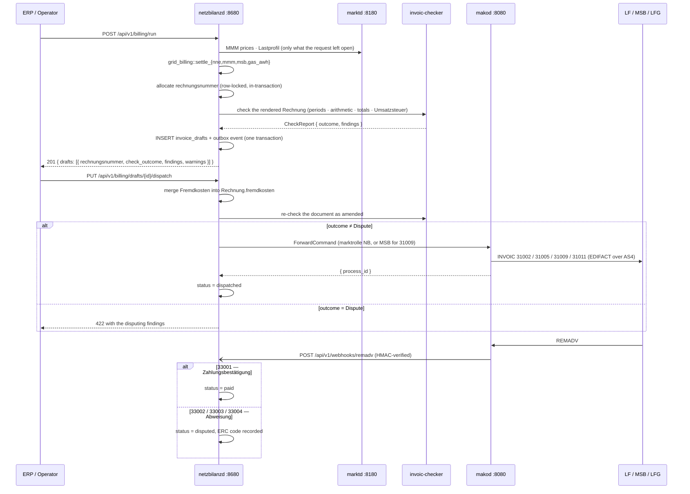
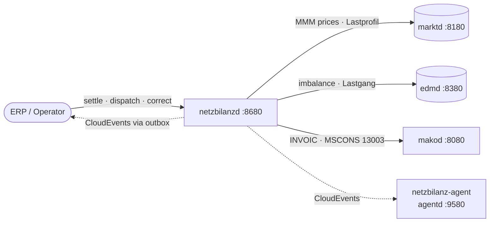
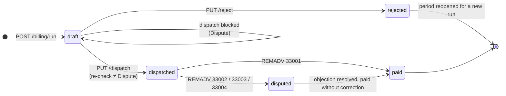
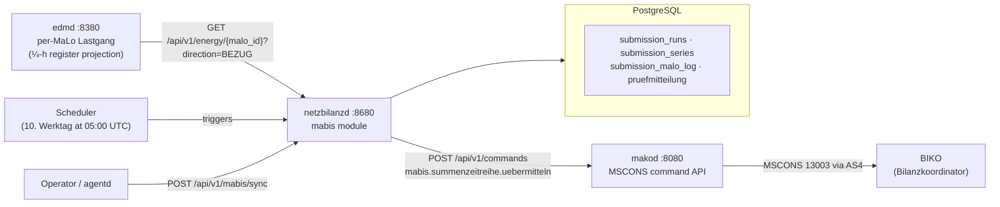
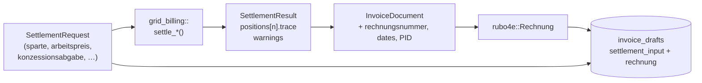

+++
title = "netzbilanzd Operator Guide"
description = "Operator guide for netzbilanzd, the NB billing daemon: Netznutzungsentgelt, Konzessionsabgabe and Mehr-/Mindermengen settlement into INVOIC drafts, and the MaBiS Summenzeitreihen filed with the BIKO."
weight = 25
+++
`netzbilanzd` settles, checks and dispatches every invoice a network operator owes its
counterparties, carries the Redispatch 2.0 cost sheets, and files the MaBiS Summenzeitreihen
(MSCONS 13003) with the BIKO.

**Port:** `:8680` · **Role:** NB / GNB (and MSB for PID 31009; NB / ÜNB for MaBiS) ·
**Storage:** PostgreSQL — `invoice_drafts`, `invoice_number_seq`, `abschlag_verrechnungen`,
`kostenblatt_records`, `fremdkosten_records`, `submission_runs`, `submission_series`,
`submission_malo_log`, `pruefmitteilung`

1. TOC
{:toc}

---

## Architecture

### The billing lifecycle



### Integration topology



---

## What it issues

| PID | Document | Direction | `billing_type` | Regulatory basis |
|---|---|---|---|---|
| 31001 | Abschlagsrechnung Netznutzung (payment on account) | NB → LF | `abschlag` | INVOIC AHB 1.0b · §14 Abs. 5 UStG |
| 31002 | NN-Rechnung (Netznutzungsentgelt + Konzessionsabgabe) | NB → LF | `nne` | StromNEV §§17/21 · GasNEV §15 · KAV §2 |
| 31005 | Mehr-/Mindermengensaldo | NB → LF | `mmm` | GPKE (BK6-24-174) Teil 1 Kap. 8.4 · GaBi Gas 2.1 (BK7-24-01-008) |
| 31009 | MSB-Rechnung (Messstellenbetrieb) | **MSB → NB / LF / ESA** | `msb` | §30 MsbG |
| 31011 | Rechnung sonstige Leistung (AWH Sperrprozesse) | GNB → LFG | `gas_awh` | GeLi Gas 3.0 (BK7-24-01-009) §5.4 |

Every document is an INVOIC; the [PID](@/docs/architecture/domain-model.md#prufidentifikator-pid)
names which kind. Two properties cost money when missed:

- **The Sparte is not in the PID.** Strom and Gas share 31002 and 31005, so every settlement
  states its `sparte`. It decides whether the Arbeit position cites StromNEV §21 or GasNEV §15,
  whether the EnFG levies are billed, and what `Rechnung.sparte` says on the wire.
- **PID 31009 runs MSB → NB / LF / ESA** in all seven Anwendungsfälle (*Anwendungsübersicht der
  Prüfidentifikatoren* 4.0). The draft stores the MSB as `sender_mp_id`; dispatch declares
  `marktrolle: MSB`.

---

## Regulatory baseline (2026)

**StromNZV and GasNZV ceased to apply with the end of 31.12.2025** (Art. 15 Abs. 4 resp.
Abs. 6 of the Gesetz v. 22.12.2023, BGBl. 2023 I Nr. 405). The successor competence is
§20 Abs. 3 EnWG, exercised through BNetzA Festlegungen — for MMM Strom that is
**GPKE (BK6-24-174) Teil 1 Kap. 8.4**, for MMM Gas **GaBi Gas 2.1 (BK7-24-01-008)**.

Consequently MMM prices come from the VNB (GPKE Kap. 8.4 Nr. 3: *"Der Betreiber von
Elektrizitätsverteilernetzen berechnet für Jahresmehr- und Jahresmindermengen auf Grundlage der
monatlichen Marktpreise einen einheitlichen Preis."*), and the Konzessionsabgabe is KAV §2, its
rate bands keyed on the municipality's inhabitant count.

### The network levies (EnFG)

Three levies ride on the Strom Netzentgelt; `netzbilanzd` adds them to every Strom NNE
settlement and to no Gas settlement:

| Levy | 2026 rate (A′) | Basis |
|---|---|---|
| Aufschlag für besondere Netznutzung (§19 StromNEV-Umlage) | 1.559 ct/kWh | §19 Abs. 2 StromNEV |
| Offshore-Netzumlage | 0.941 ct/kWh | §17f EnWG |
| KWKG-Umlage | 0.446 ct/kWh | §26 KWKG |

The §19 StromNEV levy has an A′/B′/C′ schedule (B′ capped at 0.050, C′ at 0.025 ct/kWh); set
`letztverbrauchergruppe` to bill a privileged band. Offshore- and KWKG-Umlage are published at
the non-privileged rate only; a privilege under §§ 21 ff. EnFG is granted per Entnahmestelle, so
supply it via `offshore_umlage_ct_per_kwh` / `kwkg_umlage_ct_per_kwh`.

B′ and C′ apply „für Strommengen über 1 000 000 kWh" at one Entnahmestelle, so the year's first
GWh carries A′. Supply `enfg_jahresvorverbrauch_kwh` (kWh consumed there earlier in the year); a
period straddling the boundary bills **two** §19 positions. Omitted, the period is billed as if
it opened the year, with `ENFG_VORVERBRAUCH_MISSING`.

Each calendar year of a period is priced at its own year's rates: a period crossing 1 January
carries every levy as one position per year, the quantity split by days, and the new year's
1-GWh threshold opens at zero. A levy with neither a tabled rate nor an override for a year of
the period refuses the settlement, naming each missing levy and year — the ÜNB publish the next
year's rates „bis zum 25. Oktober eines Kalenderjahres" (§ 11 EnFG), and until a year is tabled
its rates are supplied as overrides. An override is one rate, so a period crossing 1 January
that carries one is refused and has to be split at the year boundary.

### The §30 MsbG Preisobergrenze is derived, not asserted

§30 Abs. 1 MsbG states five Nummern, each a disjunction over facts about the metering point
(Jahresstromverbrauch, installierte Leistung, a §14a EnWG Vereinbarung). `messstellen_kategorie`
carries those **facts**, not a band:

```json
{
  "messstellen_kategorie": {
    "Pflichteinbau": {
      "jahresverbrauch_kwh": "18000",
      "steuerbare_verbrauchseinrichtung": true
    }
  },
  "entgeltschuldner": "Letztverbraucher"
}
```

The engine walks the Nummern top down, so a point meeting several takes the highest and a request
cannot pick its ceiling. `{"OptionalerEinbau": null}` is §30 Abs. 3 (30 EUR each side). With no
fact supplied, Nr. 5 applies — a Pflichteinbaufall exists only above 6 000 kWh (§29 Abs. 1).

### Umsatzsteuer

Every invoice states its tax (§14 Abs. 4 Nr. 8 UStG). The treatment follows what is supplied:

| Settlement | Nature | Treatment |
|---|---|---|
| NNE, MSB, Gas AWH | *sonstige Leistung* | 19 %. UStAE 13b.3a excludes "die Bereitstellung und Unterhaltung des Netzes" from §13b |
| MMM Strom / Gas | **Lieferung** of the commodity | 19 %, or reverse-charged under §13b Abs. 2 Nr. 5 Buchst. b |

§13b Abs. 5 is asymmetric: for Elektrizität supplier **and** recipient must hold §3g status, for
Gas über das Erdgasnetz the recipient alone (evidenced by a *USt 1 TH*, UStAE 13b.3a). An MMM
settlement therefore carries both facts:

```jsonc
"wiederverkaeufer": { "leistender": true, "empfaenger": true }
```

Tax shown on a reverse-charge invoice is owed under §14c Abs. 1 UStG and gives the recipient no
Vorsteuerabzug. The pre-dispatch gate refuses an invoice with no tax block and a reverse-charge
invoice that states tax.

**Rate windows.** The departures from 19 % the engine knows:

| Window | Rate | Applies to | Basis |
|---|---|---|---|
| 01.07.2020 – 31.12.2020 | 16 % | every supply | §28 Abs. 1–3 UStG a. F. |
| 01.10.2022 – 31.03.2024 | 7 % | gas through the Erdgasnetz | §28 Abs. 5 UStG |

The gas reduction reached the Lieferung, not the network: a Gas MMM in that window is 7 %, a
Netznutzung Gas invoice 19 %. A delivery period straddling a rate change is refused.

### Mehr-/Mindermengen sign convention

Named from the network operator's side, which inverts the intuitive reading:

| Measurement vs profile | Quantity | Money |
|---|---|---|
| measured **<** profiled | ungewollte **Mehrmenge** | NB vergütet → credit |
| measured **>** profiled | ungewollte **Mindermenge** | NB stellt in Rechnung → charge |


---

## Settling an invoice

A billing run carries an issue date, a due date, an optional Rechnungskreis and up to **1 000
positions** (one MaLo, one period, one settlement each), all in **one transaction**. The
settlement is a **tagged union** on `billing_type`; a field belonging to another kind is a `422`.

```bash
curl -X POST http://localhost:8680/api/v1/billing/run \
  -H "Content-Type: application/json" \
  -d '{
    "invoice_date": "2026-02-01",
    "due_date": "2026-03-03",
    "rechnungskreis": "NNE",
    "positions": [{
      "malo_id": "51238696012",
      "period_from": "2026-01-01",
      "period_to": "2026-01-31",
      "settlement": {
        "billing_type": "nne",
        "nb_mp_id": "9900357000004",
        "lf_mp_id": "9900012345678",
        "sparte": "Strom",
        "arbeitspreis": { "Einheitlich": { "menge_kwh": "1500", "preis_ct_per_kwh": "3.5" } },
        "leistungspreis": {
          "spitzenleistung_kw": "40",
          "preis_eur_per_kw": "12.50",
          "system": { "MONAT": { "monate": "1" } }
        },
        "konzessionsabgabe": { "satz_ct_per_kwh": "0.11", "klasse": "Sondervertragskunde" },
        "netzebene": "Niederspannung",
        "jahresarbeit_kwh": "18000",
        "tariff_sheet_id": "Preisblatt-NNE-2026-Q1"
      }
    }]
  }'
```

```jsonc
{
  "drafted": 1,
  "drafts": [{
    "draft_id": "550e8400-…",
    "malo_id": "51238696012",
    "rechnungsnummer": "NNE-2026-000001",
    "pid": 31002,
    "sparte": "STROM",
    "check_outcome": "Ok",
    "check_findings": [],
    "settlement_warnings": [],
    "netto_eur":     "598.34",
    "steuer_eur":    "113.68",
    "brutto_eur":    "712.02",
    // gross less the Abschläge this invoice settles — see "Abschläge" below
    "zu_zahlen_eur": "712.02"
  }]
}
```

### `leistungspreis.system` — which Leistungspreissystem the Preisblatt states

§ 17 Abs. 2 StromNEV: „Das Jahresleistungsentgelt ist das Produkt aus dem jeweiligen
Jahresleistungspreis und der Jahreshöchstleistung", with no pro-rating. Abs. 8 presupposes a
Monatsleistungspreissystem, published in the Netzbetreiber's Preisblatt. `system` selects:

| Value | Billed as | Use on |
|---|---|---|
| `"JAHR"` (**default**) | Jahresleistungspreis × Jahreshöchstleistung (§ 17 Abs. 2 Satz 2) | a yearly settlement |
| `{ "MONAT": { "monate": "1" } }` | Höchstleistung × Monate × Monatsleistungspreis (§ 17 Abs. 8) | a monthly or quarterly settlement |

A monthly invoice that omits `system` bills the whole year's demand charge and raises
`JAHRESLEISTUNGSPREIS_UNTERJAEHRIG`; `MONATSLEISTUNGSPREIS_MONATE_MISMATCH` fires when `monate`
and the period length disagree by more than a month.

### Invoice numbers are allocated here

§14 Abs. 4 Nr. 4 UStG requires an *einmalig vergebene, fortlaufende* number, so the caller
supplies only the series (`rechnungskreis`). The number comes from `invoice_number_seq` under a
row lock inside the drafting transaction: a rolled-back run consumes none, a reused one is refused
by a unique index, and the counter restarts per tenant, series and calendar year. Numbers read
`NNE-2026-000001`, or `2026-000001` with no series.

### Read the warnings

`check_findings` come from `invoic-checker` (the library the receiving LF runs);
`settlement_warnings` record what the engine could not do. Both are stored on the draft. Watch
`KA_ABOVE_KAV_MAXIMUM` — KAV §2 rates are Höchstbeträge per group (ct/kWh):

| `klasse` | Strom | Gas |
|---|---|---|
| `Sondervertragskunde` (§2 Abs. 3) | 0.11 | 0.03 |
| `Schwachlast` (§2 Abs. 2) | 0.61 | — |
| `Tarifkunde`, Gemeinde ≤ 25 000 | 1.32 | 0.22 (0.51 nur Kochen/Warmwasser) |
| `Tarifkunde`, ≤ 100 000 | 1.59 | 0.27 (0.61) |
| `Tarifkunde`, ≤ 500 000 | 1.99 | 0.33 (0.77) |
| `Tarifkunde`, > 500 000 | 2.39 | 0.40 (0.93) |
| `Exempt` (§2 Abs. 4 Strom / Abs. 5 Gas) | — | — |

`Exempt` means no Konzessionsabgabe is due, so no position is billed. The rate and the group
travel in one value, so the ceiling check cannot be skipped.

#### The group is a consequence, not a label

KAV § 2 Abs. 7: a Niederspannungslieferung is a Tariflieferung „es sei denn, die gemessene
Leistung des Kunden überschreitet in mindestens zwei Monaten des Abrechnungsjahres 30 Kilowatt
**und** der Jahresverbrauch beträgt mehr als 30.000 Kilowattstunden". State the facts in
`konzessionsabgabe.niederspannung` and a disagreeing group raises
`KA_GRUPPE_WIDERSPRICHT_KAV_ABS7`:

```json
"konzessionsabgabe": {
  "satz_ct_per_kwh": "0.11",
  "klasse": "Sondervertragskunde",
  "niederspannung": { "monate_ueber_leistungsgrenze": 5, "jahresverbrauch_kwh": "90000" }
}
```

`leistungsgrenze_kw` / `verbrauchsgrenze_kwh` carry lower limits agreed under Satz 4 (default
30 kW / 30 000 kWh).

#### Two rules forbid a Konzessionsabgabe outright

Neither is a ceiling — a rate inside the Höchstbetrag is still unlawful:

| Warning | Rule | Fact it needs |
|---|---|---|
| `KA_UNTER_GRENZPREIS` | § 2 Abs. 4 (Strom) resp. Abs. 5 Nr. 2 (Gas) — a Sondervertragskunde whose Durchschnittspreis im Kalenderjahr lies **under** the Grenzpreis | `konzessionsabgabe.grenzpreis`, both figures in ct/kWh ohne USt |
| `KA_GAS_UEBER_GRENZMENGE` | § 2 Abs. 5 Nr. 1 — Gas above **5 Millionen kWh** je Jahr und Abnahmefall | none — read off `jahresarbeit_kwh` |

The Grenzpreis (Strom: the Durchschnittserlös of the *vorletzte* Kalenderjahr) and the
customer's price are supplied; omitted, the comparison is not made.

### §14a EnWG

BK8-22/010-A numbers three modules; `ArbeitspreisModell` holds one at a time:

| Module | Mechanism | Shape |
|---|---|---|
| **Modul 1** | pauschale Reduzierung — a flat annual amount credited pro rata, not a rate change | `Modul1Pauschal { basis, pauschale_eur_pro_jahr, jahresanteil }` |
| **Modul 2** | prozentuale Reduzierung of the controllable device's own Arbeitspreis; scales with consumption, and needs that device separately metered | `Modul2ProzentualeReduzierung { basis, reduktion }` |
| **Modul 3** | zeitvariable Netzentgelte in three Tarifstufen, opt-in since 01.04.2025 | `Modul3ZeitVariabel { ht, st, nt }` |

```jsonc
"arbeitspreis": { "Modul3ZeitVariabel": {
  "ht": { "menge_kwh": "600", "preis_ct_per_kwh": "4.20" },
  "st": { "menge_kwh": "100", "preis_ct_per_kwh": "3.00" },
  "nt": { "menge_kwh": "400", "preis_ct_per_kwh": "1.50" }
}}
```

All three bands are required; a band with no energy carries `menge_kwh: "0"`. The Modul-2
`reduktion` is **pinned to 0.40**: BK8-22/010-A Tenor 2. b) fixes the reduced Arbeitspreis at
40 % of the Niederspannungs-Arbeitspreis ohne Leistungsmessung, so every other value is refused.
Modul 1 + Modul 3, the one permitted pair, is not representable in one settlement.

**Data sources.** Band quantities come from `edmd GET /api/v1/billing-period/{malo_id}`
(HT/NT OBIS registers); band prices from the `PreisblattNetznutzung`
(`zeitvariable_preispositionen`) in `marktd`.

### A fifth Arbeitspreis shape that is not a §14a module

`ArbeitspreisModell` has one more variant, which is not a §14a module:

```jsonc
"arbeitspreis": { "SpotpreisNetzentgelt": { "intervalle": [
  { "period_from": "2026-01-15T11:00:00Z", "period_to": "2026-01-15T11:15:00Z",
    "menge_kwh": "1.25", "nne_rate_ct_per_kwh": "2.00",
    "epex_spot_ct_per_kwh": "1.10" }
] } }
```

`SpotpreisNetzentgelt` bills one rate per dispatch interval under the Netzbetreiber's own
`PreisblattNetznutzung` formula; the rates arrive already derived.

### §19 Abs. 2 StromNEV — individuelle Netzentgelte

Distinct from the §19 Umlage. An agreed individual charge (`sect19`) replaces Arbeits- and
Leistungspreis and touches neither the Konzessionsabgabe nor the levies:

| Form | Qualification | Floor, as a share of the published charge |
|---|---|---|
| `AtypischeNetznutzung` (Satz 1) | annual peak predictably in the low-load window | 20 % |
| `IntensiveNetznutzung` (Satz 2) | Benutzungsstundenzahl **≥** 7 000 h **and** consumption **>** 10 GWh | 20 % from 7 000 h · 15 % from 7 500 h · 10 % from 8 000 h |

Hours are inclusive („erreicht mindestens"), energy is not („übersteigt"): exactly 10 GWh does
not qualify. The agreed percentage is an input and may not fall below the floor.

### Positions by settlement type

| Settlement | Positions |
|---|---|
| NNE | Arbeit (flat, or one per §14a module) · Leistung (RLM) · Gas Grundpreis (§15 Abs. 7 GasNEV) · Gas Kapazitätsentgelt (§15 GasNEV, pro-rated by calendar days over the actual year length) · Konzessionsabgabe · the three EnFG levies (Strom only) · Blindmehrarbeit |
| MMM | Mehrmengen (Gutschrift, negated) · Mindermengen |
| MSB | Grundgebühr Messstellenbetrieb · Messdienstleistung, both measured together against the §30 Abs. 1 MsbG Preisobergrenze when `messstellen_kategorie` is supplied — and only for a period ending from 01.01.2025, which is what that schedule dates itself to · Steuerungseinrichtung am Netzanschlusspunkt, which §30 Abs. 2 charges „zusätzlich“ and caps separately at 50 EUR brutto/Jahr |
| NNE (privileged) | the §19 Aufschlag splits into two positions where the period straddles the EnFG 1-GWh boundary |
| Gas AWH | one per chargeable action: `anzahl × preis_eur` |

---

## Abschläge and the invoice that settles them

An **Abschlagsrechnung** (PID 31001) is a payment on account. It prices no energy and carries
**exactly one** Positionszeile (INVOIC AHB 1.0b, Änd-ID 26817: *"Eine Abschlagsrechnung kann und
muss genau eine Positionszeile enthalten"*). How the amount was arrived at is recorded:

| `grundlage` | Meaning |
|---|---|
| `Vorjahresverbrauch` | a share of the previous settled period's invoice |
| `Prognose` | a forecast of the period being paid for |
| `Vereinbarung` | a figure fixed in the Lieferantenrahmenvertrag |

### The deduction

The invoice that closes the period lists the Abschläge it settles, by draft ID:

```jsonc
{
  "malo_id": "51238696012",
  "period_from": "2026-01-01", "period_to": "2026-12-31",
  "cadence": "Abschlussrechnung",
  "abschlaege": ["550e8400-…", "6ba7b810-…"],
  "settlement": { "billing_type": "nne", … }
}
```

| Rule | Why |
|---|---|
| Only `zuZahlen` moves; `gesamtnetto` / `gesamtsteuer` stand | §14 Abs. 5 UStG taxed the Anzahlung on receipt; the AHB puts the deduction in `SG50 MOA+113` (*Vorausbezahlter Betrag inkl. USt.*) |
| The amount is the stored Abschlag's gross `MOA+77`, never the request's | AHB rule **[526]** |
| A storniertes or never-dispatched Abschlag is refused | AHB rule **[519]**; nothing was paid on it |
| Each deduction names its invoice (`SG51 RFF+AFL`, `SG51 DTM+3`) | the counterparty can break the total down |
| One Abschlag per MaLo, period and **Rechnungsdatum** (`409` on a same-day duplicate) | a replayed run would otherwise be deducted twice; the double-billing guard itself excludes 31001 |

`zu_zahlen_eur_units` is stored beside the three amounts, so summary, overdue alert and audit
export answer *what are we owed*. A CHECK keeps the deduction directional but lets it pass zero:
settling for less than the Anzahlungen leaves a Guthaben owed back.

### Billing cadence

`cadence` is `IMD+7081` on the wire — a document fact, omitted when unset:

| `cadence` | `IMD+7081` |
|---|---|
| `Abschlagsrechnung` | `ABS` |
| `Abschlussrechnung` | `ABR` |
| `Turnusrechnung` | `JVR` |
| `Monatsrechnung` | `MVR` |
| `Zwischenrechnung` | `ZVR` |

---

## Dispatching

```bash
# Optional: attach typed external costs first.
curl -X PUT http://localhost:8680/api/v1/billing/fremdkosten/{draft_id} -d @fremdkosten.json

curl -X PUT http://localhost:8680/api/v1/billing/drafts/{draft_id}/dispatch
```

Dispatch runs four steps in one transaction:

1. **Merge the Fremdkosten** into `Rechnung.fremdkosten` (BO4E's first-class field). They are
   informational and change no total; costs the counterparty owes belong in the settlement.
   `PUT /fremdkosten/{draft_id}` answers `409` once the invoice has left `draft`.
2. **Run the outbound BO4E gate** over the merged document
   ([`ensure_conformant`](@/docs/architecture/domain-model.md#the-bo4e-gate)) — this is the one
   document netzbilanzd assembles at runtime from two stored parts.
3. **Re-check the amended document** with `invoic-checker`; `Dispute` blocks the send and returns
   the findings.
4. **Hand it to `makod`** under the idempotency key `netzbilanzd-invoic-{draft_id}`:

   | Field | Value |
   |---|---|
   | `command` | `invoic.nne-abschlag.stellen` (31001) · `invoic.nne.stellen` (31002) · `invoic.mmm.stellen` (31005) · `wim.msb-rechnung.stellen` (31009) · `invoic.sonstige-leistung.stellen` (31011) |
   | `marktrolle` | `MSB` for PID 31009, `GNB` for 31011 and any gas invoice, `NB` otherwise — checked by `makod` against the licensed roles |
   | `invoice_ref` | the invoice number — what the inbound REMADV correlates on |
   | `sender_mp_id` / `recipient_mp_id` | as the settlement resolved them |
   | `pid`, `sparte`, `rechnung` | the document and what identifies it |

The commands are Sparte-neutral. Every PID has an issuer-side process in `makod`, 31011 included.

`POST /api/v1/billing/drafts/dispatch-batch` runs the same sequence per draft, each in its
own transaction, and reports `207 Multi-Status` when some refused: one rejection never rolls
back the invoices that already went out.

---

## Correcting

```bash
curl -X POST .../drafts/{id}/storno    -d '{"grund": "Messwertkorrektur"}'
curl -X POST .../drafts/{id}/korrektur -d '{"grund": "Messwertkorrektur", "settlement": { … }}'
```

| Rule | Behaviour |
|---|---|
| A Storno is **recomputed** | the stored settlement input is replayed and negated by `grid_billing::reverse`; the document sets `ist_storno` + `original_rechnungsnummer`, the fields `invoic-checker` stage 0 reads (BK6-24-174 §5) |
| Only a dispatched invoice can be reversed or corrected | `draft` and `rejected` answer `409`; reject a draft and bill again |
| A Korrektur needs the Storno first | it carries the whole corrected amount; `409` until the original is reversed |
| A Korrektur corrects the **same** invoice | changing `settlement_type`, `sparte`, `sender_mp_id` or `recipient_mp_id` is a `422` naming the field |
| The recomputation must match the original | net, Umsatzsteuer **and** gross; a mismatch (a tabled rate corrected since issue) is a `409` naming both figures |
| One Storno per invoice | unique index; Korrekturrechnungen are not limited |

A Korrekturrechnung is a new settlement from corrected inputs through the same engine and checks.
Both carry a `grund` (`grid_billing::KorrekturGrund`: `Rechenfehler`, `Stammdatenkorrektur`,
`RegulatorischeAenderung`, …) and inherit the original's Rechnungskreis. The original is never
mutated; a CHECK requires `original_draft_id` and `korrektur_grund` on corrections only.

---

## Draft lifecycle



**REMADV 33001 is the only Zahlungsbestätigung**; 33002–33004 are Abweisungen (33003/33004 the
itemised Strom rejections). A dispute has its own columns (`dispute_erc_code`, `dispute_reason`)
and leaves `check_outcome` — the NB's pre-dispatch evidence — untouched. Rejecting a draft reopens
the period for a new run. REMADV ingest is idempotent: a replay matching the current state answers
`204`. The closing transitions are also reachable directly (Cedar `record-payment`):

| Method | Path | Body | Effect |
|---|---|---|---|
| `PUT` | `/api/v1/billing/drafts/{id}/mark-paid` | `remadv_ref` | `dispatched` or `disputed` → `paid` |
| `PUT` | `/api/v1/billing/drafts/{id}/mark-disputed` | `erc_code`, `reason` | `dispatched` → `disputed` |


---

## Mehr-/Mindermengen

```bash
curl -X POST http://localhost:8680/api/v1/billing/mmm-run/51238696012 \
  -d '{"nb_mp_id":"9900357000004","lf_mp_id":"9900012345678","sparte":"Gas",
       "period_year":2026,"period_month":1,"bilanziert_kwh":"1000.000"}'
```

`bilanziert_kwh` is **required**: it is what the Bilanzkreis was charged from the load profile,
which `edmd` does not hold. `sparte` selects the price series (Trading Hub Europe for Gas, the
BDEW series for Strom) and is passed to `edmd` as the aggregation basis — Gas balances on the
06:00 Gastag.

The cited basis follows the delivery period: to 31.12.2025 `StromNZV §13 Abs. 3` / `GasNZV §25`,
from 01.01.2026 `§20 Abs. 3 EnWG` with BK6-24-174 (Strom) or GaBi Gas 2.1 (BK7-24-01-008) (Gas),
resolved by `grid_billing::regulatory::RegulatoryRegime`; a straddling period warns. Prices are
fetched only when the request leaves them open, memoised per run per `(Sparte, year, month)`, and
stored on the draft so an audit replays the same numbers.

---

## §42b EnWG Gemeinschaftliche Gebäudeversorgung

```bash
curl -X POST http://localhost:8680/api/v1/billing/ggv-nne/{ggv_malo_id} \
  -d '{"nb_mp_id":"…","lf_mp_id":"…",
       "period_from":"2026-01-01","period_to":"2026-01-31",
       "arbeitspreis_ct_per_kwh":"5.50",
       "tenant_consumption":{"51238696781":"450.000","51238696129":"550.000"}}'
```

`tenant_consumption` is required: §42b attributes the Netzentgelt to each tenant Marktlokation,
and an equal split is not an attribution. The building settles in one transaction; the response
reports each tenant's share (summing to 100 %).

---

## Redispatch 2.0

BK6-20-061 §4.2 — the VNB submits a monthly Kostenblatt to the ÜNB by the **15th of the
following month**.

| Method | Path | Description |
|---|---|---|
| `PUT` | `/api/v1/redispatch/kostenblatt/{activation_id}` | Create or update a record |
| `GET` | `/api/v1/redispatch/kostenblatt/{activation_id}` | Every TechnischeRessource under the activation |
| `GET` | `/api/v1/redispatch/kostenblatt?year=&month=&status=` | List a month |
| `POST` | `/api/v1/redispatch/kostenblatt/{activation_id}/compute` | Quantify from `edmd`'s projected feed-in series |
| `GET` | `/api/v1/redispatch/kostenblatt/gaps/{year}/{month}` | Activations registered but never quantified |
| `POST` | `/api/v1/redispatch/kostenblatt/submit/{year}/{month}` | Submit the month's pending records |
| `POST` | `/api/v1/redispatch/verguetung/{activation_id}/compute` | §13a Abs. 2 EnWG compensation |

The stored `kosten_json` is a BO4E `Kosten` built as a struct and passed through
[the outbound gate](@/docs/architecture/domain-model.md#the-bo4e-gate); an operator-supplied
`kosten_json` or `fremdkosten_json` crosses the inbound gate as `Bo4e<Kosten>` and is stored as its
canonical round-trip.

`compute` resolves the dispatched energy in one order and records it in `dispatch_source`:

1. `manual_override` — a verified operator figure;
2. `lastgang_sum` — `edmd`'s projected feed-in series
   (`GET /api/v1/energy/{malo_id}?direction=EINSPEISUNG`) over the exact window `[start, end)`;
3. `einspeisung_tag` — the same series over the whole Europe/Berlin day, only when the window has
   none. For a 15-minute activation this is wrong by up to two orders of magnitude: check
   `dispatch_source` and supply `dispatch_kwh_override`. No Einspeisung that day → `404`.

The BO4E `/lastgang` export is never folded into a figure: it mixes registers, directions and
non-billable qualities. `coverage_pct` from the projection is logged; a partial window still
yields a figure. `Einsatzkosten = dispatch_kwh × arbeitspreis_eur_per_kwh` is a generated column.

### The redispatch case selects the §13a counterfactual

§13a Abs. 2 measures the curtailed energy differently in the two cases, and the two produce
different figures for the same activation:

| `abwicklung` | Counterfactual | Ausfallarbeit source |
|---|---|---|
| `DULDUNGSFALL` | The NB steered the resource, so what the plant would have produced was never transmitted | the measured `edmd` feed-in series over the window |
| `AUFFORDERUNGSFALL` | The EIV steered to a transmitted schedule, and that schedule *is* the counterfactual | `ausfallarbeit_kwh_override` from that schedule — **required**; the request is refused `422` without it |

The chosen basis travels into the result and its calculation trace.

### BilAReM Kap. 3

The stateless Ausfallarbeit engine (BK6-23-241) sits at `/api/v1/redispatch/ausfallarbeit/*`:
`compute` (per-TR `W_A` series for every Abrechnungsvariante), `ueberbauung` (the Kap.-3.4
cap), `kf-bin` (the Kap.-3.2.3.2 offshore Wind-Bin factor), `malo-split`
(§ 24 Abs. 3 S. 2 EEG 2023) and the two Vergleichszeitraum selectors —
`vergleichszeitraum` (Kap. 3.2.2.1, wind: four contiguous quarter-hours, measured
to the **beginning** of the Maßnahme on one side and to its **end** on the other)
and `vergleichstag` (Kap. 3.2.4.1, solar: a whole calendar day without a Maßnahme
against the SR). Callers supply the quarter-hour series; sourcing them from
SCADA, `edmd` or DWD stays with the operator.

Every JSON request body here rejects unknown fields; query strings are not strict.

---

## MaBiS Summenzeitreihen

**MaBiS** settles electricity Bilanzkreise after the fact. A **Summenzeitreihe**
is the monthly ¼-h series a grid operator files for one **Bilanzierungsgebiet**,
summed from each
[MaLo](@/docs/architecture/domain-model.md#malo-vs-melo-the-critical-distinction)'s
Lastgang. `netzbilanzd` files it with the BIKO (Bilanzkoordinator) when its
configuration carries a `[mabis]` section; without one the `/api/v1/mabis/*`
routes are not mounted and no submission is scheduled. Metering comes from
[`edmd`](@/docs/services/edmd.md), master data from
[`marktd`](@/docs/services/marktd.md), and the message leaves through
[`makod`](@/docs/services/makod.md). Strom only — Gas balances under GaBi Gas.

A Summenzeitreihe is an **MSCONS** message, Prüfidentifikator **13003**
("Übertragung Summenzeitreihe", MSCONS AHB 3.2 §8.3.1). UTILTS carries
Berechnungsformel and Zählzeit-/Schaltzeitdefinitionen and has no Summenzeitreihe
use case. Submission goes out through `makod` as
`mabis.summenzeitreihe.uebermitteln` (Marktrolle `NB`/`ÜNB`), which enqueues the
MSCONS directly rather than spawning a workflow; the BIKO's Datenstatus (IFTSTA
21003/21004) and Prüfmitteilung (21000/21001) are recorded here, where the
version history lives. The wire message carries the identifying 3-tuple as `LOC`
(MaBiS-Zählpunkt), `DTM+492` (Bilanzierungsmonat, `CCYYMM`) and `DTM+293`
(Versionsangabe, `CCYYMMDDHHMMSSZZZ`), and one `QTY+220` per settlement slot
bounded by `DTM+163`/`DTM+164`; how `makod` renders the other MSCONS
Anwendungsfälle is in its [operator guide](@/docs/services/makod.md).



### Aggregation is per Bilanzierungsgebiet

MaBiS settles per territory, so a run builds **one Summenzeitreihe per
Bilanzierungsgebiet** and files one MSCONS per territory. Each MaLo's territory
comes from `marktd` (`GET /api/v1/malos/{id}` → `bilanzierungsgebiet`). A MaLo
whose master data names none is excluded and **fails the run** — never folded
into another zone. `[mabis] bilanzierungsgebiet_id` keys the run itself (the
`submission_runs` row, the live-run check, the failure event).

The 13003 column of the MSCONS AHB marks `SG6 LOC` with qualifier `172` only: the
series is filed under its **MaBiS-Zählpunkt**, and the Bilanzierungsgebiet EIC
selects which Zählpunkt to send. The assignment is `marktd` master data, resolved
before each submission:

```
GET /api/v1/bilanzierungsgebiete/{eic}/mabis-zp   → { "mabis_zp_id": "DE0004030099000000000000000012345", ... }
PUT /api/v1/bilanzierungsgebiete/{eic}/mabis-zp   (NB role, Cedar `write-mabis-zp`)
GET /api/v1/mabis-zp                             → every assignment for the tenant
```

Every failure path **refuses**: an unassigned territory (`404`), an unreachable
`marktd`, a malformed response, or a response echoing the EIC as the Meldepunkt
aborts the submission. A submission that discovers **no** MaLos fails the run: an
empty series would settle the territory at zero.

### Aggregation is quarter-hourly

MaBiS settles on a **¼-h grid**, so each Lastgang is read from
`GET /api/v1/energy/{malo_id}?direction=BEZUG` — `edmd`'s register projection,
one entry per slot. The BO4E `/api/v1/lastgang` export is not used: on a
dual-tariff MaLo `1-0:1.8.0` and its `1.8.1`/`1.8.2` decomposition would all be
summed. Three checks fail the run rather than file a wrong series:

- `SummenzeitreiheBuilder` is constructed with the slot length it expects
  (`MABIS_SLOT` = 15 min) and returns `SlotResolutionError` for any interval that
  does not match.
- `Summenzeitreihe::missing_slot_count()` > 0 — slots no MaLo covered.
- The Meldepunkt is a validating newtype (`MabisZaehlpunktId`), and
  `Summenzeitreihe::validate_identifiers()` refuses a Meldepunkt equal to its
  Bilanzierungsgebiet — `SG6 LOC+172` is free text at the MIG level, and
  `marktd`'s `mabis_zp_not_the_gebiet` CHECK guards only its own table.

Discovery reads `edmd`'s billing periods — every MaLo with readings in the
period. It asks for up to 5 000 (`edmd`'s cap) and fails the run on a `truncated`
(or unstated) answer. Only `sparte` Strom is kept, and only the Bezugsregister
(OBIS `1.x.y`) contributes. Quality flags map conservatively: anything not
plainly `ABGELESEN` counts as non-measured.

### Versionierung and Datenstatus

A Summenzeitreihe is identified by **(MaBiS-Zählpunkt, Bilanzierungsmonat,
Version)**, and §3.8.2 requires only that the version ascend: *"Die Version einer
Summenzeitreihe ist jeweils aufsteigend zu vergeben und ist über die gesamte BKA
beizubehalten."* A correction is the same series under a higher version. The
version is a timestamp (`SG6 DTM+293`, format 304); `BGM 1225` is always `9`.

**Datenstatus** is the separate, inbound axis. It is assigned exclusively by the
BIKO (§3.8.3: *"Der Datenstatus wird ausschließlich vom BIKO vergeben"*) and
arrives via IFTSTA `SG7 STS+Z04`:

| Datenstatus | Meaning |
|---|---|
| `Prüfdaten` | received, not yet accepted for settlement |
| `Abrechnungsdaten` | accepted for the ordinary BKA |
| `Abrechnungsdaten KBKA` | accepted for the Korrekturbilanzkreisabrechnung |
| `abgerechnete Daten` | settled in the BKA |
| `abgerechnete Daten KBKA` | settled in the KBKA |

Settlement uses the **highest version carrying `Abrechnungsdaten`** (or
`Abrechnungsdaten KBKA`). `netzbilanzd` only records what the BIKO sent.

### Fristen (§3.10, Tabelle 2)

Werktage after the end of the Bilanzierungsmonat, measured at **arrival at the
BIKO**; executable as `mako_mabis::Bilanzierungsmonat`. `netzbilanzd` files a
**BG-SZR (Kategorie B)**:

| Zeitreihe | BKA Erstaufschlag | BKA Clearing | KBKA |
|---|---|---|---|
| **BG-SZR (Kategorie B)** · NZR | **1.–10. WT** | **11.–30. WT** | 31. WT – end of month 7 |
| BK-SZR (Kategorie A und B) | 1.–**12.** WT | **13.**–30. WT | 31. WT – end of month 7 |
| DZÜ | — | 31.–34. WT | 1.–8. WT of month 8 |

| Abrechnungsstichtag | BKA | KBKA |
|---|---|---|
| Vorläufige Bilanzierung | 18. WT, Datenstand 15. WT | 8. WT of month 5, Datenstand end of month 4 |
| Abrechnungsrelevante Bilanzierung | 42. WT, Datenstand 30. WT | end of month 8, Datenstand end of month 7 |

The Redispatch-Ausfallarbeit series have their own windows (Kap. 17.3.1.3);
`netzbilanzd` files none of them.

Within the Erstaufschlag a new version is assigned `Abrechnungsdaten`
automatically; after it a new version starts as `Prüfdaten` and needs a positive
Prüfmitteilung (§3.8.3). A BG-SZR filed on the 11. WT is already in the
Clearingphase, so the scheduler submits on the **10. Werktag** by default, at
`run_hour_utc`.

**There is no Prüfmitteilung deadline.** §9.8.2 Nr. 1 leaves the Frist cell
empty — the receiving party „kann" answer — and §13.8.2 defines no answer at
all; its two rows are the BIKO's own dispatch dates above. What bounds a
Prüfmitteilung is the clearing window. The two genuine 1-Werktag Fristen are the
BIKO's: forwarding a Prüfmitteilung (§9.8.2 Nr. 3) and dispatching the
Datenstatus (§9.9.2 Nr. 1).

### Submission target

`[mabis] submission_target` selects where Summenzeitreihen are filed. One value is
accepted, `"biko-bilateral"` (the default). `"mabis-hub"` (BK6-24-210) parses
and then **refuses at startup**: no Beschluss publishes a wire format, endpoint
or payload shape.

### Routes and run lifecycle

| Route | Cedar action | Purpose |
|---|---|---|
| `POST /api/v1/mabis/sync` | `trigger-mabis-run` | trigger an aggregation run; refuses a period with a live run |
| `GET /api/v1/mabis/runs` · `/runs/{id}` | `read-mabis-run` | recent runs; one run with its per-territory `series` |
| `PUT /api/v1/mabis/runs/{id}/retry` | `trigger-mabis-run` | retry a failed run (≤ 3 attempts) |
| `POST /api/v1/mabis/datenstatus` | `record-biko-response` | record the BIKO Datenstatus (IFTSTA 21003/21004) |
| `POST /api/v1/mabis/pruefmitteilung` | `record-biko-response` | record a Prüfmitteilung (IFTSTA 21000/21001) |
| `GET /api/v1/mabis/korrekturbedarf` | `read-mabis-run` | negative Prüfmitteilungen not yet corrected (§9.8.1) |

```
pending ──► submitted ──► acked      (terminal — every territory filed)
   │            │
   └────────────┴──► failed          (retry allowed, attempt_count < 3)
```

A retry carries the original's `corrects_run_id`. One MSCONS goes out per
Bilanzierungsgebiet, so a run may be **partly filed**: `submission_series`
records each territory's `message_ref` or failure, a retry skips the acked ones,
and the run still fails as a whole. A re-filing of a period with a live run is a
correction under `corrects_run_id`.

The three write bodies are typed. An unknown key, or a value that does not
parse — a `period_from` that is no ISO-8601 date, an `as_of` that is no RFC 3339
instant, a `corrects_run_id` that is no UUID — is a `422` naming the field, never
a default: a dropped `corrects_run_id` would turn a correction into a first
filing. A Prüfmitteilung requires `sender_mp_id` and a `pid` of `21000` (LF → NB)
or `21001` (benachbarter NB → NB); anything else is a `422`.

```bash
# Trigger a submission for May 2026. The version is assigned by the service —
# it must ascend (§3.8.2) — and the phase follows from the Werktag calendar.
curl -X POST http://netzbilanzd:8680/api/v1/mabis/sync \
  -H "Content-Type: application/json" \
  -d '{ "period_from": "2026-05-01", "period_to": "2026-05-31" }'

# Record the Datenstatus the BIKO assigned (IFTSTA 21003/21004)
curl -X POST http://netzbilanzd:8680/api/v1/mabis/datenstatus \
  -H "Content-Type: application/json" \
  -d '{ "bilanzierungsgebiet_id": "11YAPG4CTRDNZ--P",
        "period_from": "2026-05-01", "period_to": "2026-05-31",
        "version": "2026-06-15T05:00:00Z", "datenstatus": "Abrechnungsdaten" }'

# Record a Prüfmitteilung (IFTSTA 21000/21001). A negative one requires a
# corrected Summenzeitreihe under a higher version.
curl -X POST http://netzbilanzd:8680/api/v1/mabis/pruefmitteilung \
  -H "Content-Type: application/json" \
  -d '{ "bilanzierungsgebiet_id": "11YAPG4CTRDNZ--P",
        "period_from": "2026-05-01", "period_to": "2026-05-31",
        "version": "2026-06-15T05:00:00Z", "positiv": false,
        "sender_mp_id": "9900077000006", "pid": 21000,
        "begruendung": "Abweichung MaLo 51238696012" }'

# Send the correction, naming the run it corrects
curl -X POST http://netzbilanzd:8680/api/v1/mabis/sync \
  -H "Content-Type: application/json" \
  -d '{ "period_from": "2026-05-01", "period_to": "2026-05-31",
        "corrects_run_id": "550e8400-e29b-41d4-a716-446655440000" }'
```

### Monitoring

| Metric / Alert | Target |
|---|---|
| `submission_runs.status = failed` older than 24 h | Immediate escalation — regulatory deadline at risk |
| `submission_series.status <> 'acked'` on an otherwise finished run | A territory was not filed; the month is settled short |
| No acked submission by the 10. Werktag | Erstaufschlag window closed — a later version starts as `Prüfdaten` (§3.10) |
| Open Korrekturbedarf after the 30. Werktag | Clearingphase for the ordinary BKA closing (§3.10) |
| MaLo coverage < 95 % in `submission_malo_log` | Missing data — check `edmd` quality warnings |

---

## Calculation audit trail

Every position carries a `CalculationTrace` — inputs, arithmetic, paragraphs and rate source —
and the draft stores the replayable settlement input beside the document:

```
GET /api/v1/billing/drafts/{id}
→ rechnung.rechnungspositionen[0]
    positionstext = "Netznutzung Arbeit HT (§14a Modul 3)"
    zusatzAttribute["mako:calculation_trace"]
      explanation   = "600.000 kWh × 0.042000 EUR/kWh = 25.20000 EUR"
      legal_refs    = ["StromNEV §21", "§14a EnWG Modul 3", "BNetzA BK8-22/010-A"]
      tariff_source = { sheet_id: "Preisblatt-NNE-2026-Q1" }
→ rechnung.zusatzAttribute
    "mako:legal_references"   — every paragraph the settlement rests on, deduplicated
    "mako:settlement_warnings" — what the engine could not do
→ settlement_input            — the request the figure was computed from, replayable
```



### BDEW Artikelnummern

`grid-billing` decides which code applies to which position; the BO4E bridge looks it up.
Source: BDEW Codeliste Artikelnummern und Artikel-ID v5.6 (valid 01.09.2025).

| Position | `BdewArtikelnummer` | Code |
|---|---|---|
| NNE Arbeit **(Gas only, all variants)** | `Wirkarbeit` | `9990001 00026 9` |
| NNE Leistung **(Gas only)** · Gas Kapazitätsentgelt | `Leistung` | `9990001 00005 3` |
| Gas Grundpreis | `Grundpreis` | `9990001 00008 7` |
| Konzessionsabgabe | `Konzessionsabgabe` | `9990001 00041 7` |
| Mehrmengen | `Mehrmenge` | `9990001 00074 8` |
| Mindermengen | `Mindermenge` | `9990001 00075 6` |
| MSB Grundgebühr | `EntgeltEinbauBetriebWartungMesstechnik` | `9990001 00061 5` |
| Messdienstleistung | `EntgeltMessungAblesung` | `9990001 00062 3` |
| Blindmehrarbeit | `Blindmehrarbeit` | `9990001 00047 5` |
| §19 StromNEV-Umlage | `Paragraf19StromNevUmlage` | — |
| Offshore-Netzumlage | `OffshoreHaftungsumlage` *(the BO4E `BdewArtikelnummer` variant for this levy; its wire value is `OFFSHORE_HAFTUNGSUMLAGE`)* | — |
| KWKG-Umlage | `AbgabeKwkg` | — |

No Artikelnummer: an Abschlag, Gas AWH positions (`2-01-7-xxx` Artikel-ID), a §19 Abs. 2
individuelles Entgelt and a dezentrale Einspeisung. NNE Strom carries the `artikel_id` from the
Netznutzungspreisblatt (BK6-20-160), supplied through the price sheet.

**Gas AWH (PID 31011)** codes come from section 3.2 of the codelist, set per
`AwhPositionInput.artikel_id`:

| Action | `artikel_id` |
|---|---|
| Unterbrechung (reguläre AZ) | `2-01-7-001` |
| Wiederherstellung (reguläre AZ) | `2-01-7-002` |
| Erfolglose Unterbrechung | `2-01-7-003` |
| Stornierung (bis Vortag) | `2-01-7-004` |
| Stornierung (am Sperrtag) | `2-01-7-005` |
| Wiederherstellung (außerhalb AZ) | `2-01-7-006` |

---

## Reporting and audit

| Method | Path | Description |
|---|---|---|
| `GET` | `/api/v1/billing/drafts` | Filter by MaLo, party, PID, **Sparte**, status, verdict, Rechnungsart |
| `GET` | `/api/v1/billing/drafts/{id}` | One invoice in full |
| `GET` | `/api/v1/billing/malo/{malo_id}` | Billing history for one MaLo |
| `GET` | `/api/v1/billing/summary?year=&month=` | Monthly net, Umsatzsteuer, gross **and `zu_zahlen`** by PID, Sparte, status, Rechnungsart |
| `GET` | `/api/v1/billing/audit?from=&to=&pid=&status=` | § 147 AO / § 14b UStG export, up to 50 000 rows per page |

Amounts are integers in 10⁻⁵ EUR. `sparte` is case-insensitive; anything but Strom/Gas is a
`400`. `/drafts` and `/audit` page by keyset: `next_cursor` is the `(created_at, id)` of the last
row, omitted on the last page.

```bash
curl '.../api/v1/billing/drafts?sparte=Gas&status=dispatched&limit=100'
# → { "count": 100, "next_cursor": "2026-02-01T08:30:00Z_550e8400-…", "drafts": [ … ] }
curl '.../api/v1/billing/drafts?limit=100&after=2026-02-01T08:30:00Z_550e8400-…'
```

Reconcile month-end against `zu_zahlen`, not the gross.

---

## Background workers

All three run only when `erp_webhook_url` is set, and stop promptly on shutdown:

| Worker | Interval | Emits |
|---|---|---|
| Transactional outbox drain | continuous | every `de.netzbilanz.*` event, signed, with retry and dead-lettering |
| Undispatched-draft alert | 1 h (`dispatch_alert_interval_secs`) | `de.netzbilanz.invoic.dispatch-overdue` — two clocks: a draft older than `dispatch_stale_hours`, **or** one whose own `due_date` falls inside that window |
| Kostenblatt deadline alert | 1 d (`kostenblatt_alert_interval_secs`) | `de.netzbilanz.kostenblatt.deadline-approaching` on days 10–14 with pending records |

With `[mabis]`, a fourth worker runs regardless of `erp_webhook_url`: the MaBiS scheduler,
which wakes every five minutes and files the previous Bilanzierungsmonat at `run_hour_utc` on
the `erstaufschlag_werktag`, skipping a period that already has a live run.

Both alerts enqueue on the outbox. The overdue alert reports `zu_zahlen_eur` and `due_date`, and
skips drafts the checker disputed (blocked, not overdue).

## CloudEvents

Every event goes through `event_outbox`; the five business events are enqueued in the transaction
of the change they describe.

| Event | Trigger | Key `data` fields |
|---|---|---|
| `de.netzbilanz.invoic.drafted` | a draft is settled | `draft_id`, `rechnungsnummer`, `pid`, `check_outcome`, `brutto_eur`, `zu_zahlen_eur` |
| `de.netzbilanz.invoic.dispatched` | dispatch succeeds | `draft_id`, `dispatch_ref`, `rechnungsnummer` |
| `de.netzbilanz.invoic.paid` | REMADV 33001 | `draft_id`, `remadv_ref` |
| `de.netzbilanz.invoic.disputed` | REMADV Abweisung | `draft_id`, `erc_code`, `reason` |
| `de.netzbilanz.invoic.dispatch-overdue` | hourly worker | `stale_hours`, `undispatched_count`, `drafts[]` (each with `due_date` and `zu_zahlen_eur`) |
| `de.netzbilanz.kostenblatt.computed` | an activation is quantified | `record_id`, `einsatzkosten_eur`, `dispatch_source` |
| `de.netzbilanz.kostenblatt.deadline-approaching` | daily worker | `period_year`, `period_month`, `pending_count`, `days_until_deadline` |
| `de.mabis.submission.failed` | a MaBiS aggregation or BIKO submission failed | `run_id`, `bilanzierungsgebiet_id`, period, `phase`, `attempt_count` (at 3 the scheduler stops retrying) |
| `de.mabis.korrekturbedarf.opened` | a negative Prüfmitteilung was recorded | `pruefmitteilung_id`, `bilanzierungsgebiet_id`, period, `version` — a corrected Summenzeitreihe is owed within the Clearing window |

Inbound REMADV events arrive on `POST /api/v1/webhooks/remadv`, HMAC-verified against
`inbound_secret`, and are idempotent.

---

## MCP server

At `/mcp` (Streamable HTTP), behind OIDC (`use-mcp`) or `[mcp] api_key`. **Read-only**, twelve
tools:

| Tool | Purpose |
|---|---|
| `list_drafts` | filter by MaLo, party, PID, **Sparte**, status, Rechnungsart, checker verdict |
| `get_draft` | one invoice: BO4E document, settlement input, findings, warnings |
| `list_disputed` | REMADV Abweisungen with their ERC codes |
| `list_undispatched` | drafts past their dispatch window |
| `list_corrections` | the Storno / Korrektur chain, as one limited window |
| `get_billing_summary` | monthly totals by PID, Sparte, status, Rechnungsart |
| `list_pending_kostenblatt` | cost sheets awaiting the 15th |
| `list_kostenblatt_gaps` | activations registered but never quantified |
| `get_submission_status` | MaBiS: recent runs + failed / retry-exhausted / open-Korrekturbedarf counts |
| `list_failed_submissions` | MaBiS: failed runs, newest first, with `attempt_count` and `error_msg` |
| `get_submission_run` | MaBiS: one run by UUID (version as RFC 3339) |
| `list_korrekturbedarf` | MaBiS: open negative Prüfmitteilungen (§9.8.1 obligations) |

Settling, dispatching, rejecting, correcting and filing a Summenzeitreihe live on REST, where
the action is attributable to an operator. `agentd`'s `mabis-agent` reads the four MaBiS tools.

Seven prompts walk the common workflows: `nb-invoic-overview`, `run-nne-billing`,
`mmm-monthly-run`, `investigate-dispute`, `ggv-nne-billing`, `redispatch-monthly-submit`,
`submission-triage`.

---

## Authentication and authorization

`netzbilanzd` **refuses to boot** with any of three doors open, unless
`allow_insecure_no_auth = true`:

| Door | Guard | What it protects |
|---|---|---|
| REST | `[oidc]` — every route extracts `Claims` | dispatch, Storno, mark-paid, the § 147 AO export, Kostenblatt submission, the binding Summenzeitreihe filing |
| MCP | `[oidc]` or `[mcp] api_key` | the tenant's whole invoice register and its Redispatch cost sheets |
| `POST /api/v1/webhooks/remadv` | `inbound_secret` HMAC over the raw body | a forged REMADV marking an invoice paid, or disputing one that was not |

`services/netzbilanzd/policies/netzbilanzd.cedar` states 16 actions in seven grants:

| Grant | Actions | Requires |
|---|---|---|
| Reads and the stateless calculators | `read-settlement`, `export-audit`, `read-kostenblatt`, `compute-ausfallarbeit` | a matching tenant only — so an auditor's role-less token reads the export and can change nothing |
| Invoicing | `run-settlement`, `amend-settlement`, `dispatch-settlement`, `correct-settlement`, `record-payment` | `NB` or `MSB` — the NB bills Netznutzung, the MMM-Saldo and the GeLi-Gas Handlungen; the MSB bills the Messstellenbetrieb (PID 31009) |
| Redispatch 2.0 | `compute-kostenblatt`, `submit-kostenblatt`, `compute-verguetung` | `NB` or `UENB` — the money moves between the NB that steered the resource and the ÜNB that asked for it |
| MaBiS — reading run state | `read-mabis-run` | a matching tenant — run history discloses which Bilanzierungsgebiete a tenant settles |
| MaBiS — recording what the BIKO said | `record-biko-response` | a matching tenant — it states what arrived and files nothing, so the relaying ingest identity holds no filing power |
| MaBiS — filing a Summenzeitreihe | `trigger-mabis-run` | `NB` or `UENB` — the roles that aggregate a Bilanzierungsgebiet; an acked filing cannot be withdrawn |
| MCP | `use-mcp` | a matching tenant; the tools are read-only by construction |

`tests/it/authorization_guard.rs` pins every handler to a `Claims` extractor and an
authorization call, and the action sets of code and policy to each other; the REMADV webhook is
the documented HMAC exception; `tests/it/mabis/authorization_guard.rs` asserts the two BIKO
ingest routes do **not** require `trigger-mabis-run`. There is no four-eyes split: `mako_roles` carries market roles
only, so "may settle" and "may dispatch" are one grant. Denials are logged with `sub` and action.

---

## Configuration

```toml
# netzbilanzd.toml
tenant = "9900357000004"

marktd_url     = "http://marktd:8180"
marktd_api_key = "env:NETZBILANZD_MARKTD_API_KEY"
makod_url      = "http://makod:8080"
makod_api_key  = "env:NETZBILANZD_MAKOD_API_KEY"
edmd_url       = "http://edmd:8380"
edmd_api_key   = "env:NETZBILANZD_EDMD_API_KEY"

erp_webhook_url    = "http://erp:9000/webhooks/mako"
erp_webhook_secret = "env:NETZBILANZD_WEBHOOK_SECRET"
inbound_secret     = "env:NETZBILANZD_INBOUND_SECRET"

dispatch_alert_interval_secs    = 3600
dispatch_stale_hours            = 48
kostenblatt_alert_interval_secs = 86400

[http]
addr = "0.0.0.0:8680"

[database]
url = "postgres://nb:secret@db:5432/netzbilanzd"

[oidc]
issuer    = "https://idp.example.com/realms/mako"
audience  = "netzbilanzd"

[mcp]
api_key = "env:NETZBILANZD_MCP_API_KEY"

# MaBiS Summenzeitreihen. Absent, no filing is scheduled and /api/v1/mabis/* is
# not mounted. Requires edmd_url above.
[mabis]
sender_mp_id           = "9900357000004"     # NB / ÜNB, MSCONS NAD+MS
receiver_mp_id         = "9900077000006"     # BIKO, MSCONS NAD+MR
bilanzierungsgebiet_id = "11YMAKO-TEST-01U"  # Y-type (Area) EIC; keys the run
submission_target      = "biko-bilateral"    # default; the only implemented target

[mabis.schedule]
erstaufschlag_werktag = 10   # Werktag after the Bilanzierungsmonat to submit on
run_hour_utc          = 5    # 05:00 UTC = 06:00 CET / 07:00 CEST
```

Every key is refused when unknown, `[mabis]` included. Startup refuses a `[mabis]` whose
`bilanzierungsgebiet_id` is not a 16-character EIC of object type **`Y` (Area)** (a Bilanzkreis
is type `X`), an unimplemented `submission_target`, and a `[mabis]` without `edmd_url`.

All keys support a `_FILE` suffix for Kubernetes secrets
(`NETZBILANZD_MAKOD_API_KEY_FILE=/run/secrets/makod-key`); nested keys use a double
underscore (`NETZBILANZD_DATABASE__URL`).

---

## PostgreSQL schema

Migrations run at startup; every table is tenant-scoped. `invoice_drafts` enforces in SQL:

| Constraint | Rule |
|---|---|
| `pid` CHECK | `31001, 31002, 31005, 31009, 31011` |
| `id_totals_add_up` | `netto + steuer = brutto` (units of 10⁻⁵ EUR) |
| `id_zu_zahlen_within_brutto` | the Abschlag deduction never flips the sign or exceeds the gross |
| `id_reverse_charge_states_no_tax` | `AE` ⇒ zero tax and rate; `S` ⇒ rate > 0 |
| `id_correction_is_linked` | `RECHNUNG` has no `original_draft_id` / `korrektur_grund`; corrections have both |
| `id_rechnungsnummer_unique` | one invoice number, one invoice |
| `id_no_double_billing` | one live `RECHNUNG` per MaLo × period × PID (rejected rows and 31001 excluded) |
| `id_one_abschlag_per_invoice_date` | one 31001 per MaLo × period × `invoice_date` |
| `id_one_storno_per_original` | one Stornorechnung per original |
| `id_tenant_created` | the `(tenant, created_at, id)` index the keyset cursor walks |

`kostenblatt_records` is unique per `tenant, activation_id, tr_id` with a generated
`einsatzkosten_eur`; `fremdkosten_records` holds one row per draft.

The MaBiS tables:

| Table | Purpose |
|---|---|
| `submission_runs` | One row per aggregation + submission attempt: status, period, version, Datenstatus. Unique per tenant × Bilanzierungsgebiet × period × version. |
| `submission_series` | One row per **Bilanzierungsgebiet** per run — the MSCONS that actually went out, with its `message_ref` or its failure reason; an `acked` row names its reference. |
| `submission_malo_log` | One row per MaLo per run: coverage and gap analysis. |
| `pruefmitteilung` | Inbound BIKO objections (IFTSTA 21000/21001) and the run that corrected each. |

`just test-netzbilanzd-db` runs the invoice-draft store and the MaBiS schema suites against
PostgreSQL.

---

## Regulatory basis

| Regulation | Requirement handled |
|---|---|
| StromNEV §§17, 21 · GasNEV §15 | NNE Arbeits-, Leistungs-, Grund- and Kapazitätspreis; the §17 Abs. 6 Arbeitspreis-only check |
| KAV §2 | Konzessionsabgabe as its own position, with the Höchstbetrag checked per customer group |
| EnFG §§ 21 ff. · §19 Abs. 2 StromNEV · §17f EnWG · §26 KWKG | the three network levies, per Letztverbrauchergruppe, Strom only |
| §14a EnWG (BK8-22/010-A) | Modul 1 pauschal, Modul 2 prozentual, Modul 3 zeitvariabel |
| GPKE (BK6-24-174) Teil 1 Kap. 8.4 | Mehr-/Mindermengensaldo Strom and its sign convention |
| GaBi Gas 2.1 (BK7-24-01-008) | Mehr-/Mindermengensaldo Gas, on the 06:00 Gastag |
| §30 MsbG | MSB-Rechnung and its Preisobergrenze |
| GeLi Gas 3.0 (BK7-24-01-009) §5.4 | AWH Sperrprozesse, billed per action |
| §42b EnWG | GGV: each tenant Marktlokation billed for its own metered Netzentgelt |
| §§13, 13a EnWG · BK6-20-061 §4.2 · BK6-23-241 | Redispatch Kostenblatt, angemessene Vergütung, BilAReM Ausfallarbeit |
| BK6-24-174 Anlage 3 (MaBiS) §§3.8.2, 3.8.3, 3.10, 9.8.1 | Summenzeitreihe versioning, BIKO-assigned Datenstatus, the Tabelle 2 windows, the correction after a negative Prüfmitteilung |
| MSCONS AHB 3.2 §8.3.1 · IFTSTA AHB 2.1 | PID 13003 Summenzeitreihe; 21000/21001 Prüfmitteilung, 21003/21004 Datenstatus |
| §14 Abs. 4 Nr. 4 UStG | consecutive, single-use invoice numbering |
| § 147 Abs. 3 AO · § 14b UStG | invoices are Buchungsbelege — 8 years, reduced from 10 with effect from 01.01.2025 |

---

## Informatorisches Unbundling

`netzbilanzd` is an NB-side service: Cedar gates every write on `NB`/`MSB` (invoicing) or
`NB`/`UENB` (Redispatch), it is not in the LF `agentd` MCP server list, and `billingd` /
`invoicd` do not receive `de.netzbilanz.*` events.

See [§ 6a EnWG Informatorisches Unbundling](@/docs/services/portald.md#informatorisches-unbundling-ss-6a-enwg).
