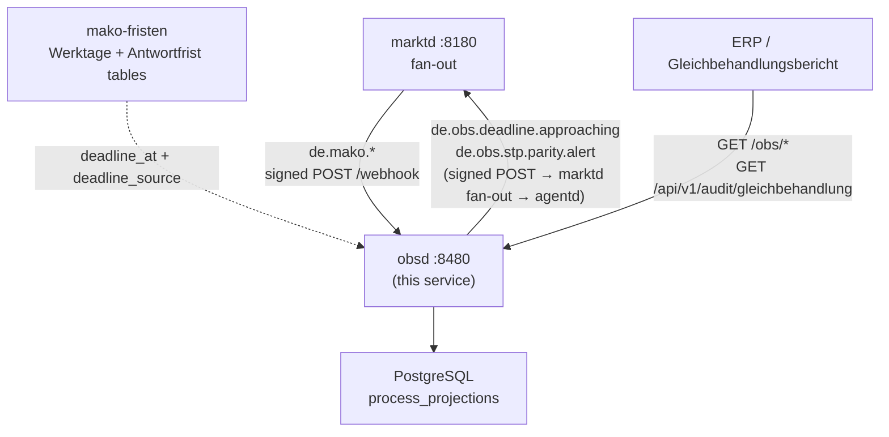

+++
title = "obsd Operator Guide"
description = "obsd operator guide: process projections, the two deadline clocks, per-PID KPIs and the § 7a Abs. 5 EnWG Gleichbehandlung parity evidence."
weight = 29
+++
`obsd` subscribes to every `de.mako.*` CloudEvent from `marktd` and projects it
into one row per business process. From that row it answers three questions the
engine's own metrics cannot:

- **Which processes are at risk** of missing their business answer window?
- **How did this Prüfidentifikator perform** last month?
- **Did we treat our own Lieferant better** than a third party's?

It never connects to `makod`: it is a read model with two producers of its own
and an MCP surface `agentd`'s specialists read. Its unit is the
[Prüfidentifikator (PID)](@/docs/architecture/domain-model.md#prufidentifikator-pid);
„at risk" means a [Frist](@/docs/architecture/domain-model.md#frist-and-werktag)
about to lapse; the **STP rate** is completions over the processes that *ended*
in the window. Other terms are in the
[glossary](@/docs/architecture/domain-model.md#glossary).



---

## Two deadline clocks

Every MaKo process carries **two independent deadlines**. obsd measures the
second; the first never reaches it.

| Clock | Window | A breach means | Where it shows |
|---|---|---|---|
| **APERAK Frist** | Strom UTILMD/ORDERS 45 min (Samstag: Sonntag 12:00), other Strom next Werktag 12:00; Gas Folgeprozess next Werktag 12:00, Initialprozess end of the 3. Werktag (APERAK AHB 1.1 §§ 2.3.1 / 2.4.1) | the counterparty's acknowledgement of a message did not arrive — a transport or validation fault | nowhere in obsd: makod raises the delivery-window alert and keeps the message in its outbox |
| **Antwortfrist** | per PID — see below | the *business answer* is owed and has not been sent | `deadline_at`, computed on `process.initiated` |

`state = aperak_timeout` is set by `de.mako.aperak.timeout`, which
`gpke-supplier-change` and `geli-gas-supplier-change` emit when **their
Antwortfrist** lapses unanswered. Despite the name it is an Antwortfrist
signal, raised by the workflow rather than computed by obsd.

`total_aperak_timeout` and `total_frist_breached` are separate fields on every
report. `total_frist_breached` is obsd's own measure against `deadline_at`, for
every PID with a published window. `total_aperak_timeout` counts processes
whose **current** state is `aperak_timeout` — only those two workflows' PIDs
can reach it, and one that later completes, is rejected or fails leaves the
count. `aperak_timeout` is not terminal, so those processes stay in the
Antwortfrist sweep.

---

## Port layout

```
┌───────────────────────────────────────────────────────────────────────┐
│  obsd  :8480                                                          │
│                                                                       │
│  POST /webhook                       ← marktd CloudEvents (signed)    │
│  GET  /obs/processes                 ← list / filter projections      │
│  GET  /obs/processes/{id}            ← single process by UUID         │
│  GET  /obs/kpis                      ← per-PID KPIs for a month       │
│  GET  /obs/overdue                   ← past the business Antwortfrist │
│  GET  /api/v1/audit/gleichbehandlung ← § 7a Abs. 5 EnWG evidence      │
│  GET  /obs/metrics                   ← obsd business gauges (Prom)    │
│  GET  /metrics                       ← request metrics (runner)       │
│  GET  /health/live  /health/ready    ← liveness + real DB ping        │
│  POST|GET /mcp                       ← MCP Streamable HTTP            │
└───────────────────────────────────────────────────────────────────────┘
```

### Cedar ABAC

`obsd` is read-only, so `policies/obsd.cedar` is one rule: **same tenant, any
role**. The resource tenant is the deployment's own `[identity] tenant`, never a
caller-supplied value. `POST /webhook` is authenticated by the HMAC in
`webhook.inbound_secret` instead.

| Action | Routes |
|---|---|
| `read-process` | `GET /obs/processes`, `GET /obs/processes/{id}` |
| `read-kpi` | `GET /obs/kpis`, `GET /api/v1/audit/gleichbehandlung` |
| `read-overdue` | `GET /obs/overdue` |
| `use-mcp` | `POST` / `GET /mcp` |

---

## ProcessProjection

| Field | Description |
|-------|-------------|
| `process_id` | UUID — the CloudEvent `subject` |
| `pid` | BDEW Prüfidentifikator (e.g. 55001) |
| `family` | `gpke`, `wim`, `geli-gas`, `wim-gas`, `gabi-gas`, `mabis`, `emob`, `redispatch`, `invoic-storno`, `unknown`. A PID with a published Antwortfrist takes the family of its Festlegung. The WiM PIDs of both Sparten (INSRPT, INVOIC 31003) take `wim` or `wim-gas` from the event's `data.sparte`, else from the counterparty's coding authority (BDEW-Codenummer `293` Strom, DVGW-Codenummer `332` Gas), else `wim`. Then the workflow-name prefix, then the PID table |
| `workflow_name` | From the `makoworkflow` CE extension |
| `state` | `initiated` \| `running` \| `aperak_timeout` \| `completed` \| `rejected` \| `failed` |
| `malo_id` | 11-digit Marktlokations-ID |
| `partner_mp_id` | MP-ID of the counterparty (NB/GNB/MSB) |
| `mdm_role` | Canonical Marktrolle (`LF`, `NB`, …) |
| `started_at` | First event seen for this process |
| `last_event_at` | Most recent event |
| `tenant` | Operator MP-ID the row belongs to |
| `deadline_at` | The **business Antwortfrist**. `null` = no published window for this PID |
| `deadline_source` | The Festlegung `deadline_at` came from |
| `deadline_risk` | `unknown` \| `green` \| `amber` (< 24 h) \| `red` (past) |
| `erc_code` | BDEW ERC code when `state = rejected` |
| `initiator_is_affiliate` | The Lieferant belongs to this operator's own undertaking |

`completed_at` (not on the wire) is set once when the state first becomes
terminal. It feeds cycle time and caps the breach test
(`deadline_at < COALESCE(completed_at, now())`), so a process that closed late
counts as breached. `failed` projects `de.mako.process.failed`; nothing in mako
emits a cancellation.

---

## The Antwortfrist

`obsd` does not compute deadlines: `mako-fristen` does, from the same
per-PID table `makod` registers deadlines from and `processd` sizes its queue
by.

| Family | Window | Source |
|---|---|---|
| GPKE Strom | **a clock time on the 1. Werktag after the ÜT**: 11:00 Anmeldung (55001/55077), 06:00 Abmeldung (55004), 05:00 Lieferende NB→LF (55007), 09:00 Beendigung der Zuordnung (55010); Kündigung 55016 to the end of the 1. WT | BK6-24-174 GPKE Teil 2 |
| GeLi Gas | Ablauf des **4. WT** Anmeldung (44001), **3. WT** Abmeldung (44004), **2. WT** Ersatz-/Grundversorgung (44013), **3. WT** Kündigung (44016) | BK7-24-01-009 Kap. 3.1–3.3 |
| WiM (Strom + Gas) | **3 / 5 / 7 / 1 Werktage** (55039/55042/55051/55168 resp. 44039/44042/44051/44168), to the end of that Werktag in Berlin; REQOTE Preisanfrage 4/5/10 WT je PID; Rechnungsabwicklung 8 WT | BK6-24-174 Anlage 2a Kap. 2.2.2–2.5.2, 3.2.2, 3.3.1.2, 3.6.3 · AWH WiM Gas 2.0 |
| Everything else | `null` — **unknown, never unbounded** | — |

A flat window is wrong in both directions: a GPKE Anmeldung arriving Friday
afternoon is answerable until Monday, one arriving Tuesday evening has under
sixteen hours. The GeLi Gas „10 Werktage" is the supplier's Vorlauffrist, not the
Netzbetreiber's answer window.

### `null` is unknown, not compliant

A PID with no published window carries no deadline, is absent from every breach
sweep, and has `deadline_risk = unknown` — never `green`. Every stored deadline
carries `deadline_source` into the CloudEvent and the MCP tools.

---

## § 7a Abs. 5 EnWG Gleichbehandlung parity

A vertically integrated undertaking's Gleichbehandlungsbeauftragte files a report
with the Bundesnetzagentur **by 31 March** for the preceding calendar year
(§ 7a Abs. 5 EnWG); `obsd` produces its Lieferantenwechsel evidence. The
underlying duties are **§ 6a EnWG** and **§ 20 Abs. 1 Satz 1 EnWG**.

A process belongs to the calendar year in which it **started, in
Europe/Berlin**: one initiated on 1 January at 00:30 belongs to the new year,
although the stored instant is 31 December 23:30 UTC. The default `year` is the
current Berlin year, and the `GET /obs/kpis` month is bounded by Berlin dates
the same way. Grouping by start (not by last update) makes a re-run of a closed
year reproduce it.

### What is compared

The processes the operator's network arm answers for a Lieferant, derived from
the Antwortfrist table (`answered_by == "NB"` in GPKE and GeLi Gas): 55001,
55077, 55004, 44001 and 44004. The Kündigung (55016, 44016) is answered by the
old supplier and is not in the set. `initiator_is_affiliate` is set when the
Lieferant's MP-ID (`new_supplier`, else the counterparty) is in
`[identity] own_mp_ids`.

### The sign convention

**`gap_pp = affiliate − third_party`, in percentage points; positive means the
affiliate fared better.** REST report, CloudEvent and MCP tool share the
convention. `gap_pp` covers the completion rate, `frist_gap_pp` the share
answered inside the Antwortfrist — they can diverge, since a rejection may be
legitimate while lateness is measurable exactly. Both are `null` when either
group has fewer than 10 processes.

### There is no regulatory threshold

The Bundesnetzagentur publishes no numeric parity limit; § 7a Abs. 5 asks for a
description of measures. `[worker] parity_threshold_pp` is the operator's own
escalation policy.

### Multi-MP-ID configuration

List every MP-ID the operator uses, or its affiliate processes count as third-party:

```toml
[identity]
tenant     = "9900357000004"   # primary — Cedar resource checks
# Strom NB (BDEW 99…) + Gas GNB (DVGW 98…)
own_mp_ids = ["9900357000004", "9800357000004"]
```

Omitting `own_mp_ids` defaults it to `[tenant]`.

### Export

```bash
# JSON, for the current year
curl -s "http://obsd:8480/api/v1/audit/gleichbehandlung?year=2026" \
  -H "Authorization: Bearer $TOKEN" \
  | jq '.by_pid[] | {pid, process, gap_pp, frist_gap_pp, favours}'

# CSV, for the filing
curl -s "http://obsd:8480/api/v1/audit/gleichbehandlung?year=2025&format=csv" \
  -H "Authorization: Bearer $TOKEN" > gleichbehandlung-2025.csv
# 15 columns: pid, both groups' total/completed/rejected/frist_breached and their
# two rates, then gap_pp and frist_gap_pp. An unstatable rate is an empty cell,
# never a 0 that would read as "completed none of them".
```

---

## Events produced

Two sweeps produce `de.obs.*` CloudEvents when `webhook.outbound_url` is set
(in production `marktd`'s event ingest), HMAC-signed with
`webhook.outbound_secret`:

| Event | Producer | When | Consumed by |
|-------|----------|------|-------------|
| `de.obs.deadline.approaching` | deadline sweep (`deadline_sweep_secs`) | an open process has `deadline_at` within `deadline_warn_hours`, or already past it, and has not been alerted (idempotent per process via `deadline_alerted_at`) | agentd `deadline-alert-agent` |
| `de.obs.stp.parity.alert` | parity sweep (`parity_sweep_secs`) | **either** gap — completion rate or Frist compliance — passes `parity_threshold_pp`, with both groups ≥ 10 processes | agentd `compliance-agent` |

**`de.obs.deadline.approaching`:** `process_id`, `pid`, `family`,
`workflow_name`, `malo_id`, `partner_mp_id`, `due_at` (RFC 3339),
`hours_remaining`, `breached`, `deadline_risk`, **`deadline_source`**, `tenant`.

**`de.obs.stp.parity.alert`:** `tenant`, `window_days`, `threshold_pp`,
`affiliate` + `third_party` `{total, completed, rejected, frist_breached}`,
`gap_pp` and `frist_gap_pp` (both signed), `favours`, `min_sample`,
`gap_convention`, `basis`.

Either gap alone raises the alert. Only a **delivered** alert is stamped, so a
downed target cannot consume a warning; a sweep returning a full batch reports
`saturated`.

---

## Configuration reference

`obsd` reads `OBSD_CONFIG` (default `obsd.toml`); `"env:VAR"` defers secrets,
`OBSD_<SECTION>__<KEY>` overrides, unknown keys are refused at startup.

```toml
[http]
addr = "0.0.0.0:8480"          # default

[database]
url       = "env:DATABASE_URL"  # required
pool_size = 10                  # default

[identity]
tenant     = "9900357000004"    # required — MP-ID of the operator
own_mp_ids = ["9900357000004", "9800357000004"]   # § 7a Abs. 5 affiliate detection

[marktd]
url     = "http://marktd:8180"      # required
api_key = "env:OBSD_MARKTD_API_KEY" # required

[webhook]
inbound_secret  = "env:OBSD_INBOUND_SECRET"   # required unless allow_insecure_no_auth
# Target for the de.obs.* events; omit to disable both sweeps.
outbound_url    = "env:OBSD_OUTBOUND_URL"     # e.g. http://marktd:8180/api/v1/mako/events
outbound_secret = "env:OBSD_OUTBOUND_SECRET"  # HMAC; must match the target's inbound secret

[worker]
deadline_sweep_secs = 900     # deadline sweep interval (default 15 min)
deadline_warn_hours = 24      # alert when an Antwortfrist is within this many hours
parity_sweep_secs   = 86400   # parity sweep interval (default daily)
# The operator's own escalation threshold, in percentage points.
parity_threshold_pp = 5.0
parity_window_days  = 90      # parity look-back window

[subscription]
# Self-registers with marktd on startup.
webhook_url   = "http://obsd:8480/webhook"
subscriber_id = "obsd"
event_types   = [
  "de.mako.process.initiated",
  "de.mako.process.completed",
  "de.mako.aperak.accepted",
  "de.mako.aperak.timeout",
  "de.mako.aperak.rejected",
  "de.mako.process.failed",
]

# Required unless allow_insecure_no_auth = true.
[oidc]
# issuer   = "https://login.microsoftonline.com/{tenant-id}/v2.0"
# audience = "api://mako-obsd"

# [mcp]           # MCP server auth: OIDC + optional API-key fallback
# api_key = "env:OBSD_MCP_API_KEY"

```

---

## Query examples

```bash
# Open GPKE Anmeldungen, newest first
curl -s "http://obsd:8480/obs/processes?family=gpke&state=initiated&pid=55001" \
  -H "Authorization: Bearer $TOKEN" \
  | jq '.[] | {process_id, started_at, deadline_at, deadline_source}'

# Per-PID KPIs for one calendar month
curl -s "http://obsd:8480/obs/kpis?pid=55001&period=2026-07" \
  -H "Authorization: Bearer $TOKEN" | jq .

# Past the business Antwortfrist
curl -s "http://obsd:8480/obs/overdue" \
  -H "Authorization: Bearer $TOKEN" \
  | jq '.[] | {pid, malo_id, deadline_at, deadline_source, deadline_risk}'
```

`state` accepts exactly the six stored spellings; anything else is a `400` naming
them, not a silently dropped filter.

### Reading a KPI report honestly

```json
{
  "pid": 55001,
  "total_initiated": 412,
  "total_aperak_timeout": 3,
  "total_frist_breached": 11,
  "total_with_frist": 412,
  "frist_compliance_rate": 0.9733,
  "avg_cycle_time_hours": 9.4,
  "p95_cycle_time_hours": 21.8
}
```

- `total_frist_breached` is obsd's measure against `deadline_at`;
  `total_aperak_timeout` is the supplier-change workflows' own report of a
  lapsed Antwortfrist. Neither is an APERAK delivery window.
- Check `total_with_frist` before quoting `frist_compliance_rate`: a small
  denominator means the bucket is mostly *unmeasured*, not compliant.
- A `null` rate means nothing measurable in the bucket. It is not `0`, and it is
  not perfect performance.

---

## Monitoring

`GET /obs/metrics` serves business gauges computed from the store on each scrape:

| Gauge | Meaning |
|---|---|
| `obsd_process_projections_total` | rows in the read-model |
| `obsd_open_processes_total` | non-terminal processes |
| `obsd_overdue_processes_total` | open and past their Antwortfrist |
| `obsd_db_pool_size` / `obsd_db_pool_idle` | connection pool |

`/obs/metrics` is unauthenticated — restrict it at the ingress; every route that
returns business data requires OIDC and Cedar. There is no Alertmanager bridge.

---

## MCP server

`obsd` exposes a read-only MCP server at `/mcp`, over the same repository as REST.

### Tools (6)

| Tool | Description |
|---|---|
| `get_process(process_id)` | Full projection — state, deadline, `deadline_source`, ERC code |
| `list_overdue_processes` | Past the business Antwortfrist, most urgent first; reports `saturated` |
| `get_kpi_report(pid, period)` | Per-PID KPIs for a `YYYY-MM` month, both clocks separately |
| `get_parity_report(days)` | § 7a Abs. 5 parity; `gap_pp` = affiliate − third_party |
| `get_stp_rate(days)` | Completions over processes that **ended** |
| `list_processes_by_family(family, state, limit)` | Drill into one family; `family` and `state` are enumerated in the tool schema from the family list and `ProcessState`, and an unknown value of either is refused |

### Prompts (2)

| Prompt | Description |
|---|---|
| `audit-kpi` | Walk a period's KPIs per PID without confusing the APERAK clock with the Antwortfrist; no BNetzA threshold exists for these rates |
| `investigate-aperak-violation` | Root-cause a missed APERAK acknowledgement |

### Example

```bash
curl -X POST http://obsd:8480/mcp \
  -H "Authorization: Bearer $TOKEN" -H "Content-Type: application/json" \
  -d '{"jsonrpc":"2.0","id":1,"method":"tools/call",
       "params":{"name":"get_stp_rate","arguments":{"days":30}}}'
```

Returns `ended`, `completed`, `rejected`, `failed`, `in_flight`,
`aperak_timeout`, `frist_breached` and `stp_rate` — `null` when nothing ended in
the window, because a window with no endings has no rate.

---

## See also

- [agentd Operator Guide](@/docs/services/agentd.md) — the specialists that
  consume `de.obs.*`.
- [processd Operator Guide](@/docs/services/processd.md) — the operator queue
  sized by the same Antwortfrist table.
