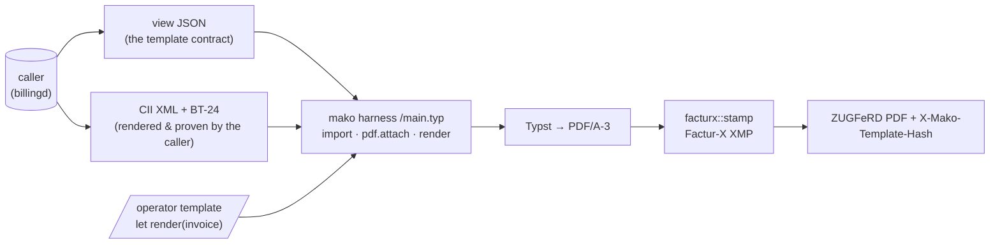

+++
title = "outputd Operator Guide"
description = "Operator guide for outputd, the customer-communications daemon: operator-owned Typst templates, the ZUGFeRD PDF/A-3 carrier and per-channel delivery evidence."
weight = 33
+++
`outputd` renders the documents a customer receives and delivers them. It owns
**how documents look** — the operator's Typst templates, the render engine, the
ZUGFeRD PDF/A-3 carrier, the publish gates and the append-only template store —
and **whether they arrived**: the store of issued documents and the per-channel
delivery evidence. What a document **says** — amounts, VAT, legal basis — stays
with the issuing service: billingd for invoices, accountingd for the Mahnwesen
figures, vertragd for a price change. outputd never recomputes a number.

One brand has one template store, so a logo change reaches the invoice *and*
the Mahnung.

| Document | What it is | Form |
|---|---|---|
| **Mahnung** | dunning letter, computed by [accountingd](@/docs/services/accountingd.md) | Textform (§ 126b BGB: a readable declaration on a durable medium naming sender and recipient; no signature) |
| **Preisanpassung** | the price-change notice of § 41 Abs. 5 EnWG | Textform |
| **Invoice** | from billingd | **ZUGFeRD**: a PDF/A-3 carrying the EN 16931 invoice XML; **XRechnung** is the German CIUS. The document declares which in **BT-24**, and outputd stamps the carrier from that |

Port: `:9880`

| Method | Path | Description |
|---|---|---|
| `POST` | `/api/v1/render/{kind}` | Render a view with the current or a pinned template; `X-Mako-Template-Hash` names the layout used. Stores nothing |
| `POST` | `/api/v1/documents/issue/{kind}` | Render, **record** and queue for delivery; idempotent on `subject_ref` |
| `GET` | `/api/v1/documents` | A customer's documents (`?malo_id=` or `?kunden_nr=`, `&kind=`) — the portal inbox |
| `GET` | `/api/v1/documents/{id}` | One document with every delivery track |
| `GET` | `/api/v1/documents/{id}/content` | The bytes as issued — a reproduction, never a re-render |
| `POST` | `/api/v1/deliveries/{id}/read` | The customer opened it in the portal |
| `POST` | `/api/v1/deliveries/{id}/status` | A channel reports arrival or a bounce |
| `GET` | `/api/v1/spool` | What a print service collects |
| `GET` | `/api/v1/templates` | Every template this tenant published (`?kind=&limit=`) |
| `POST` | `/api/v1/templates` | Prove a template, then store it forever |
| `POST` | `/api/v1/templates/preview` | Render an `INVOICE`/`MAHNUNG` candidate against its specimen; stores nothing |
| `GET` | `/api/v1/templates/reference/{kind}` | The reference layout mako ships, one per kind |
| `GET`/`PUT` | `/api/v1/templates/{kind}/current` | Which template is rolled out |
| `GET` | `/api/v1/templates/by-hash/{hash}` | Resolve the layout an issued document used |

## The render API — `POST /api/v1/render/{kind}`

The caller sends what the document is *about*, optionally a **template hash**
(a pinned document; omitted, the tenant's current template renders), and — for
`INVOICE` — the **CII payload with its BT-24**, so the ZUGFeRD carrier is
stamped exactly as the document declares itself. The answer is the PDF, with
`X-Mako-Template-Hash` naming the template used; the issuing service pins that
hash next to its record.

What "about" means depends on the kind:

| Kind | Field | Why |
|---|---|---|
| `INVOICE` | `model` — the EN 16931 semantic model | outputd projects the page view from it, so the projection the publish gate proves templates against is the one production feeds them |
| `MAHNUNG`, `PREISANPASSUNG` | `view` — the kind's own view | their producer has no EN 16931 model, and the view *is* the contract |

`POST /api/v1/documents/issue/{kind}` takes the same body plus `subject_ref`,
`recipient` and `channels`. Sending the model rather than a caller-projected view
keeps one implementation of `en16931::Invoice → DocumentView` — the one the
publish gate proves templates against.

Admission is checked before rendering, each refusal a `422` naming the fix: a
pinned hash must belong to **this kind**, the subject must match the kind, an
`INVOICE` render **requires** the attachment, and a Textform render must not
carry one. A hash of another tenant does not resolve (`template_store::by_hash`
is tenant-scoped).

## Authorization

`policies/outputd.cedar` decides every route before it touches the database:

| Action | Routes | Who |
|---|---|---|
| `read-template` | `GET /templates`, `/{kind}/current`, `/by-hash/{hash}`, `/reference/{kind}` | any authenticated caller in the tenant |
| `preview-template` | `POST /templates/preview` | any authenticated caller in the tenant |
| `publish-template` | `POST /templates` | `LF`, `MSB`, `ESA` |
| `rollout-template` | `PUT /templates/{kind}/current` | `LF`, `MSB`, `ESA` |
| `render-document` | `POST /render/{kind}` | `LF`, `MSB`, `ESA` |
| `issue-document` | `POST /documents/issue/{kind}` | `LF`, `MSB`, `ESA` |
| `report-delivery` | `POST /deliveries/{id}/status` | `LF`, `MSB`, `ESA` |
| `read-document` | `GET /documents…`, `/spool`, `POST /deliveries/{id}/read` | any authenticated caller in the tenant |

A template is the shape of every document, so publishing, rolling out and
rendering need a market role. `tests/it/authorization.rs` holds handler checks
and policy grants to each other in both directions. Reading is a tenant read
because the **query** scopes it: `GET /api/v1/documents` refuses to answer
without `malo_id` or `kunden_nr` (`UNSCOPED_QUERY`). `portald` turns a
customer's identity into that scope via `vertragd`.

## Issuing and delivery

`POST /render/{kind}` keeps nothing (preview, re-print, a caller with its own
archive). `POST /documents/issue/{kind}` records and queues, which answers two
regulated questions:

- **Reproduce what was issued.** § 14 Abs. 1 Satz 2 UStG and § 147 Abs. 1
  Nr. 2–3 AO keep the Rechnungsdoppel eight years in the form issued;
  `GET /documents/{id}/content` returns the stored bytes, never a re-render.
- **Did the customer receive it.** § 126b BGB and § 41f Abs. 1/Abs. 5 EnWG rest
  on notices that *reached* the customer.

Both stores are append-only; a corrected document is a new row.

### Idempotency

`subject_ref` names the subject in the issuer's terms (Rechnungsnummer,
dunning-case id, product-slice id) and is unique per `(tenant, kind)`, so a
retry gets the document already issued — essential where a duplicate Mahnung
would be a second statutory demand.

### Channels

| Channel | How outputd delivers | Evidence | `DELIVERED` when |
|---|---|---|---|
| `PORTAL` | the document is in the store; `portald` serves it | published, then `read_at` when the customer opens it | on publish — it is then in the recipient's sphere, which is what § 126b BGB asks of a durable medium |
| `EMAIL` | `POST` to a configured mail relay | the relay's message id | the relay reports the recipient's server accepted it |
| `POST` | a spool a print service pulls (`GET /api/v1/spool`); an optional push when `postal_relay_url` is set | the batch reference it reports back | the service reports it posted |
| `ERP` | `POST` to the operator's own webhook | its response | the ERP reports it |

outputd embeds **no SMTP client and no print driver**: each outbound channel is
an HTTP relay (URL, bearer token, JSON with the document base64-encoded, signed
Standard Webhooks). With none configured, the portal channel still delivers.

A channel with nothing to send to (`EMAIL` with no address) is stored
`SUPPRESSED` **with its reason**. `recipient.address` is typed and
all-or-nothing — street, postcode and town — and an absent address suppresses
`POST`. `SENT` (relay accepted) and `DELIVERED` (far end reported via
`POST /deliveries/{id}/status`) are different states; a reported bounce turns
even a `DELIVERED` row `FAILED` and clears `delivered_at`.

### The worker

One loop drains `PENDING` rows with doubling backoff from 60 s to 6 h up to
`max_attempts` (default 8, about half a day); the claim is `FOR UPDATE SKIP
LOCKED`, so replicas are safe. At the ceiling a delivery becomes `FAILED` and is
logged at `error`.

A `POST` delivery without `postal_relay_url` is **not on that clock**: in the
pull model the print service reads `GET /api/v1/spool`, fetches the bytes and
reports back, so the worker never claims those rows and they stay `PENDING` in
the spool until collected. Setting `postal_relay_url` switches them to push.

## Errors

Every route answers with one envelope and a stable code. Template compile errors
come back as a **list** of `path:line:col: message` diagnostics pointing into the
operator's file:

```json
{ "error": { "code": "TEMPLATE_DID_NOT_COMPILE",
             "message": "the template did not render",
             "diagnostics": ["/template.typ:12:4: unknown variable: invoce"] } }
```

| Code | Status | Meaning |
|---|---|---|
| `UNKNOWN_TEMPLATE_KIND`, `INVALID_DATE`, `EMPTY_SOURCE` | 400 | a malformed request |
| `SUBJECT_REF_REQUIRED`, `NO_CHANNEL`, `UNSCOPED_QUERY` | 400 | an issue or a query missing the key that scopes it |
| `FORBIDDEN` | 403 | the Cedar policy denied the action |
| `TEMPLATE_NOT_FOUND`, `NO_CURRENT_TEMPLATE` | 404 | nothing of this tenant answers to that |
| `DOCUMENT_NOT_FOUND`, `PORTAL_DELIVERY_NOT_FOUND` | 404 | no such issued document / portal delivery in this tenant |
| `TEMPLATE_IDENTITY_TAKEN` | 409 | you have already published this exact source under another kind |
| `TEMPLATE_DID_NOT_COMPILE`, `TEMPLATE_REJECTED_BY_GATE` | 422 | with `diagnostics` |
| `TEMPLATE_NOT_PUBLISHED` | 422 | the rollout names a hash never published as this kind |
| `TEMPLATE_WRONG_KIND`, `SUBJECT_MUST_BE_A_MODEL`, `SUBJECT_MUST_BE_A_VIEW` | 422 | the render's parts do not agree |
| `ATTACHMENT_REQUIRED`, `ATTACHMENT_NOT_ALLOWED`, `ATTACHMENT_UNUSABLE`, `ATTACHMENT_NAME_INVALID` | 422 | the carrier contract |
| `PDF_STANDARD_UNUSABLE` | 422 | a level that would silently drop the invoice |
| `DATE_NOT_REPRESENTABLE` | 422 | a document date the PDF date format cannot carry |
| `NO_SPECIMEN` | 422 | this kind has no preview specimen — publish it instead |
| `RENDER_BUDGET_EXCEEDED` | 422 | the template is doing far more work than one document needs |

## Templates

The **layout** belongs to the operator — a [Typst](https://typst.app) template
published over the API and pinned by hash. The **content** belongs to the
issuing service, which validates the payload against its declared profile
before it reaches outputd.



### The template contract

A template exports exactly one function:

```typst
#let render(invoice) = { .. }
```

`invoice` is `document::view::DocumentView` as a Typst dictionary, projected by
outputd from the EN 16931 model: the §14 Abs. 4 UStG Pflichtangaben, lines, VAT
breakdown and totals, each field documented with its BT/BG term. Amounts are
exact decimal strings at their term's scale (money 2, unit price 4); a template
pads and never truncates. `GET /api/v1/templates/reference/{kind}` serves mako's
reference layout (DIN 5008, German number formatting), compiled by the test
suite against the gate's specimen on every run.

### What a template cannot do

mako compiles **its own** entry file, not the operator's. The harness imports
the template, hands it the view, and emits the `pdf.attach` itself:

```typst
#import "/template.typ": render
#pdf.attach("factur-x.xml", bytes("<?xml version=\"1.0\" .."), relationship: "alternative", ..)
#render(json("/document.json"))
```

So a template cannot omit, rename, replace or read the invoice: the XML is a
literal in mako's file, not a file the compiler serves. The environment:

| Capability | Available to a template |
|---|---|
| Host filesystem | none — three in-memory files exist and nothing else |
| Network, `@preview` packages | refused, with a message explaining why |
| Fonts | the bundled Typst set; never the host's, never the operator's |
| Wall clock | none — `datetime.today()` returns the *document's* date (BT-2) |

Compute is not sandboxed: a render runs on a blocking thread under a 20 s budget
(`RENDER_BUDGET_EXCEEDED`), and concurrent renders are capped at one fewer than
the machine's cores so typesetting cannot starve `sqlx` on the shared blocking
pool. Waiting for a slot counts against the budget; a timed-out render keeps its
slot until it actually ends.

### The Factur-X carrier

A PDF/A-3 with the XML stapled inside it is not yet a ZUGFeRD document.
ZUGFeRD 2.3 requires four things of the carrier:

| Requirement | Written by |
|---|---|
| PDF/A-3 conformance | `typst-pdf` (enforced, not claimed) |
| `factur-x.xml` — or `xrechnung.xml` for the XRECHNUNG profile | the harness |
| `/AFRelationship /Alternative` + catalogue `/AF` | Typst |
| XMP `fx:DocumentType` / `DocumentFileName` / `Version` / `ConformanceLevel`, **plus** the PDF/A extension schema description | `document::facturx::stamp` |

The XMP is added by **incremental update** — the renderer's bytes stay in place
and a new metadata object is appended, the mechanism a digital signature uses.
Reading a finished document back is `en16931-formats::zugferd::extract`, with
that crate's `Profile`. The profile is derived from BT-24, never configured:
plain EN 16931 gets `factur-x.xml` and level `EN 16931`; the XRechnung CIUS gets
`xrechnung.xml` and `XRECHNUNG`.

### Publishing is gated by proof

`POST /api/v1/templates` renders the candidate against an awkward specimen —
two VAT rates, an exempt position with a BT-120 reason, a credit line, a
four-decimal unit price, umlauts, a long item name, absent optional fields —
then:

1. enforces the declared PDF/A level (one that cannot embed a file is refused);
2. stamps the Factur-X XMP;
3. reads the document back with **the counterparty's reader**
   (`en16931-formats::zugferd::extract`): the payload must be byte-identical,
   re-parse as CII, carry the same BT-1 and BT-115, and produce **no
   `Divergence`** (XMP profile ≠ BT-24, XMP filename ≠ attachment,
   supplementary `/AFRelationship`, missing XMP);
4. reads the **page** text and requires the invoice number (§ 14 Abs. 4 Nr. 4
   UStG), both party names (Nr. 1) and the USt-IdNr. (BT-31) *or* Steuernummer
   (BT-32) (Nr. 2) — so `#let render(invoice) = []` fails;
5. refuses more than 8 pages on the specimen (3 for a Mahnung or
   Preisanpassung).

The specimen is a real `en16931::Invoice`, rendered through
`DocumentView::of` and `en16931_formats::cii` like production; a two-sided test
pins its BT-23, BT-34, BG-14 and BG-16 to what billingd's `einvoice::build`
stamps. A failing template answers `422` with diagnostics.
`document_templates.proof` records `RENDERED_PDFA` or `RENDERED_TEXTFORM`, and a
`CHECK` ties each kind to its proof.

`POST /api/v1/templates/preview` runs the same render for `INVOICE` and
`MAHNUNG` and stores nothing; `PREISANPASSUNG` answers `422 NO_SPECIMEN` and is
checked by publishing.

### Renders are reproducible

Nothing ambient reaches the output: the date is BT-2, the PDF `/ID` derives
from tenant, template hash and record id, and the fonts are compiled in — so a
re-render produces the same bytes
(`rendering_the_same_invoice_twice_produces_the_same_file`). The issuing service
pins `X-Mako-Template-Hash` beside its record (billingd:
`billing_records.template_hash`); a draft pins nothing.

### The template store

Templates live in `document_templates`, **content-addressed and append-only**,
identified by `(tenant, SHA-256 of the source)` — scoped to the tenant, so two
tenants publishing the reference layout unchanged get two rows and never see
each other. The pin lives in another service's database, so append-only is the
whole guarantee that it resolves for the 8 years an invoice is kept (§ 14b UStG
/ § 147 AO, GoBD *Unveränderbarkeit*). `document_template_current` is the
mutable pointer per `(tenant, kind)`.

| Kind | Output | Default conformance | Proof |
|---|---|---|---|
| `INVOICE` | ZUGFeRD PDF/A-3 carrier | `a-3b` | `RENDERED_PDFA` |
| `MAHNUNG` | Textform (§ 126b BGB) | — | `RENDERED_TEXTFORM` |
| `PREISANPASSUNG` | § 41 Abs. 5 EnWG notice, Textform | — | `RENDERED_TEXTFORM` |

A **Mahnung** is proven against the Stufe-3 specimen and must show the § 126b
declarant, the Gesamtforderung, the Zahlungsfrist and the § 41f Sperrtermin;
`document::mahnung::MahnungView` projects accountingd's Mahnwesen (Stufe 1–3,
open Posten, § 288 BGB Verzugszinsen, Mahngebühr, Sperrandrohung). A
**Preisanpassung** must state the change, its Anlass and Umfang and the
Sonderkündigungsrecht in the same notice (§ 41 Abs. 5 Satz 1 and 4 EnWG); the
gate renders a mixed specimen (one price up, one down) and requires the
declarant, the Wirksamkeit, both changed prices and the Kündigungsrecht date.
The views live with the renderer; `accountingd` and `vertragd` conform to them.

| Method | Path | Purpose |
|---|---|---|
| `GET` | `/api/v1/templates` | Every template this tenant published (`?kind=&limit=`), newest first, `is_current` marking the one in use — how a rollback finds its hash |
| `POST` | `/api/v1/templates` | Prove a template and publish it; returns its hash, proof, page count and any Typst warnings. Idempotent — identical source stores nothing new |
| `POST` | `/api/v1/templates/preview` | Render an `INVOICE` or `MAHNUNG` candidate against its specimen and return the PDF. Stores nothing; `PREISANPASSUNG` answers `422 NO_SPECIMEN` |
| `GET` | `/api/v1/templates/reference/{kind}` | The reference layout mako ships — one per kind, each passing its own gate |
| `PUT` | `/api/v1/templates/{kind}/current` | Roll a published template out. `422` when the hash was never published |
| `GET` | `/api/v1/templates/{kind}/current` | What this tenant renders with now |
| `GET` | `/api/v1/templates/by-hash/{hash}` | Resolve any template by hash — how an audit answers *why did the 2027 invoice look like that* |

Publishing and rolling out are separate decisions; a rollback is the same `PUT`
with the previous hash from `GET /api/v1/templates`. There is **no update and no
delete** endpoint. The listing omits the source; `by-hash` returns it.

### Verifying a generated document

`just zugferd-specimen` writes stamped specimens to `target/`; `just zugferd-verify` runs the external panel in containers (veraPDF, Mustang under Temurin):

| Check | Tool | Status |
|---|---|---|
| Payload against the 227 EN 16931 rules | `en16931 validate` (`cargo install en16931-cli`) | **valid — 0 findings**, an independent implementation reading what mako wrote |
| Payload validity *before* embedding | the caller (billingd), and the publish gate for its specimen | enforced |
| Carrier round-trip, `Divergence`, page content | mako's publish gate | enforced on every publish |
| XMP well-formed, every `fx:` property declared in its extension schema | `tests/it/zugferd_carrier.rs` | enforced |
| The incremental update disturbs **exactly one object**, `/ID` `/Root` `/Size` preserved | `tests/it/zugferd_carrier.rs` | enforced |
| **PDF/A-3b conformance** | veraPDF (`verapdf/cli:latest`) | **compliant, 0 failed rules** — both profiles and the pre-stamp control |
| XRechnung-profile payload (core + BR-DE) | `en16931 validate` | **valid — 0 findings of 282 rules** |
| Carrier + payload against the ZUGFeRD specification | Mustang 2.25.0 (reference validator) | **valid, both profiles** — XRechnung profile with zero findings; core profile carries one upstream warning (below) |

`tests/it/zugferd_carrier.rs` parses the stamped XMP, requires every `fx:`
property to be declared in the fx extension schema, requires the
`pdfaExtension:schemas` bag to occur once (a second occurrence breaks PDF/A
6.6.2.1 / 6.6.4), and walks every object of the pre- and post-stamp files, the
`/Metadata` stream being the single permitted difference. veraPDF is not part of
`just ci`; re-run it after any change to `document::facturx`.

Mustang raises `PEPPOL-EN16931-R008` on the core-profile file for the empty
`<ram:ApplicableHeaderTradeDelivery/>`. It is a false positive: the element is
mandatory in the CII D16B XSD and KoSIT's Schematron carves it out of R008. Do
not omit the element.

`en16931` / `en16931-formats` are on 0.7; `document::facturx` writes the carrier
and the `zugferd` feature is the reader the gate checks it with.

## Configuration

```toml
# outputd.toml
port   = 9880
tenant = "9900357000004"   # the operator's MP-ID — every template row is scoped to it

[database]
url = "postgresql://outputd:secret@db:5432/outputd"

# Required unless allow_insecure_no_auth = true (dev only).
[oidc]
issuer   = "https://idp.example/realms/mako"
audience = "outputd"

# Every outbound channel is an HTTP relay. A relay URL requires its key — the
# bearer token and the Standard Webhooks signing key; a URL without one is a
# startup refusal.
[delivery]
enabled             = true          # default
max_attempts        = 8             # default; with the doubling backoff, ~half a day
from_address        = "rechnung@stadtwerke-musterstadt.example"
email_relay_url     = "https://mail-relay.internal/api/v1/send"
email_relay_api_key = "env:OUTPUTD_MAIL_RELAY_KEY"
# Optional: unset selects the pull model (GET /api/v1/spool).
postal_relay_url    = "https://druckdienstleister.example/api/v1/jobs"
postal_relay_api_key = "env:OUTPUTD_PRINT_KEY"
# The ERP channel — the operator's own system, which then owns delivery.
erp_webhook_url     = "https://erp.internal/api/v1/documents"
erp_api_key         = "env:OUTPUTD_ERP_KEY"

# Subject lines per kind; a kind with no entry falls back to a built-in.
[delivery.subjects]
INVOICE        = "Ihre Rechnung"
MAHNUNG        = "Zahlungserinnerung"
PREISANPASSUNG = "Änderung Ihrer Preise"
```

Callers configure the counterpart: `outputd_url` plus an optional
`outputd_api_key` bearer in billingd, accountingd, vertragd and portald. Without
a reachable outputd, billingd's PDF endpoint answers `502` (the XML endpoints
need no renderer), and accountingd and vertragd record their dunning and
price-change facts without producing a document — visibly, in the log.
