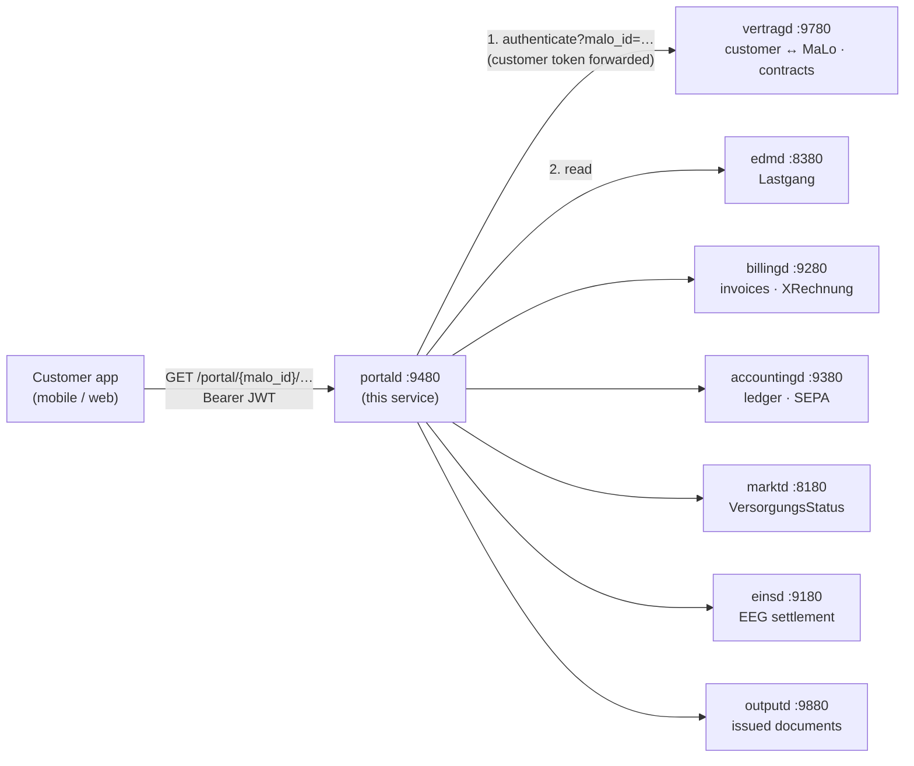

+++
title = "portald Operator Guide"
description = "Operator guide for portald, the customer-portal read-model gateway: one REST API over Lastgang, invoices, ledger and supply status, plus §41 EnWG self-service."
weight = 36
+++
`portald` is a **stateless read-model gateway** that aggregates the LF back-end
services into one customer-facing REST API, and proxies the § 41 EnWG
self-service writes to the services that own them.

It serves the **LF** (Lieferant) role; every route is keyed on a
[Marktlokation](@/docs/architecture/domain-model.md#malo-vs-melo-the-critical-distinction)
(MaLo).



Port: **`:9480`**

---

## Design principles

- **Stateless.** No database, no cache, no session store. Every response is
  assembled from the authoritative services on the request path, so a portal
  reply can never be staler than they are and replicas need no coordination.
- **No domain policy.** Notice periods, tariff rules, IBAN validation and
  invoice rendering belong to the services that own them. `portald` validates
  request *shape* and relays their verdicts unchanged.
- **Degrade a tile, not the screen.** On the dashboard, a field is `null` when
  its upstream is unconfigured or has no data.

---

## Authorization

`portald` verifies no tokens and holds no customer↔MaLo map. It forwards the
customer's `Authorization: Bearer` header to
`vertragd GET /api/v1/kunden/authenticate?malo_id=…` — the owner of the OIDC
verifier, the customer record and the mapping — and relays the verdict. Its own
service credential rides as `X-Api-Key`, never as a second `Authorization`
header.

| `vertragd` answers | `portald` answers |
|---|---|
| `2xx` with a `kunden_id` | the request proceeds |
| `401` / no bearer / no customer profile | `401` |
| `403` | `403` |
| unreachable, `5xx`, or `2xx` without a `kunden_id` | `503` |

`auth::authorize` is the only way to obtain a `PortalAuthCtx`, and every
customer-scoped handler takes one by value. `tests/it/authorization_guard.rs`
drives every customer-scoped method handler against a refusing `vertragd` and
fails if any answers with upstream data, or if the router gains a handler the
test does not list.
`…/invoices/{record_id}/download` also compares the record's `malo_id` with the
authorised one. Starting without `vertragd_url` is refused unless
`allow_insecure_no_auth = true`.

---

## Endpoints

All paths are prefixed `/api/v1/portal/{malo_id}`.

| Method | Path | Upstream |
|--------|------|----------|
| `GET` | `/dashboard` | `marktd` · `accountingd` · `billingd` · `edmd` — five reads, concurrently |
| `GET` | `/lastgang?from=&to=` | `edmd` — BO4E `Lastgang` array |
| `GET` | `/invoices?limit=&outcome=` | `billingd` — page size defaults to 24, clamped to 1–100 |
| `GET` | `/invoices/{record_id}/download` | `billingd` — the EN 16931 CII XML of the stored model (`GET /billing/{id}/xrechnung`). BT-24 declares plain EN 16931 for a retail invoice; only the B2G path declares the XRechnung CIUS |
| `GET` | `/dokumente?kind=&limit=` | `outputd` — the **document inbox**: what was issued and sent. `kind` is an allowlist (`INVOICE`, `MAHNUNG`, `PREISANPASSUNG`); page size defaults to 50, clamped to 1–200 |
| `GET` | `/dokumente/{document_id}` | `outputd` — the bytes as issued; opening it records the portal read receipt |
| `GET` | `/balance` | `accountingd` — open-items balance |
| `GET` | `/kontoauszug?from=&to=` | `accountingd` — account statement (§ 666 BGB); both bounds together scope it to a period and open it at that period's balance |
| `GET` | `/vorauszahlung` | `accountingd` — Abschlag schedule (§ 40 Abs. 1 EnWG) |
| `GET` | `/eeg` | `einsd` — plants + settlements |
| `GET` | `/versorgung` | `marktd` — supply state |
| `GET` | `/vertrag` | `vertragd` — active supply contract |
| `GET` | `/kuendigungsfrist` | `vertragd` — reachable end dates per reason |
| `POST` | `/tarifwechsel` | `vertragd` |
| `POST` | `/kuendigen` | `vertragd` |
| `GET` | `/kontakt` | `vertragd` — DSGVO Art. 15, and the **read half** of the rectification flow: a `PUT` replaces the stored `Geschaeftspartner` whole, so a client that has not read it first cannot change one field without dropping the rest. Projected, not proxied: operator notes and the ERP key are not the customer's to see |
| `PUT` | `/kontakt` | `vertragd` — DSGVO Art. 16. The body's `geschaeftspartner` is a BO4E `Geschaeftspartner` and crosses [the gate](@/docs/architecture/domain-model.md#the-bo4e-gate) **here**, at the edge the customer reaches: a portal user who mistypes an enum gets the field named back, not a `502` from one hop away |
| `PUT` | `/sepa` | `accountingd` |

`/health/live`, `/health/ready` and `/metrics` come from the service runner.

### Invoices and documents are two different lists

`/invoices` is what `billingd` **calculated**, drafts held by the risk gate
included. `/dokumente` is what the customer was **sent**, byte for byte, with
delivery evidence; opening one records the read receipt a § 41f EnWG dispute
asks about. `outputd` refuses a document query that names neither a MaLo nor a
Kundennummer.

---

## Dashboard

`GET /api/v1/portal/{malo_id}/dashboard` fetches from every configured upstream
concurrently and returns one object:

```json
{
  "malo_id": "51238696012",
  "tenant": "9900357000004",
  "kundentyp": "B2C",
  "versorgung":    { "lieferstatus": "Beliefert", "lf_mp_id": "9900357000004" },
  "balance":       { "balance_ct": -4500, "currency": "EUR" },
  "last_invoice":  [ { "id": "…", "total_brutto_eur": "126.14" } ],
  "meter_summary": { "arbeitsmenge_kwh": "312.5", "sparte": "STROM" },
  "vorauszahlung": { "betrag_ct": 8900, "naechste_faelligkeit": "2026-07-01" }
}
```

---

## Self-service writes (§ 41 EnWG)

### Notice periods live in `vertragd`

`portald` validates the date format only. Whether a `lieferende` or
`wirksamkeit` is reachable depends on Vertragsart, Haushaltskunde status (§ 3
Nr. 57 EnWG) and the reason — § 20 Abs. 1 StromGVV/GasGVV in the
Grundversorgung, § 41b Abs. 5 EnWG on a move, § 41 Abs. 5 Satz 4 EnWG after a
price change, § 309 Nr. 9 lit. c BGB on term length — and `vertragd` decides.
Its `422` naming the rule is relayed unchanged. Call `GET /kuendigungsfrist`
first to show the reachable dates.

### SEPA mandates

`PUT /sepa` registers a mandate with `accountingd`, which validates the IBAN
(ISO 13616 mod-97) and the debtor address.

The caller supplies neither `sequence_type` (`FRST` before `RCUR` is
`accountingd`'s to track) nor `mandatsref` (derived here with a random suffix,
35 characters, the SEPA `MndtId` limit, so a same-day IBAN correction gets a new
mandate).

`debtor_address` is optional until **15 November 2026**, when version 1.1 of the
2025 SEPA rulebooks ends the unstructured address and the schemes begin
requiring `town` + `country` on every collection.

---

## Configuration

```toml
# portald.toml
port   = 9480
tenant = "9900357000004"

# Required — the authorization authority for every route.
vertragd_url     = "http://vertragd:9780"
vertragd_api_key = "env:PORTALD_VERTRAGD_SERVICE_KEY"   # sent as X-Api-Key

edmd_url        = "http://edmd:8380"
billingd_url    = "http://billingd:9280"
accountingd_url = "http://accountingd:9380"
einsd_url       = "http://einsd:9180"
marktd_url      = "http://marktd:8180"
outputd_url     = "http://outputd:9880"

# Opaque service Bearer tokens; register each in the upstream's service keys.
# edmd_api_key        = "env:PORTALD_EDMD_SERVICE_KEY"
# billingd_api_key    = "env:PORTALD_BILLINGD_SERVICE_KEY"
# accountingd_api_key = "env:PORTALD_ACCOUNTINGD_SERVICE_KEY"
# einsd_api_key       = "env:PORTALD_EINSD_SERVICE_KEY"
# marktd_api_key      = "env:PORTALD_MARKTD_SERVICE_KEY"
# outputd_api_key     = "env:PORTALD_OUTPUTD_SERVICE_KEY"

# MP-ID a self-service SEPA mandate is registered under. Defaults to `tenant`;
# must match accountingd's `lf_mp_id`.
# lf_mp_id = "9900357000004"

# Local development only: serve portal routes without resolving ownership.
# allow_insecure_no_auth = true

# Required, like `vertragd_url`: the MCP tools take a `malo_id` and carry no
# customer token, so `/mcp` is a second door the ownership check never reaches.
# portald refuses to start without a key unless `allow_insecure_no_auth` is set.
[mcp]
api_key = "env:PORTALD_MCP_API_KEY"
```

There is no `oidc_issuer` / `oidc_audience`: `portald` verifies no tokens.

---

## Deployment

Stateless — no schema, no migrations. Deploy as many replicas as needed behind a
load balancer.

```yaml
# docker-compose.yml (excerpt)
portald:
  image: ghcr.io/hupe1980/mako-portald:latest
  ports: ["9480:9480"]
  volumes:
    - ./portald.toml:/etc/mako/portald.toml:ro
  environment:
    PORTALD_VERTRAGD_SERVICE_KEY: "${PORTALD_VERTRAGD_SERVICE_KEY}"
```

---

## MCP server

`/mcp` (Streamable HTTP), 8 read-only tools:

| Tool | Description |
|---|---|
| `get_dashboard` | Aggregated snapshot: supply status, latest invoice, balance |
| `get_lastgang` | Consumption time-series, optional ISO-8601 range |
| `get_invoices` | Billing history, newest first |
| `get_balance` | Open-items net balance (positive = owed) |
| `get_kontoauszug` | Full account statement, for dispute investigation |
| `get_vorauszahlung` | Abschlag amount, cycle, next due date |
| `get_eeg_status` | EEG/KWKG plants + settlements |
| `get_versorgung` | Supply status and effective date |

Prompts: `customer-overview`, `billing-dispute`, `eeg-foerderung-check`.

**This surface is operator-facing.** Its tools take a `malo_id` and carry no
customer token, so they bypass the ownership gate: whoever can call `/mcp` reads
every customer in the tenant. `portald` therefore refuses to start without
`[mcp] api_key` (unless `allow_insecure_no_auth`). Keep the credential off the
public ingress.

---

## Informatorisches Unbundling (§ 6a EnWG)

An **LF-role** service. It reads `marktd` only for VersorgungsStatus — the LF's
own supply records — never NB grid topology or NB billing data. The unbundled NB
services (`netzbilanzd`, `sperrd`) are not reachable through it.

---

## Related services

| Service | Role |
|---------|------|
| [`vertragd`](@/docs/services/vertragd.md) | Authorization authority; contracts, Tarifwechsel, Kündigung |
| [`edmd`](@/docs/services/edmd.md) | Meter data |
| [`billingd`](@/docs/services/billingd.md) | Invoices + XRechnung rendering |
| [`accountingd`](@/docs/services/accountingd.md) | Account ledger + SEPA |
| [`einsd`](@/docs/services/einsd.md) | EEG/KWKG settlement |
| [`marktd`](@/docs/services/marktd.md) | Supply status + MaLo master data |
| [`outputd`](@/docs/services/outputd.md) | Issued documents + delivery evidence (the inbox) |
