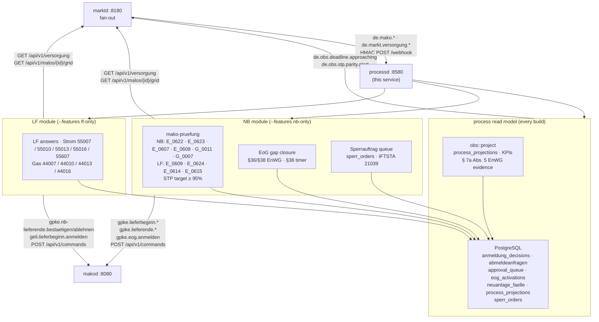
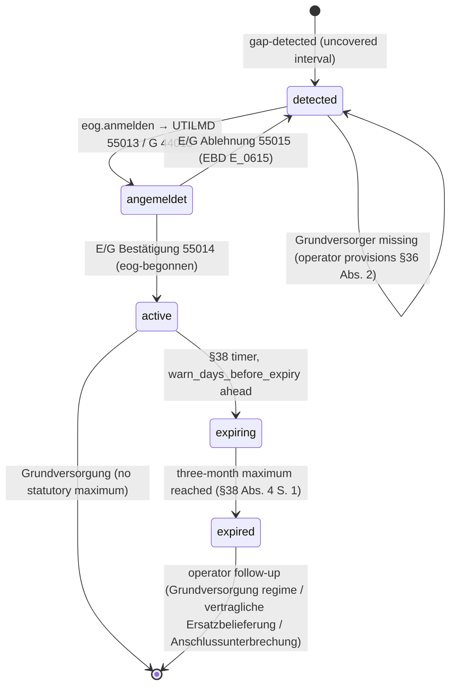
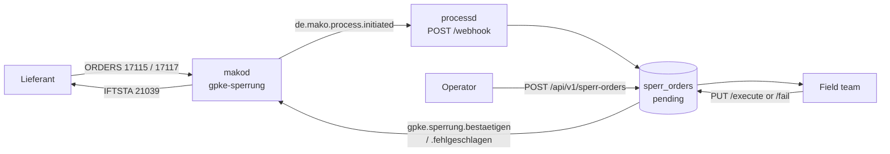

+++
title = "processd Operator Guide"
description = "Operator guide for processd, the process decision engine: NB Anmeldung straight-through processing, LF and MSB answers, the process read model with its KPIs and § 7a Abs. 5 EnWG evidence, the NB Sperrauftrag queue, role-gated binaries and Cedar ABAC."
weight = 23
+++
`processd` is the **process decision engine**. It receives the market messages
its operator must answer, walks the published
[EBD](@/docs/architecture/domain-model.md#ebd-entscheidungsbaumdiagramm)
(Entscheidungsbaum) for the message's
[PID](@/docs/architecture/domain-model.md#prufidentifikator-pid), dispatches the
answer through [`makod`](@/docs/services/makod.md) before the
[Frist](@/docs/architecture/domain-model.md#frist-and-werktag), and queues
whatever the tree cannot decide for an operator. Beside the decisions it keeps
the [process read model](#process-read-model) — one row per process, its
Antwortfrist, the per-PID KPIs and the § 7a Abs. 5 EnWG Gleichbehandlung
evidence — and, in an NB build, the
[Sperr-/Entsperrauftrag queue](#sperr-entsperrauftrag-queue-nb-role). Terms are defined in the
[glossary](@/docs/architecture/domain-model.md#glossary); which PID belongs to
which process is the [process map](@/docs/reference/processes.md).



---

## Role isolation

Feature flags select which decision paths compile in, so a deployment carries
only the answers its Marktrolle gives and an `nb-only` binary cannot answer as
an LF:

```toml
[features]
role-lf-strom  = ["mako-pruefung/role-lf"]  # LF answers 55007/55010/55013/55016/55607
role-lf-gas    = ["mako-pruefung/role-lf"]  # LF Gas 44007 / 44010 / 44013 / 44016
role-nb-strom  = ["mako-pruefung/role-nb"]  # GPKE STP (55001, 55077, 55004, 55600/55601), EoG closure
role-nb-gas    = ["mako-pruefung/role-nb"]  # GeLi Gas An-/Abmeldung STP (44001, 44004)
role-msb       = ["mako-pruefung/role-msb"]   # REQOTE→QUOTES, §14a ORDRSP, MSB-answered MSB-Wechsel,
                                             # ESA Wertebestellung (35003/17007/17008/39002)

lf-only    = ["role-lf-strom", "role-lf-gas"]
nb-only    = ["role-nb-strom", "role-nb-gas"]
msb-only   = ["role-msb"]
integrated = ["role-lf-strom", "role-lf-gas", "role-nb-strom", "role-nb-gas", "role-msb"]
```

The NB queue routes stay mounted in a build without an NB role, so the Cedar
decision is still the first answer; past it they answer `501 Not Implemented` —
the build does not serve them, and a retry against it cannot succeed.

The flags gate handlers, not linked code: `mako-gpke`, `mako-geli-gas` and
`mako-wim` are unconditional dependencies. A role build cannot answer as a role
it was not built for; the §§ 6a/7/7a EnWG separation is a matter of the legal
entity and of access control, not of the binary.

PID 55016 „Kündigung" is an LF process: LFN → LFA, answered 55017/55018 under
`E_0614` (*Anwendungsübersicht der Prüfidentifikatoren 4.0*, lfd. Nr. 20030).

---

## Routes and authorization

Every REST route takes the `Claims` extractor and evaluates one
[Cedar](https://cedarpolicy.com) action against
`services/processd/policies/processd.cedar`. There is no global auth
middleware; `tests/it/authorization_guard.rs` checks every mounted route for a
`Claims` extractor and an authorization call, and holds the action sets of code
and policy to each other in both directions.

| Route | Cedar action | Granted to |
|---|---|---|
| `POST /webhook` | — (marktd HMAC signature + timestamp) | marktd |
| `GET /api/v1/decisions` | `read-decisions` | any caller of the tenant |
| `GET /api/v1/queue` | `read-queue` | any caller of the tenant |
| `GET /api/v1/eog` | `read-eog` | any caller of the tenant |
| `GET /api/v1/neuanlage` | `read-neuanlage` | any caller of the tenant |
| `POST /api/v1/queue/{id}/approve` · `/reject` | `decide-queue` | `NB`, `LF` or `MSB` |
| `PUT /api/v1/neuanlage/{id}/identifikation` | `identify-neuanlage` | `NB` |
| `POST /api/v1/start-supply[-gas]` · `end-supply[-gas]` | `initiate-supply` | `LF` |
| `GET /obs/processes` · `/obs/processes/{id}` | `read-process` | any caller of the tenant |
| `GET /obs/kpis` · `GET /api/v1/audit/gleichbehandlung` | `read-kpi` | any caller of the tenant |
| `GET /obs/overdue` | `read-overdue` | any caller of the tenant |
| `POST /api/v1/obs/rebuild` | `rebuild-projection` | `ADMIN` |
| `GET /obs/metrics` | — (restrict at the ingress) | scraper |
| `GET /api/v1/sperr-orders` · `/{id}` · `/stats` | `read-sperr-order` | `NB` |
| `POST /api/v1/sperr-orders` | `create-sperr-order` | `NB` |
| `PUT /api/v1/sperr-orders/{id}/execute` · `/fail` | `execute-sperr-order` | `NB` |
| `PUT /api/v1/sperr-orders/{id}/cancel` | `cancel-sperr-order` | `NB` |
| `POST`/`GET /mcp` | `use-mcp`, then a per-tool action | any caller of the tenant |

Roles come from the `mako_roles` JWT claim, the tenant from `mako_tenant`, which
must equal the deployment's own. The runner adds `/health/live`,
`/health/ready` and `/metrics`.

`processd` refuses to start without `[oidc]` and without `[webhook]
inbound_secret`, and with a `[sperr] erp_webhook_url` but no `erp_hmac_secret`;
the refusal names each missing one. `allow_insecure_no_auth =
true` accepts both, for local development (`just dev processd` reads
`dev/config/processd.toml`).

---

## NB module — Anmeldung STP

### Decision pipeline (`nb_module.rs`)

```text
de.mako.process.initiated
  ├─ Anmeldung (55001 verb. MaLo / 55077 erz. MaLo / 44001 Gas)
  │    → GET marktd /api/v1/versorgung/{malo_id}       → VersorgungsStatus
  │    → GET marktd /api/v1/malos/{malo_id}/grid       → MaloGridRecord
  │    → GET marktd /api/v1/partners/{lf_mp_id}        → partner_known
  │    → mako_pruefung::evaluate(…)             ← E_0622 / E_3005, the Vorprüfung
  │    → mako_pruefung::evaluate_lieferbeginn(…) ← E_0623 / E_3007, what is answered
  └─ Abmeldung (55004 Strom / 44004 Gas)
       → GET marktd /api/v1/versorgung/{malo_id}       → VersorgungsStatus
       → mako_pruefung::evaluate_abmeldung(…)

  Accept   → anmeldung_decisions(Accept, Zustimmungscode)
             [if auto_accept] → makod …bestaetigen (antwort_code, antwort_ebd)
             else             → approval_queue
  Reject   → anmeldung_decisions(Reject, Antwortcode)
             → makod …ablehnen (antwort_code, antwort_ebd, bemerkung)
  Escalate → anmeldung_decisions(Escalate) → approval_queue
  AnfrageErforderlich
           → INSERT abmeldeanfragen (the waiting AnmeldungAnfrage)
           → makod gpke.beendigung-zuordnung.anfragen  → UTILMD 55010 to the LFA
             …09:00 Uhr des 1. WT, or the LFA answers 55011/55012…
de.mako.abmeldeanfrage.beantwortet
           → take abmeldeanfragen → mako_pruefung::evaluate_lieferbeginn(…)
           → the Accept / Reject / Escalate paths above
```

**Two trees, and on an assigned Marktlokation two phases.** `E_0622` is a
Vorprüfung: surviving it means only that the Anmeldung is not directly
refusable. If the Marktlokation is assigned at the Zuordnungsbeginn, the NB owes
the incumbent LFA an Anfrage zur Beendigung der Zuordnung (55010) before
answering the LFN, because `E_0623` Prüfschritte 20–50 read that answer (GPKE
Teil 2 § 2.1.2 SD Lieferbeginn Nr. 1 Prüfschritt 4, Nr. 3).

The waiting `AnmeldungAnfrage` is written to `abmeldeanfragen` **before** the
Anfrage goes out, so a fast loopback answer always finds it; phase two replays
the same pure evaluation with one more fact. Resolution is a single
`UPDATE … WHERE resolved_at IS NULL`, so of the LFA's answer and the 09:00 lapse
exactly one answers the LFN.

**Silence releases the Marktlokation.** „Verstreicht die Frist, ohne dass eine
Antwort beim NB eingeht, gilt dies als Bestätigung nach Fall a)." A Widerspruch
other than `A30` / `A41` refuses the Anmeldung with `E_0623` `A50` / `A57`
(`Z35` in Gas). Those two codes need a second `SG4 STS+Z35` restating the LFA's
`E_0624` code (GPKE Teil 2 § 2.1.2 Nr. 6); `processd` puts it on the `ablehnen`
command and `makod` refuses to render the message without it.

**Geschäftsvorfall.** On 55077/55078 `SG4 STS+7` DE 9013 element 3 carries
`ZW0` (ganze Marktlokation), `ZW1` (bestehende Tranche) or `ZW2` (neu zu bildende
Tranche); `E_0622` Prüfschritte 300/310 branch on it, and a message carrying
none escalates. Geschäftsvorfall 3 asks **all** Tranchen-LFA and decides on
arithmetic (Prüfschritte 500–540): at least one release (`A53`), enough
percentage (`A54`), and whether a residual share would stay in the NB's own
Bilanzkreis on a direktvermarktungspflichtige Marktlokation (`A55` / `A56`).

| Geschäftsvorfall-3 detail | Behaviour |
|---|---|
| Direktvermarktungspflicht (Prüfschritt 540) | From `einsd` — installed capacity against the 100-kW ceiling of §21 Abs. 1 Satz 1 Nr. 1 EEG; §20 Satz 1 Nr. 3 EEG pays the Marktprämie only from a pure EE-Bilanzkreis. No register answer → escalate |
| The registered share | `SG8` Produkt-Code `9991000002090`, Produkteigenschaft „prozentuale Aufteilung" (Muss on GV 3). An Aufteilungsfaktor or Aufteilung auf Technische Ressourcen escalates |
| Answers | One per Tranchen-LFA before deciding; a lapsed 09:00 Frist resolves whatever is outstanding as Zustimmung; an LFA code `E_0624` does not publish escalates |

**Three trees, three alphabets.** Strom splits into two branches that share no
Antwortcode, and Gas answers from a different Codeliste:

| Anwendungsfall | Tree | „andere Anmeldung in Bearbeitung" | Fristüberschreitung | Zustimmung |
|---|---|---|---|---|
| Strom, verbrauchende / ruhende MaLo | `E_0622` 15–70 | `A06` | `A07` | `A51` (`E_0623`) |
| Strom, erzeugende MaLo / Tranche | `E_0622` 220–830 | `A45` | `A34`/`A28`/`A29`/`A30`/`A32`/`A35`/`A44` | `A58` (`E_0623`) |
| Gas | `E_3005` / `G_0011` | `ZC5` | `E17` | `E15` (`G_0012`) |
| Abmeldung Strom, verbrauchende / ruhende MaLo | `E_0607` 10–140 | — | `A02` | `A11` |
| Abmeldung Strom, erzeugende MaLo / Tranche | `E_0607` 500–620 | — | `A22` (`A21` Datum) | `A27` |
| Abmeldung Gas | `E_3019` / `G_0007` | — | `E17` | `E15` |

Every code is resolved through `mako_pruefung::codes` against the tree that
publishes it; `RejectReason` can only be built from a resolved entry, and
`makod` re-checks it at the command boundary, where the code's **Cluster**
decides the response PID. A Bestätigung carries a code too (`SG4 STS+E01` is
Muss), so `NbEntscheidung::Accept` carries `A51` / `A58` / `E15`.

### `mako_pruefung::nb::evaluate` — the Anmeldung

**Strom, verbrauchende / ruhende Marktlokation** (`E_0622` Prüfschritte 15–70):

| Prüfschritt | Rule | On failure |
|---|------|------------|
| — | `MaloGridRecord` exists for the MaLo | `Escalate` (a data gap, not a ground to refuse) |
| 15 | Vorlauffrist — one full Werktag between receipt and Zuordnungsbeginn (LFW24, all Transaktionsgründe) | `Reject A07` |
| 30 | MaLo participates in MaKo | `Reject A02` |
| 60 | Zuordnungsermächtigung: Bilanzierungsgebiet matches, LF in the partner directory | `Reject A05` |
| 70 | No other Anmeldung in Bearbeitung | `Reject A06` |

A **ruhende** Marktlokation is not refused: Prüfschritt 30's Hinweis names only
stillgelegte Marktlokationen and the Modell-2-Zuordnung.

**Strom, erzeugende Marktlokation** (Prüfschritte 220–830) uses `A45` / `A25`
for the same two questions, then picks one of the **six** Vorlauffristen of
GPKE Teil 2 § 2.1.1, keyed on `(Geschäftsvorfall, bestehende, angemeldete
Veräußerungsform)`. The angemeldete one is `SG10 CCI+Z22`; the bestehende one
and the Ausfallvergütung flag come from `einsd`
(`GET /api/v1/anlagen/by-malo/{malo_id}/veraeusserungsform`, `[nb] einsd_url`),
because wire code `Z90` covers both Einspeisevergütung and Ausfallvergütung,
whose Fristen differ. A missing fact escalates; a `CCI+Z22` code outside the
published four is dropped at ingest with a warning. The Monatserster rule rests
on **§ 21b Abs. 1 Satz 2 EEG 2023**.

**Gas** (`G_0011`) runs the `A03`/`A04`/`A16`/`A17` identification checks
first, then `E17` Fristüberschreitung, `E13` Bilanzierungsproblem and `ZC5` /
`Z08` for a conflicting or duplicate Anmeldung.

### `mako_pruefung::nb::evaluate_neuanlage` — the Neuanlage, `E_0608`

Inbound **55600** / **55601** register a Marktlokation commissioned for the
first time. Prüfschritte 110 / 590 loop: a Marktlokation the NB cannot yet
identify is re-checked **daily for 60 Werktage** and only then refused `A07` /
`A16`. `processd` keeps the case log `neuanlage_faelle` and a daily worker:

| Endpoint | Purpose |
|---|---|
| `GET /api/v1/neuanlage?status=offen` | The Prüflauf view, with `letzter_pruefungstag` (a refusal is admissible only after it) and the `pruefungen` count |
| `PUT /api/v1/neuanlage/{id}/identifikation` | The MaLo-ID the NB matched from its NIS/GIS; the next pass walks the tree with it |

The branches share no code (`A01`–`A09` verbrauchend, `A10`–`A19` erzeugend).
The Vorlauffrist is measured against the Übertragungstag (GPKE Teil 1 Kap. 7
„Fristenberechnung", S. 27) — processd reads it as the Berlin day of the
CloudEvent `time`, which `makod` stamps when it records the process in the
request that received the message — and never against the moment processd
evaluates. An Anmeldung received at 23:40 and evaluated after
midnight keeps its Werktag, the Abmeldung (`E_0607`) is judged the same way,
and a re-evaluation on day 40 reaches the verdict of day one.

### `mako_pruefung::nb::evaluate_abmeldung` — the Abmeldung, `E_0607` / `E_3019`

Inbound **55004** / **44004**, answered 55005/55006 (44005/44006). Strom splits
into two branches that share no Antwortcode:

| Prüfschritt | Rule | verbrauchend / ruhend | erzeugend |
|---|---|---|---|
| — | MaLo known to this NB, and the LF holds an assignment or a Lieferende at this date is already settled | `Escalate` | `Escalate` |
| 50 / 500+520 | Vorlauffrist — verbrauchend: one full Werktag; erzeugend: Monatserster (`A21`) one month ahead (`A22`), § 21b Abs. 1 EEG 2023 | `A02` | `A21` / `A22` |
| 90 / 570 | Aufhebung einer zukünftigen Zuordnung (`ZH2`) nennt den bestätigten Zeitpunkt | `A06` | `A23` |
| 80 | `Z41` „Ende der ESV ohne Folgelieferung" setzt eine E/G voraus, die innerhalb von 3 Monaten vor dem Endezeitpunkt begann | `A05` | — |
| 100–130 / 580–610 | Kein bereits bestätigtes Lieferende zum selben Datum | `A09` | `A25` |
| 140 / 620 | — | Zustimmung `A11` | Zustimmung `A27` |

Gas (`G_0007`) has one code space: `E17` Vorlauffrist, `Z08` bereits bestätigt,
`E15` Zustimmung.

Not decided automatically: Prüfschritte 10–30 (Kundenanlagen-Herauslösung, § 20
Abs. 1d EnWG / § 10c EEG) need a fact the projection does not record, so `A01`
is unreachable; Prüfschritt 130 / 610 asks about an earlier message's
Transaktionsgrund and escalates. Escalation is the § 20 Abs. 1 Satz 1
EnWG-safe direction: an unfounded Ablehnung binds a customer to a supplier they
have left.

### STP rate and `[nb] auto_accept`

The target is ≥ 95 % straight-through processing on a verbrauchende Anmeldung.
A missing `malo_grid` record escalates; provision grid records (the NB's own
topology, not MaStR) via marktd's NB-role `PUT /api/v1/malos/{malo_id}/grid`.
An erzeugende Marktlokation additionally needs `[nb] einsd_url`; without it
every 55077 escalates. Monitor via `GET /api/v1/decisions` or `get_stp_rate`.

Keep `auto_accept = false` (the default; `PROCESSD_NB__AUTO_ACCEPT`) until grid
records cover the portfolio, the partner directory holds every expected LF
MP-ID, and one manual review cycle confirmed the codes.

### Affiliate guard — § 20 Abs. 1 Satz 1 EnWG

In a vertically integrated NB+LF utility, auto-acceptance is **always blocked**
for An- and Abmeldungen from the operator's own LF:

```text
initiating LF MP-ID == [identity] own_mp_id  →  initiator_is_affiliate = true
                                                auto_accept overridden to false
                                                → approval_queue (operator review)
```

`[identity] own_mp_id` must match makod's primary party. Startup logs the coding
authority derived from it (293 = BDEW, 332 = DVGW) and warns on a GS1 GLN. The
flag lands on every `anmeldung_decisions` row and on the read model's
`ProcessProjection`; see [the Gleichbehandlung parity report](#ss-7a-abs-5-enwg-gleichbehandlung-parity).

### Selbstzahler — the Lieferantenwechsel carve-out

GPKE Teil 1 (BK6-24-174 Anlage 1a), Vorbemerkung: „Ist der Letztverbraucher selbst
Netznutzer, so tritt er in die Rolle des Lieferanten i.S. dieser Prozessbeschreibung
[…]. **Eine Ausnahme bilden die Meldungen des Lieferanten im Rahmen des
Lieferantenwechsels.**"

`processd` reads the Netznutzungsvertrag in force the day before the requested
Zuordnungsbeginn (`GET /api/v1/nb-contracts/by-malo/{malo_id}?on=`) and holds
the decision for the operator when it displaces a Selbstzahler:

```text
transaktionsgrund == "E03" (Wechsel)
  ∧ incumbent netznutzer_typ == LETZTVERBRAUCHER
  → approval_queue (operator review), Antwortfrist attached
```

An Einzug (`E01`, `E02`) stays automated and skips the lookup.

---

## NB module — EoG gap closure (§36/§38 EnWG)

Every consuming Marktlokation must be assigned to a Bilanzkreis at all times
(GPKE Teil 2 Kap. 2.3). The EoG module closes supply gaps:

```
de.markt.versorgung.gap-detected           (marktd: an interval no supplier
  │                                         covers — a Lieferende the successor
  │                                         does not follow on, or a Fall-b
  │                                         Bestätigung 55002/55078/44002)
  ├─ record case in eog_activations         (idempotent per MaLo)
  ├─ [eog.auto_activate] GET /api/v1/grundversorger/{nb_mp_id}?sparte=…
  │    └─ found → Strom: gpke.eog.anmelden → UTILMD 55013;
  │             Gas:   geli.eog.anmelden → UTILMD G 44013 → makod → E/G
  │       (Zuordnungsbeginn = day after Lieferende — retroactive allowed)
  │    └─ missing → case stays `detected`; operator provisions the
  │       §36 Abs. 2 Feststellung and re-triggers
  └─ de.markt.versorgung.eog-begonnen → case `active`
       (eog_art = Ersatz-/Grundversorgung as classified by the E/G in 55014;
        eog_seit = Zuordnungsbeginn)
```



A daily worker enforces the three-month maximum (§38 Abs. 4 S. 1 EnWG, calendar
months from `eog_seit`): `warn_days_before_expiry` ahead the case turns
`expiring`, at expiry `expired`; both emit
`de.markt.versorgung.ersatz-auslaufend` to `[eog] notify_webhook_url`. After
expiry, Haushaltskunden pass into Grundversorgung without a market message;
otherwise the NB secures the Bilanzkreis (vertragliche Ersatzbelieferung, STS
`E06`) or interrupts the Anschlussnutzung. Cases are listed by
`GET /api/v1/eog?status=detected|angemeldet|active|expiring|expired`.

---

## LF module — answering what the market asks a supplier

| Sparte | Inbound | Process | EBD | Answers | Frist |
|---|---|---|---|---|---|
| Strom | 55007 | Lieferende von NB an LF | `E_0609` | 55008 / 55009 | 05:00 Uhr des 1. WT nach dem ÜT |
| Strom | 55010 | Beendigung der Zuordnung | `E_0624` | 55011 / 55012 | 09:00 Uhr des 1. WT nach dem ÜT |
| Strom | 55013 | Anmeldung E/G (§ 36 / § 38 EnWG) | `E_0615` | 55014 / 55015 | **15:00 Uhr am ÜT**, sonst 15:00 Uhr des 1. WT |
| Strom | 55016 | Kündigung (LFN → LFA) | `E_0614` | 55017 / 55018 | Ablauf des 1. WT nach dem ÜT |
| Strom | 55607 | Ankündigung Zuordnung LF (erz. MaLo / Tranche) | `E_0603`–`E_0606` | 55608 / 55609 | **15:00 Uhr am ÜT**, sonst 15:00 Uhr des 1. WT |
| Gas | 44007 | Lieferende von NB an LF | `E_3002` | 44008 / 44009 | Ablauf des 3. WT |
| Gas | 44010 | Beendigung der Zuordnung | `E_3020` | 44011 / 44012 | Ablauf des 3. WT |
| Gas | 44013 | Anmeldung E/G | `E_3008` | 44014 / 44015 | Ablauf des 2. WT |
| Gas | 44016 | Kündigung beim Altlieferanten | `E_3001` | 44017 / 44018 | Ablauf des 3. WT |

For the two „am ÜT" rows GPKE Teil 2 (§ 2.3.2.2 resp. § 2.4.2.2) states two
windows depending on whether the Zuordnungsbeginn lies in the future.
`mako-fristen` publishes the same-day instant, rolling to 15:00 on the next
Werktag when that instant is already past, after the cut-off or on a
non-Werktag.

The same process carries the same command name in both Sparten —
`{gpke,geli}.nb-lieferende.*`, `{gpke,geli}.beendigung-zuordnung.*`,
`{gpke,geli}.kuendigung.*`.

### How a decision is made

```
de.mako.process.initiated (an answerable PID)
  → LfAnfrage from the CloudEvent — Transaktionsgrund and its Ergänzung
    (ZW3/ZW4/ZW5/ZAP, which selects the tree's branch), Termin, ÜT
  → LfVertragslage from marktd (supply state) + vertragd (contract state)
  → pruefe_*(…)
      Antwort    → makod command carrying the Antwortcode and its EBD
      Eskalation → approval_queue, naming the Prüfschritt it stopped at
```

The Antwortcode's **Cluster** selects the answer PID: `A36` „Vertragsverhältnis
wurde beendet" rides 55011, `A35` „Es besteht eine Vertragsbindung" 55012.

Two facts come from the message itself:

- **Object of the Vorgang** — `SG4 STS+7` DE 9013 element 3: `ZW3` erzeugende,
  `ZW4` verbrauchende, `ZW5` Tranche, `ZAP` ruhende Marktlokation. The halves
  of `E_0609` and `E_0624` answer from different code ranges, so a missing
  Ergänzung escalates. The same element carries `ZW0`–`ZW2` on a 55077 and
  `ZW8`–`ZX1` on a 55607; the PID decides which code space applies.
- **Vorlauffrist** (`E_0609` Prüfschritt 40, `E_3002` `E17`) —
  `mako_fristen::abmeldung` per GPKE Teil 2 § 2.5.2 Nr. 1: a calendar month for
  EEG-Marktlokationen, the day before the last Werktag otherwise. An erzeugende
  Marktlokation escalates unless the deployment can say which applies.

**55607: silence is not a lapse.** GPKE Teil 2 § 2.4.2.2 Nr. 3 has the NB assign
the supplier „aufgrund fehlender Antwort" with the Bilanzkreis on file. The
substance of the answer is that Bilanzkreis (`A01` / `A99` are the only codes).
UTILMD AHB Strom 2.2 Bedingungen [161]–[164] map `ZW8`–`ZX1` onto
`E_0603`–`E_0606`. The BK rides `SG8 SEQ+Z79`, Produkt-Code `9991000002082`,
Merkmalswert in `SG10 CAV+ZV4` (the AHB admits `SG4 FTX+ACB` on the 55609
only, Bedingung [48]). `[[lf.bilanzkreise]]` is keyed on the
Bilanzierungsgebiet because MaBiS § 10.2.1 grants the Zuordnungsermächtigung
„je ZRT, BG, BK und LF"; several BKs for one regime are an operator choice.

### Contract facts

| Prüfschritt | Question | Source |
|---|---|---|
| `E_0624` 5 | Ging die Anfrage bis 07:00 Uhr des nächsten WT ein? | `SG4 DTM+154` on the message |
| `E_0624` 20 | Besteht zum Folgetag noch eine Zuordnung? | `marktd` |
| `E_0624` 50 | Ist der Kunde aus der Anfrage identisch mit dem Kunden beim LFA? | `SG12 NAD+Z09`, compared by `vertragd` |
| `E_0624` 60 | Hat der LFA Informationen, dass sein Kunde nicht ausgezogen ist? | `vertragd` |
| `E_0624` 90 / 220 | Bleibt das Vertragsverhältnis zum Folgetag bestehen? | `vertragd` — `kuendigung_zum` **and** `vertragsende`, whichever cuts first |
| `E_0614` 40 / 50 / 80 | Wurde der Vertrag bereits gekündigt, und zu welchem Datum? | `vertragd` — `kuendigung_zum` **only** |
| `E_0614` 70 / 580 | Ist der Vertrag zum Kündigungstermin kündbar? | `vertragd` — `naechstmoeglicher_kuendigungstermin ≤ Termin` |
| `E_0614` 500 | Liegt zu dem genannten Objekt ein Vertrag vor? | `vertragd` — a contract row |
| `E_0609` 40 | Wurde die Vorlauffrist eingehalten? | `mako-fristen` |
| `E_0615` 20 | Liegt die MaLo im Grundversorgungsgebiet des Empfängers? | `[lf] grundversorgungs_netzgebiete` |

Prüfschritt 50 compares names, not strings: `processd` forwards `NAD+Z09` as
`?kunde=` and `vertragd` matches token sets; a shared Nachname alone is
`Unklar` and escalates (see [vertragd](@/docs/services/vertragd.md)). Without
`[vertragd] url` every contract fact is `Bekannt::Unbekannt` and a decision
reaching one escalates. `auto_respond = false` means an operator decides: the
walk still runs and its outcome is queued with the Antwortfrist.

### The E/G Anmeldung has its own switch

`E_0615` / `E_3008` is the only Anmeldung whose Zustimmung accepts a statutory
duty (§ 36 / § 38 EnWG), so dispatch needs `[lf] eog_auto_respond = true` on
top of `auto_respond`. An empty `grundversorgungs_netzgebiete` escalates every
55013 / 44013. A Zustimmung also needs the Versorgungsart (`SG10 CCI+Z36`:
`ZC9`, `ZD0`, `ZE3`) from `[lf] eog_versorgungsart` and the Bilanzkreis from
`[[lf.bilanzkreise]]`; missing either, the answer is queued with the field
named.

### Approval queue

The queue is shared by every compiled role. Each entry stores the `makod`
command for approve and for reject, resolved at enqueue, and the bodies:

| Entry | Approve sends | Reject sends |
|---|---|---|
| A held decision (`auto_accept` / `auto_respond` off, a § 20 EnWG affiliate, a Selbstzahler) | the answer the automatic path would have sent, **frozen** at enqueue (`answer_payload`) | the other command, with the operator's Antwortcode |
| An escalation | the operator's answer | the operator's answer |

What an answer is addressed by (the MeLo of a WiM order, the `tx_id` of a § 14a
Steuerungsauftrag, the location and Messprodukt of an ESA order) is frozen on
both (`answer_payload`, `reject_payload`). The operator states the rest:

```json
{ "antwort_code": "A01", "antwort_tree": "E_0622", "antwort_codeliste": "E_0622", "bemerkung": "…" }
```

The body is optional and refuses unknown keys. A field the frozen answer
already holds cannot be replaced (`422`): an approval sends the answer that was
shown. Every queueable command has an answer contract (`ANSWER_CONTRACTS` in
`src/pg/approval.rs`) naming the fields `makod` needs; a decision missing one is
`422` with the claim released, before anything is sent. `cargo xtask
check-approval-commands` refuses an enqueue site naming a command without a
contract. The ESA Werteanfrage dispatches its refusal only; its Angebot needs
prices and OBIS-Kennzahlen (QUOTES AHB 1.1a §4.3) and goes through the `makod`
command API.

`expires_at` is the business Frist from `mako_fristen::antwort` less one hour:

| Trigger | Frist | Source |
|---|---|---|
| GPKE Anmeldung 55001 / 55077 | 11:00 Uhr des 1. WT nach dem ÜT | BK6-24-174 Teil 2, SD Lieferbeginn 5/6 |
| GPKE Abmeldung 55004 | 06:00 Uhr des 1. WT nach dem ÜT | BK6-24-174 Teil 2, SD Lieferende von LF an NB 2/3 |
| GPKE LF answer 55007 | 05:00 Uhr des 1. WT nach dem ÜT | BK6-24-174 Teil 2, SD Lieferende von NB an LF 2 |
| GPKE LFA answer 55010 | 09:00 Uhr des 1. WT nach dem ÜT | BK6-24-174 Teil 2, SD Lieferbeginn 4 |
| GPKE LFA answer 55016 | Ablauf des 1. WT nach dem ÜT | BK6-24-174 Teil 2, SD Kündigung 2 |
| GeLi Gas LF answer 44007 | Ablauf des 3. WT | AWH GeLi Gas 2.0 Kap. 2.3.2 Nr. 2 |
| GeLi Gas LFA answer 44010 | Ablauf des 3. WT | AWH GeLi Gas 2.0 Kap. 2.5.2 Nr. 4 |
| GeLi Gas LFA answer 44016 | Ablauf des 3. WT | GeLi Gas 3.0 Kap. 3.1 |
| GeLi Gas Anmeldung 44001 | Ablauf des 4. WT nach Eingang | BK7-24-01-009 Kap. 3.2.3 |
| GeLi Gas Abmeldung 44004 | Ablauf des 3. WT nach Eingang | BK7-24-01-009 Kap. 3.2.2 |
| WiM MSB-Wechsel 55039 / 55042 / 55051 / 55168 | 3 / 5 / 7 / 1 WT | WiM Strom Teil 1 |
| GPKE Neuanlage 55600 / 55601 | 00:00 Uhr des 61. WT nach dem ÜT | BK6-24-174 Teil 2 § 2.2.2 (60 WT täglicher Prüflauf, `E_0608`) |
| GPKE Sperr-/Entsperrauftrag 17115 / 17117 / 39000 | spätester ÜT ist der 1. WT nach dem ÜT | BK6-24-174 Teil 2 §§ 3.5.1.2 / 3.5.2.2 / 3.5.3.2 Nr. 2 |
| GPKE Anfrage Sperrung an den MSB 17116 | 3. WT nach dem ÜT — Fristverstreichen gilt als Zustimmung | BK6-24-174 Teil 2 § 3.5.1.2 Nr. 4 |
| GPKE Teil 4 Stammdaten-Rückmeldung 55109 / 55230 / 55557 / 55639–55643 / 55693 | 2. WT nach dem ÜT | BK6-22-024 Anlage 1d (GPKE Teil 4) §§ 1.4.3 / 1.4.4 Nr. 2 |
| GPKE Teil 2 Bearbeitungsstand Abrechnungsdaten 55156 / 55220 / 55673 | 2. WT nach dem ÜT | BK6-24-174 Teil 2 §§ 3.1.1.2 / 3.1.2.2 / 3.1.3.2 |

The 45-minute APERAK window is a separate clock, owned by `makod`.

```
GET  /api/v1/queue                → list Pending entries (review before expires_at)
POST /api/v1/queue/{id}/approve   → dispatch the approve command via makod, mark Approved
POST /api/v1/queue/{id}/reject    → dispatch the reject command via makod, mark Rejected
```

The handlers **claim** the entry (`status = 'Pending'` guard) before
dispatching and release the claim if the body is incomplete or the dispatch
fails, so a decided entry never re-sends and two operators cannot send both
answers. `decided_by` records the deciding principal's `sub`. A task running
every 60 s marks stale entries `Expired`; expired entries log a `WARN` and are
reconciled manually.

---

## LF module — LFN bootstrap

### Strom: `POST /api/v1/start-supply`

Initiates a GPKE Lieferbeginn (UTILMD 55001) with LFW24 Vorlauffrist validation.

```bash
curl -X POST http://processd:8580/api/v1/start-supply \
  -H "Authorization: Bearer <token>" \
  -H "Content-Type: application/json" \
  -d '{"malo_id": "10001234558", "lieferbeginn_datum": "2026-10-01",
       "bilanzkreis": "11XBK-STD-----9"}'
```

| Field | Required | Notes |
|---|---|---|
| `malo_id` | ✓ | 11-digit Strom Marktlokations-ID |
| `lieferbeginn_datum` | ✓ | ISO-8601 date (YYYY-MM-DD) |
| `bilanzkreis` | ✓* | `SG8 SEQ+Z79` Produktpaket, Produkt-Code `9991000002082` |

\* Optional only where `[[lf.bilanzkreise]]` declares exactly one `standard`
entry. UTILMD AHB Strom 2.2 Kap. 5.3 makes the Produktpaket Muss on a 55001, so
a request resolving to none is a `422` with `code` `MISSING_BILANZKREIS`.

Every refusal is the shared problem body — `error`, `detail` (the sentence) and
`code` (the machine-readable reason: `MISSING_MALO_ID`, `MISSING_LIEFERBEGINN`,
`INVALID_DATE`, `RETROACTIVE_DATE`, `VORLAUFFRIST_VIOLATION`, and for Gas
`MISSING_ZAEHLPUNKT`, `MISSING_PROCESS_DATE`). A command `makod` refuses in the
process's current state is a `409`; `makod` failing or unreachable is a `502`
whose body names `upstream` and an `error_id`, never `makod`'s own text.

Vorlauffrist (BK6-24-174 GPKE Teil 2, SD Lieferbeginn Prozessschritt 1):
„Spätester ÜT ist der Tag vor dem letzten WT vor dem Zuordnungsbeginn" —
day-granular, no time-of-day cutoff. The earliest Lieferbeginn is the calendar
day after the next Werktag after today (Berlin date); a date before today is
`RETROACTIVE_DATE`, a date before the earliest `VORLAUFFRIST_VIOLATION`, which
carries `earliest_lieferbeginn` and `berlin_date`. The `202` carries
`vorlauffrist.earliest_allowed` and `vorlauffrist.berlin_date_at_submission`.

### Gas: `POST /api/v1/start-supply-gas`

Initiates a GeLi Gas Lieferbeginn (UTILMD 44001).

```bash
curl -X POST http://processd:8580/api/v1/start-supply-gas \
  -H "Authorization: Bearer <token>" \
  -H "Content-Type: application/json" \
  -d '{
    "malo_id":    "10001234558",
    "zaehlpunkt": "DE00123456789012345678901234567890",
    "process_date": "20261001",
    "bilanzkreis": "9870000000006"
  }'
```

| Field | Required | Notes |
|---|---|---|
| `malo_id` | ✓ | Gas-MaLo-ID — rendered into `SG5 LOC+Z16`; supplied by the ERP |
| `zaehlpunkt` | ✓ | Zählpunktbezeichnung (RFF+Z13) |
| `process_date` | ✓ | Lieferbeginn date (YYYYMMDD, CET/CEST) |
| `bilanzkreis` | ✓* | `SG10 CCI+Z19` DE 7037 (UTILMD AHB Gas 1.2, Muss on 44001) — Gas has no Produktpaket |
| `transaktionsgrund` | — | `E03` Wechsel (default), `E01`/`E02` Einzug |

\* Same fallback as Strom. A Lieferantenwechsel needs **10 WT** Mindestvorlauf
(AWH GeLi Gas 2.0 Kap. 2.5.2 Nr. 1), enforced here; an Einzug passes with a
`vorlauffrist_hinweis`, because the NB corrects the date rather than rejecting
(Kap. 4). The GNB answers 44002 / 44003 by **Ablauf des 4. WT** (Kap. 3.2.3).

`POST /api/v1/end-supply` / `end-supply-gas` take `malo_id` and
`lieferende_datum` and forward `gpke.lieferende.anmelden` /
`geli.lieferende.anmelden`; the notice period is `vertragd`'s to enforce.

### Gas Datenabruf

Abrechnungsbrennwert and Zustandszahl are requested through `makod`'s command
API (`geli.datenabruf.anfragen`, ORDERS 17103, payload `malo_id` and the
required `zeitspanne_bis`): the GNB answers within ten Werktage, but not before
the 10. Werktag of the month after the Zeitspanne ends (GeLi Gas 3.0 Kap. 4.2).
The answer is MSCONS 13007 or ORDRSP 19103; a delivery updates `edmd`
`meter_billing_periods` via `record_gas_quality`.

---

## Process read model

The read model is a module of every role build. Every `de.mako.*` lifecycle
event the one `POST /webhook` receives is projected into one
`process_projections` row per business process **before** any decision module
sees it: the Antwortfrist at risk, the per-PID KPIs and the affiliate parity
are read from that row. A projection write that fails is not acknowledged, so the fan-out redelivers;
every module behind it is idempotent against a redelivery. The **STP rate** of
the read model is completions over the processes that *ended* in the window.

### Two deadline clocks

Every MaKo process carries **two independent deadlines**. The read model
measures the second; the first never reaches it.

| Clock | Window | A breach means | Where it shows |
|---|---|---|---|
| **APERAK Frist** | Strom UTILMD/ORDERS 45 min (Samstag: Sonntag 12:00), other Strom next Werktag 12:00; Gas Folgeprozess next Werktag 12:00, Initialprozess end of the 3. Werktag (APERAK AHB 1.1 §§ 2.3.1 / 2.4.1) | the counterparty's acknowledgement did not arrive — a transport or validation fault | not in the read model: makod raises the delivery-window alert and keeps the message in its outbox |
| **Antwortfrist** | per PID — see below | the *business answer* is owed and has not been sent | `deadline_at`, computed on `process.initiated` |

`state = aperak_timeout` is set by `de.mako.aperak.timeout`, which
`gpke-supplier-change` and `geli-gas-supplier-change` emit when **their
Antwortfrist** lapses unanswered — an Antwortfrist signal raised by the
workflow. `total_aperak_timeout` and `total_frist_breached` are separate fields
on every report; `aperak_timeout` is not terminal, so those processes stay in the
Antwortfrist sweep.

### ProcessProjection

| Field | Description |
|-------|-------------|
| `process_id` | UUID — the CloudEvent `subject` |
| `pid` | BDEW Prüfidentifikator (e.g. 55001) |
| `family` | `gpke`, `wim`, `geli-gas`, `wim-gas`, `gabi-gas`, `mabis`, `emob`, `redispatch`, `invoic-storno`, `unknown` — the Festlegung of the PID's Antwortfrist; a two-Sparten WiM PID by `data.sparte`, else the counterparty's coding authority (`293` / `332`) |
| `workflow_name` | From the `makoworkflow` CE extension |
| `state` | `initiated` \| `running` \| `aperak_timeout` \| `completed` \| `rejected` \| `failed` |
| `malo_id` | 11-digit Marktlokations-ID |
| `partner_mp_id` | MP-ID of the counterparty |
| `mdm_role` | Canonical Marktrolle (`LF`, `NB`, …) |
| `started_at` / `last_event_at` | First and most recent event seen for this process |
| `deadline_at` | The **business Antwortfrist**. `null` = no published window for this PID |
| `deadline_source` | The Festlegung `deadline_at` came from |
| `deadline_risk` | `unknown` \| `green` \| `amber` (< 24 h) \| `red` (past) |
| `erc_code` | BDEW ERC code when `state = rejected` |
| `initiator_is_affiliate` | The Lieferant belongs to this operator's own undertaking |

`completed_at` (not on the wire) is the time the first terminal event carries.
It feeds cycle time and caps the breach test
(`deadline_at < COALESCE(completed_at, now())`), so a process that closed late
counts as breached.

### The Antwortfrist

The read model computes no deadline of its own: `mako-fristen` does, from the
same per-PID table `makod` registers deadlines from and the approval queue is
sized by.

| Family | Window | Source |
|---|---|---|
| GPKE Strom | **a clock time on the 1. Werktag after the ÜT**: 11:00 Anmeldung (55001/55077), 06:00 Abmeldung (55004), 05:00 Lieferende NB→LF (55007), 09:00 Beendigung der Zuordnung (55010); Kündigung 55016 to the end of the 1. WT | BK6-24-174 GPKE Teil 2 |
| GeLi Gas | Ablauf des **4. WT** Anmeldung (44001), **3. WT** Abmeldung (44004), **2. WT** Ersatz-/Grundversorgung (44013), **3. WT** Kündigung (44016) | BK7-24-01-009 Kap. 3.1–3.3 |
| WiM (Strom + Gas) | **3 / 5 / 7 / 1 Werktage** (55039/55042/55051/55168 resp. 44039/44042/44051/44168), to the end of that Werktag in Berlin; REQOTE Preisanfrage 4/5/10 WT je PID; Rechnungsabwicklung 8 WT | BK6-24-174 Anlage 2a Kap. 2.2.2–2.5.2, 3.2.2, 3.3.1.2, 3.6.3 · AWH WiM Gas 2.0 |
| Everything else | `null` — **unknown, never unbounded** | — |

A PID with no published window carries no deadline, is absent from every breach
sweep, and has `deadline_risk = unknown` — never `green`.

### § 7a Abs. 5 EnWG Gleichbehandlung parity

A vertically integrated undertaking's Gleichbehandlungsbeauftragte files a report
with the Bundesnetzagentur **by 31 March** for the preceding calendar year
(§ 7a Abs. 5 EnWG); the read model produces its Lieferantenwechsel evidence. The
underlying duties are **§ 6a EnWG** and **§ 20 Abs. 1 Satz 1 EnWG**.

A process belongs to the calendar year in which it **started, in
Europe/Berlin**: one initiated on 1 January at 00:30 belongs to the new year,
although the stored instant is 31 December 23:30 UTC. The `GET /obs/kpis` month
is bounded by Berlin dates the same way, and grouping by start makes a re-run of
a closed year reproduce it.

The comparison covers the processes the network arm answers for a Lieferant,
derived from the Antwortfrist table (`answered_by == "NB"` in GPKE and GeLi Gas):
55001, 55077, 55004, 44001 and 44004. `initiator_is_affiliate` is set when the
Lieferant's MP-ID (`new_supplier`, else the counterparty) is in
`[identity] own_mp_ids`; list every MP-ID the operator uses, or its affiliate
processes count as third-party.

**`gap_pp = affiliate − third_party`, in percentage points; positive means the
affiliate fared better.** `gap_pp` covers the completion rate, `frist_gap_pp`
the share answered inside the Antwortfrist; both are `null` when either group
has fewer than 10 processes. The Bundesnetzagentur publishes no numeric parity
limit; `[obs] parity_threshold_pp` is the operator's own escalation policy.

```bash
# JSON, for the current year
curl -s "http://processd:8580/api/v1/audit/gleichbehandlung?year=2026" \
  -H "Authorization: Bearer $TOKEN" \
  | jq '.by_pid[] | {pid, process, gap_pp, frist_gap_pp, favours}'

# CSV, for the filing: 15 columns; an unstatable rate is an empty cell
curl -s "http://processd:8580/api/v1/audit/gleichbehandlung?year=2025&format=csv" \
  -H "Authorization: Bearer $TOKEN" > gleichbehandlung-2025.csv
```

### Queries

```bash
curl -s "http://processd:8580/obs/processes?family=gpke&state=initiated&pid=55001" \
  -H "Authorization: Bearer $TOKEN" | jq '.[] | {process_id, started_at, deadline_at}'
curl -s "http://processd:8580/obs/kpis?pid=55001&period=2026-07" -H "Authorization: Bearer $TOKEN"
curl -s "http://processd:8580/obs/overdue" -H "Authorization: Bearer $TOKEN"
```

`state` accepts exactly the six stored spellings; anything else is a `400` naming
them. In a KPI report, check `total_with_frist` before quoting
`frist_compliance_rate`: a small denominator means the bucket is mostly
*unmeasured*. A `null` rate means nothing measurable in the bucket — not `0`, and
not perfect performance.

### Rebuilding from marktd's replay log

The projection is a function of the events `marktd` fanned out, and `marktd`
keeps every envelope in `event_log`. `POST /api/v1/obs/rebuild` (Cedar
`rebuild-projection`, `ADMIN`) pages `marktd` `GET /admin/events` oldest first,
from the beginning of the log to the instant the rebuild started, and hands each
envelope to the projection function the webhook calls — a truncated table
rebuilt this way equals the original row for row. The projection upserts on
`process_id`, so a rebuild over a populated table repairs it, and an interrupted
rebuild is finished by sending it again.

`marktd` serves the log only to a principal holding its `manage-fanout`
action, so the `[marktd] api_key` processd uses must belong to one. A replay
log holding at least a page (5000) of events received at one instant cannot be
paged by arrival time, and the rebuild refuses rather than loops.

### Events produced

Two sweeps produce `de.obs.*` CloudEvents when `[obs] outbound_url` is set (in
production `marktd`'s event ingest), HMAC-signed with `[obs] outbound_secret`:

| Event | When | Consumed by |
|-------|------|-------------|
| `de.obs.deadline.approaching` | an open process has `deadline_at` within `deadline_warn_hours`, or already past it, and has not been alerted (`deadline_alerted_at`) | agentd `deadline-alert-agent` |
| `de.obs.stp.parity.alert` | **either** gap — completion rate or Frist compliance — passes `parity_threshold_pp`, with both groups ≥ 10 processes | agentd `compliance-agent` |

Only a **delivered** alert is stamped, so a downed target cannot consume a
warning; a sweep returning a full batch reports `saturated`.

---

## Sperr-/Entsperrauftrag queue (NB role)

The Sperrauftrag queue is a module of an NB build (`role-nb-strom` /
`role-nb-gas`): the Netzbetreiber's work queue for the physical acts GPKE orders it to perform. An **ORDERS 17115
Sperrauftrag** or **17117 Entsperrauftrag** from a Lieferant becomes a job for
the field team; the outcome goes back as **IFTSTA 21039** (Auftragsstatus
Sperren/Entsperren). Without the IFTSTA the Lieferant's `gpke-sperrung-lf`
process never reaches a terminal state, so the queue retries and reports its
dispatch.



The market inbox queues PIDs 17115 and 17117, keyed on the `makod` process so an
AS4 redelivery does not queue a second disconnection; an operator order has no
`process_id` and owes no IFTSTA. PID **17116** (Anfrage Sperrung, NB → MSB) is
not queued: it is not an order to execute.

| Column | EDIFACT | Meaning |
|---|---|---|
| `order_type` | `BGM+Z51` / `Z52` | Sperrung / Entsperrung |
| `ausfuehrung_am` | `DTM+203` | A **fixed** date the LF requires (hint [533]: a Gerichtsvollzieher may have set it) |
| `fruehestens_am` | `DTM+469` | Execute at the next opportunity, but **not before** this date |
| `arbeitszeit` | `IMD+7081` `Z53`/`Z54` | Entsperrauftrag: within working hours, or also outside |
| `treffpunkt_*` | `SG2 NAD+Z24` | Where the technician goes |
| `hinweis` | `SG29 FTX+ACB` | The LF's free-text hints |

`ausfuehrung_am` and `fruehestens_am` are alternatives (AHB conditions
[55]/[56]), enforced in the API and by a `CHECK`.

### Timing — three clocks, all published

BK6-24-174 GPKE Teil 2 §§ 3.5.1.2 / 3.5.2.2 state three deadlines, counted in
Werktagen on the BDEW-MaKo calendar:

| Clock | Frist | Tracked by |
|---|---|---|
| **ORDRSP** 19116 / 19117 answering the order | „spätester ÜT ist der 1. WT nach dem ÜT" (Prozessschritt 2) | `makod`, from `mako_fristen::antwort` |
| **The physical act** | „…spätestens innerhalb von 6 WT nach dem frühestmöglichen Sperrtermin" (Prozessschritt 1) | `ausfuehrung_faellig_am` |
| **IFTSTA 21039** | „spätester ÜT ist der 1. WT nach dem Abschluss des Sperrauftrags" (Prozessschritt 5) | `iftsta_faellig_am` |

`/stats` reports `overdue_pending` for the Lieferant's own `DTM+203` / `DTM+469`
and `frist_ueberschritten` for the regulatory window; a pending order past its
6 WT is announced once as `de.sperr.ausfuehrung.ueberfaellig`. The
Vorlauffristen the *Lieferant* owes — 6 WT before the frühestmöglicher
Sperrtermin, **12 WT** before a termingebundener one (Prozessschritt 1) — are
recorded as `vorlauffrist_eingehalten` and counted as `vorlauffrist_verletzt`,
never refused: Prozessschritt 2's checks do not include them.

„Der NB führt bis zu zwei Sperrversuche innerhalb eines Sperrauftrags durch"
(Prozessschritt 5): `PUT .../fail` records the first unsuccessful visit and
leaves the order `pending`; the second closes it, as does `endgueltig: true` for a
legal or factual impossibility.

### Reporting the outcome

`PUT /api/v1/sperr-orders/{id}/execute` and `.../fail` **claim the order first**
(`UPDATE … WHERE status = 'pending'`) and only then dispatch, so a concurrent
execute and fail cannot both reach the wire. The IFTSTA carries `SG15 STS` `Z37`
(Sperren) / `Z38` (Entsperren) with `Z14 erfolgreich` or `Z13 gescheitert`, the
EBD Prüfschritt code (`pruefschritt_code`, a **Muss**), and `DTM+293`
Fertigstellungsdatum — Muss on `Z14` and ≤ the document date (condition [495]),
so a future `executed_at` is refused at the API (IFTSTA AHB 2.1 § 7.2).

`204`: recorded, IFTSTA with `makod`. `202`: recorded, dispatch failed, order in
the retry queue — the Lieferant has **not** been told.

A terminal order with `iftsta_dispatched_at IS NULL` has an uninformed
Lieferant. A worker re-sends under the same idempotency key;
`iftsta_next_attempt_at` is both claim lease and backoff, so replicas cannot
double-send. It announces `de.sperr.iftsta.ausstehend` once when the 8 attempts
are spent or `iftsta_faellig_am` has passed. `/stats` reports
`iftsta_outstanding` (in flight), `iftsta_ueberfaellig` (past the 1-WT window)
and `iftsta_stuck` (past the retry budget — **the number that needs a human**).
A stuck dispatch almost always means `makod` has no `gpke-sperrung` process for
that MaLo in `ValidationPassed`; after fixing the cause, reset `iftsta_attempts`.

### Emitted events

All go through the transactional outbox in the transaction of the state change,
delivered to `[sperr] erp_webhook_url`; without it the notices accumulate in
`event_outbox` and startup warns.

| CloudEvent | Emitted when |
|---|---|
| `de.sperr.auftrag.eingegangen` | An order entered the queue, from ORDERS or an operator |
| `de.sperr.ausgefuehrt` | Carried out — IFTSTA `Z14` |
| `de.sperr.versuch.gescheitert` | The **first** Sperrversuch failed and the order stayed `pending` |
| `de.sperr.fehlgeschlagen` | Not carried out — IFTSTA `Z13`, with the Prüfschritt code |
| `de.sperr.storniert` | A pending order was withdrawn; no IFTSTA |
| `de.sperr.ausfuehrung.ueberfaellig` | The 6-WT execution window closed with the order still open |
| `de.sperr.iftsta.ausstehend` | The retry budget is spent **or** the § 3.5.1.2 Nr. 5 Frist has passed, and the LF is still uninformed |

`agentd`'s `sperrd-agent` subscribes to the `de.sperr.*` glob. All four
Sperrauftrag Cedar actions require the `NB` role and a tenant match;
`tests/it/sperr/authorization_guard.rs` fails the build if a handler loses its
`Claims` extractor or Cedar check.

---

## Configuration reference

`processd` reads a TOML file (`PROCESSD_CONFIG`, default `./processd.toml`);
`"env:VAR_NAME"` values defer secrets to the environment, and any key can be
overridden by `PROCESSD_<SECTION>__<KEY>` (e.g. `PROCESSD_DATABASE__URL`).
Unknown keys are refused, and a config error names every offending field.
`cargo test -p processd --test it -- published_config` parses the block below.

### Full `processd.toml` reference

```toml
[http]
addr = "0.0.0.0:8580"          # default

[database]
url       = "env:DATABASE_URL"  # required
pool_size = 10                  # default

[identity]
own_mp_id = "9900357000004"     # required — must match makod.toml [[party]] primary
tenant    = ""                  # optional; defaults to own_mp_id
# Every MP-ID the operator acts under, for the read model's § 7a Abs. 5 EnWG
# affiliate detection: Strom NB (BDEW 99…) + Gas GNB (DVGW 98…). Defaults to
# [own_mp_id].
own_mp_ids = ["9900357000004", "9800357000004"]

[makod]
url     = "http://makod:8080"   # required
api_key = "env:MAKOD_API_KEY"   # required

[marktd]
url     = "http://marktd:8180"  # required
api_key = "env:MARKTD_API_KEY"  # required

# Optional. The LF and MSB modules read contract facts from it; without it
# every contract fact is `Unbekannt` and the decisions asking one escalate.
[vertragd]
url     = "http://vertragd:9780"
api_key = "env:VERTRAGD_API_KEY"

[webhook]
inbound_secret = "env:INBOUND_WEBHOOK_SECRET"   # required unless allow_insecure_no_auth

[subscription]
# Self-registers with marktd on startup (PUT /api/v1/subscriptions/{subscriber_id},
# retried with backoff up to 30 s).
webhook_url   = "http://processd:8580/webhook"  # optional; omit to skip registration
subscriber_id = "processd"                       # default
# One subscription for every module. The default is the union they read;
# leaving one out silently disables the module that consumes it.
event_types = [
  "de.mako.process.initiated",
  "de.mako.process.completed",
  "de.mako.process.failed",
  "de.mako.aperak.accepted",
  "de.mako.aperak.rejected",
  "de.mako.aperak.timeout",
  "de.markt.versorgung.gap-detected",
  "de.markt.versorgung.eog-begonnen",
  "de.markt.versorgung.changed",
]

[nb]
auto_accept              = false  # true → dispatch bestaetigen automatically on Accept
gas_bearbeitungsfrist_wt = 3      # AWH GeLi Gas 2.0 Kap. 2.2
einsd_url                = ""     # EEG-/KWKG-Register; without it every 55077 escalates
einsd_api_key            = ""

[lf]
auto_respond = true   # false → every inbound LF process routed to approval_queue
# NB MP-IDs whose area this supplier is Grund-/Ersatzversorger in (E_0615
# Prüfschritt 20). Empty → every 55013 / 44013 escalates.
grundversorgungs_netzgebiete = ["9900000000001"]
eog_auto_respond = false          # E_0615 / E_3008 dispatch, on top of auto_respond
# SG10 CCI+Z36 on a 55014: ZC9 §38 Ersatzversorgung, ZD0 §36 Grundversorgung,
# ZE3 vertragliche Ersatzbelieferung. Unset → an automatic Zustimmung is queued.
eog_versorgungsart = "ZD0"

# The Bilanzkreise a 55607 Zustimmung (and a start-supply default) may name,
# by Bilanzierungsgebiet and regime. Omit `bilanzierungsgebiet` for the
# fallback row; no table → every 55607 escalates.
[[lf.bilanzkreise]]
bilanzierungsgebiet = "11YN-BG-EON---X"
eeg      = ["11XBK-EEG-----1"]
kwkg     = ["11XBK-KWKG----5"]
standard = ["11XBK-STD-----9"]

[msb]
auto_accept       = false   # true → dispatch the MSB-Wechsel Bestätigung
auto_preisanfrage = true    # false → the REQOTE goes to the approval queue

[esa]                                 # WiM Teil 2 Kap. 4 — the MSB's answers to an ESA
auto_accept                = false    # true → dispatch the E_0256/E_0257/E_0254 Zustimmungscode
auto_reject                = false    # true → dispatch a deterministic Ablehnungscode
accept_after_bindungsfrist = false    # E_0256 Prüfschritt 2 — a commercial decision

[eog]                                     # §36/§38 EnWG gap closure (NB role)
auto_activate             = false         # true → dispatch gpke.eog.anmelden on gap-detected
default_transaktionsgrund = "ZT6"         # SG4 STS DE9013 for automatic Anmeldungen
warn_days_before_expiry   = 14            # §38 Abs. 4 3-month warning lead
# notify_webhook_url      = "https://erp.example/hooks/eog"   # ersatz-auslaufend CloudEvents
# notify_webhook_secret   = "env:EOG_WEBHOOK_SECRET"

[obs]                               # the process read model's de.obs.* producers
# Target for de.obs.deadline.approaching and de.obs.stp.parity.alert, in
# production marktd's event ingest; omit to disable both sweeps.
outbound_url        = "http://marktd:8180/api/v1/mako/events"
outbound_secret     = "env:PROCESSD_OBS_OUTBOUND_SECRET"  # HMAC; the target's inbound secret
deadline_sweep_secs = 900     # default
deadline_warn_hours = 24      # alert when an Antwortfrist is within this many hours
parity_sweep_secs   = 86400   # default
parity_threshold_pp = 5.0     # the operator's own escalation threshold, not a regulatory one
parity_window_days  = 90      # parity look-back window

[sperr]                             # NB Sperrauftrag queue — de.sperr.* to the ERP
# erp_webhook_url = "https://erp.internal/hooks/sperr"
# erp_hmac_secret = "env:PROCESSD_SPERR_ERP_HMAC_SECRET"   # required with erp_webhook_url

# Required unless allow_insecure_no_auth = true.
[oidc]
issuer   = "https://login.microsoftonline.com/{tenant-id}/v2.0"
audience = "api://mako-processd"
# jwks_refresh_secs = 300       # default

# [mcp]                 # optional /mcp bearer keys beside OIDC
# api_key = "env:PROCESSD_MCP_API_KEY"
# [[mcp.named_keys]]    # one named key per agent, so audit logs say which
# name    = "agentd"
# api_key = "env:AGENTD_MCP_KEY"
```

| Flag / Env var | Default | Description |
|----------------|---------|-------------|
| `--check` | — | Probe the running instance's `/health/ready` on loopback and exit 0/non-zero (container HEALTHCHECK) |
| `PROCESSD_CONFIG` | `processd.toml` | Path to the config file |
| `RUST_LOG` / `LOG_LEVEL` | `info` | Log level |
| `OTEL_EXPORTER_OTLP_ENDPOINT` | — | OTLP endpoint; unset disables tracing export |

---

## MCP tools

`/mcp` (Streamable HTTP) takes an OIDC token or an `[mcp]` API key. The
transport checks `use-mcp`, then each `tools/call` against the tool's own Cedar
action; a tool with no mapped action is refused `403`. `approve_queue_entry` /
`reject_queue_entry` stamp the verified caller as `decided_by` (an
unattributable decision is refused) and call processd's own
`POST /api/v1/queue/{id}/approve` / `/reject` over the loopback, so the REST
handler's `decide-queue` check runs as well.

| Tool | Cedar action | Description |
|------|------|-------------|
| `list_decisions` | `read-decisions` | Last N Anmeldung decisions with ERC codes and affiliate flag |
| `get_decision` | `read-decisions` | Single Anmeldung decision by `process_id` (UUID) |
| `get_stp_rate` | `read-decisions` | STP rate over last N days vs. 95 % target |
| `get_stp_breakdown_by_erc` | `read-decisions` | Rejection breakdown by ERC code |
| `list_affiliate_decisions` | `read-decisions` | Decisions involving affiliated suppliers (Gleichbehandlung evidence) |
| `list_pending_approvals` | `read-queue` | Pending approval queue entries (most urgent first) |
| `get_queue_entry` | `read-queue` | Single queue entry by UUID |
| `approve_queue_entry` | `decide-queue` | Dispatch the entry's answer; takes `antwort_code` / `antwort_tree` / `antwort_codeliste` / `bemerkung` for an escalation |
| `reject_queue_entry` | `decide-queue` | Dispatch the refusal with the operator's `antwort_code`, or `bemerkung` as the Begründung |
| `get_process` | `read-process` | Full process projection — state, deadline, `deadline_source`, ERC code |
| `list_processes_by_family` | `read-process` | One family, optionally one state; both are enumerated in the schema and an unknown value is refused |
| `list_overdue_processes` | `read-overdue` | Past the business Antwortfrist, most urgent first; reports `saturated` |
| `get_kpi_report` | `read-kpi` | Per-PID KPIs for a `YYYY-MM` month, both clocks separately |
| `get_parity_report` | `read-kpi` | § 7a Abs. 5 parity; `gap_pp` = affiliate − third_party |
| `get_process_stp_rate` | `read-kpi` | Completions over the processes that **ended** in the window, `null` when none did |
| `list_sperr_orders` | `read-sperr-order` | The Sperrauftrag queue (NB build) |
| `get_sperr_order` | `read-sperr-order` | One order, with ORDERS provenance and IFTSTA state |
| `get_sperr_stats` | `read-sperr-order` | Counters, incl. `iftsta_outstanding` / `iftsta_stuck` |
| `list_due_orders` | `read-sperr-order` | The field-dispatch list, with the Treffpunkt |

Guided prompts ship alongside them — `triage-nb-rejection`,
`investigate-stp-drop`, `triage-msb-wechsel`, `trigger-lieferbeginn`, the read
model's `audit-kpi` and `investigate-aperak-violation`, and in an NB build the
queue's `execute-sperrung` and `iftsta-sweep`. An agent key reading the
Sperrauftrag tools carries the `NB` role (`[mcp] api_key_roles` or a named
key's `roles`).

---

## Monitoring

| Metric | Type | Description |
|--------|------|-------------|
| `processd_decisions_total{decision,pid}` | counter | NB STP decisions by outcome (`Accept`/`Reject`/`Escalate`) and PID (`55001`/`55077`/`55004`/`44001`/`44004`) |
| `processd_approval_queue_pending` | gauge | Processes waiting for an operator decision |
| `processd_approval_queue_overdue` | gauge | Pending entries past `expires_at` — the answer deadline has been missed |
| `processd_eog_open` | gauge | Ersatz-/Grundversorgung cases not yet closed (§ 36/§ 38 EnWG) |

`GET /obs/metrics` serves the read model's gauges, computed from the store on
each scrape: `processd_obs_process_projections_total`,
`processd_obs_open_processes_total`, `processd_obs_overdue_processes_total`
(open and past their Antwortfrist), and `processd_obs_db_pool_size` /
`processd_obs_db_pool_idle`. It is unauthenticated — restrict it at the ingress.

| Alert | Condition | Usual cause |
|---|---|---|
| STP rate | `Accept / total` < 90 % (target ≥ 95 %) | missing `malo_grid` records |
| Escalation share | `Escalate / total` > 5 % | grid or register coverage |
| Overdue | `processd_approval_queue_overdue` > 0 | a business answer Frist was missed |
| Decision latency | > 10 s | marktd connectivity |

---

## MSB module — WiM MSB-Wechsel STP

An NB build (`role-nb-strom` / `role-nb-gas`) answers 55042/44042 (Anmeldung
MSB) and 55051/44051 (Ende MSB); `role-msb` answers 55039/44039 (Kündigung MSB)
and 55168/44168 (Verpflichtungsanfrage). One handler serves both Sparten
because AWH WiM Gas 2.0 restates WiM Strom Teil 1 use-case for use-case. STP
target: **≥ 80 %**. The Prüfschritte are `mako_pruefung::msb`.

```
de.mako.process.initiated (PID 55039 / 55042 / 55051 / 55168)
  → GET marktd /api/v1/melos/{melo_id}          ← MeLo known?
  → GET marktd /api/v1/partners/{msb_mp_id}     ← Rahmenvertrag § 9 Abs. 1 Nr. 3 MsbG?
  → mako_pruefung::msb::pruefe_{anmeldung,abmeldung,kuendigung}
      Accept   → wim.geraetewechsel.bestaetigen (antwortcode) [if auto_accept]
                 else approval_queue with the WiM Frist
      Reject   → wim.geraetewechsel.ablehnen (antwortcode from the process's EBD)
      Escalate → approval_queue with the WiM Frist
```

The Frist runs from the Übertragungstag in the CloudEvent's `time`, so a
redelivery does not restart it.

**Anmeldung MSB (55042), `E_0201`, answered by the NB** (WiM Strom Teil 1
Kap. 2.3.2 Nr. 2):

| Check | Outcome on failure |
|---|---|
| Messlokation known to this NB | `ZC9` |
| Versicherung über die Beauftragung durch den AN vorhanden | `ZB6` |
| Mindestvorlaufzeit eingehalten — 15 WT, 7 WT bei erstmaliger Einrichtung | `E17`, naming the earliest reachable Zuordnungsbeginn |
| Vertrag nach § 9 Abs. 1 Nr. 3 MsbG mit dem MSBN | Escalate — `E_0201` publishes no code |

The metering technology is not a ground: §5 MsbG gives the Anschlussnutzer a
free choice of MSB, §14 MsbG the right to switch.

**Ende MSB (55051), `E_0202`, answered by the NB.** A Zuordnungsende inside the
20-Werktage Mindestvorlauffrist is set to the nächstmögliche Zuordnungsende and
confirmed `Z01` (Kap. 2.4.2 Nr. 2). An Außerbetriebnahme has no lead time.

**Kündigung MSB (55039), `E_0200`, answered by the MSBA.** Every Prüfschritt is
about the MSBA's Messstellenbetriebsvertrag in `vertragd`
(`GET /api/v1/messstellenvertraege/{melo_id}/{msb_mp_id}`):

| Contract state | Outcome |
|---|---|
| `vertragd` unreachable or unconfigured | Escalate |
| `404` — this MSB holds no contract here | `ZC9` |
| `beendet_am` set | `Z29` |
| `kuendigung_zum` set | the Kap. 2.2.3 table — `E15`, `Z01` to an earlier date, or `Z34` |
| Live, requested date on or after `naechstmoeglich` | `E15` |
| Live, requested date inside the binding | `Z12`, naming `naechstmoeglich` |
| Live, no `naechstmoeglich` recorded | Escalate |
| „Nächstmöglicher Termin" requested (`DTM+471`) | `Z01`, naming the date |

`vertragd` derives `naechstmoeglich` from the notice period, capped by § 309
Nr. 9 lit. c BGB.

**Verpflichtungsanfrage (55168), `E_0240`.** Kap. 2.4.2 Nr. 4 leaves the answer
„nach eigenem Ermessen" to the gMSB, so it escalates with its 1-Werktag window.
Escalated decisions still write an `anmeldung_decisions` row.

---

## MSB module — REQOTE auto-response

For PIDs 35001, 35002, 35004 and 35005 (REQOTE Preisanfrage) `processd` answers
from the active `PreisblattMessung` in `marktd`:

```
de.mako.process.initiated (PIDs 35001/35002/35004/35005, REQOTE)
  → GET marktd /api/v1/preisblaetter-messung/{own_mp_id}  ← PreisblattMessung current?
      Found   → wim.preisanfrage.angebot-senden
                 (includes preisblatt_gueltigkeit in payload for makod QUOTES build)
      Not found → approval_queue with the REQOTE Frist — an operator quotes
```

`[msb] auto_preisanfrage = false` (default `true`) routes every REQOTE to the
approval queue, e.g. while a Preisblatt is being updated.

---

## MSB module — ESA Wertebestellung (WiM Teil 2 Kap. 4)

Serving an Energieserviceanbieter is a mandatory Zusatzleistung (§34 Abs. 2
S. 2 Nr. 10 MsbG), so `role-msb` always carries:

| Inbound PID | Process | Answered with | Frist | EBD |
|---|---|---|---|---|
| **35003** | Werteanfrage (REQOTE) | QUOTES 15003 | 5 WT | `E_0252` |
| **17007** | Bestellung von Werten | ORDRSP 19011/19012 | 2 WT | `E_0256` |
| **39002** | Stornierung der Bestellung | ORDRSP 19013/19014 | 2 WT | `E_0257` |
| **17008** | Abbestellung von Werten | ORDRSP 19011/19012 | 2 WT | `E_0254` |

```
de.mako.process.initiated (PID 35003 / 17007 / 17008 / 39002)
  → GET marktd /api/v1/esa/framework/{msb}/{esa}   ← Rahmenvertrag established?   (E_0256 Nr. 6)
  → GET marktd /api/v1/esa/consent-check           ← Einwilligung still valid?    (E_0256 Nr. 8)
  → GET marktd /api/v1/melos/{melo}/msb?at=        ← MSB assigned for the period? (E_0256 Nr. 7)
  → GET marktd /api/v1/malos/{malo}/buendel?at=    ← one MSB across the bundle?  (E_0256 Nr. 11)
  → mako_pruefung::esa::wertebestellung::pruefe_{anfrage,bestellung,stornierung,beendigung}
      Accept   → wim.wertebestellung.*-beantworten (Zustimmungscode) [if auto_accept]
                 else approval_queue with the WiM Frist
      Reject   → the same command with the tree's Ablehnungscode      [if auto_reject]
      Escalate → approval_queue with the WiM Frist
```

The code's Cluster picks the answer PID, so Accept and Reject share one command.
`[esa] auto_accept` and `auto_reject` both default to `false` and are separate:
a wrong Bestätigung commits the MSB to a delivery, a wrong Ablehnung denies a
mandated Zusatzleistung.

**The Werteanfrage is `E_0252`** („Anfrage prüfen", refusals `A02`–`A07`, EBD
4.3 Kap. 8.25.1), the MSB's tree. `E_0253` and `E_0258` are the ESA's checks of
the offer and the ORDRSP. A refusal goes out as
`wim.wertebestellung.anfrage-ablehnen` with the code's wording in `FTX+ACB` (the
15003 has no `AJT`). A surviving Anfrage queues with its 5-WT window: the
Angebot's Bindungsfrist, start, prices and OBIS registers are commercial terms.
`A02`–`A07` mean different things in `E_0252` and `E_0256`.

**The Messprodukt-Katalog.** Whether this MSB offers an optional Kapitel-4.6
product is stated in `marktd`'s `esa_messprodukt_katalog`
(`PUT /api/v1/esa/messprodukte/{msb_mp_id}`, dated, with separate flags for the
two Abo modes: `A04` declined Abo, `A05` declined one-shot). An absent row
escalates; only a catalogue that omits the product yields `A02`/`A04`/`A05`.
The seven Pflichtprodukte (BNetzA *Mitteilung Nr. 3*) are served whatever the
catalogue holds, from their dated cut-over (`9991 00000 077 1` and `078 9`:
„Optional ab 01.10.2023, Pflicht ab 06.08.2024").

**Gerätetechnik** (`E_0252` Nr. 6, `E_0256` Nr. 9) is judged on the union of
the Messlokation's registers:

| Rule | Source |
|---|---|
| A Kapitel-**4.6.2** product without an **iMS** cannot be served | UC 4.1.1 Vorbedingung: „Bei Übermittlung von Werten aus dem iMS: Alle … benötigten Messlokationen sind mit einem iMS ausgestattet." |
| A **direction** with no register | `Zaehlwerk.richtung` — `AUSSP` Verbrauch, `EINSP` Erzeugung |
| **Blindarbeit** with no Blindarbeit register | the OBIS **C group**: `1`/`2` Wirkarbeit, `3`–`8` Blindarbeit |

Still escalated: a ¼h Lastgang on a non-iMS meter (mako holds the
`Zaehlertyp`, not the RLM capability); no meter or no registers on record; an
unknown Abo start on a 17008 (`E_0254` Prüfschritt 2 compares against the
Bestellung's `DTM+203`, carried as `abo_beginn`).

---

## MSB module — §14a Steuerungsauftrag auto-ORDRSP

On a WiM Steuerungsauftrag (`makoworkflow = wim-steuerungsauftrag`) `processd`
confirms when the `SteuerbareRessource` has `istFernschaltbar = true` **and** the
`produktcode` is in its contracted `konfigurationsprodukte` (GPKE Teil 3
Kap. 1.3); an uncontracted `produktcode` is refused
(`wim.steuerungsauftrag.ablehnen`).

```
de.mako.process.initiated (wim-steuerungsauftrag)
  → [parallel]
      GET marktd /api/v1/steuerbare-ressourcen/{sr_id}                 ← istFernschaltbar?
      GET marktd /api/v1/steuerbare-ressourcen/{sr_id}/konfigurationsprodukte  ← contracted?
  → istFernschaltbar=true + produktcode contracted  → bestaetigen
  → istFernschaltbar=true + produktcode NOT contracted  → ablehnen (GPKE Teil 3 Kap. 1.3)
  → istFernschaltbar=false  → Escalate (manual ORDRSP required)
  → SR not found  → Escalate
```

Escalations queue with the 5-Werktage Steuerungsauftrag window less an hour.
Register contracted products via marktd's
`PUT /api/v1/steuerbare-ressourcen/{sr_id}/konfigurationsprodukte`.
