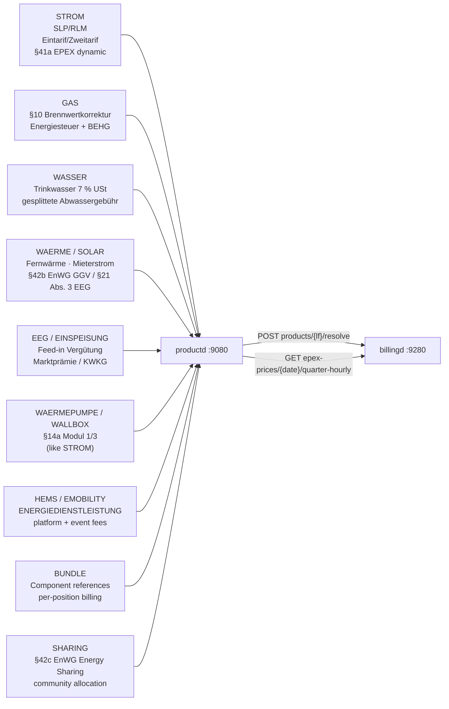

+++
title = "productd Operator Guide"
description = "Operator guide for productd, the LF product and tariff catalogue: Tarifpreisblätter, §41a EPEX dynamic pricing, the §41c comparison feed and B2B Angebote."
weight = 31
+++
`productd` is the single source of truth for **everything the LF sells** to end
customers; `billingd` and the portal price from it, never from `marktd`. Routes
are keyed by the supplier's
[MP-ID](@/docs/architecture/domain-model.md#mp-id-marktpartner-13-digits).

Port: **`:9080`**

## Authentication

`Claims` verifies each request's signature, audience and `mako_tenant`, which
must be this deployment's; the `401` does not echo the expected tenant.

## Authorization

`policies/productd.cedar` decides what a caller may do. The Tarifpreisblatt
stored here is what the next `billingd` run bills, and nothing downstream
re-checks it. The per-handler `lf_mp_id == claims.tenant()` check is a separate
question (is this my tenant's catalogue?).

| Action | Routes | Who |
|---|---|---|
| `read-product` | product `GET`s, `/history`, `/energiemix`, `POST …/resolve` | any token of the tenant |
| `read-marktpreise` | EPEX and nEHS `GET`s | any token of the tenant |
| `write-product` | `PUT` / `DELETE` of a product and its `/energiemix` | LF, MSB, ESA, ADMIN |
| `write-marktpreise` | `PUT /epex-prices/{date}`, `PUT /nehs-prices/{date}` | LF, MSB, ESA, ADMIN |
| `read-angebot` | `GET /angebote[/{id}[/comparison]]` | LF, MSB, ESA, ADMIN |
| `write-angebot` | `POST /angebote`, `PUT /angebote/{id}` | LF, MSB, ESA, ADMIN |
| `versenden-angebot` | `POST /angebote/{id}/versenden` | LF, MSB, ESA, ADMIN |
| `entscheiden-angebot` | `POST /angebote/{id}/annehmen`, `/ablehnen` | LF, MSB, ESA, ADMIN |
| `expire-angebote` | `POST /angebote/expire` | LF, MSB, ESA, ADMIN |
| `use-mcp` | the whole `/mcp` surface | LF, MSB, ESA, ADMIN |

Reading carries no role (the § 41c subset leaves the house unauthenticated
anyway); everything that *sets* a price, and the whole Angebot lifecycle, needs
LF, MSB, ESA or ADMIN — MSB and ESA because `ENERGIEDIENSTLEISTUNG` covers what
they sell. A denial is a bare `403` with the reason in the log. There is no
four-eyes split (`mako_roles` carries market roles only); `product_history`
keeps every superseded version. `/mcp` checks `use-mcp` for a JWT's
`mako_roles` and for an `[mcp]` key's declared roles (`api_key_roles`, or `roles` on a named key), so an agent key needs one
of those roles spelled out. The two § 41c feed routes are public by statute —
see [below](#ss-41c-enwg-comparison-feed).

---

## Product categories



---

## Endpoints

| Method | Path | Description |
|--------|------|-------------|
| `PUT` | `/api/v1/products/{lf_mp_id}/{product_code}` | Upsert product; archives the previous version in `product_history`. Runs the [`preistyp` whitelist](#two-vocabularies-one-field-and-why-they-are-kept-apart), then [the BO4E gate](@/docs/architecture/domain-model.md#the-bo4e-gate) |
| `GET` | `/api/v1/products/{lf_mp_id}/{product_code}` | Fetch latest product |
| `DELETE` | `/api/v1/products/{lf_mp_id}/{product_code}` | **Soft-delete** — sets `valid_to = today`; product retained for billing history; excluded from comparison feed |
| `GET` | `/api/v1/products/{lf_mp_id}` | List products (`?category=&sparte=&kundentyp=&include_drafts=&include_expired=`) |
| `GET` | `/api/v1/products/{lf_mp_id}/{product_code}/history` | Immutable version audit log (includes `energiemix` history for §42 audit trail) |
| `POST` | `/api/v1/products/{lf_mp_id}/resolve` | Product versions by code + date, batched — what `billingd` prices each leg of a period from |
| `PUT/GET/DELETE` | `/api/v1/products/{lf_mp_id}/{product_code}/energiemix` | §42 EnWG Energiemix sub-resource — does NOT archive product or trigger billing-period changes. The payload is a `Bo4e<Energiemix>` on **both** this route and the product `PUT`, so the same document is gated identically whichever one writes it |
| `GET` | `/api/v1/comparison-feed` | **Comparison portal feed** — ETag-cached, cursor-paginated tariff listing (PUBLISHED non-expired only); `jahreskosten_supply_*` for `verbrauch_kwh` |
| `GET` | `/api/v1/comparison-feed/bo4e` | **BO4E Tarifinfo array** — § 41c EnWG canonical form; direct import by Verivox / Check24 / BNetzA MTS |
| `PUT` | `/api/v1/epex-prices/{date}` | Import EPEX day-ahead prices (96/92/100 15-min MTUs, or 24 hourly; idempotent) |
| `GET` | `/api/v1/epex-prices/{date}/quarter-hourly` | 15-min MTU points `{mtu_start, price_ct_kwh}` |
| `GET` | `/api/v1/epex-prices/{year}/{month}/average` | Monthly average — used by `einsd` Direktvermarktung |
| `PUT` | `/api/v1/nehs-prices/{date}` | Import a dated nEHS certificate price (EUR/t CO₂) — `source` ∈ `auktion`/`verkaufsphase`/`nachkauf`/`manual`, CHECK-constrained; anything else → 422. Each source is checked against what § 10 BEHG fixes for that year — see [nEHS certificate prices](#nehs-certificate-prices-behg) |
| `GET` | `/api/v1/nehs-prices/latest?date=` | Most recent nEHS price at or before `date` — used by `billingd` for the Gas CO₂ component (CO2KostAufG §3) |
| `POST/GET` | `/api/v1/angebote` | B2B Angebot (quotation) — ANGELEGT→VERSANDT→ANGENOMMEN/ABGELEHNT/ABGELAUFEN |
| `GET` | `/api/v1/angebote/{id}` | One Angebot |
| `GET` | `/api/v1/angebote/{id}/comparison` | Prices the scenarios and persists the BO4E `Angebot` to `angebote.bo4e` |
| `POST` | `/api/v1/angebote/{id}/versenden` | ANGELEGT → VERSANDT |
| `PUT` | `/api/v1/angebote/{id}` | Edit before sending — `gueltig_bis`, `lieferbeginn`, `laufzeit_monate`, `positionen`, `varianten`, `notizen`. **`ANGELEGT` only**: once VERSANDT the customer holds the document |
| `POST` | `/api/v1/angebote/{id}/annehmen` · `/ablehnen` | ANGELEGT **or** VERSANDT → ANGENOMMEN / ABGELEHNT. Acceptance also requires a priced `bo4e` — otherwise `de.tarif.angebot.angenommen` would carry an empty document |
| `POST` | `/api/v1/angebote/expire` | Sweeps ANGELEGT and VERSANDT Angebote past `gueltig_bis` to ABGELAUFEN |
| `GET` | `/health/live` · `/health/ready` · `/metrics` | From the `mako_service` runner |

---

## Registering a product

```http
PUT /api/v1/products/9910000000002/STROM-H0-2026
Content-Type: application/json

{
  "category": "STROM",
  "name": "Strom Zuhause Classic",
  "sparte": "STROM",
  "register_count": "Eintarif",
  "kundentyp": "Haushalt",
  "valid_from": "2026-01-01",
  "data": {
    "_typ": "TARIFPREISBLATT",
    "bezeichnung": "Strom Zuhause Classic 2026",
    "zeitlicheGueltigkeit": { "startdatum": "2026-01-01" },
    "tarifpreise": [
      { "preistyp": "GRUNDPREIS",            "preisstaffeln": [{ "preis": "20" }] },
      { "preistyp": "ARBEITSPREIS_EINTARIF", "preisstaffeln": [{ "preis": "32" }] }
    ]
  }
}
```

`billingd` extracts `grundpreis_ct_per_day` (20 ct/day) and `arbeitspreis_ct_per_kwh`
(32 ct/kWh) by traversing `data.tarifpreise` keyed on `preistyp`.

**A `preis` is in cents**: 20 ct a day is `"20"`, not `"0.20"`. A `PUT` stores
the canonical `rubo4e` round-trip, so the gate's strict-enum stage refuses a
typo that would otherwise come back as `"UNKNOWN"`.

### Two vocabularies, one field — and why they are kept apart

BO4E `Preistyp` defines **ten** values; mako's whitelist
(`handlers::VALID_PREISTYPEN`) adds twenty extensions (EEG-Marktprämie, HEMS
event, roaming fee …). Those never go in the BO4E field: go-bo4e and
BO4E-python reject a document with an unlisted enum value outright. A mako-only
type travels in the `mako:preistyp` `ZusatzAttribut` with `preistyp` absent:

```json
{
  "preisstaffeln": [{ "preis": "8.20" }],
  "zusatzAttribute": [{ "name": "mako:preistyp", "wert": "EEG_MARKTPRAEMIE" }]
}
```

Readers do not branch: `mako_markt::bo4e::position_preistyp()` checks the BO4E
field, then the attribute, and both `productd` and `billingd` go through it.
`tests/bo4e_conformance.rs` pins the result — whatever a `PUT` stores must
round-trip through `rubo4e` with no enum anywhere falling through to `Unknown`.

---

## What productd is *not*

Which product a customer is on is a contract fact (a Tarifwechsel under § 41
Abs. 5 EnWG, guarded by the Preisgarantie) and lives in
[`vertragd`](@/docs/services/vertragd.md). `productd` answers what a product
**costs** on a given day:

```http
POST /api/v1/products/{lf_mp_id}/resolve
Content-Type: application/json

{ "anfragen": [
    { "product_code": "STROM-H0-2026", "as_of": "2026-03-01" },
    { "product_code": "STROM-H0-2027", "as_of": "2026-03-15" } ] }
```

`billingd` resolves every leg of a period in **one** round trip. A code with no
version valid on its date comes back as `null` in place. Both validity bounds
apply, so a withdrawn product stops pricing new periods and still prices the
past.

## §41a EPEX Spot feed

The SDAC day-ahead auction settles on **15-minute Market Time Units (MTU)**
since 2025-10-01 (EPEX SPOT go-live) — 96 quarter-hours per delivery day
(92/100 on the DST days). Import the day-ahead prices daily (D-1) as an ordered
array of the delivery day's MTUs, in UTC-instant order (= local wall-clock
order). `mtu_minutes` defaults to `15`; legacy `60`-minute source data is
accepted and expanded to quarter-hours on fetch.

```bash
# Import 2026-07-15 (96 quarter-hour prices, ct/kWh)
curl -s -X PUT "http://productd:9080/api/v1/epex-prices/2026-07-15" \
  -H "Content-Type: application/json" \
  -d '{
    "prices": [6.2, 6.1, 6.0, 5.9, /* … 96 entries … */ 6.5],
    "mtu_minutes": 15,
    "source": "entsoe-transparency"
  }'
```

For `billingd` dynamic billing: `GET /api/v1/epex-prices/2026-07-15/quarter-hourly`
returns the day's 15-min points, each `{ mtu_start (UTC RFC3339), price_ct_kwh }`,
for the 15-min Lastgang × EPEX-MTU multiplication (§41a pipeline). The price map
is keyed on the UTC MTU start (DST-safe).

For `einsd` Direktvermarktung: `GET /api/v1/epex-prices/2026/7/average` returns the
monthly average used in `max(0, AW − EPEX)`.

---

## nEHS certificate prices (BEHG)

The CO₂ component of every Gas and Wärme invoice derives from this series
(CO2KostAufG § 3), so a decimal slip mis-bills every gas customer. § 10 BEHG
fixes enough to catch it at import:

| Phase | Period | Price | § 10 BEHG |
|---|---|---|---|
| **Einführungsphase** (`verkaufsphase`) | 2021–2025 | 25 / 30 / 30 / 45 / **55** EUR/t — checked exactly | Abs. 2 |
| **Versteigerung** (`auktion`) | 2026 | clearing price inside the **55–65** EUR/t corridor | Abs. 1, Abs. 2 |
| **Nachkauf** (`nachkauf`) | after the 2026 auctions | **68** EUR/t (Mehrmengenpreis) | Versteigerungsbedingungen |
| `manual` | any | plausibility only (5–500 EUR/t) | — |

From 2027 § 10 Abs. 2 fixes no figures of its own (it defers to § 24 Abs. 2
Nr. 2), so any positive price is accepted. The rules are pure functions in
`src/behg.rs`.

```bash
PUT /api/v1/nehs-prices/2026-07-08   { "eur_per_t": "63.50", "source": "auktion" }

# A decimal slip is refused with the rule named:
PUT /api/v1/nehs-prices/2026-07-15   { "eur_per_t": "6.35", "source": "auktion" }
# → 422 "der Zuschlagspreis 6.35 EUR/t liegt außerhalb des Preiskorridors
#        55–65 EUR/t für 2026 (§ 10 Abs. 2 BEHG)"

GET /api/v1/nehs-prices/latest?date=2026-08-01
```
---

## § 41c EnWG comparison feed

§ 41c EnWG obliges suppliers to let independent comparison tools use
offer-relevant information free of charge, in open data formats, for
Haushaltskunden and Kleinstunternehmen below 100 000 kWh. So these two routes —
and only these — carry no token and no Cedar action.
`tests/it/authorization_guard.rs` asserts that `get_comparison_feed` /
`get_comparison_feed_bo4e` are exactly the handlers without `Claims`, and that
their shared query still pins `product_status = 'PUBLISHED'` and the comparison
categories (`STROM`, `GAS`, `WAERME`, `SOLAR`, `WAERMEPUMPE`, `WALLBOX`).

`GET /api/v1/comparison-feed` is the tariff listing for Verivox, Check24, the
BNetzA Markttransparenzstelle and similar integrators. Prices are the ones that
apply at the requested `verbrauch_kwh`: the Preisstaffel is chosen by BO4E's
rule (a gap „rutscht in die obere Zone"); a kW-tiered Leistungspreis is reported
absent. Each entry carries a `tarifinfo` BO4E object.

### BO4E Tarifinfo endpoint (§ 41c EnWG canonical form)

`GET /api/v1/comparison-feed/bo4e` returns the same products as a pure BO4E `Tarifinfo` array:

```bash
curl -s "http://productd:9080/api/v1/comparison-feed/bo4e?sparte=STROM&kundentyp=Haushalt" | jq .
```

```json
{
  "meta": { "generated_at": "...", "total_returned": 3 },
  "tarife": [
    {
      "_typ": "TARIFINFO",
      "_version": "202607.1.0",
      "_id": "STROM-PREMIUM-2026",
      "bezeichnung": "Mako Strom Premium",
      "anbietername": "9900357000004",
      "sparte": "STROM",
      "kundentypen": ["HAUSHALT"],
      "registeranzahl": "EINTARIF",
      "tariftyp": "SONDERTARIF",
      "tarifmerkmale": ["FESTPREIS"],
      "energiemix": {
        "anteil": [
          { "erzeugungsart": "WASSER", "anteilProzent": "60.0" },
          { "erzeugungsart": "WIND",   "anteilProzent": "40.0" }
        ],
        "co2Emission": 0
      },
      "zeitlicheGueltigkeit": { "startdatum": "2026-01-01" },
      "vertragskonditionen": { "vertragslaufzeit": { "dauer": "P12M" } }
    }
  ]
}
```

#### TarifInfo field mapping

| BO4E field | Source in productd |
|---|---|
| `bezeichnung` | `product.name` |
| `anbietername` | `lf_mp_id` |
| `_id` | `product.product_code` |
| `sparte` | `product.sparte` → `rubo4e::Sparte`; `WAERME` maps to `FERNWAERME`, which is what BO4E defines |
| `kundentypen` | `product.kundentyp` → `[rubo4e::Kundentyp]`; `Haushalt`→`HAUSHALT`, `Ladesaeule`→`LADESAEULE`, `Gewerbe`/`Gewerbe_RLM`→`GEWERBE`, the other three→`SONSTIGE`. An unrecognised value drops the field rather than defaulting |
| `registeranzahl` | `product.register_count` → `rubo4e::Registeranzahl` |
| `tariftyp` | `data.tariftyp` → `rubo4e::Tariftyp` |
| `tarifmerkmale` | Derived: `FESTPREIS` if preisgarantie set; `PAKET` if BUNDLE; `ONLINE` if dynamic; `STANDARD` when none applies |
| `energiemix` | `product.energiemix` → `rubo4e::Energiemix` |
| `zeitlicheGueltigkeit` | `product.valid_from/valid_to` → `rubo4e::Zeitraum` |
| `vertragskonditionen` | `data.vertragskonditionen` → `rubo4e::Vertragskonditionen` |

Every enum is emitted in its BO4E wire form (`HAUSHALT`, not the internal
`Haushalt`; `EINTARIF`, not `Eintarif`), serialised from the typed `rubo4e` enum.
Both endpoints take the same query parameters and caching headers.

### Query parameters

| Parameter | Type | Default | Description |
|---|---|---|---|
| `sparte` | string | all | Filter: `STROM` \| `GAS` \| `WAERME` |
| `kundentyp` | string | all | Filter: `Haushalt` \| `Gewerbe` \| `Waermepumpe` \| `Ladesaeule` \| `Einspeiser` \| `HEMS` \| `Gewerbe_RLM` |
| `verbrauch_kwh` | decimal | `3500` | Annual consumption — selects the Preisstaffel and drives the `jahreskosten` estimate |
| `oekolabel` | string | — | Show only products with this label (e.g. `OK_POWER`) |
| `include_dynamic` | bool | `true` | Include §41a EPEX-linked dynamic tariffs |
| `only_dynamic` | bool | `false` | Return only §41a dynamic tariffs |
| `limit` | integer | `100` | Page size (1–500) |
| `cursor` | string | — | Pagination cursor from `meta.next_cursor` |
| `lf_mp_id` | string | `cfg.tenant` | Override operator ID |

### Example: Household electricity tariffs

```bash
curl -s "http://productd:9080/api/v1/comparison-feed?sparte=STROM&kundentyp=Haushalt&verbrauch_kwh=3500" | jq .
```

```json
{
  "meta": {
    "generated_at": "2026-07-17T12:00:00Z",
    "lf_mp_id": "9900357000004",
    "verbrauch_kwh": "3500",
    "sparte_filter": "STROM",
    "kundentyp_filter": "Haushalt",
    "total_returned": 3,
    "next_cursor": null
  },
  "tarife": [
    {
      "product_code": "STROM-PREMIUM-2026",
      "name": "Mako Strom Premium",
      "category": "STROM",
      "sparte": "STROM",
      "kundentyp": "Haushalt",
      "register_count": "Eintarif",
      "ist_oekostrom": true,
      "ist_dynamisch": false,
      "valid_from": "2026-01-01",
      "valid_to": null,
      "preise": {
        "grundpreis_ct_per_day": "5.50",
        "arbeitspreis_ct_per_kwh": "28.40",
        "arbeitspreis_ht_ct_per_kwh": null,
        "arbeitspreis_nt_ct_per_kwh": null,
        "leistungspreis_ct_per_kw_month": null
      },
      "jahreskosten_supply_netto_eur": "1014.08",
      "jahreskosten_supply_brutto_eur": "1206.75",
      "mwst_satz": "0.19",
      "laufzeit_monate": 12,
      "kuendigungsfrist_wochen": 4,
      "mindestlaufzeit_monate": 12,
      "preisgarantie_bis": "2027-06-30",
      "bonus_rabatt_eur": "50.00",
      "energiemix": { "anteil": [...], "co2Emission": 42.0 },
      "oekolabel": ["OK_POWER"],
      "tarifpreisblatt": { "...": "full BO4E payload" },
      "updated_at": "2026-07-17T10:00:00Z"
    }
  ]
}
```

### Caching and efficiency

Responses carry `ETag` and `Cache-Control: public, max-age=300`; send
`If-None-Match` and get `304` when nothing changed.

### `mwst_satz` is a fraction, not a percentage

`mwst_satz` is `"0.19"`, a share of the net:
`jahreskosten_supply_brutto_eur = jahreskosten_supply_netto_eur × (1 + mwst_satz)`.
It is the product's own rate (an `mwst_rate_override` must lie in `0…1`); when
undeterminable, `mwst_satz` and the brutto figure are both `null`.

### What `jahreskosten_supply_*` includes and excludes

`jahreskosten_supply_netto_eur` = Grundpreis + Arbeitspreis per year **only**.
NNE, Konzessionsabgabe and Stromsteuer vary by DSO/PLZ and are the
integrator's to add (net, then VAT on top):

```
Jahresgesamtkosten = jahreskosten_supply_brutto_eur
                   + NNE_brutto (from marktd PreisblattNetznutzung by PLZ)
                   + Stromsteuer (2.05 ct/kWh × verbrauch_kwh / 100)
```

### Pagination

The feed is ordered `(updated_at DESC, product_code ASC)`; pass a non-null `meta.next_cursor` as `?cursor=`.

```bash
# Page 1
curl "http://productd:9080/api/v1/comparison-feed?limit=2"
# → meta.next_cursor: "2026-07-17T10:00:00Z,STROM-BASIC"

# Page 2
curl "http://productd:9080/api/v1/comparison-feed?limit=2&cursor=2026-07-17T10:00:00Z,STROM-BASIC"
```

---

## B2B Angebot as BO4E

`GET /api/v1/angebote/{id}/comparison` prices the scenarios, returns the BO4E
`Angebot` under `bo4e` and persists it to `angebote.bo4e`.

### Structure

```text
Angebot                     one quotation      — angebotsnummer, bindefrist, sparte
└── Angebotsvariante        one scenario       — angebotsstatus, gesamtkosten, gesamtmenge
    └── Angebotsteil        one supply point   — lieferstellenangebotsteil (Marktlokation),
        │                                        lieferzeitraum, gesamtkostenangebotsteil
        └── Angebotsposition  one cost line    — positionsbezeichnung, positionskosten,
                                                 positionsmenge, positionspreis
```

### Field mapping

| Internal | BO4E |
|---|---|
| `angebotsnummer` | `Angebot.angebotsnummer` |
| `gueltig_bis` | `Angebot.bindefrist` — BO4E's own term for the binding period |
| `status` | `Angebotsvariante.angebotsstatus` |
| `jahreskosten_netto_eur` | `Angebotsvariante.gesamtkosten` (`Betrag`, EUR) |
| `jahresverbrauch_kwh` | `Angebotsteil.gesamtmengeangebotsteil` (`Menge`, kWh) |
| `malo_id` | `Angebotsteil.lieferstellenangebotsteil[].marktlokationsId` |
| supply / NNE / KA / levies | one `Angebotsposition` each |

`ANGELEGT` maps to `Angebotsstatus::Konzeption`: it has not been sent.

### Extension points

Fields BO4E lacks ride in `zusatz_attribute`:

| Attribute | Carries |
|---|---|
| `mako.angebot.variante.label` | scenario name |
| `mako.angebot.variante.rabattProzent` | discount applied to the Arbeitspreis |
| `mako.angebot.variante.istBasis` | marks the base scenario |
| `mako.angebot.teil.produktCode` | internal product code |
| `mako.angebot.teil.standortBezeichnung` | free-text site label |

### Two deliberate omissions

A zero cost line is omitted (BO4E cannot say "does not apply"), and an invalid
MaLo-ID yields no `lieferstellenangebotsteil` (`MaloId` validates the check
digit).

## Database schema

### `products`

| Column | Type | Notes |
|--------|------|-------|
| `id` | UUID | Primary key |
| `lf_mp_id` | TEXT | The **market identity** products are sold under. Not the tenant: the isolation key and the market identity are the same string in a single-mandant install and different in a shared one |
| `product_code` | TEXT | Operator-assigned product identifier |
| `category` | TEXT | 14 values: `STROM`/`GAS`/`WAERME`/`WASSER`/`SOLAR`/`EEG`/`EINSPEISUNG`/`WAERMEPUMPE`/`WALLBOX`/`HEMS`/`EMOBILITY`/`ENERGIEDIENSTLEISTUNG`/`BUNDLE`/`SHARING` |
| `product_status` | TEXT | `PUBLISHED` (default) — visible to billingd and portals; `DRAFT` — staged, invisible until published |
| `name` | TEXT | Human-readable name |
| `sparte` | TEXT | `STROM` / `GAS` / `WAERME` / `WASSER` / NULL |
| `register_count` | TEXT | `Eintarif` / `Zweitarif` / `Mehrtarif` |
| `kundentyp` | TEXT | `Haushalt` / `Gewerbe` / `Waermepumpe` / `Ladesaeule` / `Einspeiser` / `HEMS` / `Gewerbe_RLM` |
| `dyn_source` | TEXT | `"epex-spot-day-ahead"` for §41a; NULL for fixed. Only this value is accepted — all others are rejected with 422 |
| `valid_from` | DATE | Tariff validity start. Staging a version with a later start end-dates the running one automatically; `products_no_overlap` (GiST) forbids two versions covering the same day |
| `valid_to` | DATE | Tariff validity end, inclusive. `DELETE` is a withdrawal that sets it to today. Both bounds are applied on read, so a withdrawn product stops pricing new periods and still prices the past |
| `data` | JSONB | `Tarifpreisblatt` / `Preisblatt` BO4E payload (validated on PUT: `_typ`, `_version` series `202607`, enum fields, `preistyp` whitelist; always a *valid* BO4E document — mako-only price types ride in `zusatzAttribute`) |
| `energiemix` | JSONB | §42 EnWG `Energiemix` COM — CO₂ emissions, fuel mix, certification labels |
| `oekolabel` | TEXT[] | Extracted from energiemix for GIN `@>` filter queries |

### `epex_prices`

One row per 15-min MTU, keyed on `mtu_start` (UTC). `price_date` (local delivery date) is indexed for day/range queries; `mtu_minutes` records the source resolution (15 or 60).

---

## Product lifecycle — DRAFT vs. PUBLISHED

`DRAFT` stages a version invisible to `billingd`, the portal and the feed; a `PUT` with `PUBLISHED` (the default) makes it live:

```http
# Stage a new price version (operator-only preview)
PUT /api/v1/products/9910000000002/STROM-PREMIUM-2027
Content-Type: application/json

{ "category": "STROM", "product_status": "DRAFT", "name": "...", "data": {...} }

# Publish when ready (makes it live instantly)
PUT /api/v1/products/9910000000002/STROM-PREMIUM-2027
Content-Type: application/json

{ "category": "STROM", "product_status": "PUBLISHED", "name": "...", "data": {...} }
```

---

## MCP tools

`productd` ships an MCP server at `/mcp` (Streamable HTTP) with
**13 read-only tools** and **3 prompts**.

| Tool | Description |
|---|---|
| `list_products` | List products for an LF MP-ID (filter by category / sparte) |
| `get_product` | Full Tarifpreisblatt JSONB including Preisstaffeln and Energiemix |
| `get_product_history` | Version history including Energiemix changes (§42 audit trail) |
| `resolve_product` | Product versions by code + date, batched — the MCP side of `POST /products/{lf}/resolve` |
| `get_epex_price` | 15-min MTU EPEX day-ahead prices for a date (§41a compliance check) |
| `list_angebote` | B2B quotations by status (ANGELEGT/VERSANDT/ANGENOMMEN/…) |
| `get_angebot` | Full Angebot with enriched positions and variant comparisons |
| `get_angebot_summary` | Plain-text Angebot summary for sales staff review |
| `check_41a_epex_status` | §41a compliance: are tomorrow's EPEX prices imported? CRITICAL/WARNING/OK |
| `get_product_energiemix` | §42 EnWG Energiemix disclosure (CO₂, fuel mix, certification) |
| `validate_tariff_config` | Validate Tarifpreisblatt JSONB before PUT (same logic as REST) |
| `explain_invoice_position` | How a `preistyp` maps to a billingd invoice output + formula |
| `get_comparison_feed` | Retrieve the § 41c comparison portal feed (proxies the REST endpoint) |

The BO4E `Angebot` comes from `GET /angebote/{id}/comparison`, not from a tool.

**Prompts:**
- `configure-41a-tariff` — Step-by-step: configure a §41a EPEX dynamic tariff product (iMSys requirement, §41a guard)
- `assign-product` — Step-by-step: assign a tariff to a MaLo and verify the assignment
- `create-b2b-quotation` — Step-by-step: create a formal B2B Angebot for a C&I customer

---
## Configuration

```toml
# productd.toml
port   = 9080
tenant = "9910000000002"   # operator LF BDEW-Codenummer

[database]
url = "postgresql://productd:secret@db:5432/productd"

# Required unless allow_insecure_no_auth = true.
[oidc]
issuer   = "https://idp.example/realms/mako"
audience = "productd"

# de.tarif.* notifications to the ERP; HMAC-signed when the secret is set.
# erp_webhook_url = "https://erp.internal/hooks/tarif"
# erp_hmac_secret = "env:PRODUCTD_ERP_HMAC"

# [mcp]
# api_key = "env:PRODUCTD_MCP_API_KEY"
# api_key_roles = ["LF"]    # use-mcp needs LF, MSB, ESA or ADMIN
```
