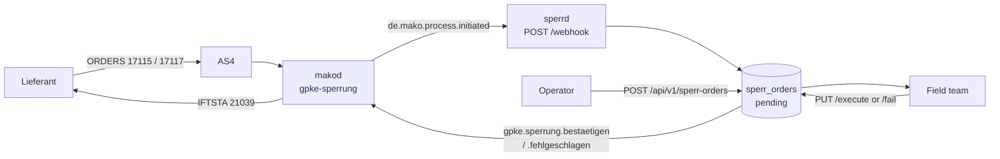

+++
title = "sperrd Operator Guide"
description = "Operator guide for sperrd, the Netzbetreiber's Sperr-/Entsperrauftrag queue: ORDERS 17115/17117 in, field dispatch, IFTSTA 21039 out."
weight = 26
+++
`sperrd` is the Netzbetreiber's work queue for the physical acts GPKE orders it
to perform. An **ORDERS 17115 Sperrauftrag** or **17117 Entsperrauftrag** from a
Lieferant becomes a job for the field team; the outcome goes back as **IFTSTA
21039** (Auftragsstatus Sperren/Entsperren).

A **Sperrung** interrupts a supply point and an **Entsperrung** restores it;
the five-digit numbers are
[Prüfidentifikatoren](@/docs/architecture/domain-model.md#prufidentifikator-pid).
Without the IFTSTA the Lieferant's `gpke-sperrung-lf` process never reaches a
terminal state, so dispatching it is the one state `sperrd` will not let fall
silently.

**Port:** `:8780`
**Storage:** PostgreSQL (`sperr_orders`)
**Role:** NB (Netzbetreiber)

1. TOC
{:toc}

## Where orders come from



Two producers, one queue:

* **The market inbox.** `POST /webhook` consumes `de.mako.process.initiated`
  and queues PIDs 17115 and 17117, keyed on the `makod` process so an AS4
  redelivery does not queue a second disconnection.
* **Operators.** `POST /api/v1/sperr-orders` for an order with no market
  correspondent — no `process_id`, so no IFTSTA is owed.

PID **17116** (Anfrage Sperrung, NB → MSB) is not queued: it is not an order to
execute.

## What the queue carries

The row is shaped by what the ORDERS AHB actually sends:

| Column | EDIFACT | Meaning |
|---|---|---|
| `order_type` | `BGM+Z51` / `Z52` | Sperrung / Entsperrung |
| `ausfuehrung_am` | `DTM+203` | A **fixed** date the LF requires (hint [533]: a Gerichtsvollzieher may have set it) |
| `fruehestens_am` | `DTM+469` | Execute at the next opportunity, but **not before** this date |
| `arbeitszeit` | `IMD+7081` `Z53`/`Z54` | Entsperrauftrag: within working hours, or also outside |
| `treffpunkt_*` | `SG2 NAD+Z24` | Where the technician goes |
| `hinweis` | `SG29 FTX+ACB` | The LF's free-text hints |

`ausfuehrung_am` and `fruehestens_am` are alternatives (AHB conditions
[55]/[56]), enforced in the API and by a `CHECK`.

## Timing — three clocks, all published

BK6-24-174 GPKE Teil 2 §§ 3.5.1.2 / 3.5.2.2 state three deadlines, counted in
Werktagen on the BDEW-MaKo calendar
([business dates](@/docs/architecture/domain-model.md#dates-and-days)); ÜT is the
Übertragungszeitpunkt:

| Clock | Frist | Tracked by |
|---|---|---|
| **ORDRSP** 19116 / 19117 answering the order | „spätester ÜT ist der 1. WT nach dem ÜT" (Prozessschritt 2) | `makod`, from `mako_fristen::antwort` |
| **The physical act** | „…spätestens innerhalb von 6 WT nach dem frühestmöglichen Sperrtermin" (Prozessschritt 1) | `sperrd` — `ausfuehrung_faellig_am` |
| **IFTSTA 21039** | „spätester ÜT ist der 1. WT nach dem Abschluss des Sperrauftrags" (Prozessschritt 5) | `sperrd` — `iftsta_faellig_am` |

The Lieferant's `DTM+203` / `DTM+469` is a different question — when the LF
wanted the work done. `/stats` reports `overdue_pending` for that and
`frist_ueberschritten` for the regulatory window; a pending order past its 6 WT
is announced once as `de.sperr.ausfuehrung.ueberfaellig`.

### …and three Vorlauffristen, which count the other way

These run **backwards from the Sperrtermin**:

| Prozessschritt | Frist | Owed by |
|---|---|---|
| Sperrauftrag, nicht termingebunden (Nr. 1) | spätester ÜT ist der **6. WT** vor dem frühestmöglichen Sperrtermin | LF |
| Sperrauftrag, **termingebunden** (Nr. 1) | spätester ÜT ist der **12. WT** vor dem Sperrtermin | LF |
| Anfrage Sperrung an den MSB (Nr. 3) | spätester ÜT ist der **3. WT** vor dem Sperrtermin | NB |

A termingebundener Auftrag fixes Datum, Uhrzeit und Ort (e.g. a
Gerichtsvollzieher); `DTM+203` vs `DTM+469` tells the two apart on the wire.
`sperrd` records `vorlauffrist_eingehalten` and the latest admissible ÜT per
order and counts `vorlauffrist_verletzt`, but does **not** refuse: Prozessschritt
2's checks („ob die Marktlokation dem LF zugeordnet ist, ob die Marktlokation
identifiziert werden kann und die Zusicherung der Berechtigung nach
Netznutzungsvertrag vorliegt") do not include it. Without a generelle Zustimmung
des MSB the NB must set the Sperrtermin at least six Werktage out (Anfrage 3 WT +
the MSB's 3 WT answer).

### Two Sperrversuche

„Der NB führt bis zu zwei Sperrversuche innerhalb eines Sperrauftrags durch"
(Prozessschritt 5). `PUT .../fail` records the first unsuccessful visit and
leaves the order `pending`; the second closes it, as does `endgueltig: true`
for a legal or factual impossibility (a gerichtliche Verfügung, lebenserhaltende
medizinische Geräte).

## Reporting the outcome

`PUT /api/v1/sperr-orders/{id}/execute` and `.../fail` **claim the order
first** (`UPDATE … WHERE status = 'pending'`) and only then dispatch, so a
concurrent execute and fail cannot both reach the wire.

What the IFTSTA carries, per AHB 2.1 §7.2:

| Field | Source |
|---|---|
| `SG15 STS DE9015` | `Z37` Auftragsstatus Sperren / `Z38` Entsperren — derived from `order_type` |
| `SG15 STS DE4405` | `Z14 erfolgreich` (execute) / `Z13 gescheitert` (fail) |
| `SG15 STS DE9013` | The Prüfschritt code from the EBD (*Entscheidungsbaumdiagramm* — BDEW's published decision tree for this answer). A **Muss**, so `pruefschritt_code` is what makes the message valid |
| `DTM+293` | Fertigstellungsdatum — **Muss** on `Z14`, and condition [495] requires it ≤ the document date, so a future `executed_at` is refused at the API |
| `SG25 FTX+ACB` | The `note` or `reason` free text |

`204`: recorded, IFTSTA with `makod`. `202`: recorded, dispatch failed, order in
the retry queue — the Lieferant has **not** been told; the field report is kept
regardless.

## The IFTSTA retry queue

A terminal order with `iftsta_dispatched_at IS NULL` has an uninformed
Lieferant. A worker re-sends under the same idempotency key `makod`
deduplicates on; `iftsta_next_attempt_at` is both claim lease and backoff, so
replicas cannot double-send. It announces `de.sperr.iftsta.ausstehend` once,
on either trigger:

| Trigger | Why it is there |
|---|---|
| `iftsta_attempts` reaches `IFTSTA_MAX_ATTEMPTS` (8) | eight failures mean a `makod` process in the wrong state, not a transport problem |
| `iftsta_faellig_am` has passed | the 1. WT nach Abschluss (GPKE Teil 2 § 3.5.1.2 Nr. 5), stamped when the order goes terminal — escalates even if a lost write never advanced the counter |

`/stats` reports the three apart:

| Field | Meaning |
|---|---|
| `iftsta_outstanding` | Dispatches in flight. Normal for seconds after an execution. |
| `iftsta_ueberfaellig` | Past the 1-WT window of GPKE Teil 2 § 3.5.1.2 Nr. 5. |
| `iftsta_stuck` | Past the retry budget. **This is the number that needs a human.** |
| `vorlauffrist_verletzt` | Orders the *Lieferant* sent later than its own Vorlauffrist allowed. A contract question, not an operations one — the NB executes them anyway. |

### Diagnosing a stuck IFTSTA

Read `iftsta_last_error`. The usual cause is that `makod` has no
`gpke-sperrung` process for that MaLo in `ValidationPassed`, the only state its
`BestaetigueSperrung` accepts. After fixing the cause, reset `iftsta_attempts`.

## Emitted events

All go through the transactional outbox in the transaction of the state change.
Delivery needs `erp_webhook_url`; without it the notices accumulate in
`event_outbox` and startup warns.

| CloudEvent | Emitted when |
|---|---|
| `de.sperr.auftrag.eingegangen` | An order entered the queue, from ORDERS or an operator |
| `de.sperr.ausgefuehrt` | Carried out — IFTSTA `Z14` |
| `de.sperr.versuch.gescheitert` | The **first** Sperrversuch failed and the order stayed `pending`; nothing is reported to the LF yet |
| `de.sperr.fehlgeschlagen` | Not carried out — IFTSTA `Z13`, with the Prüfschritt code |
| `de.sperr.storniert` | A pending order was withdrawn; no IFTSTA |
| `de.sperr.ausfuehrung.ueberfaellig` | The 6-WT execution window closed with the order still open |
| `de.sperr.iftsta.ausstehend` | The retry budget is spent **or** the § 3.5.1.2 Nr. 5 Frist has passed, and the LF is still uninformed |

`agentd`'s `sperrd-agent` subscribes to the `de.sperr.*` glob.

## Authentication and authorization

Every REST route requires an OIDC token **and** a Cedar check; a denial is a
`403` naming why. `POST /webhook` is authenticated by `inbound_hmac_secret`
(Standard Webhooks) instead, and startup refuses without one unless
`allow_insecure_no_auth = true`.

| Action | Routes |
|---|---|
| `read-sperr-order` | `GET` the queue, an order, `/stats` |
| `create-sperr-order` | `POST /api/v1/sperr-orders` |
| `execute-sperr-order` | `PUT .../execute`, `.../fail` |
| `cancel-sperr-order` | `PUT .../cancel` |

All four require the `NB` role in `mako_roles` and a tenant match.
`tests/it/authorization_guard.rs` fails the build if a handler loses its
`Claims` extractor or Cedar check, or if code and policy name different actions.

## Schema

`sperr_orders` (migration `services/sperrd/migrations/`) is unique per
`(tenant, process_id)`. Its `CHECK`s hold the invariants above: `order_type` ∈
`sperrung`/`entsperrung`, `pruefidentifikator` ∈ 17115/17117, `ausfuehrung_am`
and `fruehestens_am` mutually exclusive, `sperrversuche` 0–2, `status` ∈
`pending`/`executed`/`failed`/`cancelled` with `executed_at` on executed and
`fail_reason` on failed, `arbeitszeit` ∈ `innerhalb`/`auch_ausserhalb`, and a
two-letter `treffpunkt_land`.

## MCP surface

Read-only: acting on an order stays on the authenticated REST routes.

| Tool | Description |
|---|---|
| `list_sperr_orders(status, malo_id, due, limit)` | The queue |
| `get_sperr_order(id)` | One order, with ORDERS provenance and IFTSTA state |
| `get_sperr_stats` | Counters, incl. `iftsta_outstanding` / `iftsta_stuck` |
| `list_due_orders` | The field-dispatch list, with the Treffpunkt |

Prompts: `execute-sperrung`, `iftsta-sweep`.

## Configuration

```toml
port           = 8780
tenant         = "9900357000004"

makod_url      = "http://makod:8080"
makod_api_key  = "env:SPERRD_MAKOD_API_KEY"
inbound_hmac_secret = "env:SPERRD_INBOUND_HMAC_SECRET"   # required unless allow_insecure_no_auth

erp_webhook_url = "https://erp.internal/hooks/sperr"      # de.sperr.* delivery
erp_hmac_secret = "env:SPERRD_ERP_HMAC_SECRET"

[database]
url       = "env:SPERRD_DATABASE_URL"
pool_size = 10

# Required unless allow_insecure_no_auth = true.
[oidc]
issuer   = "https://keycloak:8080/realms/mako"
audience = "sperrd"

# [mcp]
# api_key = "env:SPERRD_MCP_API_KEY"
```

## Tests

`cargo test -p sperrd` runs the unit and guard tests. `just test-sperrd-db` runs
the PostgreSQL scenarios: redelivery guard, two replicas unable to claim the same
IFTSTA, a failed dispatch keeping the report, budget exhaustion and an overdue
IFTSTA each escalating once, one terminal outcome per order, the first
Sperrversuch leaving the order open, tenant isolation, and the
mutually-exclusive ORDERS dates.
