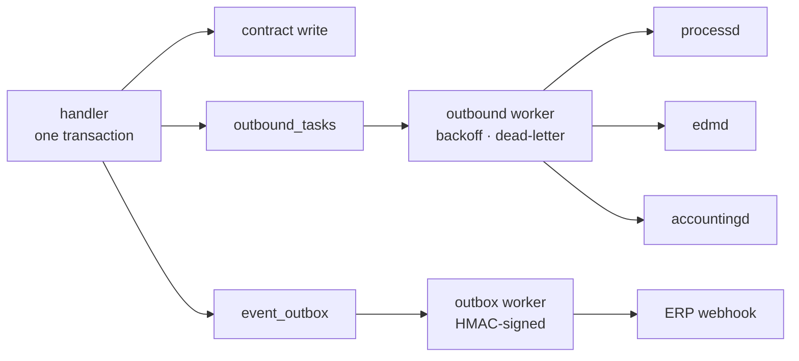
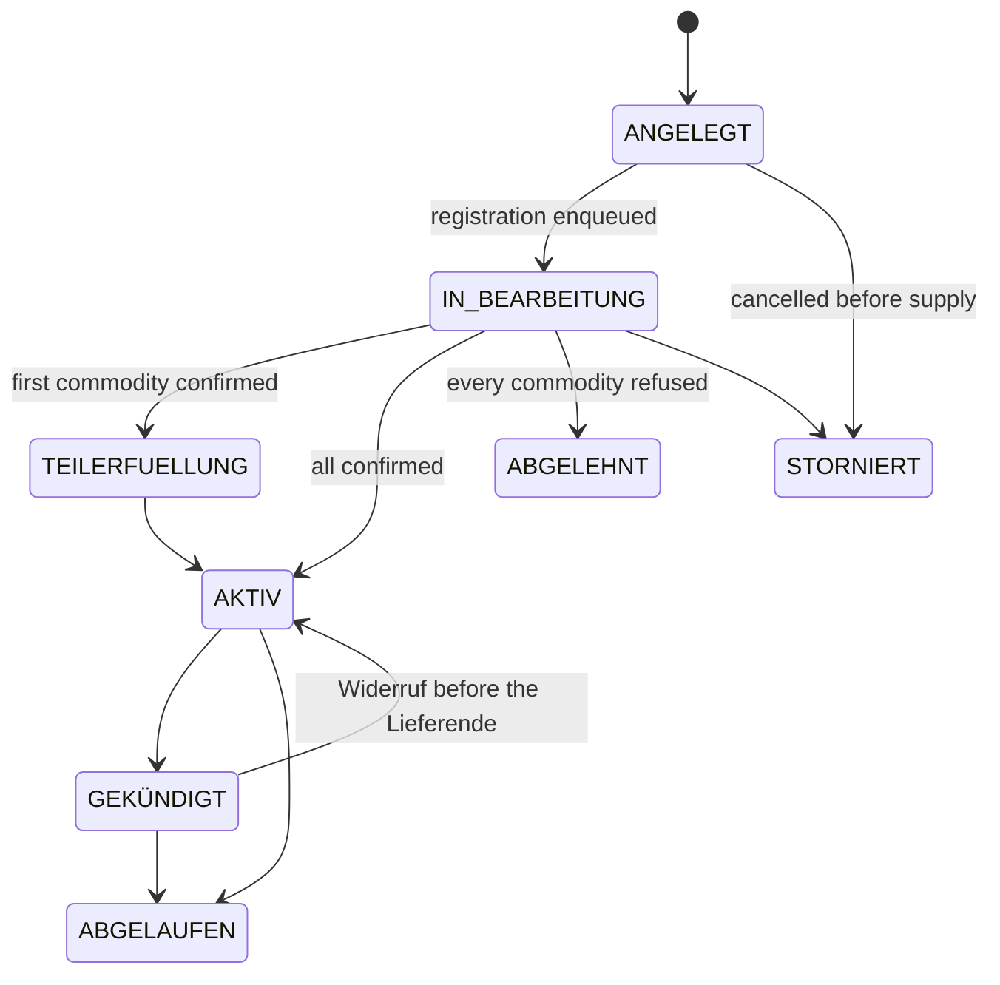

+++
title = "vertragd Operator Guide"
description = "Operator guide for vertragd, contract and customer management: B2C and B2B Verträge, Rahmenverträge, Kündigungsfristen and §41 EnWG price-change duties."
weight = 35
+++
`vertragd` is the **customer registry and retail contract lifecycle engine** for
both B2C (private households) and B2B (commercial, RLM) customers. It owns the
chain from customer identity to supply contract to billing-account provisioning,
and it is the single authorization gateway between OIDC identities and MaLo IDs.

The operator holds the **LF** role. A [MaLo](@/docs/architecture/domain-model.md#market-objects-objekte)
is what a supply contract is about. "Dispatched to MaKo" means a UTILMD sent by
[`processd`](@/docs/services/processd.md) and [`makod`](@/docs/services/makod.md);
`vertragd` speaks no EDIFACT.

Port: **`:9780`** · PostgreSQL · OIDC/JWT on every route

## The rules live in one module

Every deadline is a pure function in `src/domain.rs` (no HTTP, SQL or clock),
chosen by contract type and customer:

| Rule | Source | Value |
|---|---|---|
| Kündigung Grundversorgung | § 20 Abs. 1 StromGVV / GasGVV | 2 Wochen, jederzeit |
| Kündigungsbestätigung | § 41 Abs. 8 Nr. 2 EnWG, § 20 Abs. 2 GVV | unverzüglich, Textform |
| Kündigung Sondervertrag | Vertrag, gedeckelt durch § 309 Nr. 9 lit. c BGB | ≤ 1 Monat für Verbraucher |
| Sonderkündigung Preisanpassung | § 41 Abs. 5 Satz 4 EnWG, § 5 Abs. 3 GVV | fristlos zum Wirksamwerden |
| Sonderkündigung Umzug | § 41b Abs. 5 EnWG | 6 Wochen (Haushaltskunden) |
| Preisänderungsanzeige Sondervertrag | § 41 Abs. 5 Satz 2 EnWG | 1 Monat (Haushaltskunde) — ein **Kalendermonat** nach § 188 Abs. 2 BGB, kein 30-Tage-Fenster; sonst 2 Wochen |
| Preisänderungsanzeige Grundversorgung | § 5 Abs. 2 StromGVV / GasGVV | 6 Wochen, nur zum Monatsersten |
| Erstlaufzeit Verbrauchervertrag | § 309 Nr. 9 lit. a BGB | ≤ 24 Monate |
| Stillschweigende Verlängerung | § 309 Nr. 9 lit. b BGB | nur unbefristet, ≤ 1 Monat kündbar |
| Ersatzversorgung | § 38 Abs. 4 EnWG | endet spätestens nach 3 Monaten |

### Two stored facts pick the column

- **`versorgungsvertraege.vertragsart`** — `GRUNDVERSORGUNG`,
  `ERSATZVERSORGUNG` or `SONDERVERTRAG`. An unrecognised value reads as
  `SONDERVERTRAG`, the regime with the least statutory privilege, so a typo
  cannot silently claim Grundversorgungs-Fristen.
- **`kunden.haushaltskunde`** — § 3 Nr. 57 EnWG, deliberately not `kundentyp`:
  a commercial customer under 10 000 kWh a year is a Haushaltskunde. It defaults
  to `kundentyp == "B2C"` and is correctable.

## Nothing is dispatched from a detached task

A Lieferbeginn, a Schlussablesung and a billing account are obligations, so the
*intent* is written in the same transaction as the contract change and workers
perform it afterwards:



**`outbound_tasks`** carries every service-to-service call — `LIEFERBEGINN`,
`LIEFERENDE`, `ABLESUNG_BEGINN`, `ABLESUNG_ENDE`, `ABRECHNUNGSKONTO` — with
backoff from 30 s to an hour, dead-lettered after eight attempts, claimed with
`FOR UPDATE SKIP LOCKED`. **A delivered call is never repeated**: once the peer
answers, a failing local follow-up is recorded in `last_error`, not retried as a
second UTILMD 55001. A unique `dedupe_key` makes the enqueue exactly-once: a
repeatable action keys on what makes it distinct
(`ABLESUNG_ENDE:{komp}:{geplant_am}`), a one-shot one does not
(`LIEFERBEGINN:{komp}`).

**`event_outbox`** carries every `de.vertrag.*` CloudEvent, statutory notices
included. A crash costs a retry, never an obligation; what retries could not
discharge is the operator's queue:

```bash
curl -s http://vertragd:9780/api/v1/outbound/dead
curl -X POST http://vertragd:9780/api/v1/outbound/dead/{id}/retry
```

## Authentication

Every REST route extracts `Claims`, which also rejects a token whose
`mako_tenant` is not this deployment's (generic `401`, mismatch logged at
`WARN`). The two webhook routes (`POST /api/v1/events`,
`POST /api/v1/webhooks/angebot`) are authenticated by the Standard Webhooks
signature over the raw body. `vertragd` refuses to start without **both**
`[oidc]` and `inbound_secret` unless `allow_insecure_no_auth = true`.

`billingd` and `portald` read contract data with an `[[oidc.service_keys]]`
credential.

## Authorization

`policies/vertragd.cedar` states 25 actions over two kinds of principal:
**operators** (staff and peer services) carry a market role — `LF`, `MSB`, `ESA`
or `ADMIN`; **portal customers** carry none. Two actions are customer-scoped and
need no role: `authenticate-portal-identity` and `read-own-portal-identity`
(the `by-sub` lookup of the caller's own subject). Every other action needs a
market role and a matching tenant.

> **Deployment invariant: the portal IdP realm must not issue `mako_roles`.** An
> IdP that puts a market role on a customer token makes that customer an operator
> of this service, with reach across every customer in the tenant.

### The 25 actions

Each is checked with `authorize(&enforcer, &claims, …)` in its handler; the
policy reads only `context.*`. A denial is a `403`.

| Action | Routes |
|---|---|
| `authenticate-portal-identity` ᶜ | `GET /kunden/authenticate` |
| `read-own-portal-identity` ᶜ | `GET /kunden/by-sub/{sub}`, own subject only |
| `read-kunde` | `GET /kunden[/{id}]`, `/{id}/person`, `/{id}/portfolio`, `/by-sub/{sub}` for a foreign subject |
| `write-kunde` | `POST /kunden`, `PUT /kunden/{id}`, `PUT /kunden/{id}/person` |
| `read-zahlungsinformation` · `write-zahlungsinformation` | `GET` / `PUT /kunden/{id}/zahlungsinformation` |
| `read-portal-identitaeten` | `GET /kunden/{id}/identitaeten` |
| `manage-portal-identitaeten` | `POST /kunden/{id}/identitaeten`, `DELETE …/{sub}` |
| `export-kunde` | `GET /kunden/{id}/export` (DSGVO Art. 15/20) |
| `anonymize-kunde` | `POST /kunden/{id}/anonymize` (DSGVO Art. 17) |
| `read-vertrag` | every contract `GET` — `/malo/{id}/produkte`, `billing-candidates`, `expiring`, `by-malo`, Kündigungsfrist, Preisgarantie |
| `create-vertrag` | `POST /kunden/{id}/vertraege` |
| `kuendigen-vertrag` | `POST /vertraege/{id}/kuendigen`, `/widerruf-kuendigung` |
| `stornieren-vertrag` | `POST /vertraege/{id}/stornieren` |
| `tarifwechsel-vertrag` | `POST /vertraege/{id}/tarifwechsel` |
| `write-preisgarantie` | `PUT /vertraege/{id}/preisgarantie` |
| `read-rahmenvertrag` | `GET /rahmenvertraege[/{id}[/malos]]`, `GET /kunden/{id}/rahmenvertraege` |
| `create-rahmenvertrag` | `POST /kunden/{id}/rahmenvertraege` |
| `kuendigen-rahmenvertrag` | `POST /rahmenvertraege/{id}/kuendigen` |
| `read-stammdaten` · `write-stammdaten` | `GET` / `PUT` of `/ggv/{id}/betreiber`, `/aggregatorvertraege`, `/messstellenvertraege/{melo}/{msb}` |
| `read-outbound-tasks` | `GET /outbound/dead` |
| `retry-outbound-task` | `POST /outbound/dead/{id}/retry` |
| `use-mcp` | the whole `/mcp` surface, gated once by the shared `McpAuth` middleware rather than per tool |
| `read-policy` | `GET /api/v1/policy` — the operator policy report, checked by the shared `mako_service::policy` router |

ᶜ = customer-scoped: tenant equality only, no market role.

`use-mcp` is an operator's grant (the tools read profiles and bank details
across the tenant), so an `[mcp]` key needs `api_key_roles` (or `roles` on a
named key) naming LF, MSB, ESA or ADMIN.

There is no job-function split (`mako_roles` carries market roles only);
`anonymization_log` and `preisgarantie_override_log` keep erasures and price-lock
overrides attributable.

## Data model

```text
Kunde (B2C: Haushalt/SLP, B2B: Unternehmen/RLM/HV)
├── N × KundenIdentitaet   OIDC portal users; 1:1 for B2C, 1:N for B2B
├── [B2B] Rahmenvertrag    shared pricing, Sammelrechnung, indexation, angebot_id
│    └── N × Versorgungsvertrag        one per site
│          └── N × Vertragskomponente  one per commodity
└── [B2C] Versorgungsvertrag
       └── N × Vertragskomponente
```

`vertrags_nr` and `rahmenvertrag_nr` come from a sequence (§ 41 Abs. 1 Nr. 1
EnWG). `vertragsart`, `kuendigung_grund` and the outbound task `kind` are
`CHECK`-constrained and held to their Rust enums in both directions by
`tests/it/schema_enum_guard.rs`.

### Contract status



The status is derived from the component statuses and never leaves a terminal
state. `ABGELEHNT` (the NB refused) and `STORNIERT` (cancelled) are different
answers.

### "In supply" and "billable" are different questions

A component is **in supply** from `BESTAETIGT`. A period is **billable** in
every state except `ABGELEHNT` and `STORNIERT`. `KOMPONENTE_BILLABLE` is that
list, shared by the price feed `billingd` bills from, the § 40 Abs. 1 contract
facts and the BG-7 recipient lookup; a source-scanning test pins them to it.

## Portal authorization (OIDC → MaLo)

`vertragd` decouples the **legal entity** (Kunde) from **portal users**
(KundenIdentitaeten). A B2B company has one Kunde record and N employee logins.

```text
Customer calls portald /api/v1/portal/{malo_id}/…
  → portald forwards the customer's Bearer token to
    GET vertragd /api/v1/kunden/authenticate?malo_id={malo_id}
     → 200 { kunden_id, kundentyp, rolle, malo_id }  or  403
```

**`standort_filter` is the scope that is enforced.** It narrows an identity to
the MaLos whose `standort_bezeichnung` matches, on every read that returns
customer data, the per-request check included.

**`rolle` is recorded, not enforced**: all five values grant the same access.
Scope with `standort_filter`, or gate in the portal.

| rolle | Intended access (not enforced) |
|---|---|
| `VOLLZUGRIFF` | Full read/write |
| `ADMIN` | All data + identity management |
| `FINANZEN` | Invoices, balance, SEPA mandates |
| `TECHNIK` | Lastgang, readings, device status — no billing |
| `READONLY` | Read-only within the site scope |

Every "not authorized" outcome of `GET /api/v1/kunden/authenticate` — unknown
subject, no customer, a MaLo not owned or outside the `standort_filter` — is the
**same `403`**, so a token holder cannot probe which subjects and MaLo-IDs exist
(DSGVO Art. 32). `portald`, `billingd`
and `accountingd` keep no customer↔MaLo map of their own.

## Kündigung

The notice period comes from the **reason**, not from the contract record, so
the API answers what is possible before it is asked to do it:

```bash
curl -s http://vertragd:9780/api/v1/vertraege/{id}/kuendigungsfrist
```

```json
{
  "vertragsart": "GRUNDVERSORGUNG",
  "haushaltskunde": true,
  "eingang": "2026-09-01",
  "fristen": {
    "ORDENTLICH":         { "fruehestens": "2026-09-15", "frist": "2 Wochen",
                            "rechtsgrundlage": "§ 20 Abs. 1 StromGVV / GasGVV" },
    "UMZUG":              { "fruehestens": "2026-10-13", "frist": "6 Wochen",
                            "rechtsgrundlage": "§ 41b Abs. 5 EnWG" },
    "PREISANPASSUNG":     { "fruehestens": "2026-09-01",
                            "frist": "fristlos zum Wirksamwerden der Änderung",
                            "rechtsgrundlage": "§ 5 Abs. 3 StromGVV / GasGVV" },
    "LIEFERANTENWECHSEL": { "fruehestens": "2026-09-15", "frist": "2 Wochen" }
  }
}
```

`processd` asks through `GET /api/v1/vertraege/by-malo/{malo_id}`, which returns
the contract with `naechstmoeglicher_kuendigungstermin`. `?stichtag=` is the
date the 55016 arrived, because `E_0614` Prüfschritt 70 measures „unter
Berücksichtigung des **Eingangsdatums der Kündigung**".

`?kunde=<Name>` answers `E_0624` Prüfschritt 50 („Ist der Kunde aus der Anfrage
identisch mit dem Kunden beim LFA?") as `kundenidentitaet` (`IDENTISCH` /
`VERSCHIEDEN` / `UNKLAR`), comparing the **set** of normalised name tokens
(umlauts folded, Rechtsformzusätze dropped). `IDENTISCH` needs equal token sets
(it drives the Ablehnung `A32`); `VERSCHIEDEN` needs no similar token pair (it
drives `A34`, which releases the Marktlokation). Jaro-Winkler ≥ 0.90 or a Kölner
Phonetik match (`Meyer`/`Maier`) yields `UNKLAR`.

```bash
curl -X POST http://vertragd:9780/api/v1/vertraege/{id}/kuendigen \
  -H 'Content-Type: application/json' \
  -d '{"lieferende":"2026-10-13","grund":"UMZUG","eingang":"2026-09-01"}'
# → 202 { "status": "GEKÜNDIGT", "frist": "6 Wochen",
#         "rechtsgrundlage": "§ 41b Abs. 5 EnWG", "mako_dispatched": 1 }
```

A `lieferende` earlier than the rule allows is a **422 quoting the rule**.
Otherwise one transaction records the end date on each live component, enqueues
the Lieferende UTILMDs and the Schlussablesung (a task of its own, so a
`processd` outage cannot cost the reading), sets `vertragsende` and
`kuendigung_zum`, clears `auto_renewal`, and emits `de.vertrag.kuendigung` with
the § 41 Abs. 8 Nr. 2 EnWG Textform confirmation. `eingang` records when the
Kündigung was received, since the notice period runs from receipt.

Supply continues until the Lieferende: the daily worker ends the components then
and closes the contract with `de.vertrag.abgeschlossen`.

### Widerruf and Stornierung

`POST /api/v1/vertraege/{id}/widerruf-kuendigung` reverts a Kündigung whose
Lieferende is still ahead and parks the queued Lieferende UTILMD and
Schlussablesung in the same transaction; one already sent to `processd` is
cancelled there and listed in `lieferende_bereits_versandt`. The Lieferende task
is keyed by component **and date**, so a re-issued Kündigung supersedes the old
one. `POST /api/v1/vertraege/{id}/stornieren` cancels a contract that never went
into supply and withdraws a queued registration (or cancels one already at
`processd`, saying which).

## Tarifwechsel

A Tarifwechsel changes price, not supply — no UTILMD, no MaKo status change.

`initiator` is required: `"LIEFERANT"` exercises a reserved change right, which
§ 41 Abs. 5 Satz 1 EnWG obliges it to announce and which gives the customer the
Sonderkündigungsrecht of Satz 4; `"KUNDE"` is an agreed change with neither.

For a supplier-initiated change ahead of its Wirksamkeit the API refuses:

| Refusal | Rule |
|---|---|
| Wirksamkeit inside the price-guarantee window | the contract's `preisgarantie_bis` (applies to every Tarifwechsel) |
| Wirksamkeit closer than the notice period | § 41 Abs. 5 Satz 2 EnWG / § 5 Abs. 2 GVV |
| Grundversorgungspreis mid-month | § 5 Abs. 2 StromGVV / GasGVV |

```bash
curl -X POST …/tarifwechsel -d '{"komp_id":"…","new_product_code":"STROM-PREMIUM-2027",
                                 "initiator":"LIEFERANT","wirksamkeit":"2026-09-05"}'
# → 422 { "error": "die Wirksamkeit wahrt die gesetzliche Ankündigungsfrist nicht",
#         "fruehestens": "2026-09-18", "frist": "1 Monat",
#         "rechtsgrundlage": "§ 41 Abs. 5 Satz 2 EnWG" }
```

An operator bypass of the price guarantee needs a documented customer waiver and
is logged in `preisgarantie_override_log`. A retroactive correction
(`wirksamkeit ≤ today`) applies immediately and is exempt from the notice rules.
Either way the change is one slice write in the contract's transaction.

### BO4E payloads cross the gate

`POST`/`PUT /kunden` (`geschaeftspartner`), `PUT /kunden/{id}/person`,
`/kunden/{id}/zahlungsinformation`, `/vertraege/{id}/preisgarantie` and
`POST /kunden/{id}/vertraege` (`standort_adresse`) all carry BO4E, and each runs
[the gate](@/docs/architecture/domain-model.md#the-bo4e-gate) before storing.

`geschaeftspartner` is a `Bo4e<Geschaeftspartner>` (`cargo xtask
check-request-bodies` refuses a raw `Value` there). Each stores the canonical
round-trip, so the strict-enum stage keeps an unknown `anrede` or `zahlungsart`
from becoming `"UNKNOWN"`.

**A `geschaeftspartner` on a `PUT` replaces the stored document whole**; read it
first (`GET /kunden/{id}`, or `portald`'s `GET /portal/{malo}/kontakt`).

For a `Preisgarantie` the gate also checks the `zeitlicheGueltigkeit` period
that `preisgarantie_bis` is derived from.

### Which product a MaLo is on lives here

It is stored as valid-time slices on the component:

```text
[gueltig_von, gueltig_bis)   gueltig_bis is the first day NOT covered
```

`kp_no_overlap` (GiST) makes two products for one component on one day
unrepresentable, and half-open ranges make consecutive slices tile a billing
period exactly.

```http
GET /api/v1/malo/{malo_id}/produkte?from=2026-11-01&to=2026-11-30
```

```json
{
  "slice_count": 2,
  "fully_covered": true,
  "slices": [
    { "product_code": "STROM-ALT", "gueltig_von": "2026-11-01", "gueltig_bis": "2026-11-15",
      "jahresverbrauch_kwh": "3500.000" },
    { "product_code": "STROM-NEU", "gueltig_von": "2026-11-15", "gueltig_bis": "2026-12-01",
      "jahresverbrauch_kwh": "3500.000" }
  ]
}
```

`billingd` bills one leg per slice; [`productd`](@/docs/services/productd.md)
answers what each code costs on its own dates and does not know who is on it.

**`jahresverbrauch_kwh` rides with the slice**: the expected year the tariff was
agreed against (from the offer's `gesamtmengeangebotsteil`), which selects the
Preisstaffel. A tiered product without it is refused by `billingd`
(`422 TARIFSTAFFEL_OHNE_MENGE`).

**A future-dated Tarifwechsel is a slice that starts in the future.** Re-applying
the same change is idempotent; refused are a change dated behind a later slice,
and a same-date replay that flips `initiator` while the § 41 Abs. 5 notice is
still owed (it would drop the notice and the Sonderkündigungsrecht).

## DSGVO

### Art. 15 / Art. 20 — access and portability

`GET /api/v1/kunden/{id}/export` returns Kunde, Person, Zahlungsinformation,
portal identities, contracts and components; any failing read fails the export.
Beside them it states `datenuebertragbarkeit` — which of those categories form
the Art. 20 document — and `automatisierte_entscheidungen` — the Art. 15
Abs. 1 lit. h statement — each entry with the reading it was decided under.

### `[policy.dsr]` {#policy-dsr}

Two questions the DSGVO text leaves to the data protection officer, set per
category and per process:

| Key | Default | Reading |
|---|---|---|
| `portabel.<kategorie>` | `true` | Whether the category counts as *bereitgestellt* under Art. 20 Abs. 1 DSGVO and so belongs to the Art. 20 document. Categories: `kunde`, `person`, `zahlungsinformation`, `identitaeten`, `vertraege`, `komponenten` |
| `automatisiert.<prozess>` | `true` | Whether the Auskunft states the process as an automated decision under Art. 15 Abs. 1 lit. h i. V. m. Art. 22 Abs. 1 DSGVO. Processes: `mahnwesen`, `sperreskalation` |

Both default to `true` because stating more than a reading requires cannot
breach Art. 15 or Art. 20, and stating less can. An unknown category or
process is refused at startup.

```toml
[policy.dsr.portabel]
zahlungsinformation = false

[policy.dsr.automatisiert]
mahnwesen = false
```

Each entry is logged at startup as `dsr.portabel.<kategorie>` /
`dsr.automatisiert.<prozess>` with its origin and source, served at
`GET /api/v1/policy` and by the MCP tool `get_policy`, and listed in
[Operator policy](@/docs/reference/operator-policy.md).

### Art. 17 — erasure

```bash
curl -X POST http://vertragd:9780/api/v1/kunden/{id}/anonymize \
  -d '{"requested_by":"dpo"}'
```

**`409` while supply runs**: the data is needed to perform the contract
(Art. 6 Abs. 1 lit. b DSGVO; Art. 17 Abs. 3 lit. b), and the response names the
contracts. `force` covers Art. 17 Abs. 1 lit. d and requires a `request_reason`.
One transaction then pseudonymises Geschäftspartner, Person,
Zahlungsinformation, VAT-ID, notes, supply address and every portal login (each
its own pseudonym). Contract rows survive without personal data for § 147 Abs. 3
AO; `anonymization_log` records what, by whom and why.

## Background workers

| Worker | Cadence | What it does |
|---|---|---|
| Outbound | 5 s | Drains `outbound_tasks`, up to 64 per wake-up |
| Outbox | per `mako_service::outbox` | Delivers `de.vertrag.*` to the ERP webhook |
| Preisanpassung | daily | Sends the § 41 Abs. 5 notice for every scheduled Tarifwechsel whose notice is still owed, issues it as a document where `outputd` is configured, and logs at `ERROR` every change that took effect **without** its notice |
| Auto-renewal | daily | Announces the extension once per term, then applies it |
| Ablauf | daily | Ends supply whose Lieferende has passed and closes the contract behind it; announces a term or price guarantee running out, once per date |

The daily workers sleep **23 hours**, so a delayed run drifts earlier rather
than skipping a day; each holds its own advisory lock.

### The price-change notice

The notice goes out as soon as the change is scheduled: § 41 Abs. 5 Satz 2 EnWG
sets a floor, not a ceiling. The event carries the regime, whether the lead was
met, and the Sonderkündigungsrecht of Satz 4.

With `outputd_url` the notice is also rendered and delivered as a
`PREISANPASSUNG` document and its id stamped on the slice; the CloudEvent goes
out first either way. A missing `[absender]` or no customer on file makes the
document unissuable; the failure is recorded on the slice (`notif_versuche`,
`notif_letzter_fehler`) and retried. The document is issued before the event and
`preisanpassung_notif_sent` commit together; a crash re-issues, and `outputd`
returns the document it already recorded.

§ 41 Abs. 5 Satz 1 also wants the **Umfang** of the change:

| Deployment | Where the Umfang comes from | `preise[]` |
|---|---|---|
| `outputd_url` configured — `vertragd` renders the Preisänderungsanzeige | the `preise[]` lines *are* the document's content | **mandatory**; a supplier-initiated future change without them is refused at the API with § 41 Abs. 5 Satz 3 EnWG |
| No `outputd_url` — the CloudEvent *is* the notice | the ERP composing the letter states it from its own price sheets | optional; the event carries the lines when they are given and `umfang_vollstaendig: false` when they are not |

Retroactive corrections and customer-initiated switches need no lines. The lines
travel with the Tarifwechsel:

```bash
curl -X POST …/tarifwechsel -d '{
  "komp_id": "…", "new_product_code": "STROM-PREMIUM-2027",
  "initiator": "LIEFERANT",
  "wirksamkeit": "2026-11-01",
  "grund": "Gestiegene Beschaffungskosten und geänderte Netzentgelte.",
  "preise": [
    {"bezeichnung":"Arbeitspreis","einheit":"ct/kWh","bisher":"34.90","neu":"37.20"},
    {"bezeichnung":"Grundpreis","einheit":"EUR/Jahr","bisher":"143.88","neu":"131.40"}
  ]
}'
```

The caller supplies them: what a notice *said* is a fact about the notice, which
a later catalogue lookup cannot reproduce.

### The automatic extension

A **consumer** contract becomes **unbefristet** with at most a month's notice
(§ 309 Nr. 9 lit. b BGB); a **business** contract may take a further fixed term
(§ 310 Abs. 1 BGB). Each notice is tracked against the term or date it announces
(`autoerneuerung_notif_fuer`, `ablauf_notif_fuer`), so it is sent once.

## CloudEvents emitted

Eleven `de.vertrag.*` types, all through `event_outbox` and all HMAC-signed. Each
carries `subject` = the Vertrags-UUID, plus the `tenantid` and `correlationid`
extensions — `correlationid` repeats the subject, so a consumer can join every
event of one contract without parsing `data`.

| `type` | When | Beyond `vertrag_id` |
|---|---|---|
| `de.vertrag.aktiv` | Every component NB-confirmed | — |
| `de.vertrag.kuendigung` | A Kündigung is accepted and the Lieferende dispatched | `lieferende`, `grund`, `frist`, `rechtsgrundlage`, and the § 41 Abs. 8 Nr. 2 EnWG `kuendigungsbestaetigung` block |
| `de.vertrag.gekuendigt` | One child of a Rahmenvertrag-Kündigung cascade | as above, plus `rahmenvertrag_id` / `rahmenvertrag_nr` |
| `de.vertrag.kuendigung-widerrufen` | `POST /widerruf-kuendigung` reverted a Kündigung still ahead of its Lieferende | — |
| `de.vertrag.abgeschlossen` | The daily Ablauf worker ended the last component | `status: "ABGELAUFEN"` |
| `de.vertrag.tarifwechsel` | A product change effective **today or earlier** | `komp_id`, `malo_id`, `old`/`new_product_code`, `wirksamkeit`, `initiator`, `sonderkuendigungsrecht` |
| `de.vertrag.tarifwechsel-geplant` | The same change dated in the **future** — a slice that starts later, not a pending state | same payload, `geplant: true` |
| `de.vertrag.preisaenderung.ankuendigung` | The § 41 Abs. 5 notice, sent as soon as the change is scheduled | the regime, `frist_gewahrt`, `umfang[]` + `umfang_vollstaendig`, `sonderkuendigungsrecht`, `dokument_id` |
| `de.vertrag.preisgarantie-hinterlegt` | `PUT /vertraege/{id}/preisgarantie` stored or replaced a price lock | `preisgarantie_bis` |
| `de.vertrag.autoerneuerung.ankuendigung` | 30 days before an automatic extension | `vertragsende`, `verlaengerung` (`UNBEFRISTET` with § 309 Nr. 9 lit. b BGB, or `BEFRISTET` with the new end) |
| `de.vertrag.ablauf.ankuendigung` | 30 days before a `vertragsende` or a `preisgarantie_bis` | `faellig_am`, `auto_renewal`, `standort_bezeichnung` |

Subscribe to `de.vertrag.kuendigung` and `de.vertrag.kuendigung-widerrufen`
together, or a revoked termination stays acted on.

## § 40b EnWG billing cadence

Every Versorgungsvertrag carries an `abrechnungszyklus` (`MONATLICH` /
`VIERTELJAEHRLICH` / `HALBJAEHRLICH` / `JAEHRLICH`, default annual). § 40b EnWG
obliges the supplier to offer the shorter cadences; the customer's choice is a
contract fact. `GET /api/v1/vertraege/billing-candidates` lists every active
supply component with its cadence and supply window, and billingd's billing-run
worker consumes it.

The feed accepts `BESTAETIGT` and `AKTIV` components.

## § 41e EnWG Aggregatorverträge

VPP contracts between an Aggregator and a plant operator or Letztverbraucher,
the German transposition of Art. 17 RL (EU) 2019/944.
`PUT /api/v1/aggregatorvertraege/{sr_id}` maps an SR-ID to the agreed
Einsatzkosten and a validity window; `GET /api/v1/aggregatorvertraege` lists them. `billingd` reads them per dispatch and keeps no copy. An
`EXCLUDE USING gist` constraint makes two simultaneously active contracts per
resource unrepresentable, surfaced as a `409`.

## §§ 9, 10 MsbG Messstellenverträge

The contract a Messstellenbetreiber holds with the Anschlussnutzer for one
Messlokation. `GET`/`PUT /api/v1/messstellenvertraege/{melo_id}/{msb_mp_id}`;
`processd` reads it to answer a WiM Kündigung MSB out of `E_0200` and keeps no
copy.

WiM Strom Teil 1 Kap. 2.1.3 makes that Kündigung a contract-layer process
between the two MSB: the notice period binds a requested Termin (`Z12`), an
existing `kuendigung_zum` opens the Kap. 2.2.3 table (`Z34`), `beendet_am` is
`Z29`, no row is `ZC9`.

The `GET` returns the contract plus `naechstmoeglich`, the date a Kündigung
received on `?on=` could take effect. It is **derived** from
`kuendigungsfrist_monate` by the same [`domain`](#the-rules-live-in-one-module)
cap that governs a Versorgungsvertrag. `?haushaltskunde=false` opts out of the § 309 Nr. 9 lit. c BGB
one-month cap for a business customer.

`kunden_id` is optional: a gMSB under its Grundzuständigkeit (§ 3 MsbG) has no
named customer.

## § 42b EnWG GGV-Betreiber

The GGV operator is the LF's customer for the bundled Sammelrechnung (BG-7) and
has no MP-ID, so it lives here, not in `marktd`. `GET`/`PUT
/api/v1/ggv/{ggv_id}/betreiber` maps the `ggv_id` to a Kunde.

## Which contracts live here

A contract between two Marktpartner with MP-IDs (Netznutzungsvertrag
`nb_contracts`, MSB-Rahmenvertrag Gas `msb_rahmenvertraege_gas`) lives in
`marktd`; a contract with a Kunde on one side lives here. There is no
Einspeisevertrag: § 7 Abs. 1 EEG 2023 forbids making the EEG obligations
conditional on a contract, so the party record lives in
[`einsd`](@/docs/services/einsd.md) as `einspeiser`.

## Configuration

```toml
# vertragd.toml
tenant   = "9900357000004"   # data-isolation key (here: the operator's BDEW-Codenummer)
lf_mp_id = "9900357000004"   # market identity registered on the UTILMD

processd_url    = "http://processd:8580"
accountingd_url = "http://accountingd:9380"
edmd_url        = "http://edmd:8380"
edmd_api_key    = "env:VERTRAGD_EDMD_SERVICE_KEY"
# processd_api_key / accountingd_api_key likewise

# Optional: render § 41 Abs. 5 notices as PREISANPASSUNG documents.
outputd_url     = "http://outputd:9880"
# outputd_api_key = "env:VERTRAGD_OUTPUTD_KEY"

erp_webhook_url = "http://erp:8000/events"
erp_hmac_secret = "env:VERTRAGD_ERP_HMAC_SECRET"
inbound_secret  = "env:VERTRAGD_INBOUND_SECRET"

max_identitaeten_per_kunde = 50

[http]
addr = "0.0.0.0:9780"

# § 126b BGB declarant on a rendered notice.
[absender]
name         = "Stadtwerke Musterstadt GmbH"
line1        = "Hauptstraße 1"
post_code    = "12345"
city         = "Musterstadt"
contact_name = "Kundenservice"

[database]
url = "postgresql://vertragd:secret@db:5432/vertragd"

[oidc]
issuer   = "https://auth.example.de/realms/mako"
audience = "vertragd"

# [mcp]
# api_key       = "env:VERTRAGD_MCP_API_KEY"
# api_key_roles = ["LF"]

# [policy.dsr.portabel]          # see [policy.dsr]; every entry defaults to true
# zahlungsinformation = false
```

`tenant` is the isolation key, `lf_mp_id` the market identity on the UTILMD;
they differ in a shared install.

## MCP

18 read-only tools and 4 prompts at `/mcp`, behind OIDC or an `[mcp]` key. `compute_kuendigungsfrist` returns the earliest lawful end date for
**every** termination reason with the rule that produced it;
`check_mako_trigger_status` distinguishes a registration still waiting in the
outbound queue from one the NB has not answered.

## Related

| | |
|---|---|
| [`portald`](@/docs/services/portald.md) | Customer portal; authorizes every request here |
| [`billingd`](@/docs/services/billingd.md) | Reads § 40 Abs. 1 facts, BG-7 buyers, § 40b candidates |
| [`productd`](@/docs/services/productd.md) | Product catalog — what a product code costs; which MaLo is on it stays here |
| [`processd`](@/docs/services/processd.md) | Runs the GPKE / GeLi Gas Lieferbeginn and Lieferende |
| [`edmd`](@/docs/services/edmd.md) | Beginn- and Schlussablesung reading orders |
