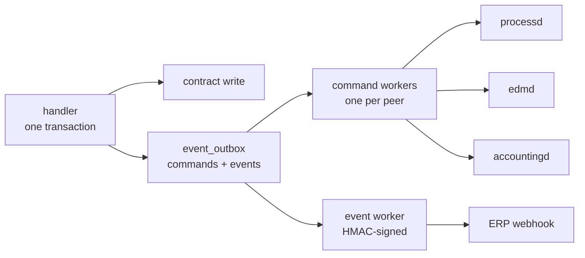
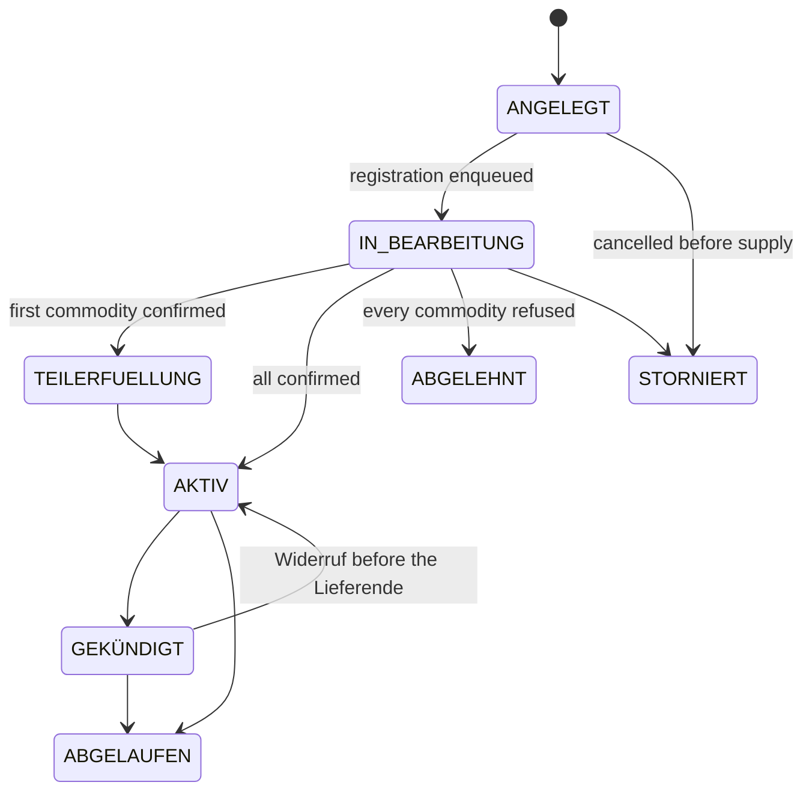

+++
title = "vertragd Operator Guide"
description = "Operator guide for vertragd, contract and customer management: B2C and B2B Verträge, Rahmenverträge, Kündigungsfristen and §41 EnWG price-change duties."
weight = 35
+++
`vertragd` is the **customer registry and retail contract lifecycle engine** for
both B2C (private households) and B2B (commercial, RLM) customers. It owns the
chain from customer identity to supply contract to billing-account provisioning,
and it is the single authorization gateway between OIDC identities and MaLo IDs.

The operator holds the **LF** role. A [MaLo](@/docs/architecture/domain-model.md#market-objects-objekte)
is what a supply contract is about. "Dispatched to MaKo" means a UTILMD sent by
[`processd`](@/docs/services/processd.md) and [`makod`](@/docs/services/makod.md);
`vertragd` speaks no EDIFACT.

Port: **`:9780`** · PostgreSQL · OIDC/JWT on every route

## The rules live in one module

Every deadline is a pure function in `src/domain.rs` (no HTTP, SQL or clock),
chosen by contract type and customer:

| Rule | Source | Value |
|---|---|---|
| Kündigung Grundversorgung | § 20 Abs. 1 StromGVV / GasGVV | 2 Wochen, jederzeit |
| Kündigungsbestätigung | § 41 Abs. 8 Nr. 2 EnWG, § 20 Abs. 2 GVV | unverzüglich, Textform |
| Kündigung Sondervertrag | Vertrag, gedeckelt durch § 309 Nr. 9 lit. c BGB | ≤ 1 Monat für Verbraucher |
| Sonderkündigung Preisanpassung | § 41 Abs. 5 Satz 4 EnWG, § 5 Abs. 3 GVV | fristlos zum Wirksamwerden |
| Sonderkündigung Umzug | § 41b Abs. 5 EnWG | 6 Wochen (Haushaltskunden) |
| Preisänderungsanzeige Sondervertrag | § 41 Abs. 5 Satz 2 EnWG | 1 Monat (Haushaltskunde) — ein **Kalendermonat** nach § 188 Abs. 2 BGB, kein 30-Tage-Fenster; sonst 2 Wochen |
| Preisänderungsanzeige Grundversorgung | § 5 Abs. 2 StromGVV / GasGVV | 6 Wochen, nur zum Monatsersten |
| Erstlaufzeit Verbrauchervertrag | § 309 Nr. 9 lit. a BGB | ≤ 24 Monate |
| Stillschweigende Verlängerung | § 309 Nr. 9 lit. b BGB | nur unbefristet, ≤ 1 Monat kündbar |
| Ersatzversorgung | § 38 Abs. 4 EnWG | endet spätestens nach 3 Monaten |

### Two stored facts pick the column

- **`versorgungsvertraege.vertragsart`** — `GRUNDVERSORGUNG`,
  `ERSATZVERSORGUNG` or `SONDERVERTRAG`. An unrecognised value reads as
  `SONDERVERTRAG`, the regime with the least statutory privilege, so a typo
  cannot silently claim Grundversorgungs-Fristen.
- **`kunden.haushaltskunde`** — § 3 Nr. 57 EnWG, deliberately not `kundentyp`:
  a commercial customer under 10 000 kWh a year is a Haushaltskunde. It defaults
  to `kundentyp == "B2C"` and is correctable.

### The Verbraucher status reaches accountingd

`versorgungsvertraege.verbraucher` (§ 13 BGB — a Verbraucher concludes the
contract for purposes „die überwiegend weder ihrer gewerblichen noch ihrer
selbständigen beruflichen Tätigkeit zugerechnet werden können") is set on
`POST /kunden/{id}/vertraege` and is neither `kundentyp` nor `haushaltskunde`.
When the NB confirms a component, a durable outbox command sends it to
accountingd's `PUT /accounts/{malo_id}/verbraucher`, as `null` when unrecorded;
accountingd admits that route to the principal `vertragd` alone, so its
`[[oidc.service_keys]]` entry for vertragd must carry that name. accountingd charges the § 288 Abs. 2
BGB rate (Basiszinssatz + 9 Prozentpunkte) and the Abs. 5 Pauschale only on
`false`.

### What the `rechnungsempfaenger` block tells billing about e-invoicing

`GET /vertraege/by-malo/{id}`, `GET /rahmenvertraege/{id}/malos` and
`GET /ggv/{ggv_id}/betreiber` name the party the invoice is addressed to, and
carry beside the address the facts § 27 Abs. 38 UStG turns on — read off that
party's `kunden` row, never off the contract:

| Field | Source | Unrecorded |
|---|---|---|
| `unternehmer` | the Rechnungsempfänger's own `kundentyp`: `B2C` no, `B2B_*` yes (§ 14 Abs. 2 Satz 2 Nr. 1 UStG) | — always answered |
| `zustimmung_sonstige_erechnung` | `kunden.zustimmung_sonstige_erechnung` — Zustimmung to another electronic format (§ 27 Abs. 38 Nr. 1/2 UStG) | `null`, refuses that grace |
| `edi_zustimmung` · `edi_extrahierbar` | `kunden.edi_*` — the EDI agreement, and whether its data extract into EN 16931 (§ 14 Abs. 1 Satz 6 Nr. 2 UStG) | `null`, refuses the EDI route |

All three are set through `POST /kunden` and `PUT /kunden/{id}`; an absent
field on `PUT` keeps the stored value.

## Nothing is dispatched from a detached task

A Lieferbeginn, a Schlussablesung and a billing account are obligations, so the
*intent* is written in the same transaction as the contract change and workers
perform it afterwards:



Every service-to-service call — `LIEFERBEGINN`, `LIEFERENDE`,
`ABLESUNG_BEGINN`, `ABLESUNG_ENDE`, `ABRECHNUNGSKONTO` — is a
`mako_service::outbox` command in `event_outbox`, keyed
`{tenant}/{dedupe_key}` and delivered under the shared policy (8 attempts,
30 s × 4ⁿ capped at 2 h, then dead-lettered; a 4xx other than 429 dead-letters
at once). The key makes the enqueue exactly-once: a repeatable action keys on
what makes it distinct (`ABLESUNG_ENDE:{komp}:{geplant_am}`), a one-shot one
does not (`LIEFERBEGINN:{komp}`).

**A delivered call is never repeated**: the
follow-up write (the component `ANGEMELDET` with processd's `process_id`, the
edmd reading order on the component) runs in a savepoint of the transaction
that marks the delivery done, and a failure there is recorded in the row's
`last_error`, not retried as a second UTILMD 55001. A Stornierung or a
withdrawn Kündigung parks the commands not yet delivered.

The same table carries every `de.mako.vertrag.*` CloudEvent, statutory notices
included. A crash costs a retry, never an obligation; what retries could not
discharge is the operator's queue:

```bash
curl -s http://vertragd:9780/api/v1/outbound/dead
curl -X POST http://vertragd:9780/api/v1/outbound/dead/{id}/retry
```

## Authentication

Every REST route extracts `Claims`, which also rejects a token whose
`mako_tenant` is not this deployment's (generic `401`, mismatch logged at
`WARN`). The two webhook routes (`POST /api/v1/events`,
`POST /api/v1/webhooks/angebot`) are authenticated by the Standard Webhooks
signature over the raw body. `vertragd` refuses to start without **both**
`[oidc]` and `inbound_secret` unless `allow_insecure_no_auth = true`.

`billingd` and `portald` read contract data with an `[[oidc.service_keys]]`
credential.

## Authorization

`policies/vertragd.cedar` states 35 actions over two kinds of principal:
**operators** (staff and peer services) carry a market role — `LF`, `MSB`, `ESA`
or `ADMIN`; **portal customers** carry none. Two actions are customer-scoped and
need no role: `authenticate-portal-identity` and `read-own-portal-identity`
(the `by-sub` lookup of the caller's own subject). Every other action needs a
market role and a matching tenant.

> **Deployment invariant: the portal IdP realm must not issue `mako_roles`.** An
> IdP that puts a market role on a customer token makes that customer an operator
> of this service, with reach across every customer in the tenant.

### The 35 actions

Each is checked with `authorize(&enforcer, &claims, …)` in its handler; the
policy reads only `context.*`. A denial is a `403`.

| Action | Routes |
|---|---|
| `authenticate-portal-identity` ᶜ | `GET /kunden/authenticate` |
| `read-own-portal-identity` ᶜ | `GET /kunden/by-sub/{sub}`, own subject only |
| `read-kunde` | `GET /kunden[/{id}]`, `/{id}/person`, `/{id}/portfolio`, `/by-sub/{sub}` for a foreign subject |
| `write-kunde` | `POST /kunden`, `PUT /kunden/{id}`, `PUT /kunden/{id}/person` |
| `read-zahlungsinformation` · `write-zahlungsinformation` | `GET` / `PUT /kunden/{id}/zahlungsinformation` |
| `read-portal-identitaeten` | `GET /kunden/{id}/identitaeten` |
| `manage-portal-identitaeten` | `POST /kunden/{id}/identitaeten`, `DELETE …/{sub}` |
| `export-kunde` | `GET /kunden/{id}/export` (DSGVO Art. 15/20) |
| `anonymize-kunde` | `POST /kunden/{id}/anonymize` (DSGVO Art. 17) |
| `read-vertrag` | every contract `GET` — `/malo/{id}/produkte`, `/malo/{id}/sect14a`, `billing-candidates`, `expiring`, `by-malo`, Kündigungsfrist, Preisgarantie |
| `create-vertrag` | `POST /kunden/{id}/vertraege` |
| `kuendigen-vertrag` | `POST /vertraege/{id}/kuendigen`, `/widerruf-kuendigung` |
| `stornieren-vertrag` | `POST /vertraege/{id}/stornieren` |
| `tarifwechsel-vertrag` | `POST /vertraege/{id}/tarifwechsel` |
| `write-preisgarantie` | `PUT /vertraege/{id}/preisgarantie` |
| `write-netzentgeltmodule` | `POST /malo/{id}/sect14a` |
| `read-rahmenvertrag` | `GET /rahmenvertraege[/{id}[/malos]]`, `GET /kunden/{id}/rahmenvertraege` |
| `create-rahmenvertrag` | `POST /kunden/{id}/rahmenvertraege` |
| `kuendigen-rahmenvertrag` | `POST /rahmenvertraege/{id}/kuendigen` |
| `read-stammdaten` · `write-stammdaten` | `GET` / `PUT` of `/ggv/{id}/betreiber`, `/aggregatorvertraege`, `/messstellenvertraege/{melo}/{msb}` |
| `bestellen` | `POST /bestellungen` |
| `annehmen-bestellung` | `POST /bestellungen/{id}/annehmen`, `/ablehnen` |
| `read-bestellung` | `GET /bestellungen/{id}/nachweis` |
| `widerrufen` | `POST /vertraege/{id}/widerruf`, `POST /bestellungen/{id}/widerruf` |
| `pflegen-rechtsdokument` · `read-rechtsdokument` | `PUT /rechtsdokumente/{art}` / `GET /rechtsdokumente/{sha256}` |
| `read-outbound-tasks` | `GET /outbound/dead` |
| `retry-outbound-task` | `POST /outbound/dead/{id}/retry` |
| `use-mcp` | the whole `/mcp` surface, gated once by the shared `McpAuth` middleware rather than per tool |
| `read-policy` | `GET /api/v1/policy` — the operator policy report, checked by the shared `mako_service::einrichtung` router |
| `read-config` | `GET /admin/einrichtung` — the configuration findings, checked by the same router |
| `manage-subscription` | `/api/v1/webhooks/endpoints/**` and the MCP tools `list_webhook_endpoints` / `list_webhook_deliveries` — LF and ADMIN only, checked by the shared `mako_service::subscriptions` routes |
| `read-events` | `GET /api/v1/events` — the outbox as a feed, checked by the same module |

ᶜ = customer-scoped: tenant equality only, no market role.

`use-mcp` is an operator's grant (the tools read profiles and bank details
across the tenant), so an `[mcp]` key needs `api_key_roles` (or `roles` on a
named key) naming LF, MSB, ESA or ADMIN.

There is no job-function split (`mako_roles` carries market roles only);
`anonymization_log` and `preisgarantie_override_log` keep erasures and price-lock
overrides attributable.

## Data model

```text
Kunde (B2C: Haushalt/SLP, B2B: Unternehmen/RLM/HV)
├── N × KundenIdentitaet   OIDC portal users; 1:1 for B2C, 1:N for B2B
├── [B2B] Rahmenvertrag    shared pricing, Sammelrechnung, indexation, angebot_id
│    └── N × Versorgungsvertrag        one per site
│          └── N × Vertragskomponente  one per commodity
└── [B2C] Versorgungsvertrag
       └── N × Vertragskomponente
```

`vertrags_nr` and `rahmenvertrag_nr` come from a sequence (§ 41 Abs. 1 Nr. 1
EnWG).

**A component names its Bilanzkreis** (`bilanzkreis`): which Bilanzkreis a
supply runs in is the Lieferant's choice per contract. A Strom Bilanzkreis is an
X-type EIC with its check character; a Gas one is the code its
Marktgebietsverantwortlicher issues; a component that is no supply carries
none. Without one, processd fills in the single `standard` entry of the
contract's Sparte in its `[[lf.bilanzkreise]]` and refuses the Anmeldung (`MISSING_BILANZKREIS`) when it
lists none or several — the UTILMD AHB Strom 2.2 Kap. 5.3 makes the Bilanzkreis
Muss on a 55001, so the refusal is dead-lettered for the operator rather than
sent.

**A gas component states what its Anmeldung NN 44001 carries.** UTILMD AHB
Gas 1.2 Kap. 5.6 makes the Lieferant's contract facts Muss, so a GAS component
registered at the NB (it names `malo_id` and `nb_mp_id`) is refused on
creation — `422 anmeldedaten_unvollstaendig`, each fact in `fehlend` — unless
the contract states every one:

| Fact | Where vertragd holds it | Segment |
|---|---|---|
| Transaktionsgrund | component `lieferbeginn_anlass`: `WECHSEL` (`E03`), `UMZUG` (`E01`), `NEUANLAGE` (`E02`), `ENDE_ERSATZVERSORGUNG` (`ZD2`) | `SG4 STS+7` (S. 45) |
| Abrechnungsintervall des LF | contract `abrechnungszyklus` → 1, 3, 6 or 12 Monate | `SG6 DTM+Z20` (S. 48) |
| Gruppenzuordnung | the Kunde's `haushaltskunde` | `SG10 CCI+++Z15`/`Z18` (S. 51) |
| Netznutzungsvertrag, Zahler | component `netznutzungsvertrag` (`LIEFERANT_NB`/`KUNDE_NB`), `netznutzung_zahler` (`LIEFERANT`/`KUNDE`, the latter beside `KUNDE_NB` only) | `CAV+Z74`, `CAV+Z73` (S. 52) |
| Gemeinderabatt | component `gemeinderabatt_prozent`, 0 to 10 | `SEQ+Z12 QTY+Z16` (S. 55) |
| Kunde, Korrespondenzanschrift, Ablesekarte | the Kunde's BO4E `Geschaeftspartner` (or `Person`) name and address; without an address of his own the contract's `standort_adresse`, as Bedingung `[556]` has the Marktlokation's address stand in | `SG12 NAD+Z09`/`Z04`/`Z05` (S. 63–65) |

The Ablesekarte goes to the contract's Kunde: the contract names no other
addressee. No Messlokation is asked for — the 44001 names the Marktlokation
alone in `SG5 LOC+172`.

**Every other component states what its Anmeldung 55001 carries.** A STROM
(or other non-GAS) component registered at the NB goes out as `start-supply`,
and UTILMD AHB Strom 2.2 Kap. 8.2 makes these Muss — refused on creation the
same way, `422 anmeldedaten_unvollstaendig`, unless the contract states each:

| Fact | Where vertragd holds it | Segment |
|---|---|---|
| Transaktionsgrund | component `lieferbeginn_anlass`: `WECHSEL` (`E03`) or `UMZUG` (`E01`) — the 55001 admits no other | `SG4 STS+7` (S. 73) |
| Gruppenzuordnung | the Kunde's `haushaltskunde` | `SEQ+Z01 CCI+++Z15`/`Z18` (S. 83) |
| Grundlage nach EnFG | component `enfg_grundlage` (`ZF9`, `ZG0`, `ZG1`) and, beside `ZF9` only, `enfg_grund` (`ZU5` … `ZV3`) | `SEQ+Z75 CCI+Z61`, `CAV` (S. 85) |
| Kunde, Korrespondenzanschrift | the Kunde's name and address, as for the 44001 | `SG12 NAD+Z09`/`Z04` (S. 86) |

The Lieferbeginn and Lieferende bodies are processd's request types field
for field, pinned by `tests/it/processd_supply_contract.rs`. `vertragsart`,
`kuendigung_grund`, `lieferbeginn_anlass`, `netznutzungsvertrag`,
`netznutzung_zahler`, `enfg_grundlage`, `enfg_grund` and the outbound task
`kind` are `CHECK`-constrained and held to their Rust enums or code lists in
both directions by `tests/it/schema_enum_guard.rs`.

### Contract status



The status is derived from the component statuses and never leaves a terminal
state. `ABGELEHNT` (the NB refused) and `STORNIERT` (cancelled) are different
answers.

### "In supply" and "billable" are different questions

A component is **in supply** from `BESTAETIGT`. A period is **billable** in
every state except `ABGELEHNT` and `STORNIERT`. `KOMPONENTE_BILLABLE` is that
list, shared by the price feed `billingd` bills from, the § 40 Abs. 1 contract
facts and the BG-7 recipient lookup; a source-scanning test pins them to it.

## Portal authorization (OIDC → MaLo)

`vertragd` decouples the **legal entity** (Kunde) from **portal users**
(KundenIdentitaeten). A B2B company has one Kunde record and N employee logins.

```text
Customer calls portald /api/v1/portal/{malo_id}/…
  → portald forwards the customer's Bearer token to
    GET vertragd /api/v1/kunden/authenticate?malo_id={malo_id}
     → 200 { kunden_id, kundentyp, malo_id }  or  403
```

**`standort_filter` is the one restriction an identity carries.** It narrows
an identity to the MaLos whose `standort_bezeichnung` matches, on every read
that returns customer data, the per-request check included. An identity has no
role: every identity of a Kunde sees the same data within its site scope, and an
upsert body carrying a `rolle` key is refused as an unknown field. Finer gating
by function belongs in the portal.

Every "not authorized" outcome of `GET /api/v1/kunden/authenticate` — unknown
subject, no customer, a MaLo not owned or outside the `standort_filter` — is the
**same `403`**, so a token holder cannot probe which subjects and MaLo-IDs exist
(DSGVO Art. 32). `portald`, `billingd`
and `accountingd` keep no customer↔MaLo map of their own.

## Kündigung

The notice period comes from the **reason**, not from the contract record, so
the API answers what is possible before it is asked to do it:

```bash
curl -s http://vertragd:9780/api/v1/vertraege/{id}/kuendigungsfrist
```

```json
{
  "vertragsart": "GRUNDVERSORGUNG",
  "haushaltskunde": true,
  "eingang": "2026-09-01",
  "fristen": {
    "ORDENTLICH":         { "fruehestens": "2026-09-15", "frist": "2 Wochen",
                            "rechtsgrundlage": "§ 20 Abs. 1 StromGVV / GasGVV" },
    "UMZUG":              { "fruehestens": "2026-10-13", "frist": "6 Wochen",
                            "rechtsgrundlage": "§ 41b Abs. 5 EnWG" },
    "PREISANPASSUNG":     { "fruehestens": "2026-09-01",
                            "frist": "fristlos zum Wirksamwerden der Änderung",
                            "rechtsgrundlage": "§ 5 Abs. 3 StromGVV / GasGVV" },
    "LIEFERANTENWECHSEL": { "fruehestens": "2026-09-15", "frist": "2 Wochen" }
  }
}
```

`processd` asks through `GET /api/v1/vertraege/by-malo/{malo_id}`, which returns
the contract with `naechstmoeglicher_kuendigungstermin`. `?stichtag=` is the
date the 55016 arrived, because `E_0614` Prüfschritt 70 measures „unter
Berücksichtigung des **Eingangsdatums der Kündigung**".

`?kunde=<Name>` answers `E_0624` Prüfschritt 50 („Ist der Kunde aus der Anfrage
identisch mit dem Kunden beim LFA?") as `kundenidentitaet` (`IDENTISCH` /
`VERSCHIEDEN` / `UNKLAR`), comparing the **set** of normalised name tokens
(umlauts folded, Rechtsformzusätze dropped). `IDENTISCH` needs equal token sets
(it drives the Ablehnung `A32`); `VERSCHIEDEN` needs no similar token pair (it
drives `A34`, which releases the Marktlokation). Jaro-Winkler ≥ 0.90 or a Kölner
Phonetik match (`Meyer`/`Maier`) yields `UNKLAR`.

```bash
curl -X POST http://vertragd:9780/api/v1/vertraege/{id}/kuendigen \
  -H 'Content-Type: application/json' \
  -d '{"lieferende":"2026-10-13","grund":"UMZUG","eingang":"2026-09-01"}'
# → 202 { "status": "GEKÜNDIGT", "frist": "6 Wochen",
#         "rechtsgrundlage": "§ 41b Abs. 5 EnWG", "mako_dispatched": 1 }
```

A `lieferende` earlier than the rule allows is a **422 quoting the rule**.
Otherwise one transaction records the end date on each live component, enqueues
the Lieferende UTILMDs and the Schlussablesung (a task of its own, so a
`processd` outage cannot cost the reading), sets `vertragsende` and
`kuendigung_zum`, clears `auto_renewal`, and emits `de.mako.vertrag.kuendigung` with
the § 41 Abs. 8 Nr. 2 EnWG Textform confirmation. `eingang` records when the
Kündigung was received, since the notice period runs from receipt.

The Abmeldung — Strom 55004, Gas 44004 — states the `grund` as its `SG4 STS+7`
Transaktionsgrund, which both columns make Muss: `UMZUG` is `E01` „Ein-/Auszug
(Umzug)", every other reason `ZT5` „Ende wegen Kündigung durch Kunde/LFN"
(UTILMD AHB Strom 2.2 Kap. 5.4, S. 166; UTILMD AHB Gas 1.2 Kap. 5.5, S. 41).
makod adds the Strom Lokationsart from the MaLo.

Supply continues until the Lieferende: the daily worker ends the components then
and closes the contract with `de.mako.vertrag.abgeschlossen`.

### Kündigung beim Vorversorger

A new supplier may terminate the customer's old contract on their behalf —
the 55016 (Gas 44016), LFN → LFA, GPKE Teil 2 Kap. 1.2. An order or a contract
asks for it per component:

```json
"vorversorger": {
  "mp_id": "9900357000011",
  "kundennummer": "K-4711",
  "vollmacht": { "erteilt_am": "2026-11-20", "referenz": "sha256:…" }
},
"kuendigung_beim_vorversorger": { "zum": "2027-01-31" }
```

The Vollmacht is held, not sent („im Regelfall auf den Versand von Vollmachten
zu verzichten", GPKE Teil 1 Kap. 5): its date and reference are the proof,
stored on the component. The customer number travels only where an AHB has an
element for it — the 44016's `RFF+Z01`; the 55016 identifies by MaLo-ID alone.

GPKE recommends the Kündigung run first („empfiehlt es sich, den Use-Case
„Kündigung" generell einem Use-Case „Lieferbeginn" vorzuschalten", Teil 2
Kap. 1.2), so the contract enqueues the Kündigung and **holds** the Anmeldung.
The old supplier's Antwortcode decides what follows:

| Answer | Codes | The Anmeldung |
|---|---|---|
| Zustimmung | `E_0614` A03, A09, A12, A17; `E_3001` E15, Z44 | sent, no earlier than the end of the old contract |
| Kein Vertrag mehr | A04, A13, A18; Z29 | sent — there is nothing to terminate |
| Vertragsbindung | A05, A06, A14, A15; Z12 | `[policy] nach_kuendigungsablehnung` |
| Zustimmung mit Terminänderung | Z01 | held — mako does not read the new date from the answer |
| Everything else | A01, A08, A10, A16, A99; E14, Z34, A03, A04 | held |
| No answer within the Frist (1 WT Strom, 3 WT Gas) | — | sent; the Netzbetreiber's 55010 settles it |

A held Anmeldung waits for a person:
`POST /api/v1/vertraege/{id}/komponenten/{komp}/kuendigung-vorversorger/freigeben`
sends it (Cedar `create-vertrag`), `…/zurueckziehen` withdraws the component
(`stornieren-vertrag`); both record who and when, and answer `409
kuendigung_nicht_gehalten` when nothing is held. Each answer is announced as
`de.mako.vertrag.kuendigung-vorversorger.bestaetigt` or `…abgelehnt`, with the
code's `klasse` and the `reaktion` taken.

#### `[policy] nach_kuendigungsablehnung` {#policy-nach-kuendigungsablehnung}

| Value | Effect |
|---|---|
| `halten` (default) | a Vertragsbindung refusal holds the Anmeldung — the 24-hour switch does not shorten a binding contract |
| `anmelden` | the Anmeldung goes out anyway, and the old supplier's answer to the Netzbetreiber's 55010 decides |

### What the market writes back

- **The Zuordnung ends.** The Netzbetreiber's 55037 (Gas 44037) „Beendigung
  der Zuordnung" names its Grund and the Zuordnungsende (GPKE Teil 2 Kap.
  2.1.2 SD Lieferbeginn Nr. 10). vertragd sets that date as the Lieferende of
  every running component **whose `nb_mp_id` is the sender**, orders the
  Schlussablesung and announces `de.mako.vertrag.zuordnung.beendet` (`wechsel:
  true` on `E03`). A Meldung from another party, or without a date, changes
  nothing.
- **An Ersatzversorgung begins.** When this deployment accepts a 55013 as
  Ersatzversorgung, vertragd opens the contract: a Kunde named by the NB's
  informative `NAD+Z67` (where sent), `vertragsart = ERSATZVERSORGUNG`, three
  months from the Zuordnungsbeginn (§ 38 Abs. 4 Satz 1 EnWG), priced on
  `ersatzversorgung_produkt`, with no Anmeldung — the Netzbetreiber assigned
  it. Once per (MaLo, Zuordnungsbeginn), however often the outcome arrives.
  Without `ersatzversorgung_produkt` no contract is opened, and
  `--check-config` says so. A Gas 44013 opens no contract.

- **A new supplier gives notice.** A Lieferant's 55016 (Gas 44016)
  Kündigung for a Marktlokation this deployment supplies is announced as
  `de.mako.vertrag.kuendigung-neulieferant.eingegangen`, once per running
  component: the new supplier, `kuendigung_zum` or `naechstmoeglicher_termin`.
  The contract does not change. Whether the Kündigung is valid is the
  LF's answer (55017/55018), and the supply ends only when the Netzbetreiber's
  55037 ends the Zuordnung. It is the earliest moment a front end can win the
  customer back.

All three arrive as makod's process events, which marktd fans out to vertragd's
`POST /api/v1/events` (`[[subscriptions.endpoints]]` in marktd's
configuration, signed with vertragd's `inbound_secret`).

### Earliest Lieferbeginn

`GET /api/v1/lieferbeginn/fruehestens?sparte=STROM&verbraucher=true` answers
the earliest Lieferbeginn an order placed today may name, with each bound:

```json
{ "fruehestens": "2026-12-05", "stand": "2026-11-20",
  "grenzen": [
    { "regel": "vorlauf", "datum": "2026-11-24", "quelle": "BK6-24-174 GPKE Teil 2 Kap. 2.1.2 SD Lieferbeginn Nr. 1" },
    { "regel": "widerrufsfrist", "datum": "2026-12-05", "quelle": "§ 357a Abs. 2 Satz 1 Nr. 1 BGB" } ] }
```

`lieferbeginn_anlass` (only a Gas `WECHSEL` has a lead time of its own),
`lieferung_in_widerrufsfrist_verlangt` and `belehrung_angezeigt` refine it.
The order route and processd's Anmeldung check compute the same date.

### Widerruf and Stornierung

`POST /api/v1/vertraege/{id}/widerruf-kuendigung` reverts a Kündigung whose
Lieferende is still ahead and parks the queued Lieferende UTILMD and
Schlussablesung in the same transaction; one already sent to `processd` is
cancelled there and listed in `lieferende_bereits_versandt`. The Lieferende task
is keyed by component **and date**, so a re-issued Kündigung supersedes the old
one. `POST /api/v1/vertraege/{id}/stornieren` cancels a contract that never went
into supply and withdraws a queued registration (or cancels one already at
`processd`, saying which).

## Online Vertragsschluss

An online order becomes a contract only together with its **Bestellnachweis**:
„Ein Vertrag nach Absatz 2 kommt nur zustande, wenn der Unternehmer seine
Pflicht aus Absatz 3 erfüllt." (§ 312j Abs. 4 BGB). The front end — the
operator's website or a portal partner's — first freezes an Endkunden-Angebot
in [`productd`](@/docs/services/productd.md), then posts the order here. The
record holds what the consumer was shown immediately before the order (§ 312j
Abs. 2 BGB), the button label (Abs. 3), the documents shown by their SHA-256,
whether the Widerrufsbelehrung and the Wertersatz information were shown, and
whether the consumer expressly asked for supply to start inside the
Widerrufsfrist. It is stored as RFC 8785 JSON with its hash; a `CHECK` ties the
hash to the bytes and a trigger refuses any `UPDATE` or `DELETE`.

The schema holds the rule, whatever writes the row: a consumer contract with
`abschlussweg = 'ONLINE'` and no `bestellnachweis_id` and `vertragsschluss_am`
is refused by `vv_online_verbraucher_nachweis`. The generic `POST
/kunden/{id}/vertraege` cannot write `ONLINE` — its body has no such field, so
`Json` refuses it.

| Route | Cedar | What it does |
|---|---|---|
| `PUT /api/v1/rechtsdokumente/{art}` | `pflegen-rechtsdokument` | Registers a version of `AGB`, `WIDERRUFSBELEHRUNG`, `MUSTER_WIDERRUFSFORMULAR` or `DATENSCHUTZ` from `{ "text", "gueltig_ab" }`; `201` new, `200` when the bytes are already held. Append-only |
| `GET /api/v1/rechtsdokumente/{sha256}` | `read-rechtsdokument` | The bytes an order's hash names |
| `POST /api/v1/bestellungen` | `bestellen` | The order. `Idempotency-Key` header required once |
| `POST /api/v1/bestellungen/{id}/annehmen` · `/ablehnen` | `annehmen-bestellung` | The operator's decision under `mit_annahme`; `{ "bonitaet_ref" }` (opaque, stored, never read) / `{ "grund" }` |
| `GET /api/v1/bestellungen/{id}/nachweis` | `read-bestellung` | The record's canonical bytes, its stored hash and the hash recomputed from the bytes |
| `POST /api/v1/vertraege/{id}/widerruf` · `POST /api/v1/bestellungen/{id}/widerruf` | `widerrufen` | A consumer's Widerruf of an online contract or of an order not yet accepted |

All six actions are granted to `LF` and `ADMIN` only. A consumer's Widerruf
reaches the route through a service credential, never the customer's own
token.

### The order

`POST /api/v1/bestellungen` checks, before anything is stored: every element
the record must hold (all missing ones named in `fehlend`), the button label,
every document hash against `rechtsdokumente` (the `PREISBLATT` against the
offer's product version), the frozen offer `angebot_ref` names (`id`, `sha256`)
— its hash, validity and MaLo-ID and its earliest Lieferbeginn — and the facts
the Anmeldung needs. An offer priced on a front end's own price names its
contract price as the product
([productd](@/docs/services/productd.md#a-front-end-s-own-price-vertriebspreis)),
so the contract is billed at what the customer signed. Each refusal is a stable
`code`:

| Code | Status | When |
|---|---|---|
| `policy_nicht_gesetzt` | 409 | `[policy] vertragsschluss` is unset |
| `idempotency_key_missing` | 400 | no `Idempotency-Key` |
| `idempotency_key_reused` | 422 | the same key with another body |
| `idempotency_request_in_flight` | 409 | the first request under the key is still running |
| `bestellnachweis_unvollstaendig` | 422 | `fehlend: [...]` |
| `bestellbutton_nicht_zulaessig` | 422 | a label `bestellbutton_beschriftungen` does not admit |
| `dokument_unbekannt` | 422 | `unbekannt: [...]` — a hash no registered document has |
| `angebot_unbekannt` · `angebot_abgelaufen` · `angebot_hash_abweichend` | 422 | the offer |
| `malo_id_abweichend` | 422 | the order's MaLo-ID is not the offer's |
| `lieferbeginn_zu_frueh` | 422 | `fruehestens` — the offer's, the Anmeldung's lead time, or the Widerrufsfrist's below |
| `anmeldedaten_unvollstaendig` | 422 | `fehlend: [...]` — a fact the Anmeldung needs |
| `kunde_unbekannt` | 422 | `kunde.kunden_id` names no Kunde of this deployment |
| `sect14a_kombination_unzulaessig` · `sect14a_nur_strom` | 422 | the § 14a module set ([below](#the-ss-14a-enwg-module-state-lives-here-too)) |
| `vorversorger_fehlt` · `vorversorger_mp_id_ungueltig` · `vollmacht_in_zukunft` · `kuendigung_zum_vergangen` · `freitext_ungueltig` | 422 | the Kündigung beim Vorversorger ([above](#kundigung-beim-vorversorger)) |

A `422` is final for that body: sending it again tomorrow is refused again,
so a front end shows it to a person. The two `409`s pass — set the policy, or
wait for the first request — and are the ones to retry.

The answer names the `kunden_id`. A later order for the same person carries it
as `kunde.kunden_id` and concludes under that Kunde, whose stored data it
leaves as it is; without it every order creates a Kunde.

The same key with the same body answers the first response unchanged; a
hundred concurrent replays conclude one contract. Under `mit_bestellung` the
Bestellnachweis, the Bestellung, the contract, the Anmeldung's outbox command,
the documents' commands and the events commit in **one** transaction and the
answer is `201`; under `mit_annahme` it is `202` with the Bestellung
`EINGEGANGEN`, and the same conclusion runs at `/annehmen`.

Every online conclusion owes the § 41 Abs. 4 EnWG `VERTRAGSZUSAMMENFASSUNG`
and, for a Verbraucher, the § 312f Abs. 2 BGB `VERTRAGSBESTAETIGUNG` with the
Widerrufsbelehrung and the Muster-Widerrufsformular printed from the
registered bytes. Both are outbox commands to
[`outputd`](@/docs/services/outputd.md), drained by the outbound worker and
idempotent on `(kind, contract)`.

### `[policy] vertragsschluss` {#policy-vertragsschluss}

| Key | Options | Default |
|---|---|---|
| `vertragsschluss` | `mit_bestellung` — the frozen offer is binding and the click concludes the contract; `mit_annahme` — the order is the consumer's offer, the contract comes about at the operator's acceptance | **none**: unset, `POST /api/v1/bestellungen` refuses with `policy_nicht_gesetzt`; every other route is unaffected |
| `lieferbeginn_in_widerrufsfrist` | `nur_auf_verlangen` — without the consumer's express request the earliest Lieferbeginn is the day after the Widerrufsfrist ends; `immer` | `nur_auf_verlangen` |
| `bestellbutton_beschriftungen` | the admitted labels | `["zahlungspflichtig bestellen"]` — § 312j Abs. 3 Satz 2 BGB; any other wording is the operator's reading |

Which `vertragsschluss` applies is the operator's AGB; either way the
Widerrufsfrist starts „mit Vertragsschluss" (§ 356 Abs. 2 Nr. 2 BGB).
`nur_auf_verlangen` holds Lieferbeginn back because Wertersatz is owed only
when „der Verbraucher von dem Unternehmer ausdrücklich verlangt hat, dass mit
der Leistung vor Ablauf der Widerrufsfrist begonnen werden soll" (§ 357a Abs. 2
Satz 1 Nr. 1 BGB). Once it
is set, `productd_url`, `outputd_url` and `[absender] name` are required, and
`--check-config` names each one missing.

### Widerruf

The Frist is `mako_fristen::vorlauf::widerrufsfrist`: fourteen days (§ 355
Abs. 2 Satz 1 BGB) from the later of the Vertragsschluss and the Belehrung, the
end moved past a Sunday, Saturday or holiday (§ 193 BGB), and extinguished at
the latest twelve months and fourteen days after conclusion (§ 356 Abs. 4
Satz 1 BGB). The Belehrung is the order's day when the record proves it was
shown; otherwise the day `outputd` records the Vertragsbestätigung as
delivered; otherwise none, and only the cap runs. The **sending** decides
timeliness (§ 355 Abs. 1 Satz 5 BGB), so the body carries `abgesendet_am`.

A timely Widerruf, in one transaction: before Lieferbeginn the Anmeldung is
withdrawn on the Stornierung path (`wirkung: "STORNIERT"`); after it, supply
ends on the Lieferende path (`"LIEFERENDE"`) and the record states whether
Wertersatz is owed — only when it holds both the express request and the
Wertersatz information (§ 357a Abs. 2 Satz 1 Nr. 1 and Nr. 3 BGB). The contract
becomes `WIDERRUFEN`, and the § 356a Abs. 4 BGB `WIDERRUFSBESTAETIGUNG` and
`de.mako.vertrag.widerruf.eingegangen` are owed. A second timely Widerruf answers
`200` with the first. A late one is recorded, its receipt confirmed, and
refused `422 widerrufsfrist_abgelaufen` with the `frist`. A Widerruf of an
order not yet accepted closes it `WIDERRUFEN`. A contract not concluded online
by a Verbraucher answers `kein_online_vertrag` / `kein_widerrufsrecht`.

## Tarifwechsel

A Tarifwechsel changes price, not supply — no UTILMD, no MaKo status change.

`initiator` is required: `"LIEFERANT"` exercises a reserved change right, which
§ 41 Abs. 5 Satz 1 EnWG obliges it to announce and which gives the customer the
Sonderkündigungsrecht of Satz 4; `"KUNDE"` is an agreed change with neither.

For a supplier-initiated change ahead of its Wirksamkeit the API refuses:

| Refusal | Rule |
|---|---|
| Wirksamkeit inside the price-guarantee window | the contract's `preisgarantie_bis` (applies to every Tarifwechsel) |
| Wirksamkeit closer than the notice period | § 41 Abs. 5 Satz 2 EnWG / § 5 Abs. 2 GVV |
| Grundversorgungspreis mid-month | § 5 Abs. 2 StromGVV / GasGVV |

```bash
curl -X POST …/tarifwechsel -d '{"komp_id":"…","new_product_code":"STROM-PREMIUM-2027",
                                 "initiator":"LIEFERANT","wirksamkeit":"2026-09-05"}'
# → 422 { "error": "die Wirksamkeit wahrt die gesetzliche Ankündigungsfrist nicht",
#         "fruehestens": "2026-09-18", "frist": "1 Monat",
#         "rechtsgrundlage": "§ 41 Abs. 5 Satz 2 EnWG" }
```

An operator bypass of the price guarantee needs a documented customer waiver and
is logged in `preisgarantie_override_log`. A retroactive correction
(`wirksamkeit ≤ today`) applies immediately and is exempt from the notice rules.
Either way the change is one slice write in the contract's transaction.

### BO4E payloads cross the gate

`POST`/`PUT /kunden` (`geschaeftspartner`), `PUT /kunden/{id}/person`,
`/kunden/{id}/zahlungsinformation`, `/vertraege/{id}/preisgarantie` and
`POST /kunden/{id}/vertraege` (`standort_adresse`) all carry BO4E, and each runs
[the gate](@/docs/architecture/domain-model.md#the-bo4e-gate) before storing.

`geschaeftspartner` is a `Bo4e<Geschaeftspartner>`, and the `person`,
`zahlungsinformation` and `preisgarantie` bodies are the BO4E document itself,
read as `Bo4e<Person>`, `Bo4e<Zahlungsinformation>` and `Bo4e<Preisgarantie>`
(`cargo xtask check-request-bodies` refuses a raw `Value` in either place).
Each stores the canonical round-trip, so the strict-enum stage keeps an unknown
`anrede` or `zahlungsart` from becoming `"UNKNOWN"`.

Those three documents are also refused, `422` with `code: "bo4e.unknown_field"`
and the `paths`, when they carry a key BO4E does not define. The gate alone
keeps such a key under `_additional`, which suits a document a counterparty
sends; here it is a misspelling — `ibn` for `iban` would store a
Zahlungsinformation without an IBAN.

**A `geschaeftspartner` on a `PUT` replaces the stored document whole**; read it
first (`GET /kunden/{id}`, or `portald`'s `GET /portal/{malo}/kontakt`).

For a `Preisgarantie` the gate also checks the `zeitlicheGueltigkeit` period
that `preisgarantie_bis` is derived from.

### Which product a MaLo is on lives here

It is stored as valid-time slices on the component:

```text
[gueltig_von, gueltig_bis)   gueltig_bis is the first day NOT covered
```

`kp_no_overlap` (GiST) makes two products for one component on one day
unrepresentable, and half-open ranges make consecutive slices tile a billing
period exactly.

```http
GET /api/v1/malo/{malo_id}/produkte?from=2026-11-01&to=2026-11-30
```

```json
{
  "slice_count": 2,
  "fully_covered": true,
  "slices": [
    { "product_code": "STROM-ALT", "gueltig_von": "2026-11-01", "gueltig_bis": "2026-11-15",
      "jahresverbrauch_kwh": "3500.000" },
    { "product_code": "STROM-NEU", "gueltig_von": "2026-11-15", "gueltig_bis": "2026-12-01",
      "jahresverbrauch_kwh": "3500.000" }
  ]
}
```

`billingd` bills one leg per slice; [`productd`](@/docs/services/productd.md)
answers what each code costs on its own dates and does not know who is on it.

**`jahresverbrauch_kwh` rides with the slice**: the expected year the tariff was
agreed against (from the offer's `gesamtmengeangebotsteil`), which selects the
Preisstaffel. A tiered product without it is refused by `billingd`
(`422 TARIFSTAFFEL_OHNE_MENGE`).

**A future-dated Tarifwechsel is a slice that starts in the future.** Re-applying
the same change is idempotent; refused are a change dated behind a later slice,
and a same-date replay that flips `initiator` while the § 41 Abs. 5 notice is
still owed (it would drop the notice and the Sonderkündigungsrecht).

### The § 14a EnWG module state lives here too

Which BK8-22/010-A Netzentgelt modules the Anschlussnutzer holds — `MODUL_1`
(pauschal) or `MODUL_2` (prozentual) as the base, `MODUL_3` (zeitvariabel)
beside Modul 1 — is stored per component as valid-time slices
(`komponenten_sect14a`, `ks_no_overlap`):

```http
POST /api/v1/malo/{malo_id}/sect14a
{ "module": ["MODUL_1", "MODUL_3"], "gueltig_ab": "2026-11-15" }

GET /api/v1/malo/{malo_id}/sect14a?from=2026-11-01&to=2026-11-30
```

A new state ends the slice in force on `gueltig_ab`; a state dated behind a
later one is `409`. A combination the Festlegung does not offer is stored as
recorded — `billingd` refuses it when it bills, rather than the record dropping
a module. `billingd` selects the reductions it bills from this, never from the
product.

The customer chooses the module „gegenüber dem Lieferanten" when concluding
the contract (BK8-22/010-A, Begründung Rn. 148), so an order and a contract
carry it per Strom component as `sect14a: { "module": [...] }`. It is recorded
from the Lieferbeginn, in the contract's transaction. Intake admits only the
three sets the Festlegung offers — Modul 1, Modul 2, Modul 1 with 3 —
(`422 sect14a_kombination_unzulaessig`) and only on Strom
(`sect14a_nur_strom`). Nothing about the module is sent to the Netzbetreiber:
no binding UTILMD element carries it.

## DSGVO

### Art. 15 / Art. 20 — access and portability

`GET /api/v1/kunden/{id}/export` returns Kunde, Person, Zahlungsinformation,
portal identities, contracts and components; any failing read fails the export.
Beside them it states `datenuebertragbarkeit` — which of those categories form
the Art. 20 document — and `automatisierte_entscheidungen` — the Art. 15
Abs. 1 lit. h statement — each entry with the reading it was decided under.

### `[policy.dsr]` {#policy-dsr}

Two questions the DSGVO text leaves to the data protection officer, set per
category and per process:

| Key | Default | Reading |
|---|---|---|
| `portabel.<kategorie>` | `true` | Whether the category counts as *bereitgestellt* under Art. 20 Abs. 1 DSGVO and so belongs to the Art. 20 document. Categories: `kunde`, `person`, `zahlungsinformation`, `identitaeten`, `vertraege`, `komponenten` |
| `automatisiert.<prozess>` | `true` | Whether the Auskunft states the process as an automated decision under Art. 15 Abs. 1 lit. h i. V. m. Art. 22 Abs. 1 DSGVO. Processes: `mahnwesen`, `sperreskalation` |

Both default to `true` because stating more than a reading requires cannot
breach Art. 15 or Art. 20, and stating less can. An unknown category or
process is refused at startup.

```toml
[policy.dsr.portabel]
zahlungsinformation = false

[policy.dsr.automatisiert]
mahnwesen = false
```

Each entry is logged at startup as `dsr.portabel.<kategorie>` /
`dsr.automatisiert.<prozess>` with its origin and source, served at
`GET /api/v1/policy` and by the MCP tool `get_policy`, and listed in
[Operator policy](@/docs/reference/operator-policy.md).

### Art. 17 — erasure

```bash
curl -X POST http://vertragd:9780/api/v1/kunden/{id}/anonymize \
  -d '{"requested_by":"dpo"}'
```

**`409` while supply runs**: the data is needed to perform the contract
(Art. 6 Abs. 1 lit. b DSGVO; Art. 17 Abs. 3 lit. b), and the response names the
contracts. `force` covers Art. 17 Abs. 1 lit. d and requires a `request_reason`.
One transaction then pseudonymises Geschäftspartner, Person,
Zahlungsinformation, VAT-ID, notes, supply address and every portal login (each
its own pseudonym). Contract rows survive without personal data for § 147 Abs. 3
AO; `anonymization_log` records what, by whom and why.

## Background workers

| Worker | Cadence | What it does |
|---|---|---|
| Outbound | per `mako_service::outbox` | One command worker each for processd, edmd and accountingd |
| Webhooks | per `mako_service::subscriptions` | Fans `de.mako.vertrag.*` out to every matching webhook endpoint, `default` (the ERP) included |
| Preisanpassung | daily | Sends the § 41 Abs. 5 notice for every scheduled Tarifwechsel whose notice is still owed, issues it as a document where `outputd` is configured, and logs at `ERROR` every change that took effect **without** its notice |
| Auto-renewal | daily | Announces the extension once per term, then applies it |
| Ablauf | daily | Ends supply whose Lieferende has passed and closes the contract behind it; announces a term or price guarantee running out, once per date |

The daily workers sleep **23 hours**, so a delayed run drifts earlier rather
than skipping a day; each holds its own advisory lock.

### The price-change notice

The notice goes out as soon as the change is scheduled: § 41 Abs. 5 Satz 2 EnWG
sets a floor, not a ceiling. The event carries the regime, whether the lead was
met, and the Sonderkündigungsrecht of Satz 4.

With `outputd_url` the notice is also rendered and delivered as a
`PREISANPASSUNG` document and its id stamped on the slice; the CloudEvent goes
out first either way. A missing `[absender]` or no customer on file makes the
document unissuable; the failure is recorded on the slice (`notif_versuche`,
`notif_letzter_fehler`) and retried. The document is issued before the event and
`preisanpassung_notif_sent` commit together; a crash re-issues, and `outputd`
returns the document it already recorded.

§ 41 Abs. 5 Satz 1 also wants the **Umfang** of the change:

| Deployment | Where the Umfang comes from | `preise[]` |
|---|---|---|
| `outputd_url` configured — `vertragd` renders the Preisänderungsanzeige | the `preise[]` lines *are* the document's content | **mandatory**; a supplier-initiated future change without them is refused at the API with § 41 Abs. 5 Satz 3 EnWG |
| No `outputd_url` — the CloudEvent *is* the notice | the ERP composing the letter states it from its own price sheets | optional; the event carries the lines when they are given and `umfang_vollstaendig: false` when they are not |

Retroactive corrections and customer-initiated switches need no lines. The lines
travel with the Tarifwechsel:

```bash
curl -X POST …/tarifwechsel -d '{
  "komp_id": "…", "new_product_code": "STROM-PREMIUM-2027",
  "initiator": "LIEFERANT",
  "wirksamkeit": "2026-11-01",
  "grund": "Gestiegene Beschaffungskosten und geänderte Netzentgelte.",
  "preise": [
    {"bezeichnung":"Arbeitspreis","einheit":"ct/kWh","bisher":"34.90","neu":"37.20"},
    {"bezeichnung":"Grundpreis","einheit":"EUR/Jahr","bisher":"143.88","neu":"131.40"}
  ]
}'
```

The caller supplies them: what a notice *said* is a fact about the notice, which
a later catalogue lookup cannot reproduce.

### The automatic extension

A **consumer** contract becomes **unbefristet** with at most a month's notice
(§ 309 Nr. 9 lit. b BGB); a **business** contract may take a further fixed term
(§ 310 Abs. 1 BGB). Each notice is tracked against the term or date it announces
(`autoerneuerung_notif_fuer`, `ablauf_notif_fuer`), so it is sent once.

## CloudEvents emitted

Twenty-one `de.mako.vertrag.*` types, all through `event_outbox` and all signed per
[Standard Webhooks](https://www.standardwebhooks.com/).
Each carries the `tenantid` and `correlationid` extensions. The seventeen contract
events carry `subject` = the Vertrags-UUID and `correlationid` repeats it, so a
consumer can join every event of one contract without parsing `data`. The four
order events below carry `subject` = the front end's `bestellreferenz` and
`correlationid` = the `bestellung_id`, so a sales partner finds its own order
by its own reference.

| `type` | When | Beyond `vertrag_id` |
|---|---|---|
| `de.mako.vertrag.aktiv` | Every component NB-confirmed | — |
| `de.mako.vertrag.lieferbeginn.bestaetigt` | The grid operator confirmed one component's Anmeldung | `vertrags_nr`, `kunden_id`, the caller's `erp_contract_id` / `bestellreferenz`, `komp_id`, `sparte`, `malo_id`, `lieferbeginn` |
| `de.mako.vertrag.lieferbeginn.abgelehnt` | The grid operator refused it | the same, plus `antwortcode`, the `codeliste` that defines it, and `reason` |
| `de.mako.vertrag.ersatzversorgung.begonnen` | An Ersatzversorgung contract was written | the component, `ende`, `kunde_name`, `quelle` (`55013` or `api`) |
| `de.mako.vertrag.zuordnung.beendet` | The Netzbetreiber ended this supplier's Zuordnung (55037/44037) | the component, `zuordnungsende`, `grund`, `wechsel`, `netzbetreiber` |
| `de.mako.vertrag.kuendigung-vorversorger.bestaetigt` | The previous supplier confirmed the Kündigung | the component, `vorversorger_mp_id`, `kuendigung_zum`, `antwortcode`, `codeliste`, `reaktion` |
| `de.mako.vertrag.kuendigung-vorversorger.abgelehnt` | It refused | the component, `vorversorger_mp_id`, `antwortcode`, `codeliste`, `reason`, `klasse`, `reaktion` |
| `de.mako.vertrag.kuendigung-neulieferant.eingegangen` | A new supplier's Kündigung (55016/44016) arrived for a running component; nothing changes | the component, `neulieferant`, `kuendigung_zum`, `naechstmoeglicher_termin` |
| `de.mako.vertrag.kuendigung` | A Kündigung is accepted and the Lieferende dispatched | `lieferende`, `grund`, `frist`, `rechtsgrundlage`, and the § 41 Abs. 8 Nr. 2 EnWG `kuendigungsbestaetigung` block |
| `de.mako.vertrag.gekuendigt` | One child of a Rahmenvertrag-Kündigung cascade | as above, plus `rahmenvertrag_id` / `rahmenvertrag_nr` |
| `de.mako.vertrag.kuendigung-widerrufen` | `POST /widerruf-kuendigung` reverted a Kündigung still ahead of its Lieferende | — |
| `de.mako.vertrag.abgeschlossen` | The daily Ablauf worker ended the last component | `status: "ABGELAUFEN"` |
| `de.mako.vertrag.tarifwechsel` | A product change effective **today or earlier** | `komp_id`, `malo_id`, `old`/`new_product_code`, `wirksamkeit`, `initiator`, `sonderkuendigungsrecht` |
| `de.mako.vertrag.tarifwechsel-geplant` | The same change dated in the **future** — a slice that starts later, not a pending state | same payload, `geplant: true` |
| `de.mako.vertrag.preisaenderung.ankuendigung` | The § 41 Abs. 5 notice, sent as soon as the change is scheduled | the regime, `frist_gewahrt`, `umfang[]` + `umfang_vollstaendig`, `sonderkuendigungsrecht`, `dokument_id` |
| `de.mako.vertrag.preisgarantie-hinterlegt` | `PUT /vertraege/{id}/preisgarantie` stored or replaced a price lock | `preisgarantie_bis` |
| `de.mako.vertrag.autoerneuerung.ankuendigung` | 30 days before an automatic extension | `vertragsende`, `verlaengerung` (`UNBEFRISTET` with § 309 Nr. 9 lit. b BGB, or `BEFRISTET` with the new end) |
| `de.mako.vertrag.ablauf.ankuendigung` | 30 days before a `vertragsende` or a `preisgarantie_bis` | `faellig_am`, `auto_renewal`, `standort_bezeichnung` |

| `type` | When | `data` |
|---|---|---|
| `de.mako.vertrag.bestellung.eingegangen` | An order was recorded | `bestellung_id`, `bestellreferenz`, `bestellnachweis` (`id`, `sha256`), `eingegangen_am` |
| `de.mako.vertrag.bestellung.angenommen` | The contract came about — at the order under `mit_bestellung`, at `/annehmen` under `mit_annahme` | `bestellung_id`, `bestellreferenz`, `vertrag_id`, `vertrags_nr`, `vertragsschluss_am`, `widerrufsfrist` |
| `de.mako.vertrag.bestellung.abgelehnt` | `/ablehnen` refused an order | `bestellung_id`, `bestellreferenz`, `grund` |
| `de.mako.vertrag.widerruf.eingegangen` | A Widerruf was recorded, timely or late | `bestellung_id`, `bestellreferenz`, `vertrag_id`, `widerruf` (`rechtzeitig`, `frist`, `wirkung`, `lieferende`, `wertersatz_geschuldet`) |

Subscribe to `de.mako.vertrag.kuendigung` and `de.mako.vertrag.kuendigung-widerrufen`
together, or a revoked termination stays acted on.

The two `lieferbeginn` types are what a system that handed a contract over
waits for: one per component, with its own reference on it and a published
schema ([event catalog](@/docs/reference/events.md)). `de.mako.vertrag.aktiv` says
only that every component of a contract is confirmed.
`GET /api/v1/vertraege?erp_contract_id=` or `?bestellreferenz=` finds a
contract by that reference in any status, a refused one included; each
component then shows `abgelehnt_erc` and `abgelehnt_reason`. An
Antwortcode means what its Codeliste says and nothing else.

### Webhooks

vertragd delivers these events through the shared subscription module:
`erp_webhook_url` (signed with `erp_hmac_secret`) is the endpoint `default`,
and an integrator registers further endpoints, rotates their secrets, reads the
delivery log, replays a window and pages `GET /api/v1/events` on vertragd's own
port — the routes, signatures, ordering and retention are described once in
[Webhook subscriptions](@/docs/architecture/erp-integration.md#webhook-subscriptions).
Events of one contract share their `subject`, so they reach an endpoint in
commit order. `[subscriptions] retention_days` (default 30) bounds replay;
`allow_loopback` admits `http` and loopback receivers for `just dev` and is
reported as a warning.

## § 40b EnWG billing cadence

Every Versorgungsvertrag carries an `abrechnungszyklus` (`MONATLICH` /
`VIERTELJAEHRLICH` / `HALBJAEHRLICH` / `JAEHRLICH`, default annual). § 40b EnWG
obliges the supplier to offer the shorter cadences; the customer's choice is a
contract fact. `GET /api/v1/vertraege/billing-candidates` lists every active
supply component with its cadence and supply window, and billingd's billing-run
worker consumes it.

The feed accepts `BESTAETIGT` and `AKTIV` components, and — flagged
`beendet` — a `BEENDET` one for twelve weeks after its `lieferende`, also
under a contract already `ABGELAUFEN`: the period that ends with the supply is
owed an Abschlussrechnung (§ 40c Abs. 2 Satz 1 EnWG), and billingd decides
whether it already exists.

## § 41e EnWG Aggregatorverträge

VPP contracts between an Aggregator and a plant operator or Letztverbraucher,
the German transposition of Art. 17 RL (EU) 2019/944.
`PUT /api/v1/aggregatorvertraege/{sr_id}` maps an SR-ID to the agreed
Einsatzkosten and a validity window; `GET /api/v1/aggregatorvertraege` lists them. `billingd` reads them per dispatch and keeps no copy. The
contract carries no VAT rate: `billingd` taxes the settlement at the period's
statutory rate. An
`EXCLUDE USING gist` constraint makes two simultaneously active contracts per
resource unrepresentable, surfaced as a `409`.

## §§ 9, 10 MsbG Messstellenverträge

The contract a Messstellenbetreiber holds with the Anschlussnutzer for one
Messlokation. `GET`/`PUT /api/v1/messstellenvertraege/{melo_id}/{msb_mp_id}`;
`processd` reads it to answer a WiM Kündigung MSB out of `E_0200` and keeps no
copy.

WiM Strom Teil 1 Kap. 2.1.3 makes that Kündigung a contract-layer process
between the two MSB: the notice period binds a requested Termin (`Z12`), an
existing `kuendigung_zum` opens the Kap. 2.2.3 table (`Z34`), `beendet_am` is
`Z29`, no row is `ZC9`.

The `GET` returns the contract plus `naechstmoeglich`, the date a Kündigung
received on `?on=` could take effect. It is **derived** from
`kuendigungsfrist_monate` by the same [`domain`](#the-rules-live-in-one-module)
cap that governs a Versorgungsvertrag. `?haushaltskunde=false` opts out of the § 309 Nr. 9 lit. c BGB
one-month cap for a business customer.

`kunden_id` is optional: a gMSB under its Grundzuständigkeit (§ 3 MsbG) has no
named customer.

## § 42b EnWG GGV-Betreiber

The GGV operator is the LF's customer for the bundled Sammelrechnung (BG-7) and
has no MP-ID, so it lives here, not in `marktd`. `GET`/`PUT
/api/v1/ggv/{ggv_id}/betreiber` maps the `ggv_id` to a Kunde.

## Which contracts live here

A contract between two Marktpartner with MP-IDs (Netznutzungsvertrag
`nb_contracts`, MSB-Rahmenvertrag `msb_rahmenvertraege`) lives in
`marktd`; a contract with a Kunde on one side lives here. There is no
Einspeisevertrag: § 7 Abs. 1 EEG 2023 forbids making the EEG obligations
conditional on a contract, so the party record lives in
[`einsd`](@/docs/services/einsd.md) as `einspeiser`.

## Configuration

```toml
# vertragd.toml
tenant   = "9900357000004"   # data-isolation key (here: the operator's BDEW-Codenummer)
lf_mp_id = "9900357000004"   # market identity registered on the UTILMD

processd_url    = "http://processd:8580"
accountingd_url = "http://accountingd:9380"
edmd_url        = "http://edmd:8380"
edmd_api_key    = "env:VERTRAGD_EDMD_SERVICE_KEY"
# processd_api_key / accountingd_api_key likewise

# Optional: render § 41 Abs. 5 notices as PREISANPASSUNG documents.
outputd_url     = "http://outputd:9880"
# outputd_api_key = "env:VERTRAGD_OUTPUTD_KEY"

# The product an Ersatzversorgung accepted on a 55013 is priced on; without it
# none is opened (§ 38 Abs. 1 Satz 2 EnWG).
# ersatzversorgung_produkt = "STROM-ERSATZ"

# Required once [policy] vertragsschluss is set: the frozen Endkunden-Angebot.
# productd_url     = "http://productd:9080"
# productd_api_key = "env:VERTRAGD_PRODUCTD_KEY"

erp_webhook_url = "http://erp:8000/events"     # the webhook endpoint `default`
erp_hmac_secret = "env:VERTRAGD_ERP_HMAC_SECRET"
inbound_secret  = "env:VERTRAGD_INBOUND_SECRET"

max_identitaeten_per_kunde = 50

[http]
addr = "0.0.0.0:9780"

# § 126b BGB declarant on a rendered notice.
[absender]
name         = "Stadtwerke Musterstadt GmbH"
line1        = "Hauptstraße 1"
post_code    = "12345"
city         = "Musterstadt"
contact_name = "Kundenservice"

[database]
url = "postgresql://vertragd:secret@db:5432/vertragd"

[oidc]
issuer   = "https://auth.example.de/realms/mako"
audience = "vertragd"

# [mcp]
# api_key       = "env:VERTRAGD_MCP_API_KEY"
# api_key_roles = ["LF"]

# [subscriptions]                # see Webhooks
# retention_days = 30

# [policy]                       # see [policy] vertragsschluss
# vertragsschluss = "mit_bestellung"
# lieferbeginn_in_widerrufsfrist = "nur_auf_verlangen"
# nach_kuendigungsablehnung = "halten"

# [policy.dsr.portabel]          # see [policy.dsr]; every entry defaults to true
# zahlungsinformation = false
```

`tenant` is the isolation key, `lf_mp_id` the market identity on the UTILMD;
they differ in a shared install.

## MCP

22 read-only tools and 4 prompts at `/mcp`, behind OIDC or an `[mcp]` key. `compute_kuendigungsfrist` returns the earliest lawful end date for
**every** termination reason with the rule that produced it;
`check_mako_trigger_status` distinguishes a registration still waiting in the
outbound queue from one the NB has not answered. `search_kunden` finds a
customer by the start of any word of the name or of the Kundennummer, or by
the MaLo-ID of a Lieferstelle — at most 20 hits, answered from a trigram index
(`kunden.suchtext`), so a keystroke reads no table scan however many customers
the tenant holds. `kunden_zu_malos` names the customers of up to 200
MaLos in one statement — how a worklist page names its rows.
`list_webhook_endpoints` and `list_webhook_deliveries` are the agent twins of
the REST reads of the same name and need `manage-subscription`.

## Related

| | |
|---|---|
| [`portald`](@/docs/services/portald.md) | Customer portal; authorizes every request here |
| [`billingd`](@/docs/services/billingd.md) | Reads § 40 Abs. 1 facts, BG-7 buyers, § 40b candidates |
| [`productd`](@/docs/services/productd.md) | Product catalog — what a product code costs; which MaLo is on it stays here |
| [`processd`](@/docs/services/processd.md) | Runs the GPKE / GeLi Gas Lieferbeginn and Lieferende |
| [`edmd`](@/docs/services/edmd.md) | Beginn- and Schlussablesung reading orders |
